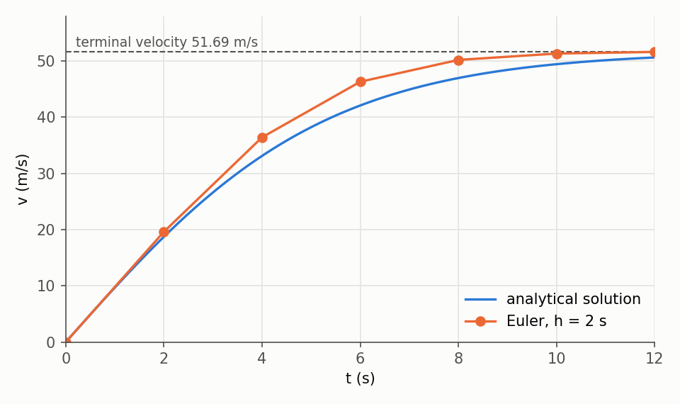
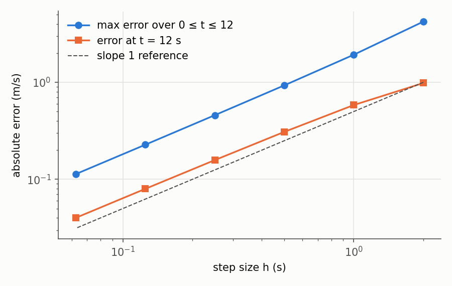
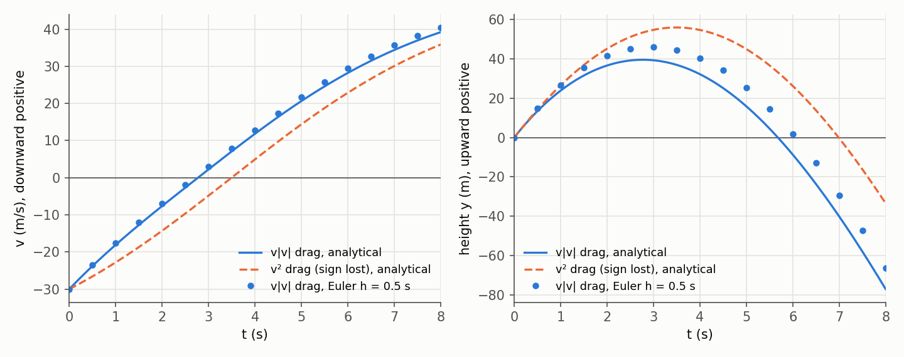

# 1장 — 수학적 모델링과 공학 문제 해결

[레포지토리 안내](../../README.ko.md) | [English](Concepts_Lecture.md) | [한국어](Concepts_Lecture.ko.md)

> **최종 수정일:** 2026-11-19
>
> Applied Numerical Methods with Python for Engineers and Scientists, Chapra and Clough, Ch 1

> **학습 목표:**
> 1. 공학에서 수학적 모델링의 역할과 보존 법칙이 모델의 기초가 되는 방식을 설명하고, 과도 계산과 정상 상태 계산을 구분할 수 있다
> 2. 수치 계산에서 오차의 원인을 식별할 수 있다
> 3. 오일러 방법으로 상미분방정식의 근사해를 단계별로 계산할 수 있다
> 4. 스텝 크기에 따른 정확도와 계산 비용의 트레이드오프를 설명할 수 있다
> 5. 이차 항력 모델의 해석해, 종단 속도, 낙하 거리를 유도하고 오일러 해와 비교할 수 있다
> 6. 테일러 전개로 오일러 방법의 국소 절단 오차와 전역 절단 오차의 차수를 설명할 수 있다

---

## 목차

- [1. 수학적 모델의 개념](#1-수학적-모델의-개념)
  - [1.1 정의와 일반적 형태](#11-정의와-일반적-형태)
  - [1.2 해석해와 수치해](#12-해석해와-수치해)
  - [1.3 보존 법칙](#13-보존-법칙)
  - [1.4 과도 계산과 정상 상태 계산](#14-과도-계산과-정상-상태-계산)
- [2. 뉴턴의 제2법칙: 번지 점프 예제](#2-뉴턴의-제2법칙-번지-점프-예제)
  - [2.1 시스템 설정과 힘의 균형](#21-시스템-설정과-힘의-균형)
  - [2.2 상미분방정식 유도](#22-상미분방정식-유도)
  - [2.3 해석해와 종단 속도](#23-해석해와-종단-속도)
  - [2.4 이차 항력 모델과 해석해](#24-이차-항력-모델과-해석해)
  - [2.5 낙하 거리](#25-낙하-거리)
  - [2.6 위로 출발하는 경우의 해석해](#26-위로-출발하는-경우의-해석해)
- [3. 오일러 방법: 수치해](#3-오일러-방법-수치해)
  - [3.1 핵심 아이디어: 유한 차분 근사](#31-핵심-아이디어-유한-차분-근사)
  - [3.2 단계별 계산](#32-단계별-계산)
  - [3.3 스텝 크기의 영향](#33-스텝-크기의-영향)
  - [3.4 이차 항력 모델의 오일러 해](#34-이차-항력-모델의-오일러-해)
  - [3.5 오일러 방법의 오차 분석](#35-오일러-방법의-오차-분석)
  - [3.6 컴퓨터 구현](#36-컴퓨터-구현)
  - [3.7 위로 출발하는 경우의 오일러 계산](#37-위로-출발하는-경우의-오일러-계산)
- [4. 수치적으로 풀 수 있는 공학 문제의 유형](#4-수치적으로-풀-수-있는-공학-문제의-유형)
- [요약](#요약)
- [점검 문제](#점검-문제)

---

<br>

## 1. 수학적 모델의 개념

### 1.1 정의와 일반적 형태

**수학적 모델(Mathematical Model)** 이란 물리적 시스템의 특성을 수학적 방정식으로 표현하는 공식화이다. 물리적 프로토타입을 제작하거나 실험에만 의존하는 대신, 실세계 현상을 수학의 언어로 변환하여 그 행동을 분석, 예측, 최적화할 수 있게 한다.

수학적 모델의 일반적 형태는 다음과 같다:

```math
\text{Dependent variable} = f(\text{independent variables},\ \text{parameters},\ \text{forcing functions})
```

- **종속변수(Dependent variable)**: 예측하거나 이해하고자 하는 양이다(예: 속도, 온도, 농도).
- **독립변수(Independent variables)**: 시스템이 변화하는 차원이다(예: 시간 $`t`$, 공간 좌표 $`x, y, z`$).
- **매개변수(Parameters)**: 주어진 상황에서 일반적으로 일정한 시스템의 속성이다(예: 질량 $`m`$, 항력 계수 $`c`$).
- **강제 함수(Forcing functions)**: 시스템에 작용하는 외부 영향이다(예: 중력, 인가 전압, 바람).

기호로는 종속변수를 $`y`$, 독립변수를 $`x`$, 매개변수를 $`\mu`$, 강제 함수를 $`g`$로 두어 $`y = f(x, \mu, g)`$로 간단히 쓴다. 2절의 번지 점프 모델에서는 속도 $`v`$가 종속변수, 시간 $`t`$가 독립변수, 질량 $`m`$과 항력 계수가 매개변수, 중력 가속도 $`g`$가 강제 함수이다. 같은 물리량이라도 문제에 따라 역할이 바뀔 수 있다. 예를 들어 측정한 속도로 항력 계수를 추정하는 문제에서는 항력 계수가 구하려는 미지수가 된다(4절의 근 문제).

수학적 모델은 현상의 모든 세부를 담지 않고, 풀려는 질문에 영향이 큰 요인만 남긴 **이상화(idealization)** 이다. 2절의 번지 점프 모델은 선수의 몸이 도는 운동, 바람, 고도에 따른 공기 밀도의 변화, 줄 자체의 질량을 버리고 중력과 항력만 남긴다. 이렇게 버린 요인이 구하려는 양에 주는 영향이 작다는 근거가 있을 때 이상화는 정당하며, 그 근거는 모델의 예측을 측정값과 비교하여 확인한다. 모델의 형태도 다양하다. 뉴턴의 제2법칙을 $`a = F/m`$으로 쓴 식은 가속도 $`a`$가 종속변수, 힘 $`F`$가 강제 함수, 질량 $`m`$이 매개변수이고 독립변수는 없는 대수식이다. 같은 법칙을 시간에 따라 변하는 속도에 적용하면 2절의 미분방정식이 되고, 구조물이나 유동을 잘게 나누어 나타내면 미지수가 수천 개인 연립 미분방정식이 된다. 형태가 복잡할수록 손으로 풀 수 있는 경우가 줄어든다.

### 1.2 해석해와 수치해

많은 실세계 공학 및 과학 문제는 해석적으로 풀 수 없다. 즉, 해를 항상 닫힌 형태의 식으로 구할 수 있는 것은 아니다. 이때 컴퓨터를 사용하여 근사해를 구하는 **수치 해법(Numerical Methods)** 이 필수적이다.

| 측면 | 해석해(Analytical Solution) | 수치해(Numerical Solution) |
|:-------|:-------------------|:-------------------|
| 형태 | 정확한 닫힌 형태 표현식 | 근사적 이산 값 |
| 적용 범위 | 단순하고 이상화된 문제 | 복잡하고 현실적인 문제 |
| 도구 | 펜, 종이, 기호 수학 | 컴퓨터, 알고리즘 |
| 예시 | $`v(t) = \frac{gm}{c}(1 - e^{-(c/m)t})`$ | 이산 $`t_i`$에서의 $`v`$ 값 테이블 |

*표 1. 해석해와 수치해의 비교*

> **참고:** 수치 해법은 해석적 방법을 대체하는 것이 아니라 보완하는 것이다. 해석해가 존재하면 수치 결과를 검증하는 기준으로 활용된다. 해석해가 존재하지 않을 때, 수치 해법이 종종 유일한 실용적 접근법이 된다.

모델은 늘 $`y = f(x)`$처럼 종속변수를 바로 계산하는 명시적 함수로 주어지지 않는다. 종속변수를 한쪽으로 분리할 수 없는 **음함수(implicit function)** 나, 종속변수의 변화율을 담은 **미분방정식(differential equation)** 으로 주어지는 경우가 많다. 앞의 경우의 예로, 질량과 낙하 시간과 측정 속도를 알 때 항력 계수를 구하는 문제는 $`v(t) = 36`$ m/s 같은 식을 항력 계수에 대해 정리할 수 없으므로 수치적인 근 찾기가 필요하다(5~6장). 뒤의 경우의 예로, 항력이 속도의 제곱에 비례하는 모델은 2.4절처럼 해석해를 구할 수 있지만, 항력 계수가 고도에 따라 바뀌거나 줄의 탄성력이 더해지면 닫힌 형태의 해가 없어 3절의 오일러 방법 같은 수치 해법으로만 풀 수 있다.

수치해를 쓸 때는 두 가지 질문을 함께 따져야 한다. 첫째는 수치해가 수학적 모델의 참 해에 얼마나 가까운가이며, 이는 스텝 크기와 알고리즘이 정하는 절단 오차와 컴퓨터의 유한 자릿수가 만드는 반올림 오차(4장)의 문제이다. 둘째는 수학적 모델이 실제 현상을 얼마나 잘 나타내는가이며, 이는 모델의 가정(예: 선형 항력과 이차 항력)과 매개변수 측정값의 정확도에 달려 있다. 수치 해법이 아무리 정확해도 모델 자체가 틀리면 결과는 현상을 설명하지 못한다.

수치 해법은 미분, 적분, 방정식 풀이 같은 문제를 덧셈, 곱셈, 비교, 분기 같은 단순한 연산의 유한한 반복으로 바꾸어 근사해를 얻는다. 3절의 오일러 방법이 도함수를 차분으로 바꾸어 미분방정식을 덧셈과 곱셈의 반복으로 만드는 것이 전형적인 예이다. 컴퓨터는 이런 연산을 빠르게 반복하므로, 수치 해법을 쓰면 해석해가 없는 비선형 방정식, 미지수가 많은 연립방정식, 복잡한 기하 형상도 다룰 수 있다. 라이브러리에 들어 있는 수치 해법을 쓸 때에도 원리를 알아야 한다. 스텝 크기가 너무 크거나 문제가 악조건이면(11장) 라이브러리도 부정확한 값을 그대로 돌려줄 수 있으며, 그 결과를 의심하고 원인을 찾으려면 방법이 어떤 근사를 쓰는지 알아야 하기 때문이다.

### 1.3 보존 법칙

공학에서 쓰는 모델의 상당수는 **보존 법칙(conservation law)** 에서 출발한다. 보존 법칙은 어떤 양이 계(system) 안에서 생성되거나 소멸되지 않고, 경계를 통한 유입과 유출 또는 내부의 변환에 의해서만 변한다는 원리이다. 일반형은 다음과 같다.

```math
\text{Change} = \text{increases} - \text{decreases}
```

시간에 따른 변화를 다루면 좌변은 변화율이 된다. 번지 점프 모델(2절)은 운동량에 대한 보존 법칙이다. 운동량의 변화율 $`d(mv)/dt`$가 증가 요인(중력)과 감소 요인(항력)의 차와 같다는 식이 곧 뉴턴의 제2법칙이다. 변화가 0이 되어 증가와 감소가 균형을 이루는 상태를 **정상 상태(steady state)** 라고 하며, 이때 보존 법칙은 $`\text{increases} = \text{decreases}`$가 된다. 종단 속도(2.3절)는 운동량 보존의 정상 상태이다.

| 분야 | 보존되는 양 | 정상 상태의 균형식 |
|:-----|:-----|:-----|
| 화학 공학 | 질량 | 반응기의 유입 질량 = 유출 질량 |
| 토목 공학 | 운동량 | 트러스 절점에서 수평력의 합 = 0, 수직력의 합 = 0 |
| 기계 공학 | 운동량 | 질량-스프링 계에서 각 질량의 힘의 합 = 0 |
| 전기 공학 | 전하 | 회로 절점에 들어오는 전류의 합 = 나가는 전류의 합 |
| 전기 공학 | 에너지 | 폐회로를 따라 전압 강하의 합 = 0 |

*표 2. 분야별 보존 법칙과 정상 상태의 균형식*

예를 들어 관 네 개가 만나는 접합부에서 물이 들어오는 관의 유량이 $`Q_1 = 32`$ L/s, $`Q_2 = 40`$ L/s이고 나가는 관 하나의 유량이 $`Q_3 = 50`$ L/s이면, 정상 상태의 질량 보존 $`Q_1 + Q_2 = Q_3 + Q_4`$에서 나머지 관의 유량은 $`Q_4 = 32 + 40 - 50 = 22`$ L/s이다. 접합부가 여러 개인 관망에서는 접합부마다 이런 균형식이 하나씩 생기므로, 여러 미지수에 대한 연립 선형 방정식(8\~12장)이 된다. 시간에 따라 변하는 경우에는 탱크의 물 부피 $`V`$에 대해 $`dV/dt = Q_{\text{in}} - Q_{\text{out}}`$처럼 미분방정식이 되며, 이는 22\~24장의 방법으로 푼다.

### 1.4 과도 계산과 정상 상태 계산

보존 법칙은 두 가지 방식으로 쓰인다. 첫째는 어떤 양이 시간에 따라 어떻게 변하는지를 예측하는 **과도 계산(transient computation)** 이고, 둘째는 변화가 0인 상태, 즉 증가와 감소가 균형을 이룬 상태를 구하는 **정상 상태 계산(steady-state computation)** 이다. 과도 계산은 미분방정식을 낳고, 정상 상태 계산은 대수 방정식을 낳는다. 1.3절의 관 접합부는 정상 상태 계산이고, 번지 점프의 속도 변화는 과도 계산이다. 과도 해가 오랜 시간 뒤에 한 값으로 다가가면 그 값이 정상 상태이다.

화학 공학의 완전 혼합 탱크로 두 계산을 비교한다. 부피 $`V = 50`$ m³인 탱크에 처음에는 깨끗한 물이 차 있고, 오염 물질 농도가 $`c_{\text{in}} = 8`$ g/m³인 물이 $`Q = 5`$ m³/min로 들어오며 같은 유량으로 나간다. 탱크 안이 완전히 섞여 있으면 나가는 물의 농도는 탱크의 농도 $`c`$와 같으므로, 탱크 안의 오염 물질 질량 $`Vc`$에 대한 보존 법칙은 다음과 같다.

```math
V\frac{dc}{dt} = Qc_{\text{in}} - Qc \quad\Longrightarrow\quad \frac{dc}{dt} = \frac{Q}{V}\left(c_{\text{in}} - c\right)
```

우변의 첫 항은 유입에 의한 증가, 둘째 항은 유출에 의한 감소이다. 정상 상태에서는 $`dc/dt = 0`$이므로 $`c = c_{\text{in}} = 8`$ g/m³이다. 과도 해는 변수 분리로 구한 $`c(t) = c_{\text{in}}(1 - e^{-(Q/V)t}) = 8(1 - e^{-0.1t})`$이며, $`t = 10, 20, 30`$ min에서 각각 5.0570, 6.9173, 7.6017 g/m³이다. 정상 상태 값의 95%에 이르는 시각은 $`e^{-0.1t} = 0.05`$에서 $`t = \ln 20/0.1 \approx 29.96`$ min이다.

이 식은 2.2절의 선형 항력 모델 $`dv/dt = g - (c/m)v = (c/m)(gm/c - v)`$과 같은 꼴이다. 농도 $`c`$는 속도 $`v`$에, 유입 농도 $`c_{\text{in}}`$은 종단 속도 $`gm/c`$에, 비율 $`Q/V`$는 $`c/m`$에 대응하며, 두 해는 모두 정상 상태 값에 지수적으로 다가간다. 물리적 분야가 달라도 보존 법칙이 같은 수학적 구조를 낳으므로, 한 가지 수치 해법으로 여러 분야의 문제를 똑같이 풀 수 있다.

탱크 안에서 오염 물질이 1차 반응으로 분해되어 단위 시간마다 $`kVc`$만큼 사라지면($`k = 0.02`$ /min) 감소 항이 하나 늘어 $`dc/dt = (Q/V)(c_{\text{in}} - c) - kc`$가 된다. 정상 상태의 균형식 $`Qc_{\text{in}} = Qc + kVc`$에서 $`c = Qc_{\text{in}}/(Q + kV) = 40/6 \approx 6.667`$ g/m³이다. 분해가 감소 쪽에 더해지므로 정상 상태 농도가 유입 농도보다 낮아지고, 지수항의 비율도 $`Q/V + k = 0.12`$ /min로 커져 정상 상태에 더 빨리 다가간다(95%까지 약 24.96 min).

---

<br>

## 2. 뉴턴의 제2법칙: 번지 점프 예제

### 2.1 시스템 설정과 힘의 균형

공기 중을 낙하하는 **번지 점프 선수(Bungee Jumper)** 를 생각한다. 자유 낙하 중(번지 줄이 팽팽해지기 전) 점프 선수의 속도가 시간에 따라 어떻게 변하는지 모델링하고자 한다.

점프 선수에게는 두 가지 힘이 작용한다:

1. **중력(아래 방향)**: $`F_D = mg`$이다. 여기서 $`m`$은 점프 선수의 질량이고 $`g`$는 중력 가속도($`9.81\ \text{m/s}^2`$)이다.
2. **공기 저항 또는 항력(위 방향)**: 운동의 반대 방향으로 작용한다.
   - **선형 항력 모델**: $`F_U = cv`$이다. 여기서 $`c`$는 항력 계수(kg/s)이고 $`v`$는 속도이다.
   - **이차 항력 모델**: $`F_U = c_d\, v|v|`$이다. 여기서 $`c_d`$는 이차 저항의 항력 계수(kg/m)이다.

```text
              ▲  F_U = cv   (공기 저항, 위 방향)
              │
           ┌──┴──┐
           │  m  │          점프 선수
           └──┬──┘
              │
              ▼  F_D = mg   (중력, 아래 방향)
```

*그림 1. 번지 점프 선수에 작용하는 중력과 공기 저항*

점프 선수에 작용하는 **알짜힘(Net Force)** 은 아래 방향 힘 $`F_D`$에서 위 방향 힘 $`F_U`$를 뺀 값이다. 선형 항력 모델을 사용하면 다음과 같다:

```math
F_{\text{net}} = F_D - F_U = mg - cv
```

아래첨자 D와 U는 각각 아래(down)와 위(up) 방향을 뜻한다.

두 항력 모델은 서로 다른 유동 상황을 나타낸다. 선형 모델은 물체가 느리게 움직여 공기의 점성이 지배하는 경우에 맞고, 이차 모델은 사람처럼 큰 물체가 빠르게 움직여 물체 뒤에 난류가 생기는 경우에 맞는다. 느린 흐름에서 속도에 비례하는 항력을 **스토크스 항력(Stokes drag)** 이라 하며, 이는 물체 주위의 흐름이 층류(laminar flow)일 때 나타난다. 낙하하는 사람의 속도는 수십 m/s에 이르므로 이차 모델이 더 현실적이며, 2.4절과 3.4절은 이 모델을 다룬다. 이차 항력을 $`c_d v^2`$ 대신 $`c_d v|v|`$로 쓰는 이유는 속도가 음수(위로 움직임)일 때에도 항력이 운동의 반대 방향을 향하게 하기 위해서이다. 이 장의 예제처럼 아래 방향을 양수로 두고 $`v \geq 0`$인 구간만 다루면 $`v|v| = v^2`$이다.

이차 항력 계수 $`c_d`$는 물리적으로 여러 요인을 하나로 묶은 값이다. 난류 조건에서 항력의 크기는 $`\frac{1}{2}\rho A C_D v^2`$으로 쓸 수 있으므로 $`c_d = \frac{1}{2}\rho A C_D`$이다. 여기서 $`\rho`$는 공기의 밀도(kg/m$`^3`$), $`A`$는 운동 방향에 수직인 단면적(m$`^2`$), $`C_D`$는 물체의 모양과 표면 상태를 반영하는 무차원 항력 계수이다. 따라서 같은 사람이라도 자세를 바꾸어 단면적을 넓히거나 펄럭이는 옷을 입으면 $`c_d`$가 커져 종단 속도가 줄어든다.

### 2.2 상미분방정식 유도

**뉴턴의 제2법칙(Newton's 2nd Law)** ($`F = ma`$)을 적용하면 다음을 얻는다:

```math
ma = mg - cv
```

가속도는 속도의 시간 미분이므로($`a = dv/dt`$) 다음과 같이 쓸 수 있다:

```math
m\frac{dv}{dt} = mg - cv
```

양변을 $`m`$으로 나누면 다음과 같다:

```math
\frac{dv}{dt} = g - \frac{c}{m}v
```

이것은 시간의 함수로서 점프 선수의 속도를 기술하는 **1차 선형 상미분방정식(First-Order Linear ODE)** 이다.

> **참고:** **물리 배경.** 뉴턴의 제2법칙은 $`F = ma`$이다. 점프 선수에 작용하는 알짜힘은 중력(아래 방향)과 공기 저항(위 방향)의 차이이다. 종단 속도에서는 두 힘이 균형을 이루어 가속도가 0이 된다.

### 2.3 해석해와 종단 속도

상미분방정식 $`\frac{dv}{dt} = g - \frac{c}{m}v`$를 초기 조건 $`v(0) = 0`$(정지 상태에서 출발) 아래에서 해석적으로 풀면 다음과 같다:

```math
v(t) = \frac{gm}{c}\left(1 - e^{-(c/m)t}\right)
```

**종단 속도(Terminal Velocity)** 는 장시간 거동을 고려하여 구한다. $`t \to \infty`$일 때 지수항 $`e^{-(c/m)t} \to 0`$이므로 다음과 같다:

```math
v_{\text{terminal}} = \frac{gm}{c}
```

같은 결과를 가속도가 0이 되는 조건에서도 얻을 수 있다:

```math
\frac{dv}{dt} = 0 \implies g - \frac{c}{m}v = 0 \implies v = \frac{gm}{c}
```

> **[미적분학]** 이 식은 1차 선형 상미분방정식이며, 해석해는 변수 분리와 적분으로 구한다. 지수 감쇠항 $`e^{-(c/m)t}`$은 속도가 종단 값에 점근적으로 접근하는 과정을 보여 준다.

### 2.4 이차 항력 모델과 해석해

이차 항력 모델에서 알짜힘은 $`mg - c_d v^2`$이므로($`v \geq 0`$), 뉴턴의 제2법칙은 다음 ODE가 된다.

```math
m\frac{dv}{dt} = mg - c_d v^2 \quad\Longrightarrow\quad \frac{dv}{dt} = g - \frac{c_d}{m}v^2
```

우변에 $`v^2`$이 있으므로 이 식은 **1차 비선형 상미분방정식**이다. 비선형이지만 변수 분리로 풀 수 있다. $`k = c_d/m`$, $`v_t = \sqrt{g/k} = \sqrt{gm/c_d}`$로 두면 우변은 $`k(v_t^2 - v^2)`$이고, 양변을 정리하면 다음과 같다.

```math
\frac{dv}{v_t^2 - v^2} = k\,dt
```

좌변의 적분은 $`\int_0^v \frac{du}{v_t^2 - u^2} = \frac{1}{v_t}\tanh^{-1}\!\left(\frac{v}{v_t}\right)`$이고($`0 \leq v < v_t`$), 우변의 적분은 $`kt`$이다. 두 결과를 같게 놓고 $`v`$에 대해 풀면 초기 조건 $`v(0) = 0`$을 만족하는 해석해를 얻는다.

```math
v(t) = v_t \tanh(k v_t t) = \sqrt{\frac{gm}{c_d}}\tanh\!\left(\sqrt{\frac{g c_d}{m}}\,t\right)
```

마지막 단계에서는 $`k v_t = (c_d/m)\sqrt{gm/c_d} = \sqrt{g c_d/m}`$를 썼다. 해를 다시 미분하면 확인할 수 있다. $`\frac{d}{dt}\tanh(at) = a(1 - \tanh^2(at))`$이므로 $`\frac{dv}{dt} = v_t \cdot k v_t (1 - \tanh^2) = k(v_t^2 - v^2) = g - k v^2`$이다.

$`t \to \infty`$이면 $`\tanh \to 1`$이므로 이차 항력 모델의 종단 속도는 다음과 같다.

```math
v_{\text{terminal}} = \sqrt{\frac{gm}{c_d}}
```

이 값도 $`dv/dt = 0`$, 즉 $`g = (c_d/m)v^2`$에서 바로 얻을 수 있다. $`m = 68.1`$ kg, $`c_d = 0.25`$ kg/m, $`g = 9.81`$ m/s$`^2`$이면 다음 값을 얻는다.

| $`t`$ (s) | 0 | 2 | 4 | 6 | 8 | 10 | 12 | $`\infty`$ |
|:-----|-----:|-----:|-----:|-----:|-----:|-----:|-----:|-----:|
| $`v(t)`$ (m/s) | 0.0000 | 18.7292 | 33.1118 | 42.0762 | 46.9575 | 49.4214 | 50.6175 | 51.6938 |

*표 3. 이차 항력 모델의 해석해 (m = 68.1 kg, cd = 0.25 kg/m)*

속도는 처음에 자유 낙하처럼 거의 $`gt`$로 늘다가, 항력이 커지면서 증가가 둔해지고 종단 속도 51.6938 m/s에 점근적으로 다가간다. $`\tanh^{-1}(0.99)/\sqrt{gc_d/m} \approx 13.95`$이므로 약 14 s 뒤에는 종단 속도의 99%에 이른다.

두 모델의 종단 속도는 매개변수에 따라 다르게 변한다. 선형 모델의 종단 속도 $`gm/c`$는 질량에 비례하지만, 이차 모델의 종단 속도 $`\sqrt{gm/c_d}`$는 질량의 제곱근에 비례한다. 질량이 4배가 되면 선형 모델에서는 종단 속도가 4배, 이차 모델에서는 2배가 된다.

> **주의:** 이 해석해는 $`v(0) = 0`$에서 출발하여 $`v`$가 계속 양수인 경우에만 성립한다. 초기 속도가 위 방향(음수)이면 $`v|v|`$의 부호가 바뀌어 다른 식이 필요하고, 줄이 팽팽해진 뒤에는 탄성력이 더해져 모델 자체가 달라진다.

### 2.5 낙하 거리

번지 줄의 길이와 강도를 정하려면 속도뿐 아니라 낙하한 거리도 알아야 한다. 출발점에서 아래로 잰 거리를 $`x`$라 하면 $`dx/dt = v`$이므로, 2.4절의 해를 적분하면 거리를 얻는다. $`a = \sqrt{gc_d/m}`$으로 두면 $`\int \tanh(as)\,ds = \frac{1}{a}\ln\cosh(as)`$이고 $`v_t/a = \sqrt{gm/c_d}\,\sqrt{m/(gc_d)} = m/c_d`$이므로, $`x(0) = 0`$인 해는 다음과 같다.

```math
x(t) = \int_0^t v(s)\,ds = \frac{m}{c_d}\ln\cosh\!\left(\sqrt{\frac{gc_d}{m}}\,t\right)
```

$`t`$가 작으면 $`\ln\cosh(at) \approx (at)^2/2`$이므로 $`x \approx gt^2/2`$로 자유 낙하와 같다. $`t`$가 크면 $`\cosh(at) \approx e^{at}/2`$이므로 $`x \approx v_t t - (m/c_d)\ln 2`$가 되어, 거리는 종단 속도로 일정하게 늘되 처음부터 종단 속도로 떨어진 경우보다 $`(m/c_d)\ln 2`$만큼 뒤처진다. $`m = 68.1`$ kg, $`c_d = 0.25`$ kg/m이면 $`m/c_d = 272.4`$ m이고, 이 뒤처짐은 188.81 m로 종단 속도로 약 3.65 s 동안 떨어지는 거리이다. 다음 코드는 거리를 계산하고, 자유 길이 30 m인 줄이 팽팽해지는 시각을 구한다.

```python
import numpy as np

g, m, cd = 9.81, 68.1, 0.25
a = np.sqrt(g * cd / m)                      # 1/s
t = np.arange(0.0, 13.0, 2.0)
x = m / cd * np.log(np.cosh(a * t))          # distance fallen (m)
print(np.round(x, 2))
L = 30.0                                     # free length of the cord (m)
tL = np.arccosh(np.exp(L * cd / m)) / a      # solve x(t) = L for t
vL = np.sqrt(g * m / cd) * np.tanh(a * tL)   # velocity at that time
print(round(tL, 4), round(vL, 4))
```

```text
[  0.    19.17  71.93 147.95 237.51 334.18 434.36]
2.5187 22.9844
```

- `x`는 위의 식을 시각 0, 2, ..., 12 s에서 계산한 값이다. 12 s 동안 434.36 m를 떨어지며, 마지막 4 s 동안에는 종단 속도에 가까운 속도로 2 s마다 약 97~100 m씩 떨어진다.
- 줄이 팽팽해지는 시각은 $`x(t) = L`$을 $`\cosh(at) = e^{Lc_d/m}`$으로 바꾸면 역쌍곡 코사인 `np.arccosh`로 바로 구할 수 있다. 결과는 2.5187 s이고 그때의 속도는 22.98 m/s이다.
- 이 시각 이후에는 줄의 탄성력이 더해지므로 2.4절의 모델이 더는 성립하지 않는다. 탄성력을 더한 모델은 해석해가 없어 3절의 수치 해법으로 풀어야 하며, 정해진 거리에 이르는 시각을 구하는 문제도 일반적으로는 5~6장의 근 찾기 문제가 된다.

### 2.6 위로 출발하는 경우의 해석해

점프 선수가 처음에 위로 뛰어오르면 아래를 양수로 잡은 초기 속도 $`v_0`$이 음수이다. 이때는 2.1절에서 말한 대로 항력을 $`c_d v|v|`$로 써야 한다. $`v < 0`$이면 $`v|v| = -v^2`$이므로 $`k = c_d/m`$으로 둔 운동 방정식은 다음과 같다.

```math
\frac{dv}{dt} = g - kv|v| = g + kv^2 \qquad (v < 0)
```

위로 움직이는 동안에는 중력과 항력이 모두 아래를 향하므로 감속의 크기가 $`g`$보다 크다. 이 식도 변수 분리로 풀린다. $`v = v_t\tan\theta`$로 치환하면 $`kv_t^2 = g`$이므로 $`v_t\sec^2\theta\,\frac{d\theta}{dt} = g(1 + \tan^2\theta) = g\sec^2\theta`$, 즉 $`d\theta/dt = g/v_t = a`$이다. 따라서 해는 다음과 같다.

```math
v(t) = v_t\tan(\theta_0 + at), \qquad \theta_0 = \tan^{-1}\!\left(\frac{v_0}{v_t}\right) < 0
```

속도가 0이 되는 최고점의 시각은 $`t^* = -\theta_0/a`$이고, 그 뒤로는 $`v \geq 0`$이므로 2.4절의 해를 $`t^*`$만큼 늦춘 $`v(t) = v_t\tanh(a(t - t^*))`$가 이어진다. 높이를 위쪽이 양수인 $`y`$로 재면 $`dy/dt = -v`$이다. 상승 구간에서 $`\int\tan(\theta_0 + as)\,ds = -\ln\cos(\theta_0 + as)/a`$와 $`\sec^2\theta_0 = 1 + v_0^2/v_t^2`$를 쓰면 최고점의 높이는 다음과 같다.

```math
y_{\max} = \frac{m}{c_d}\ln\sec\theta_0 = \frac{m}{2c_d}\ln\!\left(1 + \frac{v_0^2}{v_t^2}\right)
```

$`v_0 = -30`$ m/s이면 $`\theta_0 = \tan^{-1}(-30/51.6938) = -0.52584`$ rad, $`t^* = 0.52584/0.18977 = 2.7709`$ s이고, $`y_{\max} = 136.2 \times \ln 1.33680 = 39.54`$ m이다.

이 결과를 항력의 부호를 잃은 모델과 비교하면 모델이 정확해야 하는 이유가 드러난다. 항력을 $`c_d v^2`$로 쓰면 $`v < 0`$일 때 $`-kv^2`$가 위쪽을 향하므로, 항력이 상승 운동을 늦추는 대신 오히려 돕는다. 이 잘못된 모델의 해는 2.4절과 같은 방법으로 구한 $`v = v_t\tanh(at + \phi_0)`$, $`\phi_0 = \tanh^{-1}(v_0/v_t)`$이고, 최고점의 높이는 $`-\frac{m}{2c_d}\ln(1 - v_0^2/v_t^2)`$이다. 공기 저항이 없을 때의 최고점 $`v_0^2/(2g)`$도 $`v_t^2 = gm/c_d`$를 쓰면 $`\frac{m}{2c_d}\cdot\frac{v_0^2}{v_t^2}`$로 쓸 수 있다. 따라서 $`r = v_0^2/v_t^2`$라 하면 세 경우의 최고점은 $`\frac{m}{2c_d}`$에 각각 $`\ln(1 + r)`$, $`r`$, $`-\ln(1 - r)`$를 곱한 값이다. $`0 < r < 1`$이면 $`\ln(1 + r) < r < -\ln(1 - r)`$이므로, 올바른 모델의 최고점은 저항이 없는 경우보다 낮고, 부호를 잃은 모델의 최고점은 저항이 없는 경우보다도 높다. $`v_0 = -30`$ m/s에서 세 경우는 다음과 같다.

- 올바른 모델($`c_d v|v|`$): 최고점 시각 2.7709 s, 최고점 높이 39.54 m
- 공기 저항이 없는 경우: 최고점 시각 $`30/9.81 = 3.0581`$ s, 최고점 높이 $`900/19.62 = 45.87`$ m
- 부호를 잃은 모델($`c_d v^2`$): 최고점 시각 $`-\phi_0/a = 3.4936`$ s, 최고점 높이 55.93 m

두 항력 모델은 선수가 내려오기 시작한 뒤에는 같은 식이 되어 같은 종단 속도로 다가간다. 그러나 상승 구간의 차이가 높이에 그대로 남아, 출발점 높이로 돌아오는 시각이 올바른 모델에서는 5.68 s, 부호를 잃은 모델에서는 6.99 s로 1.3 s 넘게 벌어진다. 잘못된 모델의 해도 매끄럽고 그럴듯한 곡선이므로, 결과만 보고는 잘못을 알아차리기 어렵다. 3.7절은 이 문제를 오일러 방법으로 푼다.

---

<br>

## 3. 오일러 방법: 수치해

### 3.1 핵심 아이디어: 유한 차분 근사

**오일러 방법(Euler's Method)** 은 상미분방정식을 풀기 위한 가장 간단한 수치 기법이다. 핵심 아이디어는 연속적인 도함수를 **유한 차분(Finite Difference)** 으로 근사하는 것이다:

```math
\frac{dv}{dt}\bigg|_{t_i} \approx \frac{v(t_{i+1}) - v(t_i)}{h}
```

여기서 $`h = \Delta t`$는 연속하는 두 점 사이의 시간 증분인 **스텝 크기(Step Size)** 이다.

재배열하면 **오일러 공식(Euler Formula)** 을 얻는다:

```math
v(t_{i+1}) = v(t_i) + \frac{dv}{dt}\bigg|_{t_i} \cdot h
```

이 식은 새로운 값이 이전 값에 현재 지점의 기울기와 스텝 크기의 곱을 더한 것임을 뜻한다. 기하학적으로는 각 점에서 접선을 따라가며 다음 값을 추정하는 것이다.

> **[미적분학]** 도함수 $`dv/dt`$는 차분 몫 $`\frac{\Delta v}{\Delta t} = \frac{v(t_{i+1}) - v(t_i)}{h}`$에서 $`h \to 0`$으로 보낸 극한으로 정의된다. 오일러 방법은 이 극한을 취하지 않고 유한한 $`h`$에서의 차분 몫을 도함수 대신 쓰므로, $`h`$가 작을수록 근사가 도함수의 정의에 가까워진다.

### 3.2 단계별 계산

번지 점프 ODE $`\frac{dv}{dt} = g - \frac{c}{m}v`$에 다음 값을 사용한다:

- $`m = 68.1`$ kg
- $`c = 12.5`$ kg/s
- $`g = 9.81`$ m/s$`^2`$
- 초기 조건: $`v(0) = 0`$ m/s
- 스텝 크기: $`h = 2`$ s

**1단계:** $`t = 0`$에서 $`t = 2`$까지 진행한다.

```math
\frac{dv}{dt}\bigg|_{t=0} = 9.81 - \frac{12.5}{68.1}(0) = 9.81\ \text{m/s}^2
```

```math
v(2) = 0 + 9.81 \times 2 = 19.62\ \text{m/s}
```

**2단계:** $`t = 2`$에서 $`t = 4`$까지 진행한다.

```math
\frac{dv}{dt}\bigg|_{t=2} = 9.81 - \frac{12.5}{68.1}(19.62) = 9.81 - 3.60 = 6.21\ \text{m/s}^2
```

```math
v(4) = 19.62 + 6.21 \times 2 = 32.04\ \text{m/s}
```

**3단계:** $`t = 4`$에서 $`t = 6`$까지 진행한다.

```math
\frac{dv}{dt}\bigg|_{t=4} = 9.81 - \frac{12.5}{68.1}(32.04) = 9.81 - 5.88 = 3.93\ \text{m/s}^2
```

```math
v(6) = 32.04 + 3.93 \times 2 = 39.90\ \text{m/s}
```

이 과정을 계속하면 다음 표를 얻는다. 해석해 열은 2.3절의 식에 같은 매개변수($`g = 9.81`$ m/s$`^2`$)를 대입한 값이다.

| $`t`$ (s) | $`v_{\text{numerical}}`$ (m/s) | $`v_{\text{analytical}}`$ (m/s) |
|:--------|:----------------------------|:-----------------------------|
| 0 | 0.00 | 0.00 |
| 2 | 19.62 | 16.42 |
| 4 | 32.04 | 27.80 |
| 6 | 39.90 | 35.68 |
| 8 | 44.87 | 41.14 |
| 10 | 48.02 | 44.92 |
| 12 | 50.01 | 47.54 |

*표 4. h = 2 s일 때 오일러 방법의 수치해와 해석해*

$`t = 12`$ s에서 수치 결과($`50.01`$ m/s)는 해석 결과($`47.54`$ m/s)와 상당히 가깝지만, 비교적 큰 스텝 크기로 인해 약 $`2.47`$ m/s의 눈에 띄는 차이가 있다. 수치해가 해석해보다 큰 이유는 속도가 커질수록 기울기가 줄어드는데도 오일러 방법이 각 구간의 시작점에서 구한 가장 큰 기울기를 구간 전체에 적용하기 때문이다.

### 3.3 스텝 크기의 영향

오일러 방법의 정확도는 **스텝 크기(Step Size)** $`h`$에 크게 의존한다:

| 스텝 크기 ($`h`$) | $`v(12)`$ 수치해 | 해석해 대비 오차 |
|:----------------|:------------------|:---------------------|
| 2.0 s | 50.01 m/s | 2.47 m/s (큰 오차) |
| 1.0 s | 48.76 m/s (해석해에 더 가까움) | 1.22 m/s (중간 오차) |
| 0.5 s | 48.14 m/s (더 가까움) | 0.60 m/s (작은 오차) |

*표 5. 스텝 크기에 따른 t = 12 s의 수치해와 오차*

> **핵심:** 스텝 크기 $`h`$를 줄이면 유한 차분 근사가 참 도함수에 더 가까워지므로 정확도가 향상된다. 그러나 $`h`$가 작을수록 더 많은 계산 단계가 필요하다. 이것이 수치 해법에서 **정확도와 계산 비용 사이의 근본적인 트레이드오프(Trade-off)** 이다.

표 5에서 $`h`$를 절반으로 줄일 때마다 오차도 거의 절반으로 줄고, 계산 단계 수는 6, 12, 24로 두 배씩 늘어난다. 오일러 방법의 전역 오차가 $`h`$에 비례하기(1차 정확도) 때문이다.

반올림 오차를 무시하면 $`h \to 0`$일 때 수치해는 정확한 해석해에 수렴한다. 실제 컴퓨터에서 $`h`$가 지나치게 작으면 반올림 오차가 누적되며, 이는 4장에서 다룬다.

### 3.4 이차 항력 모델의 오일러 해

2.4절의 이차 항력 모델에 오일러 공식을 적용하면 갱신식은 다음과 같다.

```math
v_{i+1} = v_i + \left(g - \frac{c_d}{m}v_i^2\right)(t_{i+1} - t_i)
```

$`m = 68.1`$ kg, $`c_d = 0.25`$ kg/m, $`h = 2`$ s, $`v_0 = 0`$으로 처음 세 단계를 계산하면 다음과 같다. 기울기 계수는 $`c_d/m = 0.25/68.1 = 0.0036711`$이다.

- $`t = 0`$: 기울기 $`9.81 - 0.0036711(0)^2 = 9.81`$이므로 $`v(2) = 0 + 9.81 \times 2 = 19.6200`$이다.
- $`t = 2`$: 기울기 $`9.81 - 0.0036711(19.62)^2 = 9.81 - 1.4132 = 8.3968`$이므로 $`v(4) = 19.62 + 8.3968 \times 2 = 36.4137`$이다.
- $`t = 4`$: 기울기 $`9.81 - 0.0036711(36.4137)^2 = 9.81 - 4.8677 = 4.9423`$이므로 $`v(6) = 36.4137 + 4.9423 \times 2 = 46.2983`$이다.

같은 계산을 $`t = 12`$ s까지 이어 가면 표 6을 얻는다.

| $`t`$ (s) | 오일러 해 (m/s) | 해석해 (m/s) | 오차 (m/s) | 상대 오차 |
|:-----|-----:|-----:|-----:|-----:|
| 0 | 0.0000 | 0.0000 | 0.0000 | - |
| 2 | 19.6200 | 18.7292 | 0.8908 | 4.76% |
| 4 | 36.4137 | 33.1118 | 3.3019 | 9.97% |
| 6 | 46.2983 | 42.0762 | 4.2221 | 10.03% |
| 8 | 50.1802 | 46.9575 | 3.2227 | 6.86% |
| 10 | 51.3123 | 49.4214 | 1.8909 | 3.83% |
| 12 | 51.6008 | 50.6175 | 0.9833 | 1.94% |

*표 6. h = 2 s일 때 이차 항력 모델의 오일러 해와 해석해*



*그림 2. 이차 항력 모델의 해석해와 h = 2 s 오일러 해*

그림 2에서 오일러 해는 처음부터 해석해보다 위에 있다. 속도가 커질수록 $`dv/dt`$가 줄어드는데, 오일러 방법은 각 구간 시작점의 큰 기울기를 구간 끝까지 그대로 쓰기 때문이다. 오차는 $`t = 6`$ s 근처에서 가장 크고, 그 뒤에는 두 해가 모두 같은 종단 속도에 다가가면서 줄어든다. 종단 속도 근처에서는 기울기가 0에 가까워 오일러 공식도 거의 바뀌지 않는 값을 내기 때문이다. 이처럼 오차는 시간에 따라 일정하지 않으므로, 한 시점의 오차만 보고 방법의 정확도를 판단하면 안 된다.

### 3.5 오일러 방법의 오차 분석

오일러 방법의 오차는 테일러 전개로 정량화할 수 있다. 참 해 $`v(t)`$가 두 번 연속 미분 가능하면 $`t_i`$ 근방에서 다음이 성립한다.

```math
v(t_{i+1}) = v(t_i) + v'(t_i)h + \frac{v''(\xi)}{2}h^2, \quad t_i < \xi < t_{i+1}
```

오일러 공식은 우변의 처음 두 항만 쓴다. 따라서 참 값 $`v(t_i)`$에서 출발한 한 스텝이 만드는 오차, 즉 **국소 절단 오차(local truncation error)** 는 $`\frac{v''(\xi)}{2}h^2`$이며 $`O(h^2)`$이다.

구간 $`[0, T]`$를 끝까지 계산하려면 $`n = T/h`$번의 스텝이 필요하고, 각 스텝의 국소 오차가 쌓이므로 마지막 시점의 **전역 절단 오차(global truncation error)** 는 대략 다음 크기이다.

```math
n \cdot O(h^2) = \frac{T}{h} \cdot O(h^2) = O(h)
```

이 논증은 스텝마다 생긴 오차가 이후 스텝에서 크게 증폭되지 않는다는 가정 위에 있다. 이 가정이 성립하면 오일러 방법은 **1차 방법**이며, $`h`$를 절반으로 줄이면 전역 오차도 약 절반이 된다. 이차 항력 모델에서 $`t = 12`$ s의 오차를 스텝 크기별로 계산하면 표 7과 같다.

| $`h`$ (s) | 스텝 수 | $`v(12)`$ 오일러 해 (m/s) | 오차 (m/s) | 직전 오차와의 비 |
|-----:|-----:|-----:|-----:|-----:|
| 2 | 6 | 51.6008 | 0.9833 | - |
| 1 | 12 | 51.2008 | 0.5833 | 1.686 |
| 0.5 | 24 | 50.9259 | 0.3084 | 1.891 |
| 0.25 | 48 | 50.7753 | 0.1578 | 1.954 |
| 0.125 | 96 | 50.6972 | 0.0798 | 1.979 |
| 0.0625 | 192 | 50.6576 | 0.0401 | 1.990 |

*표 7. 이차 항력 모델에서 스텝 크기에 따른 t = 12 s의 오일러 해와 오차*

오차의 비는 $`h`$가 작아질수록 2에 가까워진다. 큰 $`h`$에서 비가 2보다 작은 것은 $`O(h)`$가 $`h \to 0`$의 거동을 뜻하는 표기이고, $`h = 2`$ s처럼 큰 스텝에서는 $`h^2`$ 이상의 항도 무시할 수 없기 때문이다. 로그-로그 그래프에서 오차를 $`h`$에 대해 그리면 기울기가 1인 직선에 가까워진다.



*그림 3. 스텝 크기에 따른 오일러 방법의 오차 (로그-로그 축)*

그림 3의 두 곡선은 모두 기울기 1의 기준선과 나란하다. 구간 전체의 최대 오차도 $`h`$에 비례하므로, 1차라는 성질은 특정 시점이 아니라 해 전체에 대한 성질이다.

수치해의 정확도를 높이는 방법은 두 가지이다. 첫째는 $`h`$를 줄이는 것이다. 다만 오차를 10배 줄이려면 스텝 수를 10배 늘려야 하고, $`h`$가 지나치게 작으면 4장에서 다루는 반올림 오차가 누적된다. 둘째는 한 스텝 안에서 기울기를 더 잘 근사하는 고차 방법을 쓰는 것이다. 구간 시작점과 끝점의 기울기를 평균하는 방법이나 룽게-쿠타 방법은 같은 스텝 수로 훨씬 작은 오차를 내며, 22장에서 다룬다.

> **참고:** **스텝 크기와 안정성.** 스텝 크기가 지나치게 크면 오차가 커지는 데서 그치지 않고 수치해가 진동하거나 발산할 수 있다. 종단 속도 근처에서 $`v = v_t + \delta`$로 두고 우변을 선형화하면 $`d\delta/dt \approx -2kv_t\,\delta`$이므로, 오일러 공식은 매 스텝 $`\delta`$를 $`(1 - 2kv_t h)`$배 한다. 이 배율의 절댓값이 1보다 작으려면 $`h < 1/(kv_t) = \sqrt{m/(gc_d)} \approx 5.27`$ s이어야 한다. 실제로 $`h = 4`$ s이면 해가 39.24, 55.87, 49.27, 52.86, ...으로 종단 속도 주위를 진동하며 수렴하지만, $`h = 6`$ s이면 58.86, 41.41, 62.50, 35.32, ...로 진폭이 커지고, $`h = 12`$ s이면 117.72, -375.04, ...로 부호까지 바뀌며 발산한다. 이처럼 스텝 크기에는 정확도뿐 아니라 안정성이 정하는 상한도 있으며, 수치적 안정성은 22장과 23장에서 다룬다.

> **주의:** 국소 오차의 차수 $`O(h^2)`$와 전역 오차의 차수 $`O(h)`$를 혼동하지 않도록 유의해야 한다. 방법의 차수는 전역 오차로 부르므로 오일러 방법은 2차가 아니라 1차 방법이다.

### 3.6 컴퓨터 구현

오일러 방법의 알고리즘은 다음과 같다.

```text
input: slope function f(t, v), initial value v0, step h, final time T
n = T / h
t[0] = 0, v[0] = v0
for i = 0 to n-1:
    v[i+1] = v[i] + f(t[i], v[i]) * h
    t[i+1] = t[i] + h
output: t[0..n], v[0..n]
```

이 알고리즘을 Python과 NumPy로 구현하면 다음과 같다. 반복마다 기울기 함수를 한 번 평가하므로 계산 비용은 스텝 수 $`n = T/h`$에 비례한다.

```python
import numpy as np

g, m, cd = 9.81, 68.1, 0.25          # gravity (m/s^2), mass (kg), drag (kg/m)

def dvdt(v):
    return g - cd / m * v**2          # right-hand side of the ODE

h, tend = 2.0, 12.0                   # step size and final time (s)
t = np.arange(0.0, tend + h / 2, h)   # time grid 0, 2, ..., 12
v = np.zeros_like(t)                  # v[0] = 0 is the initial condition
for i in range(len(t) - 1):
    v[i + 1] = v[i] + dvdt(v[i]) * h  # Euler step

vexact = np.sqrt(g * m / cd) * np.tanh(np.sqrt(g * cd / m) * t)
for ti, vi, ve in zip(t, v, vexact):
    print(f"{ti:5.1f} {vi:9.4f} {ve:9.4f} {vi - ve:8.4f}")
```

```text
  0.0    0.0000    0.0000   0.0000
  2.0   19.6200   18.7292   0.8908
  4.0   36.4137   33.1118   3.3019
  6.0   46.2983   42.0762   4.2221
  8.0   50.1802   46.9575   3.2227
 10.0   51.3123   49.4214   1.8909
 12.0   51.6008   50.6175   0.9833
```

각 줄의 동작은 다음과 같다.

- `dvdt`는 ODE의 우변 $`g - (c_d/m)v^2`$를 계산하는 함수이다. 기울기 계산을 함수로 분리하면 모델이 바뀌어도 이 함수만 고치면 된다.
- `np.arange(0.0, tend + h / 2, h)`는 0부터 12까지 2 간격의 시간 격자를 만든다. 끝값에 $`h/2`$를 더한 것은 `arange`가 끝값을 포함하지 않으며, 부동 소수점 오차로 12가 빠지는 일을 막기 위해서이다.
- `np.zeros_like(t)`는 `t`와 같은 길이의 0 배열을 만들며, 첫 원소 `v[0] = 0`이 초기 조건이 된다.
- 반복문의 한 줄이 오일러 공식 $`v_{i+1} = v_i + f(v_i)h`$이다. 반복은 `len(t) - 1`번이며, 마지막 반복이 `v[6]`을 채운다.
- `vexact`는 2.4절의 해석해를 배열 전체에 한 번에 계산한다. NumPy 함수는 배열의 원소마다 적용되므로 반복문이 필요 없다.
- 출력의 세 열은 표 6의 오일러 해, 해석해, 오차와 같다.

함수, 반복문, 배열을 다루는 Python 문법은 2~3장에서 다루며, 3장 3절은 같은 문제를 더 일반적인 함수로 구현한다.

### 3.7 위로 출발하는 경우의 오일러 계산

2.6절의 문제를 오일러 방법으로 풀려면 속도와 높이를 함께 계산해야 한다. 두 미분방정식 $`dv/dt = g - kv|v|`$와 $`dy/dt = -v`$에 오일러 공식을 각각 적용하면 갱신식은 다음과 같다.

```math
v_{i+1} = v_i + \left(g - kv_i|v_i|\right)h, \qquad y_{i+1} = y_i - v_i h
```

두 식 모두 구간 시작점의 값만 쓰므로, 높이를 갱신할 때에는 방금 계산한 $`v_{i+1}`$이 아니라 구간 시작점의 $`v_i`$를 쓴다. $`v_0 = -30`$ m/s, $`y_0 = 0`$, $`h = 1`$ s, $`k = 0.0036711`$로 첫 두 스텝을 계산하면 다음과 같다.

- $`t = 0`$: 기울기는 $`9.81 - k(-30)(30) = 9.81 + 3.3040 = 13.1140`$이므로 $`v_1 = -30 + 13.1140 = -16.8860`$이고, $`y_1 = 0 - (-30)(1) = 30.0000`$이다.
- $`t = 1`$: 기울기는 $`9.81 + k(16.886)^2 = 9.81 + 1.0468 = 10.8568`$이므로 $`v_2 = -16.8860 + 10.8568 \approx -6.029`$이고, $`y_2 = 30 + 16.8860 = 46.8860`$이다.

부호를 잃은 모델로 같은 계산을 하면 첫 기울기가 $`9.81 - 3.3040 = 6.5060`$이 되어 $`v_1 = -23.4940`$이다. 첫 스텝부터 감속이 절반 가까이로 줄어든다. 표 8은 $`t = 4`$ s의 높이를 스텝 크기별로 계산한 결과이다. 2.6절의 해석해로 구한 참값은 올바른 모델에서 32.1919 m, 부호를 잃은 모델에서 54.6774 m이다.

| $`h`$ (s) | 스텝 수 | $`c_d v\vert v \vert`$ 모델의 $`y(4)`$ (m) | 오차 (m) | 직전 오차와의 비 | $`c_d v^2`$ 모델의 $`y(4)`$ (m) | 32.1919 m와의 차이 (m) |
|-----:|-----:|-----:|-----:|-----:|-----:|-----:|
| 1 | 4 | 49.0011 | 16.8092 | - | 76.0106 | 43.8187 |
| 0.5 | 8 | 40.4489 | 8.2570 | 2.036 | 65.7241 | 33.5322 |
| 0.25 | 16 | 36.2891 | 4.0972 | 2.015 | 60.2873 | 28.0954 |
| 0.125 | 32 | 34.2335 | 2.0417 | 2.007 | 57.5027 | 25.3108 |
| 0.0625 | 64 | 33.2110 | 1.0191 | 2.003 | 56.0949 | 23.9031 |

*표 8. 위로 출발한 경우 t = 4 s의 높이를 오일러 방법으로 계산한 결과*



*그림 4. 위로 출발한 경우의 속도와 높이: 올바른 항력 모델, 부호를 잃은 모델, 오일러 해*

올바른 모델의 오차는 $`h`$를 절반으로 줄일 때마다 절반이 되어 3.5절의 1차 정확도를 그대로 보인다. 오일러 해의 높이가 참값보다 큰 것은 높이를 갱신할 때 구간 시작점의 속도를 쓰기 때문이다. 상승 구간에서는 구간 시작점의 상승 속도가 그 구간에서 가장 크므로 실제보다 많이 올라가고, 하강 구간에서는 구간 시작점의 하강 속도가 그 구간에서 가장 작으므로 실제보다 적게 내려온다. 그림 4에서 $`h = 0.5`$ s의 오일러 해가 해석해보다 줄곧 위에 있는 것도 이 때문이다. 반면 부호를 잃은 모델의 결과는 $`h`$를 줄여도 참값 32.1919 m가 아니라 54.6774 m로 다가가며, 차이는 약 22.49 m 밑으로 줄지 않는다.

> **핵심:** 수치해의 오차에는 스텝 크기를 줄이면 줄어드는 **수치 오차**와, 스텝 크기와 무관하게 남는 **모델 오차**가 섞여 있다. 수렴 검사(3.5절)는 수치 오차만 확인하므로, 해가 깔끔하게 수렴한다고 해서 모델이 옳다는 보장은 없다. 모델은 물리 법칙과 측정으로 따로 검증해야 한다.

---

<br>

## 4. 수치적으로 풀 수 있는 공학 문제의 유형

수치 해법은 다양한 공학 및 과학 문제를 풀기 위한 도구를 제공한다. 주요 범주는 다음과 같다:

1. **방정식의 근(Roots of Equations)**: $`f(x) = 0`$을 만족하는 $`x`$를 찾는다.
   - 예시: 낙하 10 s 후 속도가 40 m/s가 되게 하는 항력 계수 $`c`$를 결정한다.

2. **연립 선형 대수 방정식(Systems of Linear Algebraic Equations)**: $`[A]\{x\} = \{b\}`$를 푼다.
   - 예시: 구조 해석, 회로 해석, 화학 시스템의 질량 균형

3. **곡선 적합 / 회귀(Curve Fitting / Regression)**: 관측 데이터에 가장 잘 맞는 함수를 찾는다.
   - 예시: 실험 측정값을 이론 모델에 적합

4. **적분(Integration)**: 정적분 $`\int_a^b f(x)\,dx`$를 계산한다.
   - 예시: 일, 면적, 또는 총 누적량 계산

5. **상미분방정식(Ordinary Differential Equations, ODEs)**: 하나의 독립변수에 대한 도함수를 포함하는 방정식을 푼다.
   - 예시: 번지 점프 문제, 인구 역학, 방사성 붕괴

6. **편미분방정식(Partial Differential Equations, PDEs)**: 둘 이상의 독립변수에 대한 편도함수를 포함하는 방정식을 푼다.
   - 예시: 열전도, 유체 흐름, 전자기파 전파

7. **최적화(Optimization)**: 목적 함수를 최소화하거나 최대화하는 매개변수 값을 찾는다.
   - 예시: 비용 최소화, 효율 최대화, 최적 설계

> **참고:** 이 범주 가운데 방정식의 근은 5\~6장, 최적화는 7장, 연립 선형 대수 방정식은 8\~12장, 곡선 적합은 14\~18장, 적분은 19\~20장, 상미분방정식은 22\~24장에서 다룬다. 각 주제는 앞 장에서 다진 기초 위에 쌓인다.

이 범주들은 다섯 묶음으로 정리할 수 있다. 첫째 묶음은 근과 최적화(5\~7장)이다. 근 문제는 $`f(x) = 0`$인 $`x`$를 찾고, 최적화는 $`f(x)`$가 극값을 갖는 $`x`$, 즉 미분 가능한 함수에서 $`f'(x) = 0`$인 $`x`$를 찾으므로 두 문제는 수학적으로 가깝다. 선형 대수 방정식(8\~13장)은 $`a_{11}x_1 + a_{12}x_2 = b_1`$, $`a_{21}x_1 + a_{22}x_2 = b_2`$처럼 계수 $`a`$와 우변 $`b`$가 주어질 때 $`x`$를 구하는 묶음이다. 곡선 적합(14\~18장)은 데이터에 맞는 함수를 찾는다. 적분과 미분(19\~21장)에서 적분은 곡선 아래의 넓이를, 미분은 곡선의 기울기를 수치적으로 구한다. 미분방정식(22\~24장)은 $`dy/dt = f(t, y)`$가 주어질 때 $`y`$를 $`t`$의 함수로 구하며, 가장 단순한 방법이 3절에서 본 오일러 방법의 일반형 $`y_{i+1} = y_i + f(t_i, y_i)\Delta t`$이다.

곡선 적합은 데이터의 성격에 따라 두 가지로 나뉜다. 측정값처럼 점마다 무작위 오차가 섞인 데이터에 모든 점을 지나는 곡선을 맞추면 곡선이 오차까지 따라가므로, 점을 반드시 지나지 않더라도 전체 경향을 가장 잘 나타내는 곡선 하나를 찾는다. 이것이 **회귀(regression)** 이다. 반면 물성표처럼 값이 정확하다고 볼 수 있는 데이터에서는 모든 점을 정확히 지나는 곡선을 만들고 점 사이의 값을 그 곡선으로 추정하며, 이것을 **보간(interpolation)** 이라 한다. 미분방정식도 조건이 주어지는 위치에 따라 둘로 나뉜다. 번지 점프처럼 모든 조건이 시작 시각 한 점에서 주어지는 문제를 **초기값 문제(initial-value problem)** 라 하고, 양 끝의 온도가 정해진 막대처럼 조건이 구간의 두 끝에 나뉘어 주어지는 문제를 **경계값 문제(boundary-value problem)** 라 한다. 초기값 문제는 3절처럼 시작점에서 한 스텝씩 나아가며 풀 수 있지만, 경계값 문제는 한쪽 끝의 정보만으로는 나아갈 수 없어 다른 방법이 필요하다(24장). 근 찾기와 최적화는 모두 설계에서 자주 나타난다. 예를 들어 종단 속도를 정해진 값으로 맞추는 항력 계수를 찾는 것은 근 문제이고, 재료비를 최소로 하는 설계 변수를 찾는 것은 최적화 문제이다.

---

<br>

## 요약

| 개념 | 핵심 요약 |
|:------|:----------|
| 수학적 모델(Mathematical Model) | 종속변수를 독립변수, 매개변수, 강제 함수의 함수 $`f`$로 표현한다. |
| 해석해 vs. 수치해 | 해석해는 정확한 닫힌 형태의 식이고, 수치해는 계산으로 얻는 근사값이다. |
| 보존 법칙 | 변화 = 증가 - 감소이며, 정상 상태에서는 증가와 감소가 같아 균형식이 된다. |
| 과도 계산과 정상 상태 계산 | 과도 계산은 시간에 따른 변화를 미분방정식으로 예측하고, 정상 상태 계산은 변화가 0인 균형식을 푼다. |
| 뉴턴의 제2법칙 (번지 점프) | 선형 항력 모델의 ODE는 $`dv/dt = g - (c/m)v`$이고, 종단 속도는 $`v_t = gm/c`$이다. |
| 이차 항력 모델 | $`dv/dt = g - (c_d/m)v^2`$의 해석해는 $`v = \sqrt{gm/c_d}\tanh(\sqrt{gc_d/m}\,t)`$이고 종단 속도는 $`\sqrt{gm/c_d}`$이다. |
| 낙하 거리 | $`dx/dt = v`$를 적분하면 $`x = (m/c_d)\ln\cosh(\sqrt{gc_d/m}\,t)`$이며, 큰 $`t`$에서 $`v_t t - (m/c_d)\ln 2`$에 다가간다. |
| 위로 출발하는 운동 | 항력을 $`c_d v\vert v \vert`$로 쓰면 상승 구간의 해는 $`v_t\tan(\theta_0 + at)`$이고 최고점의 높이는 $`(m/2c_d)\ln(1 + v_0^2/v_t^2)`$이다. |
| 오일러 방법(Euler's Method) | $`v(t_{i+1}) = v(t_i) + (dv/dt) \cdot h`$로 값을 갱신하는 가장 간단한 수치적 ODE 풀이법이다. |
| 스텝 크기 트레이드오프 | $`h`$가 작을수록 정확도는 높아지지만 계산량이 늘어나며, 오일러 방법의 오차는 $`h`$에 비례한다. |
| 국소 오차와 전역 오차 | 오일러 방법의 국소 절단 오차는 $`O(h^2)`$, 전역 절단 오차는 $`O(h)`$이므로 1차 방법이다. |
| 수치 오차와 모델 오차 | 스텝 크기를 줄이면 수치 오차는 줄지만, 항력의 부호를 잃은 모델 같은 모델 오차는 줄지 않는다. |
| 문제 범주 | 수치 해법은 근 찾기, 연립 선형 방정식, 곡선 적합, 적분, ODE, PDE, 최적화 문제를 풀며, 곡선 적합은 회귀와 보간으로, 미분방정식은 초기값 문제와 경계값 문제로 나뉜다. |

---

<br>

## 점검 문제

1. **모델의 구성 요소:** 번지 점프 모델 $`dv/dt = g - (c/m)v`$에서 $`v`$, $`t`$, $`m`$, $`c`$, $`g`$를 종속변수, 독립변수, 매개변수, 강제 함수로 분류하라.

   <details>
   <summary>정답</summary>

   $`v`$는 종속변수, $`t`$는 독립변수, $`m`$과 $`c`$는 매개변수이다. 중력 가속도 $`g`$는 시스템에 외부에서 작용하는 강제 함수이다.

   </details>

2. **종단 속도:** $`m = 68.1`$ kg, $`c = 12.5`$ kg/s, $`g = 9.81`$ m/s$`^2`$일 때 선형 항력 모델의 종단 속도를 구하라.

   <details>
   <summary>정답</summary>

   $`v_{\text{terminal}} = gm/c = (9.81 \times 68.1)/12.5 = 668.061/12.5 \approx 53.44`$ m/s이다. 표 4의 해석해 47.54 m/s($`t = 12`$ s)는 아직 종단 속도의 약 89%이다.

   </details>

3. **오일러 한 단계:** 3.2절의 조건에서 $`v(6) = 39.90`$ m/s로부터 오일러 방법으로 $`v(8)`$을 구하라.

   <details>
   <summary>정답</summary>

   $`t = 6`$에서의 기울기는 $`9.81 - (12.5/68.1)(39.90) = 9.81 - 7.324 = 2.486`$ m/s$`^2`$이다. 따라서 $`v(8) = 39.90 + 2.486 \times 2 \approx 44.87`$ m/s이며, 표 4의 값과 같다.

   </details>

4. **스텝 크기와 오차:** 3.2절의 조건에서 스텝 크기를 $`h = 0.5`$ s에서 $`h = 0.25`$ s로 줄이면 $`t = 12`$ s의 오차와 계산 단계 수는 어떻게 변하는가?

   <details>
   <summary>정답</summary>

   오일러 방법의 오차는 $`h`$에 비례하므로 오차는 0.60 m/s의 약 절반으로 줄어든다. 실제로 계산하면 $`v(12) \approx 47.84`$ m/s이고 오차는 약 0.30 m/s이다. 계산 단계 수는 24에서 48로 두 배가 된다.

   </details>

5. **문제 범주:** 질량 68.1 kg인 점프 선수의 속도가 낙하 10 s 후 40 m/s가 되게 하는 항력 계수 $`c`$를 구하는 문제는 4절의 어느 범주에 속하는가? 풀어야 할 식을 쓰라.

   <details>
   <summary>정답</summary>

   방정식의 근 문제이다. $`f(c) = \frac{gm}{c}\left(1 - e^{-(c/m) \cdot 10}\right) - 40 = 0`$을 만족하는 $`c`$를 찾아야 한다. 이 식은 $`c`$에 대해 닫힌 형태로 풀리지 않으므로 5~6장의 수치적 근 찾기 방법을 쓰며, $`g = 9.81`$ m/s$`^2`$이면 근은 약 14.80 kg/s이다.

   </details>

6. **이차 항력 모델의 종단 속도:** 질량이 $`m = 68.1`$ kg에서 $`4m`$으로 늘면 이차 항력 모델($`c_d = 0.25`$ kg/m)의 종단 속도는 얼마가 되는가? 선형 모델에서는 몇 배가 되는가?

   <details>
   <summary>정답</summary>

   이차 모델의 종단 속도는 $`\sqrt{gm/c_d}`$이므로 질량이 4배가 되면 $`\sqrt{4} = 2`$배가 되어 $`2 \times 51.69 \approx 103.39`$ m/s이다. 선형 모델의 종단 속도 $`gm/c`$는 질량에 비례하므로 4배가 된다.

   </details>

7. **오일러 한 단계 (이차 항력):** 3.4절의 조건에서 $`v(6) = 46.2983`$ m/s로부터 $`v(8)`$을 구하라.

   <details>
   <summary>정답</summary>

   기울기는 $`9.81 - 0.0036711 \times 46.2983^2 = 9.81 - 7.8691 = 1.9409`$ m/s$`^2`$이다. 따라서 $`v(8) = 46.2983 + 1.9409 \times 2 = 50.1802`$ m/s이며, 표 6의 값과 같다.

   </details>

8. **오차 차수의 활용:** 오일러 방법으로 어떤 ODE를 $`h = 0.1`$로 풀었더니 끝점의 오차가 $`3.0 \times 10^{-2}`$이었다. 오차를 $`10^{-3}`$ 아래로 줄이려면 $`h`$를 대략 얼마로 해야 하며, 스텝 수는 몇 배가 되는가? 국소 오차와 전역 오차의 차수도 함께 설명하라.

   <details>
   <summary>정답</summary>

   전역 오차가 $`O(h)`$이므로 오차를 30분의 1로 줄이려면 $`h`$도 약 30분의 1, 즉 $`h \approx 0.0033`$ 이하로 해야 하고 스텝 수는 약 30배가 된다. 한 스텝의 국소 절단 오차는 테일러 전개에서 버린 $`v''(\xi)h^2/2`$이므로 $`O(h^2)`$이지만, 스텝 수가 $`T/h`$에 비례하여 늘어나므로 끝점에 쌓이는 전역 오차는 $`O(h)`$이다.

   </details>

9. **정상 상태와 과도 해:** 1.4절의 탱크에서 유입 농도만 12 g/m³로 바꾸면 정상 상태 농도와 $`t = 20`$ min의 농도는 각각 얼마인가? 분해 반응($`k = 0.02`$ /min)이 있으면 정상 상태 농도는 얼마인가?

   <details>
   <summary>정답</summary>

   분해가 없으면 정상 상태에서 $`c = c_{\text{in}} = 12`$ g/m³이고, 과도 해 $`c(t) = 12(1 - e^{-0.1t})`$에서 $`c(20) = 12(1 - e^{-2}) \approx 10.376`$ g/m³이다. 분해가 있으면 균형식 $`Qc_{\text{in}} = Qc + kVc`$에서 $`c = 5 \times 12/(5 + 0.02 \times 50) = 60/6 = 10`$ g/m³이다.

   </details>

10. **항력의 부호와 최고점:** 2.6절의 조건($`m = 68.1`$ kg, $`c_d = 0.25`$ kg/m)에서 $`v_0 = -20`$ m/s로 위로 뛰어오를 때, 올바른 모델, 공기 저항이 없는 경우, 항력의 부호를 잃은 모델의 최고점 높이를 각각 구하라. 세 값의 크기 순서가 정해지는 이유도 설명하라.

   <details>
   <summary>정답</summary>

   $`r = v_0^2/v_t^2 = 400/2672.24 \approx 0.14969`$이고 $`m/(2c_d) = 136.2`$ m이다. 올바른 모델은 $`136.2\ln(1.14969) \approx 19.00`$ m, 저항이 없는 경우는 $`400/19.62 \approx 20.39`$ m, 부호를 잃은 모델은 $`-136.2\ln(0.85031) \approx 22.08`$ m이다. $`0 < r < 1`$에서 $`\ln(1 + r) < r < -\ln(1 - r)`$이 성립하기 때문이다. 물리적으로는 올바른 항력이 상승을 늦추고, 부호를 잃은 항력은 상승을 도와 저항이 없는 경우보다도 높이 올라가게 만든다.

   </details>
