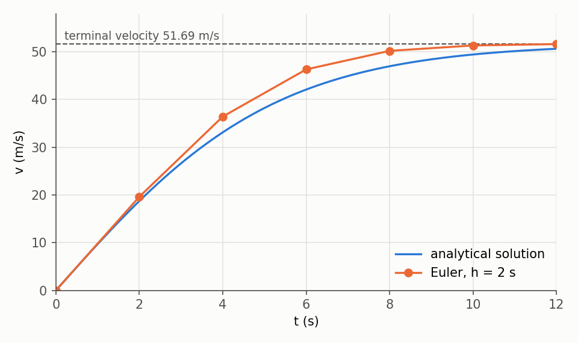
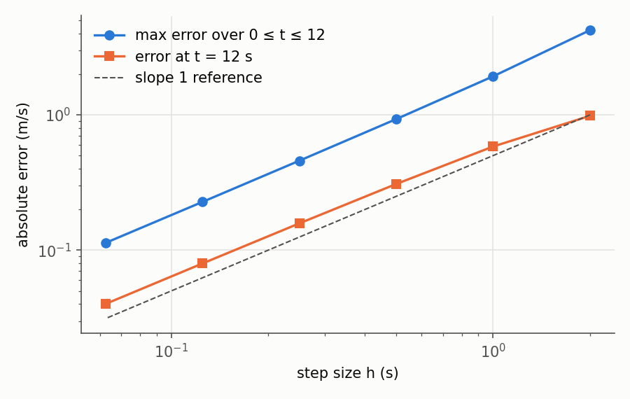

# Chapter 1 — Mathematical Modeling and Engineering Problem Solving

[Repository Guide](../../README.md) | [English](Concepts_Lecture.md) | [한국어](Concepts_Lecture.ko.md)

> **Last Updated:** 2026-11-19
>
> Applied Numerical Methods with Python for Engineers and Scientists, Chapra and Clough, Ch 1

> **Learning Objectives:**
> 1. Explain the role of mathematical modeling in engineering and how conservation laws underlie models
> 2. Identify sources of error in numerical computations
> 3. Compute an approximate solution of an ordinary differential equation step by step with Euler's method
> 4. Describe the trade-off between accuracy and computational cost that depends on the step size
> 5. Derive the analytical solution and terminal velocity of the quadratic drag model and compare it with the Euler solution
> 6. Explain with a Taylor expansion the orders of the local and global truncation errors of Euler's method

---

## Table of Contents

- [1. The Concept of a Mathematical Model](#1-the-concept-of-a-mathematical-model)
  - [1.1 Definition and General Form](#11-definition-and-general-form)
  - [1.2 Analytical vs. Numerical Solutions](#12-analytical-vs-numerical-solutions)
  - [1.3 Conservation Laws](#13-conservation-laws)
- [2. Newton's 2nd Law: Bungee Jumper Example](#2-newtons-2nd-law-bungee-jumper-example)
  - [2.1 System Setup and Force Balance](#21-system-setup-and-force-balance)
  - [2.2 Deriving the ODE](#22-deriving-the-ode)
  - [2.3 Analytical Solution and Terminal Velocity](#23-analytical-solution-and-terminal-velocity)
  - [2.4 Quadratic Drag Model and Its Analytical Solution](#24-quadratic-drag-model-and-its-analytical-solution)
- [3. Euler's Method: Numerical Solution](#3-eulers-method-numerical-solution)
  - [3.1 Core Idea: Finite Difference Approximation](#31-core-idea-finite-difference-approximation)
  - [3.2 Step-by-Step Calculation](#32-step-by-step-calculation)
  - [3.3 Effect of Step Size](#33-effect-of-step-size)
  - [3.4 Euler Solution of the Quadratic Drag Model](#34-euler-solution-of-the-quadratic-drag-model)
  - [3.5 Error Analysis of Euler's Method](#35-error-analysis-of-eulers-method)
  - [3.6 Computer Implementation](#36-computer-implementation)
- [4. Types of Engineering Problems Solved Numerically](#4-types-of-engineering-problems-solved-numerically)
- [Summary](#summary)
- [Self-Check Questions](#self-check-questions)

---

<br>

## 1. The Concept of a Mathematical Model

### 1.1 Definition and General Form

A **mathematical model** is a formulation that expresses the features of a physical system using mathematical equations. Rather than building a physical prototype or relying solely on experiments, we translate a real-world phenomenon into the language of mathematics so that we can analyze, predict, and optimize its behavior.

The general form of a mathematical model is:

```math
\text{Dependent variable} = f(\text{independent variables},\ \text{parameters},\ \text{forcing functions})
```

- **Dependent variable**: the quantity we want to predict or understand (e.g., velocity, temperature, concentration).
- **Independent variables**: the dimensions over which the system evolves (e.g., time $`t`$, spatial coordinates $`x, y, z`$).
- **Parameters**: properties of the system that are typically constant for a given scenario (e.g., mass $`m`$, drag coefficient $`c`$).
- **Forcing functions**: external influences acting on the system (e.g., gravity, applied voltage, wind).

In symbols, writing $`y`$ for the dependent variable, $`x`$ for the independent variable, $`\mu`$ for the parameters, and $`g`$ for the forcing function, the model is written compactly as $`y = f(x, \mu, g)`$. In the bungee jumper model of Section 2, the velocity $`v`$ is the dependent variable, the time $`t`$ is the independent variable, the mass $`m`$ and the drag coefficient are parameters, and the gravitational acceleration $`g`$ is the forcing function. The same quantity can play different roles in different problems. For example, when the drag coefficient is estimated from a measured velocity, the drag coefficient becomes the unknown to be found (the roots problem of Section 4).

### 1.2 Analytical vs. Numerical Solutions

Many real-world engineering and science problems cannot be solved analytically. That is, we cannot always find a closed-form expression for the solution. This is where **numerical methods**, which provide approximate solutions using computers, become essential.

| Aspect | Analytical Solution | Numerical Solution |
|:-------|:-------------------|:-------------------|
| Form | Exact closed-form expression | Approximate discrete values |
| Applicability | Simple, idealized problems | Complex, realistic problems |
| Tools | Pen, paper, symbolic math | Computers, algorithms |
| Example | $`v(t) = \frac{gm}{c}(1 - e^{-(c/m)t})`$ | Table of $`v`$ values at discrete $`t_i`$ |

*Table 1. Comparison of analytical and numerical solutions*

> **Note:** Numerical methods do not replace analytical methods; they complement them. When an analytical solution exists, it serves as a benchmark to verify numerical results. When it does not exist, numerical methods are often the only practical approach.

A model is not always given as an explicit function such as $`y = f(x)`$ that computes the dependent variable directly. It is often given as an **implicit function**, in which the dependent variable cannot be isolated on one side, or as a **differential equation**, which contains the rate of change of the dependent variable. As an example of the first case, finding the drag coefficient from a known mass, fall time, and measured velocity requires numerical root finding, because an equation such as $`v(t) = 36`$ m/s cannot be rearranged for the drag coefficient (Chapters 5-6). As an example of the second case, the model in which drag is proportional to the square of the velocity has an analytical solution (Section 2.4), but if the drag coefficient varies with altitude or the elastic force of the cord is added, no closed-form solution exists and only numerical methods such as Euler's method of Section 3 can solve it.

Two questions must be considered together when using a numerical solution. The first is how close the numerical solution is to the true solution of the mathematical model; this concerns the truncation error set by the step size and the algorithm, and the roundoff error caused by the finite number of digits of the computer (Chapter 4). The second is how well the mathematical model represents the real phenomenon; this depends on the assumptions of the model (e.g., linear versus quadratic drag) and on the accuracy of the measured parameters. However accurate the numerical method is, the result cannot explain the phenomenon if the model itself is wrong.

### 1.3 Conservation Laws

Many models used in engineering start from a **conservation law**. A conservation law states that a quantity is neither created nor destroyed within a system and changes only through inflow and outflow across the boundary or through internal conversion. Its general form is:

```math
\text{Change} = \text{increases} - \text{decreases}
```

When change over time is considered, the left side becomes a rate of change. The bungee jumper model (Section 2) is a conservation law for momentum. The statement that the rate of change of momentum $`d(mv)/dt`$ equals the difference between the increasing factor (gravity) and the decreasing factor (drag) is exactly Newton's second law. The state in which the change is zero and the increases balance the decreases is called the **steady state**, and in it the conservation law becomes $`\text{increases} = \text{decreases}`$. The terminal velocity (Section 2.3) is the steady state of momentum conservation.

| Field | Conserved Quantity | Steady-State Balance |
|:-----|:-----|:-----|
| Chemical engineering | Mass | Mass flowing into a reactor = mass flowing out |
| Civil engineering | Momentum | Sum of horizontal forces = 0 and sum of vertical forces = 0 at a truss node |
| Mechanical engineering | Momentum | Sum of forces on each mass in a mass-spring system = 0 |
| Electrical engineering | Charge | Sum of currents entering a circuit node = sum of currents leaving |
| Electrical engineering | Energy | Sum of voltage drops around a closed loop = 0 |

*Table 2. Conservation laws and steady-state balances by field*

For example, at a junction where four pipes meet, if the flows in the incoming pipes are $`Q_1 = 32`$ L/s and $`Q_2 = 40`$ L/s and the flow in one outgoing pipe is $`Q_3 = 50`$ L/s, the steady-state mass balance $`Q_1 + Q_2 = Q_3 + Q_4`$ gives the flow in the remaining pipe as $`Q_4 = 32 + 40 - 50 = 22`$ L/s. A pipe network with many junctions produces one such balance per junction, which leads to a system of linear equations in several unknowns (Chapters 8-12). When things change over time, the balance becomes a differential equation such as $`dV/dt = Q_{\text{in}} - Q_{\text{out}}`$ for the water volume $`V`$ in a tank, which is solved with the methods of Chapters 22-24.

---

<br>

## 2. Newton's 2nd Law: Bungee Jumper Example

### 2.1 System Setup and Force Balance

Consider a **bungee jumper** falling through the air. We want to model how the jumper's velocity changes over time during free fall (before the cord becomes taut).

Two forces act on the jumper:

1. **Gravity (downward)**: $`F_D = mg`$, where $`m`$ is the mass of the jumper and $`g`$ is gravitational acceleration ($`9.81\ \text{m/s}^2`$).
2. **Air resistance or drag (upward)**: it opposes the motion.
   - **Linear drag model**: $`F_U = cv`$, where $`c`$ is the drag coefficient (kg/s) and $`v`$ is velocity.
   - **Quadratic drag model**: $`F_U = c_d\, v|v|`$, where $`c_d`$ is the drag coefficient for quadratic resistance (kg/m).

```text
              ▲  F_U = cv   (air resistance, upward)
              │
           ┌──┴──┐
           │  m  │          jumper
           └──┬──┘
              │
              ▼  F_D = mg   (gravity, downward)
```

*Figure 1. Gravity and air resistance acting on the bungee jumper*

The **net force** on the jumper is the downward force $`F_D`$ minus the upward force $`F_U`$. With the linear drag model, it is:

```math
F_{\text{net}} = F_D - F_U = mg - cv
```

The subscripts D and U stand for the downward and upward directions.

The two drag models describe different flow regimes. The linear model suits slowly moving objects for which the viscosity of the air dominates, and the quadratic model suits large objects such as a person moving fast enough that turbulence forms behind them. A falling person reaches speeds of several tens of m/s, so the quadratic model is more realistic, and Sections 2.4 and 3.4 treat it. The quadratic drag is written $`c_d v|v|`$ rather than $`c_d v^2`$ so that the drag still opposes the motion when the velocity is negative (upward motion). When downward is taken as positive and only the interval with $`v \geq 0`$ is considered, as in the examples of this chapter, $`v|v| = v^2`$.

Physically, the quadratic drag coefficient $`c_d`$ lumps several factors into one value. Under turbulent conditions the magnitude of the drag can be written $`\frac{1}{2}\rho A C_D v^2`$, so $`c_d = \frac{1}{2}\rho A C_D`$. Here $`\rho`$ is the density of air (kg/m$`^3`$), $`A`$ is the cross-sectional area perpendicular to the motion (m$`^2`$), and $`C_D`$ is a dimensionless drag coefficient reflecting the shape and surface of the object. The same person therefore has a larger $`c_d`$, and a lower terminal velocity, when spreading out to enlarge the area or wearing loose clothing.

### 2.2 Deriving the ODE

Applying **Newton's 2nd law** ($`F = ma`$) gives:

```math
ma = mg - cv
```

Since acceleration is the time derivative of velocity ($`a = dv/dt`$), we can write:

```math
m\frac{dv}{dt} = mg - cv
```

Dividing both sides by $`m`$ gives:

```math
\frac{dv}{dt} = g - \frac{c}{m}v
```

This is a **first-order linear ordinary differential equation (ODE)** that describes the velocity of the jumper as a function of time.

> **Note:** **Physics background.** Newton's 2nd law states $`F = ma`$. The net force on the jumper is the difference between gravity (downward) and air resistance (upward). At terminal velocity, these forces balance and the acceleration becomes zero.

### 2.3 Analytical Solution and Terminal Velocity

Solving the ODE $`\frac{dv}{dt} = g - \frac{c}{m}v`$ analytically with the initial condition $`v(0) = 0`$ (starting from rest) gives:

```math
v(t) = \frac{gm}{c}\left(1 - e^{-(c/m)t}\right)
```

**Terminal velocity** is found by considering the long-time behavior. As $`t \to \infty`$, the exponential term $`e^{-(c/m)t} \to 0`$, so:

```math
v_{\text{terminal}} = \frac{gm}{c}
```

The same result follows from the condition that the acceleration is zero:

```math
\frac{dv}{dt} = 0 \implies g - \frac{c}{m}v = 0 \implies v = \frac{gm}{c}
```

> **[Calculus]** This is a first-order linear ODE. The analytical solution is obtained by separation of variables and integration. The exponential decay term $`e^{-(c/m)t}`$ shows how the velocity approaches the terminal value asymptotically.

### 2.4 Quadratic Drag Model and Its Analytical Solution

In the quadratic drag model the net force is $`mg - c_d v^2`$ (for $`v \geq 0`$), so Newton's second law becomes the following ODE.

```math
m\frac{dv}{dt} = mg - c_d v^2 \quad\Longrightarrow\quad \frac{dv}{dt} = g - \frac{c_d}{m}v^2
```

Because the right side contains $`v^2`$, this is a **first-order nonlinear ordinary differential equation**. Although nonlinear, it can be solved by separation of variables. With $`k = c_d/m`$ and $`v_t = \sqrt{g/k} = \sqrt{gm/c_d}`$, the right side is $`k(v_t^2 - v^2)`$, and rearranging gives:

```math
\frac{dv}{v_t^2 - v^2} = k\,dt
```

The integral of the left side is $`\int_0^v \frac{du}{v_t^2 - u^2} = \frac{1}{v_t}\tanh^{-1}\!\left(\frac{v}{v_t}\right)`$ (for $`0 \leq v < v_t`$), and the integral of the right side is $`kt`$. Setting the two results equal and solving for $`v`$ gives the analytical solution that satisfies the initial condition $`v(0) = 0`$.

```math
v(t) = v_t \tanh(k v_t t) = \sqrt{\frac{gm}{c_d}}\tanh\!\left(\sqrt{\frac{g c_d}{m}}\,t\right)
```

The last step used $`k v_t = (c_d/m)\sqrt{gm/c_d} = \sqrt{g c_d/m}`$. Differentiating the solution again confirms it. Since $`\frac{d}{dt}\tanh(at) = a(1 - \tanh^2(at))`$, we get $`\frac{dv}{dt} = v_t \cdot k v_t (1 - \tanh^2) = k(v_t^2 - v^2) = g - k v^2`$.

As $`t \to \infty`$, $`\tanh \to 1`$, so the terminal velocity of the quadratic drag model is:

```math
v_{\text{terminal}} = \sqrt{\frac{gm}{c_d}}
```

This value also follows directly from $`dv/dt = 0`$, that is, $`g = (c_d/m)v^2`$. With $`m = 68.1`$ kg, $`c_d = 0.25`$ kg/m, and $`g = 9.81`$ m/s$`^2`$, the following values result.

| $`t`$ (s) | 0 | 2 | 4 | 6 | 8 | 10 | 12 | $`\infty`$ |
|:-----|-----:|-----:|-----:|-----:|-----:|-----:|-----:|-----:|
| $`v(t)`$ (m/s) | 0.0000 | 18.7292 | 33.1118 | 42.0762 | 46.9575 | 49.4214 | 50.6175 | 51.6938 |

*Table 3. Analytical solution of the quadratic drag model (m = 68.1 kg, cd = 0.25 kg/m)*

The velocity first grows almost like $`gt`$, as in free fall, then grows more slowly as the drag increases, and approaches the terminal velocity of 51.6938 m/s asymptotically. Since $`\tanh^{-1}(0.99)/\sqrt{gc_d/m} \approx 13.95`$, the jumper reaches 99% of the terminal velocity after about 14 s.

The terminal velocities of the two models depend differently on the parameters. The terminal velocity $`gm/c`$ of the linear model is proportional to the mass, whereas the terminal velocity $`\sqrt{gm/c_d}`$ of the quadratic model is proportional to the square root of the mass. When the mass is quadrupled, the terminal velocity becomes four times larger in the linear model and twice as large in the quadratic model.

> **Caution:** This analytical solution holds only when the motion starts from $`v(0) = 0`$ and $`v`$ stays positive. If the initial velocity is upward (negative), the sign of $`v|v|`$ changes and a different formula is needed, and once the cord becomes taut the elastic force is added and the model itself changes.

---

<br>

## 3. Euler's Method: Numerical Solution

### 3.1 Core Idea: Finite Difference Approximation

**Euler's method** is the simplest numerical technique for solving ordinary differential equations. The core idea is to approximate the continuous derivative with a **finite difference**:

```math
\frac{dv}{dt}\bigg|_{t_i} \approx \frac{v(t_{i+1}) - v(t_i)}{h}
```

where $`h = \Delta t`$ is the **step size**, the time increment between two successive points.

Rearranging, we obtain the **Euler formula**:

```math
v(t_{i+1}) = v(t_i) + \frac{dv}{dt}\bigg|_{t_i} \cdot h
```

This says that the new value equals the old value plus the slope at the current point times the step size. Geometrically, we follow the tangent line at each point to estimate the next value.

> **[Calculus]** The derivative $`dv/dt`$ is defined as the limit of the difference quotient $`\frac{\Delta v}{\Delta t} = \frac{v(t_{i+1}) - v(t_i)}{h}`$ as $`h \to 0`$. Euler's method uses the difference quotient at a finite $`h`$ in place of the derivative without taking this limit, so the approximation approaches the definition of the derivative as $`h`$ becomes smaller.

### 3.2 Step-by-Step Calculation

Using the bungee jumper ODE $`\frac{dv}{dt} = g - \frac{c}{m}v`$ with:

- $`m = 68.1`$ kg
- $`c = 12.5`$ kg/s
- $`g = 9.81`$ m/s$`^2`$
- Initial condition: $`v(0) = 0`$ m/s
- Step size: $`h = 2`$ s

**Step 1:** From $`t = 0`$ to $`t = 2`$.

```math
\frac{dv}{dt}\bigg|_{t=0} = 9.81 - \frac{12.5}{68.1}(0) = 9.81\ \text{m/s}^2
```

```math
v(2) = 0 + 9.81 \times 2 = 19.62\ \text{m/s}
```

**Step 2:** From $`t = 2`$ to $`t = 4`$.

```math
\frac{dv}{dt}\bigg|_{t=2} = 9.81 - \frac{12.5}{68.1}(19.62) = 9.81 - 3.60 = 6.21\ \text{m/s}^2
```

```math
v(4) = 19.62 + 6.21 \times 2 = 32.04\ \text{m/s}
```

**Step 3:** From $`t = 4`$ to $`t = 6`$.

```math
\frac{dv}{dt}\bigg|_{t=4} = 9.81 - \frac{12.5}{68.1}(32.04) = 9.81 - 5.88 = 3.93\ \text{m/s}^2
```

```math
v(6) = 32.04 + 3.93 \times 2 = 39.90\ \text{m/s}
```

Continuing this process gives the following table. The analytical column evaluates the formula of Section 2.3 with the same parameters ($`g = 9.81`$ m/s$`^2`$).

| $`t`$ (s) | $`v_{\text{numerical}}`$ (m/s) | $`v_{\text{analytical}}`$ (m/s) |
|:--------|:----------------------------|:-----------------------------|
| 0 | 0.00 | 0.00 |
| 2 | 19.62 | 16.42 |
| 4 | 32.04 | 27.80 |
| 6 | 39.90 | 35.68 |
| 8 | 44.87 | 41.14 |
| 10 | 48.02 | 44.92 |
| 12 | 50.01 | 47.54 |

*Table 4. Euler's method and the analytical solution for h = 2 s*

At $`t = 12`$ s, the numerical result ($`50.01`$ m/s) is reasonably close to the analytical result ($`47.54`$ m/s), but there is a noticeable discrepancy of about $`2.47`$ m/s due to the relatively large step size. The numerical solution is larger because the slope decreases as the velocity grows, yet Euler's method applies the slope from the start of each interval, the largest one in that interval, to the whole interval.

### 3.3 Effect of Step Size

The accuracy of Euler's method depends heavily on the **step size** $`h`$:

| Step Size ($`h`$) | $`v(12)`$ Numerical | Error vs. Analytical |
|:----------------|:------------------|:---------------------|
| 2.0 s | 50.01 m/s | 2.47 m/s (larger error) |
| 1.0 s | 48.76 m/s (closer to analytical) | 1.22 m/s (moderate error) |
| 0.5 s | 48.14 m/s (even closer) | 0.60 m/s (smaller error) |

*Table 5. Numerical solution and error at t = 12 s for different step sizes*

> **Key Point:** Reducing the step size $`h`$ improves accuracy because the finite difference approximation becomes closer to the true derivative. However, smaller $`h`$ means more computation steps. This is the fundamental **trade-off between accuracy and computational cost** in numerical methods.

In Table 5, each halving of $`h`$ roughly halves the error, while the number of steps doubles from 6 to 12 to 24. This is because the global error of Euler's method is proportional to $`h`$ (first-order accuracy).

Ignoring roundoff error, the numerical solution converges to the exact analytical solution as $`h \to 0`$. On a real computer, an excessively small $`h`$ lets roundoff error accumulate, which is covered in Chapter 4.

### 3.4 Euler Solution of the Quadratic Drag Model

Applying the Euler formula to the quadratic drag model of Section 2.4 gives the update:

```math
v_{i+1} = v_i + \left(g - \frac{c_d}{m}v_i^2\right)(t_{i+1} - t_i)
```

With $`m = 68.1`$ kg, $`c_d = 0.25`$ kg/m, $`h = 2`$ s, and $`v_0 = 0`$, the first three steps are as follows. The slope coefficient is $`c_d/m = 0.25/68.1 = 0.0036711`$.

- $`t = 0`$: the slope is $`9.81 - 0.0036711(0)^2 = 9.81`$, so $`v(2) = 0 + 9.81 \times 2 = 19.6200`$.
- $`t = 2`$: the slope is $`9.81 - 0.0036711(19.62)^2 = 9.81 - 1.4132 = 8.3968`$, so $`v(4) = 19.62 + 8.3968 \times 2 = 36.4137`$.
- $`t = 4`$: the slope is $`9.81 - 0.0036711(36.4137)^2 = 9.81 - 4.8677 = 4.9423`$, so $`v(6) = 36.4137 + 4.9423 \times 2 = 46.2983`$.

Continuing the same computation up to $`t = 12`$ s gives Table 6.

| $`t`$ (s) | Euler Solution (m/s) | Analytical (m/s) | Error (m/s) | Relative Error |
|:-----|-----:|-----:|-----:|-----:|
| 0 | 0.0000 | 0.0000 | 0.0000 | - |
| 2 | 19.6200 | 18.7292 | 0.8908 | 4.76% |
| 4 | 36.4137 | 33.1118 | 3.3019 | 9.97% |
| 6 | 46.2983 | 42.0762 | 4.2221 | 10.03% |
| 8 | 50.1802 | 46.9575 | 3.2227 | 6.86% |
| 10 | 51.3123 | 49.4214 | 1.8909 | 3.83% |
| 12 | 51.6008 | 50.6175 | 0.9833 | 1.94% |

*Table 6. Euler solution and analytical solution of the quadratic drag model for h = 2 s*



*Figure 2. Analytical solution and h = 2 s Euler solution of the quadratic drag model*

In Figure 2 the Euler solution lies above the analytical solution from the start. The rate $`dv/dt`$ decreases as the velocity grows, but Euler's method uses the large slope at the start of each interval all the way to its end. The error is largest near $`t = 6`$ s and then shrinks as both solutions approach the same terminal velocity, because near the terminal velocity the slope is close to zero and the Euler formula also produces values that barely change. Since the error thus varies with time, the accuracy of a method should not be judged from the error at a single time.

### 3.5 Error Analysis of Euler's Method

The error of Euler's method can be quantified with a Taylor expansion. If the true solution $`v(t)`$ is twice continuously differentiable, the following holds near $`t_i`$.

```math
v(t_{i+1}) = v(t_i) + v'(t_i)h + \frac{v''(\xi)}{2}h^2, \quad t_i < \xi < t_{i+1}
```

The Euler formula uses only the first two terms on the right. The error of one step started from the true value $`v(t_i)`$, the **local truncation error**, is therefore $`\frac{v''(\xi)}{2}h^2`$, which is $`O(h^2)`$.

Computing over the whole interval $`[0, T]`$ takes $`n = T/h`$ steps, and the local errors of the steps accumulate, so the **global truncation error** at the final time has roughly the size:

```math
n \cdot O(h^2) = \frac{T}{h} \cdot O(h^2) = O(h)
```

This argument assumes that the error made in each step is not strongly amplified in later steps. When the assumption holds, Euler's method is a **first-order method**, and halving $`h`$ roughly halves the global error. Computing the error at $`t = 12`$ s of the quadratic drag model for several step sizes gives Table 7.

| $`h`$ (s) | Steps | Euler $`v(12)`$ (m/s) | Error (m/s) | Ratio to Previous Error |
|-----:|-----:|-----:|-----:|-----:|
| 2 | 6 | 51.6008 | 0.9833 | - |
| 1 | 12 | 51.2008 | 0.5833 | 1.686 |
| 0.5 | 24 | 50.9259 | 0.3084 | 1.891 |
| 0.25 | 48 | 50.7753 | 0.1578 | 1.954 |
| 0.125 | 96 | 50.6972 | 0.0798 | 1.979 |
| 0.0625 | 192 | 50.6576 | 0.0401 | 1.990 |

*Table 7. Euler solution and error at t = 12 s of the quadratic drag model for different step sizes*

The ratio of errors approaches 2 as $`h`$ becomes smaller. The ratio is below 2 for large $`h`$ because $`O(h)`$ describes the behavior as $`h \to 0`$, and for a large step such as $`h = 2`$ s the terms of order $`h^2`$ and higher cannot be neglected. Plotted against $`h`$ on log-log axes, the error approaches a straight line of slope 1.



*Figure 3. Error of Euler's method versus step size (log-log axes)*

Both curves in Figure 3 run parallel to the slope-1 reference line. The maximum error over the whole interval is also proportional to $`h`$, so being first order is a property of the whole solution, not of one particular time.

There are two ways to improve the accuracy of the numerical solution. The first is to reduce $`h`$. However, reducing the error tenfold requires ten times as many steps, and an excessively small $`h`$ accumulates the roundoff error discussed in Chapter 4. The second is to use a higher-order method that approximates the slope within a step more accurately. Methods that average the slopes at the start and end of the interval and the Runge-Kutta methods give far smaller errors with the same number of steps; they are covered in Chapter 22.

> **Note:** **Step size and stability.** When the step size is too large, the error does more than grow; the numerical solution can oscillate or diverge. Writing $`v = v_t + \delta`$ near the terminal velocity and linearizing the right side gives $`d\delta/dt \approx -2kv_t\,\delta`$, so the Euler formula multiplies $`\delta`$ by $`(1 - 2kv_t h)`$ in every step. For the magnitude of this factor to be below 1, $`h < 1/(kv_t) = \sqrt{m/(gc_d)} \approx 5.27`$ s is required. Indeed, with $`h = 4`$ s the solution 39.24, 55.87, 49.27, 52.86, ... oscillates around the terminal velocity and converges, with $`h = 6`$ s the amplitude grows as 58.86, 41.41, 62.50, 35.32, ..., and with $`h = 12`$ s the solution 117.72, -375.04, ... changes sign and diverges. The step size thus has an upper limit set by stability as well as by accuracy; numerical stability is covered in Chapters 22 and 23.

> **Caution:** Do not confuse the order $`O(h^2)`$ of the local error with the order $`O(h)`$ of the global error. The order of a method refers to the global error, so Euler's method is a first-order method, not a second-order one.

### 3.6 Computer Implementation

The algorithm of Euler's method is as follows.

```text
input: slope function f(t, v), initial value v0, step h, final time T
n = T / h
t[0] = 0, v[0] = v0
for i = 0 to n-1:
    v[i+1] = v[i] + f(t[i], v[i]) * h
    t[i+1] = t[i] + h
output: t[0..n], v[0..n]
```

The algorithm is implemented in Python with NumPy as follows. Each iteration evaluates the slope function once, so the computational cost is proportional to the number of steps $`n = T/h`$.

```python
import numpy as np

g, m, cd = 9.81, 68.1, 0.25          # gravity (m/s^2), mass (kg), drag (kg/m)

def dvdt(v):
    return g - cd / m * v**2          # right-hand side of the ODE

h, tend = 2.0, 12.0                   # step size and final time (s)
t = np.arange(0.0, tend + h / 2, h)   # time grid 0, 2, ..., 12
v = np.zeros_like(t)                  # v[0] = 0 is the initial condition
for i in range(len(t) - 1):
    v[i + 1] = v[i] + dvdt(v[i]) * h  # Euler step

vexact = np.sqrt(g * m / cd) * np.tanh(np.sqrt(g * cd / m) * t)
for ti, vi, ve in zip(t, v, vexact):
    print(f"{ti:5.1f} {vi:9.4f} {ve:9.4f} {vi - ve:8.4f}")
```

```text
  0.0    0.0000    0.0000   0.0000
  2.0   19.6200   18.7292   0.8908
  4.0   36.4137   33.1118   3.3019
  6.0   46.2983   42.0762   4.2221
  8.0   50.1802   46.9575   3.2227
 10.0   51.3123   49.4214   1.8909
 12.0   51.6008   50.6175   0.9833
```

Each line works as follows.

- `dvdt` computes the right side $`g - (c_d/m)v^2`$ of the ODE. Separating the slope computation into a function means that only this function needs to change when the model changes.
- `np.arange(0.0, tend + h / 2, h)` creates the time grid from 0 to 12 in steps of 2. Half a step $`h/2`$ is added to the end value because `arange` excludes the end value and floating-point error could otherwise drop 12.
- `np.zeros_like(t)` creates an array of zeros with the same length as `t`, and its first element `v[0] = 0` is the initial condition.
- The single line in the loop is the Euler formula $`v_{i+1} = v_i + f(v_i)h`$. The loop runs `len(t) - 1` times, and the last iteration fills `v[6]`.
- `vexact` evaluates the analytical solution of Section 2.4 for the whole array at once. NumPy functions act on each element of an array, so no loop is needed.
- The three columns of the output equal the Euler solution, analytical solution, and error of Table 6.

The Python syntax for functions, loops, and arrays is covered in Chapters 2-3, and Section 3 of Chapter 3 implements the same problem with a more general function.

---

<br>

## 4. Types of Engineering Problems Solved Numerically

Numerical methods provide tools for solving a wide range of engineering and scientific problems. The major categories include:

1. **Roots of Equations**: Finding $`x`$ such that $`f(x) = 0`$.
   - Example: determining the drag coefficient $`c`$ for which the velocity reaches 40 m/s after 10 s of free fall.

2. **Systems of Linear Algebraic Equations**: Solving $`[A]\{x\} = \{b\}`$.
   - Example: structural analysis, circuit analysis, mass balance in chemical systems

3. **Curve Fitting / Regression**: Finding a function that best fits observed data.
   - Example: fitting experimental measurements to a theoretical model

4. **Integration**: Computing definite integrals $`\int_a^b f(x)\,dx`$.
   - Example: calculating work, area, or total accumulated quantity

5. **Ordinary Differential Equations (ODEs)**: Solving equations involving derivatives with respect to one independent variable.
   - Example: the bungee jumper problem, population dynamics, radioactive decay

6. **Partial Differential Equations (PDEs)**: Solving equations involving partial derivatives with respect to two or more independent variables.
   - Example: heat conduction, fluid flow, electromagnetic wave propagation

7. **Optimization**: Finding parameter values that minimize or maximize an objective function.
   - Example: minimizing cost, maximizing efficiency, optimal design

> **Note:** Of these categories, roots of equations are covered in Chapters 5-6, optimization in Chapter 7, systems of linear algebraic equations in Chapters 8-12, curve fitting in Chapters 14-18, integration in Chapters 19-20, and ODEs in Chapters 22-24. Each topic builds on the foundations established in earlier chapters.

These categories can be organized into five groups. The first group is roots and optimization (Chapters 5-7). A roots problem finds $`x`$ with $`f(x) = 0`$, and optimization finds $`x`$ at which $`f(x)`$ has an extreme value, that is, for a differentiable function, $`x`$ with $`f'(x) = 0`$, so the two problems are mathematically close. Linear algebraic equations (Chapters 8-13) form the group that finds $`x`$ given the coefficients $`a`$ and right sides $`b`$, as in $`a_{11}x_1 + a_{12}x_2 = b_1`$ and $`a_{21}x_1 + a_{22}x_2 = b_2`$. Curve fitting (Chapters 14-18) finds a function that fits data. In integration and differentiation (Chapters 19-21), integration finds the area under a curve and differentiation finds the slope of a curve numerically. Differential equations (Chapters 22-24) find $`y`$ as a function of $`t`$ given $`dy/dt = f(t, y)`$, and the simplest method is the general form of Euler's method seen in Section 3, $`y_{i+1} = y_i + f(t_i, y_i)\Delta t`$.

---

<br>

## Summary

| Concept | Key Summary |
|:------|:----------|
| Mathematical Model | A model expresses the dependent variable as a function $`f`$ of independent variables, parameters, and forcing functions. |
| Analytical vs. Numerical | An analytical solution is an exact closed-form expression, while a numerical solution is an approximation obtained by computation. |
| Conservation Law | Change = increases - decreases, and in the steady state the increases equal the decreases, giving a balance equation. |
| Newton's 2nd Law (Bungee Jumper) | With linear drag the ODE is $`dv/dt = g - (c/m)v`$, and the terminal velocity is $`v_t = gm/c`$. |
| Quadratic Drag Model | The analytical solution of $`dv/dt = g - (c_d/m)v^2`$ is $`v = \sqrt{gm/c_d}\tanh(\sqrt{gc_d/m}\,t)`$, and the terminal velocity is $`\sqrt{gm/c_d}`$. |
| Euler's Method | It is the simplest numerical ODE solver, updating values by $`v(t_{i+1}) = v(t_i) + (dv/dt) \cdot h`$. |
| Step Size Trade-off | A smaller $`h`$ gives better accuracy but more computation, and the error of Euler's method is proportional to $`h`$. |
| Local and Global Error | The local truncation error of Euler's method is $`O(h^2)`$ and the global truncation error is $`O(h)`$, so it is a first-order method. |
| Problem Categories | Numerical methods solve roots, linear systems, curve fitting, integration, ODEs, PDEs, and optimization problems. |

---

<br>

## Self-Check Questions

1. **Model components:** In the bungee jumper model $`dv/dt = g - (c/m)v`$, classify $`v`$, $`t`$, $`m`$, $`c`$, and $`g`$ as the dependent variable, independent variable, parameters, or forcing function.

   <details>
   <summary>Answer</summary>

   $`v`$ is the dependent variable, $`t`$ is the independent variable, and $`m`$ and $`c`$ are parameters. The gravitational acceleration $`g`$ is the forcing function, an external influence acting on the system.

   </details>

2. **Terminal velocity:** Find the terminal velocity of the linear drag model for $`m = 68.1`$ kg, $`c = 12.5`$ kg/s, and $`g = 9.81`$ m/s$`^2`$.

   <details>
   <summary>Answer</summary>

   $`v_{\text{terminal}} = gm/c = (9.81 \times 68.1)/12.5 = 668.061/12.5 \approx 53.44`$ m/s. The analytical value of 47.54 m/s at $`t = 12`$ s in Table 4 is still only about 89% of the terminal velocity.

   </details>

3. **One Euler step:** Under the conditions of Section 3.2, start from $`v(6) = 39.90`$ m/s and compute $`v(8)`$ with Euler's method.

   <details>
   <summary>Answer</summary>

   The slope at $`t = 6`$ is $`9.81 - (12.5/68.1)(39.90) = 9.81 - 7.324 = 2.486`$ m/s$`^2`$. Hence $`v(8) = 39.90 + 2.486 \times 2 \approx 44.87`$ m/s, which matches Table 4.

   </details>

4. **Step size and error:** Under the conditions of Section 3.2, how do the error at $`t = 12`$ s and the number of steps change when the step size is reduced from $`h = 0.5`$ s to $`h = 0.25`$ s?

   <details>
   <summary>Answer</summary>

   The error of Euler's method is proportional to $`h`$, so the error drops to about half of 0.60 m/s. The actual computation gives $`v(12) \approx 47.84`$ m/s with an error of about 0.30 m/s. The number of steps doubles from 24 to 48.

   </details>

5. **Problem category:** Finding the drag coefficient $`c`$ for which a 68.1 kg jumper reaches 40 m/s after 10 s of free fall belongs to which category in Section 4? Write the equation to be solved.

   <details>
   <summary>Answer</summary>

   It is a roots-of-equations problem. We must find $`c`$ such that $`f(c) = \frac{gm}{c}\left(1 - e^{-(c/m) \cdot 10}\right) - 40 = 0`$. Since this equation cannot be solved for $`c`$ in closed form, the numerical root-finding methods of Chapters 5-6 are used; with $`g = 9.81`$ m/s$`^2`$ the root is about 14.80 kg/s.

   </details>

6. **Terminal velocity of the quadratic drag model:** If the mass grows from $`m = 68.1`$ kg to $`4m`$, what is the terminal velocity of the quadratic drag model ($`c_d = 0.25`$ kg/m)? By what factor does it grow in the linear model?

   <details>
   <summary>Answer</summary>

   The terminal velocity of the quadratic model is $`\sqrt{gm/c_d}`$, so quadrupling the mass multiplies it by $`\sqrt{4} = 2`$, giving $`2 \times 51.69 \approx 103.39`$ m/s. The terminal velocity $`gm/c`$ of the linear model is proportional to the mass, so it grows fourfold.

   </details>

7. **One Euler step (quadratic drag):** Under the conditions of Section 3.4, start from $`v(6) = 46.2983`$ m/s and compute $`v(8)`$.

   <details>
   <summary>Answer</summary>

   The slope is $`9.81 - 0.0036711 \times 46.2983^2 = 9.81 - 7.8691 = 1.9409`$ m/s$`^2`$. Hence $`v(8) = 46.2983 + 1.9409 \times 2 = 50.1802`$ m/s, which matches Table 6.

   </details>

8. **Using the order of the error:** Solving an ODE with Euler's method at $`h = 0.1`$ gives an error of $`3.0 \times 10^{-2}`$ at the end point. Roughly what $`h`$ is needed to bring the error below $`10^{-3}`$, and by what factor does the number of steps grow? Also explain the orders of the local and global errors.

   <details>
   <summary>Answer</summary>

   The global error is $`O(h)`$, so reducing the error thirtyfold requires reducing $`h`$ roughly thirtyfold, to about $`h \approx 0.0033`$ or less, and the number of steps grows about thirtyfold. The local truncation error of one step is the discarded Taylor term $`v''(\xi)h^2/2`$, which is $`O(h^2)`$, but the number of steps grows in proportion to $`T/h`$, so the global error accumulated at the end point is $`O(h)`$.

   </details>
