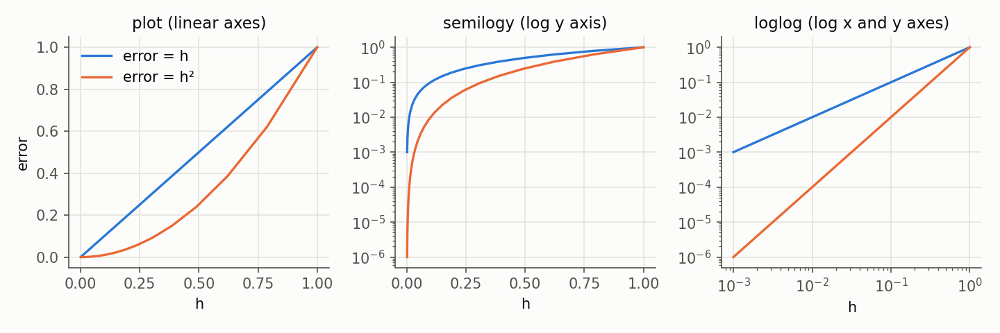

# 2장 — Python 기초

[레포지토리 안내](../../README.ko.md) | [English](Concepts_Lecture.md) | [한국어](Concepts_Lecture.ko.md)

> **최종 수정일:** 2026-11-19
>
> Applied Numerical Methods with Python for Engineers and Scientists, Chapra and Clough, Ch 2

> **학습 목표:**
> 1. Python과 NumPy, SciPy, Matplotlib으로 이루어진 수치 계산 환경의 구성을 설명할 수 있다
> 2. NumPy 배열로 요소별 연산과 행렬 연산을 구분하여 수행할 수 있다
> 3. NumPy와 SciPy 함수로 배열을 만들고 연립방정식을 풀며, Matplotlib으로 그래프를 그릴 수 있다
> 4. Python 내장 자료형의 가변성과 수치 자료형의 성질을 설명하고 별칭으로 생기는 오류를 피할 수 있다
> 5. NumPy 배열의 뷰와 복사본, 브로드캐스팅, 벡터화의 원리를 설명할 수 있다

---

## 목차

- [1. 프로그래밍 환경](#1-프로그래밍-환경)
  - [1.1 개발 환경의 구성 요소](#11-개발-환경의-구성-요소)
  - [1.2 스크립트, 대화형 실행, 노트북](#12-스크립트-대화형-실행-노트북)
- [2. Python 기초](#2-python-기초)
  - [2.1 변수와 대입](#21-변수와-대입)
  - [2.2 데이터 타입](#22-데이터-타입)
  - [2.3 NumPy 배열](#23-numpy-배열)
  - [2.4 가변 객체와 별칭](#24-가변-객체와-별칭)
  - [2.5 수치 자료형의 성질](#25-수치-자료형의-성질)
  - [2.6 뷰와 복사본](#26-뷰와-복사본)
- [3. 기본 연산](#3-기본-연산)
  - [3.1 요소별 연산](#31-요소별-연산)
  - [3.2 행렬 연산](#32-행렬-연산)
  - [3.3 브로드캐스팅](#33-브로드캐스팅)
  - [3.4 벡터화와 범용 함수](#34-벡터화와-범용-함수)
  - [3.5 1차원 배열과 행렬 곱](#35-1차원-배열과-행렬-곱)
- [4. 유용한 NumPy/SciPy 함수](#4-유용한-numpyscipy-함수)
- [5. Matplotlib을 이용한 그래프](#5-matplotlib을-이용한-그래프)
- [요약](#요약)
- [점검 문제](#점검-문제)

---

<br>

## 1. 프로그래밍 환경

수치 계산에는 **Python**을 주요 프로그래밍 언어로 사용하며, 과학 계산 생태계를 함께 활용한다:

- **NumPy**: 수치 배열, 선형대수, 수학 함수를 제공한다.
- **SciPy**: 고급 과학 계산(ODE 풀이, 최적화, 보간 등)을 제공한다.
- **Matplotlib**: 2D/3D 그래프와 시각화를 제공한다.

| 특징 | MATLAB | Python |
|:--------|:-------|:-------|
| 라이선스 | 상용 (고가) | 무료 및 오픈 소스 |
| 배열 처리 | 내장 행렬 타입 | NumPy `ndarray` |
| 생태계 | 툴박스 (유료 애드온) | 패키지 (pip/conda를 통해 무료) |
| 문법 스타일 | 1 기반 인덱싱, end 키워드 | 0 기반 인덱싱, 들여쓰기 기반 |
| 커뮤니티 | 공학/학계 | 폭넓음 (데이터 과학, 웹, ML 등) |

*표 1. MATLAB과 Python의 비교*

> **참고:** 수치 해법에 대한 대부분의 교재는 역사적으로 MATLAB용으로 작성되었다. 개념과 알고리즘은 프로그래밍 언어에 관계없이 동일하며, 문법만 다르다. 교재는 알고리즘을 Python으로 구현한다.

Python 자체는 범용 언어이므로, 수치 계산에 필요한 기능 대부분은 언어 밖의 **라이브러리(library)** 로 제공된다. NumPy가 배열과 선형대수의 기반을 만들고, SciPy와 Matplotlib은 NumPy 배열을 입력과 출력으로 쓴다. 이 계층 구조 때문에 수치 계산 코드는 대개 NumPy 배열을 중심으로 작성되며, 이 장의 대부분도 배열을 다룬다.

### 1.1 개발 환경의 구성 요소

Python으로 수치 계산을 하는 환경은 다음 요소로 이루어진다.

| 구성 요소 | 역할 | 예 |
|:-----|:-----|:-----|
| 인터프리터 | Python 코드를 한 문장씩 읽어 실행하는 프로그램 | Python 3.11 |
| 가상 환경 | 프로젝트마다 독립된 인터프리터 설정과 패키지 모음 | `venv`, conda 환경 |
| 패키지 관리자 | 라이브러리를 내려받아 설치하고 버전을 관리 | `pip`, `conda` |
| 편집기 | 코드를 작성하고 실행, 디버깅 | Visual Studio Code |
| 노트북 | 코드, 결과, 설명을 셀 단위로 함께 담는 문서 | Jupyter 노트북 (`.ipynb`) |

*표 2. Python 수치 계산 환경의 구성 요소*

Python은 **인터프리터 언어(interpreted language)** 이다. C처럼 프로그램 전체를 기계어로 미리 번역하지 않고, 인터프리터가 실행 시점에 코드를 읽어 실행한다. 그래서 코드를 고친 뒤 바로 실행해 볼 수 있지만, 같은 연산을 Python 반복문으로 수백만 번 반복하면 컴파일된 언어보다 훨씬 느리다. NumPy가 반복을 컴파일된 코드 안에서 처리하는 이유가 여기에 있다(3.4절).

**가상 환경(virtual environment)** 은 프로젝트마다 별도의 패키지 설치 공간을 두는 방법이다. 한 컴퓨터에서 여러 프로젝트가 서로 다른 버전의 NumPy를 요구해도 충돌하지 않으며, 다른 사람이 같은 버전으로 환경을 재현할 수 있다. 수치 계산의 결과는 라이브러리 버전에 따라 마지막 자릿수가 달라지거나 함수의 기본 동작이 바뀔 수 있으므로, 결과를 재현하려면 사용한 버전을 함께 기록해야 한다.

### 1.2 스크립트, 대화형 실행, 노트북

같은 코드를 세 가지 방식으로 실행할 수 있다.

- **스크립트(script)** 는 `.py` 파일에 저장한 프로그램이며, 위에서 아래로 한 번에 실행된다. 실행할 때마다 같은 순서로 같은 결과를 내므로 재현성이 가장 좋다.
- **대화형 셸(interactive shell)** 은 한 줄씩 입력하면 바로 결과를 보여 준다. 함수의 동작을 확인하거나 작은 계산을 할 때 편리하다.
- **노트북(notebook)** 은 코드를 셀 단위로 나누어 실행하고, 각 셀의 출력과 그래프, 설명 문장을 한 문서에 함께 저장한다. 노트북에서 코드를 실행하는 프로그램을 **커널(kernel)** 이라고 하며, 편집기에서 커널(가상 환경의 인터프리터)을 선택한 뒤 셀마다 Shift + Enter로 실행한다.

> **주의:** 노트북의 변수는 셀을 실행한 순서대로 커널 메모리에 남는다. 셀을 위에서 아래가 아닌 순서로 실행하거나, 셀을 고친 뒤 다시 실행하지 않으면 화면의 코드와 메모리의 상태가 달라져 재현할 수 없는 결과가 나온다. 노트북을 마무리할 때는 커널을 재시작하고 모든 셀을 처음부터 다시 실행하여 결과를 확인해야 한다.

---

<br>

## 2. Python 기초

### 2.1 변수와 대입

Python에서 변수는 단순한 대입으로 생성된다. 타입을 명시적으로 선언할 필요가 없으며, Python이 대입된 값으로부터 타입을 추론한다:

```python
x = 5        # int
y = 3.14     # float
name = "NA"  # string
```

변수 이름은 대소문자를 구분하며(`x`와 `X`는 다른 변수), 문자 또는 밑줄로 시작해야 한다.

Python의 대입은 값을 상자에 복사해 넣는 동작이 아니라, 오른쪽에서 만든 **객체(object)** 에 왼쪽의 이름을 붙이는 동작이다. 모든 값은 메모리 어딘가에 있는 객체이고, 변수는 그 객체를 가리키는 이름이다. 객체는 타입을 가지지만 이름은 타입을 가지지 않으므로, 같은 이름에 정수를 대입한 뒤 문자열을 다시 대입할 수 있다. 이를 **동적 타이핑(dynamic typing)** 이라고 한다. 내장 함수 `type(x)`는 이름이 현재 가리키는 객체의 타입을, `id(x)`는 그 객체의 고유 번호를 돌려준다.

여러 이름에 한 번에 대입하는 `a, b = 1, 2`와, 두 값을 맞바꾸는 `a, b = b, a`도 같은 원리로 동작한다. 오른쪽에서 튜플 하나를 만든 뒤 그 원소를 왼쪽 이름에 차례로 붙인다. `x += 1`처럼 연산과 대입을 합친 **복합 대입(augmented assignment)** 은 `x = x + 1`과 같은 결과를 내며, 정수처럼 바꿀 수 없는 객체에서는 새 객체를 만들어 이름을 다시 붙인다.

### 2.2 데이터 타입

Python은 과학 계산과 관련된 여러 내장 데이터 타입을 제공한다:

| 타입 | 예시 | 설명 |
|:-----|:--------|:------------|
| `int` | `5`, `-3` | 정수 (임의 정밀도) |
| `float` | `3.14`, `1e-6` | 부동 소수점 수 (64비트 배정밀도) |
| `str` | `'hello'` | 문자열 |
| `list` | `[1, 2, 3]` | 가변(Mutable) 순서열 |
| `tuple` | `(1, 2, 3)` | 불변(Immutable) 순서열 |
| `dict` | `{'a': 1}` | 키-값 매핑 |

*표 3. 과학 계산과 관련된 Python 내장 데이터 타입*

수치 작업에서 Python의 내장 `list`는 벡터화 산술을 지원하지 않으므로 충분하지 않다. 이것이 **NumPy 배열**을 사용하는 이유이다.

Python의 내장 타입은 용도에 따라 다음과 같이 분류된다.

| 분류 | 타입 | 특징 |
|:-----|:-----|:-----|
| 논리형 | `bool` | `True`, `False` 두 값만 가지며, 정수의 하위 타입이라 `True == 1`이다 |
| 수치형 | `int`, `float`, `complex` | 정수, 실수, 복소수(`3 + 4j`) |
| 문자열 | `str` | 문자의 불변 순서열 |
| 순서열 | `list`, `tuple`, `range` | 위치(0부터 시작하는 인덱스)로 원소에 접근 |
| 매핑 | `dict` | 해시 가능한 키를 임의의 값에 대응 |
| 집합 | `set` | 순서가 없고 중복이 없는 해시 가능한 객체의 모음 |

*표 4. Python 내장 타입의 분류*

세 순서열 타입은 쓰임새가 다르다. **리스트(list)** 는 원소를 바꾸거나 더하고 지울 수 있는 가변 순서열로, 보통 같은 종류의 항목을 모을 때 쓴다(`[a]`, `[a, b, c]`). **튜플(tuple)** 은 만든 뒤 바꿀 수 없는 불변 순서열로, 함수가 여러 값을 한꺼번에 돌려줄 때처럼 종류가 다른 값을 묶을 때 쓴다(`a, b, c` 또는 `(a, b, c)`). **범위(range)** 는 정수의 등차수열을 원소를 실제로 저장하지 않고 표현하는 불변 순서열로, `for` 반복문에서 정해진 횟수만큼 반복할 때 쓴다. `list(range(10))`은 `[0, 1, 2, 3, 4, 5, 6, 7, 8, 9]`이다.

**딕셔너리(dict)** 는 키와 값의 쌍을 저장하는 가변 매핑이다. 키 `'one'`에 값 `1`을 대응시키는 식으로 쓰며, 키로 값을 찾는 시간이 원소 수와 거의 무관하다. 키는 **해시 가능(hashable)** 해야 한다. 해시 가능한 객체란 수명 동안 바뀌지 않는 해시값을 가지는 객체이며, 정수, 실수, 문자열, 불변 원소로 이루어진 튜플이 여기에 속하고 리스트와 딕셔너리는 속하지 않는다. **집합(set)** 은 해시 가능한 객체를 순서 없이, 중복 없이 모은다. 집합은 원소가 같은지를 해시값과 `==`로 판정하므로 `True`와 `1`, `1.0`처럼 값이 같은 객체는 하나로 합쳐진다.

**문자열(str)** 은 문자의 불변 순서열이다. 작은따옴표나 큰따옴표로 감싸 만들고, 리스트처럼 인덱스와 슬라이스로 문자를 꺼낸다(`'Numerical'[0:3]`은 `'Num'`). `+`는 두 문자열을 연결하고 `*`는 반복하며, 불변이므로 `s[0] = 'n'` 같은 대입은 오류가 난다. 문자열과 수는 자동으로 섞이지 않으므로 `'v = ' + 3.5`는 오류이고, `str(3.5)`나 f-문자열로 수를 문자열로 바꾸어야 한다. 반대로 파일이나 키보드에서 읽은 `'3.5'`는 `float('3.5')`로 수로 바꾼다. 수치 계산에서 문자열은 주로 결과 출력의 서식(3장 1.1절), 파일 이름, 그래프의 축 이름과 범례에 쓴다.

```python
a = [1, 2, 3]
b = a              # b refers to the same list object
b[0] = 99
print(a, b, a is b)

x = 5
y = x              # ints are immutable
y = y + 1          # rebinds y to a new object 6
print(x, y)

print(type(True), True == 1, True + True)
print({True, 1, 1.0, 2})
print(2**100)
print(7 // 2, -7 // 2, 7 % 3, -7 % 3)
print(type(3 / 2), 3 / 2)
z = 3 + 4j
print(z.real, z.imag, abs(z))
```

```text
[99, 2, 3] [99, 2, 3] True
5 6
<class 'bool'> True 2
{True, 2}
1267650600228229401496703205376
3 -4 1 2
<class 'float'> 1.5
3.0 4.0 5.0
```

출력의 넷째 줄에서 집합 `{True, 1, 1.0, 2}`는 원소가 둘뿐이다. `True`, `1`, `1.0`이 모두 같은 값으로 판정되어 처음 넣은 `True` 하나만 남기 때문이다. 나머지 줄은 2.4절과 2.5절에서 설명한다.

### 2.3 NumPy 배열

NumPy의 `ndarray`는 Python에서 수치 계산을 위한 기본 데이터 구조이다. 빠르고, 메모리 효율적이며, 다차원 배열에 대해 벡터화 연산을 제공한다:

```python
import numpy as np

# 1D array (vector)
a = np.array([1, 2, 3])
print(a)       # [1 2 3]
print(a.shape) # (3,)

# 2D array (matrix)
A = np.array([[1, 2],
              [3, 4]])
print(A)
# [[1 2]
#  [3 4]]
print(A.shape) # (2, 2)
```

Python 리스트와 NumPy 배열의 주요 차이점은 다음과 같다:

| 특징 | Python `list` | NumPy `ndarray` |
|:--------|:-------------|:----------------|
| 요소 타입 | 혼합 허용 | 동일 타입(Homogeneous) |
| 산술 연산 | 연결(Concatenation) (`+`) | 요소별 덧셈 |
| 성능 | 느림 (인터프리터 루프) | 빠름 (컴파일된 C 백엔드) |
| 메모리 | 높은 오버헤드 | 컴팩트, 연속적 |

*표 5. Python 리스트와 NumPy 배열의 차이*

> **용어 정의:** **ndarray** 는 같은 자료형의 원소를 연속된 메모리 블록(데이터 버퍼)에 저장하고, 그 블록을 다차원 배열로 해석하는 방법을 메타데이터(모양, 자료형, 보폭)로 기록한 NumPy의 배열 객체이다.

배열 하나는 데이터 버퍼와 메타데이터로 이루어진다. 메타데이터의 주요 속성은 다음과 같다.

- `shape`는 각 차원의 길이를 담은 튜플이다. `(3,)`은 원소 3개인 1차원 배열, `(2, 2)`는 2행 2열 배열이다.
- `ndim`은 차원 수, `size`는 전체 원소 수이다.
- `dtype`은 원소 하나의 자료형이며, `int64`(64비트 정수)와 `float64`(64비트 배정밀도 실수)가 가장 흔하다. 배열을 만들 때 실수가 하나라도 섞이면 `float64`가 되고, 정수만 주면 플랫폼의 기본 정수 자료형이 되며 대부분의 64비트 환경에서는 `int64`이다.
- `itemsize`는 원소 하나의 바이트 수, `strides`는 각 차원을 따라 다음 원소로 가려면 버퍼에서 몇 바이트를 건너뛰어야 하는지를 담은 튜플이다.

```python
import numpy as np

a = np.array([1, 2, 3])
b = np.array([1.0, 2, 3])
print(a.dtype, b.dtype, (a + b).dtype)

big = np.array([2**62], dtype=np.int64)
print(big * 4)          # fixed-width integers wrap around

A = np.arange(12).reshape(3, 4)
print(A.shape, A.ndim, A.size, A.dtype, A.itemsize, A.strides)
print(A.T.strides)
```

```text
int64 float64 float64
[0]
(3, 4) 2 12 int64 8 (32, 8)
(8, 32)
```

3행 4열의 `int64` 배열 `A`에서 `strides`는 `(32, 8)`이다. 같은 행의 다음 원소는 8바이트 뒤에, 다음 행의 같은 열 원소는 4개 원소 뒤인 32바이트 뒤에 있다는 뜻이며, 이는 행을 차례로 이어 붙인 **행 우선 순서(row-major order)** 배치이다. 전치 `A.T`는 데이터를 옮기지 않고 보폭만 `(8, 32)`로 바꾸어 같은 버퍼를 열 우선으로 읽는다. 이처럼 메타데이터만 바꾸어 같은 데이터를 다르게 보는 방식이 2.6절의 뷰이다.

배열의 원소는 0부터 시작하는 인덱스로 가리킨다. `a = np.arange(10, 70, 10)`, 즉 `[10 20 30 40 50 60]`에서 `a[0]`은 10이고, 음수 인덱스는 끝에서부터 세므로 `a[-1]`은 60이다. 슬라이스 `a[start:stop]`은 `start`를 포함하고 `stop`을 포함하지 않는 **반열린 구간**이므로 `a[1:4]`는 `[20 30 40]`이고 그 길이는 `stop - start = 3`이다. 이 규칙 덕분에 `a[:3]`과 `a[3:]`은 겹치지도 빠지지도 않고 배열을 둘로 나눈다. 2차원 배열에서는 `A[i, j]`가 $`i`$행 $`j`$열의 원소, `A[i]`가 $`i`$행 전체, `A[:, j]`가 $`j`$열 전체이다. 수학 교재의 행렬 첨자는 보통 1부터 시작하므로, $`a_{11}`$은 코드에서 `A[0, 0]`이 된다는 점에 유의해야 한다.

### 2.4 가변 객체와 별칭

**가변 객체(mutable object)** 는 만든 뒤에도 내용을 바꿀 수 있는 객체이고(리스트, 딕셔너리, 집합, NumPy 배열), **불변 객체(immutable object)** 는 바꿀 수 없는 객체이다(정수, 실수, 문자열, 튜플). 이 구분이 중요한 이유는 대입이 객체를 복사하지 않기 때문이다.

> **용어 정의:** **별칭(alias)** 은 이미 다른 이름이 가리키고 있는 같은 객체를 가리키는 또 하나의 이름이다.

2.2절의 코드에서 `b = a`는 리스트를 복사하지 않고 같은 리스트에 이름 `b`를 하나 더 붙인다. 그래서 `b[0] = 99`로 리스트의 내용을 바꾸면 `a`로 보아도 바뀌어 있고, `a is b`는 두 이름이 같은 객체를 가리키므로 `True`이다. 반면 정수 `x = 5`에 대해 `y = x` 다음 `y = y + 1`을 하면, 정수 객체 5는 바뀌지 않고 새 객체 6이 만들어져 `y`에 붙는다. 그래서 `x`는 여전히 5이다.

별칭은 수치 코드에서 찾기 어려운 오류를 만든다. 예를 들어 반복법에서 이전 근사값을 보관하려고 `x_old = x`라고 쓴 뒤 배열 `x`의 원소를 제자리에서 갱신하면, `x_old`도 같은 배열이므로 함께 바뀌어 두 근사값의 차이가 항상 0이 된다. 이런 경우에는 `x_old = x.copy()`처럼 명시적으로 복사본을 만들어야 한다. 리스트의 복사본은 `a.copy()`, `list(a)`, `a[:]`로 만들 수 있지만, 이들은 바깥 리스트만 복사하는 **얕은 복사(shallow copy)** 이므로, 리스트 안에 리스트가 들어 있으면 안쪽 리스트까지 복사하는 `copy.deepcopy`가 필요하다.

> **주의:** 함수의 인수도 대입과 같은 방식으로 전달된다. 함수 안에서 인수로 받은 리스트나 배열의 원소를 바꾸면 호출한 쪽의 객체도 바뀐다. 입력을 보존해야 하는 함수는 처음에 복사본을 만든 뒤 작업해야 한다.

### 2.5 수치 자료형의 성질

2.2절 코드의 출력은 Python 수치 자료형의 성질을 보여 준다.

- **정수.** Python의 `int`는 크기 제한이 없는 **임의 정밀도(arbitrary precision)** 정수이다. `2**100`은 31자리 정수를 정확하게 낸다. 반면 NumPy 배열의 정수는 64비트처럼 폭이 고정되어 있어서, 2.3절의 `big * 4`처럼 결과가 $`2^{63} - 1`$을 넘으면 경고 없이 값이 순환하여(`2**64`가 0이 됨) 잘못된 결과를 낸다.
- **실수.** `float`와 NumPy의 `float64`는 IEEE 754 배정밀도 수로, 유효 숫자 약 15~16자리를 가진다. 그 결과 `0.1 + 0.2`가 정확히 `0.3`이 되지 않는 반올림 오차가 생기며, 그 원리는 4장에서 다룬다.
- **복소수.** `3 + 4j`처럼 허수 단위를 `j`로 쓴다. `z.real`, `z.imag`는 실수부와 허수부, `abs(z)`는 크기 $`\sqrt{3^2 + 4^2} = 5`$이다.
- **나눗셈.** `/`는 정수끼리 나누어도 항상 실수를 낸다(`3 / 2`는 1.5). `//`는 **바닥 나눗셈(floor division)** 으로 결과를 음의 무한대 쪽으로 내리므로 `7 // 2`는 3이지만 `-7 // 2`는 $`-3.5`$를 내린 $`-4`$이다. `%`는 `a == (a // b) * b + a % b`를 만족하는 나머지이므로 `-7 % 3`은 2이다.
- **자료형 승격.** 정수 배열과 실수 배열을 더하면 결과는 정보를 잃지 않는 쪽인 `float64`가 된다(2.3절 출력의 첫 줄).

> **주의:** `np.array([1, 2, 3])`처럼 정수로 만든 배열에 실수를 대입하면 소수 부분이 버려진다. 예를 들어 `a[0] = 0.7`을 실행하면 `a[0]`은 0이 된다. 수치 계산에서 결과를 담을 배열은 `np.zeros(n)`처럼 실수형으로 만들거나 `dtype=float`를 지정해야 한다.

### 2.6 뷰와 복사본

NumPy 배열에서 새 배열을 만드는 방법은 데이터 버퍼를 공유하는지에 따라 둘로 나뉜다.

> **용어 정의:** **뷰(view)** 는 원래 배열과 같은 데이터 버퍼를 공유하면서 모양, 보폭, 자료형 같은 메타데이터만 바꾸어 데이터를 다르게 보는 배열이다.

뷰를 통해 원소를 바꾸면 버퍼가 같으므로 원래 배열도 바뀐다. 반면 **복사본(copy)** 은 데이터 버퍼와 메타데이터를 모두 새로 만든 배열이므로, 복사본을 바꾸어도 원래 배열은 바뀌지 않는다. 어느 쪽이 만들어지는지는 연산에 따라 정해진다.

| 연산 | 결과 | 이유 |
|:-----|:-----|:-----|
| 기본 슬라이싱 `A[1]`, `A[:, 0]`, `A[::2]` | 뷰 | 시작 위치와 보폭만 바꾸면 표현할 수 있음 |
| 전치 `A.T`, 대부분의 `reshape` | 뷰 | 보폭과 모양만 바꿈 |
| 팬시 인덱싱 `A[[0, 2]]` | 복사본 | 고른 원소가 일정한 보폭으로 놓이지 않음 |
| 불리언 인덱싱 `A[A > 5]` | 복사본 | 같은 이유 |
| `A.copy()` | 복사본 | 명시적 복사 |

*표 6. NumPy 연산과 뷰, 복사본*

```python
import numpy as np

A = np.arange(12).reshape(3, 4)
row = A[1]            # basic slicing: a view
row[:] = 0
print(A)
print(np.shares_memory(A, row))

C = A[[0, 2]]         # fancy indexing: a copy
C[:] = -1
print(A[0], np.shares_memory(A, C))
```

```text
[[ 0  1  2  3]
 [ 0  0  0  0]
 [ 8  9 10 11]]
True
[0 1 2 3] False
```

`A[1]`은 둘째 행의 뷰이므로 `row[:] = 0`이 `A`의 둘째 행을 0으로 바꾼다. `np.shares_memory`는 두 배열이 메모리를 공유하는지 검사한다. `A[[0, 2]]`는 첫째와 셋째 행을 고른 복사본이므로 `C`를 $`-1`$로 채워도 `A`는 그대로이다.

뷰는 큰 배열을 복사하지 않고 일부를 다룰 수 있어 효율적이지만, 2.4절의 별칭과 같은 종류의 오류를 만든다. 가우스 소거법(8장)처럼 행렬의 행을 제자리에서 바꾸는 알고리즘에 원래 행렬을 그대로 넘기면 원래 행렬이 훼손되므로, 원본을 보존해야 하면 `A.copy()`를 넘겨야 한다. 뷰와 복사본을 실제 코드로 확인하는 방법은 2장 실습에서 다룬다.

---

<br>

## 3. 기본 연산

### 3.1 요소별 연산

NumPy 배열에 대한 표준 산술 연산자는 **요소별(Element-wise)** 로 동작한다:

```python
a = np.array([1, 2, 3])
b = np.array([4, 5, 6])

print(a + b)   # [5 7 9]     element-wise addition
print(a - b)   # [-3 -3 -3]  element-wise subtraction
print(a * b)   # [4 10 18]   element-wise multiplication
print(a / b)   # [0.25 0.4 0.5] element-wise division
print(a ** 2)  # [1 4 9]     element-wise power
```

### 3.2 행렬 연산

행렬(선형대수) 연산에는 `@` 연산자 또는 전용 NumPy 함수를 사용한다:

```python
A = np.array([[1, 2],
              [3, 4]])
B = np.array([[5, 6],
              [7, 8]])

# Matrix multiplication
C = A @ B            # preferred syntax (Python 3.5+)
C = np.dot(A, B)     # equivalent

# Transpose
print(A.T)
# [[1 3]
#  [2 4]]
```

> **주의:** `*`(요소별 곱셈)과 `@`(행렬 곱셈)을 구분해야 한다. 이것은 수치 Python 코드에서 가장 흔한 버그 원인 중 하나이다.

### 3.3 브로드캐스팅

모양이 다른 두 배열에 요소별 연산을 적용하면 NumPy는 정해진 규칙으로 작은 배열을 늘려 모양을 맞춘다.

> **용어 정의:** **브로드캐스팅(broadcasting)** 은 모양이 다른 배열 사이의 요소별 연산에서, 길이가 1인 차원이나 없는 차원을 실제로 복사하지 않고 반복된 것처럼 취급하여 두 배열의 모양을 맞추는 규칙이다.

규칙은 두 모양을 오른쪽 끝(마지막 차원)부터 맞대어 비교하는 것이다.

1. 차원 수가 다르면 짧은 쪽의 왼쪽에 길이 1인 차원을 붙인다.
2. 각 차원에서 두 길이가 같거나 한쪽이 1이면 호환되며, 결과의 길이는 둘 중 큰 값이다.
3. 어느 차원에서든 두 길이가 다르고 둘 다 1이 아니면 오류가 난다.

가장 단순한 예는 배열과 스칼라의 연산이다. `a * 2`에서 스칼라 2는 모양 `()`인 배열로 보고 모든 원소에 반복 적용된다. 더 유용한 예는 열 벡터와 행 벡터의 조합으로 표를 만드는 것이다. 다음 코드는 질량 세 개와 시각 네 개의 모든 조합에서 1장 2.4절의 번지 점프 속도를 한 번에 계산한다.

```python
import numpy as np

g, cd = 9.81, 0.25
m = np.array([[50.0], [68.1], [100.0]])   # column: 3 masses, shape (3, 1)
t = np.array([0.0, 2.0, 4.0, 8.0])        # row: 4 times, shape (4,)
v = np.sqrt(g * m / cd) * np.tanh(np.sqrt(g * cd / m) * t)
print(v.shape)
print(np.round(v, 2))
print(v.max(axis=1).round(2), v.mean(axis=0).round(2))
```

```text
(3, 4)
[[ 0.   18.43 31.42 41.81]
 [ 0.   18.73 33.11 46.96]
 [ 0.   19.   34.8  53.19]]
[41.81 46.96 53.19] [ 0.   18.72 33.11 47.32]
```

`m`의 모양 `(3, 1)`과 `t`의 모양 `(4,)`를 오른쪽부터 맞대면, 규칙 1에 따라 `t`는 `(1, 4)`가 되고, 규칙 2에 따라 두 차원의 결과 길이는 3과 4이다. 그래서 `v`는 행이 질량, 열이 시각인 `(3, 4)` 표가 된다. 질량이 클수록 같은 시각의 속도가 크다. 마지막 줄의 `max(axis=1)`은 각 행(질량)의 최댓값, `mean(axis=0)`은 각 열(시각)의 평균이다. `axis`는 그 차원을 따라 원소를 모아 줄인다는 뜻이며, 줄어든 차원은 결과에서 사라진다.

> **주의:** 브로드캐스팅은 오류 없이 예상하지 못한 모양을 만들 수 있다. 예를 들어 모양 `(3,)`인 배열과 `(3, 1)`인 배열을 빼면 오류가 아니라 `(3, 3)` 배열이 나온다. 결과의 모양을 `shape`로 확인하는 습관이 필요하다.

### 3.4 벡터화와 범용 함수

반복문으로 원소를 하나씩 처리하는 대신 배열 전체에 한 번에 연산을 적용하는 방식을 **벡터화(vectorization)** 라고 한다. 3.3절에서 12개 속도를 반복문 없이 한 줄로 계산한 것이 벡터화의 예이다.

벡터화가 빠른 이유는 세 가지이다. 첫째, 반복이 Python 인터프리터가 아니라 컴파일된 코드 안에서 일어나므로 원소마다 문장을 해석하는 비용이 없다. 둘째, 배열의 원소가 모두 같은 자료형이므로 원소마다 타입을 검사할 필요가 없다. 셋째, 원소가 연속된 메모리에 놓여 있어 CPU의 캐시를 효율적으로 쓴다. 그 결과 같은 계산이 Python 반복문보다 수십에서 수백 배 빠른 경우가 흔하다. 반복문과 벡터화의 실행 시간 비교는 3장 실습에서 다룬다.

NumPy의 `np.sqrt`, `np.exp`, `np.sin`, `np.tanh` 같은 함수는 **범용 함수(universal function, ufunc)** 이다. 범용 함수는 배열을 받으면 원소마다 같은 연산을 적용한 같은 모양의 배열을 돌려주며, 브로드캐스팅 규칙도 따른다. 산술 연산자 `+`, `*`, `**`도 내부적으로는 범용 함수이다.

배열 전체나 한 차원을 하나의 값으로 줄이는 연산을 **축약(reduction)** 이라고 한다.

| 함수 | 결과 |
|:-----|:-----|
| `a.sum()`, `a.prod()` | 합, 곱 |
| `a.mean()`, `a.std()` | 평균, 표준편차 |
| `a.min()`, `a.max()` | 최솟값, 최댓값 |
| `a.argmin()`, `a.argmax()` | 최솟값, 최댓값의 위치(평탄화한 인덱스) |
| `np.cumsum(a)` | 누적 합 (축약이 아니라 같은 길이의 배열) |

*표 7. 자주 쓰는 축약 함수*

```python
import numpy as np

v = np.array([[0.0, 18.43, 31.42],
              [0.0, 18.73, 33.11]])
print(v.sum(), v.sum(axis=0), v.sum(axis=1))
print(v.argmax(), np.cumsum([1, 2, 3, 4]))
```

```text
101.69 [ 0.   37.16 64.53] [49.85 51.84]
5 [ 1  3  6 10]
```

`v.sum()`은 6개 원소의 합, `sum(axis=0)`은 열마다의 합, `sum(axis=1)`은 행마다의 합이다. `argmax()`의 5는 배열을 행 우선으로 펼쳤을 때 최댓값 33.11의 위치이다.

### 3.5 1차원 배열과 행렬 곱

모양이 `(n,)`인 1차원 배열은 행 벡터도 열 벡터도 아니다. 행렬 곱 `@`는 1차원 배열을 상황에 맞게 해석한다. 행렬 뒤에 오면 열 벡터로, 행렬 앞에 오면 행 벡터로 보고, 두 1차원 배열 사이에서는 내적을 계산한다.

```python
import numpy as np

x = np.array([1.0, 2.0, 3.0])          # shape (3,): neither row nor column
A = np.array([[1.0, 0.0, 2.0],
              [0.0, 1.0, 1.0]])        # shape (2, 3)
print(A @ x, (A @ x).shape)
print(x @ x, np.outer(x, x).shape)
print(x.reshape(3, 1).shape, x.reshape(1, 3).shape)
```

```text
[7. 5.] (2,)
14.0 (3, 3)
(3, 1) (1, 3)
```

`A @ x`는 $`(2 \times 3)(3) \to (2)`$로 $`[1 + 6,\ 2 + 3] = [7, 5]`$이다. `x @ x`는 내적 $`1 + 4 + 9 = 14`$이고, `np.outer(x, x)`는 $`x x^T`$인 $`3 \times 3`$ 행렬이다. 수학의 열 벡터와 행 벡터를 명확히 구분해야 할 때는 `reshape`로 모양을 `(3, 1)`이나 `(1, 3)`으로 바꾼다. 1차원 배열의 전치 `x.T`는 모양이 그대로 `(3,)`이므로 열 벡터를 만들지 못한다.

---

<br>

## 4. 유용한 NumPy/SciPy 함수

다음 함수들은 이후의 수치 계산 전반에서 자주 사용된다.

**배열 생성:**

| 함수 | 설명 | 예시 |
|:---------|:-----------|:--------|
| `np.linspace(start, stop, num)` | 균등 간격 점 | `np.linspace(0, 1, 5)` $`\to`$ `[0, 0.25, 0.5, 0.75, 1]` |
| `np.arange(start, stop, step)` | 스텝 크기로 균등 간격 | `np.arange(0, 1, 0.2)` $`\to`$ `[0, 0.2, 0.4, 0.6, 0.8]` |
| `np.zeros(n)` | 0 배열 | `np.zeros(3)` $`\to`$ `[0, 0, 0]` |
| `np.ones(n)` | 1 배열 | `np.ones(3)` $`\to`$ `[1, 1, 1]` |
| `np.eye(n)` | $`n \times n`$ 단위 행렬 | `np.eye(3)` $`\to`$ $`I_3`$ |

*표 8. NumPy의 배열 생성 함수*

**선형대수 (`np.linalg`):**

| 함수 | 설명 |
|:---------|:-----------|
| `np.linalg.solve(A, b)` | $`Ax = b`$에서 $`x`$ 구하기 |
| `np.linalg.inv(A)` | $`A^{-1}`$ (역행렬) 계산 |
| `np.linalg.det(A)` | $`\det(A)`$ (행렬식) 계산 |
| `np.linalg.norm(x)` | 벡터/행렬 노름 계산 |
| `np.linalg.eig(A)` | 고유값과 고유벡터 계산 |

*표 9. np.linalg의 선형대수 함수*

```python
A = np.array([[2, 1],
              [5, 3]])
b = np.array([4, 7])

x = np.linalg.solve(A, b)  # Solve Ax = b
print(x)                    # [5. -6.]

print(np.linalg.det(A))    # 1.0000000000000002
print(np.linalg.inv(A))    # [[ 3. -1.] [-5.  2.]]
```

이 행렬의 행렬식은 정확히 $`2 \times 3 - 1 \times 5 = 1`$이지만, `np.linalg.det`는 LU 분해를 거쳐 부동 소수점으로 계산하므로 1.0000000000000002처럼 마지막 자리에 반올림 오차가 나타난다. 반올림 오차는 4장에서 다룬다.

`np.linspace`와 `np.arange`는 쓰임새가 다르다. `linspace`는 끝점을 포함한 점의 개수를 정하므로 구간 $`[a, b]`$를 $`n - 1`$등분하는 격자에 알맞다. `arange`는 간격을 정하고 끝점을 포함하지 않으며, 간격이 실수이면 부동 소수점 오차 때문에 끝점 근처의 원소가 하나 더 생기거나 빠질 수 있다. 그래서 실수 간격의 격자는 `linspace`로 만드는 편이 안전하다.

수학 함수는 표준 라이브러리 `math`와 NumPy 양쪽에 있다. `math.sqrt`, `math.exp`는 스칼라 하나만 받고, `np.sqrt`, `np.exp`는 배열을 받아 원소마다 적용한다. 정의역 밖의 입력을 처리하는 방식도 다르다.

```python
import math
import numpy as np

print(np.sqrt(np.array([4.0, -1.0])))
print(np.sqrt(np.array([4.0, -1.0], dtype=complex)))
try:
    math.sqrt(-1.0)
except ValueError as err:
    print('ValueError:', err)
```

```text
[ 2. nan]
[2.+0.j 0.+1.j]
ValueError: math domain error
```

NumPy는 음수의 제곱근에 대해 표준 오류로 경고(`RuntimeWarning: invalid value encountered in sqrt`)를 내고 **NaN**(not a number)을 돌려주며 계산을 계속한다. 자료형을 `complex`로 바꾸면 허수 결과 $`i`$를 낸다. `math.sqrt`는 예외(`ValueError`)를 일으켜 실행을 멈춘다. NaN은 이후의 모든 산술에 전파되므로(NaN과의 연산 결과는 NaN), 반복 계산의 결과가 NaN이 되었다면 앞 단계 어디선가 정의역 밖의 입력이 생겼다는 신호이다. 상수 $`\pi`$와 $`e`$는 `np.pi`, `np.e`로 쓴다.

SciPy는 기능별 하위 패키지로 나뉘며, 이후 장의 방법 대부분에 대응하는 함수가 있다. 직접 구현한 알고리즘의 결과를 이 함수들의 결과와 비교하면 구현을 검증할 수 있다.

| 하위 패키지 | 주요 기능 | 관련 장 |
|:-----|:-----|:-----|
| `scipy.optimize` | 근 찾기(`brentq`, `root_scalar`), 최소화(`minimize_scalar`, `minimize`), 곡선 적합(`curve_fit`) | 5~7장, 15장 |
| `scipy.linalg` | LU 분해, 촐레스키 분해, 고유값 등 `np.linalg`보다 넓은 선형대수 | 8~13장 |
| `scipy.interpolate` | 다항식 보간, 스플라인 | 17~18장 |
| `scipy.integrate` | 수치 적분(`quad`), ODE 풀이(`solve_ivp`) | 19\~20장, 22\~24장 |
| `scipy.fft` | 고속 푸리에 변환 | 16장 |
| `scipy.constants` | 물리 상수(`g`, `c` 등) | 전반 |

*표 10. SciPy의 주요 하위 패키지*

---

<br>

## 5. Matplotlib을 이용한 그래프

Matplotlib은 Python의 표준 그래프 라이브러리이다. `pyplot` 인터페이스는 MATLAB과 유사한 플로팅 명령을 제공한다:

```python
import matplotlib.pyplot as plt
import numpy as np

x = np.linspace(0, 2 * np.pi, 100)
y = np.sin(x)

plt.plot(x, y)
plt.xlabel('x')
plt.ylabel('sin(x)')
plt.title('Sine Function')
plt.grid(True)
plt.show()
```

같은 그림에 여러 곡선을 그릴 수 있다:

```python
plt.plot(x, np.sin(x), label='sin(x)')
plt.plot(x, np.cos(x), label='cos(x)')
plt.xlabel('x')
plt.ylabel('y')
plt.title('Trigonometric Functions')
plt.legend()
plt.grid(True)
plt.show()
```

일반적인 커스터마이징에는 선 스타일(`'-'`, `'--'`, `':'`), 색상(`'r'`, `'b'`, `'g'`), 마커(`'o'`, `'s'`, `'^'`)가 포함된다.

그림이 여러 개의 축(그래프 영역)을 가지면 **객체 지향 인터페이스**가 더 명확하다. `fig, ax = plt.subplots()`는 그림 객체 `fig`와 축 객체 `ax`를 만들고, 이후의 명령은 `ax.plot`, `ax.set_xlabel`처럼 어느 축에 그릴지 밝혀 쓴다. 수치해석에서는 오차를 그릴 때가 많으며, 오차는 여러 자릿수에 걸쳐 변하므로 축의 눈금을 로그로 바꾸어야 한다. 다음 코드는 오차가 $`h`$와 $`h^2`$에 비례하는 두 경우를 세 가지 축으로 그린다.

```python
import numpy as np
import matplotlib.pyplot as plt

h = np.logspace(-3, 0, 30)               # 30 step sizes from 1e-3 to 1
fig, axs = plt.subplots(1, 3, figsize=(9.6, 3.2))
for ax, kind in zip(axs, ['plot', 'semilogy', 'loglog']):
    draw = getattr(ax, kind)             # ax.plot, ax.semilogy, or ax.loglog
    draw(h, h, label='error = h')
    draw(h, h**2, label='error = h²')
    ax.set_title(kind)
    ax.set_xlabel('h')
axs[0].set_ylabel('error')
axs[0].legend()
fig.savefig('Ch02_Axis-Scales.png', dpi=150)
```



*그림 1. 같은 오차 곡선을 선형 축, 반로그 축, 로그-로그 축으로 그린 결과*

- `np.logspace(-3, 0, 30)`은 $`10^{-3}`$부터 $`10^0`$까지 로그 눈금에서 균등한 30개 점을 만든다. 로그 축에 그릴 데이터는 이렇게 로그 간격으로 만들어야 점이 고르게 놓인다.
- `plt.subplots(1, 3, ...)`은 1행 3열의 축 배열 `axs`를 만들고, `figsize`는 그림의 가로와 세로 길이(인치)이다.
- `getattr(ax, kind)`는 문자열 `kind`와 이름이 같은 축의 메서드를 꺼낸다. 세 축에 같은 데이터를 `plot`, `semilogy`, `loglog`로 그리기 위한 것이다.
- `fig.savefig`는 그림을 파일로 저장하며, `dpi`는 해상도이다.

그림 1의 선형 축에서는 $`h`$가 작은 쪽의 차이가 보이지 않는다. 반로그 축(`semilogy`)은 세로축만 로그이므로 $`e^{-kt}`$처럼 지수적으로 변하는 양이 직선이 되며, 반복 횟수에 따른 오차를 그릴 때 쓴다(5~6장). 로그-로그 축(`loglog`)에서는 $`e = Ch^p`$가 $`\log e = \log C + p \log h`$이므로 기울기가 $`p`$인 직선이 된다. 그래서 스텝 크기에 대한 오차를 로그-로그 축에 그리면 방법의 차수를 기울기로 읽을 수 있다(1장 3.5절, 4장).

---

<br>

## 요약

| 개념 | 핵심 요약 |
|:------|:----------|
| 프로그래밍 환경 | Python과 NumPy, SciPy, Matplotlib을 함께 사용하며, 이 조합은 MATLAB의 무료 오픈 소스 대안이다. |
| 개발 환경 | 인터프리터, 가상 환경, 패키지 관리자, 편집기, 노트북으로 이루어지며, 노트북은 셀 실행 순서에 따라 상태가 달라진다. |
| 변수 및 타입 | Python은 동적 타이핑을 사용하며, `int`, `float`, `str`, `list`와 NumPy `ndarray`를 주로 쓴다. |
| 대입과 별칭 | 대입은 객체에 이름을 붙일 뿐 복사하지 않으므로, 가변 객체를 두 이름이 공유하면 한쪽의 변경이 다른 쪽에도 보인다. |
| 내장 타입 | `list`는 가변, `tuple`과 `range`는 불변 순서열이고, `dict`의 키와 `set`의 원소는 해시 가능해야 한다. |
| 수치 자료형 | Python `int`는 임의 정밀도이지만 NumPy 정수는 고정 폭이라 넘치면 순환하고, `float`는 배정밀도이다. |
| NumPy 배열 | `np.array(...)`로 벡터와 행렬을 만들며, 동일 타입의 요소를 저장하여 빠르고 메모리 효율적이다. |
| 뷰와 복사본 | 기본 슬라이싱과 전치는 버퍼를 공유하는 뷰를, 팬시 인덱싱과 `copy()`는 독립된 복사본을 만든다. |
| 요소별 연산 | `+`, `-`, `*`, `/`는 배열에 대해 요소별로 동작한다. |
| 브로드캐스팅 | 모양을 오른쪽 끝부터 비교하여 같거나 1인 차원을 늘려 맞추며, 모양 `(3, 1)`과 `(4,)`는 `(3, 4)`가 된다. |
| 벡터화 | 반복을 컴파일된 범용 함수 안에서 처리하여 Python 반복문보다 훨씬 빠르게 배열 전체를 계산한다. |
| 행렬 연산 | `A @ B`로 행렬 곱셈을, `A.T`로 전치를 계산한다. |
| 주요 함수 | `np.linspace`, `np.zeros`, `np.ones`, `np.eye`, `np.linalg.solve` 등을 자주 사용한다. |
| 그래프 | `plt.plot(x, y)`로 그리고 `plt.xlabel(...)`, `plt.title(...)`로 꾸민 뒤 `plt.show()`로 표시하며, 오차는 로그 축에 그린다. |

---

<br>

## 점검 문제

1. **linspace와 arange:** `np.linspace(0, 2, 5)`와 `np.arange(0, 2, 0.5)`의 결과를 쓰라.

   <details>
   <summary>정답</summary>

   `np.linspace(0, 2, 5)`는 끝점 2를 포함한 5개의 점 `[0, 0.5, 1, 1.5, 2]`를 만든다. `np.arange(0, 2, 0.5)`는 `stop`인 2를 포함하지 않으므로 `[0, 0.5, 1, 1.5]`이다.

   </details>

2. **리스트와 배열의 `+`:** `[1, 2] + [3, 4]`와 `np.array([1, 2]) + np.array([3, 4])`의 결과를 쓰라.

   <details>
   <summary>정답</summary>

   리스트의 `+`는 연결이므로 `[1, 2, 3, 4]`이다. NumPy 배열의 `+`는 요소별 덧셈이므로 `[4 6]`이다.

   </details>

3. **요소별 곱셈과 행렬 곱셈:** 3.2절의 `A`와 `B`에 대해 `A * B`와 `A @ B`를 구하라.

   <details>
   <summary>정답</summary>

   `A * B`는 요소별 곱이므로 `[[5, 12], [21, 32]]`이다. `A @ B`는 행렬 곱이므로 1×5 + 2×7 = 19, 1×6 + 2×8 = 22, 3×5 + 4×7 = 43, 3×6 + 4×8 = 50에서 `[[19, 22], [43, 50]]`이다.

   </details>

4. **연립방정식 풀이:** $`3x_1 + 2x_2 = 7`$, $`x_1 + 2x_2 = 5`$를 `np.linalg.solve`로 풀 때의 입력과 결과를 쓰라.

   <details>
   <summary>정답</summary>

   `A = np.array([[3, 2], [1, 2]])`, `b = np.array([7, 5])`로 두고 `np.linalg.solve(A, b)`를 호출하면 `[1. 2.]`가 나온다. 즉 $`x_1 = 1`$, $`x_2 = 2`$이며, $`3 + 4 = 7`$, $`1 + 4 = 5`$로 확인할 수 있다.

   </details>

5. **별칭과 복사:** `x = np.zeros(3)`, `x_old = x`, `x[0] = 1.0`을 차례로 실행한 뒤 `x_old`의 값과 그 이유를 쓰라. 이전 값을 보존하려면 둘째 줄을 어떻게 바꾸어야 하는가?

   <details>
   <summary>정답</summary>

   `x_old`는 `[1. 0. 0.]`이다. `x_old = x`는 배열을 복사하지 않고 같은 배열 객체에 이름을 하나 더 붙이므로, `x[0] = 1.0`으로 배열의 내용을 바꾸면 `x_old`로 보아도 바뀌어 있다. 둘째 줄을 `x_old = x.copy()`로 바꾸면 독립된 복사본이 만들어져 `x_old`는 `[0. 0. 0.]`으로 남는다.

   </details>

6. **브로드캐스팅의 모양:** 모양이 `(4, 1)`인 배열과 `(3,)`인 배열을 더한 결과의 모양을 구하라. 모양 `(4, 2)`와 `(3,)`을 더하면 어떻게 되는가?

   <details>
   <summary>정답</summary>

   오른쪽부터 맞대면 `(4, 1)`과 `(1, 3)`이 되고, 각 차원에서 한쪽이 1이므로 결과는 `(4, 3)`이다. `(4, 2)`와 `(3,)`은 마지막 차원의 길이가 2와 3으로 다르고 둘 다 1이 아니므로 브로드캐스팅 오류가 난다.

   </details>

7. **뷰와 복사본의 판별:** `A = np.arange(6).reshape(2, 3)`에 대해 `A[:, 1]`, `A[A > 2]`, `A.T` 가운데 뷰인 것을 모두 고르고, 뷰의 원소를 바꾸면 무엇이 달라지는지 설명하라.

   <details>
   <summary>정답</summary>

   `A[:, 1]`은 기본 슬라이싱이고 `A.T`는 보폭만 바꾼 전치이므로 둘 다 뷰이다. `A[A > 2]`는 불리언 인덱싱이므로 복사본이다. 뷰는 `A`와 데이터 버퍼를 공유하므로, 예를 들어 `A[:, 1][0] = 10`을 실행하면 `A[0, 1]`도 10이 된다.

   </details>

8. **정수 배열과 실수:** `a = np.array([1, 2, 3])`에서 `a[0] = 2.9`를 실행한 결과와 `a / 2`의 결과를 쓰고, 그 차이를 설명하라.

   <details>
   <summary>정답</summary>

   `a`는 정수 배열(대부분의 64비트 환경에서 `int64`)이므로 `a[0] = 2.9`는 소수 부분을 버리고 2를 저장하여 `a`는 `[2 2 3]`이 된다. 반면 `a / 2`는 새 배열을 만드는 연산이고 `/`는 항상 실수를 내므로 결과는 `float64` 배열 `[1.  1.  1.5]`이다. 기존 배열에 대입하면 배열의 자료형이 유지되고, 연산의 결과는 자료형 승격 규칙을 따른다.

   </details>
