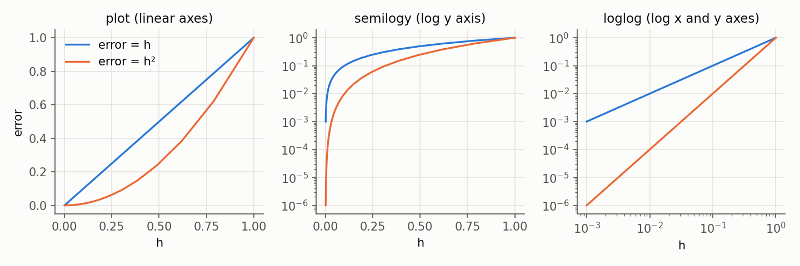
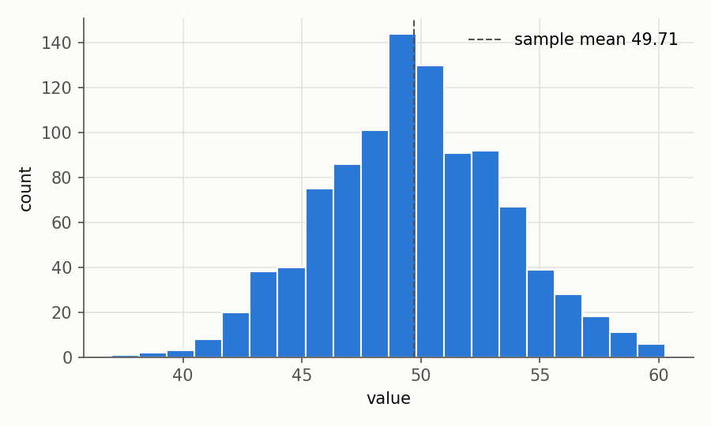
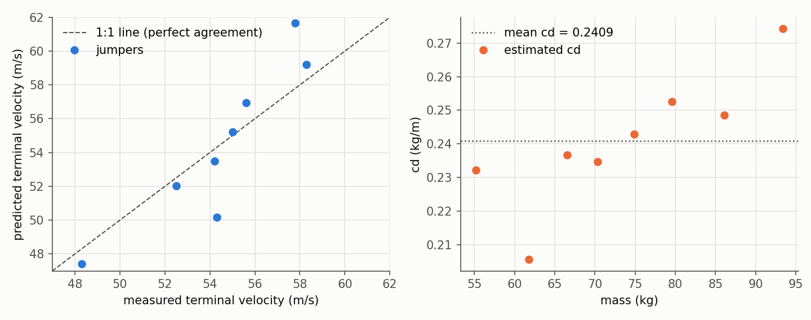

# Chapter 2 — Python Fundamentals

[Repository Guide](../../README.md) | [English](Concepts_Lecture.md) | [한국어](Concepts_Lecture.ko.md)

> **Last Updated:** 2026-11-19
>
> Applied Numerical Methods with Python for Engineers and Scientists, Chapra and Clough, Ch 2

> **Learning Objectives:**
> 1. Describe the numerical computing environment made up of Python, NumPy, SciPy, and Matplotlib
> 2. Perform element-wise and matrix operations on NumPy arrays and tell them apart
> 3. Create arrays and solve linear systems with NumPy and SciPy functions, and draw plots with Matplotlib
> 4. Explain the mutability of Python's built-in types and the properties of numeric types, and avoid errors caused by aliasing
> 5. Explain the principles of views and copies, broadcasting, and vectorization for NumPy arrays
> 6. Carry out an exploratory data analysis that estimates a parameter from measured data and checks the assumptions of a model with plots

---

## Table of Contents

- [1. Programming Environment](#1-programming-environment)
  - [1.1 Components of the Development Environment](#11-components-of-the-development-environment)
  - [1.2 Scripts, Interactive Execution, and Notebooks](#12-scripts-interactive-execution-and-notebooks)
- [2. Python Basics](#2-python-basics)
  - [2.1 Variables and Assignment](#21-variables-and-assignment)
  - [2.2 Data Types](#22-data-types)
  - [2.3 NumPy Arrays](#23-numpy-arrays)
  - [2.4 Mutable Objects and Aliasing](#24-mutable-objects-and-aliasing)
  - [2.5 Properties of Numeric Types](#25-properties-of-numeric-types)
  - [2.6 Views and Copies](#26-views-and-copies)
- [3. Basic Operations](#3-basic-operations)
  - [3.1 Element-wise Operations](#31-element-wise-operations)
  - [3.2 Matrix Operations](#32-matrix-operations)
  - [3.3 Broadcasting](#33-broadcasting)
  - [3.4 Vectorization and Universal Functions](#34-vectorization-and-universal-functions)
  - [3.5 One-Dimensional Arrays and the Matrix Product](#35-one-dimensional-arrays-and-the-matrix-product)
  - [3.6 Operator Precedence and Powers](#36-operator-precedence-and-powers)
  - [3.7 The np.matrix Class and ndarray](#37-the-npmatrix-class-and-ndarray)
- [4. Useful NumPy/SciPy Functions](#4-useful-numpyscipy-functions)
- [5. Plotting with Matplotlib](#5-plotting-with-matplotlib)
- [6. Exploratory Data Analysis: Drag Coefficients Estimated from Measurements](#6-exploratory-data-analysis-drag-coefficients-estimated-from-measurements)
- [Summary](#summary)
- [Self-Check Questions](#self-check-questions)
- [References](#references)

---

<br>

## 1. Programming Environment

Numerical computation here uses **Python** as the primary programming language, together with the scientific computing ecosystem:

- **NumPy**: provides numerical arrays, linear algebra, and mathematical functions.
- **SciPy**: provides advanced scientific computing (ODE solvers, optimization, interpolation, etc.).
- **Matplotlib**: provides 2D/3D plotting and visualization.

| Feature | MATLAB | Python |
|:--------|:-------|:-------|
| License | Commercial (expensive) | Free and open-source |
| Array handling | Built-in matrix type | NumPy `ndarray` |
| Ecosystem | Toolboxes (paid add-ons) | Packages (free via pip/conda) |
| Syntax style | 1-indexed, end keyword | 0-indexed, indentation-based |
| Community | Engineering/academia | Broad (data science, web, ML, etc.) |

*Table 1. Comparison of MATLAB and Python*

> **Note:** Most textbooks on numerical methods were historically written for MATLAB. The concepts and algorithms are identical regardless of the programming language; only the syntax differs. The textbook implements the algorithms in Python.

Python itself is a general-purpose language, so most of the functionality needed for numerical computing comes from **libraries** outside the language. NumPy provides the foundation of arrays and linear algebra, and SciPy and Matplotlib take NumPy arrays as input and output. Because of this layered structure, numerical code is usually written around NumPy arrays, and most of this chapter deals with arrays.

### 1.1 Components of the Development Environment

An environment for numerical computing in Python consists of the following components.

| Component | Role | Example |
|:-----|:-----|:-----|
| Interpreter | Program that reads and executes Python code statement by statement | Python 3.11 |
| Virtual environment | Independent interpreter setup and package collection for each project | `venv`, conda environment |
| Package manager | Downloads and installs libraries and manages their versions | `pip`, `conda` |
| Editor | Writes, runs, and debugs code | Visual Studio Code |
| Notebook | Document holding code, results, and explanations together in cells | Jupyter notebook (`.ipynb`) |

*Table 2. Components of a numerical computing environment in Python*

Python is an **interpreted language**. Unlike C, it does not translate the whole program into machine code in advance; the interpreter reads and executes the code at run time. Code can therefore be run right after it is edited, but repeating an operation millions of times in a Python loop is much slower than in a compiled language. This is why NumPy performs such repetitions inside compiled code (Section 3.4).

A **virtual environment** gives each project its own package installation space. Several projects on one computer can require different versions of NumPy without conflict, and others can reproduce the environment with the same versions. Numerical results can differ in the last digits, or the default behavior of a function can change, depending on the library version, so the versions used must be recorded to reproduce a result.

### 1.2 Scripts, Interactive Execution, and Notebooks

The same code can be run in three ways.

- A **script** is a program stored in a `.py` file and run from top to bottom in one go. It gives the same result in the same order every time, so it is the most reproducible.
- An **interactive shell** shows the result immediately after each line is entered. It is convenient for checking how a function behaves or for small calculations.
- A **notebook** runs code cell by cell and stores the output, plots, and explanatory text of each cell in one document. The program that runs the code in a notebook is called the **kernel**; in the editor, select the kernel (the interpreter of a virtual environment) and run each cell with Shift + Enter.

> **Caution:** Variables in a notebook remain in the kernel's memory in the order in which the cells were run. Running cells in an order other than top to bottom, or editing a cell without running it again, makes the code on screen and the state in memory differ and produces results that cannot be reproduced. Before finishing a notebook, restart the kernel and run all cells again from the beginning to check the results.

An **integrated development environment (IDE)** is a program that combines an editor, an interactive shell, and tools for running and debugging in one window. Spyder, an IDE for scientific computing, provides an IPython console together with a variable explorer that shows the name, type, size, and value of each variable in memory as a table. A common workflow checks the behavior of a function with short calculations in the console and moves longer code to the editor to save it as a script. The usage of a function can be displayed with the built-in function `help`, as in `help(np.linspace)`, and in IPython and Jupyter also with `np.linspace?`. This description comes from the docstring of the function (Section 2.6 of Chapter 3).

---

<br>

## 2. Python Basics

### 2.1 Variables and Assignment

In Python, variables are created by simple assignment. There is no need to declare types explicitly; Python infers the type from the assigned value:

```python
x = 5        # int
y = 3.14     # float
name = "NA"  # string
```

Variable names are case-sensitive (`x` and `X` are different variables) and must start with a letter or underscore.

Assignment in Python does not copy a value into a box; it attaches the name on the left to the **object** created on the right. Every value is an object somewhere in memory, and a variable is a name that refers to that object. Objects have types but names do not, so the same name can be assigned an integer and later a string. This is called **dynamic typing**. The built-in function `type(x)` returns the type of the object the name currently refers to, and `id(x)` returns the unique identity of that object.

Assigning several names at once, `a, b = 1, 2`, and swapping two values, `a, b = b, a`, work on the same principle. A tuple is built on the right, and its elements are attached to the names on the left in order. An **augmented assignment** such as `x += 1`, which combines an operation with assignment, gives the same result as `x = x + 1`; for an object that cannot be changed, such as an integer, it creates a new object and attaches the name to it again.

### 2.2 Data Types

Python provides several built-in data types relevant to scientific computing:

| Type | Example | Description |
|:-----|:--------|:------------|
| `int` | `5`, `-3` | Integer (arbitrary precision) |
| `float` | `3.14`, `1e-6` | Floating-point number (64-bit double) |
| `str` | `'hello'` | Text string |
| `list` | `[1, 2, 3]` | Mutable ordered sequence |
| `tuple` | `(1, 2, 3)` | Immutable ordered sequence |
| `dict` | `{'a': 1}` | Key-value mapping |

*Table 3. Python built-in data types relevant to scientific computing*

For numerical work, Python's built-in `list` is insufficient because it does not support vectorized arithmetic. This is why we use **NumPy arrays**.

Python's built-in types fall into the following groups by purpose.

| Group | Types | Characteristics |
|:-----|:-----|:-----|
| Boolean | `bool` | Has only the two values `True` and `False` and is a subtype of integers, so `True == 1` |
| Numeric | `int`, `float`, `complex` | Integers, reals, and complex numbers (`3 + 4j`) |
| Text | `str` | Immutable sequence of characters |
| Sequence | `list`, `tuple`, `range` | Elements accessed by position (an index starting at 0) |
| Mapping | `dict` | Maps hashable keys to arbitrary values |
| Set | `set` | Unordered collection of distinct hashable objects |

*Table 4. Groups of Python built-in types*

The three sequence types serve different purposes. A **list** is a mutable sequence whose elements can be changed, added, and removed, usually used to collect items of the same kind (`[a]`, `[a, b, c]`). A **tuple** is an immutable sequence that cannot be changed after it is created, used to bundle values of different kinds, for example when a function returns several values at once (`a, b, c` or `(a, b, c)`). A **range** is an immutable sequence that represents an arithmetic progression of integers without storing the elements, used in `for` loops to repeat a fixed number of times. `list(range(10))` is `[0, 1, 2, 3, 4, 5, 6, 7, 8, 9]`.

A **dict** is a mutable mapping that stores key-value pairs. It is used, for example, to map the key `'one'` to the value `1`, and the time to find a value by its key barely depends on the number of elements. Keys must be **hashable**. A hashable object has a hash value that never changes during its lifetime; integers, floats, strings, and tuples of immutable elements are hashable, while lists and dicts are not. A **set** collects hashable objects without order and without duplicates. A set decides whether elements are equal by their hash values and `==`, so objects with equal values such as `True`, `1`, and `1.0` merge into one.

A **str** (string) is an immutable sequence of characters. It is created with single or double quotes, and its characters are taken out by index and slice like a list (`'Numerical'[0:3]` is `'Num'`). `+` concatenates two strings and `*` repeats one, and because strings are immutable, an assignment such as `s[0] = 'n'` raises an error. Strings and numbers do not mix automatically, so `'v = ' + 3.5` is an error, and a number must be converted to a string with `str(3.5)` or an f-string. Conversely, `'3.5'` read from a file or the keyboard is converted to a number with `float('3.5')`. In numerical computing, strings are used mainly for formatting output (Section 1.1 of Chapter 3), file names, and axis labels and legends of plots.

```python
a = [1, 2, 3]
b = a              # b refers to the same list object
b[0] = 99
print(a, b, a is b)

x = 5
y = x              # ints are immutable
y = y + 1          # rebinds y to a new object 6
print(x, y)

print(type(True), True == 1, True + True)
print({True, 1, 1.0, 2})
print(2**100)
print(7 // 2, -7 // 2, 7 % 3, -7 % 3)
print(type(3 / 2), 3 / 2)
z = 3 + 4j
print(z.real, z.imag, abs(z))
```

```text
[99, 2, 3] [99, 2, 3] True
5 6
<class 'bool'> True 2
{True, 2}
1267650600228229401496703205376
3 -4 1 2
<class 'float'> 1.5
3.0 4.0 5.0
```

In the fourth line of the output, the set `{True, 1, 1.0, 2}` has only two elements. `True`, `1`, and `1.0` are all judged equal, so only `True`, inserted first, remains. The other lines are explained in Sections 2.4 and 2.5.

Data read from a file arrive as strings, not numbers. If a line is `"  68.1, 51.69\n"`, `strip()` removes the surrounding spaces and the newline character `\n`, `split(",")` splits at each comma to give `['68.1', ' 51.69']`, and converting each piece with `float` gives 68.1 and 51.69 (`float` ignores the space in front of a piece). In addition, `len(s)` gives the number of characters, `s.startswith(p)` and `s.endswith(p)` tell whether a prefix or suffix matches, `s.isdigit()` tells whether every character is a digit, and `s.upper()` and `s.lower()` change the case. A long string can be split over several lines by writing string literals side by side inside parentheses, and adjacent literals are joined into one.

### 2.3 NumPy Arrays

NumPy's `ndarray` is the fundamental data structure for numerical computing in Python. It provides fast, memory-efficient, multi-dimensional arrays with vectorized operations:

```python
import numpy as np

# 1D array (vector)
a = np.array([1, 2, 3])
print(a)       # [1 2 3]
print(a.shape) # (3,)

# 2D array (matrix)
A = np.array([[1, 2],
              [3, 4]])
print(A)
# [[1 2]
#  [3 4]]
print(A.shape) # (2, 2)
```

The key differences between Python lists and NumPy arrays are:

| Feature | Python `list` | NumPy `ndarray` |
|:--------|:-------------|:----------------|
| Element types | Mixed allowed | Homogeneous (all same type) |
| Arithmetic | Concatenation (`+`) | Element-wise addition |
| Performance | Slow (interpreted loop) | Fast (compiled C backend) |
| Memory | Higher overhead | Compact, contiguous |

*Table 5. Differences between Python lists and NumPy arrays*

> **Definition:** An **ndarray** is the NumPy array object that stores elements of one data type in a contiguous block of memory (the data buffer) and records in metadata (shape, data type, and strides) how to interpret that block as a multidimensional array.

An array consists of a data buffer and metadata. The main attributes of the metadata are the following.

- `shape` is a tuple of the length of each dimension. `(3,)` is a one-dimensional array of three elements, and `(2, 2)` is an array of two rows and two columns.
- `ndim` is the number of dimensions, and `size` is the total number of elements.
- `dtype` is the data type of one element; `int64` (64-bit integer) and `float64` (64-bit double-precision real) are the most common. An array containing even a single float is `float64`, and one created from integers only gets the platform's default integer type, which is `int64` on most 64-bit systems.
- `itemsize` is the number of bytes of one element, and `strides` is a tuple of how many bytes to skip in the buffer to reach the next element along each dimension.

```python
import numpy as np

a = np.array([1, 2, 3])
b = np.array([1.0, 2, 3])
print(a.dtype, b.dtype, (a + b).dtype)

big = np.array([2**62], dtype=np.int64)
print(big * 4)          # fixed-width integers wrap around

A = np.arange(12).reshape(3, 4)
print(A.shape, A.ndim, A.size, A.dtype, A.itemsize, A.strides)
print(A.T.strides)
```

```text
int64 float64 float64
[0]
(3, 4) 2 12 int64 8 (32, 8)
(8, 32)
```

For the `int64` array `A` of 3 rows and 4 columns, `strides` is `(32, 8)`. The next element in the same row is 8 bytes later, and the element in the same column of the next row is four elements, or 32 bytes, later; this is the **row-major order** layout in which the rows are stored one after another. The transpose `A.T` does not move the data; it changes only the strides to `(8, 32)` and reads the same buffer in column order. Viewing the same data differently by changing only the metadata in this way is the view of Section 2.6.

Array elements are referred to by indices starting at 0. In `a = np.arange(10, 70, 10)`, that is, `[10 20 30 40 50 60]`, `a[0]` is 10, and a negative index counts from the end, so `a[-1]` is 60. A slice `a[start:stop]` is a **half-open interval** that includes `start` and excludes `stop`, so `a[1:4]` is `[20 30 40]` and its length is `stop - start = 3`. Thanks to this rule, `a[:3]` and `a[3:]` split the array into two parts with neither overlap nor gap. In a two-dimensional array, `A[i, j]` is the element in row $`i`$ and column $`j`$, `A[i]` is the whole row $`i`$, and `A[:, j]` is the whole column $`j`$. Matrix subscripts in mathematics textbooks usually start at 1, so note that $`a_{11}`$ becomes `A[0, 0]` in code.

### 2.4 Mutable Objects and Aliasing

A **mutable object** can have its contents changed after it is created (lists, dicts, sets, NumPy arrays), and an **immutable object** cannot (integers, floats, strings, tuples). The distinction matters because assignment does not copy an object.

> **Definition:** An **alias** is another name that refers to the same object already referred to by a different name.

In the code of Section 2.2, `b = a` does not copy the list; it attaches one more name `b` to the same list. So when `b[0] = 99` changes the contents of the list, the change is visible through `a` as well, and `a is b` is `True` because the two names refer to the same object. In contrast, for the integer `x = 5`, after `y = x` and then `y = y + 1`, the integer object 5 is not changed; a new object 6 is created and attached to `y`. So `x` is still 5.

Aliasing causes errors that are hard to find in numerical code. For example, if an iterative method keeps the previous approximation with `x_old = x` and then updates the elements of the array `x` in place, `x_old` is the same array and changes along with it, so the difference between the two approximations is always zero. In such cases a copy must be made explicitly, as in `x_old = x.copy()`. A copy of a list can be made with `a.copy()`, `list(a)`, or `a[:]`, but these are **shallow copies** that copy only the outer list, so if a list contains lists, `copy.deepcopy`, which also copies the inner lists, is needed.

> **Caution:** Function arguments are passed in the same way as assignment. If a function changes the elements of a list or array it received as an argument, the caller's object changes too. A function that must preserve its input should make a copy first and work on that.

### 2.5 Properties of Numeric Types

The output of the code in Section 2.2 shows the properties of Python's numeric types.

- **Integers.** Python's `int` is an **arbitrary-precision** integer with no size limit. `2**100` produces a 31-digit integer exactly. In contrast, the integers of a NumPy array have a fixed width such as 64 bits, so when a result exceeds $`2^{63} - 1`$, as in `big * 4` of Section 2.3, the value wraps around without warning (`2**64` becomes 0) and gives a wrong result.
- **Reals.** `float` and NumPy's `float64` are IEEE 754 double-precision numbers with about 15-16 significant digits. As a result, roundoff errors arise, such as `0.1 + 0.2` not being exactly `0.3`; the principle is covered in Chapter 4.
- **Complex numbers.** The imaginary unit is written `j`, as in `3 + 4j`. `z.real` and `z.imag` are the real and imaginary parts, and `abs(z)` is the magnitude $`\sqrt{3^2 + 4^2} = 5`$. Complex division is the same as multiplying the numerator and denominator by the complex conjugate of the denominator, so `1 / (3 + 4j)` is $`(3 - 4j)/25 = 0.12 - 0.16j`$. Mathematical functions that accept complex arguments live in the `cmath` module, not `math`, and `cmath.sqrt(-4)` is `2j`. Complex roots of polynomials (Chapter 6) and Fourier analysis (Chapter 16) use complex numbers.
- **Division.** `/` always gives a float, even between integers (`3 / 2` is 1.5). `//` is **floor division**, which rounds the result toward negative infinity, so `7 // 2` is 3 but `-7 // 2` is $`-4`$, the floor of $`-3.5`$. `%` is the remainder satisfying `a == (a // b) * b + a % b`, so `-7 % 3` is 2.
- **Type promotion.** Adding an integer array and a float array gives `float64`, the type that loses no information (first line of the output in Section 2.3).

> **Caution:** Assigning a float into an array created from integers, as in `np.array([1, 2, 3])`, discards the fractional part. For example, running `a[0] = 0.7` makes `a[0]` equal to 0. In numerical computing, an array that will hold results should be created as a float array, as in `np.zeros(n)`, or with `dtype=float`.

### 2.6 Views and Copies

Ways of creating a new array from a NumPy array fall into two groups depending on whether the data buffer is shared.

> **Definition:** A **view** is an array that shares the same data buffer as the original array and looks at the data differently by changing only metadata such as the shape, strides, and data type.

Changing an element through a view also changes the original array, because the buffer is the same. In contrast, a **copy** is an array with a newly created data buffer and metadata, so changing a copy does not change the original array. Which one is created depends on the operation.

| Operation | Result | Reason |
|:-----|:-----|:-----|
| Basic slicing `A[1]`, `A[:, 0]`, `A[::2]` | View | Expressible by changing only the starting position and strides |
| Transpose `A.T`, most `reshape` calls | View | Change only the strides and shape |
| Fancy indexing `A[[0, 2]]` | Copy | The selected elements are not spaced at a constant stride |
| Boolean indexing `A[A > 5]` | Copy | Same reason |
| `A.copy()` | Copy | Explicit copy |

*Table 6. NumPy operations, views, and copies*

```python
import numpy as np

A = np.arange(12).reshape(3, 4)
row = A[1]            # basic slicing: a view
row[:] = 0
print(A)
print(np.shares_memory(A, row))

C = A[[0, 2]]         # fancy indexing: a copy
C[:] = -1
print(A[0], np.shares_memory(A, C))
```

```text
[[ 0  1  2  3]
 [ 0  0  0  0]
 [ 8  9 10 11]]
True
[0 1 2 3] False
```

`A[1]` is a view of the second row, so `row[:] = 0` sets the second row of `A` to zero. `np.shares_memory` checks whether two arrays share memory. `A[[0, 2]]` is a copy selecting the first and third rows, so filling `C` with $`-1`$ leaves `A` unchanged.

Views are efficient because they handle part of a large array without copying it, but they cause the same kind of error as the aliasing of Section 2.4. Passing the original matrix to an algorithm that modifies the rows of a matrix in place, such as Gauss elimination (Chapter 8), corrupts the original matrix, so `A.copy()` must be passed if the original is to be preserved. Checking views and copies in actual code is covered in the Chapter 2 lab.

---

<br>

## 3. Basic Operations

### 3.1 Element-wise Operations

Standard arithmetic operators on NumPy arrays act **element-wise**:

```python
a = np.array([1, 2, 3])
b = np.array([4, 5, 6])

print(a + b)   # [5 7 9]     element-wise addition
print(a - b)   # [-3 -3 -3]  element-wise subtraction
print(a * b)   # [4 10 18]   element-wise multiplication
print(a / b)   # [0.25 0.4 0.5] element-wise division
print(a ** 2)  # [1 4 9]     element-wise power
```

### 3.2 Matrix Operations

For matrix (linear algebra) operations, use the `@` operator or dedicated NumPy functions:

```python
A = np.array([[1, 2],
              [3, 4]])
B = np.array([[5, 6],
              [7, 8]])

# Matrix multiplication
C = A @ B            # preferred syntax (Python 3.5+)
C = np.dot(A, B)     # equivalent

# Transpose
print(A.T)
# [[1 3]
#  [2 4]]
```

> **Caution:** Distinguish carefully between `*` (element-wise multiplication) and `@` (matrix multiplication). This is one of the most common sources of bugs in numerical Python code.

### 3.3 Broadcasting

When an element-wise operation is applied to two arrays of different shapes, NumPy stretches the smaller array by fixed rules to match the shapes.

> **Definition:** **Broadcasting** is the rule that, in element-wise operations between arrays of different shapes, matches the two shapes by treating dimensions of length 1 or missing dimensions as if they were repeated, without actually copying them.

The rule compares the two shapes aligned from the right end (the last dimension).

1. If the numbers of dimensions differ, dimensions of length 1 are prepended to the shorter shape.
2. In each dimension, the two lengths are compatible if they are equal or one of them is 1, and the resulting length is the larger of the two.
3. If in any dimension the two lengths differ and neither is 1, an error occurs.

The simplest example is an operation between an array and a scalar. In `a * 2`, the scalar 2 is treated as an array of shape `()` and applied repeatedly to every element. A more useful example is building a table by combining a column vector and a row vector. The following code computes the bungee jumper velocity of Section 2.4 of Chapter 1 for every combination of three masses and four times at once.

```python
import numpy as np

g, cd = 9.81, 0.25
m = np.array([[50.0], [68.1], [100.0]])   # column: 3 masses, shape (3, 1)
t = np.array([0.0, 2.0, 4.0, 8.0])        # row: 4 times, shape (4,)
v = np.sqrt(g * m / cd) * np.tanh(np.sqrt(g * cd / m) * t)
print(v.shape)
print(np.round(v, 2))
print(v.max(axis=1).round(2), v.mean(axis=0).round(2))
```

```text
(3, 4)
[[ 0.   18.43 31.42 41.81]
 [ 0.   18.73 33.11 46.96]
 [ 0.   19.   34.8  53.19]]
[41.81 46.96 53.19] [ 0.   18.72 33.11 47.32]
```

Aligning the shape `(3, 1)` of `m` and the shape `(4,)` of `t` from the right, rule 1 makes `t` into `(1, 4)`, and rule 2 gives resulting lengths 3 and 4 in the two dimensions. So `v` is a `(3, 4)` table whose rows are masses and whose columns are times. The larger the mass, the larger the velocity at the same time. In the last line, `max(axis=1)` is the maximum of each row (mass), and `mean(axis=0)` is the mean of each column (time). `axis` means that elements are gathered and reduced along that dimension, and the reduced dimension disappears from the result.

> **Caution:** Broadcasting can produce an unexpected shape without an error. For example, subtracting an array of shape `(3, 1)` from one of shape `(3,)` gives a `(3, 3)` array rather than an error. It is a good habit to check the shape of a result with `shape`.

### 3.4 Vectorization and Universal Functions

Applying an operation to a whole array at once, instead of processing the elements one by one in a loop, is called **vectorization**. Computing the 12 velocities in one line without a loop in Section 3.3 is an example of vectorization.

There are three reasons vectorization is fast. First, the repetition happens inside compiled code rather than in the Python interpreter, so there is no cost of interpreting a statement for each element. Second, all elements of an array have the same data type, so no type check is needed for each element. Third, the elements lie in contiguous memory, which uses the CPU cache efficiently. As a result, the same computation is commonly tens to hundreds of times faster than a Python loop. A comparison of the run times of a loop and of vectorized code is covered in the Chapter 3 lab.

NumPy functions such as `np.sqrt`, `np.exp`, `np.sin`, and `np.tanh` are **universal functions (ufuncs)**. Given an array, a universal function returns an array of the same shape with the same operation applied to each element, and it also follows the broadcasting rules. The arithmetic operators `+`, `*`, and `**` are also universal functions internally.

An operation that reduces a whole array or one dimension to a single value is called a **reduction**.

| Function | Result |
|:-----|:-----|
| `a.sum()`, `a.prod()` | Sum, product |
| `a.mean()`, `a.std()` | Mean, standard deviation |
| `a.min()`, `a.max()` | Minimum, maximum |
| `a.argmin()`, `a.argmax()` | Position of the minimum, maximum (flattened index) |
| `np.cumsum(a)` | Cumulative sum (not a reduction but an array of the same length) |

*Table 7. Frequently used reduction functions*

```python
import numpy as np

v = np.array([[0.0, 18.43, 31.42],
              [0.0, 18.73, 33.11]])
print(v.sum(), v.sum(axis=0), v.sum(axis=1))
print(v.argmax(), np.cumsum([1, 2, 3, 4]))
```

```text
101.69 [ 0.   37.16 64.53] [49.85 51.84]
5 [ 1  3  6 10]
```

`v.sum()` is the sum of the six elements, `sum(axis=0)` is the sum of each column, and `sum(axis=1)` is the sum of each row. The 5 of `argmax()` is the position of the maximum 33.11 when the array is flattened in row-major order.

### 3.5 One-Dimensional Arrays and the Matrix Product

A one-dimensional array of shape `(n,)` is neither a row vector nor a column vector. The matrix product `@` interprets a one-dimensional array according to the situation: as a column vector when it follows a matrix, as a row vector when it precedes a matrix, and between two one-dimensional arrays it computes the inner product.

```python
import numpy as np

x = np.array([1.0, 2.0, 3.0])          # shape (3,): neither row nor column
A = np.array([[1.0, 0.0, 2.0],
              [0.0, 1.0, 1.0]])        # shape (2, 3)
print(A @ x, (A @ x).shape)
print(x @ x, np.outer(x, x).shape)
print(x.reshape(3, 1).shape, x.reshape(1, 3).shape)
```

```text
[7. 5.] (2,)
14.0 (3, 3)
(3, 1) (1, 3)
```

`A @ x` is $`(2 \times 3)(3) \to (2)`$, giving $`[1 + 6,\ 2 + 3] = [7, 5]`$. `x @ x` is the inner product $`1 + 4 + 9 = 14`$, and `np.outer(x, x)` is the $`3 \times 3`$ matrix $`x x^T`$. When the column and row vectors of mathematics must be clearly distinguished, `reshape` changes the shape to `(3, 1)` or `(1, 3)`. The transpose `x.T` of a one-dimensional array keeps the shape `(3,)`, so it does not create a column vector.

### 3.6 Operator Precedence and Powers

The precedence of the arithmetic operators, from highest to lowest, is exponentiation `**`, the unary sign `-x`, multiplication and division (`*`, `/`, `//`, `%`, `@`), and addition and subtraction. The list of operators and the associativity of exponentiation are covered in the Chapter 2 lab; this section collects the cases that cause errors when formulas are translated into code.

```python
import numpy as np

x = 3.0
print(-x**2, (-x)**2, np.exp(-x**2 / 2))
print((-8)**(1/3), np.cbrt(-8.0))
print(np.float64(-8.0)**(1/3))
print(2**-1, type(2**-1).__name__)
try:
    np.array([1, 2, 4])**-1
except ValueError as err:
    print("ValueError:", err)
print(np.array([1.0, 2.0, 4.0])**-1)
```

```text
-9.0 9.0 0.011108996538242306
(1.0000000000000002+1.7320508075688772j) -2.0
nan
0.5 float
ValueError: Integers to negative integer powers are not allowed.
[1.   0.5  0.25]
```

- Exponentiation is evaluated before the unary sign, so `-x**2` is `-(x**2)`, that is, $`-9`$. This matches the meaning of $`-x^2`$ in mathematics, so the Gaussian function $`e^{-x^2/2}`$ can be written directly as `np.exp(-x**2 / 2)` ($`e^{-4.5} \approx 0.011109`$). The square of a negative number requires parentheses, as in `(-x)**2`.
- A fractional power of a negative number is not real. Python's `(-8)**(1/3)` returns the complex number $`1 + 1.7321i`$, not the real cube root $`-2`$. A negative base with a non-integral exponent is defined to give a complex result [1], and this value is the principal cube root $`2e^{i\pi/3}`$ of $`-8 = 8e^{i\pi}`$. Moreover, `1/3` is not exactly representable in binary, so the exponent itself is not exactly 1/3. The real cube root is obtained with `np.cbrt`.
- With NumPy's `float64`, the same computation gives NaN instead of a complex number and issues a warning (`RuntimeWarning: invalid value encountered in scalar power`). This is an example of the same expression giving different results for Python floats and NumPy floats.
- The negative power of a Python integer, `2**-1`, is the float 0.5, but a negative integer exponent on a NumPy integer array raises `ValueError`. The result of an integer array must be an integer array, and $`2^{-1}`$ is not an integer. For a float array, `np.array([1.0, 2.0, 4.0])**-1` gives the reciprocal of each element.

### 3.7 The np.matrix Class and ndarray

Besides `ndarray`, NumPy also has a class dedicated to matrices, `np.matrix`. An `np.matrix` is always two-dimensional, and for it `*` means the matrix product and `**` the matrix power [2]. The class was made for MATLAB-like use and appears often in older textbooks and code, but the same operators do different things in the two classes, so mixing them causes errors that are hard to find.

```python
import numpy as np

A = np.array([[1, 2], [3, 4]])
M = np.matrix([[1, 2], [3, 4]])
print(A * A)                  # element-wise for ndarray
print(M * M)                  # matrix product for np.matrix
print(M**2 - A @ A)           # ** is a matrix power for np.matrix
print(A[0].shape, M[0].shape) # a row of a matrix stays 2-D
x = np.array([1, 1])
print(A @ x, (M @ x).shape)
print(type(np.asarray(M)).__name__, np.asarray(M).shape)
```

```text
[[ 1  4]
 [ 9 16]]
[[ 7 10]
 [15 22]]
[[0 0]
 [0 0]]
(2,) (1, 2)
[3 7] (1, 2)
ndarray (2, 2)
```

- `A * A` is the element-wise product `[[1, 4], [9, 16]]`, and `M * M` is the matrix product `[[7, 10], [15, 22]]`. Two objects with the same shape and values give different results because of a single operator.
- `M**2` equals `M @ M`, so its difference from `A @ A` is the zero matrix. For an `ndarray`, `A**2` is the element-wise square.
- Taking one row of an `ndarray`, `A[0]`, gives a one-dimensional array of shape `(2,)`, but `M[0]` is a matrix of shape `(1, 2)`. An `np.matrix` stays two-dimensional through every operation, so `M @ x` with a one-dimensional array `x` also becomes a row matrix of shape `(1, 2)`, not a column. This differs from the `ndarray` case of Section 3.5, where `A @ x` gives the one-dimensional array `[3 7]`.
- `np.asarray(M)` returns an `ndarray` with the same data.

The NumPy documentation recommends regular arrays instead of `np.matrix`, even for linear algebra, and states that the class may be removed in the future [2]. All code in later chapters uses `ndarray` and `@`. When code written with `np.matrix` is translated, every `*` must be checked to see whether it is a matrix product or an element-wise product and replaced with `@` or `*` accordingly.

---

<br>

## 4. Useful NumPy/SciPy Functions

The following functions are used frequently throughout the numerical computations that follow.

**Array creation:**

| Function | Description | Example |
|:---------|:-----------|:--------|
| `np.linspace(start, stop, num)` | Evenly spaced points | `np.linspace(0, 1, 5)` $`\to`$ `[0, 0.25, 0.5, 0.75, 1]` |
| `np.arange(start, stop, step)` | Evenly spaced by step size | `np.arange(0, 1, 0.2)` $`\to`$ `[0, 0.2, 0.4, 0.6, 0.8]` |
| `np.zeros(n)` | Array of zeros | `np.zeros(3)` $`\to`$ `[0, 0, 0]` |
| `np.ones(n)` | Array of ones | `np.ones(3)` $`\to`$ `[1, 1, 1]` |
| `np.eye(n)` | $`n \times n`$ identity matrix | `np.eye(3)` $`\to`$ $`I_3`$ |

*Table 8. NumPy array creation functions*

**Linear algebra (`np.linalg`):**

| Function | Description |
|:---------|:-----------|
| `np.linalg.solve(A, b)` | Solve $`Ax = b`$ for $`x`$ |
| `np.linalg.inv(A)` | Compute $`A^{-1}`$ (matrix inverse) |
| `np.linalg.det(A)` | Compute $`\det(A)`$ (determinant) |
| `np.linalg.norm(x)` | Compute vector/matrix norm |
| `np.linalg.eig(A)` | Compute eigenvalues and eigenvectors |

*Table 9. Linear algebra functions in np.linalg*

```python
A = np.array([[2, 1],
              [5, 3]])
b = np.array([4, 7])

x = np.linalg.solve(A, b)  # Solve Ax = b
print(x)                    # [5. -6.]

print(np.linalg.det(A))    # 1.0000000000000002
print(np.linalg.inv(A))    # [[ 3. -1.] [-5.  2.]]
```

The determinant of this matrix is exactly $`2 \times 3 - 1 \times 5 = 1`$, but `np.linalg.det` computes it in floating point through an LU factorization, so a roundoff error appears in the last digit, as in 1.0000000000000002. Roundoff error is covered in Chapter 4.

`np.linspace` and `np.arange` serve different purposes. `linspace` fixes the number of points including the endpoint, so it suits a grid that divides an interval $`[a, b]`$ into $`n - 1`$ equal parts. `arange` fixes the spacing and excludes the endpoint, and when the spacing is a float, floating-point error can add or drop an element near the endpoint. A grid with a float spacing is therefore safer to build with `linspace`.

Mathematical functions exist both in the standard library module `math` and in NumPy. `math.sqrt` and `math.exp` accept only a single scalar, while `np.sqrt` and `np.exp` accept an array and apply to each element. They also handle inputs outside the domain differently.

```python
import math
import numpy as np

print(np.sqrt(np.array([4.0, -1.0])))
print(np.sqrt(np.array([4.0, -1.0], dtype=complex)))
try:
    math.sqrt(-1.0)
except ValueError as err:
    print('ValueError:', err)
```

```text
[ 2. nan]
[2.+0.j 0.+1.j]
ValueError: math domain error
```

For the square root of a negative number, NumPy writes a warning to standard error (`RuntimeWarning: invalid value encountered in sqrt`), returns **NaN** (not a number), and continues the computation. With the data type changed to `complex`, it gives the imaginary result $`i`$. `math.sqrt` raises an exception (`ValueError`) and stops execution. NaN propagates through all later arithmetic (any operation with NaN gives NaN), so if the result of an iterative computation becomes NaN, it signals that an input outside the domain arose somewhere in an earlier step. The constants $`\pi`$ and $`e`$ are written `np.pi` and `np.e`.

SciPy is divided into subpackages by function, and it has functions corresponding to most of the methods of later chapters. Comparing the results of an algorithm implemented by hand with the results of these functions verifies the implementation.

| Subpackage | Main Functionality | Related Chapters |
|:-----|:-----|:-----|
| `scipy.optimize` | Root finding (`brentq`, `root_scalar`), minimization (`minimize_scalar`, `minimize`), curve fitting (`curve_fit`) | Chapters 5-7, 15 |
| `scipy.linalg` | Linear algebra broader than `np.linalg`, such as LU and Cholesky factorization and eigenvalues | Chapters 8-13 |
| `scipy.interpolate` | Polynomial interpolation, splines | Chapters 17-18 |
| `scipy.integrate` | Numerical integration (`quad`), ODE solvers (`solve_ivp`) | Chapters 19-20, 22-24 |
| `scipy.fft` | Fast Fourier transform | Chapter 16 |
| `scipy.constants` | Physical constants (`g`, `c`, etc.) | Throughout |

*Table 10. Main subpackages of SciPy*

The functions of `math` do not accept arrays. Using `math.tanh(t)` to apply the bungee jumper velocity formula to an array of times at once raises `TypeError`, so arrays require NumPy universal functions such as `np.tanh` (Section 3.4). Functions for angles and logarithms also need care.

```python
import math
import numpy as np

t = np.array([0.0, 2.0, 4.0])
try:
    math.tanh(t)
except TypeError as err:
    print("TypeError:", err)
print(math.atan(1 / -1), math.atan2(1, -1), np.degrees(np.arctan2(1, -1)))
print(math.log(1000, 10), math.log10(1000), np.log2(8))
```

```text
TypeError: only length-1 arrays can be converted to Python scalars
-0.7853981633974483 2.356194490192345 135.0
2.9999999999999996 3.0 3.0
```

- Computing the angle of the point $`(x, y) = (-1, 1)`$ with `math.atan(y / x)` gives $`\tan^{-1}(-1) = -\pi/4`$. The arctangent takes values only in $`(-\pi/2, \pi/2)`$, so $`y/x`$ alone cannot tell a point in the second quadrant from one in the fourth. `math.atan2(y, x)` looks at the signs of the two arguments separately and gives the angle in the correct quadrant, $`3\pi/4`$ (135°), between $`-\pi`$ and $`\pi`$ [3]. Note that the arguments come in the order `y`, `x`.
- All trigonometric functions use radians, and `np.degrees` and `np.radians` convert the units.
- `math.log(x)` is the natural logarithm, and `math.log(x, b)` computes the logarithm to base $`b`$ as $`\ln x/\ln b`$ [3]. Because of the rounding in that one division, `math.log(1000, 10)` is 2.9999999999999996, not 3. For common and binary logarithms, `math.log10` and `np.log2` are more accurate. Converting such a value with `int` discards the fractional part and gives 2, so counting digits with logarithms requires particular care.

---

<br>

## 5. Plotting with Matplotlib

Matplotlib is the standard plotting library for Python. The `pyplot` interface provides MATLAB-like plotting commands:

```python
import matplotlib.pyplot as plt
import numpy as np

x = np.linspace(0, 2 * np.pi, 100)
y = np.sin(x)

plt.plot(x, y)
plt.xlabel('x')
plt.ylabel('sin(x)')
plt.title('Sine Function')
plt.grid(True)
plt.show()
```

Multiple curves can be plotted on the same figure:

```python
plt.plot(x, np.sin(x), label='sin(x)')
plt.plot(x, np.cos(x), label='cos(x)')
plt.xlabel('x')
plt.ylabel('y')
plt.title('Trigonometric Functions')
plt.legend()
plt.grid(True)
plt.show()
```

Common customizations include line styles (`'-'`, `'--'`, `':'`), colors (`'r'`, `'b'`, `'g'`), and markers (`'o'`, `'s'`, `'^'`).

When a figure has several axes (plot areas), the **object-oriented interface** is clearer. `fig, ax = plt.subplots()` creates a figure object `fig` and an axes object `ax`, and later commands state which axes to draw on, as in `ax.plot` and `ax.set_xlabel`. Numerical analysis often plots errors, and errors vary over many orders of magnitude, so the axis scales must be changed to logarithmic. The following code plots two cases, errors proportional to $`h`$ and to $`h^2`$, on three kinds of axes.

```python
import numpy as np
import matplotlib.pyplot as plt

h = np.logspace(-3, 0, 30)               # 30 step sizes from 1e-3 to 1
fig, axs = plt.subplots(1, 3, figsize=(9.6, 3.2))
for ax, kind in zip(axs, ['plot', 'semilogy', 'loglog']):
    draw = getattr(ax, kind)             # ax.plot, ax.semilogy, or ax.loglog
    draw(h, h, label='error = h')
    draw(h, h**2, label='error = h²')
    ax.set_title(kind)
    ax.set_xlabel('h')
axs[0].set_ylabel('error')
axs[0].legend()
fig.savefig('Ch02_Axis-Scales.png', dpi=150)
```



*Figure 1. The same error curves on linear, semilog, and log-log axes*

- `np.logspace(-3, 0, 30)` creates 30 points evenly spaced on a logarithmic scale from $`10^{-3}`$ to $`10^0`$. Data to be plotted on logarithmic axes should be generated with logarithmic spacing like this so that the points are evenly placed.
- `plt.subplots(1, 3, ...)` creates an array `axs` of axes in 1 row and 3 columns, and `figsize` is the width and height of the figure in inches.
- `getattr(ax, kind)` retrieves the method of the axes whose name equals the string `kind`. It is used to draw the same data with `plot`, `semilogy`, and `loglog` on the three axes.
- `fig.savefig` saves the figure to a file, and `dpi` is the resolution.

On the linear axes of Figure 1, the differences at small $`h`$ are invisible. Semilog axes (`semilogy`) make only the vertical axis logarithmic, so a quantity that varies exponentially, such as $`e^{-kt}`$, becomes a straight line; they are used to plot error against the iteration number (Chapters 5-6). On log-log axes (`loglog`), $`e = Ch^p`$ becomes $`\log e = \log C + p \log h`$, a straight line of slope $`p`$. So when the error is plotted against the step size on log-log axes, the order of a method can be read from the slope (Section 3.5 of Chapter 1, Chapter 4).

The way a plot represents data should match the nature of the data. A set of separate points, such as measurements, is drawn with markers only, as in `plt.plot(x, y, 'o')` or `plt.scatter(x, y)`, and a continuous function, such as an analytical solution or a model, is drawn with a line. Connecting measurements with lines suggests that values exist between the points, and drawing a model with markers only hides its behavior between the markers.

How a large number of measurements is spread out is shown by a **histogram**. A histogram divides the range of values into intervals (bins) of equal width and draws the number of values in each bin as the height of a bar. The following code draws 1000 random numbers from a normal distribution with mean 50 and standard deviation 4 and plots their histogram.

```python
import numpy as np
import matplotlib.pyplot as plt

rng = np.random.default_rng(seed=7)       # reproducible random numbers
data = rng.normal(loc=50.0, scale=4.0, size=1000)
counts, edges = np.histogram(data, bins=20)
print(counts.sum(), counts.max(), round(edges[0], 2), round(edges[-1], 2))
print(round(data.mean(), 3), round(data.std(ddof=1), 3))

fig, ax = plt.subplots()
ax.hist(data, bins=20, edgecolor='white')
ax.set_xlabel('value')
ax.set_ylabel('count')
fig.savefig('Ch02_Histogram.png', dpi=150)
```

```text
1000 144 36.99 60.29
49.711 3.767
```



*Figure 2. Histogram of 1000 random numbers drawn from a normal distribution*

- `np.random.default_rng(seed=7)` creates a random number generator. Fixing the seed produces the same sequence of random numbers on every run, so the result can be reproduced.
- `rng.normal(loc, scale, size)` draws `size` values from a normal distribution with mean `loc` and standard deviation `scale`.
- `np.histogram` draws nothing and returns the count in each bin, `counts`, and the bin edges, `edges` (21 of them). The counts sum to 1000, the fullest bin holds 144 values, and the range from the minimum 36.99 to the maximum 60.29 is divided into 20 bins of width 1.165. `ax.hist` performs the same computation and then draws the bars.
- `std(ddof=1)` is the sample standard deviation, the square root of the sum of squared deviations divided by $`n - 1`$; the default `ddof=0` divides by $`n`$ instead of $`n - 1`$.

The sample mean 49.711 and sample standard deviation 3.767 are close to, but not equal to, the values 50 and 4 of the normal distribution. A statistic computed from a finite sample carries its own error and approaches the population value as the sample grows. The number of bins also changes the impression of the plot. Too few bins blur the shape of the distribution, and too many leave few values in each bin, so the bar heights become ragged.

---

<br>

## 6. Exploratory Data Analysis: Drag Coefficients Estimated from Measurements

The parameters of a formula often have to be determined from measurements. The process of computing and plotting the data in various ways to find hidden patterns before drawing conclusions is called **exploratory data analysis**. Solving the terminal velocity $`v_t = \sqrt{gm/c_d}`$ of Section 2.4 of Chapter 1 for the drag coefficient gives the following.

```math
c_d = \frac{gm}{v_t^2}
```

Measuring the terminal velocities of several people of known mass therefore gives an estimate of the drag coefficient for each person. The following code computes the drag coefficients from the masses and terminal velocities of eight people, predicts the terminal velocities again with their single mean, and compares the predictions with the measurements.

```python
import numpy as np
import matplotlib.pyplot as plt

g = 9.81
m = np.array([55.2, 61.8, 66.5, 70.3, 74.9, 79.6, 86.1, 93.4])    # mass (kg)
vt = np.array([48.3, 54.3, 52.5, 54.2, 55.0, 55.6, 58.3, 57.8])   # terminal velocity (m/s)
cd = g * m / vt**2                        # lumped drag coefficient (kg/m)
print(np.round(cd, 4))
print(f"mean {cd.mean():.4f}, min {cd.min():.4f}, max {cd.max():.4f}, "
      f"std {cd.std(ddof=1):.4f}")
vpred = np.sqrt(g * m / cd.mean())        # model with one common cd
print(np.round(vpred - vt, 2))
print(round(np.corrcoef(m, cd)[0, 1], 3))

fig, axs = plt.subplots(1, 2, figsize=(9.6, 3.8))
axs[0].plot(vt, vpred, 'o')               # data: markers only
axs[0].plot([47, 62], [47, 62], 'k--')    # 1:1 line of perfect agreement
axs[0].set_xlabel('measured vt (m/s)')
axs[0].set_ylabel('predicted vt (m/s)')
axs[1].plot(m, cd, 'o')
axs[1].axhline(cd.mean(), ls=':')         # the common cd of the model
axs[1].set_xlabel('mass (kg)')
axs[1].set_ylabel('cd (kg/m)')
fig.savefig('Ch02_Drag-Coefficient-EDA.png', dpi=150)
```

```text
[0.2321 0.2056 0.2367 0.2348 0.2429 0.2526 0.2485 0.2743]
mean 0.2409, min 0.2056, max 0.2743, std 0.0196
[-0.89 -4.14 -0.46 -0.7   0.22  1.33  0.91  3.87]
0.837
```



*Figure 3. Terminal velocities predicted with a common drag coefficient versus measurements, and estimated drag coefficients versus mass*

- `cd = g * m / vt**2` computes the eight drag coefficients in one line. Between arrays, `*`, `/`, and `**` are all element-wise operations (Section 3.1). The first element is $`9.81 \times 55.2/48.3^2 = 541.512/2332.89 = 0.2321`$ kg/m.
- The mean drag coefficient is 0.2409 kg/m; the smallest value is about 15% below the mean and the largest about 14% above it. The sample standard deviation from `std(ddof=1)` is 0.0196 kg/m.
- `vpred` is the terminal velocity predicted with the single mean drag coefficient, and the third line of the output is the prediction minus the measurement. The four lighter people all have negative differences (prediction too small), and the four heavier people all have positive differences (prediction too large).
- `np.corrcoef(m, cd)` returns the correlation coefficient matrix of mass and drag coefficient. The off-diagonal element 0.837 means that the two quantities tend strongly to increase together.
- The plotting code draws the measurements with markers (`'o'`) and the 1:1 line of perfect agreement and the mean drag coefficient with lines (Section 5).

If all points on the left of Figure 3 lay on the dashed line, the model with a common drag coefficient would explain the data perfectly. The points scatter near the dashed line, but they lean below it at small measured values and above it at large ones. The right plot shows the cause. The estimated drag coefficient is not constant but tends to increase with mass. Some points depart strongly from the trend, such as 0.2056 for the person of 61.8 kg, so more measurements are needed to tell whether it is a measurement error or a real difference.

This trend can be explained with $`c_d = \frac{1}{2}\rho AC_D`$ of Section 2.1 of Chapter 1. The air density $`\rho`$ depends on the temperature and the pressure, so if the measurements were taken at one place over a short period, it is nearly the same for everyone. The differences in $`c_d`$ must then come from the cross-sectional area $`A`$ or from $`C_D`$, which depends on posture and clothing, and the simplest explanation is that larger people also have larger cross-sectional areas. This explanation can be checked by measuring each person's cross-sectional area and seeing whether $`c_d/A`$ is nearly constant, and if it holds, a model is needed that makes the drag coefficient a function of the area instead of a constant. Revealing, through plots, a flaw of the model that a single mean would have missed is the purpose of exploratory data analysis. Methods that quantify such relationships by fitting lines or curves to data are covered in Chapters 14-15.

---

<br>

## Summary

| Concept | Key Summary |
|:------|:----------|
| Programming Environment | Python is used with NumPy, SciPy, and Matplotlib, a free, open-source alternative to MATLAB. |
| Development Environment | It consists of an interpreter, virtual environments, a package manager, an editor, and notebooks, and the state of a notebook depends on the order in which cells are run. |
| Variables & Types | Python uses dynamic typing, and `int`, `float`, `str`, `list`, and NumPy `ndarray` are the main types. |
| Assignment and Aliasing | Assignment only attaches a name to an object without copying it, so when two names share a mutable object, a change through one is visible through the other. |
| Built-in Types | `list` is a mutable sequence, `tuple` and `range` are immutable sequences, and `dict` keys and `set` elements must be hashable. |
| Numeric Types | Python `int` has arbitrary precision, but NumPy integers have a fixed width and wrap around on overflow, and `float` is double precision. |
| NumPy Arrays | `np.array(...)` creates vectors and matrices that hold elements of one type, which makes them fast and memory-efficient. |
| Views and Copies | Basic slicing and transposition create views that share the buffer, while fancy indexing and `copy()` create independent copies. |
| Element-wise Operations | `+`, `-`, `*`, and `/` act element-wise on arrays. |
| Broadcasting | Shapes are compared from the right end and dimensions that are equal or 1 are stretched to match, so shapes `(3, 1)` and `(4,)` give `(3, 4)`. |
| Vectorization | Repetition is handled inside compiled universal functions, so whole arrays are computed much faster than with Python loops. |
| Matrix Operations | `A @ B` computes the matrix product, and `A.T` computes the transpose. |
| Operator Precedence | `**` is evaluated before the unary sign, so `-x**2` is $`-(x^2)`$, and a fractional power of a negative number gives a complex number in Python and NaN in NumPy. |
| np.matrix | `*` is the matrix product and results are always two-dimensional, so the same code gives different results than with `ndarray`, and the NumPy documentation recommends regular arrays. |
| Key Functions | `np.linspace`, `np.zeros`, `np.ones`, `np.eye`, and `np.linalg.solve` are used frequently. |
| math and NumPy Functions | `math` functions accept only scalars; angles that need the quadrant come from `atan2`, and common logarithms from `log10`, which is more accurate than `log(x, 10)`. |
| Plotting | `plt.plot(x, y)` draws a plot, `plt.xlabel(...)` and `plt.title(...)` annotate it, and `plt.show()` displays it, and errors are drawn on logarithmic axes. |
| Histogram | It divides the range of values into bins of equal width and draws the count in each bin as a bar; measurements are drawn with markers and models with lines. |
| Exploratory Data Analysis | Parameters are estimated from measurements, and plots of predictions against measurements and of parameters against other variables check the assumptions of the model. |

---

<br>

## Self-Check Questions

1. **linspace and arange:** Write the results of `np.linspace(0, 2, 5)` and `np.arange(0, 2, 0.5)`.

   <details>
   <summary>Answer</summary>

   `np.linspace(0, 2, 5)` produces five points including the endpoint 2, `[0, 0.5, 1, 1.5, 2]`. `np.arange(0, 2, 0.5)` excludes the `stop` value 2, giving `[0, 0.5, 1, 1.5]`.

   </details>

2. **`+` on lists and arrays:** Write the results of `[1, 2] + [3, 4]` and `np.array([1, 2]) + np.array([3, 4])`.

   <details>
   <summary>Answer</summary>

   `+` on lists concatenates them, giving `[1, 2, 3, 4]`. `+` on NumPy arrays adds element-wise, giving `[4 6]`.

   </details>

3. **Element-wise and matrix multiplication:** For `A` and `B` in Section 3.2, find `A * B` and `A @ B`.

   <details>
   <summary>Answer</summary>

   `A * B` is the element-wise product `[[5, 12], [21, 32]]`. `A @ B` is the matrix product; from 1×5 + 2×7 = 19, 1×6 + 2×8 = 22, 3×5 + 4×7 = 43, and 3×6 + 4×8 = 50, it is `[[19, 22], [43, 50]]`.

   </details>

4. **Solving a linear system:** Write the inputs and the result when solving $`3x_1 + 2x_2 = 7`$, $`x_1 + 2x_2 = 5`$ with `np.linalg.solve`.

   <details>
   <summary>Answer</summary>

   With `A = np.array([[3, 2], [1, 2]])` and `b = np.array([7, 5])`, calling `np.linalg.solve(A, b)` returns `[1. 2.]`. That is, $`x_1 = 1`$ and $`x_2 = 2`$, which can be checked by $`3 + 4 = 7`$ and $`1 + 4 = 5`$.

   </details>

5. **Aliasing and copying:** After running `x = np.zeros(3)`, `x_old = x`, and `x[0] = 1.0` in order, write the value of `x_old` and the reason. How should the second line be changed to preserve the previous value?

   <details>
   <summary>Answer</summary>

   `x_old` is `[1. 0. 0.]`. `x_old = x` does not copy the array; it attaches one more name to the same array object, so when `x[0] = 1.0` changes the contents of the array, the change is visible through `x_old` as well. Changing the second line to `x_old = x.copy()` creates an independent copy, and `x_old` remains `[0. 0. 0.]`.

   </details>

6. **Shapes under broadcasting:** Find the shape of the sum of an array of shape `(4, 1)` and one of shape `(3,)`. What happens when shapes `(4, 2)` and `(3,)` are added?

   <details>
   <summary>Answer</summary>

   Aligned from the right, they become `(4, 1)` and `(1, 3)`, and in each dimension one side is 1, so the result is `(4, 3)`. For `(4, 2)` and `(3,)`, the lengths of the last dimension are 2 and 3, which differ and neither is 1, so a broadcasting error occurs.

   </details>

7. **Telling views from copies:** For `A = np.arange(6).reshape(2, 3)`, choose all views among `A[:, 1]`, `A[A > 2]`, and `A.T`, and explain what changes when an element of a view is modified.

   <details>
   <summary>Answer</summary>

   `A[:, 1]` is basic slicing and `A.T` is a transpose that changes only the strides, so both are views. `A[A > 2]` is boolean indexing, so it is a copy. A view shares the data buffer with `A`, so running, for example, `A[:, 1][0] = 10` also makes `A[0, 1]` equal to 10.

   </details>

8. **Integer arrays and floats:** For `a = np.array([1, 2, 3])`, write the result of running `a[0] = 2.9` and the result of `a / 2`, and explain the difference.

   <details>
   <summary>Answer</summary>

   `a` is an integer array (`int64` on most 64-bit systems), so `a[0] = 2.9` discards the fractional part and stores 2, making `a` equal to `[2 2 3]`. In contrast, `a / 2` creates a new array, and `/` always gives a float, so the result is the `float64` array `[1.  1.  1.5]`. Assigning into an existing array keeps the data type of the array, while the result of an operation follows the type promotion rules.

   </details>

9. **Powers and the unary sign:** For `x = 2.0`, write the values of `-x**2`, `(-x)**2`, and `(-x)**0.5` in Python, and explain why the last one is not real. What does NumPy's `np.float64(-2.0)**0.5` give?

   <details>
   <summary>Answer</summary>

   `-x**2` evaluates the power first, giving $`-(2^2) = -4.0`$, and `(-x)**2` is 4.0. `(-x)**0.5` has a negative base and a non-integral exponent, so Python returns a complex number; the actual output is `(8.659560562354934e-17+1.4142135623730951j)`, close to $`\sqrt{2}\,i`$. The real part is not exactly zero because of the roundoff error of the computation in polar form. NumPy's `float64` gives NaN instead of a complex number and issues a `RuntimeWarning`.

   </details>

10. **Estimating a drag coefficient:** The terminal velocity of a person of mass 80 kg is measured as 56.0 m/s. Find this person's drag coefficient, and compare the terminal velocity predicted with the mean drag coefficient 0.2409 kg/m of Section 6. Does the result agree with the trend found in Section 6?

   <details>
   <summary>Answer</summary>

   $`c_d = 9.81 \times 80/56^2 = 784.8/3136 \approx 0.2503`$ kg/m. The terminal velocity predicted with the mean drag coefficient is $`\sqrt{9.81 \times 80/0.2409} \approx 57.08`$ m/s, about 1.1 m/s larger than the measurement. A person heavier than average has a drag coefficient above the mean, so the prediction exceeds the measurement, which agrees with the trend of Section 6 that the drag coefficient grows with mass.

   </details>

---

<br>

## References

1. Python Software Foundation, "Built-in Functions," *Python 3 Documentation*. [Online]. Available: https://docs.python.org/3/library/functions.html
2. NumPy Developers, "numpy.matrix," *NumPy Reference*. [Online]. Available: https://numpy.org/doc/stable/reference/generated/numpy.matrix.html
3. Python Software Foundation, "math: Mathematical functions," *Python 3 Documentation*. [Online]. Available: https://docs.python.org/3/library/math.html
