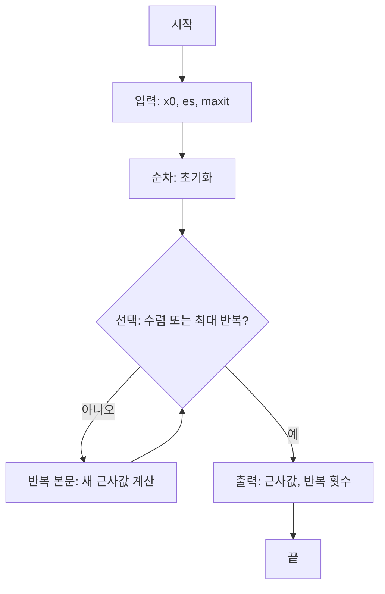

# 3장 — Python 프로그래밍

[레포지토리 안내](../../README.ko.md) | [English](Concepts_Lecture.md) | [한국어](Concepts_Lecture.ko.md)

> **최종 수정일:** 2026-11-19
>
> Applied Numerical Methods with Python for Engineers and Scientists, Chapra and Clough, Ch 3

> **학습 목표:**
> 1. 반복문, 조건문, 함수를 사용하여 수치 계산을 위한 구조화된 프로그램을 작성할 수 있다
> 2. 번지 점프 문제를 오일러 방법으로 구현하고 결과를 해석해와 비교할 수 있다
> 3. SciPy의 `solve_ivp`로 같은 ODE를 풀어 오일러 방법, 해석해와 함께 그래프로 비교할 수 있다
> 4. 위치 인수, 키워드 인수, 가변 인수를 구분하고 함수를 다른 함수의 인수로 전달할 수 있다
> 5. 중지 기준과 최대 반복 횟수를 갖춘 반복 계산을 설계하고 결과를 파일로 저장하고 읽을 수 있다
> 6. 입력 검사, 해석해와의 비교, 수렴 검사로 수치 프로그램을 검증할 수 있다

---

## 목차

- [1. 제어 구조](#1-제어-구조)
  - [1.1 For 반복문](#11-for-반복문)
  - [1.2 While 반복문](#12-while-반복문)
  - [1.3 조건문](#13-조건문)
  - [1.4 구조적 프로그래밍](#14-구조적-프로그래밍)
  - [1.5 반복 계산의 종료 조건](#15-반복-계산의-종료-조건)
  - [1.6 중첩과 들여쓰기](#16-중첩과-들여쓰기)
- [2. 함수](#2-함수)
  - [2.1 위치 인수와 키워드 인수](#21-위치-인수와-키워드-인수)
  - [2.2 가변 인수](#22-가변-인수)
  - [2.3 함수를 인수로 전달하기](#23-함수를-인수로-전달하기)
  - [2.4 map과 반복 가능 객체](#24-map과-반복-가능-객체)
  - [2.5 변수의 유효 범위](#25-변수의-유효-범위)
  - [2.6 모듈, 스크립트, 독스트링](#26-모듈-스크립트-독스트링)
- [3. 예제: Python으로 구현하는 번지 점프](#3-예제-python으로-구현하는-번지-점프)
  - [3.1 오일러 방법 구현](#31-오일러-방법-구현)
  - [3.2 수치해 vs. 해석해 그래프](#32-수치해-vs-해석해-그래프)
  - [3.3 scipy.integrate.solve_ivp 사용](#33-scipyintegratesolve_ivp-사용)
  - [3.4 일반화된 오일러 함수](#34-일반화된-오일러-함수)
  - [3.5 결과의 파일 저장과 읽기](#35-결과의-파일-저장과-읽기)
- [4. 수치 프로그램의 검증과 흔한 실수](#4-수치-프로그램의-검증과-흔한-실수)
  - [4.1 입력 검사와 예외](#41-입력-검사와-예외)
  - [4.2 결과 검증](#42-결과-검증)
  - [4.3 흔한 실수](#43-흔한-실수)
  - [4.4 배열 미리 할당](#44-배열-미리-할당)
- [요약](#요약)
- [점검 문제](#점검-문제)

---

<br>

## 1. 제어 구조

### 1.1 For 반복문

`for` 반복문은 값의 시퀀스를 순회한다. `range()` 함수는 정수 시퀀스를 생성한다:

```python
# Sum of 1 to 10
total = 0
for i in range(1, 11):
    total += i
print(total)  # 55
```

`range(start, stop, step)`은 `start`부터 `step` 간격으로 `stop` 직전까지 정수를 생성하며, `stop`은 포함하지 않는다.

`for`는 정수 인덱스뿐 아니라 리스트, 튜플, 배열, 문자열처럼 원소를 차례로 꺼낼 수 있는 모든 객체를 직접 순회한다. 인덱스와 원소가 함께 필요하면 `enumerate`를, 두 시퀀스를 나란히 순회하려면 `zip`을 쓴다.

```python
data = [3.2, 4.1, 5.0]
for i, value in enumerate(data):
    print(i, value)
for t, v in zip([0, 2, 4], [0.0, 19.62, 36.41]):
    print(f"t = {t} s, v = {v:6.2f} m/s")
```

```text
0 3.2
1 4.1
2 5.0
t = 0 s, v =   0.00 m/s
t = 2 s, v =  19.62 m/s
t = 4 s, v =  36.41 m/s
```

`enumerate(data)`는 (인덱스, 원소) 쌍을, `zip(a, b)`는 두 시퀀스에서 같은 위치의 원소 쌍을 차례로 만든다. `zip`은 짧은 쪽이 끝나면 멈추므로, 길이가 다른 두 시퀀스를 넘기면 긴 쪽의 나머지 원소는 오류 없이 무시된다. f-문자열의 `{v:6.2f}`는 `v`를 전체 폭 6, 소수점 아래 2자리의 고정 소수점으로 쓰라는 서식이다.

수치 결과를 표로 출력할 때 자주 쓰는 서식은 다음과 같다. 다음 열은 $`x = 3.14159265`$를 각 서식으로 출력한 결과이다.

| 서식 | 의미 | 출력 |
|:-----|:-----|:-----|
| `{x:8.3f}` | 폭 8, 소수점 아래 3자리의 고정 소수점, 오른쪽 정렬 | `   3.142` |
| `{x:.2e}` | 지수 표기, 가수의 소수점 아래 2자리 | `3.14e+00` |
| `{x:<10.4f}` | 폭 10, 소수점 아래 4자리, 왼쪽 정렬 | `3.1416    ` |
| `{12345678:,}` | 세 자리마다 쉼표 | `12,345,678` |
| `{0.25:.1%}` | 100을 곱한 백분율, 소수점 아래 1자리 | `25.0%` |

*표 1. f-문자열의 주요 수치 서식*

오차처럼 여러 자릿수에 걸쳐 변하는 값은 지수 표기(`e`)로, 해와 근사값처럼 크기가 비슷한 값은 고정 소수점(`f`)으로 출력하면 표를 읽기 쉽다.

### 1.2 While 반복문

`while` 반복문은 조건이 `True`인 동안 반복한다:

```python
count = 10
while count > 0:
    print(count, end=' ')
    count -= 1
# Output: 10 9 8 7 6 5 4 3 2 1
```

While 반복문은 반복 횟수를 미리 알 수 없을 때 특히 유용하다(예: 수치 알고리즘에서 수렴할 때까지 반복).

반복 횟수를 미리 알면 `for`를, 조건이 만족될 때까지 반복해야 하면 `while`을 쓰는 것이 원칙이다. `while`의 조건이 끝내 거짓이 되지 않으면 프로그램이 멈추지 않으므로, 수치 알고리즘에서는 수렴 조건과 함께 최대 반복 횟수를 반드시 둔다(1.5절). `break`는 반복문을 즉시 빠져나가고, `continue`는 남은 문장을 건너뛰고 다음 반복으로 넘어간다.

### 1.3 조건문

`if`/`elif`/`else` 구조는 분기를 제어한다:

```python
x = 42

if x > 0:
    print('Positive')
elif x == 0:
    print('Zero')
else:
    print('Negative')
```

조건식에는 비교 연산자(`<`, `<=`, `==`, `!=`, `>=`, `>`)와 논리 연산자(`and`, `or`, `not`)를 쓴다. `and`와 `or`는 **단락 평가(short-circuit evaluation)** 를 한다. `a and b`는 `a`가 거짓이면 `b`를 계산하지 않고, `a or b`는 `a`가 참이면 `b`를 계산하지 않는다. 그래서 `x != 0 and 1 / x > 2`처럼 앞의 조건으로 뒤의 계산이 안전한지 먼저 확인하는 식을 쓸 수 있다.

> **주의:** 실수끼리 `==`로 비교하면 반올림 오차 때문에 수학적으로 같은 값도 다르다고 판정될 수 있다(`0.1 + 0.2 == 0.3`은 `False`). 실수의 상등은 `abs(a - b) <= tol` 또는 `np.isclose(a, b)`처럼 허용 오차로 판정해야 한다(4.3절).

### 1.4 구조적 프로그래밍

**구조적 프로그래밍(structured programming)** 은 프로그램의 흐름을 순차, 선택, 반복의 세 가지 제어 구조만으로 구성하는 방식이다. 순차는 문장을 위에서 아래로 차례로 실행하는 것이고, 선택은 조건에 따라 실행할 문장을 고르는 `if`이며, 반복은 문장 묶음을 되풀이하는 `for`와 `while`이다. 세 구조는 각각 입구 하나와 출구 하나를 가지므로, 구조 안에 다른 구조를 넣어도 흐름을 위에서 아래로 따라 읽을 수 있다.



*그림 1. 순차, 선택, 반복으로 구성한 반복 계산의 흐름도*

알고리즘은 코드를 쓰기 전에 **흐름도(flowchart)** 나 **의사코드(pseudocode)** 로 설계한다. 흐름도는 그림 1처럼 처리를 상자로, 판단을 마름모로 그려 흐름을 시각적으로 보여 주고, 의사코드는 특정 언어의 문법에 얽매이지 않는 문장으로 단계를 적는다. 큰 문제는 **하향식 설계(top-down design)** 로 나눈다. 전체 작업을 몇 개의 하위 작업으로 나누고, 각 하위 작업을 다시 더 작은 작업으로 나누어, 가장 작은 단위를 함수 하나로 구현한다. 예를 들어 번지 점프 시뮬레이션은 매개변수 입력, 기울기 계산, 시간 진행, 결과 출력의 네 함수로 나눌 수 있으며, 이렇게 나눈 함수는 따로 시험하고 다른 문제에 다시 쓸 수 있다.

의사코드에서 흔히 쓰는 구조는 다음과 같으며, 각 구조는 Python의 문장 하나에 대응한다.

| 의사코드 | Python |
|:-----|:-----|
| `IF condition THEN ... ELSE ... ENDIF` | `if condition:` ... `else:` ... |
| `FOR i = 1 TO n ... ENDFOR` | `for i in range(1, n + 1):` ... |
| `DOWHILE condition ... ENDDO` | `while condition:` ... |
| `DO ... IF condition EXIT ... ENDDO` | `while True:` ... `if condition: break` ... |
| `FUNCTION f(x) ... RETURN y` | `def f(x):` ... `return y` |

*표 2. 의사코드 구조와 Python 문장의 대응*

의사코드의 `FOR i = 1 TO n`은 보통 끝값 $`n`$을 포함하고 첨자가 1부터 시작하므로, Python으로 옮길 때는 `range(1, n + 1)`로 쓰거나 첨자를 하나씩 줄여 `range(n)`으로 쓴다. 반복 중간에서 조건을 검사하고 빠져나가는 `DO ... EXIT` 구조는 반복 계산(1.5절)에서 자주 쓰인다.

### 1.5 반복 계산의 종료 조건

수치 해법의 상당수는 근사값을 반복해서 개선한다. 이런 반복 계산은 다음 틀을 따른다.

```text
initialize the solution and the iteration counter
loop:
    save the old solution
    compute a new solution
    compute the approximate relative error ea
    if ea < es or iter >= maxit: exit the loop
```

종료 조건은 두 가지이다. **허용 오차(tolerance)** $`\varepsilon_s`$는 원하는 정확도이고, 연속한 두 근사값의 근사 상대 오차 $`\varepsilon_a`$가 이보다 작아지면 멈춘다(4장 3.3절). **최대 반복 횟수** `maxit`은 방법이 수렴하지 않거나 허용 오차가 지나치게 작을 때 반복문이 끝나지 않는 것을 막는다. 다음 함수는 이 틀에 따라 매클로린 급수 $`\sin x = x - \frac{x^3}{3!} + \frac{x^5}{5!} - \cdots`$의 항을 더해 간다.

```python
import math

def sin_series(x, es=1e-4, maxit=50):
    """Maclaurin series of sin(x) with a relative-error stopping rule (%)."""
    sol = 0.0
    term = x                       # first term x^1/1!
    for n in range(maxit):
        sol_old = sol
        sol = sol + term
        ea = abs((sol - sol_old) / sol) * 100 if sol != 0 else 100.0
        print(f"{n + 1:2d} {sol:.10f} {ea:10.2e}")
        if ea < es:
            break
        term = -term * x * x / ((2 * n + 2) * (2 * n + 3))   # next odd term
    return sol, n + 1

x = math.pi / 3
sol, terms = sin_series(x)
print(terms, sol, math.sin(x), abs(sol - math.sin(x)))
```

```text
 1 1.0471975512   1.00e+02
 2 0.8558007816   2.24e+01
 3 0.8662952838   1.21e+00
 4 0.8660212717   3.16e-02
 5 0.8660254451   4.82e-04
 6 0.8660254035   4.80e-06
6 0.8660254034934827 0.8660254037844386 2.9095592601890985e-10
```

- `for n in range(maxit)`가 최대 반복 횟수를 보장한다. 반복 횟수의 상한이 있으므로 `while` 대신 `for`와 `break`를 썼다.
- `sol_old = sol`이 갱신 전의 값을 보관하고, `ea`는 그 값과 새 값으로 계산한 근사 백분율 상대 오차이다. 첫 반복에서는 `sol_old = 0`이므로 `ea`가 100%가 된다. `sol`이 0이면 0으로 나누게 되므로 조건식으로 피했다.
- 다음 항은 직전 항에 $`-x^2/((2n+2)(2n+3))`$을 곱해 얻는다. 매번 거듭제곱과 계승을 새로 계산하지 않으므로 연산이 적고, 큰 계승을 직접 계산할 때의 오버플로도 생기지 않는다.
- 6번째 항에서 $`\varepsilon_a = 4.80 \times 10^{-6}\% < 10^{-4}\%`$가 되어 멈추며, 참값 $`\sin(\pi/3) = 0.8660254038`$과의 차이는 $`2.9 \times 10^{-10}`$이다.

> **주의:** 허용 오차를 머신 정밀도(약 $`10^{-16}`$, 4장)보다 작게 잡으면 반올림 오차 때문에 $`\varepsilon_a`$가 그보다 작아지지 않아 반복이 최대 횟수까지 이어진다. 허용 오차는 문제에 필요한 정확도에 맞추어 정해야 하며, 반복문이 최대 횟수로 끝났는지 수렴해서 끝났는지를 호출한 쪽에 알려 주어야 한다.

### 1.6 중첩과 들여쓰기

제어 구조는 다른 제어 구조 안에 넣을 수 있으며, 이를 **중첩(nesting)** 이라고 한다. Python은 중괄호나 `end` 같은 키워드 대신 **들여쓰기(indentation)** 로 블록의 범위를 정한다. `if`, `for`, `while`, `def` 줄은 콜론(`:`)으로 끝나고, 그 아래에서 같은 깊이로 들여 쓴 문장들이 하나의 블록이 된다. 관례는 한 단계에 공백 4칸이다. 다음 코드는 반복문 안에 조건문을 넣어 세 이차 방정식의 근을 판별식에 따라 분류한다.

```python
import math

for a, b, c in [(1, -3, 2), (1, 2, 1), (1, 2, 5)]:
    d = b * b - 4 * a * c                     # discriminant
    if d > 0:
        r1 = (-b + math.sqrt(d)) / (2 * a)
        r2 = (-b - math.sqrt(d)) / (2 * a)
        print(f"{a, b, c}: two real roots {r1}, {r2}")
    elif d == 0:
        print(f"{a, b, c}: double root {-b / (2 * a)}")
    else:
        re, im = -b / (2 * a), math.sqrt(-d) / (2 * a)
        print(f"{a, b, c}: complex roots {re} +/- {im}i")
```

```text
(1, -3, 2): two real roots 2.0, 1.0
(1, 2, 1): double root -1.0
(1, 2, 5): complex roots -1.0 +/- 2.0i
```

`for` 블록 안의 모든 문장은 4칸, `if`/`elif`/`else` 블록 안의 문장은 8칸 들여 썼다. 들여쓰기가 곧 문법이므로, 마지막 `print`를 4칸으로 줄이면 `else`가 아닌 `for` 블록의 문장이 되어 매 반복 실행되고, 들여쓰기가 맞지 않는 줄은 `IndentationError`를 일으킨다. 공백과 탭을 섞어 쓰면 눈에는 같아 보여도 깊이가 다르게 해석될 수 있으므로 공백만 쓰는 것이 안전하다. 중첩이 세 단계를 넘으면 코드를 읽기 어려우므로, 안쪽 블록을 함수로 분리하는 것이 좋다(1.4절의 하향식 설계).

판별식 `d == 0`의 비교는 정수 계수에서는 정확하지만, 계수가 실수 계산의 결과이면 1.3절의 주의대로 허용 오차로 판정해야 한다.

---

<br>

## 2. 함수

함수는 재사용 가능한 코드 블록을 캡슐화한다. `def` 키워드로 정의한다:

```python
def myfunction(x):
    return x ** 2

print(myfunction(5))  # 25
```

함수는 튜플로 여러 값을 반환할 수 있다:

```python
def circle_properties(r):
    area = 3.14159 * r ** 2
    circumference = 2 * 3.14159 * r
    return area, circumference

a, c = circle_properties(5)
print(f'Area = {a:.2f}, Circumference = {c:.2f}')
# Area = 78.54, Circumference = 31.42
```

기본 인수를 사용하면 유연한 함수 호출이 가능하다:

```python
def greet(name, greeting='Hello'):
    return f'{greeting}, {name}!'

print(greet('World'))            # Hello, World!
print(greet('World', 'Hi'))      # Hi, World!
```

함수는 특정한 작업을 수행하는 문장의 묶음이며, 입력(인수)을 받아 결과(반환값)를 돌려준다. `return`이 없거나 값 없이 `return`만 쓰면 `None`을 돌려준다. 수치 해법을 함수로 구현하면 같은 알고리즘을 다른 문제에 다시 쓸 수 있고, 알고리즘과 문제를 분리하여 각각 따로 시험할 수 있다.

### 2.1 위치 인수와 키워드 인수

함수를 호출할 때 인수를 넘기는 방식은 두 가지이다. **위치 인수(positional argument)** 는 매개변수가 정의된 순서대로 값을 대응시키고, **키워드 인수(keyword argument)** 는 `이름=값`으로 매개변수를 지정하므로 순서를 기억할 필요가 없다. 위치 인수와 키워드 인수를 섞을 때는 위치 인수를 먼저 써야 한다.

```python
import numpy as np

def velocity(t, m, cd=0.25, g=9.81):
    """Analytical velocity of the bungee jumper with quadratic drag."""
    return np.sqrt(g * m / cd) * np.tanh(np.sqrt(g * cd / m) * t)

print(velocity(4, 68.1))               # positional arguments
print(velocity(m=68.1, t=4))           # keyword arguments in any order
print(velocity(4, 68.1, cd=0.3))       # override one default
```

```text
33.11182503524822
33.11182503524822
32.150378734060716
```

`cd=0.25`, `g=9.81`처럼 기본값이 있는 매개변수는 생략할 수 있다. 셋째 호출은 `cd`만 키워드로 바꾸고 `g`는 기본값을 쓴다. 매개변수가 많은 수치 함수에서는 자주 바꾸지 않는 값(허용 오차, 최대 반복 횟수 등)에 기본값을 주고, 호출할 때 키워드로 바꾸는 방식이 읽기 쉽고 실수가 적다.

### 2.2 가변 인수

인수의 개수를 미리 정할 수 없는 함수는 **가변 인수**를 쓴다. 매개변수 이름 앞의 `*`는 남는 위치 인수를 모두 튜플 하나로 모으고(`*args`), `**`는 남는 키워드 인수를 모두 딕셔너리 하나로 모은다(`**kwargs`). 이름 `args`와 `kwargs`는 관례일 뿐이고 `*`와 `**`가 의미를 정한다.

```python
def summary(*values, digits=3, **labels):
    print(values, labels)
    return round(sum(values) / len(values), digits)

print(summary(1.0, 2.0, 4.0, digits=2, unit='m/s'))
```

```text
(1.0, 2.0, 4.0) {'unit': 'm/s'}
2.33
```

`*values` 뒤에 오는 `digits`는 위치로는 값을 받을 수 없고 키워드로만 받는 **키워드 전용 인수**가 된다. 정의되지 않은 키워드 `unit='m/s'`는 `labels` 딕셔너리로 들어간다. 수치 해법에서 `*args`의 가장 중요한 쓰임은 3.4절처럼 풀이 함수가 모델 함수에 매개변수를 그대로 전달하는 것이다. 풀이 함수는 매개변수의 개수와 의미를 몰라도 되므로, 같은 풀이 함수로 매개변수 구성이 다른 여러 모델을 풀 수 있다.

### 2.3 함수를 인수로 전달하기

Python에서 함수는 정수나 리스트처럼 하나의 객체이므로, 변수에 대입하고 다른 함수의 인수로 넘기고 반환값으로 돌려줄 수 있다. 이런 성질을 가진 객체를 **일급 객체(first-class object)** 라고 한다. 수치 해법의 함수는 대부분 이 성질을 이용한다. 근 찾기(5\~6장), 최적화(7장), 적분(19\~20장), ODE 풀이(22\~24장)의 함수는 모두 대상 함수 $`f`$를 인수로 받으며, 그 덕분에 알고리즘 하나로 임의의 함수를 다룰 수 있다.

```python
import numpy as np
from functools import partial

def velocity(t, m, cd=0.25, g=9.81):
    return np.sqrt(g * m / cd) * np.tanh(np.sqrt(g * cd / m) * t)

def deriv(f, x, h=1e-5):
    """Centered-difference estimate of f'(x); f is any callable of one variable."""
    return (f(x + h) - f(x - h)) / (2 * h)

print(deriv(np.sin, 0.0))                      # cos(0) = 1
print(deriv(lambda t: velocity(t, 68.1), 0.0)) # acceleration at t = 0 is g
v68 = partial(velocity, m=68.1)                # fix m, keep t free
print(deriv(v68, 4.0), 9.81 - 0.25 / 68.1 * v68(4.0)**2)
```

```text
0.9999999999833332
9.809999999988225
5.785062565166753 5.785062565473969
```

- `deriv`는 한 변수의 함수 `f`를 받아 중심 차분(4장 10.3절)으로 도함수를 추정한다. `deriv`는 `f`가 무엇인지 모르고 `f(x + h)`처럼 호출만 한다.
- `np.sin`을 넘기면 $`\cos 0 = 1`$에 가까운 값이 나온다.
- `velocity`는 변수가 둘이므로 그대로 넘길 수 없다. **람다 식(lambda expression)** `lambda t: velocity(t, 68.1)`은 질량을 고정한 이름 없는 한 줄 함수를 만든다. 결과 9.81은 $`t = 0`$에서 항력이 0이어서 가속도가 $`g`$라는 사실과 맞는다.
- `functools.partial(velocity, m=68.1)`도 일부 인수를 고정한 새 함수를 만든다. 마지막 줄은 수치 미분과 ODE의 우변 $`g - (c_d/m)v^2`$이 소수점 아래 9자리까지 일치함을 보여 준다.

### 2.4 map과 반복 가능 객체

`map(f, iterable)`은 반복 가능한 객체의 모든 원소에 함수 `f`를 적용하는 **반복자(iterator)** 를 돌려준다. 반복자는 결과를 미리 모두 계산해 두지 않고, 원소를 요청할 때마다 하나씩 계산하여 내준다.

```python
squares = map(lambda x: x**2, [1, 2, 3])
print(type(squares), list(squares), list(squares))
```

```text
<class 'map'> [1, 4, 9] []
```

`map`의 결과는 리스트가 아니라 `map` 객체이며, `list()`로 원소를 꺼내야 값을 볼 수 있다. 반복자는 한 번 소진되면 다시 원소를 내지 않으므로 두 번째 `list(squares)`는 빈 리스트이다. 같은 결과를 리스트로 바로 얻으려면 **리스트 컴프리헨션** `[x**2 for x in [1, 2, 3]]`을 쓸 수 있다. 수치 데이터에서는 `map`이나 컴프리헨션보다 NumPy 배열의 벡터화 연산 `np.array([1, 2, 3])**2`가 빠르고 간결하므로(2장 3.4절), `map`은 원소가 배열로 표현되지 않는 객체이거나 함수가 배열을 받지 못할 때 쓴다.

### 2.5 변수의 유효 범위

함수 안에서 대입한 변수는 그 함수 안에서만 보이는 **지역 변수(local variable)** 이다. 이름이 어느 객체를 가리키는지는 지역(Local), 둘러싸는 함수(Enclosing), 전역(Global), 내장(Built-in)의 순서로 찾으며, 이를 **LEGB 규칙**이라고 한다. 함수 안에서 전역 변수를 읽는 것은 가능하지만, 함수 안에서 같은 이름에 대입하면 새 지역 변수가 생긴다. 함수가 전역 변수에 기대면 그 변수가 바뀔 때 함수의 결과도 조용히 바뀌므로, 수치 함수는 필요한 값을 모두 인수로 받는 것이 안전하다. 2.1절의 `velocity`가 `g`를 전역 변수 대신 기본값이 있는 매개변수로 받는 것이 그 예이다. `global` 키워드와 중첩 함수의 예는 3장 실습에서 다룬다.

### 2.6 모듈, 스크립트, 독스트링

Python 코드를 담은 `.py` 파일 하나를 **모듈(module)** 이라고 한다. 모듈은 직접 실행하면 스크립트로 동작하고, 다른 파일에서 `import`하면 그 안의 함수와 변수를 빌려 주는 라이브러리로 동작한다.

```python
"""Print a greeting.

A string literal at the top of a file is the module docstring.
"""


def main():
    print("Hello World")


if __name__ == "__main__":
    main()
```

```text
Hello World
```

파일 첫머리의 문자열 리터럴은 **독스트링(docstring)** 이다. 독스트링은 주석과 달리 실행 중에도 객체의 `__doc__` 속성으로 남아 `help()`가 보여 주는 설명이 된다. 함수의 첫 줄에 쓴 문자열은 그 함수의 독스트링이며, 함수가 무엇을 계산하는지, 인수와 반환값의 의미와 단위가 무엇인지를 적는다. `if __name__ == "__main__":`은 파일을 직접 실행했을 때만 참이 되는 조건이다. 직접 실행하면 `__name__`이 `"__main__"`이고, 다른 파일에서 `import`하면 모듈 이름이 된다. 이 조건 아래에 실행 코드를 두면, 같은 파일을 스크립트로 실행할 수도 있고 함수만 가져다 쓸 수도 있다.

---

<br>

## 3. 예제: Python으로 구현하는 번지 점프

이 절에서는 1장의 번지 점프 문제를 Python으로 구현하여, 수학적 공식화를 작동하는 코드로 변환하는 방법을 보인다.

### 3.1 오일러 방법 구현

선형 항력을 가진 번지 점프의 ODE는 다음과 같다:

```math
\frac{dv}{dt} = g - \frac{c}{m}v
```

오일러 방법을 적용하면 다음과 같다:

```math
v(t_{i+1}) = v(t_i) + \left(g - \frac{c}{m}v(t_i)\right) \cdot h
```

```python
import numpy as np

# Parameters
g = 9.81      # m/s^2
m = 68.1      # kg
c = 12.5      # kg/s
h = 2.0       # step size (s)
t_end = 12.0  # final time (s)

# Initialize
t = np.arange(0, t_end + h, h)
v = np.zeros(len(t))
v[0] = 0  # initial condition

# Euler's method
for i in range(len(t) - 1):
    dvdt = g - (c / m) * v[i]
    v[i + 1] = v[i] + dvdt * h

print('t (s)  |  v (m/s)')
for ti, vi in zip(t, v):
    print(f'{ti:5.1f}  |  {vi:.4f}')
```

이 코드는 1장 3.2절의 손 계산과 같은 값을 출력하며, 마지막 줄은 $`t = 12`$ s에서 50.0102 m/s이다.

### 3.2 수치해 vs. 해석해 그래프

1장에서 구한 해석해는 다음과 같다:

```math
v(t) = \frac{gm}{c}\left(1 - e^{-(c/m)t}\right)
```

```python
import matplotlib.pyplot as plt

# Analytical solution on a fine grid
t_fine = np.linspace(0, t_end, 200)
v_analytical = (g * m / c) * (1 - np.exp(-(c / m) * t_fine))

# Plot comparison
plt.plot(t_fine, v_analytical, 'b-', label='Analytical')
plt.plot(t, v, 'ro--', label=f'Euler (h={h}s)')
plt.xlabel('Time (s)')
plt.ylabel('Velocity (m/s)')
plt.title('Bungee Jumper: Euler vs. Analytical')
plt.legend()
plt.grid(True)
plt.show()
```

### 3.3 scipy.integrate.solve_ivp 사용

더 정확한 ODE 풀이를 위해 SciPy는 적응적 스텝 크기 방법을 사용하는 `solve_ivp`를 제공한다:

```python
from scipy.integrate import solve_ivp

# Define the ODE as a function: dv/dt = f(t, v)
def bungee_ode(t, v):
    return g - (c / m) * v

# Solve
sol = solve_ivp(bungee_ode, [0, t_end], [0], t_eval=t_fine)

plt.plot(t_fine, v_analytical, 'b-', label='Analytical')
plt.plot(sol.t, sol.y[0], 'g--', label='solve_ivp (RK45)')
plt.plot(t, v, 'ro--', label=f'Euler (h={h}s)')
plt.xlabel('Time (s)')
plt.ylabel('Velocity (m/s)')
plt.title('Bungee Jumper: Comparison of Methods')
plt.legend()
plt.grid(True)
plt.show()
```

> **참고:** `scipy.integrate.solve_ivp`는 기본적으로 적응적 룽게-쿠타 방법(RK45)을 사용하며, 오일러 방법보다 훨씬 정확하다. 룽게-쿠타 방법은 22장에서, 적응적 스텝 크기 제어는 23장에서 자세히 다룬다.

### 3.4 일반화된 오일러 함수

3.1절의 코드는 매개변수와 모델이 코드 안에 고정되어 있어, 이차 항력 모델처럼 모델이 바뀌면 반복문까지 고쳐야 한다. 오일러 방법을 함수로 만들고 모델을 인수로 받으면 알고리즘과 모델이 분리된다.

```python
import numpy as np

def euler(dydt, tspan, y0, h, *args):
    """Solve dy/dt = dydt(t, y, *args) from tspan[0] to tspan[1] by Euler's method."""
    t0, tf = tspan
    if tf <= t0:
        raise ValueError("tspan must be increasing")
    n = int(np.ceil((tf - t0) / h))         # number of steps
    t = np.linspace(t0, t0 + n * h, n + 1)
    t[-1] = tf                              # shorten the last step if needed
    y = np.zeros(n + 1)
    y[0] = y0
    for i in range(n):
        y[i + 1] = y[i] + dydt(t[i], y[i], *args) * (t[i + 1] - t[i])
    return t, y

def bungee(t, v, cd, m, g=9.81):
    return g - cd / m * v * abs(v)          # quadratic drag, v|v|

t, v = euler(bungee, (0, 12), 0.0, 2.0, 0.25, 68.1)
print(np.round(v, 4))
t, v = euler(bungee, (0, 11), 0.0, 2.0, 0.25, 68.1)
print(t, round(v[-1], 4))
```

```text
[ 0.     19.62   36.4137 46.2983 50.1802 51.3123 51.6008]
[ 0.  2.  4.  6.  8. 10. 11.] 51.4565
```

- `euler`의 첫 인수 `dydt`는 기울기를 계산하는 함수이며, 서명은 `dydt(t, y, *args)`로 정했다. 시간 `t`를 인수로 받으므로 우변이 시간에 따라 바뀌는 ODE도 같은 함수로 풀 수 있다.
- `*args`는 모델의 매개변수(여기서는 `cd`와 `m`)를 모아 `dydt`에 그대로 넘긴다. `euler`는 매개변수가 몇 개인지 알 필요가 없다.
- 구간 길이가 스텝 크기의 배수가 아니면 `np.ceil`로 스텝 수를 올림하고, 마지막 시각을 `tf`로 바꾸어 마지막 스텝만 짧게 한다. 둘째 호출에서 구간 $`[0, 11]`$은 $`h = 2`$의 배수가 아니므로 마지막 스텝은 10에서 11까지 1 s이다.
- 갱신식은 `h` 대신 `t[i + 1] - t[i]`를 쓰므로 길이가 다른 마지막 스텝도 정확히 처리한다.
- `bungee`는 항력을 $`c_d v|v|`$로 계산하므로 속도가 음수인 경우에도 항력의 방향이 맞다(1장 2.1절).
- 첫째 출력은 1장 표 6의 오일러 해와 같다.

### 3.5 결과의 파일 저장과 읽기

계산 결과를 파일로 저장하면 다른 프로그램에서 읽거나 나중에 다시 그래프를 그릴 수 있다. 파일은 사람이 읽을 수 있는 문자로 저장하는 **텍스트 파일**(CSV, TXT)과 메모리의 비트를 그대로 저장하는 **이진 파일**(NumPy의 `.npy`, `.npz`)로 나뉜다. 텍스트 파일은 어느 프로그램에서나 열 수 있지만 크고 느리며, 십진수로 바꾸는 과정에서 자릿수를 잘라 정밀도를 잃을 수 있다. 이진 파일은 작고 빠르며 배정밀도 값을 손실 없이 저장한다.

```python
import numpy as np

t = np.array([0.0, 2.0, 4.0, 6.0])
v = np.array([0.0, 19.62, 36.4137, 46.2983])

data = np.column_stack((t, v))               # 4 rows, 2 columns
np.savetxt('euler.csv', data, delimiter=',', fmt='%.4f',
           header='t_s,v_mps', comments='')

with open('euler.csv') as fh:                # file is closed automatically
    print(fh.read())

back = np.loadtxt('euler.csv', delimiter=',', skiprows=1)
print(back.shape, back[:, 1].max())
```

```text
t_s,v_mps
0.0000,0.0000
2.0000,19.6200
4.0000,36.4137
6.0000,46.2983

(4, 2) 46.2983
```

- `np.column_stack`은 1차원 배열 두 개를 열로 붙여 4행 2열 배열을 만든다.
- `np.savetxt`의 `fmt='%.4f'`는 각 값을 소수점 아래 4자리로 쓰라는 서식이고, `header`는 첫 줄의 열 이름이다. `comments=''`를 주지 않으면 머리글 앞에 주석 기호 `#`이 붙는다.
- `with open(...) as fh:` 문은 블록이 끝나면, 블록 안에서 오류가 나더라도 파일을 자동으로 닫는다. 파일을 연 뒤 닫지 않으면 쓴 내용이 디스크에 반영되지 않거나 다른 프로그램이 파일을 열지 못할 수 있다.
- `np.loadtxt`의 `skiprows=1`은 머리글 줄을 건너뛰고 나머지를 실수 배열로 읽는다.

키보드에서 값을 읽을 때는 내장 함수 `input(prompt)`를 쓴다. `input`은 사용자가 입력한 내용을 언제나 문자열로 돌려주므로, 수로 쓰려면 `m = float(input('mass (kg): '))`처럼 바꾸어야 한다. 대화형 입력은 실행할 때마다 사람이 값을 넣어야 하므로 재현성이 떨어지며, 수치 계산 프로그램에서는 매개변수를 함수의 인수나 파일로 주는 방식이 더 흔하다.

여러 열로 된 측정 데이터를 읽거나 이진 파일에 저장하는 방법은 3장 실습에서 다룬다.

---

<br>

## 4. 수치 프로그램의 검증과 흔한 실수

수치 프로그램은 오류가 나지 않고 실행되어도 결과가 틀릴 수 있다. 문법 오류는 인터프리터가 알려 주지만, 공식의 부호를 잘못 쓰거나 인덱스를 하나 어긋나게 쓴 오류는 그럴듯한 숫자를 내기 때문이다. 그래서 수치 프로그램은 입력을 검사하고, 답을 아는 문제로 결과를 확인하고, 스텝 크기를 바꾸어 수렴하는지 보아야 한다.

### 4.1 입력 검사와 예외

함수가 처리할 수 없는 입력을 받으면 그럴듯한 숫자를 돌려주는 대신 **예외(exception)** 를 일으켜야 한다. `raise ValueError("...")`는 값이 잘못되었음을 알리는 예외를 일으키고, 호출한 쪽은 `try`/`except`로 예외를 받아 처리할 수 있다. 3.4절의 `euler`는 구간이 거꾸로 주어지면 예외를 일으킨다.

```python
try:
    euler(bungee, (12, 0), 0.0, 2.0, 0.25, 68.1)
except ValueError as err:
    print("ValueError:", err)

print(0.1 + 0.2 == 0.3, np.isclose(0.1 + 0.2, 0.3))
```

```text
ValueError: tspan must be increasing
False True
```

입력 검사가 없으면 `tf < t0`일 때 `n`이 음수가 되어 빈 배열이 만들어지고, 오류 없이 의미 없는 결과가 나온다. 이분법(5장)이 구간 양 끝의 부호가 다른지 처음에 검사하는 것도 같은 이유이다. 둘째 줄은 실수의 상등을 허용 오차로 판정해야 하는 이유를 보여 준다.

### 4.2 결과 검증

수치 프로그램의 결과는 다음 방법으로 검증한다.

1. **해석해와 비교한다.** 해석해가 있는 문제(1장의 번지 점프)로 먼저 시험하여, 수치해가 해석해에 다가가는지 확인한다.
2. **수렴 차수를 확인한다.** 스텝 크기를 반으로 줄이며 오차를 계산하여, 오차의 비가 방법의 이론적 차수와 맞는지 본다.
3. **보존 법칙이나 물리적 한계를 확인한다.** 예를 들어 번지 점프의 속도는 종단 속도를 크게 넘을 수 없다.
4. **라이브러리 함수와 비교한다.** 직접 구현한 결과를 SciPy 함수(3.3절의 `solve_ivp` 등)의 결과와 비교한다.

다음 코드는 3.4절의 `euler`로 둘째 방법을 수행한다.

```python
exact = np.sqrt(9.81 * 68.1 / 0.25) * np.tanh(np.sqrt(9.81 * 0.25 / 68.1) * 12)
errs = []
for h in [1.0, 0.5, 0.25]:
    t, v = euler(bungee, (0, 12), 0.0, h, 0.25, 68.1)
    errs.append(abs(v[-1] - exact))
print(np.round(errs, 4), np.round(np.array(errs[:-1]) / np.array(errs[1:]), 3))
```

```text
[0.5833 0.3084 0.1578] [1.891 1.954]
```

오차의 비가 2에 가까워지므로 구현이 1차 방법인 오일러 방법의 성질(1장 3.5절)과 맞는다. 비가 2에서 크게 벗어나거나 $`h`$를 줄여도 오차가 줄지 않으면 구현에 오류가 있다는 신호이다.

> **참고:** **단위 시험.** 4.2절의 검증을 자동화하려면 함수 하나가 정해진 입력에 대해 기대한 결과를 내는지 확인하는 짧은 코드, 즉 단위 시험(unit test)을 만들어 둔다. 예를 들어 기울기가 상수 3인 ODE의 해 $`y = 3t + 1`$은 직선이므로 3.4절의 `euler`가 반올림 오차 범위에서 정확히 재현해야 하고(`assert np.allclose(y, 3.0 * t + 1.0)`), $`dy/dt = -y`$, $`y(0) = 1`$에서는 $`h`$를 0.1에서 0.05로 줄일 때 끝점 오차의 비가 2 근처여야 한다(`assert 1.8 < errs[0] / errs[1] < 2.2`). `assert`는 조건이 거짓이면 `AssertionError`를 일으킨다. 함수를 고칠 때마다 이런 시험을 다시 실행하면, 수정 때문에 이전에 맞던 결과가 틀리게 되는 일을 바로 알 수 있다.

### 4.3 흔한 실수

| 실수 | 증상 | 대책 |
|:-----|:-----|:-----|
| 실수를 `==`로 비교 | 수학적으로 같은 값이 다르다고 판정 | `abs(a - b) <= tol`, `np.isclose` |
| `range`의 끝값 착오 | 반복이 한 번 모자라거나 넘침 | `range(n)`은 0부터 `n - 1`까지임을 확인 |
| 정수 배열에 실수 대입 | 소수 부분이 버려짐 | `np.zeros(n)` 등 실수형 배열 사용 |
| 가변 객체를 기본값으로 사용 | 호출 사이에 값이 남음 | 기본값을 `None`으로 두고 함수 안에서 생성 |
| 별칭으로 이전 값 보관 | 이전 값과 새 값이 함께 바뀜 | `.copy()`로 복사본 생성 |
| 내장 함수 이름을 변수로 사용 | `sum = 0` 뒤에 `sum()` 호출이 실패 | `total`처럼 다른 이름 사용 |
| 반복 중인 리스트의 원소 삭제 | 원소를 건너뜀 | 새 리스트를 만들거나 역순으로 처리 |
| 최대 반복 횟수 없음 | 수렴하지 않으면 프로그램이 멈추지 않음 | `maxit`을 두고 종료 원인을 반환 |

*표 3. 수치 프로그램의 흔한 실수와 대책*

가변 객체를 기본값으로 쓰는 실수는 증상이 특이하다. 기본값은 함수를 정의할 때 한 번만 만들어지므로, 호출할 때마다 같은 리스트가 재사용된다.

```python
def append_bad(x, out=[]):      # default list is created once
    out.append(x)
    return out

def append_good(x, out=None):
    if out is None:
        out = []                # a new list on every call
    out.append(x)
    return out

print(append_bad(1), append_bad(2))
print(append_good(1), append_good(2))
```

```text
[1, 2] [1, 2]
[1] [2]
```

`append_bad`의 두 호출은 같은 리스트 객체를 돌려주므로, `print`가 출력할 때에는 두 번째 호출까지 반영된 `[1, 2]`가 두 번 나온다. `append_good`은 `None`을 기본값으로 두고 호출할 때마다 새 리스트를 만들므로 의도대로 동작한다.

### 4.4 배열 미리 할당

반복문 안에서 결과 배열을 한 원소씩 늘리면 계산 비용이 크게 늘어난다. `np.append(a, x)`는 원래 배열에 원소를 덧붙이는 것이 아니라, 길이가 하나 큰 새 배열을 만들고 기존 원소를 모두 복사한다. 그래서 $`n`$번 덧붙이면 복사하는 원소의 총수가 $`1 + 2 + \cdots + n = n(n+1)/2`$로 $`O(n^2)`$이다. 반면 필요한 크기의 배열을 처음에 한 번 만들고(미리 할당) 원소를 채우면 비용이 $`O(n)`$이다.

```python
import time
import numpy as np

n = 20000
start = time.perf_counter()
a = np.array([])
for i in range(n):
    a = np.append(a, i * 0.5)          # copies the whole array every time
t_append = time.perf_counter() - start

start = time.perf_counter()
b = np.zeros(n)                        # preallocate once
for i in range(n):
    b[i] = i * 0.5
t_prealloc = time.perf_counter() - start

print(np.array_equal(a, b), f"{t_append:.3f} s", f"{t_prealloc:.4f} s")
```

```text
True 0.082 s 0.0016 s
```

두 방법의 결과는 같지만(`True`), 이 실행에서는 미리 할당한 쪽이 약 50배 빨랐다. 실행 시간은 컴퓨터마다 다르지만, $`n`$이 커질수록 차이는 $`n`$에 비례하여 더 벌어진다. 1장 3.6절과 3.4절의 코드가 `np.zeros`로 결과 배열을 먼저 만든 것도 이 때문이다. 결과의 개수를 미리 알 수 없을 때는 Python 리스트의 `append`(평균적으로 상수 시간)로 모은 뒤 끝에 한 번 `np.array`로 바꾸는 방법을 쓴다.

---

<br>

## 요약

| 개념 | 핵심 요약 |
|:------|:----------|
| 제어 구조 | `for`, `while`, `if`/`elif`/`else`로 반복과 분기를 제어한다. |
| 구조적 프로그래밍 | 순차, 선택, 반복의 세 구조만으로 흐름을 구성하며, 흐름도와 의사코드로 설계하고 하향식으로 나눈다. |
| 종료 조건 | 반복 계산은 근사 상대 오차가 허용 오차보다 작아지거나 최대 반복 횟수에 이르면 멈춘다. |
| 함수 | `def func(args): return result` 형태로 정의하며, 튜플로 여러 값을 반환할 수 있다. |
| 인수 전달 | 위치 인수는 순서로, 키워드 인수는 이름으로 대응하며, `*args`와 `**kwargs`는 남는 인수를 튜플과 딕셔너리로 모은다. |
| 일급 객체로서의 함수 | 함수를 다른 함수의 인수로 넘길 수 있어 근 찾기, 적분, ODE 풀이 알고리즘이 임의의 함수를 다룬다. |
| map과 반복자 | `map`은 원소를 요청할 때마다 계산하는 반복자를 돌려주며, 한 번 소진되면 다시 쓸 수 없다. |
| 모듈과 독스트링 | `.py` 파일은 모듈이며, `if __name__ == "__main__":`으로 스크립트 실행과 `import`를 구분한다. |
| ODE 풀이 | 오일러 방법은 직접 구현하는 간단한 방법이고, `scipy.integrate.solve_ivp`는 적응적 스텝 크기로 더 정확한 해를 준다. |
| 일반화된 풀이 함수 | 기울기 함수와 매개변수를 인수로 받으면 같은 오일러 함수로 여러 모델을 풀 수 있다. |
| 파일 입출력 | `np.savetxt`와 `np.loadtxt`로 텍스트 파일을 쓰고 읽으며, `with` 문은 파일을 자동으로 닫는다. |
| 검증 | 입력 검사, 해석해와의 비교, 스텝 크기를 줄일 때의 오차 비율로 수치 프로그램을 검증한다. |
| 배열 미리 할당 | 결과 배열을 미리 할당하면 원소를 덧붙일 때마다 배열 전체를 복사하는 $`O(n^2)`$ 비용을 피한다. |

---

<br>

## 점검 문제

1. **range의 끝값:** `range(2, 11, 3)`이 만드는 정수를 모두 쓰라.

   <details>
   <summary>정답</summary>

   `range(start, stop, step)`은 `start`인 2부터 `step`인 3씩 더하며 `stop`인 11 직전까지 정수를 만든다. 따라서 결과는 2, 5, 8이며, 그다음 값 11은 `stop`과 같으므로 포함되지 않는다.

   </details>

2. **오일러 코드 추적:** 3.1절의 코드가 $`t = 2`$ s와 $`t = 4`$ s에서 출력하는 속도를 구하라.

   <details>
   <summary>정답</summary>

   $`v_1 = 0 + (9.81 - 0) \times 2 = 19.62`$이다. $`v_2 = 19.62 + (9.81 - (12.5/68.1) \times 19.62) \times 2 = 19.62 + 6.2087 \times 2 \approx 32.0374`$이다. 따라서 출력은 19.6200과 32.0374이다.

   </details>

3. **종료 조건:** 1.5절의 `sin_series`를 `es=1e-20`, `maxit=50`으로 호출하면 몇 번째 항에서 멈추는지 예측하고 그 이유를 설명하라.

   <details>
   <summary>정답</summary>

   항을 더할수록 `sol`의 변화가 반올림 오차 수준까지 줄면 `sol`이 더는 바뀌지 않아 `ea`가 정확히 0이 되므로 그 반복에서 멈춘다. 실제로 계산하면 10번째 항에서 `ea = 0`이 되어 멈춘다. 허용 오차가 머신 정밀도보다 작으면 이처럼 0이 되거나, 반올림 오차 때문에 `ea`가 0이 아닌 작은 값에서 오르내리면 `maxit`까지 반복하게 된다. 그래서 허용 오차를 필요한 정확도에 맞추고 최대 반복 횟수를 두어야 한다.

   </details>

4. **인수의 대응:** 2.1절의 `velocity`를 `velocity(68.1, 4)`로 호출하면 무엇을 계산하게 되는가? 의도대로 호출하는 방법을 두 가지 쓰라.

   <details>
   <summary>정답</summary>

   위치 인수는 정의 순서대로 대응하므로 `t = 68.1`, `m = 4`가 되어, 질량 4 kg인 물체의 68.1 s 뒤 속도를 계산한다. 의도대로 호출하려면 순서를 맞추어 `velocity(4, 68.1)`로 쓰거나, 키워드 인수로 `velocity(m=68.1, t=4)`처럼 이름을 밝힌다.

   </details>

5. **가변 인수:** `def f(a, *args, b=0, **kw)`를 `f(1, 2, 3, b=4, c=5)`로 호출하면 `a`, `args`, `b`, `kw`는 각각 무엇인가?

   <details>
   <summary>정답</summary>

   `a = 1`, `args = (2, 3)`, `b = 4`, `kw = {'c': 5}`이다. 첫 위치 인수가 `a`에 대응하고, 남는 위치 인수는 튜플 `args`에 모인다. `b`는 `*args` 뒤에 있어 키워드로만 받으며, 정의되지 않은 키워드 `c`는 딕셔너리 `kw`에 들어간다.

   </details>

6. **일반화된 오일러 함수:** 3.4절의 `euler`를 `tspan=(0, 5)`, `h=2`로 호출하면 시간 격자 `t`는 무엇이 되는가? 마지막 스텝의 길이도 구하라.

   <details>
   <summary>정답</summary>

   스텝 수는 $`\lceil 5/2 \rceil = 3`$이고 `np.linspace(0, 6, 4)`로 `[0, 2, 4, 6]`을 만든 뒤 마지막 원소를 5로 바꾸므로 `t`는 `[0, 2, 4, 5]`이다. 마지막 스텝의 길이는 $`5 - 4 = 1`$이며, 갱신식이 `t[i + 1] - t[i]`를 쓰므로 이 짧은 스텝도 정확히 처리된다.

   </details>

7. **반복자의 소진:** `r = map(abs, [-1, 2, -3])`에 대해 `sum(r)`을 두 번 호출하면 각각 무엇이 나오는가? 이유를 설명하라.

   <details>
   <summary>정답</summary>

   첫 호출은 $`1 + 2 + 3 = 6`$이고 둘째 호출은 0이다. `map`은 반복자를 돌려주며, 첫 `sum`이 원소를 모두 꺼내 반복자를 소진했으므로 둘째 `sum`에는 꺼낼 원소가 없어 빈 합 0이 된다. 같은 값을 여러 번 쓰려면 `list(map(abs, [-1, 2, -3]))`처럼 리스트로 바꾸어 두어야 한다.

   </details>

8. **결과 검증:** 어떤 학생이 오일러 방법을 구현하여 $`h = 1, 0.5, 0.25`$에서 끝점 오차 $`0.62, 0.61, 0.61`$을 얻었다. 이 결과로부터 무엇을 의심해야 하며, 어떻게 확인할 수 있는가?

   <details>
   <summary>정답</summary>

   오일러 방법은 1차 방법이므로 $`h`$를 반으로 줄이면 오차도 약 절반이 되어야 한다. 오차가 줄지 않으면 스텝 크기와 무관한 오류, 예를 들어 기울기 공식의 부호나 매개변수 값이 틀렸거나, 비교 대상인 해석해가 다른 모델의 해이거나, 반복 범위가 한 스텝 모자라 끝점이 다른 시각인 경우를 의심해야 한다. 해석해를 아는 단순한 문제로 한 스텝씩 손 계산과 비교하고, 끝점의 시각과 배열의 길이를 출력하여 확인한다.

   </details>
