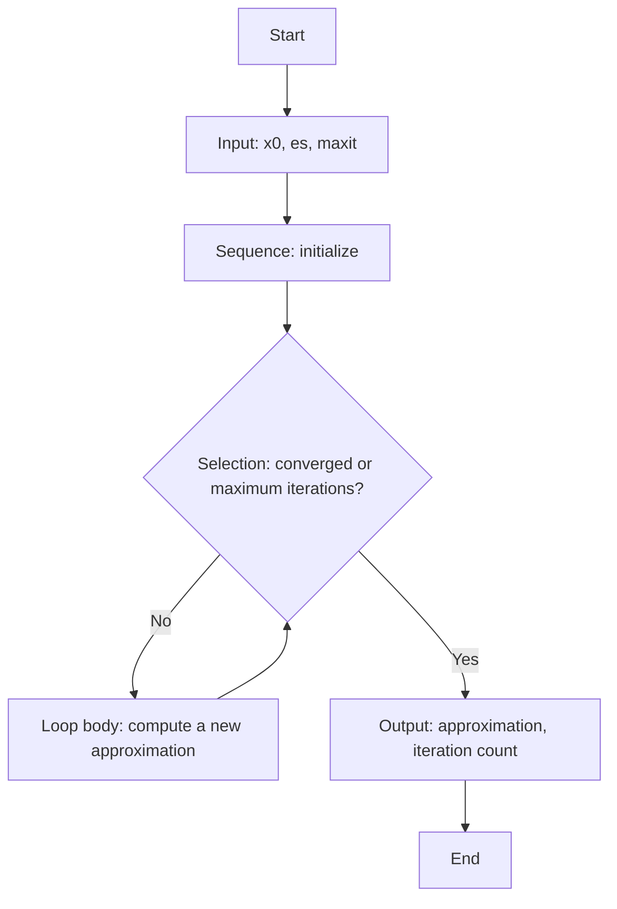

# Chapter 3 — Python Programming

[Repository Guide](../../README.md) | [English](Concepts_Lecture.md) | [한국어](Concepts_Lecture.ko.md)

> **Last Updated:** 2026-11-19
>
> Applied Numerical Methods with Python for Engineers and Scientists, Chapra and Clough, Ch 3

> **Learning Objectives:**
> 1. Write structured programs for numerical computation with loops, conditionals, and functions
> 2. Implement the bungee jumper problem with Euler's method and compare the result with the analytical solution
> 3. Solve the same ODE with SciPy's `solve_ivp` and compare it in one plot with Euler's method and the analytical solution
> 4. Distinguish positional, keyword, and variable-length arguments and pass a function as an argument to another function
> 5. Design an iterative computation with a stopping criterion and a maximum number of iterations, and save results to a file and read them back
> 6. Verify a numerical program with input checks, comparison with an analytical solution, and convergence tests

---

## Table of Contents

- [1. Control Structures](#1-control-structures)
  - [1.1 For Loop](#11-for-loop)
  - [1.2 While Loop](#12-while-loop)
  - [1.3 Conditional Statements](#13-conditional-statements)
  - [1.4 Structured Programming](#14-structured-programming)
  - [1.5 Stopping Conditions for Iterative Computations](#15-stopping-conditions-for-iterative-computations)
  - [1.6 Nesting and Indentation](#16-nesting-and-indentation)
- [2. Functions](#2-functions)
  - [2.1 Positional and Keyword Arguments](#21-positional-and-keyword-arguments)
  - [2.2 Variable-Length Arguments](#22-variable-length-arguments)
  - [2.3 Passing Functions as Arguments](#23-passing-functions-as-arguments)
  - [2.4 map and Iterables](#24-map-and-iterables)
  - [2.5 Variable Scope](#25-variable-scope)
  - [2.6 Modules, Scripts, and Docstrings](#26-modules-scripts-and-docstrings)
- [3. Example: Bungee Jumper in Python](#3-example-bungee-jumper-in-python)
  - [3.1 Implementing Euler's Method](#31-implementing-eulers-method)
  - [3.2 Plotting Numerical vs. Analytical Solution](#32-plotting-numerical-vs-analytical-solution)
  - [3.3 Using scipy.integrate.solve_ivp](#33-using-scipyintegratesolve_ivp)
  - [3.4 A General Euler Function](#34-a-general-euler-function)
  - [3.5 Saving Results to a File and Reading Them Back](#35-saving-results-to-a-file-and-reading-them-back)
- [4. Verifying Numerical Programs and Common Mistakes](#4-verifying-numerical-programs-and-common-mistakes)
  - [4.1 Input Checks and Exceptions](#41-input-checks-and-exceptions)
  - [4.2 Verifying Results](#42-verifying-results)
  - [4.3 Common Mistakes](#43-common-mistakes)
  - [4.4 Preallocating Arrays](#44-preallocating-arrays)
- [Summary](#summary)
- [Self-Check Questions](#self-check-questions)

---

<br>

## 1. Control Structures

### 1.1 For Loop

The `for` loop iterates over a sequence of values. The `range()` function generates integer sequences:

```python
# Sum of 1 to 10
total = 0
for i in range(1, 11):
    total += i
print(total)  # 55
```

`range(start, stop, step)` generates integers from `start` in increments of `step` up to (but not including) `stop`.

`for` iterates directly over any object whose elements can be taken out in order, such as lists, tuples, arrays, and strings, not only over integer indices. When both the index and the element are needed, use `enumerate`; to iterate over two sequences side by side, use `zip`.

```python
data = [3.2, 4.1, 5.0]
for i, value in enumerate(data):
    print(i, value)
for t, v in zip([0, 2, 4], [0.0, 19.62, 36.41]):
    print(f"t = {t} s, v = {v:6.2f} m/s")
```

```text
0 3.2
1 4.1
2 5.0
t = 0 s, v =   0.00 m/s
t = 2 s, v =  19.62 m/s
t = 4 s, v =  36.41 m/s
```

`enumerate(data)` produces (index, element) pairs, and `zip(a, b)` produces pairs of elements at the same position in two sequences, one after another. `zip` stops when the shorter sequence ends, so if two sequences of different lengths are passed, the remaining elements of the longer one are ignored without an error. In the f-string, `{v:6.2f}` formats `v` as a fixed-point number with a total width of 6 and 2 digits after the decimal point.

The following formats are often used to print numerical results in tables. The last column shows the output of $`x = 3.14159265`$ in each format.

| Format | Meaning | Output |
|:-----|:-----|:-----|
| `{x:8.3f}` | Fixed point, width 8, 3 digits after the decimal point, right-aligned | `   3.142` |
| `{x:.2e}` | Exponent notation, 2 digits after the decimal point of the mantissa | `3.14e+00` |
| `{x:<10.4f}` | Width 10, 4 digits after the decimal point, left-aligned | `3.1416    ` |
| `{12345678:,}` | Comma every three digits | `12,345,678` |
| `{0.25:.1%}` | Percentage multiplied by 100, 1 digit after the decimal point | `25.0%` |

*Table 1. Main numeric formats of f-strings*

Tables are easier to read when values that vary over many orders of magnitude, such as errors, are printed in exponent notation (`e`) and values of similar size, such as solutions and approximations, in fixed point (`f`).

### 1.2 While Loop

The `while` loop repeats as long as a condition is `True`:

```python
count = 10
while count > 0:
    print(count, end=' ')
    count -= 1
# Output: 10 9 8 7 6 5 4 3 2 1
```

While loops are especially useful when the number of iterations is not known in advance (e.g., iterating until convergence in a numerical algorithm).

The rule is to use `for` when the number of iterations is known in advance and `while` when the loop must repeat until a condition is met. If the condition of a `while` never becomes false, the program never stops, so numerical algorithms always pair the convergence condition with a maximum number of iterations (Section 1.5). `break` leaves the loop immediately, and `continue` skips the remaining statements and moves on to the next iteration.

### 1.3 Conditional Statements

The `if`/`elif`/`else` structure controls branching:

```python
x = 42

if x > 0:
    print('Positive')
elif x == 0:
    print('Zero')
else:
    print('Negative')
```

Conditions use comparison operators (`<`, `<=`, `==`, `!=`, `>=`, `>`) and logical operators (`and`, `or`, `not`). `and` and `or` use **short-circuit evaluation**: `a and b` does not evaluate `b` when `a` is false, and `a or b` does not evaluate `b` when `a` is true. This allows expressions such as `x != 0 and 1 / x > 2`, in which the first condition checks that the later computation is safe.

> **Caution:** Comparing floats with `==` can judge mathematically equal values as different because of roundoff error (`0.1 + 0.2 == 0.3` is `False`). Equality of floats must be judged with a tolerance, as in `abs(a - b) <= tol` or `np.isclose(a, b)` (Section 4.3).

### 1.4 Structured Programming

**Structured programming** builds the flow of a program from only three control structures: sequence, selection, and repetition. Sequence executes statements one after another from top to bottom, selection is an `if` that chooses which statements to execute according to a condition, and repetition is a `for` or `while` that repeats a block of statements. Each of the three structures has one entry and one exit, so even when structures are nested inside one another, the flow can be read from top to bottom.



*Figure 1. Flowchart of an iterative computation built from sequence, selection, and repetition*

An algorithm is designed with a **flowchart** or **pseudocode** before the code is written. A flowchart shows the flow visually, drawing processing steps as boxes and decisions as diamonds as in Figure 1, while pseudocode writes the steps as statements not bound to the syntax of a particular language. A large problem is divided by **top-down design**. The whole task is divided into a few subtasks, each subtask is divided again into smaller tasks, and each smallest unit is implemented as one function. For example, a bungee jumper simulation can be divided into four functions for parameter input, slope computation, time stepping, and output, and functions divided in this way can be tested separately and reused for other problems.

Common pseudocode constructs are the following, each of which corresponds to one Python statement.

| Pseudocode | Python |
|:-----|:-----|
| `IF condition THEN ... ELSE ... ENDIF` | `if condition:` ... `else:` ... |
| `FOR i = 1 TO n ... ENDFOR` | `for i in range(1, n + 1):` ... |
| `DOWHILE condition ... ENDDO` | `while condition:` ... |
| `DO ... IF condition EXIT ... ENDDO` | `while True:` ... `if condition: break` ... |
| `FUNCTION f(x) ... RETURN y` | `def f(x):` ... `return y` |

*Table 2. Correspondence between pseudocode constructs and Python statements*

The pseudocode `FOR i = 1 TO n` usually includes the end value $`n`$ and starts the index at 1, so when translating to Python, write `range(1, n + 1)` or shift the index down by one and write `range(n)`. The `DO ... EXIT` construct, which checks a condition in the middle of the loop and leaves it, is common in iterative computations (Section 1.5).

### 1.5 Stopping Conditions for Iterative Computations

Many numerical methods improve an approximation repeatedly. Such iterative computations follow this template.

```text
initialize the solution and the iteration counter
loop:
    save the old solution
    compute a new solution
    compute the approximate relative error ea
    if ea < es or iter >= maxit: exit the loop
```

There are two stopping conditions. The **tolerance** $`\varepsilon_s`$ is the desired accuracy, and the loop stops when the approximate relative error $`\varepsilon_a`$ of two successive approximations falls below it (Section 3.3 of Chapter 4). The **maximum number of iterations** `maxit` prevents the loop from running forever when the method does not converge or the tolerance is too small. The following function follows this template and adds the terms of the Maclaurin series $`\sin x = x - \frac{x^3}{3!} + \frac{x^5}{5!} - \cdots`$.

```python
import math

def sin_series(x, es=1e-4, maxit=50):
    """Maclaurin series of sin(x) with a relative-error stopping rule (%)."""
    sol = 0.0
    term = x                       # first term x^1/1!
    for n in range(maxit):
        sol_old = sol
        sol = sol + term
        ea = abs((sol - sol_old) / sol) * 100 if sol != 0 else 100.0
        print(f"{n + 1:2d} {sol:.10f} {ea:10.2e}")
        if ea < es:
            break
        term = -term * x * x / ((2 * n + 2) * (2 * n + 3))   # next odd term
    return sol, n + 1

x = math.pi / 3
sol, terms = sin_series(x)
print(terms, sol, math.sin(x), abs(sol - math.sin(x)))
```

```text
 1 1.0471975512   1.00e+02
 2 0.8558007816   2.24e+01
 3 0.8662952838   1.21e+00
 4 0.8660212717   3.16e-02
 5 0.8660254451   4.82e-04
 6 0.8660254035   4.80e-06
6 0.8660254034934827 0.8660254037844386 2.9095592601890985e-10
```

- `for n in range(maxit)` guarantees the maximum number of iterations. Since there is an upper limit on the iterations, `for` with `break` is used instead of `while`.
- `sol_old = sol` keeps the value before the update, and `ea` is the approximate percent relative error computed from that value and the new one. In the first iteration `sol_old = 0`, so `ea` is 100%. If `sol` were 0, the division would be by zero, which the conditional expression avoids.
- The next term is obtained by multiplying the previous term by $`-x^2/((2n+2)(2n+3))`$. Powers and factorials are not recomputed each time, so fewer operations are needed and the overflow of computing large factorials directly does not occur.
- At the sixth term $`\varepsilon_a = 4.80 \times 10^{-6}\% < 10^{-4}\%`$ and the loop stops; the difference from the true value $`\sin(\pi/3) = 0.8660254038`$ is $`2.9 \times 10^{-10}`$.

> **Caution:** If the tolerance is set below the machine precision (about $`10^{-16}`$, Chapter 4), roundoff error keeps $`\varepsilon_a`$ from falling below it and the loop runs to the maximum number of iterations. The tolerance must be set to the accuracy the problem needs, and the caller must be told whether the loop ended at the maximum count or by converging.

### 1.6 Nesting and Indentation

Control structures can be placed inside other control structures, which is called **nesting**. Python marks the extent of a block by **indentation** instead of braces or keywords such as `end`. Lines with `if`, `for`, `while`, and `def` end with a colon (`:`), and the statements indented to the same depth below form one block. The convention is four spaces per level. The following code places a conditional inside a loop to classify the roots of three quadratic equations by their discriminants.

```python
import math

for a, b, c in [(1, -3, 2), (1, 2, 1), (1, 2, 5)]:
    d = b * b - 4 * a * c                     # discriminant
    if d > 0:
        r1 = (-b + math.sqrt(d)) / (2 * a)
        r2 = (-b - math.sqrt(d)) / (2 * a)
        print(f"{a, b, c}: two real roots {r1}, {r2}")
    elif d == 0:
        print(f"{a, b, c}: double root {-b / (2 * a)}")
    else:
        re, im = -b / (2 * a), math.sqrt(-d) / (2 * a)
        print(f"{a, b, c}: complex roots {re} +/- {im}i")
```

```text
(1, -3, 2): two real roots 2.0, 1.0
(1, 2, 1): double root -1.0
(1, 2, 5): complex roots -1.0 +/- 2.0i
```

Every statement in the `for` block is indented 4 spaces, and the statements in the `if`/`elif`/`else` blocks 8 spaces. Indentation is syntax, so reducing the last `print` to 4 spaces would make it a statement of the `for` block rather than of `else`, executed in every iteration, and a line with inconsistent indentation raises an `IndentationError`. Mixing spaces and tabs can make lines that look the same be interpreted at different depths, so it is safer to use only spaces. Code nested more than three levels deep is hard to read, so it is better to move the inner blocks into functions (the top-down design of Section 1.4).

The comparison `d == 0` of the discriminant is exact for integer coefficients, but if the coefficients come from floating-point computations, it must be judged with a tolerance, as cautioned in Section 1.3.

---

<br>

## 2. Functions

Functions encapsulate reusable blocks of code. They are defined with the `def` keyword:

```python
def myfunction(x):
    return x ** 2

print(myfunction(5))  # 25
```

Functions can return multiple values as a tuple:

```python
def circle_properties(r):
    area = 3.14159 * r ** 2
    circumference = 2 * 3.14159 * r
    return area, circumference

a, c = circle_properties(5)
print(f'Area = {a:.2f}, Circumference = {c:.2f}')
# Area = 78.54, Circumference = 31.42
```

Default arguments allow flexible function calls:

```python
def greet(name, greeting='Hello'):
    return f'{greeting}, {name}!'

print(greet('World'))            # Hello, World!
print(greet('World', 'Hi'))      # Hi, World!
```

A function is a block of statements that performs a specific task; it takes inputs (arguments) and returns a result (the return value). Without a `return`, or with a bare `return`, it returns `None`. Implementing a numerical method as a function allows the same algorithm to be reused for other problems and separates the algorithm from the problem so that each can be tested on its own.

### 2.1 Positional and Keyword Arguments

There are two ways to pass arguments when calling a function. A **positional argument** is matched to the parameters in the order in which they are defined, and a **keyword argument** names the parameter as `name=value`, so its order need not be remembered. When positional and keyword arguments are mixed, the positional arguments must come first.

```python
import numpy as np

def velocity(t, m, cd=0.25, g=9.81):
    """Analytical velocity of the bungee jumper with quadratic drag."""
    return np.sqrt(g * m / cd) * np.tanh(np.sqrt(g * cd / m) * t)

print(velocity(4, 68.1))               # positional arguments
print(velocity(m=68.1, t=4))           # keyword arguments in any order
print(velocity(4, 68.1, cd=0.3))       # override one default
```

```text
33.11182503524822
33.11182503524822
32.150378734060716
```

Parameters with default values, such as `cd=0.25` and `g=9.81`, can be omitted. The third call changes only `cd` by keyword and uses the default for `g`. In numerical functions with many parameters, giving defaults to values that rarely change (tolerance, maximum number of iterations, and so on) and changing them by keyword when calling is easier to read and less error-prone.

### 2.2 Variable-Length Arguments

A function whose number of arguments cannot be fixed in advance uses **variable-length arguments**. A `*` before a parameter name collects all remaining positional arguments into one tuple (`*args`), and `**` collects all remaining keyword arguments into one dictionary (`**kwargs`). The names `args` and `kwargs` are only conventions; `*` and `**` give the meaning.

```python
def summary(*values, digits=3, **labels):
    print(values, labels)
    return round(sum(values) / len(values), digits)

print(summary(1.0, 2.0, 4.0, digits=2, unit='m/s'))
```

```text
(1.0, 2.0, 4.0) {'unit': 'm/s'}
2.33
```

`digits`, which comes after `*values`, cannot receive a value by position and becomes a **keyword-only argument** that receives a value only by keyword. The undefined keyword `unit='m/s'` goes into the dictionary `labels`. The most important use of `*args` in numerical methods is for a solver to pass parameters through to a model function unchanged, as in Section 3.4. The solver need not know the number or meaning of the parameters, so the same solver can solve several models with different sets of parameters.

### 2.3 Passing Functions as Arguments

In Python a function is an object, like an integer or a list, so it can be assigned to a variable, passed as an argument to another function, and returned as a value. An object with these properties is called a **first-class object**. Most functions for numerical methods use this property. The functions for root finding (Chapters 5-6), optimization (Chapter 7), integration (Chapters 19-20), and ODE solving (Chapters 22-24) all take the target function $`f`$ as an argument, which lets one algorithm handle any function.

```python
import numpy as np
from functools import partial

def velocity(t, m, cd=0.25, g=9.81):
    return np.sqrt(g * m / cd) * np.tanh(np.sqrt(g * cd / m) * t)

def deriv(f, x, h=1e-5):
    """Centered-difference estimate of f'(x); f is any callable of one variable."""
    return (f(x + h) - f(x - h)) / (2 * h)

print(deriv(np.sin, 0.0))                      # cos(0) = 1
print(deriv(lambda t: velocity(t, 68.1), 0.0)) # acceleration at t = 0 is g
v68 = partial(velocity, m=68.1)                # fix m, keep t free
print(deriv(v68, 4.0), 9.81 - 0.25 / 68.1 * v68(4.0)**2)
```

```text
0.9999999999833332
9.809999999988225
5.785062565166753 5.785062565473969
```

- `deriv` takes a function `f` of one variable and estimates its derivative with the centered difference (Section 10.3 of Chapter 4). `deriv` does not know what `f` is; it only calls it, as in `f(x + h)`.
- Passing `np.sin` gives a value close to $`\cos 0 = 1`$.
- `velocity` has two variables, so it cannot be passed as is. The **lambda expression** `lambda t: velocity(t, 68.1)` creates an anonymous one-line function with the mass fixed. The result 9.81 agrees with the fact that the drag is zero at $`t = 0`$, so the acceleration is $`g`$.
- `functools.partial(velocity, m=68.1)` also creates a new function with some arguments fixed. The last line shows that the numerical derivative and the right side of the ODE, $`g - (c_d/m)v^2`$, agree to nine decimal places.

### 2.4 map and Iterables

`map(f, iterable)` returns an **iterator** that applies the function `f` to every element of an iterable object. An iterator does not compute all results in advance; it computes and yields one element each time an element is requested.

```python
squares = map(lambda x: x**2, [1, 2, 3])
print(type(squares), list(squares), list(squares))
```

```text
<class 'map'> [1, 4, 9] []
```

The result of `map` is not a list but a `map` object, and the values can be seen only after taking the elements out with `list()`. Once an iterator is exhausted it yields no more elements, so the second `list(squares)` is an empty list. To obtain the same result directly as a list, the **list comprehension** `[x**2 for x in [1, 2, 3]]` can be used. For numerical data, the vectorized NumPy operation `np.array([1, 2, 3])**2` is faster and more concise than `map` or a comprehension (Section 3.4 of Chapter 2), so `map` is used when the elements are objects that cannot be represented as an array or when the function cannot accept an array.

### 2.5 Variable Scope

A variable assigned inside a function is a **local variable**, visible only inside that function. Which object a name refers to is looked up in the order Local, Enclosing (an enclosing function), Global, and Built-in, which is called the **LEGB rule**. A function can read a global variable, but assigning to the same name inside the function creates a new local variable. If a function relies on a global variable, its result changes silently when that variable changes, so a numerical function should take all the values it needs as arguments. The `velocity` of Section 2.1, which takes `g` as a parameter with a default value instead of a global variable, is an example. Examples of the `global` keyword and nested functions are covered in the Chapter 3 lab.

### 2.6 Modules, Scripts, and Docstrings

A single `.py` file containing Python code is called a **module**. A module acts as a script when run directly and as a library that lends its functions and variables when another file `import`s it.

```python
"""Print a greeting.

A string literal at the top of a file is the module docstring.
"""


def main():
    print("Hello World")


if __name__ == "__main__":
    main()
```

```text
Hello World
```

The string literal at the top of the file is a **docstring**. Unlike a comment, a docstring remains during execution as the `__doc__` attribute of the object and becomes the description shown by `help()`. A string written on the first line of a function is that function's docstring, and it states what the function computes and the meaning and units of its arguments and return values. `if __name__ == "__main__":` is a condition that is true only when the file is run directly. When the file is run directly, `__name__` is `"__main__"`; when another file `import`s it, it is the module name. Placing the executable code under this condition lets the same file be run as a script or have only its functions imported.

---

<br>

## 3. Example: Bungee Jumper in Python

This section implements the bungee jumper problem from Chapter 1 in Python, demonstrating how to translate mathematical formulations into working code.

### 3.1 Implementing Euler's Method

The ODE for a bungee jumper with linear drag is:

```math
\frac{dv}{dt} = g - \frac{c}{m}v
```

Applying Euler's method gives:

```math
v(t_{i+1}) = v(t_i) + \left(g - \frac{c}{m}v(t_i)\right) \cdot h
```

```python
import numpy as np

# Parameters
g = 9.81      # m/s^2
m = 68.1      # kg
c = 12.5      # kg/s
h = 2.0       # step size (s)
t_end = 12.0  # final time (s)

# Initialize
t = np.arange(0, t_end + h, h)
v = np.zeros(len(t))
v[0] = 0  # initial condition

# Euler's method
for i in range(len(t) - 1):
    dvdt = g - (c / m) * v[i]
    v[i + 1] = v[i] + dvdt * h

print('t (s)  |  v (m/s)')
for ti, vi in zip(t, v):
    print(f'{ti:5.1f}  |  {vi:.4f}')
```

This code prints the same values as the hand calculation in Section 3.2 of Chapter 1; the last line gives 50.0102 m/s at $`t = 12`$ s.

### 3.2 Plotting Numerical vs. Analytical Solution

The analytical solution derived in Chapter 1 is:

```math
v(t) = \frac{gm}{c}\left(1 - e^{-(c/m)t}\right)
```

```python
import matplotlib.pyplot as plt

# Analytical solution on a fine grid
t_fine = np.linspace(0, t_end, 200)
v_analytical = (g * m / c) * (1 - np.exp(-(c / m) * t_fine))

# Plot comparison
plt.plot(t_fine, v_analytical, 'b-', label='Analytical')
plt.plot(t, v, 'ro--', label=f'Euler (h={h}s)')
plt.xlabel('Time (s)')
plt.ylabel('Velocity (m/s)')
plt.title('Bungee Jumper: Euler vs. Analytical')
plt.legend()
plt.grid(True)
plt.show()
```

### 3.3 Using scipy.integrate.solve_ivp

For more accurate ODE solving, SciPy provides `solve_ivp`, which uses adaptive step-size methods:

```python
from scipy.integrate import solve_ivp

# Define the ODE as a function: dv/dt = f(t, v)
def bungee_ode(t, v):
    return g - (c / m) * v

# Solve
sol = solve_ivp(bungee_ode, [0, t_end], [0], t_eval=t_fine)

plt.plot(t_fine, v_analytical, 'b-', label='Analytical')
plt.plot(sol.t, sol.y[0], 'g--', label='solve_ivp (RK45)')
plt.plot(t, v, 'ro--', label=f'Euler (h={h}s)')
plt.xlabel('Time (s)')
plt.ylabel('Velocity (m/s)')
plt.title('Bungee Jumper: Comparison of Methods')
plt.legend()
plt.grid(True)
plt.show()
```

> **Note:** `scipy.integrate.solve_ivp` uses an adaptive Runge-Kutta method (RK45) by default, which is much more accurate than Euler's method. Runge-Kutta methods are covered in detail in Chapter 22, and adaptive step-size control in Chapter 23.

### 3.4 A General Euler Function

The code of Section 3.1 fixes the parameters and the model inside the code, so when the model changes, as with the quadratic drag model, even the loop must be edited. Making Euler's method a function that takes the model as an argument separates the algorithm from the model.

```python
import numpy as np

def euler(dydt, tspan, y0, h, *args):
    """Solve dy/dt = dydt(t, y, *args) from tspan[0] to tspan[1] by Euler's method."""
    t0, tf = tspan
    if tf <= t0:
        raise ValueError("tspan must be increasing")
    n = int(np.ceil((tf - t0) / h))         # number of steps
    t = np.linspace(t0, t0 + n * h, n + 1)
    t[-1] = tf                              # shorten the last step if needed
    y = np.zeros(n + 1)
    y[0] = y0
    for i in range(n):
        y[i + 1] = y[i] + dydt(t[i], y[i], *args) * (t[i + 1] - t[i])
    return t, y

def bungee(t, v, cd, m, g=9.81):
    return g - cd / m * v * abs(v)          # quadratic drag, v|v|

t, v = euler(bungee, (0, 12), 0.0, 2.0, 0.25, 68.1)
print(np.round(v, 4))
t, v = euler(bungee, (0, 11), 0.0, 2.0, 0.25, 68.1)
print(t, round(v[-1], 4))
```

```text
[ 0.     19.62   36.4137 46.2983 50.1802 51.3123 51.6008]
[ 0.  2.  4.  6.  8. 10. 11.] 51.4565
```

- The first argument of `euler`, `dydt`, is the function that computes the slope, with the signature `dydt(t, y, *args)`. Because it takes the time `t` as an argument, ODEs whose right side changes with time can be solved with the same function.
- `*args` collects the parameters of the model (here `cd` and `m`) and passes them to `dydt` unchanged. `euler` need not know how many parameters there are.
- If the interval length is not a multiple of the step size, `np.ceil` rounds the number of steps up, and the last time is replaced by `tf` so that only the last step is shorter. In the second call, the interval $`[0, 11]`$ is not a multiple of $`h = 2`$, so the last step runs from 10 to 11, a length of 1 s.
- The update uses `t[i + 1] - t[i]` instead of `h`, so it handles the last step of different length exactly.
- `bungee` computes the drag as $`c_d v|v|`$, so the direction of the drag is correct even when the velocity is negative (Section 2.1 of Chapter 1).
- The first output equals the Euler solution in Table 6 of Chapter 1.

### 3.5 Saving Results to a File and Reading Them Back

Saving computed results to a file allows other programs to read them or plots to be redrawn later. Files are divided into **text files** (CSV, TXT), which store human-readable characters, and **binary files** (NumPy's `.npy` and `.npz`), which store the bits in memory as they are. A text file can be opened by any program but is larger and slower, and precision can be lost when digits are cut off during the conversion to decimal. A binary file is smaller and faster and stores double-precision values without loss.

```python
import numpy as np

t = np.array([0.0, 2.0, 4.0, 6.0])
v = np.array([0.0, 19.62, 36.4137, 46.2983])

data = np.column_stack((t, v))               # 4 rows, 2 columns
np.savetxt('euler.csv', data, delimiter=',', fmt='%.4f',
           header='t_s,v_mps', comments='')

with open('euler.csv') as fh:                # file is closed automatically
    print(fh.read())

back = np.loadtxt('euler.csv', delimiter=',', skiprows=1)
print(back.shape, back[:, 1].max())
```

```text
t_s,v_mps
0.0000,0.0000
2.0000,19.6200
4.0000,36.4137
6.0000,46.2983

(4, 2) 46.2983
```

- `np.column_stack` joins two one-dimensional arrays as columns into an array of 4 rows and 2 columns.
- `fmt='%.4f'` in `np.savetxt` formats each value with 4 digits after the decimal point, and `header` is the line of column names at the top. Without `comments=''`, the comment symbol `#` is prepended to the header.
- The `with open(...) as fh:` statement closes the file automatically when the block ends, even if an error occurs inside the block. If a file is not closed after it is opened, the written contents may not reach the disk or other programs may be unable to open the file.
- `skiprows=1` in `np.loadtxt` skips the header line and reads the rest as a float array.

To read a value from the keyboard, use the built-in function `input(prompt)`. `input` always returns what the user typed as a string, so it must be converted to use it as a number, as in `m = float(input('mass (kg): '))`. Interactive input needs a person to enter values on every run, which hurts reproducibility, so numerical programs more often supply parameters as function arguments or through files.

Reading measurement data with several columns and saving to binary files are covered in the Chapter 3 lab.

---

<br>

## 4. Verifying Numerical Programs and Common Mistakes

A numerical program can run without an error and still give a wrong result. The interpreter reports syntax errors, but an error such as a wrong sign in a formula or an index off by one produces plausible numbers. A numerical program must therefore check its inputs, confirm its results on problems with known answers, and see whether it converges as the step size changes.

### 4.1 Input Checks and Exceptions

When a function receives an input it cannot handle, it should raise an **exception** instead of returning a plausible number. `raise ValueError("...")` raises an exception announcing that a value is wrong, and the caller can catch and handle the exception with `try`/`except`. The `euler` of Section 3.4 raises an exception when the interval is given in reverse.

```python
try:
    euler(bungee, (12, 0), 0.0, 2.0, 0.25, 68.1)
except ValueError as err:
    print("ValueError:", err)

print(0.1 + 0.2 == 0.3, np.isclose(0.1 + 0.2, 0.3))
```

```text
ValueError: tspan must be increasing
False True
```

Without the input check, `n` would be negative when `tf < t0`, empty arrays would be created, and a meaningless result would come out without an error. The bisection method (Chapter 5) checks at the start whether the signs at the two ends of the interval differ for the same reason. The second line shows why equality of floats must be judged with a tolerance.

### 4.2 Verifying Results

The results of a numerical program are verified in the following ways.

1. **Compare with an analytical solution.** First test on a problem with an analytical solution (the bungee jumper of Chapter 1) and check that the numerical solution approaches the analytical one.
2. **Check the order of convergence.** Compute the error while halving the step size and see whether the ratio of the errors matches the theoretical order of the method.
3. **Check conservation laws or physical limits.** For example, the velocity of the bungee jumper cannot greatly exceed the terminal velocity.
4. **Compare with library functions.** Compare the results of the hand-written implementation with those of SciPy functions (such as `solve_ivp` in Section 3.3).

The following code carries out the second method with the `euler` of Section 3.4.

```python
exact = np.sqrt(9.81 * 68.1 / 0.25) * np.tanh(np.sqrt(9.81 * 0.25 / 68.1) * 12)
errs = []
for h in [1.0, 0.5, 0.25]:
    t, v = euler(bungee, (0, 12), 0.0, h, 0.25, 68.1)
    errs.append(abs(v[-1] - exact))
print(np.round(errs, 4), np.round(np.array(errs[:-1]) / np.array(errs[1:]), 3))
```

```text
[0.5833 0.3084 0.1578] [1.891 1.954]
```

The ratios of the errors approach 2, so the implementation agrees with the property of Euler's method as a first-order method (Section 3.5 of Chapter 1). If the ratio departs far from 2, or the error does not decrease as $`h`$ shrinks, it signals an error in the implementation.

> **Note:** **Unit tests.** To automate the verification of Section 4.2, write short pieces of code, called unit tests, that check whether a single function produces the expected result for given inputs. For example, the solution $`y = 3t + 1`$ of the ODE with constant slope 3 is a straight line, so the `euler` function of Section 3.4 must reproduce it exactly within roundoff error (`assert np.allclose(y, 3.0 * t + 1.0)`), and for $`dy/dt = -y`$, $`y(0) = 1`$ the ratio of the endpoint errors must be near 2 when $`h`$ is reduced from 0.1 to 0.05 (`assert 1.8 < errs[0] / errs[1] < 2.2`). `assert` raises an `AssertionError` when the condition is false. Running such tests again after every change to a function shows immediately when a change makes a previously correct result wrong.

### 4.3 Common Mistakes

| Mistake | Symptom | Remedy |
|:-----|:-----|:-----|
| Comparing floats with `==` | Mathematically equal values judged different | `abs(a - b) <= tol`, `np.isclose` |
| Wrong end value of `range` | One iteration too few or too many | Confirm that `range(n)` runs from 0 to `n - 1` |
| Assigning floats into an integer array | Fractional part discarded | Use float arrays such as `np.zeros(n)` |
| Mutable object as a default value | Values persist between calls | Use `None` as the default and create the object inside |
| Keeping the previous value through an alias | Previous and new values change together | Create a copy with `.copy()` |
| Using a built-in function name as a variable | Calling `sum()` fails after `sum = 0` | Use another name such as `total` |
| Deleting elements of a list while iterating over it | Elements are skipped | Build a new list or process in reverse order |
| No maximum number of iterations | Program never stops when not converging | Set `maxit` and return the reason for stopping |

*Table 3. Common mistakes in numerical programs and their remedies*

The mistake of using a mutable object as a default value has an unusual symptom. A default value is created only once, when the function is defined, so the same list is reused on every call.

```python
def append_bad(x, out=[]):      # default list is created once
    out.append(x)
    return out

def append_good(x, out=None):
    if out is None:
        out = []                # a new list on every call
    out.append(x)
    return out

print(append_bad(1), append_bad(2))
print(append_good(1), append_good(2))
```

```text
[1, 2] [1, 2]
[1] [2]
```

The two calls of `append_bad` return the same list object, so when `print` writes the output, `[1, 2]`, which already includes the second call, appears twice. `append_good` uses `None` as the default and creates a new list on every call, so it behaves as intended.

### 4.4 Preallocating Arrays

Growing the result array one element at a time inside a loop greatly increases the computational cost. `np.append(a, x)` does not attach an element to the original array; it creates a new array one element longer and copies all existing elements. Appending $`n`$ times therefore copies $`1 + 2 + \cdots + n = n(n+1)/2`$ elements in total, which is $`O(n^2)`$. In contrast, creating an array of the required size once at the start (preallocation) and filling in the elements costs $`O(n)`$.

```python
import time
import numpy as np

n = 20000
start = time.perf_counter()
a = np.array([])
for i in range(n):
    a = np.append(a, i * 0.5)          # copies the whole array every time
t_append = time.perf_counter() - start

start = time.perf_counter()
b = np.zeros(n)                        # preallocate once
for i in range(n):
    b[i] = i * 0.5
t_prealloc = time.perf_counter() - start

print(np.array_equal(a, b), f"{t_append:.3f} s", f"{t_prealloc:.4f} s")
```

```text
True 0.082 s 0.0016 s
```

The two methods give the same result (`True`), but in this run the preallocated version was about 50 times faster. The run times differ between computers, but as $`n`$ grows the gap widens in proportion to $`n`$. This is also why the code in Section 3.6 of Chapter 1 and Section 3.4 creates the result array with `np.zeros` first. When the number of results cannot be known in advance, collect them with the `append` of a Python list (constant time on average) and convert them once to `np.array` at the end.

---

<br>

## Summary

| Concept | Key Summary |
|:------|:----------|
| Control Structures | `for`, `while`, and `if`/`elif`/`else` control repetition and branching. |
| Structured Programming | The flow is built from only the three structures of sequence, selection, and repetition, designed with flowcharts and pseudocode, and divided top-down. |
| Stopping Conditions | An iterative computation stops when the approximate relative error falls below the tolerance or the maximum number of iterations is reached. |
| Functions | Functions are defined as `def func(args): return result` and can return multiple values as a tuple. |
| Passing Arguments | Positional arguments match by order and keyword arguments by name, and `*args` and `**kwargs` collect the remaining arguments into a tuple and a dictionary. |
| Functions as First-Class Objects | Functions can be passed as arguments to other functions, so algorithms for root finding, integration, and ODE solving can handle any function. |
| map and Iterators | `map` returns an iterator that computes each element when it is requested, and once exhausted it cannot be reused. |
| Modules and Docstrings | A `.py` file is a module, and `if __name__ == "__main__":` distinguishes running as a script from being imported. |
| ODE Solving | Euler's method is a simple method implemented by hand, while `scipy.integrate.solve_ivp` gives a more accurate solution with adaptive steps. |
| General Solver Function | Taking the slope function and parameters as arguments lets the same Euler function solve several models. |
| File Input and Output | `np.savetxt` and `np.loadtxt` write and read text files, and the `with` statement closes files automatically. |
| Verification | Numerical programs are verified by input checks, comparison with analytical solutions, and the ratio of errors as the step size shrinks. |
| Preallocating Arrays | Preallocating a result array avoids the $`O(n^2)`$ cost of copying the whole array every time an element is appended. |

---

<br>

## Self-Check Questions

1. **End value of range:** Write all the integers that `range(2, 11, 3)` generates.

   <details>
   <summary>Answer</summary>

   `range(start, stop, step)` generates integers starting from `start`, which is 2, in steps of `step`, which is 3, up to but not including `stop`, which is 11. The result is therefore 2, 5, and 8, and the next value 11 is not included because it equals `stop`.

   </details>

2. **Tracing the Euler code:** Find the velocities that the code in Section 3.1 prints at $`t = 2`$ s and $`t = 4`$ s.

   <details>
   <summary>Answer</summary>

   $`v_1 = 0 + (9.81 - 0) \times 2 = 19.62`$. $`v_2 = 19.62 + (9.81 - (12.5/68.1) \times 19.62) \times 2 = 19.62 + 6.2087 \times 2 \approx 32.0374`$. The printed values are therefore 19.6200 and 32.0374.

   </details>

3. **Stopping condition:** Predict at which term `sin_series` of Section 1.5 stops when called with `es=1e-20` and `maxit=50`, and explain why.

   <details>
   <summary>Answer</summary>

   As terms are added, once the change in `sol` shrinks to the level of roundoff error, `sol` no longer changes and `ea` becomes exactly 0, so the loop stops at that iteration. The actual computation stops at the 10th term with `ea = 0`. When the tolerance is below the machine precision, `ea` either becomes 0 like this or, if roundoff error makes `ea` fluctuate at small nonzero values, the loop runs up to `maxit`. This is why the tolerance must match the needed accuracy and a maximum number of iterations must be set.

   </details>

4. **Matching arguments:** What does calling the `velocity` of Section 2.1 as `velocity(68.1, 4)` compute? Write two ways to call it as intended.

   <details>
   <summary>Answer</summary>

   Positional arguments match in the order of definition, so `t = 68.1` and `m = 4`, and the call computes the velocity of a 4 kg object after 68.1 s. To call it as intended, either match the order as `velocity(4, 68.1)` or name the arguments with keywords, as in `velocity(m=68.1, t=4)`.

   </details>

5. **Variable-length arguments:** When `def f(a, *args, b=0, **kw)` is called as `f(1, 2, 3, b=4, c=5)`, what are `a`, `args`, `b`, and `kw`?

   <details>
   <summary>Answer</summary>

   `a = 1`, `args = (2, 3)`, `b = 4`, and `kw = {'c': 5}`. The first positional argument matches `a`, and the remaining positional arguments are collected in the tuple `args`. `b` comes after `*args`, so it receives a value only by keyword, and the undefined keyword `c` goes into the dictionary `kw`.

   </details>

6. **General Euler function:** When the `euler` of Section 3.4 is called with `tspan=(0, 5)` and `h=2`, what is the time grid `t`? Also find the length of the last step.

   <details>
   <summary>Answer</summary>

   The number of steps is $`\lceil 5/2 \rceil = 3`$, and `np.linspace(0, 6, 4)` creates `[0, 2, 4, 6]`, whose last element is then replaced by 5, so `t` is `[0, 2, 4, 5]`. The length of the last step is $`5 - 4 = 1`$, and because the update uses `t[i + 1] - t[i]`, this shorter step is also handled exactly.

   </details>

7. **Exhausting an iterator:** For `r = map(abs, [-1, 2, -3])`, what do two successive calls of `sum(r)` give? Explain why.

   <details>
   <summary>Answer</summary>

   The first call gives $`1 + 2 + 3 = 6`$ and the second gives 0. `map` returns an iterator, and the first `sum` took out all its elements and exhausted it, so the second `sum` has no elements to take and gives the empty sum 0. To use the same values more than once, convert them to a list first, as in `list(map(abs, [-1, 2, -3]))`.

   </details>

8. **Verifying results:** A student implemented Euler's method and obtained end-point errors of $`0.62, 0.61, 0.61`$ for $`h = 1, 0.5, 0.25`$. What should be suspected from this result, and how can it be checked?

   <details>
   <summary>Answer</summary>

   Euler's method is a first-order method, so halving $`h`$ should roughly halve the error. If the error does not decrease, suspect an error independent of the step size: for example, a wrong sign or parameter value in the slope formula, an analytical solution for comparison that belongs to a different model, or a loop range one step short so that the end point is at a different time. Compare the code step by step with a hand calculation on a simple problem with a known analytical solution, and print the end time and the length of the arrays to check.

   </details>
