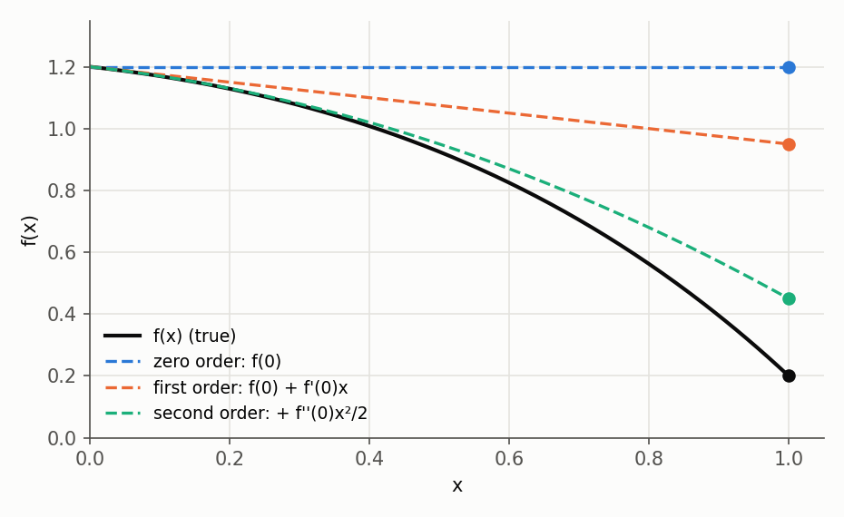
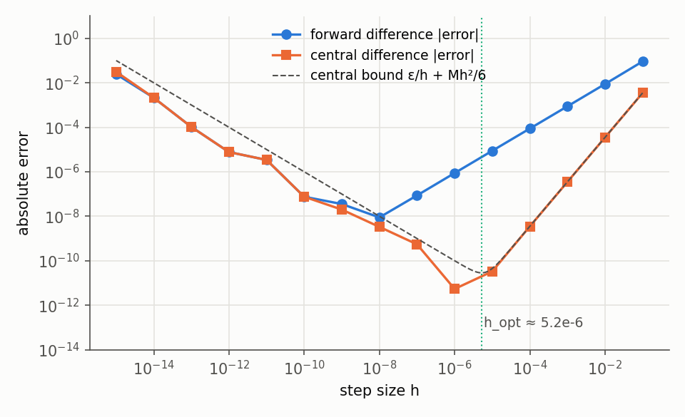

# 4장 — 반올림 오차와 절단 오차

[레포지토리 안내](../../README.ko.md) | [English](Concepts_Lecture.md) | [한국어](Concepts_Lecture.ko.md)

> **최종 수정일:** 2026-11-27
>
> Applied Numerical Methods with Python for Engineers and Scientists, Chapra and Clough, Ch 4

> **학습 목표:**
> 1. 유효 숫자를 세고 정확도와 정밀도를 구분할 수 있다
> 2. IEEE 754 부동 소수점 표현을 바탕으로 부동 소수점 연산의 반올림 오차를 분석할 수 있다
> 3. Taylor 급수로 절단 오차를 추정하고 나머지 항으로 그 상계를 구할 수 있다
> 4. 근사 방법과 유한 차분 공식의 정확도 차수를 분석할 수 있다
> 5. 절단 오차와 반올림 오차의 균형으로 최적 스텝 크기를 설명할 수 있다
> 6. 함수의 조건수로 문제가 악조건인지 판단할 수 있다

---

## 목차

- [1. 유효 숫자](#1-유효-숫자)
  - [1.1 정의](#11-정의)
  - [1.2 세기 규칙](#12-세기-규칙)
- [2. 정확도 vs. 정밀도](#2-정확도-vs-정밀도)
  - [2.1 정의와 구분](#21-정의와-구분)
  - [2.2 다트판 비유](#22-다트판-비유)
  - [2.3 편향과 불확실성](#23-편향과-불확실성)
- [3. 오차 정의](#3-오차-정의)
  - [3.1 참 오차와 참 백분율 상대 오차](#31-참-오차와-참-백분율-상대-오차)
  - [3.2 근사 백분율 상대 오차](#32-근사-백분율-상대-오차)
  - [3.3 중지 기준](#33-중지-기준)
  - [3.4 오차의 원인](#34-오차의-원인)
- [4. Scarborough 기준](#4-scarborough-기준)
- [5. 반올림 오차](#5-반올림-오차)
  - [5.1 반올림 오차의 원인](#51-반올림-오차의-원인)
  - [5.2 부동 소수점 표현](#52-부동-소수점-표현)
  - [5.3 IEEE 754 배정밀도](#53-ieee-754-배정밀도)
  - [5.4 머신 엡실론](#54-머신-엡실론)
  - [5.5 절단 오차 vs. 반올림 오차](#55-절단-오차-vs-반올림-오차)
  - [5.6 정수 표현](#56-정수-표현)
  - [5.7 가상의 십진 부동 소수점 체계](#57-가상의-십진-부동-소수점-체계)
  - [5.8 IEEE 754 배정밀도의 세부](#58-ieee-754-배정밀도의-세부)
  - [5.9 반올림 방식과 상대 오차의 한계](#59-반올림-방식과-상대-오차의-한계)
- [6. 부동 소수점 산술의 문제점](#6-부동-소수점-산술의-문제점)
  - [6.1 뺄셈 소거](#61-뺄셈-소거)
  - [6.2 큰 수와 작은 수의 덧셈](#62-큰-수와-작은-수의-덧셈)
  - [6.3 스미어링](#63-스미어링)
  - [6.4 유한 자릿수 산술의 예](#64-유한-자릿수-산술의-예)
  - [6.5 배정밀도에서의 뺄셈 소거](#65-배정밀도에서의-뺄셈-소거)
  - [6.6 내적의 계산](#66-내적의-계산)
- [7. Taylor 급수 미리보기](#7-taylor-급수-미리보기)
- [8. Taylor 급수 전개(Taylor Series Expansion)](#8-taylor-급수-전개taylor-series-expansion)
  - [8.1 Taylor 급수 공식](#81-taylor-급수-공식)
  - [8.2 나머지 항(절단 오차)](#82-나머지-항절단-오차)
  - [8.3 평균값 정리와 나머지 항](#83-평균값-정리와-나머지-항)
  - [8.4 예제: cos x의 Taylor 근사](#84-예제-cos-x의-taylor-근사)
- [9. 근사의 차수(Order of Approximation)](#9-근사의-차수order-of-approximation)
  - [9.1 0차부터 n차까지](#91-0차부터-n차까지)
  - [9.2 빅-O 표기법과 그 의미](#92-빅-o-표기법과-그-의미)
  - [9.3 예제: eˣ의 Taylor 급수](#93-예제-ex의-taylor-급수)
  - [9.4 Taylor 급수로 본 Euler 방법의 절단 오차](#94-taylor-급수로-본-euler-방법의-절단-오차)
- [10. Taylor 급수를 이용한 수치 미분](#10-taylor-급수를-이용한-수치-미분)
  - [10.1 전진 차분(Forward Difference, 1계도함수)](#101-전진-차분forward-difference-1계도함수)
  - [10.2 후진 차분(Backward Difference, 1계도함수)](#102-후진-차분backward-difference-1계도함수)
  - [10.3 중심 차분(Central Difference, 1계도함수)](#103-중심-차분central-difference-1계도함수)
  - [10.4 2계도함수(중심 차분)](#104-2계도함수중심-차분)
  - [10.5 고차 전진 차분](#105-고차-전진-차분)
  - [10.6 2계도함수의 전진 차분과 후진 차분](#106-2계도함수의-전진-차분과-후진-차분)
- [11. 상세 예제: 수치 미분](#11-상세-예제-수치-미분)
  - [11.1 문제 설정](#111-문제-설정)
  - [11.2 h = 0.5에서의 결과](#112-h--05에서의-결과)
  - [11.3 h 감소의 효과](#113-h-감소의-효과)
- [12. 총 수치 오차](#12-총-수치-오차)
  - [12.1 절단 오차 vs. 반올림 오차](#121-절단-오차-vs-반올림-오차)
  - [12.2 최적 스텝 크기](#122-최적-스텝-크기)
  - [12.3 오차 한계와 최적 스텝 크기의 유도](#123-오차-한계와-최적-스텝-크기의-유도)
  - [12.4 수치 오차의 관리](#124-수치-오차의-관리)
- [13. 안정성과 조건수(Condition Number)](#13-안정성과-조건수condition-number)
- [14. 실습: Python으로 유한 차분](#14-실습-python으로-유한-차분)
  - [14.1 전진 차분과 중심 차분 비교](#141-전진-차분과-중심-차분-비교)
  - [14.2 스텝 크기 분석과 최적 h](#142-스텝-크기-분석과-최적-h)
- [요약](#요약)
- [점검 문제](#점검-문제)
- [참고 문헌](#참고-문헌)

---

<br>

## 1. 유효 숫자

### 1.1 정의

**유효 숫자(Significant Figures)** 는 어떤 수에서 **신뢰할 수 있는 자릿수**의 개수이며, 유효 자릿수라고도 한다. 유효 숫자는 어떤 양이 알려진 정밀도를 나타낸다. 수치 해법에서 유효 숫자는 계산된 결과나 측정 결과를 얼마나 신뢰할 수 있는지 표현하는 실용적인 방법이다.

예를 들어 수 $`0.00456`$은 숫자 4, 5, 6의 **3개 유효 숫자**를 가진다. 선행 0(0.00...)은 수의 크기를 나타내는 자리 표시자일 뿐이며 정밀도에 관한 정보를 전달하지 않는다.

### 1.2 세기 규칙

유효 숫자를 세는 규칙은 다음과 같다.

1. **0이 아닌 모든 숫자는 유효하다.** $`3.285`$는 4개의 유효 숫자를 가진다.
2. **선행 0은 유효하지 않다.** $`0.00456`$은 3개의 유효 숫자를 가지며, 4 앞의 0들은 자리 표시자일 뿐이다.
3. **소수점 뒤의 후행 0은 유효하다.** $`2.3400`$은 5개의 유효 숫자를 가지며, 후행 0은 측정 정밀도를 나타낸다.
4. **0이 아닌 숫자 사이의 0(사이 0)은 유효하다.** $`3.0025`$는 5개의 유효 숫자를 가진다.
5. **정수의 후행 0은 모호하다.** $`1200`$은 2개, 3개, 4개의 유효 숫자를 모두 가질 수 있다. 과학적 표기법을 쓰면 $`1.2 \times 10^3`$(유효 숫자 2개)과 $`1.200 \times 10^3`$(유효 숫자 4개)처럼 구분된다.

> **참고:** 유효 숫자는 수치 계산 결과를 보고할 때 매우 중요해진다. 방법의 정확도로 정당화되는 것보다 더 많은 자릿수를 보고하면 정밀도에 대한 잘못된 인상을 준다. 반대로 너무 적은 자릿수를 보고하면 계산이 실제로 제공하는 정보를 버리게 된다.

---

<br>

## 2. 정확도 vs. 정밀도

### 2.1 정의와 구분

이 두 용어는 일상 언어에서 자주 혼동되지만, 수치 해법과 과학에서는 뚜렷이 다른 중요한 의미를 가진다.

- **정확도(Accuracy)** 는 계산되거나 측정된 값이 **참값**에 얼마나 가까운지를 나타낸다. 정확한 결과란 올바른 답에 가까운 결과이다.
- **정밀도(Precision)** 는 **반복된** 계산이나 측정이 **서로** 얼마나 가까운지를 나타낸다. 정밀한 결과란 올바른지와 관계없이 재현 가능하고 일관된 결과이다.

중요한 점은 **정확도 없이도 정밀도를 가질 수 있다**는 것이다. 예를 들어 항상 0.5 kg 높게 표시하는 저울처럼 측정 장비에 체계적 오차(편향)가 있으면, 반복 측정은 서로 매우 가깝지만(높은 정밀도) 일관되게 틀린다(낮은 정확도).

> **참고:** **실험 과학의 관점.** 실험 과학에서 정확도는 체계적 오차(교정)와 관련되고, 정밀도는 무작위 오차(노이즈)와 관련된다. 측정을 평가할 때는 둘 다 고려해야 한다.

### 2.2 다트판 비유

정확도와 정밀도의 관계는 다트판으로 시각화하면 이해하기 쉽다.

| 시나리오 | 정확도 | 정밀도 | 다트 패턴 |
|:---------|:---------|:----------|:-------------|
| 정확하고 정밀한 | 높음 | 높음 | 과녁 중심에 밀집 |
| 정확하지만 정밀하지 않은 | 높음 | 낮음 | 과녁 중심 주위에 흩어짐 (평균은 올바름) |
| 정밀하지만 정확하지 않은 | 낮음 | 높음 | 밀집되어 있지만 과녁에서 벗어남 (체계적 편향) |
| 정확하지도 정밀하지도 않은 | 낮음 | 낮음 | 판 전체에 흩어짐 |

*표 1. 다트판 비유로 본 정확도와 정밀도의 네 가지 조합*

정밀하지만 정확하지 않은 경우는 특히 위험한데, 밀집된 군집이 확신에 대한 잘못된 인상을 주기 때문이다. 수치 해법에서는 결함 있는 알고리즘이나 잘못된 모델 때문에 계산이 일관되게 **잘못된 답**으로 수렴하는 경우가 이에 해당한다.

### 2.3 편향과 불확실성

정확도와 정밀도의 부족은 각각 **편향(bias)** 과 **불확실성(uncertainty)** 으로 정량화한다. 부정확성(inaccuracy)은 참값에서 체계적으로 벗어난 정도이며 이를 편향이라고 한다. 부정밀성(imprecision)은 값들이 흩어진 정도의 크기이며 이를 불확실성이라고 한다. 반복 측정값 $`x_1, \ldots, x_n`$이 있으면 편향은 평균과 참값의 차 $`\bar{x} - x_{\text{true}}`$로, 불확실성은 표본 표준편차 $`s = \sqrt{\sum_i (x_i - \bar{x})^2/(n-1)}`$로 추정한다.

예를 들어 질량이 정확히 10.00 g인 분동을 저울로 다섯 번 재어 10.21, 10.19, 10.22, 10.18, 10.20 g을 얻었다면, 평균은 10.20 g이므로 편향은 +0.20 g이고 표본 표준편차는 0.016 g이다. 표준편차가 편향보다 열 배 이상 작으므로 이 저울은 정밀하지만 정확하지 않으며, 표 1의 셋째 행에 해당한다. 편향은 측정을 반복해도 줄지 않고 교정으로만 없앨 수 있지만, 불확실성은 측정을 반복해 평균을 내면 줄어든다.

수치 계산의 오차는 같은 입력에 대해 항상 같은 값으로 재현된다는 점에서 측정의 무작위 오차와 다르다. 같은 계산을 반복해 평균을 내도 수치 오차는 줄지 않으며, 방법이나 스텝 크기를 바꾸어야 줄일 수 있다.

---

<br>

## 3. 오차 정의

### 3.1 참 오차와 참 백분율 상대 오차

정확한 값(참값)을 알 때는 **참 오차(True Error)** 를 계산할 수 있다.

```math
E_t = \text{true value} - \text{approximate value}
```

$`E_t`$의 부호는 오차의 방향을 알려 준다. 양수이면 근사값이 과소추정, 음수이면 과대추정이다. 그러나 $`E_t`$의 크기만으로는 오차가 얼마나 심각한지 알 수 없다. 1 cm의 오차는 다리를 측정할 때는 무시할 수 있지만 마이크로칩을 측정할 때는 치명적이다.

오차를 정규화하기 위해 **참 백분율 상대 오차(True Percent Relative Error)** 를 계산한다.

```math
\varepsilon_t = \frac{\text{true value} - \text{approximate value}}{\text{true value}} \times 100\%
```

이는 오차를 참값에 대한 백분율로 나타내므로 무차원이며, 서로 다른 규모의 오차를 비교할 수 있게 한다. 다음은 그 예이다.

- 다리 측정에서 참값이 10,000 m이고 근사값이 10,001 m이면 $`|\varepsilon_t| = 0.01\%`$로 무시할 수 있다.
- 칩 측정에서 참값이 0.001 m이고 근사값이 0.002 m이면 $`|\varepsilon_t| = 100\%`$로 치명적이다.

$`|E_t|`$를 **절대 오차(absolute error)** 라고 하며, 같은 절대 오차라도 대상의 크기에 따라 의미가 달라진다. 길이 10,000 cm인 다리를 9,999 cm로, 길이 10 cm인 리벳을 9 cm로 측정했다면 두 경우 모두 $`|E_t| = 1`$ cm이지만, 상대 오차는 다리가 $`(1/10000) \times 100\% = 0.01\%`$, 리벳이 $`(1/10) \times 100\% = 10\%`$이다. 다리의 측정은 충분히 정확하지만 리벳의 측정은 쓸 수 없다.

### 3.2 근사 백분율 상대 오차

대부분의 실제 상황에서는 **참값을 알 수 없다**. 참값을 모르기 때문에 수치적 근사를 계산하는 것이다. 이런 경우에는 연속한 반복의 근사값을 비교하는 **근사 백분율 상대 오차(Approximate Percent Relative Error)** 를 사용한다.

```math
\varepsilon_a = \frac{\text{current approximation} - \text{previous approximation}}{\text{current approximation}} \times 100\%
```

아이디어는 간단하다. 반복 사이에 답이 크게 변하지 않으면 방법이 안정된 결과로 수렴했을 가능성이 높다.

> **참고:** **반복법의 수렴 판정.** 근사 오차 $`\varepsilon_a`$는 반복법의 기본이다. 참값을 알 수 없을 때 답이 여전히 얼마나 변하고 있는지를 측정하며, 변화가 멈추면(작은 $`\varepsilon_a`$) 수렴했다고 가정한다.

### 3.3 중지 기준

반복법에는 계산을 언제 멈출지 정하는 규칙이 필요하다. 표준적인 방법은 **허용 오차(Tolerance)** $`\varepsilon_s`$를 미리 정하고 다음이 성립할 때까지 반복하는 것이다.

```math
|\varepsilon_a| < \varepsilon_s
```

즉 근사 백분율 상대 오차가 지정한 허용 오차 아래로 떨어질 때까지 반복을 계속한다. $`\varepsilon_s`$의 선택은 응용에 요구되는 정밀도에 따라 다르다. 공학 설계 계산은 $`\varepsilon_s = 0.1\%`$를 허용할 수 있고, 금융 계산은 $`\varepsilon_s = 0.0001\%`$를 요구할 수 있다.

### 3.4 오차의 원인

수치 계산의 결과가 실제 현상과 다른 이유는 크게 네 가지이다.

| 원인 | 내용 | 예 |
|:-----|:-----|:-----|
| 수치 근사 | 수학적 절차를 유한한 계산으로 바꾸어 생기는 절단 오차와, 유한 자릿수로 수를 표현하여 생기는 반올림 오차 | 도함수를 유한 차분으로 근사, $`1/3`$을 유한 자릿수로 저장 |
| 모델 오차 | 수학적 모델이 현상을 완전히 나타내지 못하여 생기는 오차 | 이차 항력 대신 선형 항력을 가정 |
| 데이터 불확실성 | 매개변수와 입력값의 측정 오차 | 항력 계수 측정값의 편향과 흩어짐 |
| 실수 | 계산, 코딩, 입력에서 사람이 저지르는 실수 | 공식의 부호를 잘못 씀, 단위를 혼동 |

*표 2. 수치 계산 결과의 오차 원인*

이 장에서 다루는 것은 첫째 원인인 수치 근사의 오차이다. 수치 근사의 오차는 다시 **반올림 오차(roundoff error)** 와 **절단 오차(truncation error)** 로 나뉜다. 반올림 오차는 컴퓨터가 수를 유한한 자릿수로만 나타낼 수 있어서 생기는 컴퓨터 근사의 오차이고(5\~6절), 절단 오차는 정확한 수학적 절차를 유한한 단계에서 끊어 근사하여 생기는 수학적 근사의 오차이다(7\~11절). 두 오차를 합한 것이 **총 수치 오차(total numerical error)** 이다(12절). 1장의 번지 점프 예제에서 도함수 $`dv/dt`$를 유한 차분 $`\Delta v/\Delta t`$로 바꾼 것이 절단 오차의 대표적인 예이며, 곡선 아래의 넓이를 유한 개의 사다리꼴 넓이의 합으로 근사하는 것도 같은 종류의 오차를 만든다(19장). 나머지 세 원인은 수치 방법을 바꾸어도 줄지 않으므로, 결과를 해석할 때는 수치 오차와 모델 오차, 데이터 오차의 크기를 함께 따져야 한다.

---

<br>

## 4. Scarborough 기준

**Scarborough 기준(Scarborough Criterion)** 은 중지 허용 오차와 결과의 정확한 유효 숫자 개수를 직접 연결한다. 구체적인 내용은 다음과 같다.

```math
\text{If } |\varepsilon_a| < (0.5 \times 10^{2-n})\%, \text{ then the result is correct to at least } n \text{ significant figures.}
```

이 기준을 쓰면 허용 오차 $`\varepsilon_s`$를 실용적으로 정할 수 있다.

| 원하는 유효 숫자 ($`n`$) | 필요한 $`\vert\varepsilon_a\vert`$ |
|:----------------------------------|:----------------------------|
| 1 | $`< 5\%`$ |
| 2 | $`< 0.5\%`$ |
| 3 | $`< 0.05\%`$ |
| 4 | $`< 0.005\%`$ |
| 5 | $`< 0.0005\%`$ |
| 6 | $`< 0.00005\%`$ |
| 7 | $`< 0.000005\%`$ |

*표 3. 원하는 유효 숫자 개수에 따른 Scarborough 기준의 허용 오차*

예를 들어 결과가 **3개의 유효 숫자**까지 정확해야 한다면 $`\varepsilon_s = 0.05\%`$로 두고 $`|\varepsilon_a| < 0.05\%`$가 될 때까지 반복한다.

> **참고:** Scarborough 기준은 충분 조건(필요 조건은 아님)을 제공한다. 기준을 충족하면 최소 $`n`$개의 유효 숫자를 보장하지만, 실제 결과는 기준이 제시하는 것보다 더 정확할 수 있다.

Scarborough 기준을 반복 계산의 중지 기준으로 쓰는 예로, Maclaurin 급수 $`e^x = 1 + x + \frac{x^2}{2!} + \cdots + \frac{x^n}{n!} + \cdots`$로 $`e^{0.5}`$를 추정한다. 항을 더할수록 근사가 정확해지므로, $`e^{0.5} \approx 1`$에서 출발하여 항을 하나씩 더하고 매번 참 백분율 상대 오차 $`\varepsilon_t`$와 근사 백분율 상대 오차 $`\varepsilon_a`$를 계산한다. 참값은 $`e^{0.5} = 1.648721270700128\ldots`$이다. 유효 숫자 3자리를 원하면 Scarborough 기준에 따라 $`\varepsilon_s = (0.5 \times 10^{2-3})\% = 0.05\%`$로 둔다.

첫 항만 쓰면 $`e^{0.5} \approx 1`$이고 $`\varepsilon_t = |(1.648721 - 1)/1.648721| \times 100\% \approx 39.3\%`$이며, 이전 근사값이 없으므로 $`\varepsilon_a`$는 계산하지 않는다. 두 항을 쓰면 $`1 + 0.5 = 1.5`$이고 $`\varepsilon_t \approx 9.02\%`$, $`\varepsilon_a = |(1.5 - 1)/1.5| \times 100\% \approx 33.3\%`$이다. 이 과정을 $`|\varepsilon_a| < \varepsilon_s`$가 될 때까지 계속하면 다음 표를 얻는다.

| 항의 수 | 근사값 | $`\varepsilon_t`$ (%) | $`\varepsilon_a`$ (%) |
|-----:|-----:|-----:|-----:|
| 1 | 1 | 39.3 | - |
| 2 | 1.5 | 9.02 | 33.3 |
| 3 | 1.625 | 1.44 | 7.69 |
| 4 | 1.645833333 | 0.175 | 1.27 |
| 5 | 1.648437500 | 0.0172 | 0.158 |
| 6 | 1.648697917 | 0.00142 | 0.0158 |

*표 4. Maclaurin 급수로 계산한 exp(0.5)의 근사값과 오차*

6개 항에서 $`\varepsilon_a = 0.0158\% < 0.05\%`$가 되어 멈추며, 이때 $`\varepsilon_t = 0.00142\%`$이므로 결과는 요구한 3자리보다 많은 5자리(1.6487)까지 맞는다. Scarborough 기준이 보수적인 충분 조건임을 보여 준다. 또 표에서 $`\varepsilon_a`$는 항상 $`\varepsilon_t`$보다 크다. 이 급수처럼 빠르게 수렴하면 새로 더한 항이 남은 오차 전체보다 크기 때문이다. 이 반복 계산의 코드는 4장 실습에서 다룬다.

---

<br>

## 5. 반올림 오차

### 5.1 반올림 오차의 원인

반올림 오차(Roundoff Errors)는 컴퓨터가 **유한한 수의 자릿수**만 저장할 수 있기 때문에 발생한다. 대부분의 실수는 무한히 많은 자릿수를 가지므로(예: $`\pi = 3.14159265...`$, $`1/3 = 0.33333...`$) 컴퓨터는 표현을 절단하거나 반올림해야 하며, 수를 저장하거나 계산을 수행할 때마다 작은 오차가 생긴다.

### 5.2 부동 소수점 표현

컴퓨터는 실수를 **부동 소수점(Floating-Point)** 형식으로 표현한다.

```math
\pm m \times b^e
```

여기서 각 기호의 뜻은 다음과 같다.
- $`m`$은 **가수(Mantissa)** 로, 수의 유효 자릿수를 담는다. significand라고도 한다.
- $`b`$는 **밑수(Base)** 로, 사용하는 수 체계를 나타낸다. 이진 컴퓨터에서는 2이다.
- $`e`$는 **지수(Exponent)** 로, 소수점이나 이진 소수점의 위치, 즉 수의 크기를 결정한다.

이는 10진법의 과학적 표기법과 비슷하다. $`6.022 \times 10^{23}`$은 가수 $`6.022`$, 밑수 $`10`$, 지수 $`23`$을 가진다.

### 5.3 IEEE 754 배정밀도

**IEEE 754** 표준은 현대 컴퓨터에서 부동 소수점 산술의 보편적 형식을 정의한다. **배정밀도(Double Precision)** (64비트) 형식은 64비트를 다음과 같이 할당한다.

| 구성 요소 | 비트 수 | 용도 |
|:----------|:-----|:--------|
| 부호 | 1비트 | $`0`$ = 양수, $`1`$ = 음수 |
| 지수 | 11비트 | 정규화 수의 범위는 $`-1022`$부터 $`+1023`$까지 (1023만큼 편향하여 저장) |
| 가수 | 52비트 | 가수의 소수 부분 |

*표 5. IEEE 754 배정밀도 형식의 비트 할당*

```text
  63    62            52 51                              0
┌──────┬────────────────┬─────────────────────────────────┐
│ sign │ exponent (11)  │          fraction (52)          │
└──────┴────────────────┴─────────────────────────────────┘
```

*그림 1. 배정밀도 수의 64비트 배치*

이진 부동 소수점 수는 선행 1을 가지도록 정규화되므로(즉 $`1.xxxxx \times 2^e`$) 선행 1은 **암묵적**이어서 저장할 필요가 없다. 따라서 가수는 실질적으로 53비트의 정밀도를 가진다.

> **[컴퓨터구조]** CPU의 부동 소수점 장치는 IEEE 754 형식의 비트 패턴을 하드웨어에서 직접 더하고 곱하며, 연산 결과를 가수 53비트에 맞게 반올림하여 저장한다. 이 하드웨어 반올림이 이 장에서 다루는 반올림 오차의 출발점이며, 가수 53비트는 약 15~17자리의 유효 십진 자릿수에 해당한다.

### 5.4 머신 엡실론

**머신 엡실론(Machine Epsilon)** ($`\varepsilon_{\text{mach}}`$)은 1과 그다음으로 큰 부동 소수점 수 사이의 간격이며, 부동 소수점 산술에서 다음을 만족하는 가장 작은 2의 거듭제곱이기도 하다.

```math
1 + \varepsilon_{\text{mach}} \neq 1
```

IEEE 754 배정밀도의 경우는 다음과 같다.

```math
\varepsilon_{\text{mach}} = 2^{-52} \approx 2.22 \times 10^{-16}
```

머신 엡실론은 부동 소수점 체계의 **상대 정밀도**를 나타낸다. 즉 부동 소수점 수가 구별할 수 있는 최소 상대 변화의 크기를 알려 준다. 기본 반올림 방식인 최근접 반올림에서는 1에 대한 상대 크기가 $`\varepsilon_{\text{mach}}/2`$ 이하인 수를 1에 더하면 결과가 다시 1로 반올림된다.

따라서 배정밀도는 약 **15~17자리의 유효 십진 자릿수** 정밀도를 제공한다. 그 이상의 자릿수는 반올림 때문에 신뢰할 수 없다.

### 5.5 절단 오차 vs. 반올림 오차

이 두 유형의 오차는 근본적으로 다른 원인에서 생긴다.

| 속성 | 절단 오차(Truncation Error) | 반올림 오차(Roundoff Error) |
|:---------|:----------------|:----------------|
| **원인** | 수학적 절차의 근사 (예: 무한 Taylor 급수를 유한 항 이후 절단) | 컴퓨터 메모리에서 유한 자릿수로 수를 표현 |
| **의존성** | 알고리즘과 스텝 크기 | 컴퓨터 하드웨어와 수 형식 |
| **항/스텝이 많아질수록** | 일반적으로 감소 | 누적될 수 있음 |
| **예시** | 전체 무한 급수 대신 $`e^x \approx 1 + x + x^2/2`$ 사용 | $`1/3 = 0.333...`$을 $`0.333333333333333`$으로 저장 |

*표 6. 절단 오차와 반올림 오차의 비교*

두 유형의 오차가 자주 상호 작용하므로 둘 다 이해해야 한다. 절단 오차를 줄이려고 스텝 크기를 줄이면 산술 연산이 더 많이 필요하고, 이는 누적된 반올림 오차를 늘릴 수 있다.

### 5.6 정수 표현

컴퓨터는 정보를 **비트(bit)**, 즉 0과 1 두 값만 가지는 이진 숫자로 저장한다. 8비트를 묶은 **바이트(byte)** 는 0000 0000부터 1111 1111까지 $`2^8 = 256`$가지 값을 가지며, 수는 여러 바이트에 걸쳐 저장된다. 수를 적는 방식은 십진법과 같은 **위치 기수법(positional notation)** 이다. 십진수 8642.9는 $`(8 \times 10^3) + (6 \times 10^2) + (4 \times 10^1) + (2 \times 10^0) + (9 \times 10^{-1})`$이고, 이진수 $`101.1_2`$는 $`(1 \times 2^2) + (0 \times 2^1) + (1 \times 2^0) + (1 \times 2^{-1}) = 5.5_{10}`$이다. 기본 숫자의 조합으로 큰 수를 나타내며, 각 숫자의 위치가 그 숫자의 크기를 정한다.

정수의 표현 범위는 바이트 수가 정한다. 부호 없는 $`n`$비트 정수는 0부터 $`2^n - 1`$까지 나타낸다. 음수를 나타내는 가장 단순한 방법은 첫 비트를 부호(0은 양수, 1은 음수)로 쓰는 **부호-크기 표현(sign-magnitude representation)** 이지만, 0이 $`+0`$과 $`-0`$ 두 가지가 되고 덧셈 회로가 복잡해진다. 그래서 컴퓨터는 **2의 보수(two's complement)** 를 쓴다. 8비트에서 $`1111\,1111_2 + 1 = 1\,0000\,0000_2`$이고 넘치는 아홉째 자리는 버려지므로 결과는 $`0000\,0000_2`$이다. 따라서 $`1111\,1111_2`$를 $`-1`$로 정하면 덧셈이 그대로 성립한다. 일반적으로 음수 $`-k`$는 $`2^8 - k`$의 비트 패턴으로 저장하며, 예를 들어 $`5 = 0000\,0101_2`$이고 $`-5 = 1111\,1011_2`$이다. 이 방식에서도 첫 비트가 부호를 나타내며, 8비트 정수의 범위는 $`-2^7 = -128`$부터 $`2^7 - 1 = 127`$까지이다.

| 비트 수 | 부호 없는 정수의 범위 | 2의 보수 정수의 범위 |
|-----:|:-----|:-----|
| 8 | 0 ~ 255 | -128 ~ 127 |
| 16 | 0 ~ 65,535 | -32,768 ~ 32,767 |
| 32 | 0 ~ 4,294,967,295 | -2,147,483,648 ~ 2,147,483,647 |
| 64 | 0 ~ $`2^{64} - 1`$ | $`-2^{63}`$ ~ $`2^{63} - 1`$ |

*표 7. 비트 수에 따른 정수의 표현 범위*

범위 안의 정수는 정확히 표현되므로 정수의 덧셈, 뺄셈, 곱셈에는 반올림 오차가 없다. 그러나 결과가 범위를 넘으면 **오버플로(overflow)** 가 일어나 값이 순환한다. NumPy의 8비트 정수에서 127 + 1을 계산하면 $`-128`$이 된다. 2장 2.5절에서 본 것처럼 Python의 기본 `int`는 필요한 만큼 자릿수를 늘리므로 이 문제가 없지만, NumPy 배열의 정수는 폭이 고정되어 있다.

### 5.7 가상의 십진 부동 소수점 체계

부동 소수점 표현의 성질은 자릿수가 적은 가상의 체계에서 쉽게 볼 수 있다. 한 워드가 십진 숫자 5개로 이루어진 십진 컴퓨터를 생각한다. 첫 숫자는 가수의 부호, 다음 두 숫자는 지수의 부호와 크기, 마지막 두 숫자는 가수의 크기를 담는다. 즉 수는 $`s_1 d_1.d_2 \times 10^{s_0 d_0}`$의 형태이며, 가수는 정규화되어 $`d_1 \neq 0`$이다.

- **표현 범위.** 가장 큰 양수는 $`+9.9 \times 10^{+9}`$, 가장 작은 양수는 $`+1.0 \times 10^{-9}`$이다. 음수 쪽은 $`-1.0 \times 10^{-9}`$부터 $`-9.9 \times 10^{+9}`$까지이다. 크기가 $`9.9 \times 10^9`$보다 큰 수를 만들면 **오버플로**가, 0이 아니면서 크기가 $`1.0 \times 10^{-9}`$보다 작은 수를 만들면 **언더플로(underflow)** 가 일어난다. 0 근처의 구간 $`(-1.0 \times 10^{-9}, 1.0 \times 10^{-9})`$에는 0 말고는 표현할 수 있는 수가 없다.
- **자릿수를 늘리는 효과.** 가수에 숫자를 하나 더 주면($`s_1 d_1.d_2 d_3 \times 10^{s_0 d_0}`$) 가장 큰 수는 $`9.99 \times 10^9`$로 조금 늘고 정밀도가 높아진다. 지수에 숫자를 하나 더 주면($`s_1 d_1.d_2 \times 10^{s_0 d_0 d_1}`$) 가장 큰 수가 $`9.9 \times 10^{99}`$로 $`10^{90}`$배 늘어난다. 지수는 범위를, 가수는 정밀도를 정한다.
- **정밀도의 한계.** $`2^{-5} = 1/32 = 0.03125`$는 가수가 두 자리이면 $`3.1 \times 10^{-2} = 0.031`$로 저장되어 $`\varepsilon_t = |(0.03125 - 0.031)/0.03125| \times 100\% = 0.8\%`$의 오차가 생긴다. 가수가 네 자리이면 $`3.125 \times 10^{-2}`$로 정확히 저장된다. 그러나 $`\pi = 3.14159\ldots`$처럼 숫자가 끝없이 이어지는 수는 가수를 아무리 늘려도 근사할 수밖에 없다. 두 자리 가수에서 $`\pi`$는 $`3.1 \times 10^0`$이 되어 $`\varepsilon_t \approx 1.32\%`$이다.
- **간격의 불균등.** 지수가 $`-1`$인 수는 $`1.0 \times 10^{-1}`$부터 $`9.9 \times 10^{-1}`$까지 0.01 간격으로, 지수가 0인 수는 1.0부터 9.9까지 0.1 간격으로, 지수가 1인 수는 10부터 99까지 1 간격으로 놓인다. 지수가 9이면 간격은 $`10^8`$이다. 즉 인접한 수의 간격은 수의 크기에 비례하고, 수를 표현할 때 생기는 반올림 오차도 수의 크기에 비례한다. 반면 상대 오차의 상한은 크기와 무관하게 거의 일정하다(5.9절).

이 성질은 이진 체계에서도 같다. IEEE 754 배정밀도의 머신 엡실론은 1 근처의 간격이고, $`10^{16}`$ 근처에서는 간격이 2가 되는 것(6.2절)이 그 예이다.

### 5.8 IEEE 754 배정밀도의 세부

이진수를 정규화하면 소수점 앞의 숫자가 항상 1이 된다. 예를 들어 $`1011_2 = 1.011_2 \times 2^3`$이고 $`0.001_2 = 1.000_2 \times 2^{-3}`$이다. 그래서 정규화된 이진 부동 소수점 수는 다음과 같이 쓸 수 있다.

```math
\pm (1 + f) \times 2^e
```

여기서 $`f`$는 가수의 소수 부분이고 $`e`$는 지수이다. 맨 앞의 1은 언제나 같으므로 저장하지 않고 $`f`$만 저장한다. 예를 들어 $`1101.1_2 = 1.1011_2 \times 2^3 = (1 + 0.1011_2) \times 2^3`$에서 저장하는 것은 $`0.1011_2`$의 비트와 지수 3이다. 배정밀도는 $`f`$에 52비트를 쓰고 맨 앞의 1이 암묵적으로 더해지므로 53비트의 정밀도를 가진다.

지수 필드의 11비트는 0부터 $`2^{11} - 1 = 2047`$까지의 부호 없는 정수 $`E`$를 담으며, 실제 지수는 **편향(bias)** 1023을 뺀 $`e = E - 1023`$이다. 이를 **편향 지수(biased exponent)** 형식이라고 한다. 음수 지수를 부호 비트 없이 저장할 수 있고, 지수의 크기 비교가 정수의 비교와 같아진다.

| 저장된 비트 | 십진값 $`E`$ | 실제 지수 $`e = E - 1023`$ | 쓰임 |
|:-----|-----:|-----:|:-----|
| 11111111111 | 2047 | - | 무한대와 NaN에 예약 |
| 11111111110 | 2046 | 1023 | 정규화 수의 최대 지수 |
| 10000000000 | 1024 | 1 | 정규화 수 |
| 01111111111 | 1023 | 0 | 정규화 수 |
| 01111111110 | 1022 | $`-1`$ | 정규화 수 |
| 00000000001 | 1 | $`-1022`$ | 정규화 수의 최소 지수 |
| 00000000000 | 0 | - | 0과 비정규화 수에 예약 |

*표 8. 배정밀도의 편향 지수 형식*

지수 필드의 값 0과 2047은 특수한 수에 예약되어 있으므로, 정규화 수의 지수는 $`-1022`$부터 $`+1023`$까지이다. 따라서 다음이 성립한다.

- **가장 큰 수**는 소수 부분의 비트가 모두 1이고 지수가 1023인 $`(2 - 2^{-52}) \times 2^{1023} \approx 2^{1024} \approx 1.7977 \times 10^{308}`$이다.
- **가장 작은 양의 정규화 수**는 $`1.0 \times 2^{-1022} \approx 2.2251 \times 10^{-308}`$이다.
- 지수 필드가 0이면 맨 앞의 1을 가정하지 않는 **비정규화 수(subnormal number)** 가 되어 0과 $`2^{-1022}`$ 사이를 채운다. 가장 작은 양의 비정규화 수는 $`2^{-1074} \approx 4.94 \times 10^{-324}`$이다. 비정규화 수는 0에 가까워질수록 정밀도가 줄어드는 대신 언더플로를 완만하게 만든다.
- 지수 필드가 2047이면 소수 부분이 0일 때 $`\pm\infty`$를, 0이 아닐 때 NaN을 나타낸다. 오버플로의 결과는 $`\pm\infty`$이고, $`0/0`$이나 $`\infty - \infty`$의 결과는 NaN이다.
- **정밀도**는 소수 부분 52비트가 정한다. $`2^{52} \approx 4.5036 \times 10^{15}`$이므로 십진 15~16자리에 해당하며, 1 근처의 간격 $`2^{-52} \approx 2.2204 \times 10^{-16}`$이 머신 엡실론이다(5.4절).

```python
import math
import numpy as np

print(math.pi)
print(np.finfo(float).max)
print(np.finfo(float).min)
print(np.finfo(float).eps)
```

```text
3.141592653589793
1.7976931348623157e+308
-1.7976931348623157e+308
2.220446049250313e-16
```

`np.finfo(float)`는 배정밀도 수의 매개변수를 알려 준다. `max`는 가장 큰 수, `min`은 가장 작은 수(즉 $`-\text{max}`$), `eps`는 머신 엡실론이며, 가장 작은 양의 정규화 수와 비정규화 수는 각각 `tiny`와 `smallest_subnormal`로 얻는다 [1].

구체적인 수의 비트 패턴에서 이 구조를 확인할 수 있다. 0.1을 배정밀도로 저장한 64비트를 16진수로 쓰면 `0x3fb999999999999a`이다. 부호 비트는 0이고, 지수 필드는 $`01111111011_2 = 1019`$이므로 $`e = 1019 - 1023 = -4`$이며, 소수 부분은 $`1001\,1001 \cdots 1001\,1010_2`$이다. 즉 $`0.1 \approx 1.6 \times 2^{-4}`$이다. $`1/10`$은 이진수로 $`0.0\overline{0011}_2`$처럼 끝없이 반복되므로 53비트에서 반올림되며, 실제로 저장되는 값은 $`3602879701896397/2^{55} = 0.1000000000000000055511\ldots`$로 $`1/10`$보다 조금 크다 [2]. `0.1 + 0.2`가 정확히 `0.3`이 되지 않는 이유가 여기에 있다. 소수의 이진 표현을 출력하는 코드는 4장 실습에서 다룬다.

### 5.9 반올림 방식과 상대 오차의 한계

실수 $`x`$를 표현할 수 있는 수 $`\text{fl}(x)`$로 바꾸는 방법은 두 가지이다. **절단(chopping)** 은 가수에서 넘치는 자리를 버리는 것이고, **반올림(rounding)** 은 가장 가까운 표현 가능한 수를 고르는 것이다. 5.7절의 두 자리 가수에서 $`\pi = 3.14159\ldots`$는 절단과 반올림 모두 3.1이지만, $`2/3 = 0.6666\ldots`$은 절단하면 $`6.6 \times 10^{-1}`$, 반올림하면 $`6.7 \times 10^{-1}`$이다.

간격이 수의 크기에 비례하므로(5.7절) 상대 오차는 크기와 무관한 상한을 가진다. 머신 엡실론을 $`\varepsilon`$이라 하면 정규화 수의 범위에서 다음이 성립한다.

```math
\frac{|x - \text{fl}(x)|}{|x|} \leq \begin{cases} \varepsilon & \text{(chopping)} \\ \varepsilon/2 & \text{(rounding)} \end{cases}
```

IEEE 754의 기본 방식은 최근접 반올림이며, 두 후보의 정확히 중간이면 마지막 비트가 0(짝수)인 쪽을 고르는 최근접 짝수 반올림이다. 그래서 배정밀도로 수를 표현할 때의 상대 오차는 $`u = \varepsilon/2 = 2^{-53} \approx 1.11 \times 10^{-16}`$ 이하이며, 이 $`u`$를 **단위 반올림(unit roundoff)** 이라고 한다. 식으로 쓰면 $`\text{fl}(x) = x(1 + \delta)`$, $`|\delta| \leq u`$이다. 5.4절에서 $`1 + 2^{-53}`$이 1이 되는 것은 정확히 중간인 값을 짝수 쪽으로 반올림한 결과이다.

IEEE 754 표준은 사칙 연산의 결과가 정확한 결과를 같은 방식으로 반올림한 값이 되도록 요구한다 [3]. 따라서 결과가 오버플로나 언더플로 없이 정규화 수의 범위에 있으면 연산 $`\circ \in \lbrace +, -, \times, \div \rbrace`$에 대해 $`\text{fl}(x \circ y) = (x \circ y)(1 + \delta)`$, $`|\delta| \leq u`$이다. 연산 하나의 상대 오차는 이처럼 작지만, 6절에서 보듯 뺄셈 소거는 입력에 이미 들어 있던 작은 오차를 결과의 큰 상대 오차로 바꾸고, 많은 연산을 거치면 오차가 쌓인다.

---

<br>

## 6. 부동 소수점 산술의 문제점

### 6.1 뺄셈 소거

**뺄셈 소거(Subtractive Cancellation)** 는 거의 같은 두 수를 뺄 때 발생하며, 재앙적 소거라고도 한다. 결과는 유효 자릿수 대부분을 잃는다.

```math
0.12345678 - 0.12345671 = 0.00000007
```

두 피연산자는 각각 8개의 유효 자릿수를 가지지만 결과는 **1개의 유효 자릿수**만 가진다. 앞의 7자리가 소거되고, 각 피연산자에서 가장 신뢰하기 어려운 마지막 자리만 남는다. 이는 수치 오차의 가장 위험한 원인 중 하나이다.

뺄셈 소거는 긴 계산 중간에 일어나 결과를 조용히 훼손할 수 있어서 특히 교묘하다. 값이 서로 가까울 것으로 예상되는 양을 빼는 알고리즘은 모두 이 문제를 주의 깊게 검토해야 한다.

### 6.2 큰 수와 작은 수의 덧셈

매우 큰 수와 매우 작은 수를 더하면 부동 소수점 산술의 유한 정밀도 때문에 작은 수가 **완전히 손실**될 수 있다.

```math
10^{16} + 1 = 10^{16} \quad \text{(in double precision)}
```

이는 $`1`$이 $`10^{16}`$에 대해 상대 크기 $`10^{-16}`$으로, 머신 엡실론의 절반(약 $`1.11 \times 10^{-16}`$)보다 작기 때문이다. 덧셈을 위해 두 수를 같은 지수로 정렬하면 작은 수의 자릿수가 가수가 담을 수 있는 범위 밖으로 밀려나 반올림으로 버려진다. $`10^{16}`$ 근처에서 인접한 배정밀도 수의 간격은 2이다.

같은 기준을 $`10^{15}`$에 적용하면, $`10^{15}`$에 더했을 때 결과를 바꿀 수 있는 수의 크기는 대략 $`10^{15} \times 1.11 \times 10^{-16} \approx 0.111`$ 수준이다. 따라서 $`10^{15} + 1`$에서는 1이 이 임계값보다 커서 보존되고($`10^{15} + 1 \neq 10^{15}`$), $`10^{16} + 1`$에서는 1이 상대 정밀도 아래로 떨어져 완전히 손실된다.

### 6.3 스미어링

**스미어링(Smearing)** 은 교대 급수를 합산할 때 중간 부분합의 크기가 최종 답보다 훨씬 클 때 발생한다. 각 중간 덧셈이나 뺄셈은 중간 결과의 크기에 비례하는 반올림 오차를 만든다. 중간 결과가 최종 답보다 훨씬 크므로, 이 반올림 오차가 최종 결과 자체와 비슷하거나 더 커질 수 있다.

예를 들어 Maclaurin 급수로 $`e^{-20}`$을 직접 계산하면 다음과 같다.

```math
e^{-20} = 1 - 20 + \frac{400}{2!} - \frac{8000}{3!} + \cdots
```

항들은 결국 감소하기 전에 매우 크게 증가하며(가장 큰 항은 약 $`4.3 \times 10^7`$), 교대 부호 때문에 대규모 소거가 일어난다. 중간 부분합의 크기는 약 $`2.2 \times 10^7`$까지 커지지만 최종 답은 약 $`2.06 \times 10^{-9}`$이다. 중간 합에서 누적된 반올림 오차가 작은 최종 결과를 압도하므로, 배정밀도로 항을 차례로 더하면 참값과 크게 다른 값이 나온다.

더 나은 방법은 $`e^{20}`$을 계산하고(모든 항이 양수이므로 스미어링이 없다) 역수를 취하는 것이다: $`e^{-20} = 1/e^{20}`$.

### 6.4 유한 자릿수 산술의 예

가수가 네 자리인 십진 부동 소수점 체계에서 세 가지 계산을 따라가면 6.1~6.3절의 현상이 어떻게 생기는지 볼 수 있다.

**뺄셈.** $`36.41 - 26.86`$은 정규화된 형태로 $`3.641 \times 10^1 - 2.686 \times 10^1 = 0.955 \times 10^1`$이다. 결과를 정규화하면 $`9.550 \times 10^0`$이 되는데, 마지막 0은 원래 정보가 아니라 자리를 채운 것이므로 결과의 유효 숫자는 4자리에서 3자리로 줄었다. 두 수가 더 가까우면 손실이 커진다. $`7.642 \times 10^2 - 7.641 \times 10^2 = 0.001 \times 10^2`$을 정규화하면 $`1.000 \times 10^{-1}`$이지만, 의미 있는 숫자는 맨 앞의 1 하나뿐이다. 거의 같은 두 수를 빼서 정밀도를 잃는 이 현상이 뺄셈 소거이다.

**큰 수와 작은 수의 덧셈.** $`4000 + 0.0010`$을 계산하려면 두 수의 지수를 맞춰야 한다. $`4.000 \times 10^3 + 1.000 \times 10^{-3} = 4.000 \times 10^3 + 0.000001 \times 10^3 = 4.000001 \times 10^3`$이지만, 가수가 네 자리이므로 결과는 $`4.000 \times 10^3`$이 되어 작은 수가 완전히 사라진다.

**많은 연산.** $`0.0001`$을 10,000번 더하면 정확한 답은 1이다. 그러나 $`0.0001`$은 이진수로 정확히 표현되지 않으므로(5.8절의 0.1과 같은 이유) 처음부터 작은 오차를 가지고, 합이 커질수록 각 덧셈의 반올림 오차도 커져 결과가 1과 조금 다르다. 연산 하나의 상대 오차는 $`u`$ 수준이지만 오차는 연산 횟수에 따라 쌓인다. 실제 출력과 오차를 줄이는 Kahan 합산은 4장 실습에서 다룬다.

### 6.5 배정밀도에서의 뺄셈 소거

뺄셈 소거는 배정밀도에서도 일어난다. $`x \to 0`$일 때 $`(1 - \cos x)/x^2 \to 1/2`$이지만, $`x`$가 작으면 $`\cos x`$가 1에 매우 가까워 $`1 - \cos x`$에서 앞자리가 소거된다. 반각 공식 $`1 - \cos x = 2\sin^2(x/2)`$로 바꾸면 뺄셈이 없어진다.

| $`x`$ | $`(1 - \cos x)/x^2`$ | $`2\sin^2(x/2)/x^2`$ |
|:-----|:-----|:-----|
| $`10^{-1}`$ | 0.499583472197418 | 0.499583472197423 |
| $`10^{-3}`$ | 0.499999958325503 | 0.499999958333335 |
| $`10^{-5}`$ | 0.500000041370185 | 0.499999999995833 |
| $`10^{-6}`$ | 0.500044450291171 | 0.499999999999958 |
| $`10^{-7}`$ | 0.499600361081320 | 0.500000000000000 |
| $`10^{-8}`$ | 0.000000000000000 | 0.500000000000000 |

*표 9. 뺄셈 소거가 있는 식과 없는 식의 배정밀도 계산 결과*

$`x = 10^{-6}`$에서 $`\cos x \approx 1 - 5 \times 10^{-13}`$이므로, $`1 - \cos x`$의 참값 $`5 \times 10^{-13}`$은 1 근처의 간격 $`2.2 \times 10^{-16}`$의 약 2,250배에 불과하다. $`\cos x`$를 저장할 때 생긴 $`10^{-16}`$ 수준의 오차가 차이의 약 $`10^{-4}`$ 상대 오차가 되며, 표에서 실제 상대 오차는 $`8.9 \times 10^{-5}`$이다. $`x = 10^{-8}`$에서는 $`1 - x^2/2 = 1 - 5 \times 10^{-17}`$이 1과 1 바로 아래의 배정밀도 수 $`1 - 2^{-53}`$의 중간보다 1에 가까워 $`\cos x`$가 정확히 1로 반올림되므로 분자가 0이 된다. 수학적으로 같은 두 식이 수치적으로는 전혀 다른 결과를 낼 수 있으며, 뺄셈을 피하도록 식을 바꾸는 것이 소거를 막는 기본 방법이다. 이차 방정식의 근의 공식에 같은 방법을 적용한 예는 4장 실습에서 다룬다.

### 6.6 내적의 계산

무한 급수의 합산은 수치 해법에서 흔한 연산은 아니지만, 두 벡터의 **내적(inner product)** 은 연립방정식, 행렬 곱, 회귀 등 거의 모든 선형대수 계산의 기본 연산이다.

```math
\mathbf{x}^T\mathbf{y} = \sum_{i=1}^{n} x_i y_i = x_1 y_1 + x_2 y_2 + \cdots + x_n y_n
```

내적은 곱 $`n`$개를 차례로 더하므로, 6.4절의 많은 연산처럼 반올림 오차가 항의 수에 따라 쌓인다. 이를 줄이는 기본 방법은 합을 담는 변수(누산기)를 입력보다 높은 정밀도로 두는 것이다. 다음 코드는 단정밀도(32비트) 벡터의 내적을 단정밀도 누산기와 배정밀도 누산기로 계산한다.

```python
import math
import numpy as np

n = 100000
x = np.full(n, 0.1, dtype=np.float32)     # single-precision vectors
y = np.ones(n, dtype=np.float32)

s32 = np.float32(0.0)                     # single-precision accumulator
s64 = 0.0                                 # double-precision accumulator
for xi, yi in zip(x, y):
    s32 += xi * yi
    s64 += float(xi) * float(yi)
print(s32, s64, math.fsum(float(v) for v in x))
```

```text
9998.557 10000.000149011612 10000.000149011612
```

단정밀도로 저장된 0.1은 0.100000001490116이므로, 저장된 값들의 정확한 합은 10000.000149이다. 배정밀도 누산기는 이 값을 정확히 내지만(`math.fsum`은 반올림 오차 없이 합을 구하는 함수이다), 단정밀도 누산기는 9998.557로 상대 오차가 약 $`1.4 \times 10^{-4}`$이다. 합이 커질수록 단정밀도에서 인접한 수의 간격이 커져, 매번 더하는 작은 값 0.1의 상당 부분이 반올림으로 사라지기 때문이다(6.2절). 입력은 낮은 정밀도로 저장하더라도 곱과 합은 높은 정밀도로 계산하는 이 방식을 **확장 정밀도 누산(extended-precision accumulation)** 이라고 하며, 내적처럼 많은 항을 더하는 계산에서 반올림 오차의 누적을 줄이는 기본 방법이다.

---

<br>

## 7. Taylor 급수 미리보기

함수 $`f(x)`$를 점 $`x_i`$ 근방에서 전개한 **Taylor 급수(Taylor Series)** 는 다음과 같다.

```math
f(x_{i+1}) = f(x_i) + f'(x_i)h + \frac{f''(x_i)}{2!}h^2 + \frac{f'''(x_i)}{3!}h^3 + \cdots
```

여기서 $`h = x_{i+1} - x_i`$는 스텝 크기이다.

이 무한 급수는 정확하지만, 실제로는 유한 개의 항 이후 절단해야 하므로 **절단 오차(Truncation Error)** 가 생긴다. Taylor 급수는 절단 오차를 이해하기 위한 기초이며 8절에서 자세히 다룬다.

8절부터 다룰 핵심 사항은 다음과 같다.

- **나머지 항**(절단 오차)은 스텝 크기 $`h`$의 거듭제곱에 의존한다. 급수에서 더 많은 항을 남기면 $`h`$가 줄어들 때 오차가 더 빨리 감소한다.
- Taylor 급수는 대부분의 수치 해법의 이론적 기반이다. 유한 차분, 보간, 적분, ODE 풀이법의 유도나 오차 분석에 Taylor 전개가 쓰인다.
- 절단 오차(적은 항이나 큰 $`h`$)와 반올림 오차(작은 $`h`$에 따른 많은 계산) 사이의 트레이드오프는 수치 해석의 중심 주제이다.

---

<br>

## 8. Taylor 급수 전개(Taylor Series Expansion)

### 8.1 Taylor 급수 공식

**Taylor 급수(Taylor series)** 는 수치해석에서 가장 기본적인 도구 중 하나이다. 충분히 매끄러운 함수를 한 점에서 평가한 도함수들로 만든 다항식 항들의 합과 나머지 항으로 표현할 수 있게 해 주며, 해석적 함수에서는 수렴 반경 안에서 나머지 항이 0으로 수렴하여 함수가 무한합으로 정확히 표현된다.

$`(n+1)`$번 연속 미분 가능한 함수 $`f(x)`$가 주어지면, 인접한 점 $`x_{i+1}`$에서의 $`f`$ 값을 $`x_i`$에서의 $`f`$와 그 도함수들로 다음과 같이 표현할 수 있다.

```math
f(x_{i+1}) = f(x_i) + f'(x_i)(x_{i+1} - x_i) + \frac{f''(x_i)}{2!}(x_{i+1} - x_i)^2 + \frac{f'''(x_i)}{3!}(x_{i+1} - x_i)^3 + \cdots + R_n
```

**스텝 크기** $`h = x_{i+1} - x_i`$를 정의하면 더 간결한 형태가 된다.

```math
f(x_i + h) = f(x_i) + f'(x_i)h + \frac{f''(x_i)}{2!}h^2 + \frac{f'''(x_i)}{3!}h^3 + \cdots + \frac{f^{(n)}(x_i)}{n!}h^n + R_n
```

급수의 각 항은 $`x_i`$에서의 $`f`$의 더 높은 차수 도함수를 해당 팩토리얼로 나누고 $`h`$의 더 높은 거듭제곱을 곱한 것이다. $`h`$가 충분히 작다면 더 많은 항을 포함할수록 근사가 좋아진다.

> **[미적분학]** Taylor 정리는 $`(n+1)`$번 연속 미분 가능한 함수를 한 점 근방에서 $`n`$차 다항식과 나머지 항의 합으로 정확히 나타낼 수 있다는 미적분학의 정리이다. 이 장의 절단 오차 분석은 이 정리의 나머지 항(8.2절)을 다항식 근사의 오차로 해석하는 데서 출발한다.

### 8.2 나머지 항(절단 오차)

Taylor 급수를 $`n`$차 항까지 남기고 절단하면, 생략된 항들은 **나머지** $`R_n`$으로 함께 표현된다.

```math
R_n = \frac{f^{(n+1)}(\xi)}{(n+1)!} h^{n+1}
```

여기서 $`\xi`$는 $`x_i \leq \xi \leq x_{i+1}`$을 만족하는 (미지의) 값이다.

나머지의 주요 성질은 다음과 같다.

- $`R_n`$은 **절단 오차(truncation error)** 이며, 무한 급수를 유한한 개수의 항으로 절단하여 생기는 오차이다.
- $`\xi`$의 정확한 값은 일반적으로 알 수 없으므로 $`R_n`$을 정확히 계산할 수 없다.
- 그러나 구간 $`[x_i, x_{i+1}]`$에서 $`|f^{(n+1)}(x)|`$의 최댓값을 찾으면 $`R_n`$의 **상계**를 구할 수 있다.
  ```math
  |R_n| \leq \frac{\max_{x_i \leq x \leq x_{i+1}} |f^{(n+1)}(x)|}{(n+1)!} |h|^{n+1}
  ```
- $`h`$가 작을 때 $`R_n`$은 주로 $`h^{n+1}`$에 비례하며, 이를 $`R_n = O(h^{n+1})`$로 표기한다.

### 8.3 평균값 정리와 나머지 항

나머지 항의 형태는 **평균값 정리(mean value theorem)** 로 이해할 수 있다. 평균값 정리는 함수 $`f`$가 구간 $`[a, b]`$에서 연속이고 $`(a, b)`$에서 미분 가능하면, 기울기가 구간의 평균 변화율과 같은 점 $`c \in (a, b)`$가 적어도 하나 존재한다는 정리이다.

```math
f'(c) = \frac{f(b) - f(a)}{b - a}
```

0차 근사 $`f(x_{i+1}) \approx f(x_i)`$의 나머지 $`R_0 = f(x_{i+1}) - f(x_i)`$에 평균값 정리를 적용하면, $`x_i`$와 $`x_{i+1}`$ 사이의 어떤 $`\xi`$에 대해 $`R_0/h = f'(\xi)`$, 즉 다음이 성립한다.

```math
R_0 = f'(\xi)\,h
```

기하학적으로 $`R_0/h`$는 두 점 $`(x_i, f(x_i))`$와 $`(x_{i+1}, f(x_{i+1}))`$를 잇는 할선의 기울기이고, 평균값 정리는 그 기울기와 같은 접선 기울기를 갖는 점 $`\xi`$가 구간 안에 있음을 보장한다. 따라서 0차 근사의 오차는 1차 항 $`f'(x_i)h`$에서 도함수를 $`x_i`$ 대신 $`\xi`$에서 계산한 값과 같다. 같은 논리를 한 단계 더 적용하면 1차 근사의 나머지는 $`R_1 = \frac{f''(\xi)}{2}h^2`$이 되어 다음과 같이 쓸 수 있다.

```math
f(x_{i+1}) = f(x_i) + f'(x_i)h + \frac{f''(\xi)}{2!}h^2
```

일반적으로 $`n`$차 근사의 나머지는 다음 차수의 항에서 도함수를 미지의 점 $`\xi`$에서 계산한 것과 같으며, 이것이 8.2절의 $`R_n = \frac{f^{(n+1)}(\xi)}{(n+1)!}h^{n+1}`$이다. $`\xi`$의 위치는 모르지만 구간 안에 있다는 사실만으로 8.2절의 상계를 얻을 수 있다.

### 8.4 예제: cos x의 Taylor 근사

$`f(x) = \cos x`$와 그 도함수들의 $`x_i = \pi/4`$에서의 값으로 $`f(\pi/3)`$을 근사한다. 스텝 크기는 $`h = \pi/3 - \pi/4 = \pi/12 \approx 0.261799`$이다. 도함수는 $`f' = -\sin x`$, $`f'' = -\cos x`$, $`f''' = \sin x`$, $`f^{(4)} = \cos x`$로 네 번마다 되풀이되며, $`\cos(\pi/4) = \sin(\pi/4) = \sqrt{2}/2 \approx 0.707107`$이다. Taylor 급수는 다음과 같다.

```math
f\!\left(\frac{\pi}{3}\right) = \cos\frac{\pi}{4} - \sin\frac{\pi}{4}\,h - \cos\frac{\pi}{4}\,\frac{h^2}{2!} + \sin\frac{\pi}{4}\,\frac{h^3}{3!} + \cos\frac{\pi}{4}\,\frac{h^4}{4!} - \cdots
```

참값은 $`\cos(\pi/3) = 0.5`$이다. 0차 근사는 0.707107로 $`\varepsilon_t = 41.4\%`$이고, 1차 근사는 $`0.707107 - 0.707107 \times 0.261799 = 0.521987`$로 $`\varepsilon_t = 4.40\%`$이다. 차수를 높이면 다음 표를 얻는다.

| 차수 $`n`$ | $`f(\pi/3)`$ 근사값 | $`\varepsilon_t`$ (%) |
|-----:|-----:|-----:|
| 0 | 0.707106781 | 41.4 |
| 1 | 0.521986659 | 4.40 |
| 2 | 0.497754491 | 0.449 |
| 3 | 0.499869147 | 0.0262 |
| 4 | 0.500007551 | 0.00151 |
| 5 | 0.500000304 | 0.0000608 |
| 6 | 0.499999988 | 0.00000244 |

*표 10. π/4에서 전개한 Taylor 급수로 근사한 cos(π/3)*

$`h \approx 0.26`$이 1보다 작으므로 차수가 하나 오를 때마다 오차가 대략 한 자릿수씩 줄어든다. 9.3절의 $`e^1`$ 예제($`h = 1`$)보다 수렴이 빠른 이유이다. 6차 근사의 실제 오차는 $`1.2 \times 10^{-8}`$이며, $`|f^{(7)}| = |\sin x| \leq 1`$이므로 8.2절의 상계 $`|R_6| \leq h^7/7! \approx 1.67 \times 10^{-8}`$ 안에 있다.

---

<br>

## 9. 근사의 차수(Order of Approximation)

### 9.1 0차부터 n차까지

Taylor 급수를 다른 지점에서 절단하면 다른 차수의 근사를 얻는다. 항을 하나 더할 때마다 절단 오차의 차수가 하나씩 올라가므로, $`h`$가 충분히 작으면 근사가 개선된다.

| 차수 | 근사 | 절단 오차 |
|:------|:-------------|:-----------------|
| 0차 | $`f(x_{i+1}) \approx f(x_i)`$ (상수) | $`O(h)`$ |
| 1차 | $`f(x_{i+1}) \approx f(x_i) + f'(x_i)h`$ (선형) | $`O(h^2)`$ |
| 2차 | $`\frac{f''(x_i)}{2!}h^2`$ 항 추가 (이차) | $`O(h^3)`$ |
| 3차 | $`\frac{f'''(x_i)}{3!}h^3`$ 항 추가 (삼차) | $`O(h^4)`$ |
| n차 | $`\frac{f^{(n)}(x_i)}{n!}h^n`$ 항까지 포함 | $`O(h^{n+1})`$ |

*표 11. Taylor 급수의 절단 차수별 근사와 절단 오차*



*그림 2. Taylor 급수의 0차, 1차, 2차 근사*

그림 2는 $`f(x) = -0.1x^4 - 0.15x^3 - 0.5x^2 - 0.25x + 1.2`$를 $`x_i = 0`$에서 전개하여 $`x_{i+1} = 1`$($`h = 1`$)의 값을 근사한 것이다. 참값은 $`f(1) = 0.2`$이다. 0차 근사는 $`f(0) = 1.2`$인 수평선이고, 1차 근사는 기울기 $`f'(0) = -0.25`$를 더해 0.95, 2차 근사는 곡률 항 $`f''(0)/2 = -0.5`$를 더해 0.45이다. 항을 더할수록 근사 곡선이 참 곡선과 더 오래 붙어 있으며, $`x_i`$에서 멀어질수록 차이가 커진다. 이 함수는 4차 다항식이므로 $`f^{(5)} = 0`$이고, 4차 근사에서 나머지가 0이 되어 정확한 값 0.2를 얻는다.

### 9.2 빅-O 표기법과 그 의미

**빅-O 표기법** $`O(h^{n+1})`$은 절단 오차가 스텝 크기 $`h`$에 따라 어떻게 변하는지를 나타낸다. 구체적으로 $`O(h^{n+1})`$은 충분히 작은 $`h`$에 대해 오차의 상한이 $`h^{n+1}`$의 상수배로 정해진다는 뜻이다.

```math
|\text{error}| \leq C \cdot h^{n+1} \quad \text{for some constant } C
```

실용적인 결과는 다음과 같다.

- **0차** ($`O(h)`$): $`h`$를 반으로 줄이면 오차가 반으로 줄어든다.
- **1차** ($`O(h^2)`$): $`h`$를 반으로 줄이면 오차가 4분의 1로 줄어든다.
- **2차** ($`O(h^3)`$): $`h`$를 반으로 줄이면 오차가 8분의 1로 줄어든다.
- **n차** ($`O(h^{n+1})`$): $`h`$를 반으로 줄이면 오차가 $`2^{n+1}`$분의 1로 줄어든다.

> **참고:** 빅-O 표기법 $`O(h^{n+1})`$은 작은 $`h`$에 대해 오차가 $`h^{n+1}`$에 비례한다는 뜻이다. 위 목록의 차수는 Taylor 근사의 차수 $`n`$이고, 수치 방법의 정확도 차수는 오차의 지수로 부른다. 오차가 $`O(h)`$인 1차 정확도 방법에서 $`h`$를 반으로 줄이면 오차가 반으로 줄고, 오차가 $`O(h^2)`$인 2차 정확도 방법에서 $`h`$를 반으로 줄이면 오차가 4분의 1로 줄어든다.

### 9.3 예제: $`e^x`$의 Taylor 급수

$`f(x) = e^x`$를 $`x_i = 0`$에서 Taylor 급수로 전개하여 $`e^1`$을 근사하는 경우를 생각한다($`x = 1`$에서 평가하므로 $`h = 1`$).

$`f(x) = e^x`$이므로 모든 도함수도 $`e^x`$이며, $`f(0) = f'(0) = f''(0) = \cdots = 1`$이다.

Taylor 급수는 다음이 된다.

```math
e^x = 1 + x + \frac{x^2}{2!} + \frac{x^3}{3!} + \frac{x^4}{4!} + \cdots
```

$`x = 1`$($`h = 1`$)에서 평가하면서 항을 하나씩 더하면 다음과 같다.

| 차수 | 근사 | 값 | 참 오차 | $`\varepsilon_t`$ |
|:------|:-------------|:------|:-----------|:----------------|
| 0차 | $`f \approx 1`$ | 1.000000 | 1.71828 | 63.2% |
| 1차 | $`f \approx 1 + 1`$ | 2.000000 | 0.71828 | 26.4% |
| 2차 | $`f \approx 2 + 0.5`$ | 2.500000 | 0.21828 | 8.0% |
| 3차 | $`f \approx 2.5 + 1/6`$ | 2.666667 | 0.05162 | 1.9% |
| 4차 | $`f \approx 2.667 + 1/24`$ | 2.708333 | 0.00995 | 0.366% |
| 5차 | $`f \approx 2.708 + 1/120`$ | 2.716667 | 0.00162 | 0.0594% |
| 6차 | $`f \approx 2.717 + 1/720`$ | 2.718056 | 0.00023 | 0.00832% |

*표 12. 항을 하나씩 더할 때 e의 Taylor 근사값과 오차*

참값은 $`e = 2.718282\ldots`$이다. 항을 하나 더할 때마다 오차가 크게 줄어 Taylor 급수의 수렴을 보여 준다. 6차 근사에서 이미 상대 오차가 $`0.01\%`$ 아래이다.

### 9.4 Taylor 급수로 본 Euler 방법의 절단 오차

1장의 번지 점프 문제에서 Euler 방법은 도함수 $`dv/dt`$를 유한 차분 $`[v(t_{i+1}) - v(t_i)]/(t_{i+1} - t_i)`$로 바꾸었다. 이 근사의 오차를 Taylor 급수로 구할 수 있다. $`t_{i+1} = t_i + h`$로 두고 $`v(t)`$를 $`t_i`$ 근방에서 전개하면 다음과 같다.

```math
v(t_{i+1}) = v(t_i) + v'(t_i)h + \frac{v''(t_i)}{2!}h^2 + \frac{v'''(t_i)}{3!}h^3 + \cdots + R_n
```

1차 항까지 남기고 나머지를 $`R_1 = \frac{v''(\xi)}{2}h^2`$로 묶은 뒤 $`v'(t_i)`$에 대해 정리하면 다음을 얻는다.

```math
v'(t_i) = \underbrace{\frac{v(t_{i+1}) - v(t_i)}{h}}_{\text{first-order approximation}} - \underbrace{\frac{R_1}{h}}_{\text{truncation error}}, \qquad \frac{R_1}{h} = \frac{v''(\xi)}{2}h = O(h)
```

따라서 도함수의 유한 차분 근사는 $`O(h)`$의 절단 오차를 가지며, $`h`$를 절반으로 줄이면 도함수 근사의 오차도 대략 절반이 된다. 이는 10.1절의 전진 차분 공식과 같은 결과이다. Euler 방법의 한 스텝에서 $`v(t_{i+1})`$에 생기는 국소 오차는 이 오차에 $`h`$를 곱한 $`R_1 = O(h^2)`$이고, $`T/h`$개의 스텝을 거친 전역 오차는 $`O(h)`$이다(1장 3.5절). 절단 오차는 Taylor 급수의 어느 항에서 끊었는지로 정해지므로, 같은 원리로 더 많은 항을 반영하는 방법(Runge-Kutta 방법, 22장)은 더 높은 차수의 정확도를 얻는다.

---

<br>

## 10. Taylor 급수를 이용한 수치 미분

이 절에서는 수치해석 전반에서 쓰이는 유한 차분 공식을 유도한다. 이 공식들은 이산적인 함수 값으로 도함수를 근사하며, 표로 주어진 데이터를 다루거나 해석적 미분이 비현실적일 때 필수적이다.

```text
x_{i-2}   x_{i-1}    x_i     x_{i+1}   x_{i+2}
   |         |        |         |         |
                      ●─────────●              전진 차분         O(h)
             ●────────●                        후진 차분         O(h)
             ●────────○─────────●              중심 차분         O(h^2)
             ●────────●─────────●              2계도함수         O(h^2)
                      ●─────────●─────────●    고차 전진 차분    O(h^2)

● 공식에 쓰이는 점    ○ 공식에 쓰이지 않는 점
```

*그림 3. 유한 차분 공식별로 사용하는 격자점*

### 10.1 전진 차분(Forward Difference, 1계도함수)

Taylor 급수 전개에서 출발한다.

```math
f(x_{i+1}) = f(x_i) + f'(x_i)h + \frac{f''(x_i)}{2!}h^2 + \frac{f'''(x_i)}{3!}h^3 + \cdots
```

$`f'(x_i)`$에 대해 풀면 다음을 얻는다.

```math
f'(x_i) = \frac{f(x_{i+1}) - f(x_i)}{h} - \frac{f''(x_i)}{2!}h - \frac{f'''(x_i)}{3!}h^2 - \cdots
```

고차 항을 절단하면 **1차 전진 차분** 공식을 얻는다.

```math
\boxed{f'(x_i) = \frac{f(x_{i+1}) - f(x_i)}{h} + O(h)}
```

선행 오차 항은 $`-\frac{f''(x_i)}{2}h`$이므로 절단 오차는 $`O(h)`$이다. 이것은 **1차 정확도** 근사이다.

### 10.2 후진 차분(Backward Difference, 1계도함수)

$`f(x_{i-1})`$를 $`x_i`$ 주변에서 Taylor 급수로 전개한다($`h`$ 대신 $`-h`$를 대입한다).

```math
f(x_{i-1}) = f(x_i) - f'(x_i)h + \frac{f''(x_i)}{2!}h^2 - \frac{f'''(x_i)}{3!}h^3 + \cdots
```

$`f'(x_i)`$에 대해 풀면 다음을 얻는다.

```math
\boxed{f'(x_i) = \frac{f(x_i) - f(x_{i-1})}{h} + O(h)}
```

전진 차분과 마찬가지로 $`O(h)`$ 절단 오차를 가지는 **1차 정확도**이다. 후진 차분은 $`x_i`$ 앞이 아닌 뒤의 점을 사용한다.

### 10.3 중심 차분(Central Difference, 1계도함수)

중심 차분은 전진 Taylor 전개에서 후진 Taylor 전개를 빼서 유도한다.

**전진 전개:**

```math
f(x_{i+1}) = f(x_i) + f'(x_i)h + \frac{f''(x_i)}{2!}h^2 + \frac{f'''(x_i)}{3!}h^3 + \cdots
```

**후진 전개:**

```math
f(x_{i-1}) = f(x_i) - f'(x_i)h + \frac{f''(x_i)}{2!}h^2 - \frac{f'''(x_i)}{3!}h^3 + \cdots
```

전진에서 후진을 **빼면** 다음과 같다.

```math
f(x_{i+1}) - f(x_{i-1}) = 2f'(x_i)h + \frac{2f'''(x_i)}{3!}h^3 + \cdots
```

$`f(x_i)`$를 포함한 모든 짝수 거듭제곱 항($`h^2, h^4, \ldots`$)이 소거된다. $`f'(x_i)`$에 대해 풀면 다음을 얻는다.

```math
\boxed{f'(x_i) = \frac{f(x_{i+1}) - f(x_{i-1})}{2h} + O(h^2)}
```

절단 오차는 $`O(h^2)`$이다. 이것은 **2차 정확도**로, 전진이나 후진 차분보다 훨씬 정확하다.

> **참고:** **대칭 공식의 정확도.** 중심 차분이 더 정확한 이유는 전진 전개에서 후진 전개를 빼면 짝수 거듭제곱 오차 항들이 소거되기 때문이다. 이것은 일반적인 원리로, 대칭 공식이 더 정확한 경향이 있다.

### 10.4 2계도함수(중심 차분)

2계도함수의 중심 차분 공식은 전진과 후진 Taylor 전개를 빼는 대신 **더하여** 유도한다.

전진과 후진을 **더하면** 다음과 같다.

```math
f(x_{i+1}) + f(x_{i-1}) = 2f(x_i) + 2\frac{f''(x_i)}{2!}h^2 + 2\frac{f^{(4)}(x_i)}{4!}h^4 + \cdots
```

모든 홀수 거듭제곱 항($`h, h^3, h^5, \ldots`$)이 소거된다. $`f''(x_i)`$에 대해 풀면 다음을 얻는다.

```math
f''(x_i) = \frac{f(x_{i+1}) + f(x_{i-1}) - 2f(x_i)}{h^2} - \frac{f^{(4)}(x_i)}{12}h^2 - \cdots
```

절단하면 다음과 같다.

```math
\boxed{f''(x_i) = \frac{f(x_{i+1}) - 2f(x_i) + f(x_{i-1})}{h^2} + O(h^2)}
```

이것은 2계도함수의 **2차 정확도** 근사로, 등간격 점 세 개에서의 함수 평가가 필요하다.

### 10.5 고차 전진 차분

전진 점들만 사용해도 더 높은 차수의 정확도를 얻을 수 있다. 후진 점을 쓸 수 없는 영역의 경계에서 유용하다.

세 개의 전진 점 $`f(x_i)`$, $`f(x_{i+1})`$, $`f(x_{i+2})`$를 사용하면 $`f'(x_i)`$의 **2차 전진 차분**을 유도할 수 있다.

```math
\boxed{f'(x_i) = \frac{-f(x_{i+2}) + 4f(x_{i+1}) - 3f(x_i)}{2h} + O(h^2)}
```

이 공식은 전진 방향의 점만 사용하여 $`O(h^2)`$ 정확도를 얻는다. 중심 차분과 같은 차수이지만 $`x_i`$ 뒤의 점이 필요 없다.

### 10.6 2계도함수의 전진 차분과 후진 차분

10.4절의 중심 차분은 $`x_i`$ 양쪽의 점이 필요하다. 한쪽 점만 쓸 수 있으면 같은 방법을 전진 점이나 후진 점에 적용한다. $`f(x_{i+2})`$와 $`f(x_{i+1})`$을 $`x_i`$ 근방에서 전개한 두 식으로 $`f(x_{i+2}) - 2f(x_{i+1})`$을 만들면 $`f'(x_i)`$ 항이 소거되어 다음 **전진 차분** 공식을 얻는다.

```math
f''(x_i) = \frac{f(x_{i+2}) - 2f(x_{i+1}) + f(x_i)}{h^2} + O(h)
```

같은 방법으로 뒤쪽 두 점을 쓰면 **후진 차분** 공식을 얻는다.

```math
f''(x_i) = \frac{f(x_i) - 2f(x_{i-1}) + f(x_{i-2})}{h^2} + O(h)
```

세 공식은 모두 계수 $`(1, -2, 1)`$을 쓰지만 점의 위치가 다르다. 전진 차분 공식은 실제로는 $`x_{i+1}`$에서의 중심 차분이므로, 이를 $`x_i`$의 2계도함수로 쓰면 한 스텝만큼 어긋난 데서 오는 오차가 생겨 정확도가 1차로 떨어진다. 11절의 다항식에서 $`x = 0.5`$, $`h = 0.25`$로 계산하면 참값 $`f''(0.5) = -1.2(0.5)^2 - 0.9(0.5) - 1 = -1.75`$에 대해 전진 차분은 $`-2.3625`$, 후진 차분은 $`-1.3125`$, 중심 차분은 $`-1.7625`$이다. $`h = 0.125`$로 줄이면 각각 $`-2.0344`$, $`-1.5094`$, $`-1.7531`$이 되어, 전진 차분과 후진 차분의 오차는 약 절반($`0.6125 \to 0.2844`$, $`0.4375 \to 0.2406`$)으로, 중심 차분의 오차는 약 4분의 1($`0.0125 \to 0.0031`$)로 줄어든다.

---

<br>

## 11. 상세 예제: 수치 미분

### 11.1 문제 설정

다음 다항식을 생각한다.

```math
f(x) = -0.1x^4 - 0.15x^3 - 0.5x^2 - 0.25x + 1.2
```

해석적으로 계산한 (참) 도함수는 다음과 같다.

```math
f'(x) = -0.4x^3 - 0.45x^2 - x - 0.25
```

$`x = 0.5`$에서는 다음과 같다.

```math
f'(0.5) = -0.4(0.125) - 0.45(0.25) - 0.5 - 0.25 = -0.9125
```

함수 값도 필요하다.
- $`f(0.0) = 1.2`$
- $`f(0.25) = 1.10351563`$
- $`f(0.5) = 0.925`$
- $`f(0.75) = 0.63632813`$
- $`f(1.0) = 0.2`$

### 11.2 $`h = 0.5`$에서의 결과

스텝 크기 $`h = 0.5`$로 $`f'(0.5)`$를 근사한다.

**전진 차분:**

```math
f'(0.5) \approx \frac{f(1.0) - f(0.5)}{0.5} = \frac{0.2 - 0.925}{0.5} = -1.45
```

```math
\varepsilon_t = \left|\frac{-0.9125 - (-1.45)}{-0.9125}\right| \times 100\% = 58.9\%
```

**후진 차분:**

```math
f'(0.5) \approx \frac{f(0.5) - f(0.0)}{0.5} = \frac{0.925 - 1.2}{0.5} = -0.55
```

```math
\varepsilon_t = \left|\frac{-0.9125 - (-0.55)}{-0.9125}\right| \times 100\% = 39.7\%
```

**중심 차분:**

```math
f'(0.5) \approx \frac{f(1.0) - f(0.0)}{2 \times 0.5} = \frac{0.2 - 1.2}{1.0} = -1.0
```

```math
\varepsilon_t = \left|\frac{-0.9125 - (-1.0)}{-0.9125}\right| \times 100\% = 9.6\%
```

중심 차분은 전진 및 후진 차분보다 훨씬 정확하며, 이는 $`O(h)`$ 오차에 대비되는 $`O(h^2)`$ 오차와 일치한다.

### 11.3 $`h`$ 감소의 효과

더 작은 스텝 크기 $`h = 0.25`$를 중심 차분에 사용한다.

```math
f'(0.5) \approx \frac{f(0.75) - f(0.25)}{2 \times 0.25} = \frac{0.63632813 - 1.10351563}{0.5} = -0.934375
```

```math
\varepsilon_t = \left|\frac{-0.9125 - (-0.934375)}{-0.9125}\right| \times 100\% \approx 2.4\%
```

같은 $`h = 0.25`$에서 전진 차분은 $`(0.63632813 - 0.925)/0.25 = -1.1546875`$($`\varepsilon_t \approx 26.5\%`$), 후진 차분은 $`(0.925 - 1.10351563)/0.25 = -0.7140625`$($`\varepsilon_t \approx 21.7\%`$)이다.

$`h`$를 $`0.5`$에서 $`0.25`$로 반으로 줄이면 중심 차분 오차가 $`9.6\%`$에서 $`2.4\%`$로 약 4배 줄어 $`O(h^2)`$ 행동을 확인할 수 있다. 전진 차분과 후진 차분의 오차는 약 2배 줄어 $`O(h)`$ 행동과 일치한다.

| 방법 | $`h = 0.5`$ | $`h = 0.25`$ | 오차 감소율 |
|:-------|:----------|:-----------|:----------------|
| 전진 | $`\varepsilon_t = 58.9\%`$ | $`\varepsilon_t = 26.5\%`$ | $`\sim 2.2\times`$ ($`O(h)`$ 확인) |
| 후진 | $`\varepsilon_t = 39.7\%`$ | $`\varepsilon_t = 21.7\%`$ | $`\sim 1.8\times`$ ($`O(h)`$ 확인) |
| 중심 | $`\varepsilon_t = 9.6\%`$ | $`\varepsilon_t = 2.4\%`$ | $`\sim 4\times`$ ($`O(h^2)`$ 확인) |

*표 13. 스텝 크기를 반으로 줄일 때 세 차분 공식의 오차 변화*

---

<br>

## 12. 총 수치 오차

### 12.1 절단 오차 vs. 반올림 오차

컴퓨터에서 수치 미분을 수행할 때 총 오차는 두 가지 성분을 갖는다.

```math
\text{총 오차} = \text{절단 오차} + \text{반올림 오차}
```

이 두 오차 원인은 스텝 크기 $`h`$에 대해 **반대** 방향으로 의존한다.

| 성분 | $`h`$ 감소 시 | 원인 |
|:----------|:-----------------|:------|
| 절단 오차 | **감소** | 유한 차분이 도함수를 더 잘 근사 |
| 반올림 오차 | **증가** | 거의 같은 부동 소수점 수의 뺄셈 (6.1절의 뺄셈 소거) |

*표 14. 스텝 크기를 줄일 때 절단 오차와 반올림 오차의 변화*

$`h`$가 크면 절단 오차가 지배적이다. $`h`$가 매우 작으면 함수 값 $`f(x+h)`$와 $`f(x)`$가 거의 같아지며, 그 차이는 부동 소수점 반올림으로 오염된다. 총 오차 곡선은 로그-로그 그래프에서 특징적인 **V자 형태**를 보인다.

> **참고:** 이것은 수치해석에서 가장 중요한 실용적 통찰 중 하나이다. 정확도를 높이려고 $`h`$를 임의로 작게 만들 수는 없다. 어느 시점부터는 반올림 오차가 지배하여 결과가 오히려 나빠진다.

### 12.2 최적 스텝 크기

총 오차를 최소화하는 **최적 스텝 크기** $`h^*`$가 존재한다. 최적값은 사용하는 유한 차분 공식과 머신 엡실론 $`\varepsilon_{mach}`$(5.4절)에 의존한다.

**전진 차분** ($`O(h)`$ 절단 오차)의 경우는 다음과 같다.

```math
h^* \approx \sqrt{\varepsilon_{mach} \cdot \left|\frac{f(x)}{f''(x)}\right|}
```

64비트 배정밀도에서는 $`\varepsilon_{mach} \approx 2.2 \times 10^{-16}`$이므로 다음과 같다.

```math
h^* \sim \sqrt{\varepsilon_{mach}} \approx 1.5 \times 10^{-8}
```

**중심 차분** ($`O(h^2)`$ 절단 오차)의 경우는 다음과 같다.

```math
h^* \sim \varepsilon_{mach}^{1/3} \approx 6 \times 10^{-6}
```

중심 차분의 최적 $`h`$가 더 큰 이유는 절단 오차가 더 빠르게 감소하므로($`O(h^2)`$ vs. $`O(h)`$) 절단과 반올림의 균형점이 더 큰 스텝 크기로 이동하기 때문이다.

| 공식 | 절단 오차 | 최적 $`h^*`$ | 최소 총 오차 |
|:--------|:----------------|:---------------|:--------------------|
| 전진 차분 | $`O(h)`$ | $`\sim \sqrt{\varepsilon_{mach}} \approx 10^{-8}`$ | $`\sim \sqrt{\varepsilon_{mach}} \approx 10^{-8}`$ |
| 중심 차분 | $`O(h^2)`$ | $`\sim \varepsilon_{mach}^{1/3} \approx 10^{-6}`$ | $`\sim \varepsilon_{mach}^{2/3} \approx 10^{-11}`$ |

*표 15. 전진 차분과 중심 차분의 최적 스텝 크기와 최소 총 오차*

### 12.3 오차 한계와 최적 스텝 크기의 유도

12.2절의 결과는 오차의 상계를 세워 유도할 수 있다. 중심 차분의 정확한 식은 다음과 같다.

```math
f'(x_i) = \frac{f(x_{i+1}) - f(x_{i-1})}{2h} - \frac{f'''(\xi)}{6}h^2
```

좌변은 참 도함수, 우변의 첫 항은 유한 차분 근사, 둘째 항은 절단 오차이다. 컴퓨터는 참 함숫값 대신 반올림된 값 $`\tilde{f}`$를 쓰므로 $`f(x_{i+1}) = \tilde{f}(x_{i+1}) + e_{i+1}`$, $`f(x_{i-1}) = \tilde{f}(x_{i-1}) + e_{i-1}`$이다. 여기서 $`e`$는 함숫값의 반올림 오차이다. 이를 대입하면 다음을 얻는다.

```math
f'(x_i) = \frac{\tilde{f}(x_{i+1}) - \tilde{f}(x_{i-1})}{2h} + \frac{e_{i+1} - e_{i-1}}{2h} - \frac{f'''(\xi)}{6}h^2
```

둘째 항이 반올림 오차, 셋째 항이 절단 오차이다. 함숫값의 반올림 오차가 $`|e| \leq \varepsilon`$이면 $`|e_{i+1} - e_{i-1}| \leq 2\varepsilon`$이고, 구간에서 $`|f'''| \leq M`$이면 계산값과 참 도함수의 차는 다음 상계를 가진다.

```math
\left| f'(x_i) - \frac{\tilde{f}(x_{i+1}) - \tilde{f}(x_{i-1})}{2h} \right| \leq \frac{\varepsilon}{h} + \frac{M h^2}{6}
```

첫 항은 $`h`$가 줄면 커지고 둘째 항은 $`h`$가 줄면 작아지므로, 이 상계는 $`h`$의 함수로서 최솟값을 가진다. $`h`$에 대해 미분하여 0으로 놓으면 다음과 같다.

```math
-\frac{\varepsilon}{h^2} + \frac{M}{3}h = 0 \quad\Longrightarrow\quad h^3 = \frac{3\varepsilon}{M} \quad\Longrightarrow\quad h_{\text{opt}} = \sqrt[3]{\frac{3\varepsilon}{M}}
```

11절의 다항식에서 $`x = 0.5`$의 도함수를 구하는 경우를 생각한다. $`f'''(x) = -2.4x - 0.9`$이므로 $`M = |f'''(0.5)| = |-1.2 - 0.9| = 2.1`$이다. 함숫값의 크기가 1 정도이므로 함숫값의 반올림 오차를 $`\varepsilon = 10^{-16}`$으로 두면 다음과 같다.

```math
h_{\text{opt}} = \sqrt[3]{\frac{3 \times 10^{-16}}{2.1}} \approx 5.2 \times 10^{-6}
```

이때 상계는 $`\varepsilon/h + Mh^2/6 \approx 2.9 \times 10^{-11}`$이다. 그림 4는 14.1절의 코드로 계산한 실제 오차를 이 상계와 함께 그린 것이다.



*그림 4. 스텝 크기에 따른 전진 차분과 중심 차분의 총 오차와 중심 차분의 오차 한계*

큰 $`h`$에서 중심 차분의 오차는 절단 오차가 지배하여 상계의 $`Mh^2/6`$ 부분과 거의 겹치고, 작은 $`h`$에서는 반올림 오차가 지배하여 $`h`$가 10배 줄 때마다 오차가 대략 10배 커진다. 실제 오차는 상계 아래에 있으며, 격자에서 가장 작은 오차는 $`h_{\text{opt}}`$와 같은 자릿수인 $`h = 10^{-6}`$에서 나타난다. 상계는 반올림 오차가 최악의 방향으로 쌓인다고 가정하므로 실제 오차보다 크며, 최적 스텝 크기의 자릿수를 정하는 데 쓴다. $`h`$가 $`10^{-10}`$ 이하이면 두 차분 공식의 오차가 거의 같아지는데, 이 영역에서는 절단 오차가 무시되고 오차가 반올림 오차만으로 정해지기 때문이다.

### 12.4 수치 오차의 관리

실제 문제에서는 참값을 모르므로 수치 오차를 정확히 알 수 없고, 모든 문제에 적용되는 일반적인 오차 평가 방법도 없다. 그래도 다음 지침으로 오차를 줄이고 결과의 정확도를 추정할 수 있다.

- **뺄셈 소거를 피한다.** 거의 같은 두 수의 뺄셈은 유효 숫자를 잃게 하므로, 6.5절의 반각 공식처럼 식을 바꾸어 뺄셈을 없앤다.
- **작은 수부터 더한다.** 크기가 매우 다른 수를 더할 때는 크기 순으로 정렬하여 작은 수부터 더하면 작은 수가 큰 수에 흡수되는 손실(6.2절)을 줄일 수 있다.
- **크기를 맞춘다.** 매우 큰 수와 매우 작은 수가 섞인 계산은 단위나 변수를 바꾸어 값들이 비슷한 크기가 되게 하면 더 신뢰할 수 있다.
- **이론적 오차 분석을 쓴다.** Taylor 급수로 절단 오차의 차수와 12.3절 같은 오차 한계를 구한다. 다만 큰 문제에서는 분석이 복잡하고 결과가 지나치게 비관적이므로 작은 문제에 주로 쓴다.
- **결과를 검사한다.** 구한 해를 원래 방정식에 대입하여 잔차를 확인하거나, 결과가 보존 법칙 같은 조건을 만족하는지 본다.
- **매개변수를 바꾸어 본다.** 스텝 크기나 반복 횟수를 바꾸었을 때 결과가 수렴하는지, 또는 배정밀도와 다른 정밀도로 계산했을 때 결과가 얼마나 달라지는지 비교하면 오차의 크기를 가늠할 수 있다.

마지막 두 방법은 3장 4.2절의 결과 검증과 같은 원리이다. 수치 계산의 결과는 이런 검사를 거친 뒤에야 의미 있는 자릿수까지 믿을 수 있다.

---

<br>

## 13. 안정성과 조건수(Condition Number)

함수의 **조건수(condition number)** 는 입력의 작은 변동에 대해 출력이 얼마나 민감한지를 정량화한다. 함수 $`f(x)`$의 조건수는 다음과 같다.

```math
\text{Cond} = \left|\frac{x \cdot f'(x)}{f(x)}\right|
```

조건수는 출력의 상대 변화와 입력의 상대 변화의 비율이다.

- $`\text{Cond} \gg 1`$이면 문제가 **악조건(ill-conditioned)** 이다. 작은 입력 오차가 큰 출력 오차를 만들며, 어떤 알고리즘을 쓰더라도 수치 결과를 신뢰하기 어려울 수 있다.
- $`\text{Cond}`$가 1 정도이거나 그보다 작으면 문제가 **양조건(well-conditioned)** 이다. 입력 오차가 크게 증폭되지 않는다.

예를 들어 $`x = 1.00001`$ 근처에서 $`f(x) = \frac{1}{x - 1}`$을 생각하면 다음과 같다.

```math
\text{Cond} = \left|\frac{x \cdot (-1/(x-1)^2)}{1/(x-1)}\right| = \left|\frac{x}{x-1}\right|
```

$`x = 1.00001`$에서 $`\text{Cond} \approx 10^5`$이므로 매우 악조건이다. $`x`$의 작은 변동이 $`f(x)`$에 매우 큰 상대 변화를 일으킨다.

> **참고:** 같은 민감도 개념을 행렬로 확장한 행렬 조건수 $`\kappa(A) = \|A\| \cdot \|A^{-1}\|`$는 11장에서 다룬다. 함수의 조건수가 입력 변동에 대한 출력의 민감도를 재듯이, 행렬 조건수는 계수와 우변의 변동에 대한 연립방정식 해의 민감도를 잰다.

조건수의 정의는 Taylor 급수에서 나온다. 입력 $`\tilde{x}`$에 작은 오차가 있어 참 입력이 $`x`$이면, 1차 Taylor 근사로 출력의 오차는 $`f(x) - f(\tilde{x}) \approx f'(\tilde{x})(x - \tilde{x})`$이다. 출력의 상대 오차를 입력의 상대 오차로 나누면 다음과 같다.

```math
\frac{[f(x) - f(\tilde{x})]/f(\tilde{x})}{(x - \tilde{x})/\tilde{x}} \approx \frac{\tilde{x}\,f'(\tilde{x})}{f(\tilde{x})}
```

이 비의 절댓값이 조건수이다. 출력의 상대 오차는 입력의 상대 오차에 조건수를 곱한 크기이다. 입력이 배정밀도로 저장되기만 해도 상대 오차 $`u \approx 10^{-16}`$을 가지므로, 조건수가 $`10^{k}`$이면 결과에서 약 $`k`$자리의 유효 숫자를 잃는다.

예를 들어 $`f(x) = \tan x`$의 조건수는 $`x f'(x)/f(x) = x\sec^2 x/\tan x = x/(\sin x \cos x)`$이다. $`x = \frac{\pi}{2} + 0.1\left(\frac{\pi}{2}\right) \approx 1.7279`$에서 이 값은 약 $`-11.2`$이고, $`\pi/2`$에 더 가까운 $`x = \frac{\pi}{2} + 0.01\left(\frac{\pi}{2}\right) \approx 1.5865`$에서는 약 $`-101`$이다. $`\tan x`$가 발산하는 $`\pi/2`$ 근처에서는 입력의 작은 변화가 출력을 크게 바꾸기 때문이다. 앞의 예 $`f(x) = 1/(x - 1)`$의 조건수 $`|x/(x - 1)|`$이 $`x \to 1`$에서 커지는 것도 같은 현상이며, 거의 같은 두 수의 뺄셈 $`x - 1`$ 자체가 악조건인 계산이라는 점에서 6.1절의 뺄셈 소거와 연결된다.

조건수는 **문제**의 성질이고 안정성은 **알고리즘**의 성질이라는 점을 구분해야 한다. 악조건인 문제는 어떤 알고리즘으로 풀어도 입력 오차가 증폭되지만, 양조건인 문제도 불안정한 알고리즘으로 풀면 결과가 나빠진다. 6.5절의 $`(1 - \cos x)/x^2`$은 작은 $`x`$에서 조건수가 약 $`x^2/6`$으로 매우 작은 양조건 문제이지만, 뺄셈을 포함한 식은 중간 단계에서 악조건인 뺄셈을 만들어 불안정하고, 반각 공식은 안정하다. 수치 결과가 나쁠 때는 문제의 조건수가 큰지, 알고리즘이 불안정한지를 나누어 따져야 한다.

---

<br>

## 14. 실습: Python으로 유한 차분

### 14.1 전진 차분과 중심 차분 비교

다음 코드는 여러 스텝 크기에서 전진 차분과 중심 차분 공식의 오차를 비교하며, 중심 차분의 정확도 이점과 매우 작은 스텝 크기에서의 반올림 오차 효과를 함께 보여 준다.

```python
import numpy as np
import matplotlib.pyplot as plt

# Test function
f = lambda x: -0.1*x**4 - 0.15*x**3 - 0.5*x**2 - 0.25*x + 1.2
df_true = lambda x: -0.4*x**3 - 0.45*x**2 - x - 0.25

x = 0.5
true_val = df_true(x)

# Compare finite differences at various step sizes
h_values = np.logspace(-1, -15, 15)
E_fwd = np.zeros(len(h_values))
E_cen = np.zeros(len(h_values))

for i, h in enumerate(h_values):
    fwd = (f(x + h) - f(x)) / h
    cen = (f(x + h) - f(x - h)) / (2 * h)
    E_fwd[i] = abs(true_val - fwd)
    E_cen[i] = abs(true_val - cen)

plt.loglog(h_values, E_fwd, 'bo-', label='Forward O(h)')
plt.loglog(h_values, E_cen, 'rs-', label='Central O(h²)')
plt.xlabel('Step size h')
plt.ylabel('|Error|')
plt.title('Finite Difference Error vs Step Size')
plt.legend()
plt.grid(True)
plt.show()
```

결과 로그-로그 그래프는 두 가지 핵심 특징을 보여 준다.

1. **큰 $`h`$의 경우:** $`h`$가 줄어들면 두 오차가 모두 감소하며, 중심 차분 오차가 더 빠르게 감소한다(그래프의 기울기가 약 2 대 1이다). 예를 들어 $`h`$를 $`10^{-1}`$에서 $`10^{-4}`$로 줄이면 전진 차분의 오차는 $`9.1 \times 10^{-2}`$에서 $`8.8 \times 10^{-5}`$로, 중심 차분의 오차는 $`3.5 \times 10^{-3}`$에서 $`3.5 \times 10^{-9}`$로 줄어든다.
2. **매우 작은 $`h`$의 경우:** 반올림 때문에 두 오차가 모두 다시 증가하여 특징적인 V자 형태를 만든다. 중심 차분의 최소 오차($`h = 10^{-6}`$에서 약 $`5.4 \times 10^{-12}`$)는 전진 차분의 최소 오차($`h = 10^{-8}`$에서 약 $`8.9 \times 10^{-9}`$)보다 훨씬 낮고 더 큰 $`h`$에서 나타난다.

이 실험의 결과는 12.3절의 그림 4와 같다.

### 14.2 스텝 크기 분석과 최적 $`h`$

다음 코드는 전진 차분의 최적 스텝 크기를 체계적으로 찾는다.

```python
def step_size_analysis(func, dfunc, x, n_steps=15):
    """Analyze error vs step size for forward difference."""
    h_vals = np.logspace(-1, -15, n_steps)
    errors = np.zeros(n_steps)
    true_deriv = dfunc(x)

    for i, h in enumerate(h_vals):
        approx = (func(x + h) - func(x)) / h
        errors[i] = abs(true_deriv - approx)

    # Find optimal h
    i_opt = np.argmin(errors)
    print(f'Optimal h ≈ {h_vals[i_opt]:.2e}, min error ≈ {errors[i_opt]:.2e}')
    # Expected: h* ≈ sqrt(eps_mach) ≈ 1.5e-8 for forward difference

    return h_vals, errors

h_vals, errors = step_size_analysis(f, df_true, 0.5)
```

이 코드를 실행하면 `Optimal h ≈ 1.00e-08, min error ≈ 8.89e-09`가 출력된다. 격자 $`10^{-1}, 10^{-2}, \ldots, 10^{-15}`$ 중에서 예상값 $`\sqrt{\varepsilon_{mach}} \approx 1.5 \times 10^{-8}`$에 가장 가까운 $`10^{-8}`$이 최적으로 선택된다.

> **참고:** 12.2절의 분석대로 전진 차분의 최적 스텝 크기는 약 $`h^* \approx \sqrt{\varepsilon_{mach}} \approx 1.5 \times 10^{-8}`$이고, 중심 차분은 약 $`h^* \approx \varepsilon_{mach}^{1/3} \approx 6 \times 10^{-6}`$이다. 14.1절의 실험에서도 중심 차분의 오차는 $`h = 10^{-6}`$에서 가장 작아 이 예측과 맞는다.

---

<br>

## 요약

| 개념 | 핵심 요약 |
|:-----|:-----|
| 유효 숫자(Significant Figures) | 어떤 수에서 신뢰할 수 있는 자릿수의 개수이며, 선행 0은 세지 않는다. |
| 정확도(Accuracy)와 정밀도(Precision) | 정확도는 참값에 가까운 정도이고, 정밀도는 반복한 결과끼리 가까운 정도(재현성)이다. |
| 편향과 불확실성 | 편향은 평균이 참값에서 체계적으로 벗어난 정도이고, 불확실성은 값들이 흩어진 정도(표준편차)이다. |
| 참 오차(True Error) | $`E_t = \text{true} - \text{approx}`$로 정의하며, 부호가 오차의 방향을 나타낸다. |
| 상대 오차(Relative Error) | $`\varepsilon_t = (E_t / \text{true}) \times 100\%`$로 오차를 참값에 대한 백분율로 나타낸다. |
| 근사 오차(Approximate Error) | $`\varepsilon_a`$는 참값을 모를 때 연속한 근사값의 차이로 계산한다. |
| Scarborough 기준(Scarborough Criterion) | $`\vert\varepsilon_a\vert < (0.5 \times 10^{2-n})\%`$이면 결과가 최소 $`n`$자리 유효 숫자까지 정확하다. |
| 오차의 원인 | 수치 근사(절단 오차와 반올림 오차), 모델 오차, 데이터 불확실성, 사람의 실수가 있으며, 앞의 둘의 합이 총 수치 오차이다. |
| IEEE 754 배정밀도 | 64비트를 부호 1비트, 지수 11비트, 가수 52비트로 나누며 $`\varepsilon_{\text{mach}} = 2^{-52} \approx 2.22 \times 10^{-16}`$이다. |
| 2의 보수 | 음수 $`-k`$를 $`2^n - k`$의 비트로 저장하며, $`n`$비트 정수의 범위는 $`-2^{n-1}`$부터 $`2^{n-1} - 1`$까지이다. |
| 편향 지수와 특수값 | 지수는 $`E - 1023`$으로 저장되고, $`E = 0`$은 0과 비정규화 수, $`E = 2047`$은 무한대와 NaN에 쓰이며, 최대 수는 약 $`1.80 \times 10^{308}`$이다. |
| 단위 반올림 | 최근접 반올림의 상대 오차는 $`u = 2^{-53} \approx 1.11 \times 10^{-16}`$ 이하이며 $`\text{fl}(x) = x(1 + \delta)`$, $`\vert\delta\vert \leq u`$이다. |
| 뺄셈 소거(Subtractive Cancellation) | 거의 같은 두 수를 빼면 앞자리가 소거되어 유효 자릿수 대부분을 잃는다. |
| 스미어링(Smearing) | 중간 부분합이 최종 답보다 훨씬 큰 교대 급수에서 누적된 반올림 오차가 결과를 압도한다. |
| Taylor 급수(Taylor Series) | $`f(x+h) = f(x) + f'(x)h + f''(x)h^2/2! + \cdots`$로 한 점의 도함수를 써서 인접한 점의 함숫값을 나타내며, 절단 오차 분석의 기초이다. |
| 나머지 항 | $`R_n = f^{(n+1)}(\xi) h^{n+1} / (n+1)!`$은 $`n`$차에서 절단할 때의 절단 오차이며 $`O(h^{n+1})`$이다. |
| 평균값 정리 | 연속이고 미분 가능한 함수에는 기울기가 평균 변화율과 같은 점이 있으며, 이로부터 $`R_0 = f'(\xi)h`$를 얻는다. |
| 전진 차분 | $`f'(x) = [f(x+h) - f(x)] / h + O(h)`$로 1차 정확도를 가진다. |
| 후진 차분 | $`f'(x) = [f(x) - f(x-h)] / h + O(h)`$로 1차 정확도를 가진다. |
| 중심 차분 | $`f'(x) = [f(x+h) - f(x-h)] / (2h) + O(h^2)`$로 2차 정확도를 가진다. |
| 2계도함수의 중심 차분 | $`f''(x) = [f(x+h) - 2f(x) + f(x-h)] / h^2 + O(h^2)`$로 2차 정확도를 가진다. |
| 2계도함수의 전진, 후진 차분 | $`[f(x+2h) - 2f(x+h) + f(x)]/h^2`$와 $`[f(x) - 2f(x-h) + f(x-2h)]/h^2`$는 $`O(h)`$이다. |
| 고차 전진 차분 | $`f'(x) = [-f(x+2h) + 4f(x+h) - 3f(x)] / (2h) + O(h^2)`$로 뒤쪽 점 없이 2차 정확도를 얻는다. |
| 최적 스텝 크기(전진 차분) | 절단 오차와 반올림 오차의 균형점은 $`h^* \sim \sqrt{\varepsilon_{mach}} \approx 1.5 \times 10^{-8}`$이다. |
| 최적 스텝 크기(중심 차분) | 절단 오차가 더 빨리 줄어 균형점이 $`h^* \sim \varepsilon_{mach}^{1/3} \approx 6 \times 10^{-6}`$으로 커진다. |
| 오차 한계 | 중심 차분의 총 오차는 $`\varepsilon/h + Mh^2/6`$ 이하이며, 이를 최소화하면 $`h_{\text{opt}} = (3\varepsilon/M)^{1/3}`$이다. |
| 조건수 | $`\text{Cond} = \vert x f'(x) / f(x) \vert`$이며, $`\text{Cond} \gg 1`$이면 문제가 악조건이다. |

---

<br>

## 점검 문제

1. **유효 숫자 세기:** $`0.004050`$, $`30.0400`$, $`7.10 \times 10^4`$의 유효 숫자 개수를 각각 구하라.

   <details>
   <summary>정답</summary>

   $`0.004050`$은 선행 0을 세지 않고 소수점 뒤의 후행 0을 세므로 4, 0, 5, 0의 4개이다. $`30.0400`$은 사이 0과 소수점 뒤의 후행 0이 모두 유효하므로 3, 0, 0, 4, 0, 0의 6개이다. $`7.10 \times 10^4`$은 가수 $`7.10`$의 3개이다.

   </details>

2. **Scarborough 기준:** 결과를 유효 숫자 4자리까지 정확하게 얻으려면 $`\varepsilon_s`$를 얼마로 정해야 하는가? 또 $`|\varepsilon_a| = 0.003\%`$에서 반복을 멈추면 몇 자리가 보장되는가?

   <details>
   <summary>정답</summary>

   $`n = 4`$이면 $`\varepsilon_s = 0.5 \times 10^{2-4}\% = 0.005\%`$이다. $`0.003\%`$는 4자리 기준 $`0.005\%`$보다 작지만 5자리 기준 $`0.0005\%`$보다 크므로, Scarborough 기준이 보장하는 것은 4자리이다.

   </details>

3. **참 오차와 상대 오차:** $`\pi \approx 3.14159265`$를 $`22/7 \approx 3.14285714`$로 근사했을 때 $`E_t`$와 $`\varepsilon_t`$를 구하라.

   <details>
   <summary>정답</summary>

   $`E_t = 3.14159265 - 3.14285714 = -0.00126449`$이다. $`\varepsilon_t = -0.00126449 / 3.14159265 \times 100\% \approx -0.0402\%`$이며, 음수이므로 $`22/7`$은 $`\pi`$를 과대추정한다.

   </details>

4. **머신 엡실론과 덧셈:** 배정밀도에서 $`1 + 2^{-53}`$과 $`1 + 2^{-52}`$의 결과는 각각 무엇인가? 또 $`10^{16} + 1 = 10^{16}`$이 되는 이유를 설명하라.

   <details>
   <summary>정답</summary>

   $`1 + 2^{-52}`$는 1 다음의 부동 소수점 수이므로 정확히 표현되어 1과 다르다. $`1 + 2^{-53}`$은 1과 $`1 + 2^{-52}`$의 정확히 중간이므로 최근접 짝수 반올림에 따라 1이 된다. $`10^{16}`$ 근처에서 인접한 배정밀도 수의 간격은 2이므로 $`10^{16} + 1`$도 두 수의 정확히 중간이 되고, 같은 규칙에 따라 $`10^{16}`$으로 반올림된다.

   </details>

5. **스미어링 회피:** $`e^{-20}`$을 Maclaurin 급수로 직접 합산하면 왜 부정확한지 설명하고, 더 나은 계산 방법을 쓰라.

   <details>
   <summary>정답</summary>

   중간 부분합의 크기가 약 $`2.2 \times 10^7`$까지 커지므로 각 덧셈의 반올림 오차가 $`2.2 \times 10^7 \times 1.11 \times 10^{-16} \approx 2.4 \times 10^{-9}`$ 수준이 되어, 최종 답 $`2.06 \times 10^{-9}`$과 비슷한 크기가 된다. 모든 항이 양수인 $`e^{20}`$을 급수로 계산한 뒤 역수 $`1/e^{20}`$을 취하면 스미어링이 없다.

   </details>

6. **나머지 항의 상계:** $`f(x) = e^x`$를 $`x_i = 0`$에서 2차 항까지 전개하여 $`e^{0.1}`$을 근사할 때, 근사값과 $`R_2`$의 상계를 구하라.

   <details>
   <summary>정답</summary>

   근사값은 $`1 + 0.1 + 0.1^2/2 = 1.105`$이다. $`R_2 = e^{\xi} \cdot 0.1^3 / 3!`$이고 $`0 \leq \xi \leq 0.1`$에서 $`e^{\xi} \leq e^{0.1} \approx 1.10517`$이므로 $`|R_2| \leq 1.10517 \times 0.001 / 6 \approx 1.84 \times 10^{-4}`$이다. 실제 오차 $`e^{0.1} - 1.105 \approx 1.71 \times 10^{-4}`$는 이 상계 안에 있다.

   </details>

7. **차분 공식 계산:** $`f(x) = x^3`$, $`x = 2`$, $`h = 0.1`$에서 전진, 후진, 중심 차분으로 $`f'(2)`$를 근사하고 각 오차를 구하라.

   <details>
   <summary>정답</summary>

   참값은 $`f'(2) = 12`$이다. 전진 차분은 $`(2.1^3 - 2^3)/0.1 = (9.261 - 8)/0.1 = 12.61`$로 오차가 $`0.61`$이다. 후진 차분은 $`(8 - 1.9^3)/0.1 = (8 - 6.859)/0.1 = 11.41`$로 오차가 $`0.59`$이다. 중심 차분은 $`(9.261 - 6.859)/0.2 = 12.01`$로 오차가 $`0.01`$이며, 이는 선행 오차 항 $`f'''(x)h^2/6 = 6 \times 0.01 / 6 = 0.01`$과 일치한다.

   </details>

8. **오차 차수의 활용:** 중심 차분의 오차가 $`h = 0.2`$에서 $`4.0 \times 10^{-3}`$이었다. 반올림 오차를 무시할 때 $`h = 0.05`$에서 예상되는 오차는 얼마인가?

   <details>
   <summary>정답</summary>

   중심 차분의 오차는 $`O(h^2)`$이므로 $`h`$를 4분의 1로 줄이면 오차는 약 $`(1/4)^2 = 1/16`$이 된다. 따라서 예상 오차는 $`4.0 \times 10^{-3} / 16 = 2.5 \times 10^{-4}`$이다.

   </details>

9. **최적 스텝 크기:** 전진 차분의 최적 $`h`$는 약 $`\sqrt{\varepsilon_{mach}}`$이고 중심 차분의 최적 $`h`$는 약 $`\varepsilon_{mach}^{1/3}`$인 이유를 오차 모형으로 설명하라.

   <details>
   <summary>정답</summary>

   반올림 오차는 두 함수 값의 차를 $`h`$로 나누므로 약 $`\varepsilon_{mach}/h`$에 비례한다. 전진 차분의 총 오차는 $`C_1 h + C_2 \varepsilon_{mach}/h`$ 꼴이므로 두 항이 균형을 이루는 $`h \sim \sqrt{\varepsilon_{mach}}`$에서 최소가 된다. 중심 차분은 $`C_1 h^2 + C_2 \varepsilon_{mach}/h`$ 꼴이므로 $`h^3 \sim \varepsilon_{mach}`$, 즉 $`h \sim \varepsilon_{mach}^{1/3}`$에서 최소가 되고, 이때 최소 오차는 $`\varepsilon_{mach}^{2/3}`$ 수준이다.

   </details>

10. **조건수:** $`x > 0`$에서 $`f(x) = \sqrt{x}`$의 조건수를 구하고, 이 문제가 악조건인지 판단하라.

   <details>
   <summary>정답</summary>

   $`f'(x) = 1/(2\sqrt{x})`$이므로 $`\text{Cond} = |x \cdot (1/(2\sqrt{x})) / \sqrt{x}| = 1/2`$이다. 모든 $`x > 0`$에서 입력의 상대 오차가 절반으로 줄어 출력에 전달되므로 양조건이다.

   </details>

11. **IEEE 754 비트 해석:** 배정밀도 수의 부호 비트가 1, 지수 필드가 $`10000000001_2`$, 소수 부분이 첫 비트만 1이고 나머지가 모두 0이다. 이 수의 값을 구하라.

   <details>
   <summary>정답</summary>

   지수 필드는 $`E = 1025`$이므로 실제 지수는 $`e = 1025 - 1023 = 2`$이다. 소수 부분의 첫 비트는 $`2^{-1}`$ 자리이므로 $`f = 0.5`$이고 가수는 $`1 + f = 1.5`$이다. 부호 비트가 1이므로 값은 $`-1.5 \times 2^2 = -6`$이다.

   </details>

12. **Taylor 근사와 나머지 항:** 8.4절의 예에서 2차 근사의 나머지 항 $`R_2`$의 상계를 구하고 실제 오차와 비교하라.

   <details>
   <summary>정답</summary>

   $`R_2 = \frac{f'''(\xi)}{3!}h^3`$이고 $`f''' = \sin x`$는 $`[\pi/4, \pi/3]`$에서 증가하므로 $`|f'''(\xi)| \leq \sin(\pi/3) \approx 0.8660`$이다. 따라서 $`|R_2| \leq 0.8660 \times 0.261799^3/6 \approx 2.59 \times 10^{-3}`$이다. 실제 오차는 $`|0.5 - 0.497754| \approx 2.25 \times 10^{-3}`$으로 이 상계 안에 있다.

   </details>

---

<br>

## 참고 문헌

1. NumPy Developers, "numpy.finfo," *NumPy Reference*. [Online]. Available: https://numpy.org/doc/stable/reference/generated/numpy.finfo.html
2. Python Software Foundation, "Floating-Point Arithmetic: Issues and Limitations," *Python 3 Documentation*. [Online]. Available: https://docs.python.org/3/tutorial/floatingpoint.html
3. D. Goldberg, "What every computer scientist should know about floating-point arithmetic," *ACM Computing Surveys*, vol. 23, no. 1, pp. 5-48, 1991. [Online]. Available: https://docs.oracle.com/cd/E19957-01/806-3568/ncg_goldberg.html
