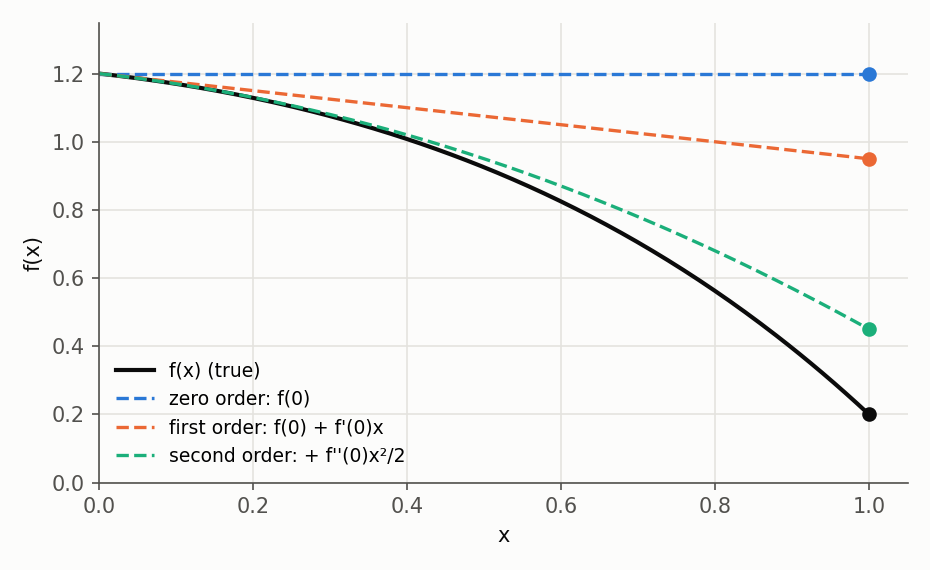
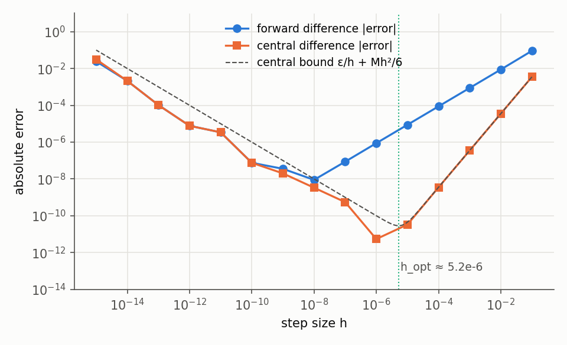

# Chapter 4 — Roundoff and Truncation Errors

[Repository Guide](../../README.md) | [English](Concepts_Lecture.md) | [한국어](Concepts_Lecture.ko.md)

> **Last Updated:** 2026-11-19
>
> Applied Numerical Methods with Python for Engineers and Scientists, Chapra and Clough, Ch 4

> **Learning Objectives:**
> 1. Count significant figures and distinguish accuracy from precision
> 2. Analyze roundoff errors in floating-point arithmetic based on the IEEE 754 floating-point representation
> 3. Estimate truncation errors using Taylor series and bound them with the remainder term
> 4. Analyze the order of accuracy of approximation methods and finite difference formulas
> 5. Explain the optimal step size as the balance between truncation and roundoff error
> 6. Decide from the condition number of a function whether a problem is ill-conditioned

---

## Table of Contents

- [1. Significant Figures](#1-significant-figures)
  - [1.1 Definition](#11-definition)
  - [1.2 Counting Rules](#12-counting-rules)
- [2. Accuracy vs. Precision](#2-accuracy-vs-precision)
  - [2.1 Definitions and Distinction](#21-definitions-and-distinction)
  - [2.2 The Dartboard Analogy](#22-the-dartboard-analogy)
  - [2.3 Bias and Uncertainty](#23-bias-and-uncertainty)
- [3. Error Definitions](#3-error-definitions)
  - [3.1 True Error and True Percent Relative Error](#31-true-error-and-true-percent-relative-error)
  - [3.2 Approximate Percent Relative Error](#32-approximate-percent-relative-error)
  - [3.3 Stopping Criterion](#33-stopping-criterion)
  - [3.4 Sources of Error](#34-sources-of-error)
- [4. Scarborough Criterion](#4-scarborough-criterion)
- [5. Roundoff Errors](#5-roundoff-errors)
  - [5.1 Source of Roundoff Errors](#51-source-of-roundoff-errors)
  - [5.2 Floating-Point Representation](#52-floating-point-representation)
  - [5.3 IEEE 754 Double Precision](#53-ieee-754-double-precision)
  - [5.4 Machine Epsilon](#54-machine-epsilon)
  - [5.5 Truncation Error vs. Roundoff Error](#55-truncation-error-vs-roundoff-error)
  - [5.6 Integer Representation](#56-integer-representation)
  - [5.7 A Hypothetical Decimal Floating-Point System](#57-a-hypothetical-decimal-floating-point-system)
  - [5.8 Details of IEEE 754 Double Precision](#58-details-of-ieee-754-double-precision)
  - [5.9 Rounding Methods and the Bound on Relative Error](#59-rounding-methods-and-the-bound-on-relative-error)
- [6. Problems with Floating-Point Arithmetic](#6-problems-with-floating-point-arithmetic)
  - [6.1 Subtractive Cancellation](#61-subtractive-cancellation)
  - [6.2 Adding Large and Small Numbers](#62-adding-large-and-small-numbers)
  - [6.3 Smearing](#63-smearing)
  - [6.4 Examples of Finite-Digit Arithmetic](#64-examples-of-finite-digit-arithmetic)
  - [6.5 Subtractive Cancellation in Double Precision](#65-subtractive-cancellation-in-double-precision)
  - [6.6 Computing Inner Products](#66-computing-inner-products)
- [7. Taylor Series Preview](#7-taylor-series-preview)
- [8. Taylor Series Expansion](#8-taylor-series-expansion)
  - [8.1 The Taylor Series Formula](#81-the-taylor-series-formula)
  - [8.2 The Remainder Term (Truncation Error)](#82-the-remainder-term-truncation-error)
  - [8.3 The Mean Value Theorem and the Remainder](#83-the-mean-value-theorem-and-the-remainder)
  - [8.4 Example: Taylor Approximation of cos x](#84-example-taylor-approximation-of-cos-x)
- [9. Order of Approximation](#9-order-of-approximation)
  - [9.1 Zeroth Through nth Order](#91-zeroth-through-nth-order)
  - [9.2 Big-O Notation and Its Meaning](#92-big-o-notation-and-its-meaning)
  - [9.3 Example: Taylor Series of eˣ](#93-example-taylor-series-of-ex)
  - [9.4 Truncation Error of Euler's Method from the Taylor Series](#94-truncation-error-of-eulers-method-from-the-taylor-series)
- [10. Numerical Differentiation Using Taylor Series](#10-numerical-differentiation-using-taylor-series)
  - [10.1 Forward Difference (First Derivative)](#101-forward-difference-first-derivative)
  - [10.2 Backward Difference (First Derivative)](#102-backward-difference-first-derivative)
  - [10.3 Central Difference (First Derivative)](#103-central-difference-first-derivative)
  - [10.4 Second Derivative (Central Difference)](#104-second-derivative-central-difference)
  - [10.5 Higher-Order Forward Difference](#105-higher-order-forward-difference)
  - [10.6 Forward and Backward Differences for the Second Derivative](#106-forward-and-backward-differences-for-the-second-derivative)
- [11. Detailed Example: Numerical Differentiation](#11-detailed-example-numerical-differentiation)
  - [11.1 Problem Setup](#111-problem-setup)
  - [11.2 Results with h = 0.5](#112-results-with-h--05)
  - [11.3 Effect of Reducing h](#113-effect-of-reducing-h)
- [12. Total Numerical Error](#12-total-numerical-error)
  - [12.1 Truncation Error vs. Roundoff Error](#121-truncation-error-vs-roundoff-error)
  - [12.2 Optimal Step Size](#122-optimal-step-size)
  - [12.3 Deriving the Error Bound and the Optimal Step Size](#123-deriving-the-error-bound-and-the-optimal-step-size)
  - [12.4 Controlling Numerical Errors](#124-controlling-numerical-errors)
- [13. Stability and Condition Number](#13-stability-and-condition-number)
- [14. Lab: Finite Differences in Python](#14-lab-finite-differences-in-python)
  - [14.1 Comparing Forward and Central Differences](#141-comparing-forward-and-central-differences)
  - [14.2 Step Size Analysis and Optimal h](#142-step-size-analysis-and-optimal-h)
- [Summary](#summary)
- [Self-Check Questions](#self-check-questions)
- [References](#references)

---

<br>

## 1. Significant Figures

### 1.1 Definition

**Significant figures** (also called significant digits) are the number of **reliable digits** in a number. They indicate the precision with which a quantity is known. In numerical methods, significant figures provide a practical way to express how much confidence we have in a computed or measured result.

For example, the number $`0.00456`$ has **3 significant figures**: the digits 4, 5, and 6. The leading zeros (0.00...) serve only as placeholders to indicate the magnitude of the number and convey no information about precision.

### 1.2 Counting Rules

The rules for counting significant figures are as follows.

1. **All nonzero digits are significant.** $`3.285`$ has 4 significant figures.
2. **Leading zeros are not significant.** $`0.00456`$ has 3 significant figures; the zeros before 4 are only placeholders.
3. **Trailing zeros after a decimal point are significant.** $`2.3400`$ has 5 significant figures; the trailing zeros indicate measured precision.
4. **Captive zeros (between nonzero digits) are significant.** $`3.0025`$ has 5 significant figures.
5. **Trailing zeros in an integer are ambiguous.** $`1200`$ could have 2, 3, or 4 significant figures. Scientific notation resolves this: $`1.2 \times 10^3`$ (2 significant figures) versus $`1.200 \times 10^3`$ (4 significant figures).

> **Note:** Significant figures become critically important when we report the results of numerical computations. Reporting more digits than are justified by the accuracy of the method gives a false sense of precision. Conversely, reporting too few digits throws away information that the computation actually provides.

---

<br>

## 2. Accuracy vs. Precision

### 2.1 Definitions and Distinction

These two terms are often confused in everyday language, but they have distinct and important meanings in numerical methods and science.

- **Accuracy** is how close a computed or measured value is to the **true value**. An accurate result is one that is near the correct answer.
- **Precision** is how close **repeated** computations or measurements are to **each other**. A precise result is one that is reproducible and consistent, regardless of whether it is correct.

The key insight is that **precision is possible without accuracy**. If a measurement instrument has a systematic error (bias), for example a scale that always reads 0.5 kg too high, then repeated measurements will be very close to each other (high precision) but consistently wrong (low accuracy).

> **Note:** **The experimental view.** In experimental sciences, accuracy relates to systematic errors (calibration), while precision relates to random errors (noise). Both must be considered when evaluating measurements.

### 2.2 The Dartboard Analogy

The relationship between accuracy and precision is easiest to visualize with a dartboard.

| Scenario | Accuracy | Precision | Dart Pattern |
|:---------|:---------|:----------|:-------------|
| Accurate and precise | High | High | Tightly clustered around the bullseye |
| Accurate but not precise | High | Low | Scattered around the bullseye (average is correct) |
| Precise but not accurate | Low | High | Tightly clustered but away from the bullseye (systematic bias) |
| Neither accurate nor precise | Low | Low | Scattered all over the board |

*Table 1. Four combinations of accuracy and precision in the dartboard analogy*

The precise but not accurate case is particularly dangerous because the tight clustering gives a false sense of confidence. In numerical methods, this corresponds to a computation that converges consistently to the **wrong answer**, for example because of a flawed algorithm or an incorrect model.

### 2.3 Bias and Uncertainty

The lack of accuracy and the lack of precision are quantified as **bias** and **uncertainty**, respectively. Inaccuracy is the systematic deviation from the truth and is called bias. Imprecision is the magnitude of the scatter of the values and is called uncertainty. Given repeated measurements $`x_1, \ldots, x_n`$, the bias is estimated by the difference between the mean and the true value, $`\bar{x} - x_{\text{true}}`$, and the uncertainty by the sample standard deviation $`s = \sqrt{\sum_i (x_i - \bar{x})^2/(n-1)}`$.

For example, if a reference mass of exactly 10.00 g is weighed five times on a scale with readings of 10.21, 10.19, 10.22, 10.18, and 10.20 g, the mean is 10.20 g, so the bias is +0.20 g and the sample standard deviation is 0.016 g. The standard deviation is more than ten times smaller than the bias, so this scale is precise but not accurate, corresponding to the third row of Table 1. Bias does not decrease when the measurement is repeated and can be removed only by calibration, whereas uncertainty decreases when repeated measurements are averaged.

The error of a numerical computation differs from the random error of a measurement in that it is reproduced as the same value for the same input every time. Averaging repeated runs of the same computation does not reduce a numerical error; it can be reduced only by changing the method or the step size.

---

<br>

## 3. Error Definitions

### 3.1 True Error and True Percent Relative Error

When we know the exact (true) value, we can compute the **true error**.

```math
E_t = \text{true value} - \text{approximate value}
```

The sign of $`E_t`$ tells us the direction of the error: positive means the approximation is an underestimate, negative means it is an overestimate. However, the magnitude of $`E_t`$ alone does not tell us how significant the error is. An error of 1 cm is negligible when measuring a bridge but catastrophic when measuring a microchip.

To normalize the error, we compute the **true percent relative error**.

```math
\varepsilon_t = \frac{\text{true value} - \text{approximate value}}{\text{true value}} \times 100\%
```

This expresses the error as a percentage of the true value, making it dimensionless and comparable across different scales. For example:

- Measuring a bridge with true value 10,000 m and approximation 10,001 m gives $`|\varepsilon_t| = 0.01\%`$, which is negligible.
- Measuring a chip with true value 0.001 m and approximation 0.002 m gives $`|\varepsilon_t| = 100\%`$, which is catastrophic.

$`|E_t|`$ is called the **absolute error**, and the same absolute error means different things depending on the size of the object. If a bridge 10,000 cm long is measured as 9,999 cm and a rivet 10 cm long as 9 cm, then $`|E_t| = 1`$ cm in both cases, but the relative error is $`(1/10000) \times 100\% = 0.01\%`$ for the bridge and $`(1/10) \times 100\% = 10\%`$ for the rivet. The measurement of the bridge is accurate enough, but the measurement of the rivet is unusable.

### 3.2 Approximate Percent Relative Error

In most practical situations, **we do not know the true value**; that is precisely why we are computing a numerical approximation in the first place. In these cases, we use the **approximate percent relative error**, which compares successive iterations of an approximation.

```math
\varepsilon_a = \frac{\text{current approximation} - \text{previous approximation}}{\text{current approximation}} \times 100\%
```

The idea is simple: if the answer is not changing much between iterations, then the method has likely converged to a stable result.

> **Note:** **Judging convergence of iterative methods.** The approximate error $`\varepsilon_a`$ is fundamental to iterative methods. When we cannot know the true value, we measure how much our answer is still changing. If it stops changing (small $`\varepsilon_a`$), we assume convergence.

### 3.3 Stopping Criterion

Iterative methods require a rule for when to stop computing. The standard approach is to pre-specify a **tolerance** $`\varepsilon_s`$ and iterate until the following holds.

```math
|\varepsilon_a| < \varepsilon_s
```

This means that we keep iterating until the approximate percent relative error drops below the specified tolerance. The choice of $`\varepsilon_s`$ depends on the required precision of the application. Engineering design calculations may tolerate $`\varepsilon_s = 0.1\%`$, while financial computations may require $`\varepsilon_s = 0.0001\%`$.

### 3.4 Sources of Error

There are four broad reasons why the result of a numerical computation differs from the real phenomenon.

| Source | Description | Example |
|:-----|:-----|:-----|
| Numerical approximation | Truncation error from replacing a mathematical procedure with a finite computation, and roundoff error from representing numbers with finitely many digits | Approximating a derivative by a finite difference, storing $`1/3`$ with finitely many digits |
| Model error | Error because the mathematical model does not fully represent the phenomenon | Assuming linear drag instead of quadratic drag |
| Data uncertainty | Measurement error in parameters and inputs | Bias and scatter in measured drag coefficients |
| Blunders | Mistakes made by people in calculation, coding, and input | Wrong sign in a formula, confusing units |

*Table 2. Sources of error in the results of numerical computations*

This chapter deals with the first source, the error of numerical approximation. This error divides further into **roundoff error** and **truncation error**. Roundoff error is the error of computer approximation, arising because a computer can represent numbers with only finitely many digits (Sections 5-6), and truncation error is the error of mathematical approximation, arising because an exact mathematical procedure is cut off and approximated after finitely many steps (Sections 7-11). Their sum is the **total numerical error** (Section 12). In the bungee jumper example of Chapter 1, replacing the derivative $`dv/dt`$ with the finite difference $`\Delta v/\Delta t`$ is a typical example of truncation error, and approximating the area under a curve by the sum of the areas of finitely many trapezoids produces the same kind of error (Chapter 19). The other three sources do not shrink when the numerical method changes, so interpreting a result requires weighing the sizes of the numerical, model, and data errors together.

---

<br>

## 4. Scarborough Criterion

The **Scarborough criterion** provides a direct link between the stopping tolerance and the number of correct significant figures in the result. Specifically:

```math
\text{If } |\varepsilon_a| < (0.5 \times 10^{2-n})\%, \text{ then the result is correct to at least } n \text{ significant figures.}
```

This gives us a practical way to choose the tolerance $`\varepsilon_s`$.

| Desired Significant Figures ($`n`$) | Required $`\vert\varepsilon_a\vert`$ |
|:----------------------------------|:----------------------------|
| 1 | $`< 5\%`$ |
| 2 | $`< 0.5\%`$ |
| 3 | $`< 0.05\%`$ |
| 4 | $`< 0.005\%`$ |
| 5 | $`< 0.0005\%`$ |
| 6 | $`< 0.00005\%`$ |
| 7 | $`< 0.000005\%`$ |

*Table 3. Scarborough tolerance for each desired number of significant figures*

For example, if we need our result to be correct to **3 significant figures**, we set $`\varepsilon_s = 0.05\%`$ and iterate until $`|\varepsilon_a| < 0.05\%`$.

> **Note:** The Scarborough criterion provides a sufficient (but not necessary) condition. Meeting the criterion guarantees at least $`n`$ significant figures, but the result may actually be more accurate than the criterion suggests.

As an example of using the Scarborough criterion as the stopping criterion of an iterative computation, estimate $`e^{0.5}`$ with the Maclaurin series $`e^x = 1 + x + \frac{x^2}{2!} + \cdots + \frac{x^n}{n!} + \cdots`$. The approximation becomes more accurate as more terms are added, so start from $`e^{0.5} \approx 1`$, add the terms one by one, and compute the true percent relative error $`\varepsilon_t`$ and the approximate percent relative error $`\varepsilon_a`$ each time. The true value is $`e^{0.5} = 1.648721270700128\ldots`$. For three significant figures, the Scarborough criterion sets $`\varepsilon_s = (0.5 \times 10^{2-3})\% = 0.05\%`$.

With the first term only, $`e^{0.5} \approx 1`$ and $`\varepsilon_t = |(1.648721 - 1)/1.648721| \times 100\% \approx 39.3\%`$; since there is no previous approximation, $`\varepsilon_a`$ is not computed. With two terms, $`1 + 0.5 = 1.5`$, $`\varepsilon_t \approx 9.02\%`$, and $`\varepsilon_a = |(1.5 - 1)/1.5| \times 100\% \approx 33.3\%`$. Continuing until $`|\varepsilon_a| < \varepsilon_s`$ gives the following table.

| Terms | Approximation | $`\varepsilon_t`$ (%) | $`\varepsilon_a`$ (%) |
|-----:|-----:|-----:|-----:|
| 1 | 1 | 39.3 | - |
| 2 | 1.5 | 9.02 | 33.3 |
| 3 | 1.625 | 1.44 | 7.69 |
| 4 | 1.645833333 | 0.175 | 1.27 |
| 5 | 1.648437500 | 0.0172 | 0.158 |
| 6 | 1.648697917 | 0.00142 | 0.0158 |

*Table 4. Approximations of exp(0.5) by the Maclaurin series and their errors*

The computation stops at six terms with $`\varepsilon_a = 0.0158\% < 0.05\%`$; at that point $`\varepsilon_t = 0.00142\%`$, so the result is correct to five figures (1.6487), more than the three requested. This shows that the Scarborough criterion is a conservative sufficient condition. In the table, $`\varepsilon_a`$ is also always larger than $`\varepsilon_t`$, because for a rapidly converging series like this one the newly added term is larger than all of the remaining error. The code for this iterative computation is covered in the Chapter 4 lab.

---

<br>

## 5. Roundoff Errors

### 5.1 Source of Roundoff Errors

Roundoff errors arise because computers can only store a **finite number of digits**. Since most real numbers have infinitely many digits (e.g., $`\pi = 3.14159265...`$, $`1/3 = 0.33333...`$), the computer must truncate or round the representation, introducing a small error every time a number is stored or a calculation is performed.

### 5.2 Floating-Point Representation

Computers represent real numbers in **floating-point** format.

```math
\pm m \times b^e
```

where the symbols mean the following:
- $`m`$ is the **mantissa**, which contains the significant digits of the number. It is also called the significand.
- $`b`$ is the **base**, the number system used. It is 2 for binary computers.
- $`e`$ is the **exponent**, which determines the magnitude, that is, the position of the decimal or binary point.

This is analogous to scientific notation in base 10: $`6.022 \times 10^{23}`$ has mantissa $`6.022`$, base $`10`$, and exponent $`23`$.

### 5.3 IEEE 754 Double Precision

The **IEEE 754** standard defines the universal format for floating-point arithmetic in modern computers. The **double precision** (64-bit) format allocates the 64 bits as follows.

| Component | Bits | Purpose |
|:----------|:-----|:--------|
| Sign | 1 bit | $`0`$ = positive, $`1`$ = negative |
| Exponent | 11 bits | Range for normalized numbers: $`-1022`$ to $`+1023`$ (stored with a bias of 1023) |
| Mantissa | 52 bits | Fractional part of the significand |

*Table 5. Bit allocation of the IEEE 754 double-precision format*

```text
  63    62            52 51                              0
┌──────┬────────────────┬─────────────────────────────────┐
│ sign │ exponent (11)  │          fraction (52)          │
└──────┴────────────────┴─────────────────────────────────┘
```

*Figure 1. The 64-bit layout of a double-precision number*

Because binary floating-point numbers are normalized to have a leading 1 (i.e., $`1.xxxxx \times 2^e`$), the leading 1 is **implicit** and does not need to be stored. This gives an effective 53 bits of precision in the mantissa.

> **[Computer Architecture]** The floating-point unit of a CPU adds and multiplies IEEE 754 bit patterns directly in hardware and rounds each result to the 53-bit mantissa before storing it. This hardware rounding is where the roundoff error studied in this chapter originates, and the 53-bit mantissa corresponds to about 15-17 significant decimal digits.

### 5.4 Machine Epsilon

**Machine epsilon** ($`\varepsilon_{\text{mach}}`$) is the gap between 1 and the next larger floating-point number. Equivalently, it is the smallest power of 2 that satisfies

```math
1 + \varepsilon_{\text{mach}} \neq 1
```

in floating-point arithmetic. For IEEE 754 double precision:

```math
\varepsilon_{\text{mach}} = 2^{-52} \approx 2.22 \times 10^{-16}
```

Machine epsilon represents the **relative precision** of the floating-point system. It tells us the smallest relative change that a floating-point number can resolve. Under the default round-to-nearest mode, adding to 1 any number whose size relative to 1 is at most $`\varepsilon_{\text{mach}}/2`$ gives a result that rounds back to 1.

This means that double precision provides approximately **15-17 significant decimal digits** of precision. Beyond that, the digits are unreliable due to roundoff.

### 5.5 Truncation Error vs. Roundoff Error

These two types of error have fundamentally different origins.

| Property | Truncation Error | Roundoff Error |
|:---------|:----------------|:----------------|
| **Source** | Approximating a mathematical procedure (e.g., truncating an infinite Taylor series after finitely many terms) | Representing numbers with finite digits in computer memory |
| **Depends on** | Algorithm and step size | Computer hardware and number format |
| **Behavior with more terms/steps** | Generally decreases | May accumulate |
| **Example** | Using $`e^x \approx 1 + x + x^2/2`$ instead of the full infinite series | Storing $`1/3 = 0.333...`$ as $`0.333333333333333`$ |

*Table 6. Comparison of truncation error and roundoff error*

Understanding both types of error is essential because they often interact. Reducing the step size to decrease truncation error requires more arithmetic operations, which can increase accumulated roundoff error.

### 5.6 Integer Representation

A computer stores information as **bits**, binary digits that take only the two values 0 and 1. A **byte**, a group of 8 bits, takes $`2^8 = 256`$ values from 0000 0000 to 1111 1111, and numbers are stored across several bytes. Numbers are written in **positional notation**, as in the decimal system. The decimal number 8642.9 is $`(8 \times 10^3) + (6 \times 10^2) + (4 \times 10^1) + (2 \times 10^0) + (9 \times 10^{-1})`$, and the binary number $`101.1_2`$ is $`(1 \times 2^2) + (0 \times 2^1) + (1 \times 2^0) + (1 \times 2^{-1}) = 5.5_{10}`$. Large numbers are represented by combinations of the basic digits, and the position of each digit determines its magnitude.

The number of bytes determines the range of integers that can be represented. An unsigned $`n`$-bit integer represents values from 0 to $`2^n - 1`$. The simplest way to represent negative numbers is **sign-magnitude representation**, which uses the first bit as the sign (0 positive, 1 negative), but then zero has two forms, $`+0`$ and $`-0`$, and the addition circuit becomes complicated. Computers therefore use **two's complement**. In 8 bits, $`1111\,1111_2 + 1 = 1\,0000\,0000_2`$, and the overflowing ninth digit is discarded, so the result is $`0000\,0000_2`$. Defining $`1111\,1111_2`$ as $`-1`$ thus keeps addition valid. In general a negative number $`-k`$ is stored as the bit pattern of $`2^8 - k`$; for example, $`5 = 0000\,0101_2`$ and $`-5 = 1111\,1011_2`$. In this scheme the first bit still indicates the sign, and the range of 8-bit integers is from $`-2^7 = -128`$ to $`2^7 - 1 = 127`$.

| Bits | Unsigned Range | Two's Complement Range |
|-----:|:-----|:-----|
| 8 | 0 to 255 | -128 to 127 |
| 16 | 0 to 65,535 | -32,768 to 32,767 |
| 32 | 0 to 4,294,967,295 | -2,147,483,648 to 2,147,483,647 |
| 64 | 0 to $`2^{64} - 1`$ | $`-2^{63}`$ to $`2^{63} - 1`$ |

*Table 7. Range of integers by number of bits*

Integers within the range are represented exactly, so integer addition, subtraction, and multiplication have no roundoff error. When a result exceeds the range, however, **overflow** occurs and the value wraps around. Computing 127 + 1 with NumPy's 8-bit integers gives $`-128`$. As seen in Section 2.5 of Chapter 2, Python's built-in `int` extends its digits as needed and does not have this problem, but the integers of NumPy arrays have a fixed width.

### 5.7 A Hypothetical Decimal Floating-Point System

The properties of floating-point representation are easy to see in a hypothetical system with few digits. Consider a decimal computer whose word consists of five decimal digits. The first digit holds the sign of the mantissa, the next two hold the sign and magnitude of the exponent, and the last two hold the magnitude of the mantissa. A number thus has the form $`s_1 d_1.d_2 \times 10^{s_0 d_0}`$, and the mantissa is normalized so that $`d_1 \neq 0`$.

- **Range.** The largest positive number is $`+9.9 \times 10^{+9}`$ and the smallest positive number is $`+1.0 \times 10^{-9}`$. On the negative side the numbers run from $`-1.0 \times 10^{-9}`$ to $`-9.9 \times 10^{+9}`$. Producing a number larger in magnitude than $`9.9 \times 10^9`$ causes **overflow**, and producing a nonzero number smaller in magnitude than $`1.0 \times 10^{-9}`$ causes **underflow**. In the interval $`(-1.0 \times 10^{-9}, 1.0 \times 10^{-9})`$ around zero, no number other than zero can be represented.
- **Effect of adding digits.** Giving the mantissa one more digit ($`s_1 d_1.d_2 d_3 \times 10^{s_0 d_0}`$) increases the largest number only slightly, to $`9.99 \times 10^9`$, and raises the precision. Giving the exponent one more digit ($`s_1 d_1.d_2 \times 10^{s_0 d_0 d_1}`$) increases the largest number to $`9.9 \times 10^{99}`$, a factor of $`10^{90}`$. The exponent sets the range, and the mantissa sets the precision.
- **Limits of precision.** With a two-digit mantissa, $`2^{-5} = 1/32 = 0.03125`$ is stored as $`3.1 \times 10^{-2} = 0.031`$, an error of $`\varepsilon_t = |(0.03125 - 0.031)/0.03125| \times 100\% = 0.8\%`$. With a four-digit mantissa it is stored exactly as $`3.125 \times 10^{-2}`$. A number whose digits continue forever, such as $`\pi = 3.14159\ldots`$, can only be approximated however long the mantissa is. With a two-digit mantissa, $`\pi`$ becomes $`3.1 \times 10^0`$, so $`\varepsilon_t \approx 1.32\%`$.
- **Uneven spacing.** Numbers with exponent $`-1`$ lie from $`1.0 \times 10^{-1}`$ to $`9.9 \times 10^{-1}`$ at spacing 0.01, numbers with exponent 0 lie from 1.0 to 9.9 at spacing 0.1, and numbers with exponent 1 lie from 10 to 99 at spacing 1. With exponent 9 the spacing is $`10^8`$. The spacing between adjacent numbers is thus proportional to their magnitude, and the roundoff error made when representing a number is also proportional to its magnitude. In contrast, the bound on the relative error is nearly constant regardless of magnitude (Section 5.9).

The binary system has the same property. The machine epsilon of IEEE 754 double precision is the spacing near 1, and the spacing near $`10^{16}`$ being 2 (Section 6.2) is an example.

### 5.8 Details of IEEE 754 Double Precision

When a binary number is normalized, the digit before the binary point is always 1. For example, $`1011_2 = 1.011_2 \times 2^3`$ and $`0.001_2 = 1.000_2 \times 2^{-3}`$. A normalized binary floating-point number can therefore be written as:

```math
\pm (1 + f) \times 2^e
```

Here $`f`$ is the fractional part of the mantissa and $`e`$ is the exponent. The leading 1 is always the same, so it is not stored; only $`f`$ is stored. For example, in $`1101.1_2 = 1.1011_2 \times 2^3 = (1 + 0.1011_2) \times 2^3`$, what is stored is the bits of $`0.1011_2`$ and the exponent 3. Double precision uses 52 bits for $`f`$, and the leading 1 is added implicitly, giving 53 bits of precision.

The 11 bits of the exponent field hold an unsigned integer $`E`$ from 0 to $`2^{11} - 1 = 2047`$, and the actual exponent is $`e = E - 1023`$, obtained by subtracting the **bias** 1023. This is called the **biased exponent** format. Negative exponents can be stored without a sign bit, and comparing exponents becomes the same as comparing integers.

| Stored Bits | Decimal $`E`$ | Actual Exponent $`e = E - 1023`$ | Use |
|:-----|-----:|-----:|:-----|
| 11111111111 | 2047 | - | Reserved for infinity and NaN |
| 11111111110 | 2046 | 1023 | Largest exponent of normalized numbers |
| 10000000000 | 1024 | 1 | Normalized numbers |
| 01111111111 | 1023 | 0 | Normalized numbers |
| 01111111110 | 1022 | $`-1`$ | Normalized numbers |
| 00000000001 | 1 | $`-1022`$ | Smallest exponent of normalized numbers |
| 00000000000 | 0 | - | Reserved for zero and subnormal numbers |

*Table 8. Biased exponent format of double precision*

The exponent-field values 0 and 2047 are reserved for special numbers, so the exponents of normalized numbers run from $`-1022`$ to $`+1023`$. Consequently:

- The **largest number**, with all fraction bits 1 and exponent 1023, is $`(2 - 2^{-52}) \times 2^{1023} \approx 2^{1024} \approx 1.7977 \times 10^{308}`$.
- The **smallest positive normalized number** is $`1.0 \times 2^{-1022} \approx 2.2251 \times 10^{-308}`$.
- When the exponent field is 0, the number is a **subnormal number** without the assumed leading 1, filling the gap between 0 and $`2^{-1022}`$. The smallest positive subnormal number is $`2^{-1074} \approx 4.94 \times 10^{-324}`$. Subnormal numbers lose precision as they approach zero but make underflow gradual.
- When the exponent field is 2047, the number represents $`\pm\infty`$ if the fraction is 0 and NaN otherwise. The result of overflow is $`\pm\infty`$, and the result of $`0/0`$ or $`\infty - \infty`$ is NaN.
- The **precision** is set by the 52 fraction bits. Since $`2^{52} \approx 4.5036 \times 10^{15}`$, this corresponds to 15-16 decimal digits, and the spacing near 1, $`2^{-52} \approx 2.2204 \times 10^{-16}`$, is the machine epsilon (Section 5.4).

```python
import math
import numpy as np

print(math.pi)
print(np.finfo(float).max)
print(np.finfo(float).min)
print(np.finfo(float).eps)
```

```text
3.141592653589793
1.7976931348623157e+308
-1.7976931348623157e+308
2.220446049250313e-16
```

`np.finfo(float)` reports the parameters of double-precision numbers. `max` is the largest number, `min` is the smallest number (that is, $`-\text{max}`$), and `eps` is the machine epsilon; the smallest positive normalized and subnormal numbers are obtained with `tiny` and `smallest_subnormal` [1].

The structure can be seen in the bit pattern of a concrete number. The 64 bits of 0.1 stored in double precision, written in hexadecimal, are `0x3fb999999999999a`. The sign bit is 0, the exponent field is $`01111111011_2 = 1019`$, so $`e = 1019 - 1023 = -4`$, and the fraction is $`1001\,1001 \cdots 1001\,1010_2`$. That is, $`0.1 \approx 1.6 \times 2^{-4}`$. In binary, $`1/10`$ repeats forever as $`0.0\overline{0011}_2`$, so it is rounded at 53 bits, and the value actually stored is $`3602879701896397/2^{55} = 0.1000000000000000055511\ldots`$, slightly larger than $`1/10`$ [2]. This is why `0.1 + 0.2` is not exactly `0.3`. Code that prints the binary representation of decimal fractions is covered in the Chapter 4 lab.

### 5.9 Rounding Methods and the Bound on Relative Error

There are two ways to replace a real number $`x`$ by a representable number $`\text{fl}(x)`$. **Chopping** discards the digits that do not fit in the mantissa, and **rounding** chooses the nearest representable number. With the two-digit mantissa of Section 5.7, $`\pi = 3.14159\ldots`$ becomes 3.1 under both chopping and rounding, but $`2/3 = 0.6666\ldots`$ becomes $`6.6 \times 10^{-1}`$ when chopped and $`6.7 \times 10^{-1}`$ when rounded.

Because the spacing is proportional to the magnitude (Section 5.7), the relative error has a bound independent of the magnitude. With machine epsilon $`\varepsilon`$, the following holds in the range of normalized numbers.

```math
\frac{|x - \text{fl}(x)|}{|x|} \leq \begin{cases} \varepsilon & \text{(chopping)} \\ \varepsilon/2 & \text{(rounding)} \end{cases}
```

The default mode of IEEE 754 is round to nearest, and when a value lies exactly halfway between two candidates, it chooses the one whose last bit is 0 (even), which is called round half to even. The relative error of representing a number in double precision is therefore at most $`u = \varepsilon/2 = 2^{-53} \approx 1.11 \times 10^{-16}`$, and this $`u`$ is called the **unit roundoff**. As a formula, $`\text{fl}(x) = x(1 + \delta)`$ with $`|\delta| \leq u`$. In Section 5.4, $`1 + 2^{-53}`$ becomes 1 because a value exactly halfway is rounded to the even side.

The IEEE 754 standard requires the result of each basic operation to be the exact result rounded in the same way [3]. Therefore, when the result lies in the normalized range without overflow or underflow, for an operation $`\circ \in \lbrace +, -, \times, \div \rbrace`$, $`\text{fl}(x \circ y) = (x \circ y)(1 + \delta)`$ with $`|\delta| \leq u`$. The relative error of a single operation is this small, but as Section 6 shows, subtractive cancellation turns small errors already present in the inputs into a large relative error in the result, and errors accumulate over many operations.

---

<br>

## 6. Problems with Floating-Point Arithmetic

### 6.1 Subtractive Cancellation

**Subtractive cancellation** (also called catastrophic cancellation) occurs when two nearly equal numbers are subtracted. The result loses most of its significant digits.

```math
0.12345678 - 0.12345671 = 0.00000007
```

The two operands each have 8 significant digits, but the result has **only 1 significant digit**. The 7 leading digits cancel, and all that remains is the least reliable last digit of each operand. This is one of the most dangerous sources of numerical error.

Subtractive cancellation is particularly insidious because it can occur in the middle of a longer computation, silently corrupting the result. Any algorithm that involves subtracting quantities that are expected to be close in value should be carefully examined for this issue.

### 6.2 Adding Large and Small Numbers

When a very large number and a very small number are added, the small number may be **completely lost** due to the finite precision of floating-point arithmetic.

```math
10^{16} + 1 = 10^{16} \quad \text{(in double precision)}
```

This happens because the number $`1`$ is $`10^{-16}`$ relative to $`10^{16}`$, which is less than half of machine epsilon (about $`1.11 \times 10^{-16}`$). When the computer aligns the two numbers to the same exponent for addition, the digits of the smaller number fall outside the range the mantissa can hold and are discarded by rounding. Near $`10^{16}`$, adjacent double-precision numbers are 2 apart.

Applying the same estimate to $`10^{15}`$, the size of a number that can change the result when added to $`10^{15}`$ is roughly $`10^{15} \times 1.11 \times 10^{-16} \approx 0.111`$. Therefore, in $`10^{15} + 1`$ the 1 is above this threshold and is preserved ($`10^{15} + 1 \neq 10^{15}`$), whereas in $`10^{16} + 1`$ the 1 falls below the relative precision and is lost entirely.

### 6.3 Smearing

**Smearing** occurs when an alternating series is summed and the intermediate partial sums are much larger in magnitude than the final answer. Each intermediate addition or subtraction introduces a roundoff error that is proportional to the magnitude of the intermediate result. Since the intermediate results are much larger than the final answer, these roundoff errors can be comparable to or larger than the final result itself.

For example, computing $`e^{-20}`$ directly with the Maclaurin series gives the following.

```math
e^{-20} = 1 - 20 + \frac{400}{2!} - \frac{8000}{3!} + \cdots
```

The terms grow very large before eventually decreasing (the largest term is about $`4.3 \times 10^7`$), and the alternating signs mean that massive cancellation occurs. The intermediate partial sums reach magnitudes of about $`2.2 \times 10^7`$, while the final answer is approximately $`2.06 \times 10^{-9}`$. The roundoff errors accumulated during the intermediate sums overwhelm the tiny final result, so adding the terms in order in double precision gives a value far from the true one.

A better approach is to compute $`e^{20}`$ (no smearing because all terms are positive) and then take the reciprocal: $`e^{-20} = 1/e^{20}`$.

### 6.4 Examples of Finite-Digit Arithmetic

Following three computations in a decimal floating-point system with a four-digit mantissa shows how the phenomena of Sections 6.1-6.3 arise.

**Subtraction.** In normalized form, $`36.41 - 26.86`$ is $`3.641 \times 10^1 - 2.686 \times 10^1 = 0.955 \times 10^1`$. Normalizing the result gives $`9.550 \times 10^0`$, but the last 0 only fills a place and carries no original information, so the result has 3 significant figures instead of 4. The loss grows when the two numbers are closer. Normalizing $`7.642 \times 10^2 - 7.641 \times 10^2 = 0.001 \times 10^2`$ gives $`1.000 \times 10^{-1}`$, but only the leading 1 is meaningful. This loss of precision from subtracting two nearly equal numbers is subtractive cancellation.

**Adding a large and a small number.** To compute $`4000 + 0.0010`$, the exponents of the two numbers must be aligned. $`4.000 \times 10^3 + 1.000 \times 10^{-3} = 4.000 \times 10^3 + 0.000001 \times 10^3 = 4.000001 \times 10^3`$, but with a four-digit mantissa the result is $`4.000 \times 10^3`$ and the small number vanishes completely.

**Many operations.** Adding $`0.0001`$ ten thousand times should give exactly 1. However, $`0.0001`$ is not represented exactly in binary (for the same reason as 0.1 in Section 5.8), so it carries a small error from the start, and as the sum grows the roundoff error of each addition grows too, so the result differs slightly from 1. The relative error of one operation is of order $`u`$, but errors accumulate with the number of operations. The actual output and Kahan summation, which reduces the error, are covered in the Chapter 4 lab.

### 6.5 Subtractive Cancellation in Double Precision

Subtractive cancellation also occurs in double precision. As $`x \to 0`$, $`(1 - \cos x)/x^2 \to 1/2`$, but when $`x`$ is small, $`\cos x`$ is very close to 1 and the leading digits cancel in $`1 - \cos x`$. Rewriting with the half-angle formula $`1 - \cos x = 2\sin^2(x/2)`$ removes the subtraction.

| $`x`$ | $`(1 - \cos x)/x^2`$ | $`2\sin^2(x/2)/x^2`$ |
|:-----|:-----|:-----|
| $`10^{-1}`$ | 0.499583472197418 | 0.499583472197423 |
| $`10^{-3}`$ | 0.499999958325503 | 0.499999958333335 |
| $`10^{-5}`$ | 0.500000041370185 | 0.499999999995833 |
| $`10^{-6}`$ | 0.500044450291171 | 0.499999999999958 |
| $`10^{-7}`$ | 0.499600361081320 | 0.500000000000000 |
| $`10^{-8}`$ | 0.000000000000000 | 0.500000000000000 |

*Table 9. Double-precision results of a formula with and without subtractive cancellation*

At $`x = 10^{-6}`$, $`\cos x \approx 1 - 5 \times 10^{-13}`$, so the true value of $`1 - \cos x`$, $`5 \times 10^{-13}`$, is only about 2,250 times the spacing near 1, $`2.2 \times 10^{-16}`$. An error of order $`10^{-16}`$ made in storing $`\cos x`$ becomes a relative error of about $`10^{-4}`$ in the difference, and the actual relative error in the table is $`8.9 \times 10^{-5}`$. At $`x = 10^{-8}`$, $`1 - x^2/2 = 1 - 5 \times 10^{-17}`$ is closer to 1 than the midpoint between 1 and the double-precision number just below it, $`1 - 2^{-53}`$, so $`\cos x`$ rounds to exactly 1 and the numerator becomes 0. Two mathematically equal formulas can give completely different numerical results, and rewriting a formula to avoid subtraction is the basic way to prevent cancellation. An example applying the same idea to the quadratic formula is covered in the Chapter 4 lab.

### 6.6 Computing Inner Products

Summing infinite series is not a common operation in numerical methods, but the **inner product** of two vectors is a basic operation of almost every linear algebra computation, including linear systems, matrix products, and regression.

```math
\mathbf{x}^T\mathbf{y} = \sum_{i=1}^{n} x_i y_i = x_1 y_1 + x_2 y_2 + \cdots + x_n y_n
```

An inner product adds $`n`$ products one after another, so, like the many operations of Section 6.4, roundoff error accumulates with the number of terms. The basic way to reduce it is to keep the variable that holds the sum (the accumulator) in higher precision than the inputs. The following code computes the inner product of single-precision (32-bit) vectors with a single-precision accumulator and with a double-precision accumulator.

```python
import math
import numpy as np

n = 100000
x = np.full(n, 0.1, dtype=np.float32)     # single-precision vectors
y = np.ones(n, dtype=np.float32)

s32 = np.float32(0.0)                     # single-precision accumulator
s64 = 0.0                                 # double-precision accumulator
for xi, yi in zip(x, y):
    s32 += xi * yi
    s64 += float(xi) * float(yi)
print(s32, s64, math.fsum(float(v) for v in x))
```

```text
9998.557 10000.000149011612 10000.000149011612
```

The value 0.1 stored in single precision is 0.100000001490116, so the exact sum of the stored values is 10000.000149. The double-precision accumulator gives this value exactly (`math.fsum` computes a sum without roundoff error), whereas the single-precision accumulator gives 9998.557, a relative error of about $`1.4 \times 10^{-4}`$. As the sum grows, the spacing between adjacent single-precision numbers grows, so a large part of the small value 0.1 added each time is lost to rounding (Section 6.2). Computing products and sums in higher precision even when the inputs are stored in lower precision is called **extended-precision accumulation**, and it is a basic way to reduce the accumulation of roundoff error in computations that add many terms, such as inner products.

---

<br>

## 7. Taylor Series Preview

The **Taylor series** expansion of a function $`f(x)`$ about the point $`x_i`$ is:

```math
f(x_{i+1}) = f(x_i) + f'(x_i)h + \frac{f''(x_i)}{2!}h^2 + \frac{f'''(x_i)}{3!}h^3 + \cdots
```

where $`h = x_{i+1} - x_i`$ is the step size.

This infinite series is exact, but in practice we must truncate it after a finite number of terms, introducing **truncation error**. The Taylor series is the foundation for understanding truncation errors and is treated in detail in Section 8.

The key points developed from Section 8 onward are the following.

- The **remainder term** (truncation error) depends on the step size $`h`$ raised to some power. Keeping more terms in the series means the error decreases faster as $`h`$ shrinks.
- Taylor series provides the theoretical basis for most numerical methods. Taylor expansions are used to derive or analyze the error of finite differences, interpolation, integration, and ODE solvers.
- The trade-off between truncation error (fewer terms or larger $`h`$) and roundoff error (more computation with smaller $`h`$) is a central theme in numerical analysis.

---

<br>

## 8. Taylor Series Expansion

### 8.1 The Taylor Series Formula

The **Taylor series** is one of the most fundamental tools in numerical analysis. It allows us to represent a sufficiently smooth function as a sum of polynomial terms, each constructed from the function's derivatives evaluated at a single point, plus a remainder term; for an analytic function, the remainder tends to zero within the radius of convergence and the function equals the infinite sum.

Given a function $`f(x)`$ that is $`(n+1)`$ times continuously differentiable, the value of $`f`$ at a nearby point $`x_{i+1}`$ can be expressed in terms of $`f`$ and its derivatives at $`x_i`$ as follows.

```math
f(x_{i+1}) = f(x_i) + f'(x_i)(x_{i+1} - x_i) + \frac{f''(x_i)}{2!}(x_{i+1} - x_i)^2 + \frac{f'''(x_i)}{3!}(x_{i+1} - x_i)^3 + \cdots + R_n
```

Defining the **step size** $`h = x_{i+1} - x_i`$, this becomes the more compact form:

```math
f(x_i + h) = f(x_i) + f'(x_i)h + \frac{f''(x_i)}{2!}h^2 + \frac{f'''(x_i)}{3!}h^3 + \cdots + \frac{f^{(n)}(x_i)}{n!}h^n + R_n
```

Each successive term in the series includes a higher-order derivative of $`f`$ at $`x_i`$, divided by the corresponding factorial, and multiplied by a higher power of $`h`$. The more terms we include, the better the approximation, provided $`h`$ is small enough.

> **[Calculus]** Taylor's theorem is the calculus result that a function that is $`(n+1)`$ times continuously differentiable can be written exactly, near a point, as an $`n`$th-degree polynomial plus a remainder term. The truncation error analysis in this chapter starts by reading the remainder term of this theorem (Section 8.2) as the error of the polynomial approximation.

### 8.2 The Remainder Term (Truncation Error)

When we truncate the Taylor series after the $`n`$th-order term, the omitted terms are collectively represented by the **remainder** $`R_n`$:

```math
R_n = \frac{f^{(n+1)}(\xi)}{(n+1)!} h^{n+1}
```

where $`\xi`$ is some (unknown) value satisfying $`x_i \leq \xi \leq x_{i+1}`$.

Key properties of the remainder are as follows.

- $`R_n`$ is the **truncation error**, the error introduced by truncating an infinite series to a finite number of terms.
- The exact value of $`\xi`$ is generally unknown, which means we cannot compute $`R_n`$ exactly.
- However, we can **bound** $`R_n`$ by finding the maximum of $`|f^{(n+1)}(x)|`$ on the interval $`[x_i, x_{i+1}]`$:
  ```math
  |R_n| \leq \frac{\max_{x_i \leq x \leq x_{i+1}} |f^{(n+1)}(x)|}{(n+1)!} |h|^{n+1}
  ```
- For small $`h`$, the dominant behavior of $`R_n`$ is proportional to $`h^{n+1}`$, which we write as $`R_n = O(h^{n+1})`$.

### 8.3 The Mean Value Theorem and the Remainder

The form of the remainder term can be understood through the **mean value theorem**. The mean value theorem states that if a function $`f`$ is continuous on the interval $`[a, b]`$ and differentiable on $`(a, b)`$, then there is at least one point $`c \in (a, b)`$ at which the slope equals the average rate of change over the interval.

```math
f'(c) = \frac{f(b) - f(a)}{b - a}
```

Applying the mean value theorem to the remainder $`R_0 = f(x_{i+1}) - f(x_i)`$ of the zero-order approximation $`f(x_{i+1}) \approx f(x_i)`$ gives $`R_0/h = f'(\xi)`$ for some $`\xi`$ between $`x_i`$ and $`x_{i+1}`$, that is:

```math
R_0 = f'(\xi)\,h
```

Geometrically, $`R_0/h`$ is the slope of the secant joining the two points $`(x_i, f(x_i))`$ and $`(x_{i+1}, f(x_{i+1}))`$, and the mean value theorem guarantees a point $`\xi`$ in the interval where the tangent has the same slope. The error of the zero-order approximation therefore equals the first-order term $`f'(x_i)h`$ with the derivative evaluated at $`\xi`$ instead of $`x_i`$. Applying the same reasoning one step further, the remainder of the first-order approximation is $`R_1 = \frac{f''(\xi)}{2}h^2`$, so it can be written as:

```math
f(x_{i+1}) = f(x_i) + f'(x_i)h + \frac{f''(\xi)}{2!}h^2
```

In general, the remainder of the $`n`$th-order approximation equals the next-order term with the derivative evaluated at an unknown point $`\xi`$, which is the $`R_n = \frac{f^{(n+1)}(\xi)}{(n+1)!}h^{n+1}`$ of Section 8.2. The location of $`\xi`$ is unknown, but the fact that it lies in the interval is enough to obtain the bound of Section 8.2.

### 8.4 Example: Taylor Approximation of cos x

Approximate $`f(\pi/3)`$ using the values of $`f(x) = \cos x`$ and its derivatives at $`x_i = \pi/4`$. The step size is $`h = \pi/3 - \pi/4 = \pi/12 \approx 0.261799`$. The derivatives $`f' = -\sin x`$, $`f'' = -\cos x`$, $`f''' = \sin x`$, $`f^{(4)} = \cos x`$ repeat every four, and $`\cos(\pi/4) = \sin(\pi/4) = \sqrt{2}/2 \approx 0.707107`$. The Taylor series is:

```math
f\!\left(\frac{\pi}{3}\right) = \cos\frac{\pi}{4} - \sin\frac{\pi}{4}\,h - \cos\frac{\pi}{4}\,\frac{h^2}{2!} + \sin\frac{\pi}{4}\,\frac{h^3}{3!} + \cos\frac{\pi}{4}\,\frac{h^4}{4!} - \cdots
```

The true value is $`\cos(\pi/3) = 0.5`$. The zero-order approximation is 0.707107 with $`\varepsilon_t = 41.4\%`$, and the first-order approximation is $`0.707107 - 0.707107 \times 0.261799 = 0.521987`$ with $`\varepsilon_t = 4.40\%`$. Raising the order gives the following table.

| Order $`n`$ | Approximation of $`f(\pi/3)`$ | $`\varepsilon_t`$ (%) |
|-----:|-----:|-----:|
| 0 | 0.707106781 | 41.4 |
| 1 | 0.521986659 | 4.40 |
| 2 | 0.497754491 | 0.449 |
| 3 | 0.499869147 | 0.0262 |
| 4 | 0.500007551 | 0.00151 |
| 5 | 0.500000304 | 0.0000608 |
| 6 | 0.499999988 | 0.00000244 |

*Table 10. Approximation of cos(π/3) by the Taylor series expanded at π/4*

Because $`h \approx 0.26`$ is less than 1, the error drops by roughly one order of magnitude with each additional order, which is why the convergence is faster than in the $`e^1`$ example of Section 9.3 ($`h = 1`$). The actual error of the sixth-order approximation is $`1.2 \times 10^{-8}`$, within the bound of Section 8.2, $`|R_6| \leq h^7/7! \approx 1.67 \times 10^{-8}`$, since $`|f^{(7)}| = |\sin x| \leq 1`$.

---

<br>

## 9. Order of Approximation

### 9.1 Zeroth Through nth Order

Truncating the Taylor series at different points yields approximations of different orders. Each additional term raises the order of the truncation error by one, so the approximation improves when $`h`$ is small enough.

| Order | Approximation | Truncation Error |
|:------|:-------------|:-----------------|
| 0th | $`f(x_{i+1}) \approx f(x_i)`$ (constant) | $`O(h)`$ |
| 1st | $`f(x_{i+1}) \approx f(x_i) + f'(x_i)h`$ (linear) | $`O(h^2)`$ |
| 2nd | adds $`\frac{f''(x_i)}{2!}h^2`$ term (quadratic) | $`O(h^3)`$ |
| 3rd | adds $`\frac{f'''(x_i)}{3!}h^3`$ term (cubic) | $`O(h^4)`$ |
| nth | includes up to $`\frac{f^{(n)}(x_i)}{n!}h^n`$ term | $`O(h^{n+1})`$ |

*Table 11. Taylor approximations and truncation errors by truncation order*



*Figure 2. Zero-, first-, and second-order Taylor approximations*

Figure 2 expands $`f(x) = -0.1x^4 - 0.15x^3 - 0.5x^2 - 0.25x + 1.2`$ at $`x_i = 0`$ to approximate the value at $`x_{i+1} = 1`$ ($`h = 1`$). The true value is $`f(1) = 0.2`$. The zero-order approximation is the horizontal line $`f(0) = 1.2`$, the first-order approximation adds the slope $`f'(0) = -0.25`$ to give 0.95, and the second-order approximation adds the curvature term $`f''(0)/2 = -0.5`$ to give 0.45. The more terms are added, the longer the approximating curve stays close to the true curve, and the difference grows with distance from $`x_i`$. This function is a fourth-degree polynomial, so $`f^{(5)} = 0`$, and the remainder of the fourth-order approximation is zero, giving the exact value 0.2.

### 9.2 Big-O Notation and Its Meaning

The **Big-O notation** $`O(h^{n+1})`$ describes how the truncation error scales with the step size $`h`$. Specifically, $`O(h^{n+1})`$ means that for sufficiently small $`h`$, the error is bounded by a constant times $`h^{n+1}`$:

```math
|\text{error}| \leq C \cdot h^{n+1} \quad \text{for some constant } C
```

The practical consequences are as follows.

- **0th-order** ($`O(h)`$): Halving $`h`$ halves the error.
- **1st-order** ($`O(h^2)`$): Halving $`h`$ reduces the error by a factor of 4.
- **2nd-order** ($`O(h^3)`$): Halving $`h`$ reduces the error by a factor of 8.
- **nth-order** ($`O(h^{n+1})`$): Halving $`h`$ reduces the error by a factor of $`2^{n+1}`$.

> **Note:** The Big-O notation $`O(h^{n+1})`$ means the error is proportional to $`h^{n+1}`$ for small $`h`$. The orders in the list above are the order $`n`$ of the Taylor approximation, whereas the order of accuracy of a numerical method is named by the exponent of its error. Halving $`h`$ in a first-order accurate method (error $`O(h)`$) halves the error; halving $`h`$ in a second-order accurate method (error $`O(h^2)`$) quarters the error.

### 9.3 Example: Taylor Series of $`e^x`$

Consider approximating $`e^1`$ using the Taylor series expansion of $`f(x) = e^x`$ about $`x_i = 0`$ (evaluating at $`x = 1`$, so $`h = 1`$).

Since $`f(x) = e^x`$, all derivatives are also $`e^x`$, so $`f(0) = f'(0) = f''(0) = \cdots = 1`$.

The Taylor series becomes:

```math
e^x = 1 + x + \frac{x^2}{2!} + \frac{x^3}{3!} + \frac{x^4}{4!} + \cdots
```

Evaluating at $`x = 1`$ ($`h = 1`$) and adding terms one at a time gives the following.

| Order | Approximation | Value | True Error | $`\varepsilon_t`$ |
|:------|:-------------|:------|:-----------|:----------------|
| 0th | $`f \approx 1`$ | 1.000000 | 1.71828 | 63.2% |
| 1st | $`f \approx 1 + 1`$ | 2.000000 | 0.71828 | 26.4% |
| 2nd | $`f \approx 2 + 0.5`$ | 2.500000 | 0.21828 | 8.0% |
| 3rd | $`f \approx 2.5 + 1/6`$ | 2.666667 | 0.05162 | 1.9% |
| 4th | $`f \approx 2.667 + 1/24`$ | 2.708333 | 0.00995 | 0.366% |
| 5th | $`f \approx 2.708 + 1/120`$ | 2.716667 | 0.00162 | 0.0594% |
| 6th | $`f \approx 2.717 + 1/720`$ | 2.718056 | 0.00023 | 0.00832% |

*Table 12. Taylor approximations of e and their errors as terms are added*

The true value is $`e = 2.718282\ldots`$. Each additional term significantly reduces the error, demonstrating the convergence of the Taylor series. By the 6th-order approximation, the relative error is already below $`0.01\%`$.

### 9.4 Truncation Error of Euler's Method from the Taylor Series

In the bungee jumper problem of Chapter 1, Euler's method replaced the derivative $`dv/dt`$ with the finite difference $`[v(t_{i+1}) - v(t_i)]/(t_{i+1} - t_i)`$. The error of this approximation can be found with the Taylor series. With $`t_{i+1} = t_i + h`$, expanding $`v(t)`$ near $`t_i`$ gives:

```math
v(t_{i+1}) = v(t_i) + v'(t_i)h + \frac{v''(t_i)}{2!}h^2 + \frac{v'''(t_i)}{3!}h^3 + \cdots + R_n
```

Keeping terms through first order, collecting the rest into $`R_1 = \frac{v''(\xi)}{2}h^2`$, and solving for $`v'(t_i)`$ gives:

```math
v'(t_i) = \underbrace{\frac{v(t_{i+1}) - v(t_i)}{h}}_{\text{first-order approximation}} - \underbrace{\frac{R_1}{h}}_{\text{truncation error}}, \qquad \frac{R_1}{h} = \frac{v''(\xi)}{2}h = O(h)
```

The finite difference approximation of the derivative therefore has a truncation error of $`O(h)`$, and halving $`h`$ roughly halves the error of the derivative approximation. This is the same result as the forward difference formula of Section 10.1. The local error made in $`v(t_{i+1})`$ by one step of Euler's method is this error times $`h`$, $`R_1 = O(h^2)`$, and the global error after $`T/h`$ steps is $`O(h)`$ (Section 3.5 of Chapter 1). The truncation error is determined by where the Taylor series is cut off, so methods that capture more terms on the same principle (the Runge-Kutta methods, Chapter 22) achieve higher orders of accuracy.

---

<br>

## 10. Numerical Differentiation Using Taylor Series

This section derives the finite difference formulas that are used throughout numerical analysis. These formulas approximate derivatives using discrete function values, which is a necessity when working with tabulated data or when analytical differentiation is impractical.

```text
x_{i-2}   x_{i-1}    x_i     x_{i+1}   x_{i+2}
   |         |        |         |         |
                      ●─────────●              forward difference      O(h)
             ●────────●                        backward difference     O(h)
             ●────────○─────────●              central difference      O(h^2)
             ●────────●─────────●              second derivative       O(h^2)
                      ●─────────●─────────●    higher-order forward    O(h^2)

● point used by the formula    ○ point not used by the formula
```

*Figure 3. Grid points used by each finite difference formula*

### 10.1 Forward Difference (First Derivative)

We start from the Taylor series expansion.

```math
f(x_{i+1}) = f(x_i) + f'(x_i)h + \frac{f''(x_i)}{2!}h^2 + \frac{f'''(x_i)}{3!}h^3 + \cdots
```

Solving for $`f'(x_i)`$ gives the following.

```math
f'(x_i) = \frac{f(x_{i+1}) - f(x_i)}{h} - \frac{f''(x_i)}{2!}h - \frac{f'''(x_i)}{3!}h^2 - \cdots
```

Truncating the higher-order terms gives the **first-order forward difference** formula.

```math
\boxed{f'(x_i) = \frac{f(x_{i+1}) - f(x_i)}{h} + O(h)}
```

The leading error term is $`-\frac{f''(x_i)}{2}h`$, so the truncation error is $`O(h)`$. This is a **first-order accurate** approximation.

### 10.2 Backward Difference (First Derivative)

Expand $`f(x_{i-1})`$ in a Taylor series about $`x_i`$ (substituting $`-h`$ for $`h`$).

```math
f(x_{i-1}) = f(x_i) - f'(x_i)h + \frac{f''(x_i)}{2!}h^2 - \frac{f'''(x_i)}{3!}h^3 + \cdots
```

Solving for $`f'(x_i)`$ gives the following.

```math
\boxed{f'(x_i) = \frac{f(x_i) - f(x_{i-1})}{h} + O(h)}
```

Like the forward difference, this is also **first-order accurate** with $`O(h)`$ truncation error. The backward difference uses the point behind $`x_i`$ rather than ahead.

### 10.3 Central Difference (First Derivative)

The central difference is derived by subtracting the backward Taylor expansion from the forward Taylor expansion.

**Forward expansion:**

```math
f(x_{i+1}) = f(x_i) + f'(x_i)h + \frac{f''(x_i)}{2!}h^2 + \frac{f'''(x_i)}{3!}h^3 + \cdots
```

**Backward expansion:**

```math
f(x_{i-1}) = f(x_i) - f'(x_i)h + \frac{f''(x_i)}{2!}h^2 - \frac{f'''(x_i)}{3!}h^3 + \cdots
```

**Subtracting** backward from forward gives the following.

```math
f(x_{i+1}) - f(x_{i-1}) = 2f'(x_i)h + \frac{2f'''(x_i)}{3!}h^3 + \cdots
```

Note that all even-powered terms, including $`f(x_i)`$ and the $`h^2, h^4, \ldots`$ terms, cancel. Solving for $`f'(x_i)`$ gives the following.

```math
\boxed{f'(x_i) = \frac{f(x_{i+1}) - f(x_{i-1})}{2h} + O(h^2)}
```

The truncation error is $`O(h^2)`$. This is **second-order accurate**, which is significantly more accurate than either the forward or backward difference.

> **Note:** **Accuracy of symmetric formulas.** The central difference is more accurate because the even-powered error terms cancel when we subtract the backward expansion from the forward expansion. This is a general principle: symmetric formulas tend to be more accurate.

### 10.4 Second Derivative (Central Difference)

The central difference formula for the second derivative is derived by **adding** the forward and backward Taylor expansions instead of subtracting them.

**Adding** forward and backward gives the following.

```math
f(x_{i+1}) + f(x_{i-1}) = 2f(x_i) + 2\frac{f''(x_i)}{2!}h^2 + 2\frac{f^{(4)}(x_i)}{4!}h^4 + \cdots
```

Note that all odd-powered terms ($`h, h^3, h^5, \ldots`$) cancel. Solving for $`f''(x_i)`$ gives the following.

```math
f''(x_i) = \frac{f(x_{i+1}) + f(x_{i-1}) - 2f(x_i)}{h^2} - \frac{f^{(4)}(x_i)}{12}h^2 - \cdots
```

Truncating gives the following.

```math
\boxed{f''(x_i) = \frac{f(x_{i+1}) - 2f(x_i) + f(x_{i-1})}{h^2} + O(h^2)}
```

This is a **second-order accurate** approximation of the second derivative, requiring three function evaluations at equally spaced points.

### 10.5 Higher-Order Forward Difference

It is possible to achieve higher-order accuracy using only forward points. This is useful at the boundary of a domain where backward points are unavailable.

Using three forward points $`f(x_i)`$, $`f(x_{i+1})`$, and $`f(x_{i+2})`$, we can derive the **second-order forward difference** for $`f'(x_i)`$.

```math
\boxed{f'(x_i) = \frac{-f(x_{i+2}) + 4f(x_{i+1}) - 3f(x_i)}{2h} + O(h^2)}
```

This achieves $`O(h^2)`$ accuracy using only forward-direction points. It has the same order as the central difference but does not require points behind $`x_i`$.

### 10.6 Forward and Backward Differences for the Second Derivative

The central difference of Section 10.4 needs points on both sides of $`x_i`$. If points are available on only one side, the same approach is applied to forward or backward points. Forming $`f(x_{i+2}) - 2f(x_{i+1})`$ from the two expansions of $`f(x_{i+2})`$ and $`f(x_{i+1})`$ about $`x_i`$ cancels the $`f'(x_i)`$ term and gives the following **forward difference** formula.

```math
f''(x_i) = \frac{f(x_{i+2}) - 2f(x_{i+1}) + f(x_i)}{h^2} + O(h)
```

Using the two points behind in the same way gives the **backward difference** formula.

```math
f''(x_i) = \frac{f(x_i) - 2f(x_{i-1}) + f(x_{i-2})}{h^2} + O(h)
```

All three formulas use the coefficients $`(1, -2, 1)`$, but at different points. The forward formula is actually the central difference at $`x_{i+1}`$, so using it as the second derivative at $`x_i`$ introduces an error from the one-step offset, and the accuracy drops to first order. For the polynomial of Section 11 with $`x = 0.5`$ and $`h = 0.25`$, against the true value $`f''(0.5) = -1.2(0.5)^2 - 0.9(0.5) - 1 = -1.75`$, the forward difference gives $`-2.3625`$, the backward difference $`-1.3125`$, and the central difference $`-1.7625`$. Reducing to $`h = 0.125`$ gives $`-2.0344`$, $`-1.5094`$, and $`-1.7531`$, so the errors of the forward and backward differences shrink by about half ($`0.6125 \to 0.2844`$, $`0.4375 \to 0.2406`$) and the error of the central difference by about a quarter ($`0.0125 \to 0.0031`$).

---

<br>

## 11. Detailed Example: Numerical Differentiation

### 11.1 Problem Setup

Consider the following polynomial.

```math
f(x) = -0.1x^4 - 0.15x^3 - 0.5x^2 - 0.25x + 1.2
```

The analytically computed (true) derivative is:

```math
f'(x) = -0.4x^3 - 0.45x^2 - x - 0.25
```

At $`x = 0.5`$:

```math
f'(0.5) = -0.4(0.125) - 0.45(0.25) - 0.5 - 0.25 = -0.9125
```

We also need the function values:
- $`f(0.0) = 1.2`$
- $`f(0.25) = 1.10351563`$
- $`f(0.5) = 0.925`$
- $`f(0.75) = 0.63632813`$
- $`f(1.0) = 0.2`$

### 11.2 Results with $`h = 0.5`$

We use step size $`h = 0.5`$ to approximate $`f'(0.5)`$.

**Forward difference:**

```math
f'(0.5) \approx \frac{f(1.0) - f(0.5)}{0.5} = \frac{0.2 - 0.925}{0.5} = -1.45
```

```math
\varepsilon_t = \left|\frac{-0.9125 - (-1.45)}{-0.9125}\right| \times 100\% = 58.9\%
```

**Backward difference:**

```math
f'(0.5) \approx \frac{f(0.5) - f(0.0)}{0.5} = \frac{0.925 - 1.2}{0.5} = -0.55
```

```math
\varepsilon_t = \left|\frac{-0.9125 - (-0.55)}{-0.9125}\right| \times 100\% = 39.7\%
```

**Central difference:**

```math
f'(0.5) \approx \frac{f(1.0) - f(0.0)}{2 \times 0.5} = \frac{0.2 - 1.2}{1.0} = -1.0
```

```math
\varepsilon_t = \left|\frac{-0.9125 - (-1.0)}{-0.9125}\right| \times 100\% = 9.6\%
```

The central difference is dramatically more accurate than both forward and backward differences, consistent with its $`O(h^2)`$ error versus $`O(h)`$.

### 11.3 Effect of Reducing $`h`$

We use a smaller step size $`h = 0.25`$ with the central difference.

```math
f'(0.5) \approx \frac{f(0.75) - f(0.25)}{2 \times 0.25} = \frac{0.63632813 - 1.10351563}{0.5} = -0.934375
```

```math
\varepsilon_t = \left|\frac{-0.9125 - (-0.934375)}{-0.9125}\right| \times 100\% \approx 2.4\%
```

With the same $`h = 0.25`$, the forward difference gives $`(0.63632813 - 0.925)/0.25 = -1.1546875`$ ($`\varepsilon_t \approx 26.5\%`$), and the backward difference gives $`(0.925 - 1.10351563)/0.25 = -0.7140625`$ ($`\varepsilon_t \approx 21.7\%`$).

Halving $`h`$ from $`0.5`$ to $`0.25`$ reduced the central difference error from $`9.6\%`$ to $`2.4\%`$, roughly a factor of 4, confirming the $`O(h^2)`$ behavior. The forward and backward difference errors fell by roughly a factor of 2, consistent with $`O(h)`$ behavior.

| Method | $`h = 0.5`$ | $`h = 0.25`$ | Error Reduction |
|:-------|:----------|:-----------|:----------------|
| Forward | $`\varepsilon_t = 58.9\%`$ | $`\varepsilon_t = 26.5\%`$ | $`\sim 2.2\times`$ (confirms $`O(h)`$) |
| Backward | $`\varepsilon_t = 39.7\%`$ | $`\varepsilon_t = 21.7\%`$ | $`\sim 1.8\times`$ (confirms $`O(h)`$) |
| Central | $`\varepsilon_t = 9.6\%`$ | $`\varepsilon_t = 2.4\%`$ | $`\sim 4\times`$ (confirms $`O(h^2)`$) |

*Table 13. Error of the three difference formulas when the step size is halved*

---

<br>

## 12. Total Numerical Error

### 12.1 Truncation Error vs. Roundoff Error

When performing numerical differentiation on a computer, the total error has two components.

```math
\text{Total error} = \text{Truncation error} + \text{Roundoff error}
```

These two error sources have **opposite** dependencies on the step size $`h`$.

| Component | As $`h`$ decreases | Cause |
|:----------|:-----------------|:------|
| Truncation error | **Decreases** | Finite difference better approximates the derivative |
| Roundoff error | **Increases** | Subtracting nearly equal floating-point numbers (subtractive cancellation, Section 6.1) |

*Table 14. Change in truncation and roundoff error as the step size decreases*

When $`h`$ is large, the truncation error dominates. When $`h`$ is very small, the function values $`f(x+h)`$ and $`f(x)`$ become nearly identical, and their difference is contaminated by floating-point roundoff. The total error curve has a characteristic **V-shape** on a log-log plot.

> **Note:** This is one of the most important practical insights in numerical analysis. We cannot make $`h`$ arbitrarily small to improve accuracy. At some point, roundoff error takes over and the result actually gets worse.

### 12.2 Optimal Step Size

There exists an **optimal step size** $`h^*`$ that minimizes the total error. The optimal value depends on the finite difference formula being used and the machine epsilon $`\varepsilon_{mach}`$ (Section 5.4).

**For forward difference** ($`O(h)`$ truncation error):

```math
h^* \approx \sqrt{\varepsilon_{mach} \cdot \left|\frac{f(x)}{f''(x)}\right|}
```

Since $`\varepsilon_{mach} \approx 2.2 \times 10^{-16}`$ for 64-bit double precision:

```math
h^* \sim \sqrt{\varepsilon_{mach}} \approx 1.5 \times 10^{-8}
```

**For central difference** ($`O(h^2)`$ truncation error):

```math
h^* \sim \varepsilon_{mach}^{1/3} \approx 6 \times 10^{-6}
```

The central difference has a larger optimal $`h`$ because its truncation error decreases faster ($`O(h^2)`$ vs. $`O(h)`$), so the balance point between truncation and roundoff shifts to a larger step size.

| Formula | Truncation Error | Optimal $`h^*`$ | Minimum Total Error |
|:--------|:----------------|:---------------|:--------------------|
| Forward difference | $`O(h)`$ | $`\sim \sqrt{\varepsilon_{mach}} \approx 10^{-8}`$ | $`\sim \sqrt{\varepsilon_{mach}} \approx 10^{-8}`$ |
| Central difference | $`O(h^2)`$ | $`\sim \varepsilon_{mach}^{1/3} \approx 10^{-6}`$ | $`\sim \varepsilon_{mach}^{2/3} \approx 10^{-11}`$ |

*Table 15. Optimal step size and minimum total error of the forward and central differences*

### 12.3 Deriving the Error Bound and the Optimal Step Size

The result of Section 12.2 can be derived by bounding the error. The exact expression for the central difference is:

```math
f'(x_i) = \frac{f(x_{i+1}) - f(x_{i-1})}{2h} - \frac{f'''(\xi)}{6}h^2
```

The left side is the true derivative, the first term on the right is the finite difference approximation, and the second term is the truncation error. A computer uses the rounded values $`\tilde{f}`$ instead of the true function values, so $`f(x_{i+1}) = \tilde{f}(x_{i+1}) + e_{i+1}`$ and $`f(x_{i-1}) = \tilde{f}(x_{i-1}) + e_{i-1}`$, where $`e`$ is the roundoff error of a function value. Substituting gives:

```math
f'(x_i) = \frac{\tilde{f}(x_{i+1}) - \tilde{f}(x_{i-1})}{2h} + \frac{e_{i+1} - e_{i-1}}{2h} - \frac{f'''(\xi)}{6}h^2
```

The second term is the roundoff error and the third is the truncation error. If the roundoff error of the function values satisfies $`|e| \leq \varepsilon`$, then $`|e_{i+1} - e_{i-1}| \leq 2\varepsilon`$, and if $`|f'''| \leq M`$ on the interval, the difference between the computed value and the true derivative has the bound:

```math
\left| f'(x_i) - \frac{\tilde{f}(x_{i+1}) - \tilde{f}(x_{i-1})}{2h} \right| \leq \frac{\varepsilon}{h} + \frac{M h^2}{6}
```

The first term grows as $`h`$ shrinks and the second shrinks as $`h`$ shrinks, so this bound has a minimum as a function of $`h`$. Differentiating with respect to $`h`$ and setting the result to zero gives:

```math
-\frac{\varepsilon}{h^2} + \frac{M}{3}h = 0 \quad\Longrightarrow\quad h^3 = \frac{3\varepsilon}{M} \quad\Longrightarrow\quad h_{\text{opt}} = \sqrt[3]{\frac{3\varepsilon}{M}}
```

Consider finding the derivative at $`x = 0.5`$ of the polynomial of Section 11. Since $`f'''(x) = -2.4x - 0.9`$, $`M = |f'''(0.5)| = |-1.2 - 0.9| = 2.1`$. The function values are of order 1, so taking the roundoff error of the function values as $`\varepsilon = 10^{-16}`$ gives:

```math
h_{\text{opt}} = \sqrt[3]{\frac{3 \times 10^{-16}}{2.1}} \approx 5.2 \times 10^{-6}
```

The bound at this step is $`\varepsilon/h + Mh^2/6 \approx 2.9 \times 10^{-11}`$. Figure 4 plots the actual errors computed with the code of Section 14.1 together with this bound.



*Figure 4. Total error of forward and central differences versus step size, with the error bound of the central difference*

For large $`h`$ the error of the central difference is dominated by truncation and nearly coincides with the $`Mh^2/6`$ part of the bound; for small $`h`$ it is dominated by roundoff, growing roughly tenfold each time $`h`$ shrinks tenfold. The actual error lies below the bound, and the smallest error on the grid occurs at $`h = 10^{-6}`$, the same order of magnitude as $`h_{\text{opt}}`$. The bound assumes that roundoff errors accumulate in the worst direction, so it exceeds the actual error, and it is used to set the order of magnitude of the optimal step size. For $`h`$ at or below $`10^{-10}`$, the errors of the two difference formulas become nearly equal, because in this range the truncation error is negligible and the error is determined by roundoff alone.

### 12.4 Controlling Numerical Errors

In real problems the true value is unknown, so the numerical error cannot be known exactly, and there is no general method of error evaluation that applies to every problem. Still, the following guidelines reduce errors and help estimate the accuracy of results.

- **Avoid subtractive cancellation.** Subtracting two nearly equal numbers loses significant figures, so reformulate the expression to remove the subtraction, as with the half-angle formula of Section 6.5.
- **Add small numbers first.** When adding numbers of very different sizes, sorting them by size and adding the small ones first reduces the loss of small numbers absorbed by large ones (Section 6.2).
- **Rescale.** A computation that mixes very large and very small numbers becomes more reliable if units or variables are changed so that the values are of similar size.
- **Use theoretical error analysis.** Use the Taylor series to find the order of the truncation error and error bounds such as that of Section 12.3. The analysis is complicated and tends to be overly pessimistic for large problems, so it is used mainly for small ones.
- **Check the results.** Substitute the solution back into the original equation to check the residual, or see whether the result satisfies conditions such as conservation laws.
- **Vary the parameters.** Comparing whether the result converges as the step size or the number of iterations changes, or how much it differs when computed in a precision other than double, gives a sense of the size of the error.

The last two methods follow the same principle as the verification of results in Section 4.2 of Chapter 3. The result of a numerical computation can be trusted to its meaningful digits only after such checks.

---

<br>

## 13. Stability and Condition Number

The **condition number** of a function quantifies how sensitive the output is to small perturbations in the input. For a function $`f(x)`$, the condition number is:

```math
\text{Cond} = \left|\frac{x \cdot f'(x)}{f(x)}\right|
```

The condition number measures the ratio of the relative change in the output to the relative change in the input.

- If $`\text{Cond} \gg 1`$, the problem is **ill-conditioned**. Small input errors produce large output errors, and numerical results may be unreliable regardless of the algorithm used.
- If $`\text{Cond}`$ is about 1 or smaller, the problem is **well-conditioned**. Input errors are not amplified significantly.

For example, consider $`f(x) = \frac{1}{x - 1}`$ near $`x = 1.00001`$:

```math
\text{Cond} = \left|\frac{x \cdot (-1/(x-1)^2)}{1/(x-1)}\right| = \left|\frac{x}{x-1}\right|
```

At $`x = 1.00001`$, $`\text{Cond} \approx 10^5`$, so the problem is extremely ill-conditioned. A tiny perturbation in $`x`$ causes a massive relative change in $`f(x)`$.

> **Note:** The matrix condition number $`\kappa(A) = \|A\| \cdot \|A^{-1}\|`$, which extends the same sensitivity concept to matrices, is covered in Chapter 11. Just as the condition number of a function measures the sensitivity of the output to input perturbations, the matrix condition number measures the sensitivity of the solution of a linear system to perturbations in the coefficients and the right-hand side.

The definition of the condition number comes from the Taylor series. If the input $`\tilde{x}`$ carries a small error so that the true input is $`x`$, the first-order Taylor approximation gives the output error as $`f(x) - f(\tilde{x}) \approx f'(\tilde{x})(x - \tilde{x})`$. Dividing the relative error of the output by the relative error of the input gives:

```math
\frac{[f(x) - f(\tilde{x})]/f(\tilde{x})}{(x - \tilde{x})/\tilde{x}} \approx \frac{\tilde{x}\,f'(\tilde{x})}{f(\tilde{x})}
```

The absolute value of this ratio is the condition number. The relative error of the output is the relative error of the input multiplied by the condition number. Merely storing an input in double precision gives it a relative error of $`u \approx 10^{-16}`$, so a condition number of $`10^{k}`$ costs about $`k`$ significant digits in the result.

For example, the condition number of $`f(x) = \tan x`$ is $`x f'(x)/f(x) = x\sec^2 x/\tan x = x/(\sin x \cos x)`$. At $`x = \frac{\pi}{2} + 0.1\left(\frac{\pi}{2}\right) \approx 1.7279`$ its value is about $`-11.2`$, and at $`x = \frac{\pi}{2} + 0.01\left(\frac{\pi}{2}\right) \approx 1.5865`$, closer to $`\pi/2`$, it is about $`-101`$. Near $`\pi/2`$, where $`\tan x`$ diverges, a small change in the input changes the output greatly. The growth of the condition number $`|x/(x - 1)|`$ of the earlier example $`f(x) = 1/(x - 1)`$ as $`x \to 1`$ is the same phenomenon, and it connects to the subtractive cancellation of Section 6.1 in that the subtraction of two nearly equal numbers, $`x - 1`$, is itself an ill-conditioned computation.

The condition number is a property of the **problem**, whereas stability is a property of the **algorithm**, and the two must be distinguished. An ill-conditioned problem amplifies input errors whatever algorithm solves it, but even a well-conditioned problem gives poor results if solved with an unstable algorithm. The $`(1 - \cos x)/x^2`$ of Section 6.5 is a well-conditioned problem whose condition number for small $`x`$ is very small, about $`x^2/6`$, but the formula containing the subtraction creates an ill-conditioned subtraction in an intermediate step and is unstable, while the half-angle formula is stable. When a numerical result is poor, whether the problem has a large condition number and whether the algorithm is unstable must be examined separately.

---

<br>

## 14. Lab: Finite Differences in Python

### 14.1 Comparing Forward and Central Differences

The following code compares the error of forward and central difference formulas across a range of step sizes, demonstrating both the accuracy advantage of central differences and the effect of roundoff error at very small step sizes.

```python
import numpy as np
import matplotlib.pyplot as plt

# Test function
f = lambda x: -0.1*x**4 - 0.15*x**3 - 0.5*x**2 - 0.25*x + 1.2
df_true = lambda x: -0.4*x**3 - 0.45*x**2 - x - 0.25

x = 0.5
true_val = df_true(x)

# Compare finite differences at various step sizes
h_values = np.logspace(-1, -15, 15)
E_fwd = np.zeros(len(h_values))
E_cen = np.zeros(len(h_values))

for i, h in enumerate(h_values):
    fwd = (f(x + h) - f(x)) / h
    cen = (f(x + h) - f(x - h)) / (2 * h)
    E_fwd[i] = abs(true_val - fwd)
    E_cen[i] = abs(true_val - cen)

plt.loglog(h_values, E_fwd, 'bo-', label='Forward O(h)')
plt.loglog(h_values, E_cen, 'rs-', label='Central O(h²)')
plt.xlabel('Step size h')
plt.ylabel('|Error|')
plt.title('Finite Difference Error vs Step Size')
plt.legend()
plt.grid(True)
plt.show()
```

The resulting log-log plot shows two key features.

1. **For large $`h`$:** Both errors decrease as $`h`$ decreases, with the central difference error decreasing faster (the slopes on the plot are about 2 versus 1). For example, reducing $`h`$ from $`10^{-1}`$ to $`10^{-4}`$ reduces the forward difference error from $`9.1 \times 10^{-2}`$ to $`8.8 \times 10^{-5}`$ and the central difference error from $`3.5 \times 10^{-3}`$ to $`3.5 \times 10^{-9}`$.
2. **For very small $`h`$:** Both errors increase again due to roundoff, forming the characteristic V-shape. The minimum error for the central difference (about $`5.4 \times 10^{-12}`$ at $`h = 10^{-6}`$) is much lower than that of the forward difference (about $`8.9 \times 10^{-9}`$ at $`h = 10^{-8}`$) and occurs at a larger $`h`$.

The result of this experiment is Figure 4 in Section 12.3.

### 14.2 Step Size Analysis and Optimal $`h`$

The following code systematically finds the optimal step size for the forward difference.

```python
def step_size_analysis(func, dfunc, x, n_steps=15):
    """Analyze error vs step size for forward difference."""
    h_vals = np.logspace(-1, -15, n_steps)
    errors = np.zeros(n_steps)
    true_deriv = dfunc(x)

    for i, h in enumerate(h_vals):
        approx = (func(x + h) - func(x)) / h
        errors[i] = abs(true_deriv - approx)

    # Find optimal h
    i_opt = np.argmin(errors)
    print(f'Optimal h ≈ {h_vals[i_opt]:.2e}, min error ≈ {errors[i_opt]:.2e}')
    # Expected: h* ≈ sqrt(eps_mach) ≈ 1.5e-8 for forward difference

    return h_vals, errors

h_vals, errors = step_size_analysis(f, df_true, 0.5)
```

Running this code prints `Optimal h ≈ 1.00e-08, min error ≈ 8.89e-09`. Among the grid values $`10^{-1}, 10^{-2}, \ldots, 10^{-15}`$, the value $`10^{-8}`$, which is closest to the expected $`\sqrt{\varepsilon_{mach}} \approx 1.5 \times 10^{-8}`$, is selected as optimal.

> **Note:** As analyzed in Section 12.2, the optimal step size is about $`h^* \approx \sqrt{\varepsilon_{mach}} \approx 1.5 \times 10^{-8}`$ for the forward difference and about $`h^* \approx \varepsilon_{mach}^{1/3} \approx 6 \times 10^{-6}`$ for the central difference. In the experiment of Section 14.1, the central difference error is also smallest at $`h = 10^{-6}`$, in agreement with this prediction.

---

<br>

## Summary

| Concept | Key Summary |
|:-----|:-----|
| Significant Figures | They are the number of reliable digits in a number, and leading zeros do not count. |
| Accuracy and Precision | Accuracy is closeness to the true value, while precision is closeness of repeated results to each other (repeatability). |
| Bias and Uncertainty | Bias is the systematic deviation of the mean from the true value, and uncertainty is the scatter of the values (standard deviation). |
| True Error | It is defined as $`E_t = \text{true} - \text{approx}`$, and its sign gives the direction of the error. |
| Relative Error | $`\varepsilon_t = (E_t / \text{true}) \times 100\%`$ expresses the error as a percentage of the true value. |
| Approximate Error | $`\varepsilon_a`$ is computed from the change between successive approximations when the true value is unknown. |
| Scarborough Criterion | If $`\vert\varepsilon_a\vert < (0.5 \times 10^{2-n})\%`$, the result is correct to at least $`n`$ significant figures. |
| Sources of Error | They are numerical approximation (truncation and roundoff), model error, data uncertainty, and blunders, and the sum of truncation and roundoff is the total numerical error. |
| IEEE 754 Double Precision | It splits 64 bits into 1 sign bit, 11 exponent bits, and 52 mantissa bits, and $`\varepsilon_{\text{mach}} = 2^{-52} \approx 2.22 \times 10^{-16}`$. |
| Two's Complement | A negative number $`-k`$ is stored as the bits of $`2^n - k`$, and the range of $`n`$-bit integers is from $`-2^{n-1}`$ to $`2^{n-1} - 1`$. |
| Biased Exponent and Special Values | The exponent is stored as $`E - 1023`$, $`E = 0`$ is used for zero and subnormal numbers and $`E = 2047`$ for infinity and NaN, and the largest number is about $`1.80 \times 10^{308}`$. |
| Unit Roundoff | The relative error of round to nearest is at most $`u = 2^{-53} \approx 1.11 \times 10^{-16}`$, so $`\text{fl}(x) = x(1 + \delta)`$ with $`\vert\delta\vert \leq u`$. |
| Subtractive Cancellation | Subtracting two nearly equal numbers cancels the leading digits and loses most significant digits. |
| Smearing | In an alternating series whose partial sums are much larger than the final answer, accumulated roundoff overwhelms the result. |
| Taylor Series | $`f(x+h) = f(x) + f'(x)h + f''(x)h^2/2! + \cdots`$ expresses the function value at a nearby point through the derivatives at one point, and it is the foundation for truncation error analysis. |
| Remainder | $`R_n = f^{(n+1)}(\xi) h^{n+1} / (n+1)!`$ is the truncation error of truncating at order $`n`$ and is $`O(h^{n+1})`$. |
| Mean Value Theorem | A continuous, differentiable function has a point where the slope equals the average rate of change, which gives $`R_0 = f'(\xi)h`$. |
| Forward Difference | $`f'(x) = [f(x+h) - f(x)] / h + O(h)`$ is first-order accurate. |
| Backward Difference | $`f'(x) = [f(x) - f(x-h)] / h + O(h)`$ is first-order accurate. |
| Central Difference | $`f'(x) = [f(x+h) - f(x-h)] / (2h) + O(h^2)`$ is second-order accurate. |
| Central Difference for the 2nd Derivative | $`f''(x) = [f(x+h) - 2f(x) + f(x-h)] / h^2 + O(h^2)`$ is second-order accurate. |
| Forward and Backward Second Differences | $`[f(x+2h) - 2f(x+h) + f(x)]/h^2`$ and $`[f(x) - 2f(x-h) + f(x-2h)]/h^2`$ are $`O(h)`$. |
| Higher-Order Forward Difference | $`f'(x) = [-f(x+2h) + 4f(x+h) - 3f(x)] / (2h) + O(h^2)`$ reaches second-order accuracy without points behind $`x`$. |
| Optimal Step Size (Forward) | The balance point between truncation and roundoff error is $`h^* \sim \sqrt{\varepsilon_{mach}} \approx 1.5 \times 10^{-8}`$. |
| Optimal Step Size (Central) | The truncation error shrinks faster, so the balance point grows to $`h^* \sim \varepsilon_{mach}^{1/3} \approx 6 \times 10^{-6}`$. |
| Error Bound | The total error of the central difference is at most $`\varepsilon/h + Mh^2/6`$, and minimizing it gives $`h_{\text{opt}} = (3\varepsilon/M)^{1/3}`$. |
| Condition Number | It is $`\text{Cond} = \vert x f'(x) / f(x) \vert`$, and the problem is ill-conditioned when $`\text{Cond} \gg 1`$. |

---

<br>

## Self-Check Questions

1. **Counting significant figures:** Find the number of significant figures in $`0.004050`$, $`30.0400`$, and $`7.10 \times 10^4`$.

   <details>
   <summary>Answer</summary>

   $`0.004050`$ has 4 (the digits 4, 0, 5, 0), because leading zeros do not count and the trailing zero after the decimal point does. $`30.0400`$ has 6 (3, 0, 0, 4, 0, 0), because captive zeros and trailing zeros after the decimal point are all significant. $`7.10 \times 10^4`$ has 3, from the mantissa $`7.10`$.

   </details>

2. **Scarborough criterion:** What $`\varepsilon_s`$ should we choose to obtain a result correct to 4 significant figures? If we stop at $`|\varepsilon_a| = 0.003\%`$, how many figures are guaranteed?

   <details>
   <summary>Answer</summary>

   For $`n = 4`$, $`\varepsilon_s = 0.5 \times 10^{2-4}\% = 0.005\%`$. Since $`0.003\%`$ is below the 4-figure threshold $`0.005\%`$ but above the 5-figure threshold $`0.0005\%`$, the Scarborough criterion guarantees 4 figures.

   </details>

3. **True and relative error:** Approximating $`\pi \approx 3.14159265`$ by $`22/7 \approx 3.14285714`$, find $`E_t`$ and $`\varepsilon_t`$.

   <details>
   <summary>Answer</summary>

   $`E_t = 3.14159265 - 3.14285714 = -0.00126449`$. $`\varepsilon_t = -0.00126449 / 3.14159265 \times 100\% \approx -0.0402\%`$, and the negative sign means that $`22/7`$ overestimates $`\pi`$.

   </details>

4. **Machine epsilon and addition:** In double precision, what are the results of $`1 + 2^{-53}`$ and $`1 + 2^{-52}`$? Explain why $`10^{16} + 1 = 10^{16}`$.

   <details>
   <summary>Answer</summary>

   $`1 + 2^{-52}`$ is the next floating-point number after 1, so it is represented exactly and differs from 1. $`1 + 2^{-53}`$ lies exactly halfway between 1 and $`1 + 2^{-52}`$, so round-half-to-even gives 1. Near $`10^{16}`$, adjacent double-precision numbers are 2 apart, so $`10^{16} + 1`$ also lies exactly halfway between two numbers and is rounded to $`10^{16}`$ by the same rule.

   </details>

5. **Avoiding smearing:** Explain why summing the Maclaurin series of $`e^{-20}`$ directly is inaccurate, and give a better way to compute it.

   <details>
   <summary>Answer</summary>

   The intermediate partial sums reach about $`2.2 \times 10^7`$, so the roundoff error of each addition is about $`2.2 \times 10^7 \times 1.11 \times 10^{-16} \approx 2.4 \times 10^{-9}`$, comparable to the final answer $`2.06 \times 10^{-9}`$. Computing $`e^{20}`$, whose terms are all positive, by the series and then taking the reciprocal $`1/e^{20}`$ avoids smearing.

   </details>

6. **Bounding the remainder:** Approximating $`e^{0.1}`$ by expanding $`f(x) = e^x`$ about $`x_i = 0`$ up to the second-order term, find the approximation and an upper bound for $`R_2`$.

   <details>
   <summary>Answer</summary>

   The approximation is $`1 + 0.1 + 0.1^2/2 = 1.105`$. Since $`R_2 = e^{\xi} \cdot 0.1^3 / 3!`$ and $`e^{\xi} \leq e^{0.1} \approx 1.10517`$ for $`0 \leq \xi \leq 0.1`$, we have $`|R_2| \leq 1.10517 \times 0.001 / 6 \approx 1.84 \times 10^{-4}`$. The actual error $`e^{0.1} - 1.105 \approx 1.71 \times 10^{-4}`$ lies within this bound.

   </details>

7. **Applying difference formulas:** For $`f(x) = x^3`$, $`x = 2`$, and $`h = 0.1`$, approximate $`f'(2)`$ with the forward, backward, and central differences and find each error.

   <details>
   <summary>Answer</summary>

   The true value is $`f'(2) = 12`$. The forward difference gives $`(2.1^3 - 2^3)/0.1 = (9.261 - 8)/0.1 = 12.61`$, an error of $`0.61`$. The backward difference gives $`(8 - 1.9^3)/0.1 = (8 - 6.859)/0.1 = 11.41`$, an error of $`0.59`$. The central difference gives $`(9.261 - 6.859)/0.2 = 12.01`$, an error of $`0.01`$, which matches the leading error term $`f'''(x)h^2/6 = 6 \times 0.01 / 6 = 0.01`$.

   </details>

8. **Using the order of accuracy:** The central difference error was $`4.0 \times 10^{-3}`$ at $`h = 0.2`$. Ignoring roundoff, what error do you expect at $`h = 0.05`$?

   <details>
   <summary>Answer</summary>

   The central difference error is $`O(h^2)`$, so reducing $`h`$ to a quarter reduces the error to about $`(1/4)^2 = 1/16`$. The expected error is therefore $`4.0 \times 10^{-3} / 16 = 2.5 \times 10^{-4}`$.

   </details>

9. **Optimal step size:** Using an error model, explain why the optimal $`h`$ is about $`\sqrt{\varepsilon_{mach}}`$ for the forward difference and about $`\varepsilon_{mach}^{1/3}`$ for the central difference.

   <details>
   <summary>Answer</summary>

   The roundoff error divides a difference of two function values by $`h`$, so it is proportional to about $`\varepsilon_{mach}/h`$. The total error of the forward difference has the form $`C_1 h + C_2 \varepsilon_{mach}/h`$, which is smallest where the two terms balance, at $`h \sim \sqrt{\varepsilon_{mach}}`$. The central difference has the form $`C_1 h^2 + C_2 \varepsilon_{mach}/h`$, which is smallest at $`h^3 \sim \varepsilon_{mach}`$, that is, $`h \sim \varepsilon_{mach}^{1/3}`$, where the minimum error is of order $`\varepsilon_{mach}^{2/3}`$.

   </details>

10. **Condition number:** Find the condition number of $`f(x) = \sqrt{x}`$ for $`x > 0`$ and decide whether the problem is ill-conditioned.

   <details>
   <summary>Answer</summary>

   Since $`f'(x) = 1/(2\sqrt{x})`$, $`\text{Cond} = |x \cdot (1/(2\sqrt{x})) / \sqrt{x}| = 1/2`$. For every $`x > 0`$, the relative input error reaches the output halved, so the problem is well-conditioned.

   </details>

11. **Interpreting IEEE 754 bits:** A double-precision number has sign bit 1, exponent field $`10000000001_2`$, and a fraction whose first bit is 1 and all other bits 0. Find its value.

   <details>
   <summary>Answer</summary>

   The exponent field is $`E = 1025`$, so the actual exponent is $`e = 1025 - 1023 = 2`$. The first fraction bit is in the $`2^{-1}`$ place, so $`f = 0.5`$ and the mantissa is $`1 + f = 1.5`$. The sign bit is 1, so the value is $`-1.5 \times 2^2 = -6`$.

   </details>

12. **Taylor approximation and the remainder:** In the example of Section 8.4, find a bound on the remainder $`R_2`$ of the second-order approximation and compare it with the actual error.

   <details>
   <summary>Answer</summary>

   $`R_2 = \frac{f'''(\xi)}{3!}h^3`$, and $`f''' = \sin x`$ increases on $`[\pi/4, \pi/3]`$, so $`|f'''(\xi)| \leq \sin(\pi/3) \approx 0.8660`$. Hence $`|R_2| \leq 0.8660 \times 0.261799^3/6 \approx 2.59 \times 10^{-3}`$. The actual error is $`|0.5 - 0.497754| \approx 2.25 \times 10^{-3}`$, within this bound.

   </details>

---

<br>

## References

1. NumPy Developers, "numpy.finfo," *NumPy Reference*. [Online]. Available: https://numpy.org/doc/stable/reference/generated/numpy.finfo.html
2. Python Software Foundation, "Floating-Point Arithmetic: Issues and Limitations," *Python 3 Documentation*. [Online]. Available: https://docs.python.org/3/tutorial/floatingpoint.html
3. D. Goldberg, "What every computer scientist should know about floating-point arithmetic," *ACM Computing Surveys*, vol. 23, no. 1, pp. 5-48, 1991. [Online]. Available: https://docs.oracle.com/cd/E19957-01/806-3568/ncg_goldberg.html
