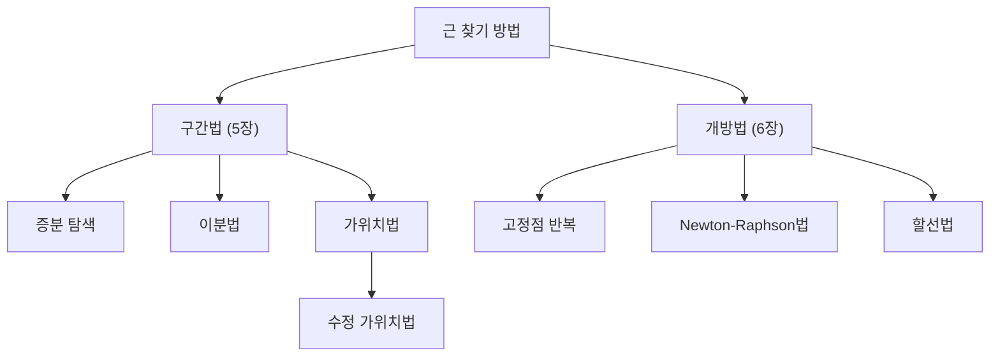
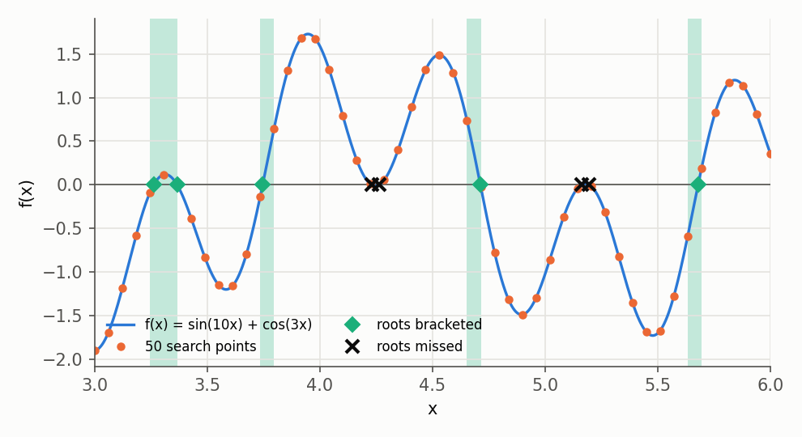
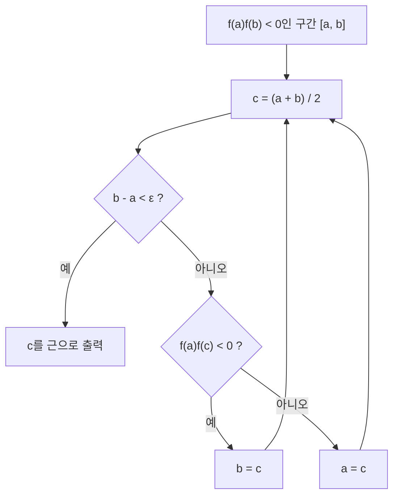
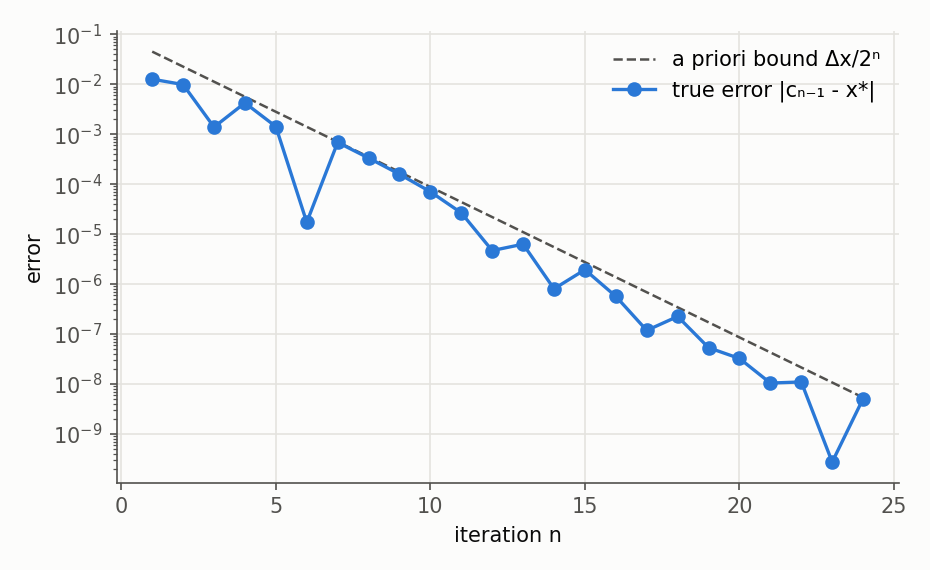
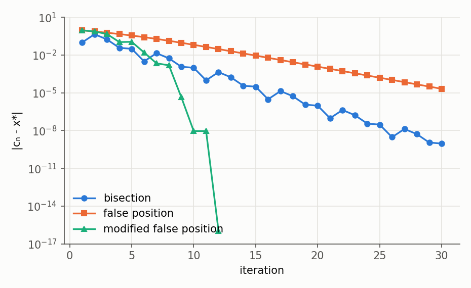

# 5장 — 근: 구간법

[레포지토리 안내](../../README.ko.md) | [English](Concepts_Lecture.md) | [한국어](Concepts_Lecture.ko.md)

> **최종 수정일:** 2026-11-27
>
> Applied Numerical Methods with Python for Engineers and Scientists, Chapra and Clough, Ch 5

> **학습 목표:**
> 1. 근 찾기에 이분법을 적용할 수 있다
> 2. 가위치법을 구현할 수 있다
> 3. 구간법의 수렴 속도를 분석할 수 있다

---

## 목차

- [1. 동기: 이차 공식](#1-동기-이차-공식)
- [2. 근 문제의 개념](#2-근-문제의-개념)
- [3. 그래프 방법](#3-그래프-방법)
  - [3.1 적금 예제](#31-적금-예제)
  - [3.2 그래프를 이용한 근 추정](#32-그래프를-이용한-근-추정)
- [4. 구간법 vs. 개방법](#4-구간법-vs-개방법)
  - [4.1 구간법(Bracketing Methods)](#41-구간법bracketing-methods)
  - [4.2 개방법(Open Methods)](#42-개방법open-methods)
- [5. 증분 탐색(Incremental Search)](#5-증분-탐색incremental-search)
  - [5.1 부호 변화 원리](#51-부호-변화-원리)
  - [5.2 알고리즘과 단점](#52-알고리즘과-단점)
  - [5.3 증분 탐색의 구현](#53-증분-탐색의-구현)
- [6. 이분법(Bisection Method, 반구간법)](#6-이분법bisection-method-반구간법)
  - [6.1 알고리즘](#61-알고리즘)
  - [6.2 단계별 절차](#62-단계별-절차)
  - [6.3 예제: 이분법으로 구한 적금 이율](#63-예제-이분법으로-구한-적금-이율)
  - [6.4 SciPy의 구간법 함수](#64-scipy의-구간법-함수)
- [7. 이분법의 수렴](#7-이분법의-수렴)
  - [7.1 오차 한계 유도](#71-오차-한계-유도)
  - [7.2 사전 오차 추정(A Priori Error Estimation)](#72-사전-오차-추정a-priori-error-estimation)
  - [7.3 필요한 반복 횟수](#73-필요한-반복-횟수)
  - [7.4 수렴 차수](#74-수렴-차수)
  - [7.5 근사 상대 오차와 중지 기준](#75-근사-상대-오차와-중지-기준)
  - [7.6 구현상의 주의](#76-구현상의-주의)
- [8. 가위치법(False Position Method, Regula Falsi)](#8-가위치법false-position-method-regula-falsi)
  - [8.1 공식 유도](#81-공식-유도)
  - [8.2 수렴 특성](#82-수렴-특성)
  - [8.3 편측성 문제(One-Sidedness Problem)](#83-편측성-문제one-sidedness-problem)
  - [8.4 예제: 가위치법으로 구한 적금 이율](#84-예제-가위치법으로-구한-적금-이율)
  - [8.5 가위치법의 수렴 속도](#85-가위치법의-수렴-속도)
- [9. 수정 가위치법(Modified False Position Method)](#9-수정-가위치법modified-false-position-method)
  - [9.1 스케일링 매개변수 도입](#91-스케일링-매개변수-도입)
  - [9.2 연속 두 점이 같은 쪽에 있는 경우](#92-연속-두-점이-같은-쪽에-있는-경우)
  - [9.3 세 구간법의 수렴 비교](#93-세-구간법의-수렴-비교)
- [10. 요약 표](#10-요약-표)
- [요약](#요약)
- [점검 문제](#점검-문제)
- [참고 문헌](#참고-문헌)

---

<br>

## 1. 동기: 이차 공식

이차 방정식은 다음과 같다.

```math
f(x) = ax^2 + bx + c = 0
```

이 방정식의 근은 완전제곱식을 만들어 해석적으로 유도할 수 있다.

> **참고:** **완전제곱식.** 완전제곱식 만들기(Completing the square)는 이차식을 꼭짓점 형태로 바꾸는 기본적인 대수 기법으로, 이차 공식으로 가는 직접적인 경로를 제공한다.

**단계 1.** $`a`$를 인수로 묶는다.

```math
a\left(x^2 + \frac{b}{a}x\right) + c = 0
```

**단계 2.** 완전제곱식을 만든다.

```math
a\left(x + \frac{b}{2a}\right)^2 - \frac{b^2}{4a} + c = 0
```

**단계 3.** $`x`$에 대해 푼다($`a \neq 0`$이라 가정한다).

```math
\left(x + \frac{b}{2a}\right)^2 = \frac{b^2 - 4ac}{4a^2}
```

```math
x = \frac{-b \pm \sqrt{b^2 - 4ac}}{2a}
```

근은 $`f(x) = 0`$인 $`x`$ 값이다. 기하학적으로 근은 곡선이 **x축과 만나는** 점이다.

그러나 고차 다항식과 초월 방정식에는 일반적으로 **닫힌 형태의 공식이 존재하지 않는다**. 근을 찾으려면 **수치적 방법**이 필요하다.

- **5장:** 구간법(Bracketing methods)은 수렴이 보장되지만 느리다.
- **6장:** 개방법(Open methods)은 발산할 수 있지만 빠르다.

---

<br>

## 2. 근 문제의 개념

근 찾기 문제(roots problem)는 어떤 함수 $`f`$를 하나 이상의 종속 변수 $`x`$로 쓸 수 있고, $`f(x) = 0`$의 해가 문제의 해가 되는 경우에 생긴다.

이러한 문제는 **설계 문제**에서 필요한 매개변수에 대한 **음함수 방정식**이 나타날 때 자주 생긴다.

> **[미적분학]** 중간값 정리(Intermediate Value Theorem, IVT)는 모든 구간법의 이론적 기초이다. $`f`$가 $`[a, b]`$에서 연속이고 $`f(a) \cdot f(b) < 0`$이면, $`f(x^*) = 0`$인 $`x^* \in (a, b)`$가 적어도 하나 존재한다.

1장의 번지 점프 모델이 그 예이다. 해석해 $`v(t) = \sqrt{gm/c_d}\tanh(\sqrt{gc_d/m}\,t)`$는 질량이 주어지면 속도를 바로 계산하게 해 주지만, 반대로 낙하 4 s 뒤의 속도가 36 m/s가 되는 질량을 구하려면 $`m`$을 식의 한쪽으로 분리할 수 없다. 식의 양변을 한쪽으로 모아 다음과 같이 쓰면 근 문제가 된다.

```math
f(m) = \sqrt{\frac{gm}{c_d}}\tanh\!\left(\sqrt{\frac{gc_d}{m}}\,t\right) - v(t) = 0
```

$`c_d = 0.25`$ kg/m, $`t = 4`$ s, $`v = 36`$ m/s이면 $`f(100) = -1.197`$, $`f(150) = 0.142`$로 부호가 바뀌므로 근은 100과 150 사이에 있고, 그 값은 $`m \approx 142.74`$ kg이다. 가장 원시적인 풀이는 **시행착오(trial and error)** 로, 값을 추측하여 $`f`$를 계산하고 $`f`$가 0에 충분히 가까워질 때까지 추측을 고친다. 이 방법은 체계적이지 않아 비효율적이고 언제 멈출지도 분명하지 않으므로, 3절의 그래프 방법과 4~9절의 체계적인 방법이 필요하다.

---

<br>

## 3. 그래프 방법

### 3.1 적금 예제

**문제 설정:** Shin은 매달 $`p`$를 정기적으로 입금하여 저축한다. 연이율은 $`r`$이고, 입금한 금액에는 다음 달부터 월 이율 $`r/12`$의 복리 이자가 붙는다고 하자. $`n`$번째 납입 직후의 총 금액 $`A`$는 다음과 같다.

```math
A = p + p\left(1 + \frac{r}{12}\right) + p\left(1 + \frac{r}{12}\right)^2 + \cdots + p\left(1 + \frac{r}{12}\right)^{n-1}
```

> **[미적분학]** 첫째항이 $`a`$이고 공비가 $`q \neq 1`$인 등비수열의 처음 $`n`$개 항의 합은 $`a + aq + \cdots + aq^{n-1} = a\frac{q^n - 1}{q - 1}`$이다. 위 식은 첫째항 $`p`$, 공비 $`1 + r/12`$, 항 수 $`n`$인 등비급수이므로 이 합 공식으로 아래의 닫힌 형태를 얻는다.

등비급수의 합 공식을 적용하면 다음을 얻는다.

```math
A = \sum_{i=0}^{n-1} p\left(1 + \frac{r}{12}\right)^i = p \cdot \frac{\left(1 + \frac{r}{12}\right)^n - 1}{\left(1 + \frac{r}{12}\right) - 1} = \frac{12p}{r}\left[\left(1 + \frac{r}{12}\right)^n - 1\right]
```

**근 찾기 문제로의 정식화:** $`A`$를 목표 금액이라 하자. Shin은 $`n`$개월 안에 $`A`$를 모으려 한다. 이 목표를 이루는 이율 $`r`$은 얼마인가?

```math
\text{Find } r: \quad f(r) = \frac{12p}{r}\left[\left(1 + \frac{r}{12}\right)^n - 1\right] - A = 0
```

이 방정식은 $`r`$에 대해 **해석적으로 풀 수 없으므로** 근 찾기 문제가 된다.

### 3.2 그래프를 이용한 근 추정

그래프 방법으로 $`f(r)`$을 그리고 곡선이 가로축과 만나는 점($`f(r) = 0`$)을 눈으로 확인하여 근을 추정할 수 있다. 아래 코드의 `g`는 `func`의 나머지 인수를 고정하여 이율만의 함수로 만든 $`f(r)`$이다.

```python
# ex
def func(interest, duration, deposit, target):
    ratio = 1. + interest / 12.
    return 12.0 * deposit / interest * (ratio**duration - 1.0) - target

from functools import partial

duration = 24
deposit = 60.
target = 1500.
g = partial(func, duration=duration, deposit=deposit, target=target)
```

점점 좁은 구간에서 그래프를 그리면 다음과 같다.

| 확대 단계 | 이율 범위 | 관찰 결과 |
|:---:|:---:|:---|
| 1차 | 1%~10% | 근이 4% 부근에 있다 |
| 2차 | 4.0%~5.0% | 근이 4.2% 부근에 있다 |
| 3차 | 4.20%~4.30% | 근은 약 **4.24%** |

*표 1. 확대 단계별 그래프 관찰 결과*

이분법으로 정밀하게 구하면 이 예제의 근은 $`r \approx 0.042361`$(약 $`4.236\%`$)이다.

> **참고:** **그래프 방법의 역할.** 그래프 방법은 대략적인 초기 추정값을 주지만 정밀하지 않다. 보통 더 체계적인 수치 방법의 출발점으로 쓰인다.

---

<br>

## 4. 구간법 vs. 개방법

근 찾기 방법은 두 계열로 나뉜다.



*그림 1. 근 찾기 방법의 분류*

### 4.1 구간법(Bracketing Methods)

- 근을 **둘러싸는**(bracket) **두 개의 초기 추정값**에서 출발한다.
- 근은 구간 $`[x_l, x_u]`$ 안에 있다.
- 해로의 **수렴이 보장된다**.
- 수렴 속도가 느리다.

### 4.2 개방법(Open Methods)

- **하나 이상의 초기 추정값**을 쓸 수 있지만 **구간이 없다**.
- **발산할 수 있다**(수렴이 보장되지 않는다).
- 수렴하면 수렴 속도가 **빠르다**.

> **참고:** **하이브리드 전략.** 수렴 보장과 속도 사이의 상충 관계는 수치해석에서 반복되는 주제이다. 실무에서는 구간법으로 시작해 근에 가까워진 뒤 개방법으로 바꾸어 빠르게 다듬는 하이브리드 전략을 자주 쓴다.

---

<br>

## 5. 증분 탐색(Incremental Search)

### 5.1 부호 변화 원리

$`f`$가 $`x_l`$에서 $`x_u`$까지의 구간에서 **실수이고 연속**일 때, 구간의 양 끝에서 $`f`$의 부호가 서로 다르다는 조건은 다음과 같다.

```math
f(x_l) \cdot f(x_u) < 0
```

이 조건이 성립하면 $`x_l`$(하한)과 $`x_u`$(상한) 사이 어딘가에 근이 적어도 하나 있다. 반대로 양 끝의 부호가 같다고 해서 근이 없다는 뜻은 아니며, 구간 안에 근이 짝수 개 있을 수 있다(5.2절).

> **[미적분학]** 이것은 중간값 정리를 직접 적용한 것이다. 이 결론이 성립하려면 $`[x_l, x_u]`$에서 $`f`$가 연속이어야 한다. 예를 들어 $`f(x) = 1/x`$는 $`[-1, 1]`$의 양 끝에서 부호가 다르지만 $`x = 0`$에서 불연속이므로 근이 없다.

### 5.2 알고리즘과 단점

**알고리즘:**

1. 구간 $`[x_l, x_u]`$를 더 작은 부분 구간으로 나눈다.
2. 각 부분 구간을 차례로 보며 부호 변화 검사 $`f(x_i) \cdot f(x_{i+1}) < 0`$으로 근이 있는지 확인한다.
3. 부호 변화가 감지되면 그 부분 구간에 근이 있다.

**단점:** **증분 길이**(스텝 크기)에 **민감하다**.

- 스텝 크기가 **너무 크면** 두 연속 점 사이에 짝수 개의 근이 있을 수 있으므로 근을 포함하는 구간을 **놓칠** 수 있다.
- 스텝 크기가 **너무 작으면** 방법의 **계산 비용이 커진다**.

> **참고:** **촘촘한 근.** $`\sin(x^2)`$ 같은 함수는 매우 촘촘하게 놓인 근을 가질 수 있다. 증분이 인접한 근 사이의 간격보다 크면 함수가 같은 부호로 돌아오므로 근의 쌍을 통째로 놓칠 수 있다.

### 5.3 증분 탐색의 구현

증분 탐색은 NumPy의 벡터화로 간단히 구현된다. 다음 함수는 구간을 `ns`개의 점으로 나누고 이웃한 두 점에서 함숫값의 부호가 바뀌는 부분 구간을 모두 돌려준다.

```python
import numpy as np

def incsearch(f, xmin, xmax, ns=50):
    """Return the subintervals [x_k, x_k+1] of [xmin, xmax] where f changes sign."""
    x = np.linspace(xmin, xmax, ns)
    fx = f(x)
    k = np.flatnonzero(np.sign(fx[:-1]) != np.sign(fx[1:]))   # sign changes
    return np.column_stack((x[k], x[k + 1]))

f = lambda x: np.sin(10 * x) + np.cos(3 * x)
for ns in (50, 100, 2500):
    brackets = incsearch(f, 3, 6, ns)
    print(ns, len(brackets))
print(np.round(incsearch(f, 3, 6, 2500), 4))
```

```text
50 5
100 9
2500 9
[[3.2617 3.2629]
 [3.3649 3.3661]
 [3.7455 3.7467]
 [4.2281 4.2293]
 [4.2629 4.2641]
 [4.7119 4.7131]
 [5.1609 5.1621]
 [5.1957 5.1969]
 [5.6783 5.6795]]
```

- `np.linspace(xmin, xmax, ns)`가 탐색점을 만들고, `f(x)`는 모든 점의 함숫값을 한 번에 계산한다.
- `np.sign(fx[:-1]) != np.sign(fx[1:])`는 이웃한 두 점의 부호를 비교한 불리언 배열이며, `np.flatnonzero`는 그 값이 참인 위치 $`k`$를 돌려준다. 부호 비교를 곱 `fx[:-1] * fx[1:] < 0` 대신 `np.sign`으로 하면 매우 작은 두 함숫값의 곱이 언더플로되어 0이 되는 일을 피할 수 있다.
- `np.column_stack`은 부분 구간의 왼쪽 끝과 오른쪽 끝을 두 열로 묶는다.

$`f(x) = \sin(10x) + \cos(3x)`$는 $`[3, 6]`$에 근이 9개 있다. 점이 50개(간격 약 0.061)이면 구간을 5개만 찾고, 100개 이상이면 9개를 모두 찾는다.



*그림 2. 50개의 점으로 한 증분 탐색이 찾은 구간과 놓친 근*

그림 2에서 놓친 근 4개는 $`x \approx 4.23, 4.26`$과 $`x \approx 5.16, 5.20`$의 두 쌍이다. 각 쌍에서 함수가 0 아래로 잠깐 내려갔다가 바로 올라오므로, 두 근 사이의 거리(약 0.035)가 탐색 간격보다 작으면 두 탐색점이 모두 같은 부호를 가져 부호 변화가 보이지 않는다. 이처럼 거의 맞닿은 근의 쌍이나 중근은 증분 탐색으로 찾기 어려우며, 함수의 그래프를 함께 그려 확인하는 것이 안전하다.

---

<br>

## 6. 이분법(Bisection Method, 반구간법)

이분법은 가장 간단한 구간법이다. 매 반복마다 탐색 구간을 체계적으로 반으로 나눈다.

### 6.1 알고리즘

**핵심 아이디어:**

1. 매 반복마다 구간의 **중점**을 골라 탐색 공간을 반으로 나눈다.
2. 두 절반 중 어느 쪽에 근이 있는지 판별한다.
3. 탐색 구간이 허용 오차 $`\varepsilon`$보다 작아질 때까지 단계 1과 2를 반복한다.

### 6.2 단계별 절차

**단계 0 (초기화):** $`f(x_l) \cdot f(x_u) < 0`$인 구간 $`[x_l, x_u]`$로 시작한다.

$`a_0 = x_l`$, $`b_0 = x_u`$로 둔다.

중점을 계산한다.

```math
c_0 = \frac{x_l + x_u}{2} = \frac{a_0 + b_0}{2}
```

**단계 1 (어느 절반인지 판별):** 부호 변화를 확인한다.

- $`f(a_0) \cdot f(c_0) < 0`$이면 근은 **왼쪽** 구간 $`[a_0, c_0]`$에 있다.
  - $`a_1 = a_0`$, $`b_1 = c_0`$으로 둔다.
- $`f(c_0) \cdot f(b_0) < 0`$이면 근은 **오른쪽** 구간 $`[c_0, b_0]`$에 있다.
  - $`a_1 = c_0`$, $`b_1 = b_0`$으로 둔다.
- $`f(c_0) = 0`$이면 $`c_0`$이 근이므로 반복을 끝낸다.

**단계 2 (수렴 확인):** $`(b_1 - a_1) < \varepsilon`$이면 다음을 출력한다.

```math
x^* \approx \frac{a_1 + b_1}{2}
```

그렇지 않으면 구간 $`[a_1, b_1]`$로 탐색을 계속한다.

**일반 반복:** 반복 $`n`$에서 다음을 계산한다.

```math
c_n = \frac{a_n + b_n}{2}
```

그다음 부호 변화 검사에 따라 구간을 갱신하고 반복한다.



*그림 3. 이분법의 반복 절차*

```python
def bisection(f, a, b, tol=1e-6, max_iter=100):
    """
    Bisection method for finding a root of f in [a, b].
    Assumes f(a) * f(b) < 0.
    """
    if f(a) * f(b) >= 0:
        raise ValueError("f(a) and f(b) must have opposite signs")

    for n in range(max_iter):
        c = (a + b) / 2.0
        if (b - a) < tol:
            return c, n
        if f(a) * f(c) < 0:
            b = c
        else:
            a = c
    return (a + b) / 2.0, max_iter
```

> **참고:** 위 코드는 `f(c)`가 정확히 0이 되는 경우를 따로 처리하지 않는다. 이때 `f(a) * f(c) < 0`이 거짓이므로 `a = c`가 되고, 이후 반복에서도 `f(a) = 0` 때문에 같은 검사가 계속 거짓이 되어 `a`가 오른쪽 끝으로 밀려간다. 예를 들어 `bisection(lambda x: x, -1, 1)`은 첫 중점 0이 근인데도 약 `0.9999995`를 반환한다. 반복 안에서 `f(c) == 0`이면 바로 `c`를 반환하는 검사를 추가하면 이 문제를 피할 수 있다.

### 6.3 예제: 이분법으로 구한 적금 이율

3.1절의 적금 문제($`p = 60`$, $`n = 24`$, $`A = 1500`$)를 이분법으로 푼다. 이율 $`r`$(소수)에 대해 $`f(0.01) = -46.12 < 0`$, $`f(0.10) = 86.81 > 0`$이므로 $`[0.01, 0.10]`$이 근을 둘러싼다. 초기 구간 폭은 $`\Delta x = 0.09`$이고, 참 근은 $`r^* = 0.0423610344\ldots`$이다.

첫 반복에서 $`c_0 = (0.01 + 0.10)/2 = 0.055`$이고 $`f(0.055) = 18.51 > 0`$이므로, 부호가 바뀌는 쪽인 $`[0.01, 0.055]`$가 새 구간이 된다. 둘째 반복에서 $`c_1 = 0.0325`$이고 $`f(0.0325) = -14.25 < 0`$이므로 새 구간은 $`[0.0325, 0.055]`$이다. 반복을 계속하면 다음 표를 얻는다. $`\varepsilon_a`$는 연속한 두 중점으로 계산한 근사 백분율 상대 오차이고, 마지막 열은 7.2절의 사전 오차 한계 $`\Delta x/2^n`$이다.

| $`n`$ | $`a`$ | $`b`$ | $`c`$ | $`f(c)`$ | $`\varepsilon_a`$ (%) | $`\vert c - r^* \vert`$ | $`\Delta x/2^n`$ |
|-----:|-----:|-----:|-----:|-----:|-----:|-----:|-----:|
| 1 | 0.010000 | 0.100000 | 0.055000 | 18.5136 | - | $`1.26 \times 10^{-2}`$ | $`4.50 \times 10^{-2}`$ |
| 2 | 0.010000 | 0.055000 | 0.032500 | -14.2464 | 69.231 | $`9.86 \times 10^{-3}`$ | $`2.25 \times 10^{-2}`$ |
| 3 | 0.032500 | 0.055000 | 0.043750 | 2.0205 | 25.714 | $`1.39 \times 10^{-3}`$ | $`1.13 \times 10^{-2}`$ |
| 4 | 0.032500 | 0.043750 | 0.038125 | -6.1410 | 14.754 | $`4.24 \times 10^{-3}`$ | $`5.63 \times 10^{-3}`$ |
| 5 | 0.038125 | 0.043750 | 0.040938 | -2.0673 | 6.870 | $`1.42 \times 10^{-3}`$ | $`2.81 \times 10^{-3}`$ |
| 6 | 0.040938 | 0.043750 | 0.042344 | -0.0251 | 3.321 | $`1.73 \times 10^{-5}`$ | $`1.41 \times 10^{-3}`$ |
| 7 | 0.042344 | 0.043750 | 0.043047 | 0.9973 | 1.633 | $`6.86 \times 10^{-4}`$ | $`7.03 \times 10^{-4}`$ |
| 8 | 0.042344 | 0.043047 | 0.042695 | 0.4860 | 0.823 | $`3.34 \times 10^{-4}`$ | $`3.52 \times 10^{-4}`$ |
| 9 | 0.042344 | 0.042695 | 0.042520 | 0.2304 | 0.413 | $`1.58 \times 10^{-4}`$ | $`1.76 \times 10^{-4}`$ |
| 10 | 0.042344 | 0.042520 | 0.042432 | 0.1026 | 0.207 | $`7.06 \times 10^{-5}`$ | $`8.79 \times 10^{-5}`$ |

*표 2. 적금 문제에 대한 이분법의 반복 과정*

세 가지를 관찰할 수 있다. 첫째, 모든 반복에서 참 오차는 사전 한계 $`\Delta x/2^n`$ 이하이다. 둘째, 참 오차는 단조롭게 줄지 않는다. 6번째 중점 0.042344는 근에 매우 가까워 오차가 $`1.73 \times 10^{-5}`$이지만, 7번째 중점은 다음 구간의 가운데이므로 오차가 다시 커진다. 이분법은 근의 위치가 아니라 구간만 보고 중점을 고르기 때문이다. 셋째, $`\varepsilon_a`$는 반복이 진행될수록 매번 거의 정확히 절반이 되며, 언제나 참 오차를 백분율로 나타낸 값보다 크다(7.5절). 허용 오차 $`10^{-6}`$을 보장하려면 7.3절의 공식으로 $`n > \log_2(0.09/10^{-6}) \approx 16.5`$, 즉 17번 반복해야 한다.

### 6.4 SciPy의 구간법 함수

SciPy의 `scipy.optimize`는 구간법 함수 `bisect`와 `brentq`(6장의 Brent 방법), 그리고 여러 방법을 하나로 묶은 `root_scalar`를 제공한다. `root_scalar`는 `bracket`을 주면 `bisect`, `brentq`, `brenth`, `ridder`, `toms748` 같은 구간법을, 초기 추정값을 주면 `secant`, `newton`, `halley` 같은 개방법을 쓴다 [1].

```python
from scipy import optimize

def g(r, n=24, p=60.0, A=1500.0):
    q = 1 + r / 12
    return 12 * p / r * (q**n - 1) - A

root, info = optimize.bisect(g, 0.01, 0.10, xtol=1e-10, full_output=True)
print(root, info.iterations, info.function_calls)
root, info = optimize.brentq(g, 0.01, 0.10, xtol=1e-10, full_output=True)
print(root, info.iterations, info.function_calls)
sol = optimize.root_scalar(g, bracket=[0.01, 0.10], method='bisect', xtol=1e-10)
print(sol.root, sol.converged, sol.iterations)
```

```text
0.042361034406349064 30 32
0.04236103442910657 6 7
0.042361034406349064 True 30
```

- `xtol=1e-10`은 근의 절대 허용 오차이다. `bisect`는 30번 반복했는데, 이는 7.3절의 공식 $`n > \log_2(0.09/10^{-10}) \approx 29.7`$과 일치한다. 함수 호출이 32번인 것은 양 끝점의 값을 한 번씩 더 계산했기 때문이다.
- `full_output=True`를 주면 근과 함께 반복 횟수(`iterations`)와 함수 호출 횟수(`function_calls`)를 담은 객체를 돌려준다.
- `brentq`는 같은 허용 오차를 6번의 반복, 7번의 함수 호출로 만족한다. 이분법의 수렴 보장을 유지하면서 할선법과 역 이차 보간을 섞어 쓰기 때문이다(6장 8절).
- `root_scalar`는 결과를 `root`, `converged`, `iterations` 속성을 가진 객체로 돌려준다.

---

<br>

## 7. 이분법의 수렴

### 7.1 오차 한계 유도

매 반복에서 오차(참 근 $`x^*`$와 중점 추정값 $`c_n`$ 사이의 거리)는 현재 구간 길이의 절반 이하이다.

**1번째 반복 후:**

```math
\text{err}_1 = |x^* - c_0| \leq \frac{1}{2}(b_0 - a_0)
```

**2번째 반복 후:**

```math
\text{err}_2 = |x^* - c_1| \leq \frac{1}{2}(b_1 - a_1)
```

**3번째 반복 후:**

```math
\text{err}_3 = |x^* - c_2| \leq \frac{1}{2}(b_2 - a_2)
```

**4번째 반복 후:**

```math
\text{err}_4 = |x^* - c_3| \leq \frac{1}{2}(b_3 - a_3)
```

각 구간은 이전 구간의 절반이므로 다음이 성립한다.

```math
\frac{1}{2}(b_3 - a_3) = \frac{1}{2^2}(b_2 - a_2) = \frac{1}{2^3}(b_1 - a_1) = \frac{1}{2^4}(b_0 - a_0)
```

### 7.2 사전 오차 추정(A Priori Error Estimation)

$`n`$번 반복한 후 오차의 상한은 다음과 같다.

```math
\boxed{\text{err}_n = |x^* - c_{n-1}| \leq \frac{\Delta x}{2^n}}
```

여기서 $`\Delta x = b_0 - a_0`$는 **초기 구간 폭**이다.

> **참고:** **사전 오차 추정.** 이를 사전 오차 추정(a priori error estimation)이라 부르는 이유는, 알고리즘을 실행하기 *전에* 초기 구간과 반복 횟수만으로 최대 오차를 예측할 수 있기 때문이다.

**실용적 예시:**
- **10번 반복 후**에는 원래 구간의 불확실성이 $`2^{10} = 1024`$배 줄어든다(약 3자리 정밀도).
- **20번 반복 후**에는 $`2^{20} \approx 10^6`$배 줄어 약 6자리 정밀도를 얻는다. 약 백만 배의 개선이다.

> **참고:** **선형 수렴.** 이분법의 수렴은 **선형(linear)** 이다. 각 반복이 대략 1비트의 정확도를 더한다. 이는 이차 수렴하는 고차 방법(예: 6장의 Newton-Raphson법)과 대조적이다.

### 7.3 필요한 반복 횟수

**질문:** 주어진 허용 오차 $`\varepsilon_s`$를 만족하려면 몇 번 반복해야 하는가?

다음이 성립해야 한다.

```math
\text{err}_n \leq \frac{\Delta x}{2^n} < \varepsilon_s
```

정리하면 다음과 같다.

```math
2^n > \frac{\Delta x}{\varepsilon_s}
```

양변에 $`\log_2`$를 취하면 다음을 얻는다.

```math
\boxed{n > \log_2\left(\frac{\Delta x}{\varepsilon_s}\right)}
```

**예시:** $`\Delta x = 1`$이고 $`\varepsilon_s = 10^{-5}`$이면 다음과 같다.

```math
n > \log_2\left(\frac{1}{10^{-5}}\right) = \log_2(10^5) \approx 16.6
```

따라서 **17번 반복**하면 허용 오차를 보장할 수 있다.

```python
import math

def bisection_iterations_needed(delta_x, tolerance):
    """Calculate minimum number of bisection iterations needed."""
    return math.ceil(math.log2(delta_x / tolerance))

# Example
n = bisection_iterations_needed(1.0, 1e-5)
print(f"Iterations needed: {n}")  # Output: 17
```

### 7.4 수렴 차수

반복법의 빠르기는 **수렴 차수(order of convergence)** 로 비교한다.

> **용어 정의:** **수렴 차수(order of convergence)** 는 근 $`x^*`$에 수렴하는 수열 $`x_k`$의 오차 $`e_k = x_k - x^*`$가 $`\lim_{k \to \infty} |e_{k+1}|/|e_k|^p = C`$ ($`0 < C < \infty`$)를 만족할 때의 지수 $`p`$이며, 상수 $`C`$를 점근 오차 상수라고 한다.

$`p = 1`$이고 $`0 < C < 1`$이면 **선형 수렴(linear convergence)** 이라고 하며, 오차가 매 반복 대략 $`C`$배가 된다. $`p = 2`$이면 **이차 수렴**이며 정확한 자릿수가 매 반복 대략 두 배가 된다(6장의 Newton-Raphson법). $`1 < p < 2`$이면 **초선형 수렴**이라고 한다(6장의 할선법).

이분법에서는 근을 포함하는 구간의 폭이 매 반복 정확히 절반이 되므로, 오차의 상한 $`\Delta x/2^n`$은 $`C = 1/2`$인 선형 수렴을 한다. 다만 6.3절에서 본 것처럼 참 오차 자체는 매 반복 줄지 않을 수 있으므로, 이분법의 선형 수렴은 오차의 상한에 대한 성질이다. 그림 4는 표 2의 반복을 24번까지 이어 가며 참 오차와 사전 한계를 반로그 축에 그린 것이다.



*그림 4. 이분법의 참 오차와 사전 오차 한계 (반로그 축)*

반로그 축에서 사전 한계는 기울기가 $`\log_{10}(1/2) \approx -0.301`$인 직선이며, 참 오차는 그 아래에서 오르내리면서 같은 기울기로 줄어든다. 오차를 10배 줄이는 데 약 $`\log_2 10 \approx 3.32`$번의 반복이 필요하므로, 유효 숫자 하나를 얻는 데 약 3.3번의 반복과 3.3번의 함수 평가가 든다. 이 비율이 함수의 모양과 무관하다는 것이 이분법의 장점이자 한계이다.

### 7.5 근사 상대 오차와 중지 기준

이분법의 중지 기준은 세 가지로 쓸 수 있다.

**구간 폭.** $`b - a < \varepsilon`$이면 멈춘다(6.2절). 참 오차가 $`(b - a)/2`$ 이하임이 보장되는 절대 오차 기준이다.

**근사 상대 오차.** 4장의 $`\varepsilon_a`$를 연속한 두 중점으로 계산한다. 이전 중점 $`c_{\text{old}}`$는 새 구간 $`[a, b]`$의 한 끝점이므로 $`|c_{\text{new}} - c_{\text{old}}| = (b - a)/2`$이고, $`c_{\text{new}} = (a + b)/2`$이므로 다음이 성립한다.

```math
\varepsilon_a = \left| \frac{c_{\text{new}} - c_{\text{old}}}{c_{\text{new}}} \right| \times 100\% = \left| \frac{b - a}{b + a} \right| \times 100\%
```

참 근은 새 구간 안에 있으므로 참 오차는 $`|c_{\text{new}} - x^*| \leq (b - a)/2 = |c_{\text{new}} - c_{\text{old}}|`$이다. 따라서 $`\varepsilon_a`$는 참 백분율 상대 오차의 상한 역할을 하며(분모 $`c_{\text{new}}`$와 $`x^*`$의 작은 차이를 무시하면), 6.3절의 표에서 $`\varepsilon_a`$가 언제나 참 오차보다 큰 이유가 이것이다. 일반적인 반복법에서는 $`\varepsilon_a`$가 참 오차의 상한이라는 보장이 없으므로, 이는 구간을 유지하는 이분법의 장점이다.

**함숫값.** $`|f(c)| < \varepsilon`$이면 멈춘다. 가위치법(8절)이 쓰는 기준이다. 함수가 근 근처에서 매우 평탄하면 $`|f(c)|`$가 작아도 $`c`$가 근에서 멀 수 있고, 반대로 매우 가파르면 $`c`$가 근에 가까워도 $`|f(c)|`$가 클 수 있다. 그래서 함숫값 기준은 $`x`$에 대한 기준과 함께 쓰는 것이 안전하다.

상대 오차 기준은 근이 0이거나 0에 가까우면 분모가 0에 가까워 쓸 수 없다. 근이 0 근처일 수 있으면 절대 오차 기준을 쓰거나, 두 기준을 섞은 $`(b - a)/2 < \varepsilon_{\text{abs}} + \varepsilon_{\text{rel}}|c|`$를 쓴다. 또 허용 오차를 머신 정밀도보다 작게 잡을 수 없다. 근 $`x^*`$ 근처에서 인접한 배정밀도 수의 간격은 약 $`\varepsilon_{\text{mach}}|x^*|`$이므로(4장 5.7절), 구간 폭이 이보다 작아지면 중점이 두 끝점 가운데 하나와 같아져 구간이 더 줄지 않는다.

### 7.6 구현상의 주의

이분법은 단순하지만 구현할 때 다음을 주의해야 한다.

| 문제 | 원인 | 대책 |
|:-----|:-----|:-----|
| 중점이 근일 때 잘못된 쪽으로 진행 | `f(a) * f(c) < 0`이 거짓이어서 `a = c`로 갱신됨(6.2절의 참고) | `f(c) == 0`이면 즉시 `c`를 반환 |
| 부호 판정의 언더플로 | 매우 작은 두 함숫값의 곱이 0이 됨 | `np.sign(f(a)) != np.sign(f(c))`로 비교 |
| 중점 계산의 오버플로 | `a`와 `b`가 매우 크면 `a + b`가 넘침 | `a + (b - a) / 2`로 계산 |
| 불필요한 함수 평가 | 반복마다 `f(a)`를 다시 계산 | `f(a)`를 변수에 보관하여 반복당 평가 1회 |
| 끝나지 않는 반복 | 허용 오차가 머신 정밀도보다 작음 | 최대 반복 횟수를 두고 종료 원인을 반환 |
| 근을 찾지 못함 | 짝수 중근처럼 부호가 바뀌지 않는 근 | 그래프로 확인하거나 개방법(6장) 사용 |
| 근이 아닌 점으로 수렴 | 구간 안의 불연속점(점검 문제 4) | 구간에서 연속인지 확인 |

*표 3. 이분법 구현의 주의점*

이분법의 계산 비용은 반복당 함수 평가 한 번이다. 허용 오차 $`\varepsilon`$을 얻는 데 필요한 평가 횟수는 양 끝점의 평가 2번을 더해 약 $`\lceil \log_2(\Delta x/\varepsilon) \rceil + 2`$로 함수와 무관하게 정해지므로, 함수 평가에 시간이 오래 걸리는 문제에서도 전체 계산 시간을 미리 알 수 있다.

---

<br>

## 8. 가위치법(False Position Method, Regula Falsi)

### 8.1 공식 유도

가위치법(FP)은 이분법과 비슷하지만, **중점** 대신 **선형 보간(linear interpolation)** 으로 새 근 추정값을 정한다.

$`(x_l, f(x_l))`$과 $`(x_u, f(x_u))`$를 잇는 직선이 x축과 만나는 점 $`c`$를 새 추정값으로 삼는다.

> **참고:** **할선과 선형 보간.** 이 방법은 두 점을 지나는 직선(할선)의 방정식을 세우고 그 x절편을 찾는다. 이것은 다항식 보간(17장)의 가장 간단한 형태이다.

**유도:** $`(a, f(a))`$와 $`(b, f(b))`$를 지나는 직선은 다음과 같다.

```math
y - f(b) = \frac{f(b) - f(a)}{b - a}(x - b)
```

x절편을 구하기 위해 $`y = 0`$으로 둔다.

```math
-f(b) \cdot \frac{b - a}{f(b) - f(a)} = x - b
```

```math
x = b + \frac{-b \cdot f(b) + a \cdot f(b)}{f(b) - f(a)}
```

```math
x = \frac{a \cdot f(b) - b \cdot f(a)}{f(b) - f(a)}
```

따라서 반복 $`n`$에서의 **가위치법 공식**은 다음과 같다.

```math
\boxed{c_n = \frac{a_n \cdot f(b_n) - b_n \cdot f(a_n)}{f(b_n) - f(a_n)}}
```

알고리즘은 이분법처럼 진행된다. 부분 구간 $`[a_n, c_n]`$과 $`[c_n, b_n]`$ 중 어느 쪽에 근이 있는지 확인하고, 구간을 갱신하며, $`|f(c_n)| < \varepsilon`$이 될 때까지 반복한다.

```python
def false_position(f, a, b, tol=1e-6, max_iter=100):
    """
    False Position (Regula Falsi) method.
    Assumes f(a) * f(b) < 0.
    """
    if f(a) * f(b) >= 0:
        raise ValueError("f(a) and f(b) must have opposite signs")

    for n in range(max_iter):
        fa, fb = f(a), f(b)
        c = (a * fb - b * fa) / (fb - fa)
        fc = f(c)

        if abs(fc) < tol:
            return c, n

        if fa * fc < 0:
            b = c
        else:
            a = c
    return c, max_iter
```

### 8.2 수렴 특성

- 가위치법은 이분법보다 빨리 수렴할 **수도 있고 그렇지 않을 수도** 있다.
- 주어진 반복 횟수 안에 기준을 만족한다는 보장을 **하지 않는다**.
- 이분법의 사전 한계와 달리 반복 횟수로 **오차를 예측할 수 없다**.

> **참고:** **오차 공식의 부재.** 이분법과 달리 가위치법에는 $`\text{err}_n \leq \Delta x / 2^n`$ 같은 간단한 공식이 없다. 수렴 속도는 근 근처에서 $`f`$의 모양(곡률)에 크게 좌우된다.

### 8.3 편측성 문제(One-Sidedness Problem)

가위치법의 주요 약점은 **편측성 문제**이다. 구간 끝점 중 하나가 **고정**된 채 움직이지 않는다. 이 때문에 가위치법은 **수렴이 느려진다**.

**예시:** $`[-1, 1]`$에서 $`f(x) = 2x^3 - 4x^2 + 3x`$의 근 $`x = 0`$을 찾는 경우를 생각한다.

함수의 곡률이 크면 한쪽 끝점은 고정되고 다른 쪽 끝점만 한 방향에서 천천히 근에 다가간다. 구간이 대칭적으로 줄어들지 않는다. 이 예에서는 첫 추정값이 $`c = 0.8`$이고 $`f(0.8) = 0.864 > 0`$이므로 $`b`$가 갱신되며, 이후에도 $`a = -1`$은 움직이지 않고 $`b`$만 $`0.642, 0.507, 0.391, \ldots`$로 줄어든다. 위 `false_position(f, -1, 1)`은 반복 번호 `n = 39`(40번째 추정값)에서야 $`|f(c)| < 10^{-6}`$을 만족한다.

### 8.4 예제: 가위치법으로 구한 적금 이율

6.3절의 적금 문제를 같은 구간 $`[0.01, 0.10]`$에서 가위치법으로 푼다. 첫 반복의 추정값은 다음과 같다.

```math
c = \frac{0.01 \times 86.8149 - 0.10 \times (-46.1153)}{86.8149 - (-46.1153)} = 0.0412222
```

$`f(0.0412222) = -1.6541 < 0`$이므로 근은 $`[0.0412222, 0.10]`$에 있고, 왼쪽 끝점이 갱신된다. 반복을 계속하면 다음 표를 얻는다.

| $`n`$ | $`a`$ | $`b`$ | $`c`$ | $`f(c)`$ | $`\vert c - r^* \vert`$ |
|-----:|-----:|-----:|-----:|-----:|-----:|
| 1 | 0.010000 | 0.100000 | 0.04122222 | -1.65408 | $`1.14 \times 10^{-3}`$ |
| 2 | 0.041222 | 0.100000 | 0.04232117 | -0.05794 | $`3.99 \times 10^{-5}`$ |
| 3 | 0.042321 | 0.100000 | 0.04235964 | -0.00203 | $`1.40 \times 10^{-6}`$ |
| 4 | 0.042360 | 0.100000 | 0.04236099 | -0.00007 | $`4.88 \times 10^{-8}`$ |
| 5 | 0.042361 | 0.100000 | 0.04236103 | -0.00000 | $`1.71 \times 10^{-9}`$ |

*표 4. 적금 문제에 대한 가위치법의 반복 과정*

여기서도 오른쪽 끝점 $`b = 0.10`$은 끝까지 움직이지 않으므로 편측성이 나타나지만, 가위치법은 5번의 반복으로 오차 $`1.71 \times 10^{-9}`$에 이른다. 같은 횟수에서 이분법의 오차는 $`1.42 \times 10^{-3}`$이다(표 2). 이 예에서 가위치법이 빠른 것은 함수가 구간에서 직선에 가까워, 끝점 하나가 고정되어도 할선의 x절편이 근에 바로 다가가기 때문이다. 8.5절은 이 차이를 정량화한다.

### 8.5 가위치법의 수렴 속도

한쪽 끝점 $`b`$가 고정되고 다른 끝점 $`a_k`$만 근에 다가가는 경우를 생각한다. $`a_k = x^* + e_k`$로 두면 가위치법 공식은 $`c = a_k - f(a_k)\frac{b - a_k}{f(b) - f(a_k)}`$로 쓸 수 있다. $`e_k`$가 작으면 $`f(a_k) \approx f'(x^*)e_k`$, $`b - a_k \approx b - x^*`$, $`f(b) - f(a_k) \approx f(b)`$이므로 다음을 얻는다.

```math
e_{k+1} = c - x^* \approx e_k - f'(x^*)\,e_k\,\frac{b - x^*}{f(b)} = \left(1 - \frac{f'(x^*)(b - x^*)}{f(b)}\right) e_k
```

따라서 가위치법은 점근 오차 상수가 $`C = 1 - f'(x^*)(b - x^*)/f(b)`$인 선형 수렴을 한다. $`f(b)/(b - x^*)`$는 근에서 고정 끝점까지의 할선 기울기이므로, $`C`$는 근에서의 접선 기울기와 이 할선 기울기의 비가 1에서 얼마나 벗어나는지를 나타낸다. 함수가 직선에 가까우면 두 기울기가 거의 같아 $`C \approx 0`$이 되어 매우 빠르고, 곡률이 크면 $`C`$가 1에 가까워져 이분법($`C = 1/2`$)보다 느려진다.

8.3절의 예 $`f(x) = 2x^3 - 4x^2 + 3x`$에서는 고정 끝점이 $`a = -1`$이므로 같은 식에서 $`b`$ 대신 $`a`$를 쓴다. $`x^* = 0`$, $`f'(0) = 3`$, $`f(-1) = -9`$이므로 $`C = 1 - 3(-1 - 0)/(-9) = 1 - 1/3 = 2/3`$이다. 실제로 연속한 추정값의 오차의 비는 0.803, 0.790, 0.770, ...에서 20번째 반복 근처에 0.667로 다가가며, $`|f(c)| < 10^{-6}`$에 이르기까지 40개의 추정값이 필요하다. 반면 8.4절의 적금 문제에서는 같은 식으로 계산한 $`C`$가 약 0.035이므로 한 반복에 유효 숫자가 약 1.5자리씩 늘어나며, 표 4의 연속한 오차의 비도 약 0.035이다.

---

<br>

## 9. 수정 가위치법(Modified False Position Method)

### 9.1 스케일링 매개변수 도입

근을 포함하는 구간의 길이가 0으로 수렴하도록 보장하기 위해, 가위치법에 스케일링 매개변수 $`\alpha`$와 $`\beta`$를 도입하여 **수정**할 수 있다. 기본값은 $`\alpha = \beta = 1`$이며, 공식의 결과는 $`\alpha`$와 $`\beta`$의 비에만 의존한다.

**원래 공식:**

```math
c_n = \frac{a_n \cdot f(b_n) - b_n \cdot f(a_n)}{f(b_n) - f(a_n)}
```

**수정 공식:**

```math
c_n = \frac{a_n \cdot \beta \cdot f(b_n) - b_n \cdot \alpha \cdot f(a_n)}{\beta \cdot f(b_n) - \alpha \cdot f(a_n)}
```

### 9.2 연속 두 점이 같은 쪽에 있는 경우

수정은 **연속한 두 추정값** $`c_{n-1}`$과 $`c_n`$이 근의 **같은 쪽**에 나타날 때($`f(c_{n-1}) \cdot f(c_n) > 0`$) 적용된다.

**경우 1: 연속한 두 점이 근의 오른쪽에 있는 경우** ($`f(c_{n-1}) \cdot f(c_n) > 0`$이고 고정 끝점이 $`a_n`$인 경우):

$`\alpha = \frac{1}{2}`$로 두어 **고정된** 끝점의 함숫값을 절반으로 줄인다.

```math
c = \frac{a \cdot f(b) - b \cdot \frac{1}{2} f(a)}{f(b) - \frac{1}{2} f(a)}
```

$`f(a)`$를 절반으로 줄이면 할선이 기울어져 다음 추정값이 고정된 쪽에 더 가까워지고, 따라서 실제 근에 더 가까워진다.

**경우 2: 연속한 두 점이 근의 왼쪽에 있는 경우** (고정 끝점이 $`b_n`$인 경우):

$`\beta = \frac{1}{2}`$로 두어 고정 끝점의 함숫값을 절반으로 줄인다.

```math
c = \frac{a \cdot \frac{1}{2} f(b) - b \cdot f(a)}{\frac{1}{2} f(b) - f(a)}
```

> **참고:** **Illinois 알고리즘.** 수정 가위치법은 구간 폭이 0으로 줄어드는 것을 보장하여 표준 가위치법의 편측성 문제를 극복한다. Illinois 알고리즘은 이 절반 전략을 쓰는 잘 알려진 변형이다.

```python
def modified_false_position(f, a, b, tol=1e-6, max_iter=100):
    """
    Modified False Position method (Illinois algorithm variant).
    Halves the function value at the stationary endpoint when
    two consecutive estimates appear on the same side.
    """
    if f(a) * f(b) >= 0:
        raise ValueError("f(a) and f(b) must have opposite signs")

    fa, fb = f(a), f(b)
    side = 0  # Track which side was updated last

    for n in range(max_iter):
        c = (a * fb - b * fa) / (fb - fa)
        fc = f(c)

        if abs(fc) < tol:
            return c, n

        if fa * fc < 0:
            # Root is in [a, c]
            if side == -1:
                # Two consecutive on the right side: halve f(a)
                fa *= 0.5
            b = c
            fb = fc
            side = -1
        else:
            # Root is in [c, b]
            if side == 1:
                # Two consecutive on the left side: halve f(b)
                fb *= 0.5
            a = c
            fa = fc
            side = 1

    return c, max_iter
```

8.3절의 예 $`f(x) = 2x^3 - 4x^2 + 3x`$, $`[-1, 1]`$에 이 함수를 적용하면 반복 번호 `n = 9`에서 $`|f(c)| < 10^{-6}`$을 만족하여 표준 가위치법(`n = 39`)보다 훨씬 빨리 수렴한다.

### 9.3 세 구간법의 수렴 비교

9.2절의 수정 가위치법을 8.3절의 예 $`f(x) = 2x^3 - 4x^2 + 3x`$, $`[-1, 1]`$에 적용하면 다음과 같이 진행한다.

| $`n`$ | $`a`$ | $`b`$ | $`c`$ | $`f(c)`$ |
|-----:|-----:|-----:|-----:|-----:|
| 1 | -1.000000 | 1.000000 | 0.800000 | $`8.64 \times 10^{-1}`$ |
| 2 | -1.000000 | 0.800000 | 0.642336 | $`8.07 \times 10^{-1}`$ |
| 3 | -1.000000 | 0.642336 | 0.392682 | $`6.82 \times 10^{-1}`$ |
| 4 | -1.000000 | 0.392682 | 0.068608 | $`1.88 \times 10^{-1}`$ |
| 5 | -1.000000 | 0.068608 | -0.084149 | $`-2.82 \times 10^{-1}`$ |
| 6 | -0.084149 | 0.068608 | 0.007570 | $`2.25 \times 10^{-2}`$ |
| 7 | -0.084149 | 0.007570 | 0.000797 | $`2.39 \times 10^{-3}`$ |
| 8 | -0.084149 | 0.000797 | -0.000618 | $`-1.86 \times 10^{-3}`$ |
| 9 | -0.000618 | 0.000797 | 0.000001 | $`1.97 \times 10^{-6}`$ |
| 10 | -0.000618 | 0.000001 | 0.000000 | $`1.62 \times 10^{-9}`$ |

*표 5. 편측성 예제에 대한 수정 가위치법의 반복 과정*

처음 두 추정값은 가위치법과 같다. 두 추정값 0.8과 0.642가 모두 근의 오른쪽에 있으므로, 셋째 추정값은 고정 끝점의 함숫값 $`f(-1) = -9`$를 절반인 $`-4.5`$로 줄인 할선으로 계산되어 0.393으로 크게 이동한다. 셋째 추정값도 같은 쪽이므로 넷째 추정값은 함숫값을 다시 절반($`-2.25`$)으로 줄인 할선으로 계산되어 0.069가 되고, 다섯째 추정값은 마침내 근의 왼쪽($`-0.084`$)으로 넘어가 그동안 고정되어 있던 왼쪽 끝점이 처음으로 움직인다. 그 뒤로는 두 끝점이 모두 갱신되어 10번째 추정값에서 $`|f(c)| = 1.6 \times 10^{-9}`$에 이른다.

같은 예에서 구간을 $`[-1, 1.2]`$로 바꾸면(첫 중점이 우연히 근이 되지 않도록) 세 방법을 공정하게 비교할 수 있다. 그림 5는 세 방법의 참 오차를 반복 횟수에 대해 그린 것이다.



*그림 5. 편측성 예제에서 이분법, 가위치법, 수정 가위치법의 참 오차*

가위치법은 $`C = 2/3`$에 가까운 선형 수렴으로 가장 느려 30번 반복 뒤에도 오차가 약 $`2 \times 10^{-5}`$이다. 이분법은 오르내리면서 상한 $`2.2/2^n`$을 따라 줄어 30번 뒤 약 $`10^{-9}`$이다. 수정 가위치법은 처음 몇 번은 가위치법과 비슷하지만, 두 끝점이 모두 움직이기 시작한 뒤 급격히 빨라져 12번째 반복에서 오차가 $`10^{-15}`$ 아래로 떨어진다. 함숫값을 절반으로 줄이는 보정이 편측성을 없애면, 할선을 쓰는 방법 본래의 초선형에 가까운 빠르기가 드러나는 것이다.

---

<br>

## 10. 요약 표

| 속성 | 증분 탐색(Incremental Search) | 이분법(Bisection) | 가위치법(False Position) | 수정 가위치법(Modified False Position) |
|:---|:---:|:---:|:---:|:---:|
| **유형** | 구간법 | 구간법 | 구간법 | 구간법 |
| **초기 요구 사항** | 구간 $`[x_l, x_u]`$ | $`f(x_l) \cdot f(x_u) < 0`$ | $`f(x_l) \cdot f(x_u) < 0`$ | $`f(x_l) \cdot f(x_u) < 0`$ |
| **추정값 공식** | 균등 스텝 | $`c = \frac{a + b}{2}`$ | $`c = \frac{a f(b) - b f(a)}{f(b) - f(a)}`$ | FP의 스케일 버전 |
| **수렴 보장** | 스텝 크기에 따라 다름 | 항상 (연속이면) | 항상 (연속이면) | 항상 (연속이면) |
| **사전 오차 한계** | 없음 | $`\frac{\Delta x}{2^n}`$ | 없음 | 없음 |
| **허용 오차에 필요한 반복 횟수** | 알 수 없음 | $`n > \log_2(\Delta x / \varepsilon_s)`$ | 예측 불가 | 예측 불가 |
| **편측성 문제** | 해당 없음 | 없음 | 있음 | 없음 (함숫값 보정으로 해결) |
| **수렴 속도** | 해당 없음 | 선형 | 다양함 (정체 가능) | 일반적으로 FP보다 우수 |
| **주요 장점** | 구현이 간단 | 예측 가능하고 견고함 | 이분법보다 자주 빠름 | FP 정체 문제 해결 |
| **주요 단점** | 스텝 크기에 민감 | 느림 (선형 수렴) | 정체 가능 (편측성) | 약간 더 복잡 |

*표 6. 네 가지 구간법의 비교*

---

<br>

## 요약

| 개념 | 핵심 요약 |
|:-----|:-----|
| 근 찾기 문제 | 닫힌 형태의 해가 없는 방정식 $`f(x) = 0`$의 해를 수치적으로 찾는 문제이다. |
| 그래프 방법 | 함수를 그려 x축과 만나는 점을 눈으로 찾아 대략적인 초기 추정값을 얻는다. |
| 중간값 정리 | $`f`$가 $`[a, b]`$에서 연속이고 $`f(a) \cdot f(b) < 0`$이면 $`(a, b)`$에 근이 적어도 하나 있다. |
| 증분 탐색 | 구간을 작은 부분 구간으로 나누어 부호 변화를 찾으며, 스텝 크기가 크면 근의 쌍을 놓칠 수 있다. |
| 이분법 | 매 반복 구간을 반으로 줄이며, $`n`$번 반복 후 오차가 $`\Delta x / 2^n`$ 이하로 보장되는 선형 수렴 방법이다. |
| 수렴 차수 | $`\lim \vert e_{k+1} \vert/\vert e_k \vert^p = C`$의 $`p`$이며, $`p = 1`$은 선형, $`p = 2`$는 이차 수렴이다. |
| 근사 상대 오차 | 이분법에서 $`\varepsilon_a = \vert (b - a)/(b + a) \vert \times 100\%`$이며 참 상대 오차의 상한 역할을 한다. |
| 필요한 반복 횟수 | 허용 오차 $`\varepsilon_s`$를 보장하려면 $`n > \log_2(\Delta x / \varepsilon_s)`$번 반복한다. |
| 가위치법 | 두 끝점을 잇는 직선의 x절편을 새 추정값으로 쓰며, 한쪽 끝점이 고정되는 편측성 문제로 느려질 수 있다. |
| 가위치법의 수렴 속도 | 끝점 하나가 고정되면 $`C = 1 - f'(x^*)(b - x^*)/f(b)`$인 선형 수렴을 하며, 함수가 직선에 가까울수록 빠르다. |
| 수정 가위치법 | 같은 쪽에 추정값이 두 번 연속 나오면 고정 끝점의 함숫값을 절반으로 줄여 편측성 문제를 해결한다. |

---

<br>

## 점검 문제

1. **이분법 추적:** $`[1, 2]`$에서 $`f(x) = x^2 - 3`$에 이분법을 적용할 때 처음 세 중점 $`c_0, c_1, c_2`$와 각 단계 후의 구간을 쓰라.

   <details>
   <summary>정답</summary>

   $`f(1) = -2`$, $`f(2) = 1`$이다. $`c_0 = 1.5`$에서 $`f(1.5) = -0.75 < 0`$이므로 구간은 $`[1.5, 2]`$가 된다. $`c_1 = 1.75`$에서 $`f(1.75) = 0.0625 > 0`$이므로 구간은 $`[1.5, 1.75]`$가 된다. $`c_2 = 1.625`$에서 $`f(1.625) = -0.359375 < 0`$이므로 구간은 $`[1.625, 1.75]`$가 된다. 참 근 $`\sqrt{3} \approx 1.7321`$은 이 구간 안에 있다.

   </details>

2. **반복 횟수:** 초기 구간 폭이 $`\Delta x = 2`$일 때 허용 오차 $`\varepsilon_s = 10^{-4}`$를 보장하려면 이분법을 몇 번 반복해야 하는가?

   <details>
   <summary>정답</summary>

   $`n > \log_2(2 / 10^{-4}) = \log_2(20000) \approx 14.29`$이므로 15번 반복해야 한다.

   </details>

3. **가위치법 한 단계:** $`[1, 2]`$에서 $`f(x) = x^2 - 3`$에 가위치법을 한 번 적용하여 $`c`$와 다음 구간을 구하고, 이분법의 첫 중점과 오차를 비교하라.

   <details>
   <summary>정답</summary>

   $`c = \frac{1 \cdot f(2) - 2 \cdot f(1)}{f(2) - f(1)} = \frac{1 + 4}{3} = 5/3 \approx 1.6667`$이다. $`f(5/3) = 25/9 - 3 \approx -0.2222 < 0`$이므로 다음 구간은 $`[5/3, 2]`$이다. 오차는 $`\sqrt{3} - 1.6667 \approx 0.0654`$로, 이분법의 첫 중점 $`1.5`$의 오차 $`0.2321`$보다 작다.

   </details>

4. **연속성 조건:** $`f(x) = 1/x`$를 $`[-1, 2]`$에서 이분법으로 풀면 어떻게 되는지 설명하라.

   <details>
   <summary>정답</summary>

   $`f(-1) = -1`$, $`f(2) = 0.5`$로 부호가 다르므로 이분법은 시작되지만, $`f`$가 $`x = 0`$에서 불연속이어서 중간값 정리를 적용할 수 없고 실제로 근이 없다. 구간은 불연속점 $`x = 0`$ 쪽으로 계속 줄어들어, 6.2절의 `bisection`은 약 $`1.2 \times 10^{-7}`$을 반환한다. 이 점에서 $`f`$의 값은 약 $`8.4 \times 10^6`$으로 근이 아니다. 따라서 구간법을 쓰기 전에 구간에서 함수가 연속인지 확인해야 한다.

   </details>

5. **편측성과 수정:** 가위치법에서 한쪽 끝점이 고정되는 이유와 수정 가위치법이 이를 해결하는 방식을 설명하라.

   <details>
   <summary>정답</summary>

   근 근처에서 함수가 한쪽으로 휘어 있으면(볼록하거나 오목하면) 할선의 x절편이 항상 근의 같은 쪽에 떨어지므로, 매번 같은 끝점만 갱신되고 반대쪽 끝점은 고정된다. 수정 가위치법은 같은 쪽 추정값이 두 번 연속 나오면 고정된 끝점의 함숫값을 절반으로 줄인다. 그러면 할선이 기울어져 다음 추정값이 근의 반대쪽으로 넘어갈 수 있고, 두 끝점이 모두 움직여 구간 폭이 0으로 줄어든다.

   </details>

6. **근사 상대 오차:** 6.3절의 이분법에서 구간이 $`[0.042344, 0.043047]`$로 줄었을 때, 7.5절의 공식으로 $`\varepsilon_a`$를 구하고 표 2와 비교하라.

   <details>
   <summary>정답</summary>

   $`\varepsilon_a = (0.043047 - 0.042344)/(0.043047 + 0.042344) \times 100\% = 0.000703/0.085391 \times 100\% \approx 0.823\%`$이다. 이 구간은 7번째 반복이 끝난 뒤의 구간이고, 그 중점이 8번째 추정값이므로 표 2의 8번째 행의 $`\varepsilon_a = 0.823\%`$와 같다.

   </details>

7. **가위치법의 점근 오차 상수:** $`[1, 2]`$에서 $`f(x) = x^2 - 3`$에 가위치법을 적용하면 어느 끝점이 고정되는가? 8.5절의 공식으로 점근 오차 상수 $`C`$를 구하고, 이분법과 비교하라.

   <details>
   <summary>정답</summary>

   $`f`$는 아래로 볼록하므로 할선이 곡선 위에 있어 x절편이 항상 근 $`\sqrt{3}`$의 왼쪽에 떨어지고, 오른쪽 끝점 $`b = 2`$가 고정된다. $`C = 1 - f'(\sqrt{3})(2 - \sqrt{3})/f(2) = 1 - 2\sqrt{3}(0.26795)/1 \approx 0.0718`$이다. 실제로 연속한 오차의 비는 0.0731, 0.0719, 0.0718, ...로 이 값에 수렴한다. 이분법의 $`C = 1/2`$보다 훨씬 작으므로 이 문제에서는 가위치법이 이분법보다 훨씬 빠르다.

   </details>

8. **증분 탐색의 간격:** 5.3절의 예에서 거리가 약 0.035인 근의 쌍을 놓치지 않으려면 탐색 간격이 얼마보다 작아야 하는가? $`[3, 6]`$에서 필요한 최소 점의 개수를 구하라.

   <details>
   <summary>정답</summary>

   두 근 사이에 탐색점이 적어도 하나 들어가야 그 점의 부호가 양쪽 이웃 점과 달라져 두 부호 변화가 모두 보인다. 간격이 근 사이의 거리보다 작으면 길이 0.035인 구간에 반드시 탐색점이 들어가므로 간격은 0.035보다 작아야 한다. $`(6 - 3)/(n_s - 1) < 0.035`$에서 $`n_s - 1 > 85.7`$이므로 최소 87개의 점이 필요하다. 점이 100개일 때 근 9개를 모두 찾은 결과와 맞는다.

   </details>

---

<br>

## 참고 문헌

1. SciPy Developers, "scipy.optimize.root_scalar," *SciPy Reference Guide*. [Online]. Available: https://docs.scipy.org/doc/scipy/reference/generated/scipy.optimize.root_scalar.html
