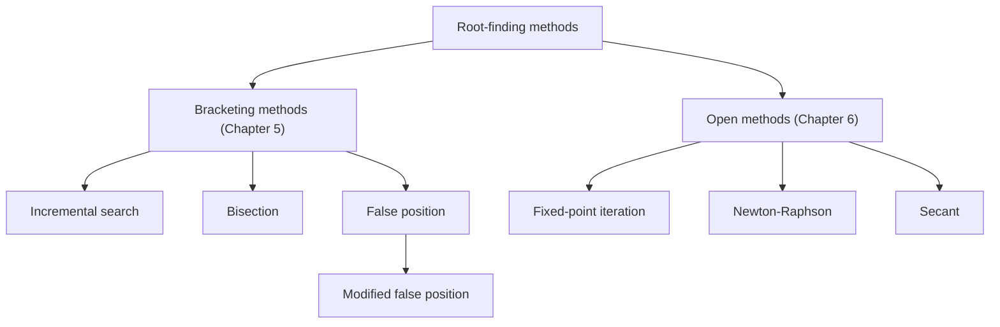
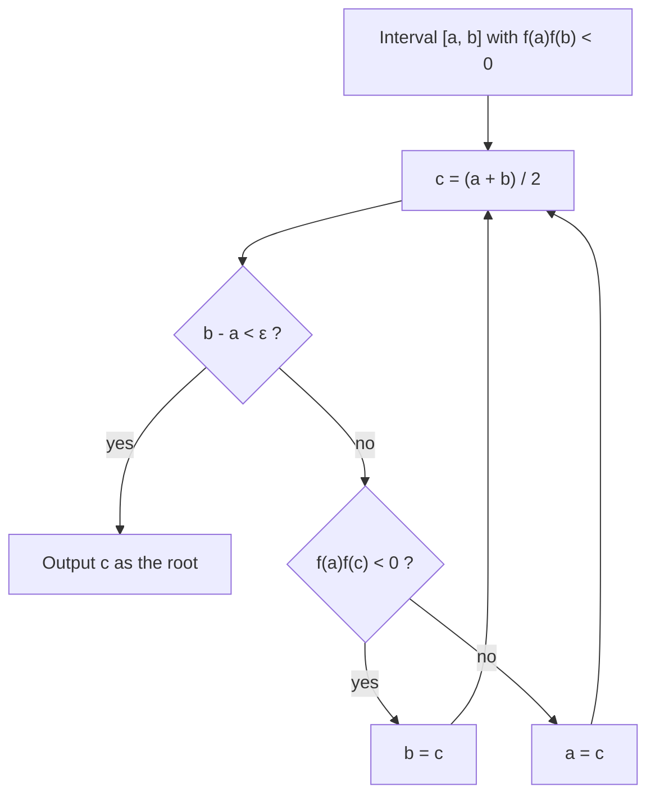

# Chapter 5 — Roots: Bracketing Methods

[Repository Guide](../../README.md) | [English](Concepts_Lecture.md) | [한국어](Concepts_Lecture.ko.md)

> **Last Updated:** 2026-10-18
>
> Applied Numerical Methods with Python for Engineers and Scientists, Chapra and Clough, Ch 5

> **Learning Objectives:**
> 1. Apply the bisection method to root finding
> 2. Implement the false position method
> 3. Analyze convergence rates of bracketing methods

---

## Table of Contents

- [1. Motivation: The Quadratic Formula](#1-motivation-the-quadratic-formula)
- [2. What Are Roots Problems?](#2-what-are-roots-problems)
- [3. Graphical Methods](#3-graphical-methods)
  - [3.1 Savings Account Example](#31-savings-account-example)
  - [3.2 Graphical Root Estimation](#32-graphical-root-estimation)
- [4. Bracketing vs. Open Methods](#4-bracketing-vs-open-methods)
  - [4.1 Bracketing Methods](#41-bracketing-methods)
  - [4.2 Open Methods](#42-open-methods)
- [5. Incremental Search](#5-incremental-search)
  - [5.1 Sign-Change Principle](#51-sign-change-principle)
  - [5.2 Algorithm and Drawbacks](#52-algorithm-and-drawbacks)
- [6. Bisection Method (Half-Interval Method)](#6-bisection-method-half-interval-method)
  - [6.1 Algorithm](#61-algorithm)
  - [6.2 Step-by-Step Procedure](#62-step-by-step-procedure)
- [7. Convergence of the Bisection Method](#7-convergence-of-the-bisection-method)
  - [7.1 Error Bound Derivation](#71-error-bound-derivation)
  - [7.2 A Priori Error Estimation](#72-a-priori-error-estimation)
  - [7.3 Required Number of Iterations](#73-required-number-of-iterations)
- [8. False Position Method (Regula Falsi)](#8-false-position-method-regula-falsi)
  - [8.1 Derivation of the Formula](#81-derivation-of-the-formula)
  - [8.2 Convergence Properties](#82-convergence-properties)
  - [8.3 One-Sidedness Problem](#83-one-sidedness-problem)
- [9. Modified False Position Method](#9-modified-false-position-method)
  - [9.1 Introducing Scaling Parameters](#91-introducing-scaling-parameters)
  - [9.2 Two Consecutive Points on Same Side](#92-two-consecutive-points-on-same-side)
- [10. Summary Table](#10-summary-table)
- [Summary](#summary)
- [Self-Check Questions](#self-check-questions)

---

<br>

## 1. Motivation: The Quadratic Formula

Consider a quadratic equation.

```math
f(x) = ax^2 + bx + c = 0
```

We can derive its roots analytically by completing the square.

> **Note:** **Completing the square.** Completing the square is a fundamental algebraic technique that transforms a quadratic into vertex form, providing a direct path to the quadratic formula.

**Step 1.** Factor out $`a`$.

```math
a\left(x^2 + \frac{b}{a}x\right) + c = 0
```

**Step 2.** Complete the square.

```math
a\left(x + \frac{b}{2a}\right)^2 - \frac{b^2}{4a} + c = 0
```

**Step 3.** Solve for $`x`$ (assuming $`a \neq 0`$).

```math
\left(x + \frac{b}{2a}\right)^2 = \frac{b^2 - 4ac}{4a^2}
```

```math
x = \frac{-b \pm \sqrt{b^2 - 4ac}}{2a}
```

The roots are the values of $`x`$ where $`f(x) = 0`$. Geometrically, the roots are the points where the curve **crosses the x-axis**.

However, for higher-degree polynomials and transcendental equations, **no closed-form formula** generally exists. We need **numerical methods** to find roots.

- **Chapter 5:** Bracketing methods guarantee convergence but are slower.
- **Chapter 6:** Open methods may diverge but are faster.

---

<br>

## 2. What Are Roots Problems?

A roots problem occurs when some function $`f`$ can be written in terms of one or more dependent variables $`x`$, where the solutions to $`f(x) = 0`$ yield the solution to the problem.

These problems often occur when a **design problem** presents an **implicit equation** for a required parameter.

> **[Calculus]** The Intermediate Value Theorem (IVT) is the theoretical foundation for all bracketing methods: if $`f`$ is continuous on $`[a, b]`$ and $`f(a) \cdot f(b) < 0`$, then there exists at least one $`x^* \in (a, b)`$ such that $`f(x^*) = 0`$.

---

<br>

## 3. Graphical Methods

### 3.1 Savings Account Example

**Problem Setup:** Shin saves money by making regular monthly deposits of $`p`$ to his account. The annual interest rate is $`r`$. The total amount $`A`$ after $`n`$ payments is as follows.

```math
A = p\left(1 + \frac{r}{12}\right) + p\left(1 + \frac{r}{12}\right)^2 + \cdots + p\left(1 + \frac{r}{12}\right)^n
```

> **[Calculus]** This is a geometric series with first term $`p(1 + r/12)`$ and common ratio $`(1 + r/12)`$.

Applying the geometric series formula gives the following.

```math
A = \sum_{i=1}^{n} p\left(1 + \frac{r}{12}\right)^i = p \cdot \frac{\left(1 + \frac{r}{12}\right)^n - 1}{\left(1 + \frac{r}{12}\right) - 1} = \frac{12p}{r}\left[\left(1 + \frac{r}{12}\right)^n - 1\right]
```

**Root-Finding Formulation:** Suppose $`A`$ is the target amount. Shin wants to have $`A`$ within $`n`$ months. What is the interest rate $`r`$ to achieve this goal?

```math
\text{Find } r: \quad f(r) = \frac{12p}{r}\left[\left(1 + \frac{r}{12}\right)^n - 1\right] - A = 0
```

This equation **cannot be solved analytically** for $`r`$, so it is a root-finding problem.

### 3.2 Graphical Root Estimation

We can use the graphical approach to estimate the root by plotting $`g(x) = f(r)`$ and visually identifying where the curve crosses the x-axis ($`g(x) = 0`$).

```python
# ex
def func(interest, duration, deposit, target):
    ratio = 1. + interest / 12.
    return 12.0 * deposit / interest * (ratio**duration - 1.0) - target

from functools import partial

duration = 24
deposit = 60.
target = 1500.
g = partial(func, duration=duration, deposit=deposit, target=target)
```

Plotting over progressively narrower intervals gives the following.

| Zoom Level | Interest Range | Observation |
|:---:|:---:|:---|
| 1st | 1%-10% | Root is near 4% |
| 2nd | 4.0%-5.0% | Root is near 4.2% |
| 3rd | 4.20%-4.30% | Root is approximately **4.24%** |

*Table 1. Graphical observations at each zoom level*

Computed precisely with the bisection method, the root of this example is $`r \approx 0.042361`$ (about $`4.236\%`$).

> **Note:** **Role of graphical methods.** Graphical methods provide a rough initial estimate but are imprecise. They are typically used as a starting point for more systematic numerical methods.

---

<br>

## 4. Bracketing vs. Open Methods

Root-finding methods are classified into two families.



*Figure 1. Classification of root-finding methods*

### 4.1 Bracketing Methods

- They start from **two initial guesses** that **bracket** (enclose) the root.
- The root lies within the interval $`[x_l, x_u]`$.
- They are **guaranteed to converge** to a solution.
- Their convergence rate is slower.

### 4.2 Open Methods

- They can involve **one or more initial guesses**, but there is **no bracket**.
- They **can diverge** (convergence is not guaranteed).
- Their convergence rate is **faster** when they do converge.

> **Note:** **Hybrid strategy.** The trade-off between guaranteed convergence and speed is a recurring theme in numerical analysis. In practice, a hybrid strategy often starts with a bracketing method to get close, then switches to an open method for rapid refinement.

---

<br>

## 5. Incremental Search

### 5.1 Sign-Change Principle

If $`f`$ is **real and continuous** in the interval from $`x_l`$ to $`x_u`$, and $`f`$ changes sign on opposite sides of the root, then the following holds.

```math
f(x_l) \cdot f(x_u) < 0
```

This means a root exists somewhere between $`x_l`$ (lower bound) and $`x_u`$ (upper bound).

> **[Calculus]** This is a direct application of the Intermediate Value Theorem. For this conclusion to hold, $`f`$ must be continuous on $`[x_l, x_u]`$. For example, $`f(x) = 1/x`$ has opposite signs at the ends of $`[-1, 1]`$ but no root, because it is discontinuous at $`x = 0`$.

### 5.2 Algorithm and Drawbacks

**Algorithm:**

1. Divide the interval $`[x_l, x_u]`$ into smaller subintervals.
2. Go through the subintervals one by one, checking whether a root exists within each with the sign-change test $`f(x_i) \cdot f(x_{i+1}) < 0`$.
3. If a sign change is detected, the root is in that subinterval.

**Drawback:** It is **sensitive to the increment length** (step size).

- If the step size is **too large**, root brackets may be **missed** because an even number of roots could fall between two consecutive points.
- If the step size is **too small**, the method becomes **computationally expensive**.

> **Note:** **Closely spaced roots.** A function like $`\sin(x^2)`$ can have many closely spaced roots. If the increment is larger than the spacing between adjacent roots, pairs of roots may be missed entirely because the function returns to the same sign.

---

<br>

## 6. Bisection Method (Half-Interval Method)

The bisection method is the simplest bracketing method. It systematically halves the search interval at each iteration.

### 6.1 Algorithm

**The idea:**

1. Split the search space in half at each iteration by choosing the **midpoint** of the interval.
2. Determine which of the two halves contains the root.
3. Repeat steps 1 and 2 until the search interval is smaller than a tolerance $`\varepsilon`$.

### 6.2 Step-by-Step Procedure

**Step 0 (Initialization):** Start with an interval $`[x_l, x_u]`$ such that $`f(x_l) \cdot f(x_u) < 0`$.

Set $`a_0 = x_l`$, $`b_0 = x_u`$.

Compute the midpoint.

```math
c_0 = \frac{x_l + x_u}{2} = \frac{a_0 + b_0}{2}
```

**Step 1 (Determine which half):** Check the sign changes.

- If $`f(a_0) \cdot f(c_0) < 0`$, the root is in the **left** interval $`[a_0, c_0]`$.
  - Set $`a_1 = a_0`$, $`b_1 = c_0`$.
- If $`f(c_0) \cdot f(b_0) < 0`$, the root is in the **right** interval $`[c_0, b_0]`$.
  - Set $`a_1 = c_0`$, $`b_1 = b_0`$.
- If $`f(c_0) = 0`$, then $`c_0`$ is the root and the iteration stops.

**Step 2 (Convergence check):** If $`(b_1 - a_1) < \varepsilon`$, the output is:

```math
x^* \approx \frac{a_1 + b_1}{2}
```

Otherwise, continue the search with the interval $`[a_1, b_1]`$.

**General iteration:** At iteration $`n`$, compute the following.

```math
c_n = \frac{a_n + b_n}{2}
```

Then update the interval based on the sign-change test and repeat.



*Figure 2. Iteration procedure of the bisection method*

```python
def bisection(f, a, b, tol=1e-6, max_iter=100):
    """
    Bisection method for finding a root of f in [a, b].
    Assumes f(a) * f(b) < 0.
    """
    if f(a) * f(b) >= 0:
        raise ValueError("f(a) and f(b) must have opposite signs")

    for n in range(max_iter):
        c = (a + b) / 2.0
        if (b - a) < tol:
            return c, n
        if f(a) * f(c) < 0:
            b = c
        else:
            a = c
    return (a + b) / 2.0, max_iter
```

> **Note:** The code above does not handle the case where `f(c)` is exactly 0. In that case `f(a) * f(c) < 0` is false, so `a = c`, and in later iterations the same test stays false because `f(a) = 0`, which pushes `a` toward the right end. For example, `bisection(lambda x: x, -1, 1)` returns about `0.9999995` even though the first midpoint 0 is the root. Adding a check that returns `c` immediately when `f(c) == 0` inside the loop avoids this problem.

---

<br>

## 7. Convergence of the Bisection Method

### 7.1 Error Bound Derivation

At each iteration, the error (distance between the true root $`x^*`$ and the midpoint estimate $`c_n`$) is bounded by half the current interval length.

**After the 1st iteration:**

```math
\text{err}_1 = |x^* - c_0| \leq \frac{1}{2}(b_0 - a_0)
```

**After the 2nd iteration:**

```math
\text{err}_2 = |x^* - c_1| \leq \frac{1}{2}(b_1 - a_1)
```

**After the 3rd iteration:**

```math
\text{err}_3 = |x^* - c_2| \leq \frac{1}{2}(b_2 - a_2)
```

**After the 4th iteration:**

```math
\text{err}_4 = |x^* - c_3| \leq \frac{1}{2}(b_3 - a_3)
```

Since each interval is half the previous one, the following holds.

```math
\frac{1}{2}(b_3 - a_3) = \frac{1}{2^2}(b_2 - a_2) = \frac{1}{2^3}(b_1 - a_1) = \frac{1}{2^4}(b_0 - a_0)
```

### 7.2 A Priori Error Estimation

After $`n`$ iterations, the error is bounded above as follows.

```math
\boxed{\text{err}_n = |x^* - c_{n-1}| \leq \frac{\Delta x}{2^n}}
```

where $`\Delta x = b_0 - a_0`$ is the **initial interval width**.

> **Note:** **A priori error estimation.** This is called an a priori error estimation because we can predict the maximum error *before* running the algorithm, based solely on the initial interval and the number of iterations.

**Practical examples:**
- After **10 iterations**, the original interval uncertainty is reduced by $`2^{10} = 1024`$ (about 3 decimal digits of accuracy).
- After **20 iterations**, it is reduced by $`2^{20} \approx 10^6`$, giving about 6 decimal digits. This is roughly a million-fold improvement.

> **Note:** **Linear convergence.** The convergence of bisection is **linear**: each iteration adds roughly one bit of accuracy. This is in contrast to higher-order methods (e.g., the Newton-Raphson method in Chapter 6) that converge quadratically.

### 7.3 Required Number of Iterations

**Question:** How many iterations are needed to meet a given error tolerance $`\varepsilon_s`$?

We need the following.

```math
\text{err}_n \leq \frac{\Delta x}{2^n} < \varepsilon_s
```

Rearranging gives the following.

```math
2^n > \frac{\Delta x}{\varepsilon_s}
```

Taking $`\log_2`$ of both sides gives the following.

```math
\boxed{n > \log_2\left(\frac{\Delta x}{\varepsilon_s}\right)}
```

**Example:** If $`\Delta x = 1`$ and $`\varepsilon_s = 10^{-5}`$:

```math
n > \log_2\left(\frac{1}{10^{-5}}\right) = \log_2(10^5) \approx 16.6
```

Therefore, **17 iterations** will guarantee the tolerance.

```python
import math

def bisection_iterations_needed(delta_x, tolerance):
    """Calculate minimum number of bisection iterations needed."""
    return math.ceil(math.log2(delta_x / tolerance))

# Example
n = bisection_iterations_needed(1.0, 1e-5)
print(f"Iterations needed: {n}")  # Output: 17
```

---

<br>

## 8. False Position Method (Regula Falsi)

### 8.1 Derivation of the Formula

The False Position (FP) method is similar to the bisection method, but instead of the **midpoint**, it proposes a new estimate of the root using **linear interpolation**.

It takes as the new estimate the point $`c`$ where a straight line between $`(x_l, f(x_l))`$ and $`(x_u, f(x_u))`$ crosses the x-axis.

> **Note:** **Secant line and linear interpolation.** The method constructs the equation of a line (secant line) passing through two points and finds its x-intercept. This is the simplest form of polynomial interpolation (Chapter 17).

**Derivation:** The line through $`(a, f(a))`$ and $`(b, f(b))`$ is:

```math
y - f(b) = \frac{f(b) - f(a)}{b - a}(x - b)
```

To find the x-intercept, set $`y = 0`$.

```math
-f(b) \cdot \frac{b - a}{f(b) - f(a)} = x - b
```

```math
x = b + \frac{-b \cdot f(b) + a \cdot f(b)}{f(b) - f(a)}
```

```math
x = \frac{a \cdot f(b) - b \cdot f(a)}{f(b) - f(a)}
```

Therefore, the **False Position formula** at iteration $`n`$ is:

```math
\boxed{c_n = \frac{a_n \cdot f(b_n) - b_n \cdot f(a_n)}{f(b_n) - f(a_n)}}
```

The algorithm then proceeds like bisection: check which subinterval $`[a_n, c_n]`$ or $`[c_n, b_n]`$ contains the root, update the interval, and repeat until $`|f(c_n)| < \varepsilon`$.

```python
def false_position(f, a, b, tol=1e-6, max_iter=100):
    """
    False Position (Regula Falsi) method.
    Assumes f(a) * f(b) < 0.
    """
    if f(a) * f(b) >= 0:
        raise ValueError("f(a) and f(b) must have opposite signs")

    for n in range(max_iter):
        fa, fb = f(a), f(b)
        c = (a * fb - b * fa) / (fb - fa)
        fc = f(c)

        if abs(fc) < tol:
            return c, n

        if fa * fc < 0:
            b = c
        else:
            a = c
    return c, max_iter
```

### 8.2 Convergence Properties

- False position **may or may not** converge more quickly than bisection.
- It **does not** guarantee meeting a criterion within a given number of iterations.
- Unlike bisection's a priori bound, we **cannot predict the error** from the number of iterations.

> **Note:** **No simple error formula.** Unlike bisection, false position has no simple formula such as $`\text{err}_n \leq \Delta x / 2^n`$. The convergence rate depends heavily on the shape (curvature) of $`f`$ near the root.

### 8.3 One-Sidedness Problem

A key weakness of the false position method is the **one-sidedness problem**: one of the bracket points remains **stationary** and does not move. This causes the false position method to exhibit **poor convergence**.

**Example:** Consider finding the root $`x = 0`$ of $`f(x) = 2x^3 - 4x^2 + 3x`$ on $`[-1, 1]`$.

When the function has significant curvature, one endpoint gets stuck while the other slowly approaches the root from one side. The interval does not shrink symmetrically. In this example, the first estimate is $`c = 0.8`$ with $`f(0.8) = 0.864 > 0`$, so $`b`$ is updated; afterward $`a = -1`$ never moves and only $`b`$ shrinks through $`0.642, 0.507, 0.391, \ldots`$. The `false_position(f, -1, 1)` call above meets $`|f(c)| < 10^{-6}`$ only at iteration index `n = 39` (the 40th estimate).

---

<br>

## 9. Modified False Position Method

### 9.1 Introducing Scaling Parameters

To guarantee that the length of the interval containing a root tends to zero, the Regula Falsi method can be **modified** by introducing scaling parameters $`\alpha`$ and $`\beta`$. Their default values are $`\alpha = \beta = 1`$, and the result of the formula depends only on the ratio of $`\alpha`$ to $`\beta`$.

**Original formula:**

```math
c_n = \frac{a_n \cdot f(b_n) - b_n \cdot f(a_n)}{f(b_n) - f(a_n)}
```

**Modified formula:**

```math
c_n = \frac{a_n \cdot \beta \cdot f(b_n) - b_n \cdot \alpha \cdot f(a_n)}{\beta \cdot f(b_n) - \alpha \cdot f(a_n)}
```

### 9.2 Two Consecutive Points on Same Side

The modification is applied when **two consecutive estimates** $`c_0`$ and $`c_1`$ appear on the **same side** of the root (i.e., $`f(c_0) \cdot f(c_1) > 0`$).

**Case 1: Two consecutive points to the right of the root** (i.e., $`f(c_0) \cdot f(c_1) > 0`$ and the stationary endpoint is $`a_n`$):

Set $`\alpha = \frac{1}{2}`$, which halves the function value at the **stationary** endpoint.

```math
c = \frac{a \cdot f(b) - b \cdot \frac{1}{2} f(a)}{f(b) - \frac{1}{2} f(a)}
```

By reducing $`f(a)`$ by half, the secant line tilts, moving the next estimate closer to the stationary side and thus closer to the actual root.

**Case 2: Two consecutive points to the left of the root** (stationary endpoint is $`b_n`$):

Set $`\beta = \frac{1}{2}`$, which halves the function value at the stationary endpoint.

```math
c = \frac{a \cdot \frac{1}{2} f(b) - b \cdot f(a)}{\frac{1}{2} f(b) - f(a)}
```

> **Note:** **The Illinois algorithm.** The modified false position method guarantees that the interval width shrinks to zero, overcoming the one-sidedness problem of standard Regula Falsi. The Illinois algorithm is a well-known variant that uses this halving strategy.

```python
def modified_false_position(f, a, b, tol=1e-6, max_iter=100):
    """
    Modified False Position method (Illinois algorithm variant).
    Halves the function value at the stationary endpoint when
    two consecutive estimates appear on the same side.
    """
    if f(a) * f(b) >= 0:
        raise ValueError("f(a) and f(b) must have opposite signs")

    fa, fb = f(a), f(b)
    side = 0  # Track which side was updated last

    for n in range(max_iter):
        c = (a * fb - b * fa) / (fb - fa)
        fc = f(c)

        if abs(fc) < tol:
            return c, n

        if fa * fc < 0:
            # Root is in [a, c]
            if side == -1:
                # Two consecutive on the right side: halve f(a)
                fa *= 0.5
            b = c
            fb = fc
            side = -1
        else:
            # Root is in [c, b]
            if side == 1:
                # Two consecutive on the left side: halve f(b)
                fb *= 0.5
            a = c
            fa = fc
            side = 1

    return c, max_iter
```

Applied to the example of Section 8.3, $`f(x) = 2x^3 - 4x^2 + 3x`$ on $`[-1, 1]`$, this function meets $`|f(c)| < 10^{-6}`$ at iteration index `n = 9`, converging much faster than standard false position (`n = 39`).

---

<br>

## 10. Summary Table

| Property | Incremental Search | Bisection | False Position | Modified False Position |
|:---|:---:|:---:|:---:|:---:|
| **Type** | Bracketing | Bracketing | Bracketing | Bracketing |
| **Initial Requirement** | Interval $`[x_l, x_u]`$ | $`f(x_l) \cdot f(x_u) < 0`$ | $`f(x_l) \cdot f(x_u) < 0`$ | $`f(x_l) \cdot f(x_u) < 0`$ |
| **Estimate Formula** | Uniform step | $`c = \frac{a + b}{2}`$ | $`c = \frac{a f(b) - b f(a)}{f(b) - f(a)}`$ | Scaled version of FP |
| **Convergence Guarantee** | Depends on step size | Always (if continuous) | Always (if continuous) | Always (if continuous) |
| **A Priori Error Bound** | None | $`\frac{\Delta x}{2^n}`$ | None | None |
| **Iterations for Tolerance** | Unknown | $`n > \log_2(\Delta x / \varepsilon_s)`$ | Unpredictable | Unpredictable |
| **One-Sidedness Issue** | N/A | No | Yes | No (corrected) |
| **Convergence Rate** | N/A | Linear | Varies (can stall) | Generally better than FP |
| **Key Advantage** | Simple to implement | Predictable, robust | Often faster than bisection | Fixes FP stalling |
| **Key Disadvantage** | Sensitive to step size | Slow (linear convergence) | Can stall (one-sided) | Slightly more complex |

*Table 2. Comparison of the four bracketing methods*

---

<br>

## Summary

| Concept | Key Summary |
|:-----|:-----|
| Roots Problem | It is the problem of finding numerically the solution of an equation $`f(x) = 0`$ that has no closed-form solution. |
| Graphical Method | It plots the function and locates the x-axis crossing by eye to obtain a rough initial estimate. |
| Intermediate Value Theorem | If $`f`$ is continuous on $`[a, b]`$ and $`f(a) \cdot f(b) < 0`$, there is at least one root in $`(a, b)`$. |
| Incremental Search | It splits the interval into small subintervals to find sign changes, and a large step size can miss pairs of roots. |
| Bisection | It halves the interval at each iteration and converges linearly with an error guaranteed to be at most $`\Delta x / 2^n`$ after $`n`$ iterations. |
| Required Iterations | Guaranteeing a tolerance $`\varepsilon_s`$ takes $`n > \log_2(\Delta x / \varepsilon_s)`$ iterations. |
| False Position | It uses the x-intercept of the line through the two endpoints as the new estimate and can slow down because of the one-sidedness problem. |
| Modified False Position | It halves the function value at the stationary endpoint when two consecutive estimates fall on the same side, which fixes the one-sidedness problem. |

---

<br>

## Self-Check Questions

1. **Tracing bisection:** Applying bisection to $`f(x) = x^2 - 3`$ on $`[1, 2]`$, give the first three midpoints $`c_0, c_1, c_2`$ and the interval after each step.

   <details>
   <summary>Answer</summary>

   $`f(1) = -2`$ and $`f(2) = 1`$. At $`c_0 = 1.5`$, $`f(1.5) = -0.75 < 0`$, so the interval becomes $`[1.5, 2]`$. At $`c_1 = 1.75`$, $`f(1.75) = 0.0625 > 0`$, so the interval becomes $`[1.5, 1.75]`$. At $`c_2 = 1.625`$, $`f(1.625) = -0.359375 < 0`$, so the interval becomes $`[1.625, 1.75]`$. The true root $`\sqrt{3} \approx 1.7321`$ lies in this interval.

   </details>

2. **Number of iterations:** With an initial interval width $`\Delta x = 2`$, how many bisection iterations are needed to guarantee a tolerance $`\varepsilon_s = 10^{-4}`$?

   <details>
   <summary>Answer</summary>

   $`n > \log_2(2 / 10^{-4}) = \log_2(20000) \approx 14.29`$, so 15 iterations are needed.

   </details>

3. **One step of false position:** Apply one step of false position to $`f(x) = x^2 - 3`$ on $`[1, 2]`$, find $`c`$ and the next interval, and compare the error with the first bisection midpoint.

   <details>
   <summary>Answer</summary>

   $`c = \frac{1 \cdot f(2) - 2 \cdot f(1)}{f(2) - f(1)} = \frac{1 + 4}{3} = 5/3 \approx 1.6667`$. Since $`f(5/3) = 25/9 - 3 \approx -0.2222 < 0`$, the next interval is $`[5/3, 2]`$. The error is $`\sqrt{3} - 1.6667 \approx 0.0654`$, smaller than the error $`0.2321`$ of the first bisection midpoint $`1.5`$.

   </details>

4. **Continuity condition:** Explain what happens when bisection is applied to $`f(x) = 1/x`$ on $`[-1, 2]`$.

   <details>
   <summary>Answer</summary>

   Since $`f(-1) = -1`$ and $`f(2) = 0.5`$ have opposite signs, bisection starts, but $`f`$ is discontinuous at $`x = 0`$, so the Intermediate Value Theorem does not apply and there is in fact no root. The interval keeps shrinking toward the discontinuity $`x = 0`$, and the `bisection` function of Section 6.2 returns about $`1.2 \times 10^{-7}`$. The value of $`f`$ there is about $`8.4 \times 10^6`$, so this point is not a root. We must therefore check that the function is continuous on the interval before using a bracketing method.

   </details>

5. **One-sidedness and its fix:** Explain why one endpoint stays fixed in false position and how the modified false position method fixes this.

   <details>
   <summary>Answer</summary>

   If the function bends to one side near the root (convex or concave), the x-intercept of the secant always falls on the same side of the root, so the same endpoint is updated every time and the opposite endpoint stays fixed. The modified false position method halves the function value at the fixed endpoint when two consecutive estimates fall on the same side. The secant then tilts so that the next estimate can cross to the other side of the root, both endpoints move, and the interval width shrinks to zero.

   </details>
