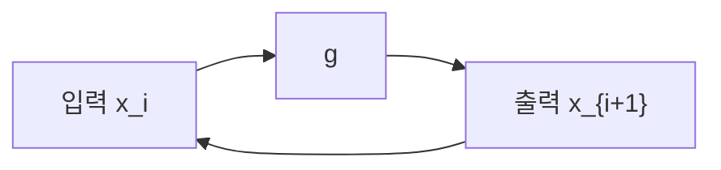
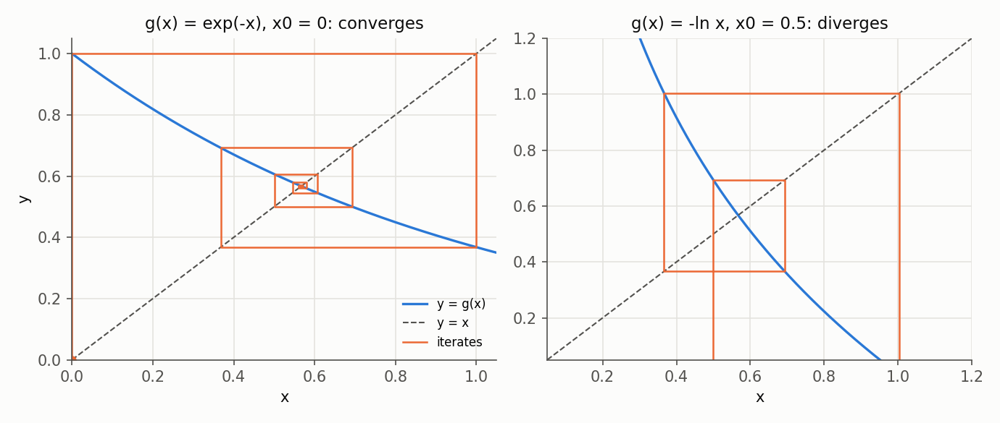
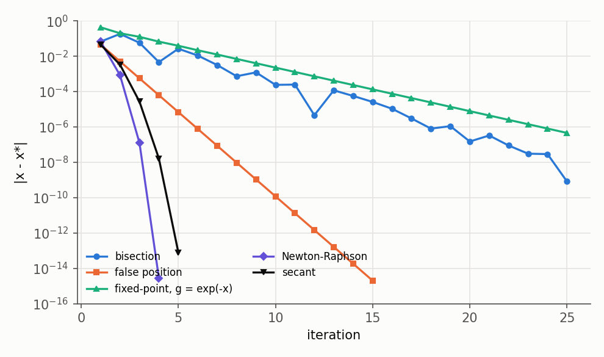
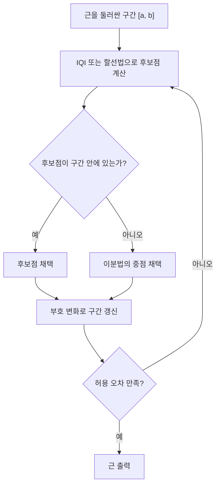

# 6장 — 근: 개방법

[레포지토리 안내](../../README.ko.md) | [English](Concepts_Lecture.md) | [한국어](Concepts_Lecture.ko.md)

> **최종 수정일:** 2026-11-19
>
> Applied Numerical Methods with Python for Engineers and Scientists, Chapra and Clough, Ch 6

> **학습 목표:**
> 1. 근 찾기에 뉴턴-랩슨법을 적용할 수 있다
> 2. 할선법과 수정 할선법을 구현할 수 있다
> 3. 개방법과 구간법의 수렴을 비교할 수 있다

---

## 목차

- [1. 목표](#1-목표)
- [2. 개방법 vs 구간법](#2-개방법-vs-구간법)
- [3. 고정점 반복(Fixed-Point Iteration)](#3-고정점-반복fixed-point-iteration)
  - [3.1 개념과 정의](#31-개념과-정의)
  - [3.2 알고리즘](#32-알고리즘)
  - [3.3 고정점과 근의 관계](#33-고정점과-근의-관계)
  - [3.4 수렴 분석](#34-수렴-분석)
  - [3.5 평균값 정리를 통한 수렴 증명](#35-평균값-정리를-통한-수렴-증명)
  - [3.6 예제 6.1: 수렴하는 경우](#36-예제-61-수렴하는-경우)
  - [3.7 예제 6.1: 발산하는 경우](#37-예제-61-발산하는-경우)
  - [3.8 예제 6.1: 순환하는 경우](#38-예제-61-순환하는-경우)
  - [3.9 고정점 반복의 그래프 해석](#39-고정점-반복의-그래프-해석)
  - [3.10 수렴 속도와 오차 추정](#310-수렴-속도와-오차-추정)
- [4. Wegstein 방법](#4-wegstein-방법)
  - [4.1 가위치법에서의 동기](#41-가위치법에서의-동기)
  - [4.2 기하학적 아이디어](#42-기하학적-아이디어)
  - [4.3 유도](#43-유도)
  - [4.4 일반 공식](#44-일반-공식)
- [5. 뉴턴-랩슨법(Newton-Raphson Method)](#5-뉴턴-랩슨법newton-raphson-method)
  - [5.1 기하학적 유도](#51-기하학적-유도)
  - [5.2 2단계 접근법](#52-2단계-접근법)
  - [5.3 테일러 전개로부터의 유도](#53-테일러-전개로부터의-유도)
  - [5.4 이차 수렴(Quadratic Convergence)](#54-이차-수렴quadratic-convergence)
  - [5.5 이차 수렴 증명](#55-이차-수렴-증명)
  - [5.6 예제 6.5: 느리게 수렴하는 함수](#56-예제-65-느리게-수렴하는-함수)
  - [5.7 이차 수렴의 수치 확인](#57-이차-수렴의-수치-확인)
  - [5.8 뉴턴-랩슨법이 실패하는 경우](#58-뉴턴-랩슨법이-실패하는-경우)
  - [5.9 중근에서의 수렴 저하](#59-중근에서의-수렴-저하)
  - [5.10 연립 비선형 방정식의 뉴턴-랩슨법](#510-연립-비선형-방정식의-뉴턴-랩슨법)
- [6. 할선법(Secant Method)](#6-할선법secant-method)
  - [6.1 표준 할선법](#61-표준-할선법)
  - [6.2 수정 할선법(Modified Secant Method)](#62-수정-할선법modified-secant-method)
  - [6.3 할선법의 수렴 차수](#63-할선법의-수렴-차수)
  - [6.4 개방법과 구간법의 수렴 비교](#64-개방법과-구간법의-수렴-비교)
- [7. 역 이차 보간(Inverse Quadratic Interpolation)](#7-역-이차-보간inverse-quadratic-interpolation)
  - [7.1 개념](#71-개념)
  - [7.2 라그랑주 다항식 공식화](#72-라그랑주-다항식-공식화)
  - [7.3 할선법과의 비교](#73-할선법과의-비교)
- [8. 브렌트 방법(Brent's Method)](#8-브렌트-방법brents-method)
  - [8.1 개요](#81-개요)
  - [8.2 SciPy를 이용한 Python 구현](#82-scipy를-이용한-python-구현)
  - [8.3 브렌트 방법의 단계](#83-브렌트-방법의-단계)
  - [8.4 SciPy의 근 찾기 함수 비교](#84-scipy의-근-찾기-함수-비교)
- [9. 요약 표](#9-요약-표)
- [10. 다항식의 근](#10-다항식의-근)
- [요약](#요약)
- [점검 문제](#점검-문제)
- [참고 문헌](#참고-문헌)

---

<br>

## 1. 목표

- **고정점 반복(Fixed-point iteration)** 을 이해한다.
- **Wegstein 방법**을 구현한다.
- 이차 수렴하는 **뉴턴-랩슨법(Newton-Raphson method)** 을 이해한다.
- **할선법(Secant method)** 을 이해한다.
- **브렌트 방법(Brent's method)** 을 이해한다.

> **참고:** **5장과의 연결.** 이 장은 이분법과 가위치법을 다룬 5장(근: 구간법)에 이어진다. 5장에서 다룬 구간, 허용 오차, 반복 수렴의 개념이 여기서 직접 확장된다.

---

<br>

## 2. 개방법 vs 구간법

**구간법**(이분법, 가위치법)과 달리 개방법은 근을 둘러싸는 두 개의 초기 추정값을 **필요로 하지 않는다**. 주요 특징은 다음과 같다.

| 속성 | 구간법(Bracketing Methods) | 개방법(Open Methods) |
|---|---|---|
| 초기 추정값 | $`f(x_l) \cdot f(x_u) < 0`$인 두 점 $`x_l, x_u`$ | 하나 또는 두 개의 초기 추정값 (부호 변화 요구 없음) |
| 수렴 보장 | 항상 수렴 (보장됨) | **발산**하거나 근에서 멀어질 수 있음 |
| 속도 | 느림 (선형 수렴) | 수렴할 때 **더 빠른** 수렴 |
| 구간 동작 | 매 반복마다 구간이 축소 | 단일 점(들)이 근을 향해 반복 |

*표 1. 구간법과 개방법의 비교*

> **핵심:** 개방법은 수렴 보장을 속도와 맞바꾼다. 수렴하면 구간법보다 훨씬 빠르게 근에 다가간다.

---

<br>

## 3. 고정점 반복(Fixed-Point Iteration)

### 3.1 개념과 정의

다른 이름은 다음과 같다.
- **단순 1점 반복법(Simple one-point iteration)**
- **연속 대입법(Method of successive substitutions)**

$`f: [a, b] \to \mathbb{R}`$인 방정식 $`f(x) = 0`$이 주어지면 이를 다음 형태로 재배열한다.

```math
f(x) = x - g(x) = 0 \quad \Longrightarrow \quad x = g(x)
```

반복 $`x_{i+1} = g(x_i)`$를 **고정점 반복**이라 한다.

> **용어 정의:** 함수 $`g`$의 **고정점(fixed point)** 은 다음을 만족하는 실수 $`x^*`$이다.
>
> ```math
> g(x^*) = x^*
> ```

> **참고:** **구간법과의 차이.** 구간법(5장)은 $`f(x) = 0`$을 직접 다루지만, 고정점 반복은 문제를 $`x = g(x)`$로 바꾸어 쓰며, 이는 $`y = g(x)`$와 $`y = x`$의 교점을 찾는 것으로 볼 수 있다.

### 3.2 알고리즘

근 $`x^* \in (a, b)`$를 찾는 절차는 다음과 같다.

1. 시작점 $`x_0 \in (a, b)`$를 고른다.
2. 다음 식으로 $`x_1, x_2, \ldots, x_{i+1}`$을 차례로 계산한다.

```math
x_{i+1} = g(x_i)
```

3. $`x_{i+1} \approx x_i`$가 될 때까지, 즉 수렴할 때까지 반복한다.

이것은 **순환 계산(circular calculation)** 이다. 한 단계의 출력 $`x_{i+1}`$이 다음 단계의 입력 $`x_i`$가 된다.



*그림 1. 고정점 반복의 순환 계산*

### 3.3 고정점과 근의 관계

$`g`$를 연속 함수라 하자. 수열 $`\{x_i : i \geq 0\}`$이 고정점 반복 $`x_{i+1} = g(x_i)`$로 생성된다고 하자.

$`\displaystyle\lim_{i \to \infty} x_i = x^*`$이면 $`x^*`$는 $`g`$의 고정점이다.

따라서 $`x^*`$는 $`f`$의 **근**이다.

```math
f(x^*) = x^* - g(x^*) = 0
```

### 3.4 수렴 분석

수렴은 고정점에서의 **$`g`$의 기울기**에 의존한다. 평균값 정리를 쓰면 다음을 얻는다.

```math
\text{err}_{i+1} = \text{err}_i \cdot |g'(\xi)|
```

여기서 $`\xi`$는 $`x_i`$와 $`x^*`$ 사이의 어떤 점이다.

**수렴 기준:**

| 조건 | 결과 |
|---|---|
| $`\vert g'(\xi)\vert < 1`$ | 반복이 **수렴**한다 |
| $`\vert g'(\xi)\vert > 1`$ | 반복이 **발산**한다 |
| $`\vert g'(\xi)\vert = 1`$ | 판정할 수 없다 (순환할 수 있음) |

*표 2. g의 기울기 크기에 따른 고정점 반복의 수렴 판정*

### 3.5 평균값 정리를 통한 수렴 증명

$`x^* \in (a, b)`$를 $`g`$의 고정점, $`x_i \in (a, b)`$라 하자.

**평균값 정리**에 의해 $`\xi_i \in (x_i, x^*)`$ 또는 $`(x^*, x_i)`$인 $`\xi_i`$가 존재하여 다음이 성립한다.

```math
g(x_i) - g(x^*) = g'(\xi_i)(x_i - x^*)
```

> **[미적분학]** 평균값 정리는 $`[a, b]`$에서 연속이고 $`(a, b)`$에서 미분 가능한 함수 $`g`$에 대해 $`g(b) - g(a) = g'(\xi)(b - a)`$인 $`\xi \in (a, b)`$가 존재한다는 정리이다. 고정점 반복의 수렴 분석은 이 정리로 두 점 사이의 함숫값 차이를 기울기 $`g'(\xi_i)`$와 거리의 곱으로 바꾸어, 오차가 매 반복 $`|g'(\xi_i)|`$배가 됨을 보인다. 따라서 이 분석은 $`g`$가 미분 가능하다는 가정 아래 성립한다.

$`x_i = g(x_{i-1})`$이고 $`x^* = g(x^*)`$이므로 다음을 얻는다.

```math
|x_i - x^*| = |g(x_{i-1}) - g(x^*)| = |g'(\xi_{i-1})| \cdot |x_{i-1} - x^*|
```

$`(a, b)`$의 모든 $`\xi`$에 대해 $`|g'(\xi)| \leq q < 1`$이면(반복값이 모두 $`(a, b)`$ 안에 머문다고 가정한다) 다음이 성립한다.

```math
|x_i - x^*| \leq q \cdot |x_{i-1} - x^*| \leq q^2 \cdot |x_{i-2} - x^*| \leq \cdots \leq q^i \cdot |x_0 - x^*|
```

$`q < 1`$이므로 $`i \to \infty`$일 때 $`q^i \to 0`$이 되어 다음을 얻는다.

```math
|x_i - x^*| \to 0
```

> **핵심:** 근과 반복값을 포함하는 구간에서 **축소 상수(contraction constant)** $`q = \max|g'(\xi)| < 1`$이면 고정점 반복은 수렴한다.

### 3.6 예제 6.1: 수렴하는 경우

**문제:** $`f(x) = x - e^{-x}`$의 근을 추정하라.

**설정:** $`f(x) = 0`$에서 다음과 같이 둔다.

```math
x = e^{-x} = g(x)
```

$`x_0 = 0`$으로 시작한다.

| 반복 | $`x_i`$ | $`g(x_i) = e^{-x_i}`$ |
|---|---|---|
| 0 | 0 | $`e^{0} = 1.0000`$ |
| 1 | 1.0000 | $`e^{-1} = 0.3679`$ |
| 2 | 0.3679 | $`e^{-0.3679} = 0.6922`$ |
| 3 | 0.6922 | $`\cdots`$ |
| $`\vdots`$ | $`\vdots`$ | $`x^* \approx 0.5671`$로 수렴 |

*표 3. 수렴하는 고정점 반복의 처음 몇 단계*

**수렴하는 이유:** $`g(x) = e^{-x}`$이므로 $`g'(x) = -e^{-x}`$이다. 근 $`x^* \approx 0.5671`$에서 $`|g'(x^*)| = e^{-0.5671} \approx 0.5671 < 1`$이다.

그래프로 보면 이것은 **나선형 수렴(spiral convergence)** 이다. $`g'(x^*) < 0`$이어서 반복값이 고정점의 양쪽을 번갈아 오가며, $`y = g(x) = e^{-x}`$와 $`y = x`$의 교점을 향해 안쪽으로 나선을 그린다.

```python
import numpy as np

def fixed_point_ex1(x0, tol=1e-6, max_iter=100):
    """Fixed-point iteration for f(x) = x - e^(-x)"""
    g = lambda x: np.exp(-x)
    x = x0
    for i in range(max_iter):
        x_new = g(x)
        if abs(x_new - x) < tol:
            print(f"Converged in {i+1} iterations: x* = {x_new:.6f}")
            return x_new
        x = x_new
    print("Did not converge")
    return x
```

`fixed_point_ex1(0)`을 실행하면 26번 반복 후 `x* = 0.567143`으로 수렴한다.

### 3.7 예제 6.1: 발산하는 경우

**문제:** $`f(x) = x + \ln x`$의 근을 추정하라.

**설정:** $`f(x) = 0`$에서 다음과 같이 둔다.

```math
x = -\ln(x) = g(x)
```

**결과:** 반복이 **발산**한다(나선이 바깥으로 향한다). 예를 들어 $`x_0 = 0.5`$에서 시작하면 $`0.693, 0.367, 1.004, -0.0037`$로 진폭이 커지다가 음수가 되어 로그를 계산할 수 없게 된다.

**발산하는 이유:** $`g(x) = -\ln(x)`$이므로 $`g'(x) = -1/x`$이다. 근 $`x^* \approx 0.5671`$에서 $`|g'(x^*)| = 1/0.5671 \approx 1.763 > 1`$이다.

> **참고:** **재배열의 선택.** 같은 근이라도 $`f(x) = 0`$을 어떻게 재배열하느냐에 따라 찾을 수도 있고 찾지 못할 수도 있다. $`g(x)`$의 선택이 수렴을 결정적으로 좌우한다.

### 3.8 예제 6.1: 순환하는 경우

$`x_0 = 4`$에서 $`g(x) = \dfrac{1}{x}`$를 생각한다.

| 반복 | $`x_i`$ | $`g(x_i) = 1/x_i`$ |
|---|---|---|
| 0 | 4 | $`1/4 = 0.25`$ |
| 1 | 0.25 | $`1/0.25 = 4`$ |
| 2 | 4 | $`1/4 = 0.25`$ |

*표 4. 두 점 사이를 순환하는 고정점 반복*

반복이 두 점 $`x_0`$과 $`x_1`$ 사이를 **무한히 순환**하며 고정점 $`x^* = 1`$에 수렴하지 않는다.

**이유:** $`g'(x) = -1/x^2`$이므로 $`|g'(1)| = 1`$이다(경계 경우).

### 3.9 고정점 반복의 그래프 해석

고정점 반복은 $`y = g(x)`$와 $`y = x`$의 그래프 위에서 계단이나 거미줄 모양의 경로로 나타낼 수 있다. $`x_i`$에서 수직으로 올라가 곡선 $`y = g(x)`$에 닿으면 그 높이가 $`x_{i+1} = g(x_i)`$이고, 수평으로 직선 $`y = x`$까지 가면 가로 좌표가 $`x_{i+1}`$이 된다. 이 과정을 되풀이한 경로가 두 그래프의 교점(고정점)으로 다가가면 수렴하고, 멀어지면 발산한다.



*그림 2. 수렴하는 고정점 반복과 발산하는 고정점 반복의 경로*

그림 2의 왼쪽은 3.6절의 $`g(x) = e^{-x}`$, 오른쪽은 3.7절의 $`g(x) = -\ln x`$이다. 두 곡선 모두 같은 고정점 $`x^* \approx 0.5671`$에서 $`y = x`$와 만나지만, 왼쪽은 교점 근처의 기울기 크기가 $`0.567 < 1`$이어서 경로가 안쪽으로 감기고, 오른쪽은 $`1.763 > 1`$이어서 바깥으로 풀린다. 경로의 모양은 $`g'(x^*)`$의 부호가 정한다.

| $`g'(x^*)`$의 범위 | 경로의 모양 | 결과 |
|:-----|:-----|:-----|
| $`0 < g'(x^*) < 1`$ | 계단 모양으로 한쪽에서 다가감 | 단조 수렴 |
| $`-1 < g'(x^*) < 0`$ | 거미줄 모양으로 양쪽을 오가며 다가감 | 진동 수렴 |
| $`g'(x^*) > 1`$ | 계단 모양으로 한쪽으로 멀어짐 | 단조 발산 |
| $`g'(x^*) < -1`$ | 거미줄 모양으로 양쪽을 오가며 멀어짐 | 진동 발산 |

*표 5. g의 기울기에 따른 고정점 반복 경로의 모양*

### 3.10 수렴 속도와 오차 추정

3.5절의 결과 $`|x_{i+1} - x^*| = |g'(\xi_i)| \cdot |x_i - x^*|`$에서 $`x_i \to x^*`$이면 $`\xi_i \to x^*`$이므로, 연속한 오차의 비는 $`|g'(x^*)|`$로 수렴한다. 따라서 $`0 < |g'(x^*)| < 1`$인 고정점 반복은 점근 오차 상수 $`C = |g'(x^*)|`$인 선형 수렴을 한다(5장 7.4절). 3.6절의 $`g(x) = e^{-x}`$에 $`x_0 = 0`$을 적용하면 다음 표를 얻는다.

| $`i`$ | $`x_i`$ | $`\vert x_i - x^* \vert`$ | 오차의 비 | $`\varepsilon_a`$ (%) |
|-----:|-----:|-----:|-----:|-----:|
| 1 | 1.000000 | $`4.329 \times 10^{-1}`$ | - | 100 |
| 2 | 0.367879 | $`1.993 \times 10^{-1}`$ | 0.4603 | 172 |
| 3 | 0.692201 | $`1.251 \times 10^{-1}`$ | 0.6276 | 46.9 |
| 4 | 0.500474 | $`6.667 \times 10^{-2}`$ | 0.5331 | 38.3 |
| 5 | 0.606244 | $`3.910 \times 10^{-2}`$ | 0.5865 | 17.4 |
| 6 | 0.545396 | $`2.175 \times 10^{-2}`$ | 0.5562 | 11.2 |
| 8 | 0.560115 | $`7.028 \times 10^{-3}`$ | 0.5636 | 3.48 |
| 10 | 0.564879 | $`2.264 \times 10^{-3}`$ | 0.5660 | 1.11 |
| 12 | 0.566415 | $`7.286 \times 10^{-4}`$ | 0.5668 | 0.356 |

*표 6. g(x) = exp(-x)의 고정점 반복과 오차의 비*

오차의 비는 $`|g'(x^*)| = e^{-x^*} = x^* \approx 0.5671`$로 다가가며, $`x_i`$가 고정점의 양쪽을 번갈아 오가는 것은 $`g'(x^*) < 0`$이기 때문이다. 오차가 매 반복 약 0.567배가 되므로 유효 숫자 하나를 얻는 데 약 $`1/\log_{10}(1/0.567) \approx 4`$번의 반복이 든다. 3.6절의 코드가 허용 오차 $`10^{-6}`$에 26번의 반복을 쓴 이유이다.

참값을 모를 때도 연속한 두 근사값의 차로 오차를 추정할 수 있다. 축소 상수 $`q`$에 대해 $`|x_{i+1} - x^*| \leq q|x_i - x^*|`$이고, 삼각 부등식으로 $`|x_i - x^*| \leq |x_i - x_{i+1}| + |x_{i+1} - x^*|`$이므로 정리하면 다음을 얻는다.

```math
|x_{i+1} - x^*| \leq \frac{q}{1 - q}\,|x_{i+1} - x_i|
```

$`q = 0.567`$이면 $`q/(1 - q) \approx 1.31`$이므로, 연속한 두 근사값의 차가 허용 오차보다 작으면 참 오차도 그 1.31배 이하이다. 반면 $`q`$가 1에 가까우면, 예를 들어 $`q = 0.99`$이면 계수가 99가 되어, 근사값이 거의 변하지 않아도 참 오차는 그 99배까지 클 수 있다. 수렴이 느린 반복에서 $`|x_{i+1} - x_i|`$만 보고 멈추면 정확도를 과대평가하게 된다.

---

<br>

## 4. Wegstein 방법

### 4.1 가위치법에서의 동기

**가위치법(False Position method)**(5장)에서는 $`f(x)`$ 위의 두 추정값을 잇는 직선이 x축과 만나는 점이 다음 추정값이 되었다.

Wegstein 방법은 비슷한 선형 보간 아이디어를 $`f(x)`$ 대신 함수 $`g(x)`$에 적용한다.

### 4.2 기하학적 아이디어

Wegstein 방법에서는 곡선 $`y = g(x)`$ 위의 두 추정값을 잇는 직선이 **직선 $`y = x`$와 교차**하는 점으로 다음 해 추정값을 정한다.

곡선 $`g(x)`$ 위의 두 점 $`(x_0, g(x_0))`$과 $`(x_1, g(x_1))`$이 주어지면 다음과 같이 한다.
- 이 두 점을 지나는 직선을 그린다.
- 이 직선이 $`y = x`$와 만나는 점을 찾는다.
- 그 교점이 다음 추정값 $`x_2`$가 된다.

### 4.3 유도

$`(x_0, g(x_0))`$과 $`(x_1, g(x_1))`$을 지나는 직선의 기울기는 같은 직선 위의 두 점 $`(x_1, g(x_1))`$과 $`(x_2, g(x_2))`$를 지나는 기울기와 같다. 여기서 $`g(x_2)`$는 곡선 $`g`$의 값이 아니라 이 직선이 $`x_2`$에서 갖는 높이를 나타낸다.

```math
\text{slope} = \frac{g(x_1) - g(x_0)}{x_1 - x_0} = \frac{g(x_2) - g(x_1)}{x_2 - x_1}
```

교점이 직선 $`y = x`$ 위에 있으므로 이 높이는 $`g(x_2) = x_2`$이다. 따라서 다음이 성립한다.

```math
\frac{g(x_1) - g(x_0)}{x_1 - x_0} = \frac{x_2 - g(x_1)}{x_2 - x_1}
```

양변을 교차 곱하고 $`x_2`$에 대해 풀면 다음을 얻는다.

```math
x_2(g(x_1) - g(x_0)) - x_1(g(x_1) - g(x_0)) = (x_1 - x_0)x_2 - g(x_1)(x_1 - x_0)
```

```math
x_2 = \frac{x_1 g(x_0) - x_0 g(x_1)}{x_1 - x_0 - g(x_1) + g(x_0)}
```

### 4.4 일반 공식

일반 Wegstein 반복 공식은 다음과 같다.

```math
\boxed{x_{i+1} = \frac{x_i \, g(x_{i-1}) - x_{i-1} \, g(x_i)}{x_i - x_{i-1} - g(x_i) + g(x_{i-1})}}
```

> **핵심:** 마지막 두 추정값으로 다음 추정값을 정한다. 할선법처럼 **두 개의 초기 추정값**이 필요하지만 근을 둘러쌀 필요는 없다.

> **참고:** **가위치법, 할선법과의 관계.** Wegstein 방법은 본질적으로 가위치법(5장)의 아이디어를 $`f(x)`$가 $`y = 0`$과 만나는 문제 대신 $`g(x)`$가 $`y = x`$와 만나는 문제에 적용한 것이다. 다만 구간을 유지하지 않고 항상 마지막 두 추정값을 쓰므로, 식을 정리하면 $`F(x) = x - g(x)`$에 할선법(6.1절)을 적용한 것과 같다.

```python
def wegstein(g, x0, x1, tol=1e-6, max_iter=100):
    """Wegstein method for solving x = g(x)"""
    for i in range(max_iter):
        g0, g1 = g(x0), g(x1)
        denom = x1 - x0 - g1 + g0
        if abs(denom) < 1e-15:
            print("Denominator near zero")
            return x1
        x_new = (x1 * g0 - x0 * g1) / denom
        if abs(x_new - x1) < tol:
            print(f"Converged in {i+1} iterations: x* = {x_new:.6f}")
            return x_new
        x0, x1 = x1, x_new
    print("Did not converge")
    return x1
```

예를 들어 $`g(x) = e^{-x}`$에 $`x_0 = 0`$, $`x_1 = 1`$로 적용하면 5번 반복에 `x* = 0.567143`으로 수렴하고, 고정점 반복이 발산했던 $`g(x) = -\ln x`$에도 $`x_0 = 0.5`$, $`x_1 = 0.6`$으로 적용하면 4번 반복에 같은 근으로 수렴한다.

---

<br>

## 5. 뉴턴-랩슨법(Newton-Raphson Method)

### 5.1 기하학적 유도

$`f(x) = 0`$이 주어지면 현재 추정값에서의 **1계도함수**(접선)를 사용한다.

점 $`(x_i, f(x_i))`$에서 접선의 기울기는 다음과 같다.

```math
\text{slope} = f'(x_i) = \frac{0 - f(x_i)}{x_{i+1} - x_i}
```

$`x_{i+1}`$에 대해 풀면 다음을 얻는다.

```math
\boxed{x_{i+1} = x_i - \frac{f(x_i)}{f'(x_i)}}
```

### 5.2 2단계 접근법

뉴턴-랩슨법은 2단계 과정으로 볼 수 있다.

**단계 1:** 보정값(뉴턴 스텝)을 계산한다.

```math
\delta x_i = -\frac{f(x_i)}{f'(x_i)}
```

**단계 2:** 추정값을 갱신한다.

```math
x_{i+1} = x_i + \delta x_i
```

> **참고:** **구간법과의 비교.** 뉴턴-랩슨법은 **하나의** 초기 추정값과 도함수 $`f'(x)`$만 필요한 개방법이다. 구간법과 달리 수렴이 보장되지 않지만, $`f'(x^*) \neq 0`$인 근에 수렴할 때는 이차 수렴한다.

### 5.3 테일러 전개로부터의 유도

뉴턴-랩슨 공식은 **테일러 전개(Taylor expansion)** 로부터 유도할 수 있다.

```math
f(x_{i+1}) = f(x_i + \delta x_i) = f(x_i) + f'(x_i)\,\delta x_i + \frac{f''(x_i)}{2}(\delta x_i)^2 + \cdots
```

1차 항 다음을 절단하면 다음을 얻는다.

```math
f(x_{i+1}) \approx f(x_i) + f'(x_i)\,\delta x_i
```

$`f(x_{i+1}) = 0`$, 즉 $`x_{i+1}`$이 근 $`x^*`$가 되기를 **기대**하므로 위 식을 0으로 둔다.

```math
0 = f(x_i) + f'(x_i)\,\delta x_i
```

```math
\delta x_i = -\frac{f(x_i)}{f'(x_i)}
```

이로써 뉴턴-랩슨 공식이 다시 얻어진다.

### 5.4 이차 수렴(Quadratic Convergence)

뉴턴-랩슨법은 **이차 수렴(quadratic convergence)** 한다. 즉 다음이 성립한다.

```math
|x_{i+1} - x^*| \lesssim |x_i - x^*|^2
```

**직관적 의미:** 아래의 상수 $`M`$이 1 정도일 때 현재 오차가 $`\sim 10^{-2}`$이면 다음 오차는 $`\sim 10^{-4}`$가 된다. 정확한 자릿수가 매 반복 대략 **두 배**가 된다.

**엄밀한 서술:** $`f`$가 $`(a, b)`$에서 두 번 연속 미분 가능하다고 하자. $`f(x^*) = 0`$이고 $`f'(x^*) \neq 0`$인 $`x^* \in (a, b)`$가 존재한다고 하자. 뉴턴-랩슨 반복을 다음과 같이 정의한다.

```math
x_{i+1} = x_i - \frac{f(x_i)}{f'(x_i)}, \quad i = 1, 2, \ldots
```

$`i \to \infty`$일 때 $`x_i \to x^*`$라 가정하면, 충분히 큰 $`i`$에 대해 다음이 성립한다.

```math
|x_{i+1} - x^*| \leq M |x_i - x^*|^2 \quad \text{where} \quad M > \frac{|f''(x^*)|}{2|f'(x^*)|}
```

### 5.5 이차 수렴 증명

**증명:**

$`e_i = x_i - x^*`$(단계 $`i`$에서의 오차)라 하자. 따라서 $`x^* = x_i - e_i`$이다.

$`x_i`$에서 $`f`$를 테일러 전개하여 $`x_i - e_i`$에서의 값을 나타내면 다음과 같다.

```math
f(x_i - e_i) = f(x_i) - f'(x_i)\,e_i + f''(\xi_i)\frac{e_i^2}{2}
```

여기서 $`\xi_i`$는 $`x_i`$와 $`x^*`$ 사이에 있다(라그랑주 형태의 나머지 항을 가진 테일러 정리).

$`x^* = x_i - e_i`$이고 $`f(x^*) = 0`$이므로 다음이 성립한다.

```math
0 = f(x_i) - f'(x_i)\,e_i + f''(\xi_i)\frac{e_i^2}{2}
```

$`f'`$이 연속이고 $`f'(x^*) \neq 0`$이므로 $`x_i`$가 $`x^*`$에 충분히 가까우면 $`f'(x_i) \neq 0`$이다. $`f'(x_i)`$로 나누면 다음을 얻는다.

```math
0 = \frac{f(x_i)}{f'(x_i)} - e_i + \frac{f''(\xi_i)}{f'(x_i)}\frac{e_i^2}{2}
```

뉴턴법의 정의에 의해 $`x_{i+1} = x_i - \dfrac{f(x_i)}{f'(x_i)}`$이므로 다음이 성립한다.

```math
x_{i+1} - x^* = x_i - x^* - \frac{f(x_i)}{f'(x_i)} = e_i - \frac{f(x_i)}{f'(x_i)}
```

위 식으로부터 다음을 얻는다.

```math
0 = (x^* - x_{i+1}) + \frac{f''(\xi_i)}{f'(x_i)} \cdot \frac{e_i^2}{2}
```

따라서 다음이 성립한다.

```math
x_{i+1} - x^* = \frac{f''(\xi_i)}{f'(x_i)} \cdot \frac{1}{2}(x_i - x^*)^2
```

절댓값을 취하면 다음과 같다.

```math
|x_{i+1} - x^*| = \frac{|f''(\xi_i)|}{2|f'(x_i)|} \cdot |x_i - x^*|^2
```

$`x_i`$가 $`x^*`$에 충분히 가까우면 $`\dfrac{|f''(\xi_i)|}{2|f'(x_i)|} \leq M`$인 상수 $`M`$이 존재하므로 다음이 성립한다.

```math
\boxed{|x_{i+1} - x^*| \leq M |x_i - x^*|^2}
```

이로써 **이차 수렴**이 증명된다. $`\blacksquare`$

```python
def newton_raphson(f, df, x0, tol=1e-6, max_iter=100):
    """Newton-Raphson method"""
    x = x0
    for i in range(max_iter):
        fx = f(x)
        dfx = df(x)
        if abs(dfx) < 1e-15:
            print("Derivative near zero, method fails")
            return x
        delta_x = -fx / dfx            # Step 1: Newton step
        x = x + delta_x                # Step 2: Update
        if abs(delta_x) < tol:
            print(f"Converged in {i+1} iterations: x* = {x:.10f}")
            return x
    print("Did not converge")
    return x
```

### 5.6 예제 6.5: 느리게 수렴하는 함수

**문제:** $`f(x) = x^{60} - 1`$

이 함수는 근에서 먼 $`0 < x < 1`$에서 기울기가 거의 0이어서 뉴턴 스텝이 매우 커지고, 그 결과 $`x > 1`$의 먼 곳으로 튄 뒤에는 매 반복 $`x`$가 약 $`59/60`$배씩만 줄어드는 **느리게 수렴하는 함수**이다. $`x`$가 클 때 $`x - (x^{60} - 1)/(60x^{59}) \approx (59/60)x`$이기 때문이다.

- $`x_0 = 0.5`$이면 기울기가 매우 작아($`f'(0.5) = 60 \cdot 0.5^{59} \approx 1.04 \times 10^{-16}`$) 첫 스텝에서 $`x_1 \approx 9.6 \times 10^{15}`$으로 튄다. 정확한 산술에서는 이후 매 반복 약 $`59/60`$배씩 줄어 약 2,200번 반복한 뒤에야 근에 도달하고, 배정밀도에서는 $`x^{60}`$이 오버플로되어 계산이 실패한다. 위 `newton_raphson` 함수는 도함수가 $`10^{-15}`$보다 작다는 검사에서 바로 멈춘다.
- $`x_0 = 0.9`$도 근 $`x^* = 1`$에서 멀다. 첫 스텝에서 $`x_1 \approx 9.23`$으로 튀므로, 위 함수는 기본 설정(`max_iter=100`)에서 "Did not converge"를 출력하고 반복 한도를 늘리면 138번 반복 후에 수렴한다. $`x_0 = 0.99`$처럼 근에 충분히 가까우면 5번 반복으로 수렴한다.

> **참고:** **뉴턴-랩슨법이 어려워지는 경우.** 뉴턴-랩슨법은 다음 경우에 실패하거나 느리게 수렴할 수 있다.
> - $`f'(x_i) \approx 0`$인 경우이다. 거의 수평인 접선이 과도한 이동을 일으킨다.
> - 초기 추정값이 근에서 먼 경우이다.
> - 근 근처에서 함수가 매우 평탄한 경우이다.

### 5.7 이차 수렴의 수치 확인

3.6절과 같은 근을 $`f(x) = e^{-x} - x`$로 놓고 뉴턴-랩슨법을 적용한다. $`f'(x) = -e^{-x} - 1`$이므로 갱신식은 다음과 같다.

```math
x_{i+1} = x_i - \frac{e^{-x_i} - x_i}{-e^{-x_i} - 1}
```

$`x_0 = 0`$에서 시작하면 $`x_1 = 0 - (1 - 0)/(-1 - 1) = 0.5`$이고, $`x_2 = 0.5 - (0.606531 - 0.5)/(-1.606531) = 0.566311`$이다. 반복을 계속하면 다음 표를 얻는다.

| $`i`$ | $`x_i`$ | $`\vert e_i \vert = \vert x_i - x^* \vert`$ | $`\vert e_i \vert / \vert e_{i-1} \vert^2`$ |
|-----:|-----:|-----:|-----:|
| 0 | 0 | $`5.671 \times 10^{-1}`$ | - |
| 1 | 0.5 | $`6.714 \times 10^{-2}`$ | 0.2087 |
| 2 | 0.566311003197218 | $`8.323 \times 10^{-4}`$ | 0.1846 |
| 3 | 0.567143165034862 | $`1.254 \times 10^{-7}`$ | 0.1810 |
| 4 | 0.567143290409781 | $`2.776 \times 10^{-15}`$ | 0.1766 |

*표 7. f(x) = exp(-x) - x에 대한 뉴턴-랩슨법의 오차*

오차의 지수가 $`-1, -2, -4, -7, -15`$로 매 반복 대략 두 배가 되며, 네 번의 반복으로 배정밀도의 한계에 이른다. 마지막 열의 비는 5.4절의 상수 $`|f''(x^*)|/(2|f'(x^*)|) = e^{-x^*}/(2(e^{-x^*} + 1)) = 0.5671/3.1343 \approx 0.1809`$로 다가가 이차 수렴을 확인해 준다. 같은 근에 대해 고정점 반복(표 6)은 12번의 반복으로 오차 $`7.3 \times 10^{-4}`$에 그쳤다.

### 5.8 뉴턴-랩슨법이 실패하는 경우

5.5절의 증명은 초기 추정값이 근에 충분히 가깝다는 가정 위에 있다. 이 가정이 깨지면 뉴턴-랩슨법은 다음과 같이 실패할 수 있다.

- **순환.** $`f(x) = x^3 - 2x + 2`$에 $`x_0 = 0`$을 쓰면 $`x_1 = 0 - 2/(-2) = 1`$, $`x_2 = 1 - 1/1 = 0`$이 되어 0과 1 사이를 끝없이 오간다. 두 점의 접선이 서로 상대 점을 가리키기 때문이다.
- **발산.** $`f(x) = \tan^{-1} x`$의 근은 0이지만, $`x_0 = 1.5`$에서 시작하면 $`-1.694, 2.321, -5.114, 32.30, -1575, \ldots`$로 진폭이 커지며 발산한다. 근에서 멀면 접선이 거의 수평이어서 스텝이 지나치게 크기 때문이다. 같은 함수에 $`x_0 = 1.3`$을 쓰면 $`-1.162, 0.859, -0.374, 0.034, \ldots`$로 수렴하므로, 수렴 여부는 초기 추정값에 민감하다.
- **극값 근처.** $`f'(x_i) = 0`$이면 스텝을 계산할 수 없고, $`f'(x_i) \approx 0`$이면 5.6절처럼 먼 곳으로 튄다. 근 근처에 극값이 있는 함수에서 자주 생긴다.
- **변곡점 근처.** 근 근처에 변곡점($`f''(x) = 0`$)이 있으면 반복이 근 주위를 오가며 멀어질 수 있다. $`\tan^{-1} x`$의 근 0이 바로 변곡점이다.

실무에서는 이런 실패를 막기 위해 최대 반복 횟수를 두고, 스텝이 줄지 않거나 $`|f|`$가 커지면 이분법으로 대체하며, 가능하면 그래프나 구간법으로 근에 충분히 가까운 초기 추정값을 먼저 얻는다. 8절의 브렌트 방법이 이 전략을 자동화한 것이다.

### 5.9 중근에서의 수렴 저하

5.5절의 증명에는 $`f'(x^*) \neq 0`$이라는 가정이 있다. **중근(multiple root)**, 즉 $`f(x^*) = f'(x^*) = 0`$인 근에서는 이 가정이 깨진다. 근 $`x^*`$의 **중복도(multiplicity)** 가 $`m`$이라는 것은 $`f(x) = (x - x^*)^m h(x)`$, $`h(x^*) \neq 0`$으로 쓸 수 있다는 뜻이다. 이때 $`f(x)/f'(x) \approx (x - x^*)/m`$이므로 뉴턴 스텝은 다음과 같다.

```math
e_{i+1} \approx e_i - \frac{e_i}{m} = \frac{m - 1}{m}\,e_i
```

따라서 중근에서 뉴턴-랩슨법은 점근 오차 상수 $`(m - 1)/m`$인 선형 수렴으로 떨어진다. 이중근($`m = 2`$)이면 오차가 매 반복 절반이 되어 이분법과 같은 빠르기이다. $`f(x) = (x - 3)(x - 1)^2`$는 $`x = 1`$에 이중근을 가지며, $`x_0 = 0`$에서 시작하면 다음과 같이 진행한다.

| $`i`$ | 표준 뉴턴 $`x_i`$ | 오차 | 오차의 비 | 수정 뉴턴($`m = 2`$) $`x_i`$ | 오차 |
|-----:|-----:|-----:|-----:|-----:|-----:|
| 1 | 0.428571 | $`5.714 \times 10^{-1}`$ | 0.5714 | 0.8571428571 | $`1.429 \times 10^{-1}`$ |
| 2 | 0.685714 | $`3.143 \times 10^{-1}`$ | 0.5500 | 0.9953917051 | $`4.608 \times 10^{-3}`$ |
| 3 | 0.832865 | $`1.671 \times 10^{-1}`$ | 0.5318 | 0.9999947092 | $`5.291 \times 10^{-6}`$ |
| 4 | 0.913330 | $`8.667 \times 10^{-2}`$ | 0.5186 | 1.0000000000 | $`6.998 \times 10^{-12}`$ |
| 5 | 0.955783 | $`4.422 \times 10^{-2}`$ | 0.5102 | - | - |
| 6 | 0.977655 | $`2.234 \times 10^{-2}`$ | 0.5053 | - | - |

*표 8. 이중근에서 표준 뉴턴-랩슨법과 수정 뉴턴-랩슨법의 비교*

표준 뉴턴-랩슨법의 오차의 비는 이론값 $`(2 - 1)/2 = 0.5`$로 다가간다. 중복도 $`m`$을 알면 스텝에 $`m`$을 곱한 **수정 뉴턴-랩슨법** $`x_{i+1} = x_i - m f(x_i)/f'(x_i)`$이 이차 수렴을 되찾으며, 표에서 오차의 지수가 $`-1, -3, -6, -12`$로 두 배씩 늘어난다. 중복도를 모르면 $`u(x) = f(x)/f'(x)`$에 뉴턴-랩슨법을 적용한다. $`u`$는 $`x^*`$에서 단순근(중복도 1)을 가지므로 다음 반복이 이차 수렴한다.

```math
x_{i+1} = x_i - \frac{u(x_i)}{u'(x_i)} = x_i - \frac{f(x_i) f'(x_i)}{[f'(x_i)]^2 - f(x_i) f''(x_i)}
```

같은 예에서 이 방법은 $`1.105263, 1.003082, 1.0000024, 1.0000000000014`$로 수렴하며, 대가로 매 반복 2계도함수가 필요하다. 중근에서는 $`f`$와 $`f'`$이 함께 0에 다가가 분모와 분자 모두 반올림 오차의 영향을 크게 받으므로, 얻을 수 있는 정확도 자체도 단순근보다 낮다. 또 짝수 중근에서는 $`f`$의 부호가 바뀌지 않아 구간법을 쓸 수 없다(5장 7.6절).

### 5.10 연립 비선형 방정식의 뉴턴-랩슨법

뉴턴-랩슨법은 미지수가 여럿인 연립 비선형 방정식 $`\mathbf{F}(\mathbf{x}) = \mathbf{0}`$으로 확장된다. 1변수와 달라지는 점은 두 가지이다. 도함수 $`f'`$ 자리에 편도함수 $`\partial F_i/\partial x_j`$를 모은 **야코비 행렬(Jacobian matrix)** $`\mathbf{J}`$가 들어가고, 나눗셈 $`f/f'`$ 대신 매 반복 선형 연립방정식 $`\mathbf{J}(\mathbf{x}^{(k)})\,\Delta\mathbf{x} = -\mathbf{F}(\mathbf{x}^{(k)})`$을 풀어 $`\mathbf{x}^{(k+1)} = \mathbf{x}^{(k)} + \Delta\mathbf{x}`$로 갱신한다. 근 근처에서 이차 수렴하고 초기 추정값이 근에 가까워야 수렴한다는 성질은 1변수와 같으며, 미지수 수 $`n`$이 크면 매 반복 야코비 행렬을 계산하고 $`n \times n`$ 연립방정식을 푸는 비용이 커진다. 유도와 예제는 12장 9절에서 다룬다.

---

<br>

## 6. 할선법(Secant Method)

### 6.1 표준 할선법

할선법은 뉴턴-랩슨법의 도함수를 **유한 차분 근사(finite difference approximation)** 로 바꾼 방법이다. **해석적 도함수를 구할 수 없을 때** 유용하다.

뉴턴-랩슨법에서 출발한다.

```math
x_{i+1} = x_i - \frac{f(x_i)}{f'(x_i)}
```

$`f'(x_i)`$를 이전 두 점을 사용한 유한 차분 근사(4장의 후진 차분과 같은 형태)로 바꾼다.

```math
f'(x_i) \approx \frac{f(x_i) - f(x_{i-1})}{x_i - x_{i-1}}
```

대입하면 다음을 얻는다.

```math
\boxed{x_{i+1} = x_i - \frac{f(x_i)(x_i - x_{i-1})}{f(x_i) - f(x_{i-1})}}
```

**특성:**
- Wegstein 방법처럼 **두 개의 초기 추정값** $`x_0`$과 $`x_1`$이 필요하지만, 근을 둘러쌀 필요는 없다.
- 두 추정값을 사용한다는 점에서 Wegstein 방법과 비슷하다.
- 수렴 차수는 **초선형(superlinear)** 으로 약 $`1.618`$(황금비)이며, 선형보다 빠르지만 이차보다 느리다.

> **참고:** **가위치법과의 차이.** 할선법 공식은 형태상 가위치법 공식(5장)과 같지만, 할선법은 구간을 **유지하지 않는다**. 할선법은 항상 가장 최근의 두 점을 쓰고, 가위치법은 근을 둘러싸는 구간을 유지한다.

```python
def secant_method(f, x0, x1, tol=1e-6, max_iter=100):
    """Standard secant method"""
    for i in range(max_iter):
        f0, f1 = f(x0), f(x1)
        if abs(f1 - f0) < 1e-15:
            print("Division by zero in secant method")
            return x1
        x_new = x1 - f1 * (x1 - x0) / (f1 - f0)
        if abs(x_new - x1) < tol:
            print(f"Converged in {i+1} iterations: x* = {x_new:.10f}")
            return x_new
        x0, x1 = x1, x_new
    print("Did not converge")
    return x1
```

예를 들어 `secant_method(lambda x: x - np.exp(-x), 0, 1)`은 5번 반복에 `x* = 0.5671432904`로 수렴한다.

### 6.2 수정 할선법(Modified Secant Method)

두 점 $`x_{i-1}`$과 $`x_i`$가 **충분히 가깝지 않으면** **수정 할선법**을 쓸 수 있다.

두 개의 별도 점 대신 $`x_i`$를 작은 분율만큼 교란한 점을 쓴다. 교란 크기를 $`\delta x_i`$라 하면 다음과 같다.

```math
f'(x_i) \approx \frac{f(x_i + \delta x_i) - f(x_i)}{\delta x_i}
```

뉴턴-랩슨 공식에 대입하면 다음을 얻는다.

```math
\boxed{x_{i+1} = x_i - \frac{f(x_i) \cdot \delta x_i}{f(x_i + \delta x_i) - f(x_i)}}
```

여기서 $`\delta x_i`$는 작은 교란값이다(예: 작은 $`\epsilon`$에 대해 $`\delta x_i = \epsilon \cdot x_i`$).

> **참고:** **장점.** 뉴턴-랩슨법처럼 **하나의** 초기 추정값만 필요하고 해석적 도함수 계산을 피한다. 교란 $`\delta x_i`$가 유한 차분의 스텝 크기를 정한다.

```python
def modified_secant(f, x0, delta=1e-4, tol=1e-6, max_iter=100):
    """Modified secant method using perturbation"""
    x = x0
    for i in range(max_iter):
        fx = f(x)
        dx = delta * x if abs(x) > 1e-10 else delta
        f_perturbed = f(x + dx)
        if abs(f_perturbed - fx) < 1e-15:
            print("Denominator near zero")
            return x
        x_new = x - fx * dx / (f_perturbed - fx)
        if abs(x_new - x) < tol:
            print(f"Converged in {i+1} iterations: x* = {x_new:.10f}")
            return x_new
        x = x_new
    print("Did not converge")
    return x
```

예를 들어 `modified_secant(lambda x: x - np.exp(-x), 1.0)`은 4번 반복에 같은 근으로 수렴한다.

### 6.3 할선법의 수렴 차수

할선법의 수렴 차수 1.618은 다음과 같이 유도된다. 근 근처에서 $`f`$를 2차 테일러 다항식으로 근사하고 할선 공식에 대입하면, 오차 사이에 다음 관계가 성립한다.

```math
e_{i+1} \approx \frac{f''(x^*)}{2f'(x^*)}\,e_i\,e_{i-1}
```

뉴턴-랩슨법의 $`e_{i+1} \approx M e_i^2`$에서 $`e_i^2`$ 자리에 $`e_i e_{i-1}`$이 들어간 형태이다. 이전 오차 $`e_{i-1}`$은 $`e_i`$보다 크므로 뉴턴-랩슨법보다 느리다. $`|e_{i+1}| \approx C|e_i|^p`$를 가정하면 $`|e_i| \approx C|e_{i-1}|^p`$, 즉 $`|e_{i-1}| \approx (|e_i|/C)^{1/p}`$이고, 이를 위 식에 넣어 양변의 $`|e_i|`$ 지수를 비교하면 $`p = 1 + 1/p`$, 즉 $`p^2 - p - 1 = 0`$을 얻는다. 양의 근은 황금비 $`p = (1 + \sqrt{5})/2 \approx 1.618`$이다.

5.7절과 같은 함수에 $`x_0 = 0`$, $`x_1 = 1`$로 할선법을 적용하면 다음 표를 얻는다. 마지막 열은 연속한 세 오차로 추정한 차수 $`p \approx \ln(|e_{i}|/|e_{i-1}|)/\ln(|e_{i-1}|/|e_{i-2}|)`$이다.

| $`i`$ | $`x_i`$ | $`\vert e_i \vert`$ | 추정 차수 $`p`$ |
|-----:|-----:|-----:|-----:|
| 0 | 0 | $`5.671 \times 10^{-1}`$ | - |
| 1 | 1 | $`4.329 \times 10^{-1}`$ | - |
| 2 | 0.612699836780282 | $`4.556 \times 10^{-2}`$ | - |
| 3 | 0.563838389161074 | $`3.305 \times 10^{-3}`$ | 1.17 |
| 4 | 0.567170358419745 | $`2.707 \times 10^{-5}`$ | 1.83 |
| 5 | 0.567143306604963 | $`1.620 \times 10^{-8}`$ | 1.54 |
| 6 | 0.567143290409705 | $`7.927 \times 10^{-14}`$ | 1.65 |

*표 9. f(x) = exp(-x) - x에 대한 할선법의 오차와 추정 차수*

추정 차수는 처음에 오르내리다가 1.618 근처로 모이며, 오차의 지수는 $`-2, -3, -5, -8, -13`$으로 앞의 두 지수를 더한 것과 비슷하게 늘어난다. 이는 $`e_{i+1} \propto e_i e_{i-1}`$에서 로그를 취하면 지수끼리 더해지는 피보나치 수열이 되기 때문이며, 피보나치 수열의 연속한 항의 비가 황금비로 수렴하는 것과 같은 원리이다.

### 6.4 개방법과 구간법의 수렴 비교

그림 3은 근 $`x^* \approx 0.567143`$을 다섯 가지 방법으로 구할 때의 참 오차를 반복 횟수에 대해 그린 것이다. 구간법은 $`[0, 1]`$에서, 고정점 반복은 $`g(x) = e^{-x}`$와 $`x_0 = 0`$으로, 뉴턴-랩슨법은 $`x_0 = 0`$으로, 할선법은 $`x_0 = 0`$, $`x_1 = 1`$로 시작하였다.



*그림 3. 같은 근에 대한 다섯 가지 방법의 오차 (반로그 축)*

반로그 축에서 선형 수렴하는 방법은 직선으로 나타나며, 기울기가 점근 오차 상수 $`C`$를 나타낸다. 고정점 반복($`C \approx 0.567`$)이 가장 완만하고, 이분법($`C = 1/2`$, 오르내림)이 비슷하며, 이 함수에서 직선에 가까운 가위치법($`C \approx 0.11`$)은 훨씬 가파르다. 초선형인 할선법과 이차인 뉴턴-랩슨법은 곡선이 점점 가팔라지며 각각 5번, 4번의 반복으로 오차가 $`10^{-13}`$ 아래로 떨어진다.

반복 횟수만으로 비교하면 뉴턴-랩슨법이 가장 빠르지만, 비용은 함수 평가 횟수로 따져야 한다. 뉴턴-랩슨법은 반복마다 $`f`$와 $`f'`$을 한 번씩 평가하고, 할선법은 $`f`$만 한 번 평가한다. $`f'`$의 계산 비용이 $`f`$와 같다고 하면, 함수 평가 한 번당 오차의 지수는 뉴턴-랩슨법에서 $`2^{1/2} \approx 1.414`$배, 할선법에서 $`1.618`$배 늘어난다. 따라서 도함수의 계산이 비싸거나 해석적 도함수가 없으면 할선법이 실제로 더 빠를 수 있다. 반면 구간법은 느리지만 수렴이 보장되므로, 8절의 브렌트 방법처럼 두 계열을 결합하는 것이 실용적인 선택이다.

---

<br>

## 7. 역 이차 보간(Inverse Quadratic Interpolation)

### 7.1 개념

**세 개의 점** $`(x_{i-2}, y_{i-2})`$, $`(x_{i-1}, y_{i-1})`$, $`(x_i, y_i)`$($`y_k = f(x_k)`$)가 있다고 하자.

핵심 아이디어는 다음과 같다.
- 세 점을 지나는 순방향 이차식 $`y = p(x)`$($`x`$의 이차식)는 **x축과 만나지 않을 수 있다**.
- 그러나 이 세 점을 지나는 **역함수** $`x = g(y)`$는 $`y`$의 이차식이므로 x축과 항상 **만난다**. 즉 $`g(0)`$을 계산하여 근 추정값을 얻을 수 있다.

$`y`$의 **이차 함수**를 적합한다.

```math
x = ay^2 + by + c
```

세 $`y`$ 값이 모두 다르면 미지수 3개 $`(a, b, c)`$와 방정식 3개(각 점에 하나)로 시스템이 유일하게 결정된다.

### 7.2 라그랑주 다항식 공식화

**라그랑주 다항식(Lagrange polynomials)** 을 사용하면 역 이차 보간은 다음과 같다.

```math
g(y) = \frac{(y - y_{i-1})(y - y_i)}{(y_{i-2} - y_{i-1})(y_{i-2} - y_i)} x_{i-2} + \frac{(y - y_{i-2})(y - y_i)}{(y_{i-1} - y_{i-2})(y_{i-1} - y_i)} x_{i-1} + \frac{(y - y_{i-2})(y - y_{i-1})}{(y_i - y_{i-2})(y_i - y_{i-1})} x_i
```

이를 간결하게 쓰면 다음과 같다.

```math
g(y) = \ell_{i-2}(y) \cdot x_{i-2} + \ell_{i-1}(y) \cdot x_{i-1} + \ell_i(y) \cdot x_i
```

여기서 $`\ell_k(y)`$는 라그랑주 기저 다항식이다.

다음 근 추정값은 $`x_{i+1} = g(0)`$이다. 즉 위 공식에서 $`y = 0`$으로 둔다.

> **참고:** **할선법으로의 대체.** 두 $`y`$ 값이 일치하면(예: $`y_{i-2} = y_{i-1}`$) 라그랑주 다항식의 분모가 0이 되어 퇴화한다. 이 경우 두 점을 쓰는 **할선법**으로 대체한다.

### 7.3 할선법과의 비교

| 특성 | 할선법(Secant Method) | 역 이차 보간(Inverse Quadratic Interpolation) |
|---|---|---|
| 사용하는 점 수 | 2 | 3 |
| 보간 방식 | 선형 ($`f`$ 위의 2점을 지나는 직선) | 이차 (역함수 위의 3점을 지나는 포물선) |
| 수렴 차수 | $`\approx 1.618`$ (황금비) | $`\approx 1.839`$ |
| 견고성 | 더 견고 | $`y`$ 값이 일치하면 실패할 수 있음 |

*표 10. 할선법과 역 이차 보간의 비교*

---

<br>

## 8. 브렌트 방법(Brent's Method)

### 8.1 개요

**브렌트 방법**(Richard Brent, 1973)은 다음 방법들을 결합한 하이브리드 근 찾기 알고리즘이다.
- **이분법(Bisection method):** 구간법이며 수렴이 보장된다.
- **할선법(Secant method):** 빠른 개방법이다.
- **역 이차 보간(Inverse quadratic interpolation):** 적용할 수 있을 때 더 빠르다.

```math
\text{브렌트 방법} = \text{구간법} + \text{개방법}
```

**전략:** 더 빠른 개방법(할선법 또는 IQI)이 현재 구간 안의 결과를 내면 그 결과를 쓰고, 실패하거나 구간 밖의 결과를 내면 이분법으로 대체한다.



*그림 4. 브렌트 방법의 전략*

> **핵심:** 브렌트 방법은 이분법의 **수렴 보장**을 물려받으면서도 유리한 경우에는 개방법의 **속도**를 얻는다. 많은 수치 라이브러리에서 기본 근 찾기 알고리즘으로 쓰인다.

### 8.2 SciPy를 이용한 Python 구현

SciPy는 `scipy.optimize.brentq`로 브렌트 방법을 제공한다.

```python
from scipy import optimize

def f(x):
    return (x**2 - 1)

# Find root in [-2, 0]
root = optimize.brentq(f, -2, 0)
print(root)  # -1.0

# Find root in [0, 2]
root = optimize.brentq(f, 0, 2)
print(root)  # 1.0
```

**함수 시그니처:** `brentq(f, a, b)`
- `f`: 풀고자 하는 방정식 $`f(x) = 0`$의 함수이다.
- `a`: 구간의 하한(왼쪽 끝, $`x_l`$)이다.
- `b`: 구간의 상한(오른쪽 끝, $`x_u`$)이다.
- 이분법과 마찬가지로 $`f(x_l) \cdot f(x_u) < 0`$이어야 한다.

> **참고:** **실용적 관점.** 부호가 바뀌는 구간을 알 수 있는 실제 응용에서는 신뢰성과 속도를 함께 갖춘 브렌트 방법이 순수한 이분법, 뉴턴-랩슨법, 할선법보다 대부분 선호된다.

### 8.3 브렌트 방법의 단계

브렌트 방법의 세부 규칙은 구현마다 조금씩 다르지만, 뼈대는 다음과 같다.

1. **세 점의 유지.** 근을 둘러싼 두 점 $`b`$와 $`c`$를 유지하며, $`b`$는 지금까지의 최선 추정값($`|f(b)| \leq |f(c)|`$)이다. 직전의 $`b`$를 $`a`$로 기억해 둔다.
2. **후보점 계산.** 세 점 $`a`$, $`b`$, $`c`$의 함숫값이 모두 다르면 역 이차 보간(7절)으로, 그렇지 않으면 할선법(6.1절)으로 후보점을 계산한다.
3. **후보점의 검사.** 후보점이 $`b`$와 반대쪽 끝점 $`c`$ 사이의 정해진 범위 안에 있고, 스텝의 크기가 이전 스텝들에 비해 충분히 줄어들 때만 후보점을 받아들인다. 그렇지 않으면 이분법의 중점을 쓴다.
4. **구간 갱신.** 새 점의 함숫값 부호를 보고 근을 둘러싼 구간을 갱신하며, 함숫값의 크기를 비교하여 $`b`$가 다시 최선 추정값이 되도록 점을 맞바꾼다.
5. **종료.** 구간의 절반 $`|c - b|/2`$가 허용 오차(상대 허용 오차와 절대 허용 오차를 합한 값)보다 작거나 $`f(b) = 0`$이면 멈춘다.

3단계의 검사 덕분에 보간이 잘 동작하는 근 근처에서는 초선형으로 수렴하고, 보간이 실패하거나 스텝이 충분히 줄지 않을 때는 이분법의 중점으로 대체되므로 근을 둘러싼 구간이 유지되어 이분법의 수렴 보장을 잃지 않는다. 그래서 보통의 매끄러운 함수에서는 할선법과 비슷한 횟수로 수렴하면서도, 보간이 잘 맞지 않는 함수에서 발산하지 않는다.

### 8.4 SciPy의 근 찾기 함수 비교

`scipy.optimize.newton`은 도함수 `fprime`을 주면 뉴턴-랩슨법을, 주지 않으면 할선법을 쓴다. `root_scalar`는 구간(`bracket`)을 주면 구간법을, 초기 추정값(`x0`, `x1`)을 주면 개방법을 쓰며, 방법 이름을 `method`로 지정할 수 있다 [1]. 다음 코드는 5.7절의 근을 네 가지 방법으로 구하고 반복 횟수와 함수 호출 횟수를 비교한다.

```python
import numpy as np
from scipy import optimize

f = lambda x: np.exp(-x) - x
fprime = lambda x: -np.exp(-x) - 1

print(optimize.newton(f, 0.0, fprime=fprime))     # Newton-Raphson
print(optimize.newton(f, 0.0))                    # secant (no derivative)
for method, kw in [('bisect', dict(bracket=[0, 1])),
                   ('brentq', dict(bracket=[0, 1])),
                   ('secant', dict(x0=0.0, x1=1.0)),
                   ('newton', dict(x0=0.0, fprime=fprime))]:
    sol = optimize.root_scalar(f, method=method, xtol=1e-12, **kw)
    print(f"{method:7s} {sol.root:.15f} {sol.iterations:3d} {sol.function_calls:3d}")
```

```text
0.567143290409784
0.5671432904097838
bisect  0.567143290410058  40  42
brentq  0.567143290409784   6   7
secant  0.567143290409784   6   7
newton  0.567143290409784   5  10
```

같은 허용 오차 $`10^{-12}`$에 이분법은 40번의 반복과 42번의 함수 호출이 필요하다. 브렌트 방법과 할선법은 각각 6번의 반복, 7번의 함수 호출로 끝난다. 뉴턴-랩슨법은 반복은 5번으로 가장 적지만, 반복마다 $`f`$와 $`f'`$을 평가하므로 함수 호출은 10번이다. 6.4절의 효율 비교가 실제 호출 횟수로 확인된다. 구간을 알면 수렴 보장과 속도를 함께 갖춘 `brentq`가 기본 선택이고, 구간을 모르지만 좋은 초기 추정값과 값싼 도함수가 있으면 뉴턴-랩슨법이 알맞다.

---

<br>

## 9. 요약 표

| 방법 | 초기 추정값 | 도함수 필요 | 수렴 차수 | 수렴 보장 | 핵심 공식 |
|---|---|---|---|---|---|
| **고정점 반복(Fixed-Point Iteration)** | 1 | 아니오 | 선형 ($`\sim q^i`$) | $`\vert g'(x^*)\vert < 1`$일 때만 | $`x_{i+1} = g(x_i)`$ |
| **Wegstein** | 2 | 아니오 | 초선형(Superlinear) | 아니오 | $`x_{i+1} = \frac{x_i g(x_{i-1}) - x_{i-1} g(x_i)}{x_i - x_{i-1} - g(x_i) + g(x_{i-1})}`$ |
| **뉴턴-랩슨(Newton-Raphson)** | 1 | 예 ($`f'`$) | 이차 ($`\sim e_i^2`$) | 아니오 | $`x_{i+1} = x_i - \frac{f(x_i)}{f'(x_i)}`$ |
| **할선법(Secant)** | 2 | 아니오 | 초선형 ($`\approx 1.618`$) | 아니오 | $`x_{i+1} = x_i - \frac{f(x_i)(x_i - x_{i-1})}{f(x_i) - f(x_{i-1})}`$ |
| **수정 할선법(Modified Secant)** | 1 | 아니오 | 초선형 | 아니오 | $`x_{i+1} = x_i - \frac{f(x_i)\,\delta x_i}{f(x_i + \delta x_i) - f(x_i)}`$ |
| **역 이차 보간(Inverse Quadratic Interp.)** | 3 | 아니오 | $`\approx 1.839`$ | 아니오 | $`y = 0`$에서의 라그랑주 역다항식 |
| **브렌트 방법(Brent's Method)** | 2 (구간) | 아니오 | 초선형 (하이브리드) | 예 (이분법 대체를 통해) | 적응적: 이분법 + 할선법 + IQI |

*표 11. 개방법과 브렌트 방법의 비교*

---

<br>

## 10. 다항식의 근

다항식은 비선형 방정식의 특별한 경우이다. $`n`$차 다항식은 다음과 같이 쓴다.

```math
f_n(x) = a_1 x^n + a_2 x^{n-1} + \cdots + a_n x + a_{n+1}
```

대수학의 기본 정리에 따라 $`n`$차 다항식은 중복도를 세어 정확히 $`n`$개의 근을 가지며, 계수가 모두 실수이면 근은 실수이거나 켤레 복소수 쌍으로 나타난다. 다항식은 곡선 적합(14~18장)과 선형 미분방정식으로 기술되는 동적 시스템의 특성 방정식에서 자주 나타나며, 이런 응용에서는 하나의 근이 아니라 모든 근(복소근 포함)이 필요한 경우가 많다. 이 장의 방법은 실근 하나를 찾는 데 맞추어져 있으므로, 다항식의 모든 근을 구하는 데에는 다음 두 계열의 방법을 쓴다.

**근 하나와 감차.** 근 하나를 찾은 뒤 그 근에 해당하는 일차 인수로 다항식을 나누어 차수를 하나 줄이고(**감차(deflation)**), 줄어든 다항식에서 다음 근을 찾는다. 예를 들어 $`x^3 - 6x^2 + 11x - 6`$의 근 3을 찾았다면 $`x - 3`$으로 나누어 $`x^2 - 3x + 2`$를 얻고, 나머지 두 근은 근의 공식으로 구한다. 감차를 거듭하면 앞에서 찾은 근의 오차가 다음 다항식의 계수에 쌓이므로, 감차한 다항식에서 얻은 근은 원래 다항식에 뉴턴-랩슨법을 몇 번 적용하여 다듬는다. 복소근까지 찾으려면 복소수 산술에서 동작하는 방법(이차 보간을 쓰는 뮐러 방법 등)이 필요하다.

**고유값 문제로의 변환.** $`a_1 \neq 0`$으로 나누면 $`x^n = -\frac{a_2}{a_1}x^{n-1} - \cdots - \frac{a_{n+1}}{a_1}`$이다. 첫 행에 $`-a_2/a_1, -a_3/a_1, \ldots, -a_{n+1}/a_1`$을 놓고 그 아래 부대각선에 1을, 나머지에 0을 놓은 $`n \times n`$ 행렬을 **동반 행렬(companion matrix)** 이라고 하며, 그 고유값이 다항식의 근과 같다. 따라서 고유값 알고리즘(13장)으로 모든 근을 한꺼번에 구할 수 있다. NumPy의 `np.roots`가 이 방법을 쓴다 [2].

```python
import numpy as np

p = [1, -6, 11, -6]                 # x^3 - 6x^2 + 11x - 6
print(np.roots(p))
print(np.roots([1, 2, 5]))          # x^2 + 2x + 5
print(np.poly([1, 2, 3]))           # coefficients from roots
print(np.polyval(p, 2.5))           # p(2.5)

C = np.array([[6.0, -11.0, 6.0],    # companion matrix of p
              [1.0,   0.0, 0.0],
              [0.0,   1.0, 0.0]])
print(np.linalg.eigvals(C))
```

```text
[3. 2. 1.]
[-1.+2.j -1.-2.j]
[ 1. -6. 11. -6.]
-0.375
[3. 2. 1.]
```

- `np.roots(p)`의 `p`는 최고차항부터 상수항까지의 계수이다. $`x^3 - 6x^2 + 11x - 6 = (x - 1)(x - 2)(x - 3)`$의 근 3, 2, 1을 돌려준다.
- $`x^2 + 2x + 5`$는 판별식이 $`4 - 20 < 0`$이므로 켤레 복소근 $`-1 \pm 2i`$를 가지며, 결과는 복소수 배열이다.
- `np.poly`는 반대로 근에서 계수를 만들고, `np.polyval(p, x)`는 다항식의 값을 계산한다. $`p(2.5) = 15.625 - 37.5 + 27.5 - 6 = -0.375`$이다.
- `C`는 이 다항식의 동반 행렬이며, 첫 행이 $`-(-6)/1, -11/1, -(-6)/1`$이다. `np.linalg.eigvals(C)`가 `np.roots`와 같은 값을 내는 것으로 두 방법이 같음을 확인할 수 있다.

> **주의:** 다항식의 근은 계수의 작은 변화에 매우 민감할 수 있다. 특히 근이 서로 가깝거나 중근이 있으면 계수의 반올림 오차만으로도 근이 크게 움직이며, 실수 중근이 가까운 복소근 쌍으로 계산되기도 한다. 고차 다항식의 근을 구할 때는 이런 악조건을 염두에 두고 결과를 원래 다항식에 대입해 확인해야 한다.

---

<br>

## 요약

| 개념 | 핵심 요약 |
|:-----|:-----|
| 개방법 | 근을 둘러싸는 구간 없이 한두 개의 초기 추정값에서 출발하며, 수렴이 보장되지 않지만 수렴하면 빠르다. |
| 고정점 반복 | $`x = g(x)`$로 바꾸어 $`x_{i+1} = g(x_i)`$를 반복하며, 고정점 근처에서 $`\vert g'\vert < 1`$이면 선형 수렴한다. |
| 고정점 반복의 수렴 속도 | 점근 오차 상수 $`\vert g'(x^*) \vert`$인 선형 수렴이며, 참 오차는 $`q/(1-q)`$와 연속한 근사값의 차의 곱 이하이다. |
| Wegstein 방법 | $`y = g(x)`$ 위 두 점을 잇는 직선과 $`y = x`$의 교점을 다음 추정값으로 쓰며, $`x - g(x)`$에 할선법을 적용한 것과 같다. |
| 뉴턴-랩슨법 | 접선의 x절편 $`x_{i+1} = x_i - f(x_i)/f'(x_i)`$를 반복하며, $`f'(x^*) \neq 0`$인 근 근처에서 이차 수렴한다. |
| 중근 | 중복도 $`m`$인 근에서 뉴턴-랩슨법은 $`C = (m-1)/m`$의 선형 수렴으로 떨어지며, 스텝에 $`m`$을 곱하거나 $`f/f'`$에 적용하면 이차 수렴을 되찾는다. |
| 연립 방정식의 뉴턴-랩슨법 | 매 반복 $`\mathbf{J}\Delta\mathbf{x} = -\mathbf{F}`$를 풀어 갱신하며, 근 근처에서 이차 수렴한다. |
| 할선법 | 도함수를 최근 두 점의 차분으로 근사하며 약 1.618차로 초선형 수렴한다. |
| 계산 효율 | 함수 평가 한 번당 오차 지수의 증가는 뉴턴-랩슨법이 약 1.414배, 할선법이 약 1.618배이다. |
| 수정 할선법 | 한 점을 작게 교란한 차분으로 도함수를 근사하여 초기 추정값 하나로 동작한다. |
| 역 이차 보간 | 세 점을 지나는 $`x = g(y)`$의 이차식에서 $`g(0)`$을 다음 추정값으로 쓰며 약 1.839차로 수렴한다. |
| 브렌트 방법 | 구간 안에서 역 이차 보간이나 할선법을 쓰고 필요할 때 이분법으로 대체하여 수렴 보장과 속도를 함께 얻는다. |
| 다항식의 근 | $`n`$차 다항식은 $`n`$개의 근을 가지며, 감차와 뉴턴-랩슨법으로 하나씩 구하거나 동반 행렬의 고유값(`np.roots`)으로 한꺼번에 구한다. |

---

<br>

## 점검 문제

1. **고정점 반복의 수렴 판정:** $`x^2 - 2x - 3 = 0`$의 근 $`x^* = 3`$을 찾기 위해 $`g_1(x) = \sqrt{2x + 3}`$, $`g_2(x) = 3/(x - 2)`$, $`g_3(x) = (x^2 - 3)/2`$의 세 재배열을 생각한다. 어느 재배열이 $`x^* = 3`$ 근처에서 수렴하는가?

   <details>
   <summary>정답</summary>

   $`g_1'(x) = 1/\sqrt{2x + 3}`$이므로 $`|g_1'(3)| = 1/3 < 1`$이어서 수렴한다($`x_0 = 4`$에서 3.317, 3.104, 3.034, ...로 수렴한다). $`g_2'(x) = -3/(x - 2)^2`$이므로 $`|g_2'(3)| = 3 > 1`$이고, $`g_3'(x) = x`$이므로 $`|g_3'(3)| = 3 > 1`$이어서 두 재배열은 $`x^* = 3`$에서 멀어진다.

   </details>

2. **뉴턴-랩슨 한 단계:** $`f(x) = x^2 - 2`$, $`x_0 = 1`$에서 뉴턴-랩슨법으로 $`x_1`$과 $`x_2`$를 구하라.

   <details>
   <summary>정답</summary>

   $`f'(x) = 2x`$이므로 $`x_1 = 1 - (-1)/2 = 1.5`$이고 $`x_2 = 1.5 - 0.25/3 \approx 1.416667`$이다. 이 반복은 4장 실습의 바빌로니아 방법과 같은 값을 낸다.

   </details>

3. **할선법 한 단계:** $`f(x) = x^2 - 2`$, $`x_0 = 1`$, $`x_1 = 2`$에서 할선법으로 $`x_2`$를 구하라.

   <details>
   <summary>정답</summary>

   $`f(1) = -1`$, $`f(2) = 2`$이므로 $`x_2 = 2 - \frac{2 \cdot (2 - 1)}{2 - (-1)} = 2 - 2/3 \approx 1.333333`$이다.

   </details>

4. **이차 수렴의 오차:** 뉴턴-랩슨법에서 $`M = 0.5`$이고 현재 오차가 $`|e_i| = 10^{-3}`$이면, 다음 두 반복의 오차 상한은 각각 얼마인가?

   <details>
   <summary>정답</summary>

   $`|e_{i+1}| \leq 0.5 \times (10^{-3})^2 = 5 \times 10^{-7}`$이고, $`|e_{i+2}| \leq 0.5 \times (5 \times 10^{-7})^2 = 1.25 \times 10^{-13}`$이다. 정확한 자릿수가 매 반복 약 두 배가 된다.

   </details>

5. **느린 수렴의 원인:** $`f(x) = x^{60} - 1`$에 $`x_0 = 0.9`$로 뉴턴-랩슨법을 적용할 때 $`x_1`$을 구하고, 그 뒤 수렴이 느린 이유를 설명하라.

   <details>
   <summary>정답</summary>

   $`f(0.9) \approx -0.9982`$, $`f'(0.9) = 60 \cdot 0.9^{59} \approx 0.120`$이므로 $`x_1 = 0.9 + 0.9982/0.120 \approx 9.23`$이다. $`x`$가 크면 $`x_{i+1} \approx (59/60)x_i`$이므로 매 반복 약 1.7%씩만 줄어들고, 근 근처에 와서야 이차 수렴이 시작된다. 그래서 허용 오차 $`10^{-6}`$까지 138번의 반복이 필요하다.

   </details>

6. **중근과 뉴턴-랩슨법:** $`f(x) = (x - 2)^3`$에 $`x_0 = 3`$으로 뉴턴-랩슨법을 적용할 때 $`x_1`$, $`x_2`$와 오차의 비를 구하라. 수정 뉴턴-랩슨법을 쓰면 어떻게 되는가?

   <details>
   <summary>정답</summary>

   $`f/f' = (x - 2)^3/(3(x - 2)^2) = (x - 2)/3`$이므로 $`x_{i+1} = x_i - (x_i - 2)/3`$이고, 오차는 매 반복 정확히 $`2/3`$배가 된다. $`x_1 = 3 - 1/3 \approx 2.6667`$, $`x_2 = 2.6667 - 0.6667/3 \approx 2.4444`$이다. 중복도 $`m = 3`$에 대한 이론값 $`(m - 1)/m = 2/3`$과 같다. 수정 뉴턴-랩슨법 $`x_{i+1} = x_i - 3f/f'`$은 $`x_1 = 3 - 3 \times 1/3 = 2`$로 한 번에 근에 닿는다.

   </details>

7. **연립 방정식의 뉴턴 한 단계:** $`x^2 + y^2 = 2`$, $`x - y = 0`$을 $`\mathbf{x}^{(0)} = (2, 1)`$에서 뉴턴-랩슨법으로 한 번 갱신하라.

   <details>
   <summary>정답</summary>

   $`\mathbf{F} = (x^2 + y^2 - 2,\ x - y) = (3, 1)`$이고 $`\mathbf{J} = \begin{bmatrix} 2x & 2y \\ 1 & -1 \end{bmatrix} = \begin{bmatrix} 4 & 2 \\ 1 & -1 \end{bmatrix}`$이다. $`4\Delta x + 2\Delta y = -3`$, $`\Delta x - \Delta y = -1`$을 풀면 $`\Delta y = 1/6`$, $`\Delta x = -5/6`$이므로 $`\mathbf{x}^{(1)} = (2 - 5/6,\ 1 + 1/6) = (7/6, 7/6) \approx (1.1667, 1.1667)`$이다. 참 근 $`(1, 1)`$에 가까워졌다.

   </details>

8. **고정점 반복의 오차 추정:** 축소 상수가 $`q = 0.9`$인 고정점 반복에서 연속한 두 근사값의 차가 $`10^{-4}`$이었다. 참 오차의 상한을 구하고, 참 오차를 $`10^{-4}`$ 이하로 보장하려면 연속한 차가 얼마 이하여야 하는지 구하라.

   <details>
   <summary>정답</summary>

   3.10절의 식에서 참 오차는 $`q/(1 - q) \times 10^{-4} = 9 \times 10^{-4}`$ 이하이다. 참 오차를 $`10^{-4}`$ 이하로 보장하려면 $`9|x_{i+1} - x_i| \leq 10^{-4}`$, 즉 연속한 차가 약 $`1.11 \times 10^{-5}`$ 이하여야 한다. $`q`$가 1에 가까울수록 연속한 차를 허용 오차보다 훨씬 작게 잡아야 한다.

   </details>

---

<br>

## 참고 문헌

1. SciPy Developers, "scipy.optimize.root_scalar," *SciPy Reference Guide*. [Online]. Available: https://docs.scipy.org/doc/scipy/reference/generated/scipy.optimize.root_scalar.html
2. NumPy Developers, "numpy.roots," *NumPy Reference*. [Online]. Available: https://numpy.org/doc/stable/reference/generated/numpy.roots.html
