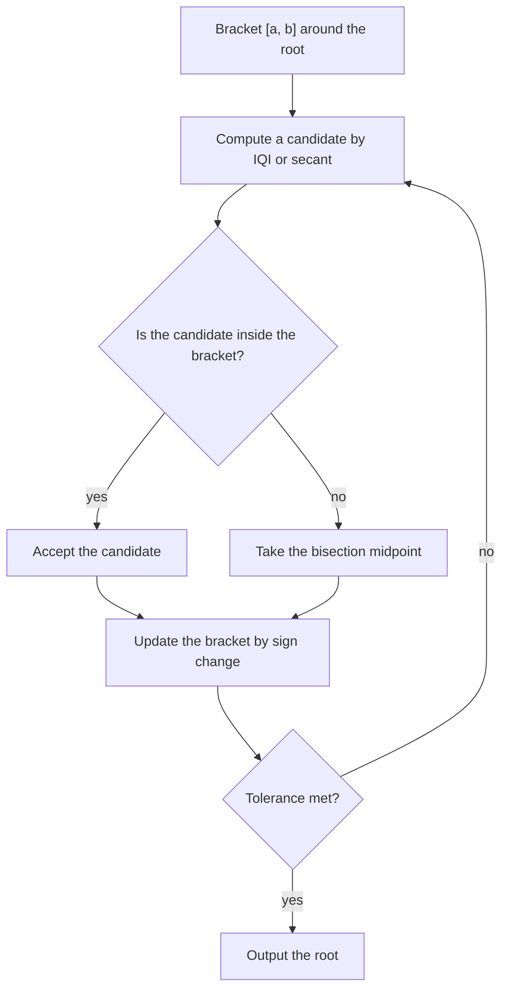

# Chapter 6 — Roots: Open Methods

[Repository Guide](../../README.md) | [English](Concepts_Lecture.md) | [한국어](Concepts_Lecture.ko.md)

> **Last Updated:** 2026-10-20
>
> Applied Numerical Methods with Python for Engineers and Scientists, Chapra and Clough, Ch 6

> **Learning Objectives:**
> 1. Apply the Newton-Raphson method to root finding
> 2. Implement the secant and modified secant methods
> 3. Compare the convergence of open and bracketing methods

---

## Table of Contents

- [1. Objectives](#1-objectives)
- [2. Open Methods vs Bracketing Methods](#2-open-methods-vs-bracketing-methods)
- [3. Fixed-Point Iteration](#3-fixed-point-iteration)
  - [3.1 Concept and Definition](#31-concept-and-definition)
  - [3.2 Algorithm](#32-algorithm)
  - [3.3 Fixed Point and Root Relationship](#33-fixed-point-and-root-relationship)
  - [3.4 Convergence Analysis](#34-convergence-analysis)
  - [3.5 Convergence Proof via Mean Value Theorem](#35-convergence-proof-via-mean-value-theorem)
  - [3.6 Example 6.1: Convergent Case](#36-example-61-convergent-case)
  - [3.7 Example 6.1: Divergent Case](#37-example-61-divergent-case)
  - [3.8 Example 6.1: Cycling Case](#38-example-61-cycling-case)
- [4. The Wegstein Method](#4-the-wegstein-method)
  - [4.1 Motivation from False Position](#41-motivation-from-false-position)
  - [4.2 Geometric Idea](#42-geometric-idea)
  - [4.3 Derivation](#43-derivation)
  - [4.4 General Formula](#44-general-formula)
- [5. Newton-Raphson Method](#5-newton-raphson-method)
  - [5.1 Geometric Derivation](#51-geometric-derivation)
  - [5.2 Two-Step Approach](#52-two-step-approach)
  - [5.3 Derivation from Taylor Expansion](#53-derivation-from-taylor-expansion)
  - [5.4 Quadratic Convergence](#54-quadratic-convergence)
  - [5.5 Proof of Quadratic Convergence](#55-proof-of-quadratic-convergence)
  - [5.6 Example 6.5: Slowly Converging Function](#56-example-65-slowly-converging-function)
- [6. Secant Method](#6-secant-method)
  - [6.1 Standard Secant Method](#61-standard-secant-method)
  - [6.2 Modified Secant Method](#62-modified-secant-method)
- [7. Inverse Quadratic Interpolation](#7-inverse-quadratic-interpolation)
  - [7.1 Concept](#71-concept)
  - [7.2 Lagrange Polynomial Formulation](#72-lagrange-polynomial-formulation)
  - [7.3 Comparison with Secant Method](#73-comparison-with-secant-method)
- [8. Brent's Method](#8-brents-method)
  - [8.1 Overview](#81-overview)
  - [8.2 Python Implementation with SciPy](#82-python-implementation-with-scipy)
- [9. Summary Table](#9-summary-table)
- [Summary](#summary)
- [Self-Check Questions](#self-check-questions)

---

<br>

## 1. Objectives

- Understand the **fixed-point iteration**.
- Implement the **Wegstein method**.
- Understand the quadratically convergent **Newton-Raphson method**.
- Understand the **secant method**.
- Understand **Brent's method**.

> **Note:** **Connection to Chapter 5.** This chapter builds on Chapter 5 (Roots: Bracketing Methods), which covered bisection and false position. The concepts of bracketing, error tolerance, and iterative convergence from Chapter 5 are directly extended here.

---

<br>

## 2. Open Methods vs Bracketing Methods

Unlike **bracketing methods** (bisection, false position), open methods do **not** require two initial guesses that bracket a root. Their key characteristics are as follows.

| Property | Bracketing Methods | Open Methods |
|---|---|---|
| Initial guesses | Two points $`x_l, x_u`$ with $`f(x_l) \cdot f(x_u) < 0`$ | One or two initial guesses (no sign-change requirement) |
| Convergence guarantee | Always converge (guaranteed) | May **diverge** or move away from the root |
| Speed | Slower (linear convergence) | Faster convergence **when they converge** |
| Interval behavior | Interval shrinks each iteration | Single point(s) iterate toward root |

*Table 1. Comparison of bracketing and open methods*

> **Key Point:** Open methods trade convergence guarantees for speed. If they converge, they approach the root much more quickly than bracketing methods.

---

<br>

## 3. Fixed-Point Iteration

### 3.1 Concept and Definition

It is also known by the following names.
- **Simple one-point iteration**
- **Method of successive substitutions**

Given an equation $`f(x) = 0`$ where $`f: [a, b] \to \mathbb{R}`$, we rearrange it into the following form.

```math
f(x) = x - g(x) = 0 \quad \Longrightarrow \quad x = g(x)
```

The iteration $`x_{i+1} = g(x_i)`$ is called **fixed-point iteration**.

**Definition:** A **fixed point** of a function $`g`$ is a real number $`x^*`$ such that:

```math
g(x^*) = x^*
```

> **Note:** **Difference from bracketing methods.** While bracketing methods (Chapter 5) work directly with $`f(x) = 0`$, fixed-point iteration reformulates the problem as $`x = g(x)`$, which can be viewed as finding the intersection of $`y = g(x)`$ and $`y = x`$.

### 3.2 Algorithm

To find the root $`x^* \in (a, b)`$, proceed as follows.

1. Choose a starting point $`x_0 \in (a, b)`$.
2. Sequentially calculate $`x_1, x_2, \ldots, x_{i+1}`$ using the following formula.

```math
x_{i+1} = g(x_i)
```

3. Repeat until $`x_{i+1} \approx x_i`$, that is, until convergence is achieved.

This is a **circular calculation**: the output $`x_{i+1}`$ from one step becomes the input $`x_i`$ for the next.

```text
input x_i  -->  [ g ]  -->  output x_{i+1}
     ^                            |
     |____________________________|
```

*Figure 1. The circular calculation of fixed-point iteration*

### 3.3 Fixed Point and Root Relationship

Let $`g`$ be a continuous function. Let the sequence $`\{x_i : i \geq 0\}`$ be generated by the fixed-point iteration $`x_{i+1} = g(x_i)`$.

If $`\displaystyle\lim_{i \to \infty} x_i = x^*`$, then $`x^*`$ is a fixed point of $`g`$.

Thus $`x^*`$ is the **root** of $`f`$:

```math
f(x^*) = x^* - g(x^*) = 0
```

### 3.4 Convergence Analysis

Convergence depends on the **slope of $`g`$** at the fixed point. Using the mean value theorem gives the following.

```math
\text{err}_{i+1} = \text{err}_i \cdot |g'(\xi)|
```

where $`\xi`$ is some point between $`x_i`$ and $`x^*`$.

**Convergence criterion:**

| Condition | Result |
|---|---|
| $`\vert g'(\xi)\vert < 1`$ | The iteration **converges** |
| $`\vert g'(\xi)\vert > 1`$ | The iteration **diverges** |
| $`\vert g'(\xi)\vert = 1`$ | Inconclusive (may cycle) |

*Table 2. Convergence of fixed-point iteration by the magnitude of the slope of g*

### 3.5 Convergence Proof via Mean Value Theorem

Let $`x^* \in (a, b)`$ be a fixed point of $`g`$ and let $`x_i \in (a, b)`$.

By the **Mean Value Theorem**, there exists $`\xi_i \in (x_i, x^*)`$ or $`(x^*, x_i)`$ such that:

```math
g(x_i) - g(x^*) = g'(\xi_i)(x_i - x^*)
```

> **[Calculus]** The Mean Value Theorem states that for a function $`g`$ continuous on $`[a, b]`$ and differentiable on $`(a, b)`$ there exists $`\xi \in (a, b)`$ with $`g(b) - g(a) = g'(\xi)(b - a)`$. The convergence analysis of fixed-point iteration uses it to turn the difference of function values at two points into the slope $`g'(\xi_i)`$ times the distance, showing that the error is multiplied by $`|g'(\xi_i)|`$ at each iteration. The analysis therefore holds under the assumption that $`g`$ is differentiable.

Since $`x_i = g(x_{i-1})`$ and $`x^* = g(x^*)`$, we obtain the following.

```math
|x_i - x^*| = |g(x_{i-1}) - g(x^*)| = |g'(\xi_{i-1})| \cdot |x_{i-1} - x^*|
```

If $`|g'(\xi)| \leq q < 1`$ for every $`\xi \in (a, b)`$ (assuming that all iterates stay in $`(a, b)`$), then:

```math
|x_i - x^*| \leq q \cdot |x_{i-1} - x^*| \leq q^2 \cdot |x_{i-2} - x^*| \leq \cdots \leq q^i \cdot |x_0 - x^*|
```

Since $`q < 1`$, we have $`q^i \to 0`$ as $`i \to \infty`$, so:

```math
|x_i - x^*| \to 0
```

> **Key Point:** The fixed-point iteration converges if the **contraction constant** $`q = \max|g'(\xi)| < 1`$ on the interval containing the root and iterates.

### 3.6 Example 6.1: Convergent Case

**Problem:** Estimate the root of $`f(x) = x - e^{-x}`$.

**Setup:** From $`f(x) = 0`$, we set the following.

```math
x = e^{-x} = g(x)
```

We start with $`x_0 = 0`$.

| Iteration | $`x_i`$ | $`g(x_i) = e^{-x_i}`$ |
|---|---|---|
| 0 | 0 | $`e^{0} = 1.0000`$ |
| 1 | 1.0000 | $`e^{-1} = 0.3679`$ |
| 2 | 0.3679 | $`e^{-0.3679} = 0.6922`$ |
| 3 | 0.6922 | $`\cdots`$ |
| $`\vdots`$ | $`\vdots`$ | converges to $`x^* \approx 0.5671`$ |

*Table 3. The first steps of a convergent fixed-point iteration*

**Why it converges:** $`g(x) = e^{-x}`$, so $`g'(x) = -e^{-x}`$. At the root $`x^* \approx 0.5671`$, $`|g'(x^*)| = e^{-0.5671} \approx 0.5671 < 1`$.

Graphically, this is a **spiral convergence**. Since $`g'(x^*) < 0`$, the iterates alternate between the two sides of the fixed point and spiral inward toward the intersection of $`y = g(x) = e^{-x}`$ and $`y = x`$.

```python
import numpy as np

def fixed_point_ex1(x0, tol=1e-6, max_iter=100):
    """Fixed-point iteration for f(x) = x - e^(-x)"""
    g = lambda x: np.exp(-x)
    x = x0
    for i in range(max_iter):
        x_new = g(x)
        if abs(x_new - x) < tol:
            print(f"Converged in {i+1} iterations: x* = {x_new:.6f}")
            return x_new
        x = x_new
    print("Did not converge")
    return x
```

Running `fixed_point_ex1(0)` converges to `x* = 0.567143` after 26 iterations.

### 3.7 Example 6.1: Divergent Case

**Problem:** Estimate the root of $`f(x) = x + \ln x`$.

**Setup:** From $`f(x) = 0`$, we set the following.

```math
x = -\ln(x) = g(x)
```

**Result:** The iteration **diverges** (spiral outward). For example, starting from $`x_0 = 0.5`$ gives $`0.693, 0.367, 1.004, -0.0037`$, whose oscillation grows until the value becomes negative and the logarithm can no longer be computed.

**Why it diverges:** $`g(x) = -\ln(x)`$, so $`g'(x) = -1/x`$. At the root $`x^* \approx 0.5671`$, $`|g'(x^*)| = 1/0.5671 \approx 1.763 > 1`$.

> **Note:** **Choice of rearrangement.** The same root can be found by one rearrangement of $`f(x) = 0`$ but not another. The choice of $`g(x)`$ critically determines convergence.

### 3.8 Example 6.1: Cycling Case

Consider $`g(x) = \dfrac{1}{x}`$ with $`x_0 = 4`$.

| Iteration | $`x_i`$ | $`g(x_i) = 1/x_i`$ |
|---|---|---|
| 0 | 4 | $`1/4 = 0.25`$ |
| 1 | 0.25 | $`1/0.25 = 4`$ |
| 2 | 4 | $`1/4 = 0.25`$ |

*Table 4. A fixed-point iteration cycling between two points*

The iteration **cycles between two points** $`x_0`$ and $`x_1`$ indefinitely, never converging to the fixed point $`x^* = 1`$.

**Why:** $`g'(x) = -1/x^2`$, so $`|g'(1)| = 1`$ (boundary case).

---

<br>

## 4. The Wegstein Method

### 4.1 Motivation from False Position

Recall that in the **false position method** (Chapter 5), a straight line between two guesses on $`f(x)`$ crossed the x-axis to produce the next estimate.

The Wegstein method applies a similar linear interpolation idea, but to the function $`g(x)`$ instead of $`f(x)`$.

### 4.2 Geometric Idea

In the Wegstein method, a straight line between two guesses on the curve $`y = g(x)`$ **intersects with the line $`y = x`$** to determine the next estimate of the solution.

Given two points $`(x_0, g(x_0))`$ and $`(x_1, g(x_1))`$ on the curve $`g(x)`$, proceed as follows.
- Draw a straight line through these two points.
- Find where this line intersects $`y = x`$.
- That intersection gives the next estimate $`x_2`$.

### 4.3 Derivation

The slope of the line through $`(x_0, g(x_0))`$ and $`(x_1, g(x_1))`$ equals the slope through the two points $`(x_1, g(x_1))`$ and $`(x_2, g(x_2))`$ on the same line. Here $`g(x_2)`$ denotes not the value of the curve $`g`$ but the height of this line at $`x_2`$.

```math
\text{slope} = \frac{g(x_1) - g(x_0)}{x_1 - x_0} = \frac{g(x_2) - g(x_1)}{x_2 - x_1}
```

Since the intersection is on the line $`y = x`$, this height is $`g(x_2) = x_2`$. Therefore:

```math
\frac{g(x_1) - g(x_0)}{x_1 - x_0} = \frac{x_2 - g(x_1)}{x_2 - x_1}
```

Cross-multiplying and solving for $`x_2`$ gives the following.

```math
x_2(g(x_1) - g(x_0)) - x_1(g(x_1) - g(x_0)) = (x_1 - x_0)x_2 - g(x_1)(x_1 - x_0)
```

```math
x_2 = \frac{x_1 g(x_0) - x_0 g(x_1)}{x_1 - x_0 - g(x_1) + g(x_0)}
```

### 4.4 General Formula

The general Wegstein iteration formula is:

```math
\boxed{x_{i+1} = \frac{x_i \, g(x_{i-1}) - x_{i-1} \, g(x_i)}{x_i - x_{i-1} - g(x_i) + g(x_{i-1})}}
```

> **Key Point:** The last two estimates are used to determine the next estimate. This requires **two initial guesses** (like the secant method), but they do not need to bracket the root.

> **Note:** **Relation to false position and the secant method.** The Wegstein method is essentially the false position idea (Chapter 5) applied to $`g(x)`$ intersecting $`y = x`$ rather than $`f(x)`$ intersecting $`y = 0`$. Since it keeps no bracket and always uses the last two estimates, however, its formula reduces to the secant method (Section 6.1) applied to $`F(x) = x - g(x)`$.

```python
def wegstein(g, x0, x1, tol=1e-6, max_iter=100):
    """Wegstein method for solving x = g(x)"""
    for i in range(max_iter):
        g0, g1 = g(x0), g(x1)
        denom = x1 - x0 - g1 + g0
        if abs(denom) < 1e-15:
            print("Denominator near zero")
            return x1
        x_new = (x1 * g0 - x0 * g1) / denom
        if abs(x_new - x1) < tol:
            print(f"Converged in {i+1} iterations: x* = {x_new:.6f}")
            return x_new
        x0, x1 = x1, x_new
    print("Did not converge")
    return x1
```

For example, applying it to $`g(x) = e^{-x}`$ with $`x_0 = 0`$ and $`x_1 = 1`$ converges to `x* = 0.567143` in 5 iterations, and applying it with $`x_0 = 0.5`$ and $`x_1 = 0.6`$ to $`g(x) = -\ln x`$, for which fixed-point iteration diverged, converges to the same root in 4 iterations.

---

<br>

## 5. Newton-Raphson Method

### 5.1 Geometric Derivation

Given $`f(x) = 0`$, we use the **first-order derivative** (tangent line) at the current estimate.

At the point $`(x_i, f(x_i))`$, the slope of the tangent line is:

```math
\text{slope} = f'(x_i) = \frac{0 - f(x_i)}{x_{i+1} - x_i}
```

Solving for $`x_{i+1}`$ gives the following.

```math
\boxed{x_{i+1} = x_i - \frac{f(x_i)}{f'(x_i)}}
```

### 5.2 Two-Step Approach

The Newton-Raphson method can be viewed as a two-step process.

**Step 1:** Compute the correction (Newton step).

```math
\delta x_i = -\frac{f(x_i)}{f'(x_i)}
```

**Step 2:** Update the estimate.

```math
x_{i+1} = x_i + \delta x_i
```

> **Note:** **Comparison with bracketing methods.** Newton-Raphson is an open method requiring only **one** initial guess and the derivative $`f'(x)`$. Unlike bracketing methods, there is no guarantee of convergence, but when it converges to a root with $`f'(x^*) \neq 0`$, it does so quadratically.

### 5.3 Derivation from Taylor Expansion

We can derive the Newton-Raphson formula from the **Taylor expansion**.

```math
f(x_{i+1}) = f(x_i + \delta x_i) = f(x_i) + f'(x_i)\,\delta x_i + \frac{f''(x_i)}{2}(\delta x_i)^2 + \cdots
```

Truncating after the first-order term gives the following.

```math
f(x_{i+1}) \approx f(x_i) + f'(x_i)\,\delta x_i
```

We **hope** $`f(x_{i+1}) = 0`$ (i.e., $`x_{i+1}`$ is the root $`x^*`$), so we set the above to zero.

```math
0 = f(x_i) + f'(x_i)\,\delta x_i
```

```math
\delta x_i = -\frac{f(x_i)}{f'(x_i)}
```

This recovers the Newton-Raphson formula.

### 5.4 Quadratic Convergence

The Newton-Raphson method has **quadratic convergence**, meaning:

```math
|x_{i+1} - x^*| \lesssim |x_i - x^*|^2
```

**Intuitive meaning:** When the constant $`M`$ below is of order 1, if the current error is $`\sim 10^{-2}`$, the next error will be $`\sim 10^{-4}`$. The number of correct digits roughly **doubles** each iteration.

**Formal statement:** Assume that $`f`$ is twice continuously differentiable on $`(a, b)`$. Suppose there exists $`x^* \in (a, b)`$ with $`f(x^*) = 0`$ and $`f'(x^*) \neq 0`$. Define the Newton-Raphson iteration as follows.

```math
x_{i+1} = x_i - \frac{f(x_i)}{f'(x_i)}, \quad i = 1, 2, \ldots
```

Assume that $`x_i \to x^*`$ as $`i \to \infty`$. Then for sufficiently large $`i`$:

```math
|x_{i+1} - x^*| \leq M |x_i - x^*|^2 \quad \text{where} \quad M > \frac{|f''(x^*)|}{2|f'(x^*)|}
```

### 5.5 Proof of Quadratic Convergence

**Proof:**

Let $`e_i = x_i - x^*`$ (the error at step $`i`$), so $`x^* = x_i - e_i`$.

Expanding $`f`$ in a Taylor series about $`x_i`$ and evaluating at $`x_i - e_i`$ gives the following.

```math
f(x_i - e_i) = f(x_i) - f'(x_i)\,e_i + f''(\xi_i)\frac{e_i^2}{2}
```

where $`\xi_i`$ is between $`x_i`$ and $`x^*`$ (by Taylor's theorem with the Lagrange form of the remainder).

Since $`x^* = x_i - e_i`$ and $`f(x^*) = 0`$:

```math
0 = f(x_i) - f'(x_i)\,e_i + f''(\xi_i)\frac{e_i^2}{2}
```

Since $`f'`$ is continuous and $`f'(x^*) \neq 0`$, we have $`f'(x_i) \neq 0`$ as long as $`x_i`$ is close enough to $`x^*`$. Dividing by $`f'(x_i)`$ gives the following.

```math
0 = \frac{f(x_i)}{f'(x_i)} - e_i + \frac{f''(\xi_i)}{f'(x_i)}\frac{e_i^2}{2}
```

By definition of Newton's method, $`x_{i+1} = x_i - \dfrac{f(x_i)}{f'(x_i)}`$, so:

```math
x_{i+1} - x^* = x_i - x^* - \frac{f(x_i)}{f'(x_i)} = e_i - \frac{f(x_i)}{f'(x_i)}
```

From the equation above:

```math
0 = (x^* - x_{i+1}) + \frac{f''(\xi_i)}{f'(x_i)} \cdot \frac{e_i^2}{2}
```

Therefore:

```math
x_{i+1} - x^* = \frac{f''(\xi_i)}{f'(x_i)} \cdot \frac{1}{2}(x_i - x^*)^2
```

Taking absolute values:

```math
|x_{i+1} - x^*| = \frac{|f''(\xi_i)|}{2|f'(x_i)|} \cdot |x_i - x^*|^2
```

When $`x_i`$ is close enough to $`x^*`$, there is a constant $`M`$ with $`\dfrac{|f''(\xi_i)|}{2|f'(x_i)|} \leq M`$, so:

```math
\boxed{|x_{i+1} - x^*| \leq M |x_i - x^*|^2}
```

This proves **quadratic convergence**. $`\blacksquare`$

```python
def newton_raphson(f, df, x0, tol=1e-6, max_iter=100):
    """Newton-Raphson method"""
    x = x0
    for i in range(max_iter):
        fx = f(x)
        dfx = df(x)
        if abs(dfx) < 1e-15:
            print("Derivative near zero — method fails")
            return x
        delta_x = -fx / dfx            # Step 1: Newton step
        x = x + delta_x                # Step 2: Update
        if abs(delta_x) < tol:
            print(f"Converged in {i+1} iterations: x* = {x:.10f}")
            return x
    print("Did not converge")
    return x
```

### 5.6 Example 6.5: Slowly Converging Function

**Problem:** $`f(x) = x^{60} - 1`$

This is a **slowly converging function**: for $`0 < x < 1`$, away from the root, the slope is nearly zero, so the Newton step becomes huge, and after jumping far out to $`x > 1`$ each iteration reduces $`x`$ only by a factor of about $`59/60`$. The reason is that $`x - (x^{60} - 1)/(60x^{59}) \approx (59/60)x`$ for large $`x`$.

- With $`x_0 = 0.5`$, the slope is tiny ($`f'(0.5) = 60 \cdot 0.5^{59} \approx 1.04 \times 10^{-16}`$), so the first step jumps to $`x_1 \approx 9.6 \times 10^{15}`$. In exact arithmetic, each later iteration shrinks $`x`$ by about $`59/60`$, so the root is reached only after about 2,200 iterations, and in double precision $`x^{60}`$ overflows and the computation fails. The `newton_raphson` function above stops immediately at its check that the derivative is smaller than $`10^{-15}`$.
- With $`x_0 = 0.9`$, the guess is also far from the root $`x^* = 1`$. The first step jumps to $`x_1 \approx 9.23`$, so the function above prints "Did not converge" with its default setting (`max_iter=100`) and converges after 138 iterations when the iteration limit is raised. With a guess close enough to the root, such as $`x_0 = 0.99`$, it converges in 5 iterations.

> **Note:** **When Newton-Raphson struggles.** Newton-Raphson can fail or converge slowly in the following cases.
> - $`f'(x_i) \approx 0`$: a nearly horizontal tangent causes overshooting.
> - The initial guess is far from the root.
> - The function is very flat near the root.

---

<br>

## 6. Secant Method

### 6.1 Standard Secant Method

The secant method replaces the derivative in the Newton-Raphson method with a **finite difference approximation**. It is useful when **analytic derivatives are not available**.

We start from Newton-Raphson.

```math
x_{i+1} = x_i - \frac{f(x_i)}{f'(x_i)}
```

Replace $`f'(x_i)`$ with a finite difference approximation using two previous points (the same form as the backward difference of Chapter 4).

```math
f'(x_i) \approx \frac{f(x_i) - f(x_{i-1})}{x_i - x_{i-1}}
```

Substituting gives the following.

```math
\boxed{x_{i+1} = x_i - \frac{f(x_i)(x_i - x_{i-1})}{f(x_i) - f(x_{i-1})}}
```

**Properties:**
- It requires **two initial guesses** $`x_0`$ and $`x_1`$ (like Wegstein), but they need not bracket the root.
- It is similar to the Wegstein method in using two guesses.
- Its convergence order is **superlinear** ($`\approx 1.618`$, the golden ratio), faster than linear but slower than quadratic.

> **Note:** **Difference from false position.** The secant method formula is identical in form to the false position formula (Chapter 5), but the secant method does **not** maintain a bracket. It always uses the two most recent points, whereas false position retains the bracket around the root.

```python
def secant_method(f, x0, x1, tol=1e-6, max_iter=100):
    """Standard secant method"""
    for i in range(max_iter):
        f0, f1 = f(x0), f(x1)
        if abs(f1 - f0) < 1e-15:
            print("Division by zero in secant method")
            return x1
        x_new = x1 - f1 * (x1 - x0) / (f1 - f0)
        if abs(x_new - x1) < tol:
            print(f"Converged in {i+1} iterations: x* = {x_new:.10f}")
            return x_new
        x0, x1 = x1, x_new
    print("Did not converge")
    return x1
```

For example, `secant_method(lambda x: x - np.exp(-x), 0, 1)` converges to `x* = 0.5671432904` in 5 iterations.

### 6.2 Modified Secant Method

If the two points $`x_{i-1}`$ and $`x_i`$ are **not close enough**, we can use the **modified secant method**.

Instead of two separate points, we use a point obtained by perturbing $`x_i`$ by a small fraction. Writing the perturbation as $`\delta x_i`$ gives the following.

```math
f'(x_i) \approx \frac{f(x_i + \delta x_i) - f(x_i)}{\delta x_i}
```

Substituting into the Newton-Raphson formula gives the following.

```math
\boxed{x_{i+1} = x_i - \frac{f(x_i) \cdot \delta x_i}{f(x_i + \delta x_i) - f(x_i)}}
```

where $`\delta x_i`$ is a small perturbation (e.g., $`\delta x_i = \epsilon \cdot x_i`$ for some small $`\epsilon`$).

> **Note:** **Advantage.** It requires only **one** initial guess (like Newton-Raphson) and avoids computing the analytic derivative. The perturbation $`\delta x_i`$ controls the finite difference step size.

```python
def modified_secant(f, x0, delta=1e-4, tol=1e-6, max_iter=100):
    """Modified secant method using perturbation"""
    x = x0
    for i in range(max_iter):
        fx = f(x)
        dx = delta * x if abs(x) > 1e-10 else delta
        f_perturbed = f(x + dx)
        if abs(f_perturbed - fx) < 1e-15:
            print("Denominator near zero")
            return x
        x_new = x - fx * dx / (f_perturbed - fx)
        if abs(x_new - x) < tol:
            print(f"Converged in {i+1} iterations: x* = {x_new:.10f}")
            return x_new
        x = x_new
    print("Did not converge")
    return x
```

For example, `modified_secant(lambda x: x - np.exp(-x), 1.0)` converges to the same root in 4 iterations.

---

<br>

## 7. Inverse Quadratic Interpolation

### 7.1 Concept

Suppose we have **three points** $`(x_{i-2}, y_{i-2})`$, $`(x_{i-1}, y_{i-1})`$, $`(x_i, y_i)`$ where $`y_k = f(x_k)`$.

The key idea is as follows.
- A forward quadratic $`y = p(x)`$ (a quadratic in $`x`$) through three points may **not cross the x-axis**.
- But the **inverse function** $`x = g(y)`$ through these three points is a quadratic in $`y`$, so it always **crosses** the x-axis. That is, we can evaluate $`g(0)`$ to find the root estimate.

We fit a **quadratic function of $`y`$**.

```math
x = ay^2 + by + c
```

When the three $`y`$-values are distinct, the 3 unknowns $`(a, b, c)`$ and 3 equations (one for each point) determine the system uniquely.

### 7.2 Lagrange Polynomial Formulation

Using **Lagrange polynomials**, the inverse quadratic interpolation is:

```math
g(y) = \frac{(y - y_{i-1})(y - y_i)}{(y_{i-2} - y_{i-1})(y_{i-2} - y_i)} x_{i-2} + \frac{(y - y_{i-2})(y - y_i)}{(y_{i-1} - y_{i-2})(y_{i-1} - y_i)} x_{i-1} + \frac{(y - y_{i-2})(y - y_{i-1})}{(y_i - y_{i-2})(y_i - y_{i-1})} x_i
```

This can be written compactly as:

```math
g(y) = \ell_{i-2}(y) \cdot x_{i-2} + \ell_{i-1}(y) \cdot x_{i-1} + \ell_i(y) \cdot x_i
```

where $`\ell_k(y)`$ are the Lagrange basis polynomials.

The next root estimate is $`x_{i+1} = g(0)`$, i.e., we set $`y = 0`$ in the formula above.

> **Note:** **Falling back to the secant method.** If two $`y`$-values coincide (e.g., $`y_{i-2} = y_{i-1}`$), a denominator of the Lagrange polynomial becomes zero and the formula degenerates. In this case, fall back to the **secant method** using two points instead.

### 7.3 Comparison with Secant Method

| Feature | Secant Method | Inverse Quadratic Interpolation |
|---|---|---|
| Points used | 2 | 3 |
| Interpolation | Linear (straight line through 2 points on $`f`$) | Quadratic (parabola through 3 points on inverse) |
| Convergence order | $`\approx 1.618`$ (golden ratio) | $`\approx 1.839`$ |
| Robustness | More robust | Can fail if $`y`$-values coincide |

*Table 5. Comparison of the secant method and inverse quadratic interpolation*

---

<br>

## 8. Brent's Method

### 8.1 Overview

**Brent's method** (Richard Brent, 1973) is a hybrid root-finding algorithm that combines the following methods.
- **Bisection method:** a bracketing method with guaranteed convergence.
- **Secant method:** a fast open method.
- **Inverse quadratic interpolation:** even faster when applicable.

```math
\text{Brent's method} = \text{Bracketing methods} + \text{Open methods}
```

**Strategy:** Use the faster open methods (secant or IQI) when they produce a result within the current bracket, and fall back to bisection when they fail or produce results outside the bracket.



*Figure 2. The strategy of Brent's method*

> **Key Point:** Brent's method inherits the **guaranteed convergence** of bisection while achieving the **speed** of open methods in favorable cases. It is the default root-finding algorithm in many numerical libraries.

### 8.2 Python Implementation with SciPy

SciPy provides Brent's method through `scipy.optimize.brentq`.

```python
from scipy import optimize

def f(x):
    return (x**2 - 1)

# Find root in [-2, 0]
root = optimize.brentq(f, -2, 0)
print(root)  # -1.0

# Find root in [0, 2]
root = optimize.brentq(f, 0, 2)
print(root)  # 1.0
```

**Function signature:** `brentq(f, a, b)`
- `f`: the function of the equation $`f(x) = 0`$ to be solved.
- `a`: the lower (left) end of the bracket, $`x_l`$.
- `b`: the upper (right) end of the bracket, $`x_u`$.
- As in bisection, $`f(x_l) \cdot f(x_u) < 0`$ is required.

> **Note:** **Practical view.** In real-world applications where a sign-changing bracket is available, Brent's method is usually preferred over pure bisection, Newton-Raphson, or secant methods because of its combination of reliability and speed.

---

<br>

## 9. Summary Table

| Method | Initial Guesses | Derivative Required | Convergence Order | Convergence Guarantee | Key Formula |
|---|---|---|---|---|---|
| **Fixed-Point Iteration** | 1 | No | Linear ($`\sim q^i`$) | Only if $`\vert g'(x^*)\vert < 1`$ | $`x_{i+1} = g(x_i)`$ |
| **Wegstein** | 2 | No | Superlinear | No | $`x_{i+1} = \frac{x_i g(x_{i-1}) - x_{i-1} g(x_i)}{x_i - x_{i-1} - g(x_i) + g(x_{i-1})}`$ |
| **Newton-Raphson** | 1 | Yes ($`f'`$) | Quadratic ($`\sim e_i^2`$) | No | $`x_{i+1} = x_i - \frac{f(x_i)}{f'(x_i)}`$ |
| **Secant** | 2 | No | Superlinear ($`\approx 1.618`$) | No | $`x_{i+1} = x_i - \frac{f(x_i)(x_i - x_{i-1})}{f(x_i) - f(x_{i-1})}`$ |
| **Modified Secant** | 1 | No | Superlinear | No | $`x_{i+1} = x_i - \frac{f(x_i)\,\delta x_i}{f(x_i + \delta x_i) - f(x_i)}`$ |
| **Inverse Quadratic Interp.** | 3 | No | $`\approx 1.839`$ | No | Lagrange inverse polynomial at $`y = 0`$ |
| **Brent's Method** | 2 (bracket) | No | Superlinear (hybrid) | Yes (via bisection fallback) | Adaptive: bisection + secant + IQI |

*Table 6. Comparison of the open methods and Brent's method*

---

<br>

## Summary

| Concept | Key Summary |
|:-----|:-----|
| Open Methods | They start from one or two initial guesses without a bracket, are not guaranteed to converge, and are fast when they converge. |
| Fixed-Point Iteration | It rewrites the equation as $`x = g(x)`$ and repeats $`x_{i+1} = g(x_i)`$, converging linearly if $`\vert g'\vert < 1`$ near the fixed point. |
| Wegstein Method | It uses the intersection of $`y = x`$ with the line through two points on $`y = g(x)`$ as the next estimate, which equals the secant method applied to $`x - g(x)`$. |
| Newton-Raphson Method | It repeats the tangent's x-intercept $`x_{i+1} = x_i - f(x_i)/f'(x_i)`$ and converges quadratically near a root with $`f'(x^*) \neq 0`$. |
| Secant Method | It approximates the derivative by the difference of the two most recent points and converges superlinearly with order about 1.618. |
| Modified Secant Method | It approximates the derivative by a difference with a small perturbation of one point, so it works with a single initial guess. |
| Inverse Quadratic Interpolation | It uses $`g(0)`$ of the quadratic $`x = g(y)`$ through three points as the next estimate and converges with order about 1.839. |
| Brent's Method | It uses inverse quadratic interpolation or the secant step inside the bracket and falls back to bisection when needed, combining guaranteed convergence with speed. |

---

<br>

## Self-Check Questions

1. **Convergence of fixed-point iteration:** To find the root $`x^* = 3`$ of $`x^2 - 2x - 3 = 0`$, consider the three rearrangements $`g_1(x) = \sqrt{2x + 3}`$, $`g_2(x) = 3/(x - 2)`$, and $`g_3(x) = (x^2 - 3)/2`$. Which rearrangements converge near $`x^* = 3`$?

   <details>
   <summary>Answer</summary>

   Since $`g_1'(x) = 1/\sqrt{2x + 3}`$, $`|g_1'(3)| = 1/3 < 1`$, so it converges (from $`x_0 = 4`$ it goes 3.317, 3.104, 3.034, ...). Since $`g_2'(x) = -3/(x - 2)^2`$, $`|g_2'(3)| = 3 > 1`$, and since $`g_3'(x) = x`$, $`|g_3'(3)| = 3 > 1`$, so these two rearrangements move away from $`x^* = 3`$.

   </details>

2. **One Newton-Raphson step:** For $`f(x) = x^2 - 2`$ and $`x_0 = 1`$, find $`x_1`$ and $`x_2`$ by the Newton-Raphson method.

   <details>
   <summary>Answer</summary>

   Since $`f'(x) = 2x`$, $`x_1 = 1 - (-1)/2 = 1.5`$ and $`x_2 = 1.5 - 0.25/3 \approx 1.416667`$. This iteration gives the same values as the Babylonian method of the Chapter 3 lab.

   </details>

3. **One secant step:** For $`f(x) = x^2 - 2`$ with $`x_0 = 1`$ and $`x_1 = 2`$, find $`x_2`$ by the secant method.

   <details>
   <summary>Answer</summary>

   Since $`f(1) = -1`$ and $`f(2) = 2`$, $`x_2 = 2 - \frac{2 \cdot (2 - 1)}{2 - (-1)} = 2 - 2/3 \approx 1.333333`$.

   </details>

4. **Error under quadratic convergence:** In the Newton-Raphson method with $`M = 0.5`$ and a current error $`|e_i| = 10^{-3}`$, what are the error bounds for the next two iterations?

   <details>
   <summary>Answer</summary>

   $`|e_{i+1}| \leq 0.5 \times (10^{-3})^2 = 5 \times 10^{-7}`$ and $`|e_{i+2}| \leq 0.5 \times (5 \times 10^{-7})^2 = 1.25 \times 10^{-13}`$. The number of correct digits roughly doubles each iteration.

   </details>

5. **Cause of slow convergence:** Applying the Newton-Raphson method to $`f(x) = x^{60} - 1`$ with $`x_0 = 0.9`$, find $`x_1`$ and explain why convergence is slow afterward.

   <details>
   <summary>Answer</summary>

   Since $`f(0.9) \approx -0.9982`$ and $`f'(0.9) = 60 \cdot 0.9^{59} \approx 0.120`$, $`x_1 = 0.9 + 0.9982/0.120 \approx 9.23`$. For large $`x`$, $`x_{i+1} \approx (59/60)x_i`$, so each iteration reduces $`x`$ by only about 1.7%, and quadratic convergence begins only near the root. That is why 138 iterations are needed to reach the tolerance $`10^{-6}`$.

   </details>
