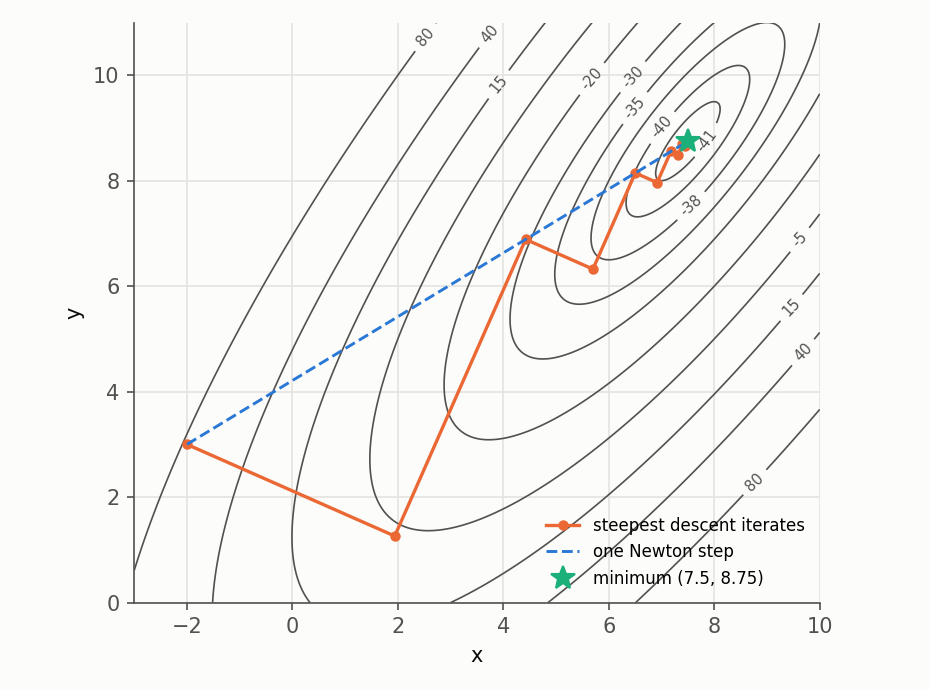

# 7장 — 최적화

[레포지토리 안내](../../README.ko.md) | [English](Concepts_Lecture.md) | [한국어](Concepts_Lecture.ko.md)

> **최종 수정일:** 2026-11-27
>
> Applied Numerical Methods with Python for Engineers and Scientists, Chapra and Clough, Ch 7

> **학습 목표:**
> 1. 1차원 최적화에 황금 분할 탐색을 적용할 수 있다
> 2. 포물선 보간으로 1차원 최적점을 추정할 수 있다
> 3. 국소 최솟값, 전역 최솟값, 볼록성의 정의를 설명할 수 있다
> 4. 최급 하강법 알고리즘을 구현할 수 있다

---

<br>

## 목차

- [1. 최적화 소개](#1-최적화-소개)
  - [1.1 최적화의 개념](#11-최적화의-개념)
  - [1.2 동기 부여 예제: 알루미늄 캔 설계](#12-동기-부여-예제-알루미늄-캔-설계)
  - [1.3 수학적 표현](#13-수학적-표현)
  - [1.4 최소화 vs. 최대화](#14-최소화-vs-최대화)
  - [1.5 실행 가능 영역과 제약 조건](#15-실행-가능-영역과-제약-조건)
- [2. 핵심 위상 개념](#2-핵심-위상-개념)
  - [2.1 내부점(Interior Points)](#21-내부점interior-points)
  - [2.2 경계점(Boundary Points)](#22-경계점boundary-points)
  - [2.3 실행 가능 방향(Feasible Directions)](#23-실행-가능-방향feasible-directions)
- [3. 국소 최적성과 전역 최적성](#3-국소-최적성과-전역-최적성)
  - [3.1 전역 최솟값(Global Minimum)](#31-전역-최솟값global-minimum)
  - [3.2 하한과 상한(Infimum and Supremum)](#32-하한과-상한infimum-and-supremum)
  - [3.3 국소 최솟값(Local Minimum)](#33-국소-최솟값local-minimum)
  - [3.4 순 국소 최솟값(Strict Local Minimum)](#34-순-국소-최솟값strict-local-minimum)
- [4. 최적해의 존재](#4-최적해의-존재)
  - [4.1 Weierstrass 정리(Weierstrass Theorem)](#41-weierstrass-정리weierstrass-theorem)
  - [4.2 강제 함수(Coercive Functions)](#42-강제-함수coercive-functions)
  - [4.3 강제 함수에 대한 증명 개요](#43-강제-함수에-대한-증명-개요)
- [5. 1차원 최적화](#5-1차원-최적화)
- [6. 황금 분할 탐색(Golden-Section Search)](#6-황금-분할-탐색golden-section-search)
  - [6.1 황금비(Golden Ratio)](#61-황금비golden-ratio)
  - [6.2 알고리즘: 구간 축소](#62-알고리즘-구간-축소)
  - [6.3 함수 평가의 재사용](#63-함수-평가의-재사용)
  - [6.4 오차 분석](#64-오차-분석)
  - [6.5 예제: 황금 분할 탐색의 반복 과정](#65-예제-황금-분할-탐색의-반복-과정)
  - [6.6 황금 분할 탐색의 정밀도 한계와 주의](#66-황금-분할-탐색의-정밀도-한계와-주의)
- [7. 포물선 보간(Parabolic Interpolation)](#7-포물선-보간parabolic-interpolation)
  - [7.1 포물선 구성](#71-포물선-구성)
  - [7.2 최적점 공식](#72-최적점-공식)
  - [7.3 다음 반복을 위한 점 갱신](#73-다음-반복을-위한-점-갱신)
  - [7.4 예제: 포물선 보간의 반복 과정](#74-예제-포물선-보간의-반복-과정)
  - [7.5 포물선 보간의 한계와 Brent 방법](#75-포물선-보간의-한계와-brent-방법)
- [8. 등고선(Level Sets)과 기울기(Gradient)](#8-등고선level-sets과-기울기gradient)
  - [8.1 등고선 정의](#81-등고선-정의)
  - [8.2 기울기는 등고선에 직교한다](#82-기울기는-등고선에-직교한다)
- [9. 볼록 문제(Convex Problems)](#9-볼록-문제convex-problems)
  - [9.1 볼록 결합(Convex Combination)](#91-볼록-결합convex-combination)
  - [9.2 볼록 집합(Convex Set)](#92-볼록-집합convex-set)
  - [9.3 초평면(Hyperplane)과 다면체 집합(Polyhedral Set)](#93-초평면hyperplane과-다면체-집합polyhedral-set)
  - [9.4 꼭짓점(Extreme Point)](#94-꼭짓점extreme-point)
  - [9.5 볼록 함수(Convex Function)](#95-볼록-함수convex-function)
  - [9.6 볼록 최적화 문제](#96-볼록-최적화-문제)
  - [9.7 볼록 문제의 국소 최소화자](#97-볼록-문제의-국소-최소화자)
  - [9.8 1차 특성화](#98-1차-특성화)
  - [9.9 2차 특성화](#99-2차-특성화)
- [10. 최급 하강법(Steepest Gradient Descent Method)](#10-최급-하강법steepest-gradient-descent-method)
  - [10.1 방향 도함수와 Cauchy-Schwarz](#101-방향-도함수와-cauchy-schwarz)
  - [10.2 최급 하강 갱신 규칙](#102-최급-하강-갱신-규칙)
  - [10.3 수렴과 직교성 성질](#103-수렴과-직교성-성질)
  - [10.4 예제](#104-예제)
  - [10.5 예제의 반복 과정과 수렴 속도](#105-예제의-반복-과정과-수렴-속도)
- [11. 최적점에 대한 Newton 방법](#11-최적점에-대한-newton-방법)
  - [11.1 1차원 Newton 방법](#111-1차원-newton-방법)
  - [11.2 정류점의 판정](#112-정류점의-판정)
  - [11.3 다차원 Newton 방법](#113-다차원-newton-방법)
- [12. SciPy를 이용한 최적화](#12-scipy를-이용한-최적화)
  - [12.1 1차원 최소화](#121-1차원-최소화)
  - [12.2 다차원 최소화](#122-다차원-최소화)
  - [12.3 제약 조건이 있는 최적화: 알루미늄 캔 설계](#123-제약-조건이-있는-최적화-알루미늄-캔-설계)
- [요약](#요약)
- [점검 문제](#점검-문제)
- [참고 문헌](#참고-문헌)

---

<br>

## 1. 최적화 소개

### 1.1 최적화의 개념

**최적화(Optimization)** 는 모든 **실행 가능한 해** 중에서 **최선**을 찾는 방법론이다. **최적해(optimal solution)** 는 최선의 목적 함수 값을 산출하는 실행 가능한 해이다.

함수 $`f(x)`$는 여러 유형의 극값점을 가질 수 있다:

- **전역 최댓값(Global maximum)**: 전체 정의역에서 $`f`$가 가장 큰 값을 갖는 점이다.
- **전역 최솟값(Global minimum)**: 전체 정의역에서 $`f`$가 가장 작은 값을 갖는 점이다.
- **국소 최댓값(Local maximum)**: 인근의 어떤 점에서보다 $`f`$의 값이 작지 않은 점이다.
- **국소 최솟값(Local minimum)**: 인근의 어떤 점에서보다 $`f`$의 값이 크지 않은 점이다.

### 1.2 동기 부여 예제: 알루미늄 캔 설계

한 회사가 지름 $`d`$와 높이 $`h`$를 가진 원기둥 형태의 알루미늄 캔을 설계해야 한다.

**공식:**

```math
\text{Volume} = \pi \left(\frac{d}{2}\right)^2 h = \frac{\pi d^2 h}{4}
```

```math
\text{Surface Area} = \frac{\pi d^2}{2} + \pi d h
```

부피와 겉넓이 모두 지름 $`d`$와 높이 $`h`$의 함수이다.

**목표:** 다음 조건을 만족하면서 **가능한 한 적은 알루미늄**을 사용하는 캔, 즉 겉넓이가 최소인 캔을 설계한다:

1. 높이는 지름보다 50% 이상 커야 한다: $`h \geq \frac{3}{2}d \iff \frac{3}{2}d - h \leq 0`$
2. 높이는 지름의 두 배를 넘을 수 없다: $`h \leq 2d \iff -2d + h \leq 0`$
3. 부피는 330 mL 이상이어야 한다: $`\frac{\pi d^2 h}{4} \geq 330`$
4. $`h > 0, \; d > 0`$이어야 하며, 이 조건은 이미 보장된다. 조건 1과 2에서 $`d \geq 0`$, $`h \geq 0`$이 나오고, 조건 3이 $`d = 0`$이나 $`h = 0`$을 배제하기 때문이다.

**최적화 문제 요약:**

```math
\text{minimize} \quad \frac{\pi d^2}{2} + \pi d h
```

```math
\text{subject to} \quad \frac{3}{2}d - h \leq 0
```

```math
-2d + h \leq 0
```

```math
\frac{\pi d^2 h}{4} \geq 330
```

### 1.3 수학적 표현

$`\mathbb{X} \subseteq \mathbb{R}^n`$을 $`n`$차원 실수 벡터의 집합이라 하자. 즉 $`\mathbb{X} \ni x = [x_1, x_2, \ldots, x_n]^T`$이다.

$`f : \mathbb{X} \to \mathbb{R}`$이라 하자.

최적화 문제의 일반적인 형태는 다음과 같다:

```math
\min_{x \in \mathbb{X}} f(x)
```

이는 다음과 같이 쓸 수도 있다:

```math
\text{minimize} \quad f(x) \quad \text{subject to} \quad x \in \mathbb{X}
```

여기서 각 기호의 뜻은 다음과 같다:

- $`\mathbb{X}`$는 **실행 가능(허용) 영역(feasible/admissible region)** 이다.
- $`f`$는 **목적 함수(objective function)** 이다.
- $`x`$는 **실행 가능한 해(feasible solution)** 또는 **결정 변수(decision variable)** 이다.

### 1.4 최소화 vs. 최대화

최소화 문제 $`\min_{x \in \mathbb{X}} f(x)`$는 동등한 최대화 문제로 변환할 수 있다:

```math
\max_{x \in \mathbb{X}} (-f(x))
```

그 역도 성립한다. 따라서 일반성을 잃지 않고 항상 최소화 문제만 고려할 수 있다.

### 1.5 실행 가능 영역과 제약 조건

실행 가능 영역 $`\mathbb{X}`$는 **제약 조건(constraints)** 의 집합으로 기술된다:

- **등식 제약 조건(Equality constraints):** $`h_i(x) = 0`$ 꼴이다. 여기서 $`h_i : \mathbb{R}^n \to \mathbb{R}`$이고 $`i \in \mathcal{E}_i`$(인덱스 집합)이다.
- **부등식 제약 조건(Inequality constraints):** $`g_j(x) \leq 0`$ 꼴이다. 여기서 $`g_j : \mathbb{R}^n \to \mathbb{R}`$이고 $`j \in \mathcal{E}_j`$(인덱스 집합)이다.

**예시:** 두 개의 부등식 제약 조건으로 정의된 다음 실행 가능 집합 $`\mathbb{X}`$를 생각한다:

```math
\mathbb{X} = \{x \in \mathbb{R}^2 : x_1^2 + x_2^2 \leq 1, \; (x_1 - 1)^2 + x_2^2 \leq 1\}
```

여기서 $`g_1(x_1, x_2) = x_1^2 + x_2^2 - 1 \leq 0`$이고 $`g_2(x_1, x_2) = (x_1 - 1)^2 + x_2^2 - 1 \leq 0`$이다. 실행 가능 영역은 두 원판의 교집합(겹치는 부분)이다.

---

<br>

## 2. 핵심 위상 개념

### 2.1 내부점(Interior Points)

**정의.** 점 $`\hat{x} \in \mathbb{X}`$가 $`\mathbb{X}`$의 **내부점(interior point)** 이란 $`\varepsilon > 0`$이 존재하여 $`\hat{x}`$를 중심으로 한 $`\varepsilon`$-공이 $`\mathbb{X}`$에 포함되는 것을 말한다:

```math
B(\hat{x}, \varepsilon) \subset \mathbb{X}
```

**정의.** $`\text{int}(\mathbb{X})`$는 $`\mathbb{X}`$의 모든 내부점의 집합이다.

### 2.2 경계점(Boundary Points)

**정의.** 점 $`\bar{x}`$가 다음을 만족하면 $`\mathbb{X}`$의 **경계점(boundary point)** 이라 한다:

```math
\bar{x} \in \mathbb{X} \quad \text{and} \quad \bar{x} \notin \text{int}(\mathbb{X})
```

다시 말해, $`\bar{x}`$는 집합에 속하지만 그 주위의 어떤 $`\varepsilon`$-공도 집합 안에 완전히 포함되지 않는다. 기하학적으로 경계점은 집합의 가장자리에 놓이고, 내부점은 모든 방향으로 여유를 두고 집합 안쪽에 놓인다.

### 2.3 실행 가능 방향(Feasible Directions)

**정의.** 벡터 $`d \in \mathbb{R}^n`$이 $`\bar{x} \in \mathbb{X}`$에서 집합 $`\mathbb{X} \subseteq \mathbb{R}^n`$에 대한 **실행 가능 방향(feasible direction)** 이란 $`\delta > 0`$이 존재하여 다음이 성립하는 것이다:

```math
\bar{x} + \alpha d \in \mathbb{X} \quad \text{for any } 0 \leq \alpha \leq \delta
```

> **참고:** **기하학적 의미.** 실행 가능 방향은 현재 점에서 그 방향으로 양의 작은 스텝만큼 이동해도 실행 가능 집합 안에 머무를 수 있는 방향이다. 내부점에서는 모든 방향이 실행 가능하다. 경계점에서는 바깥을 향하는 방향은 실행 가능하지 않다. 안쪽을 향하는 방향은 실행 가능하고, 경계를 따르는 방향은 경계가 평평한 부분(예: 다면체 집합의 면)에서만 실행 가능하다.

---

<br>

## 3. 국소 최적성과 전역 최적성

다음 최소화 문제를 생각한다:

```math
\text{minimize} \quad f(x) \quad \text{subject to} \quad x \in \mathbb{X}
```

여기서 $`f : \mathbb{R}^n \to \mathbb{R}`$이다.

### 3.1 전역 최솟값(Global Minimum)

**정의 (전역 최솟값).** 점 $`x^* \in \mathbb{X}`$가 다음을 만족하면 문제 $`\min_{x \in \mathbb{X}} f(x)`$의 **전역 최솟값(global minimum)** (전역 최소화자)이라 하고 $`x^* = \arg\min_{x \in \mathbb{X}} f(x)`$로 쓴다:

```math
f(x^*) \leq f(x) \quad \forall \; x \in \mathbb{X}
```

전역 최소화자 $`x^*`$가 다음을 만족하면 **순 전역 최소화자(strict global minimizer)** 라 한다:

```math
f(x^*) < f(x) \quad \forall \; x \in \mathbb{X} \setminus \{x^*\}
```

### 3.2 하한과 상한(Infimum and Supremum)

모든 함수가 전역 최소화자를 갖는 것은 아니다. $`x \in \mathbb{R}`$에서 $`f(x) = e^x`$를 생각하면 다음이 성립한다:

- $`f(x) \geq 0`$이므로 $`f`$는 아래로 유계이다.
- $`\lim_{x \to -\infty} f(x) = 0`$이고 0이 최대 하계이지만, $`f(x) = 0`$인 $`x`$는 존재하지 않는다.

**정의 (하한, 상한).** 함수 $`f : \mathbb{X} \to \mathbb{R}`$에 대해 다음과 같이 정의한다:

- $`f`$의 **최대 하계(greatest lower bound)** 를 **하한(infimum)** 이라 한다: $`\inf_{x \in \mathbb{X}} f(x)`$
- $`f`$의 **최소 상계(least upper bound)** 를 **상한(supremum)** 이라 한다: $`\sup_{x \in \mathbb{X}} f(x)`$

**예시:**

- $`\sup_{x \in \mathbb{R}} e^x = +\infty`$
- $`\inf_{x \in (0, +\infty)} \ln(x) = -\infty`$

> **참고:** **최솟값과 하한.** 함수의 최솟값(minimum)은 실제로 달성되는 하한이다. $`f(x^*) = \inf f`$인 $`x^*`$가 존재하면 $`\min f = \inf f`$이다. 하한이 달성되지 않으면, 하한은 잘 정의되더라도 최솟값은 존재하지 않는다.

### 3.3 국소 최솟값(Local Minimum)

**정의 (국소 최솟값).** $`x^* \in \mathbb{X}`$가 문제 $`\min_{x \in \mathbb{X}} f(x)`$의 **국소 최솟값(local minimum)** (국소 최소화자)이란 $`\varepsilon > 0`$이 존재하여 다음이 성립하는 것이다:

```math
f(x) \geq f(x^*) \quad \forall \; x \in \mathbb{X} \text{ with } \|x - x^*\| \leq \varepsilon
```

### 3.4 순 국소 최솟값(Strict Local Minimum)

국소 최소화자 $`x^*`$가 **순 국소 최소화자(strict local minimizer)** 이란 $`\varepsilon > 0`$이 존재하여 다음이 성립하는 것이다:

```math
f(x) > f(x^*) \quad \forall \; x \in \mathbb{X} \setminus \{x^*\} \text{ with } \|x - x^*\| \leq \varepsilon
```

> **핵심:** 전역 최소화자는 **전체** 실행 가능 집합에서 가장 작은 함수 값을 가지는 반면, 국소 최소화자는 어떤 이웃 안에서만 최적이면 된다. 모든 전역 최소화자는 국소 최소화자이지만, 그 역이 항상 성립하는 것은 아니다.

---

<br>

## 4. 최적해의 존재

전역 최소화자가 존재하는지 확인하는 것은 일반적으로 매우 어려운 문제이다. 그러나 일부 상황에서는 전역 최소화자의 존재를 보장할 수 있다.

### 4.1 Weierstrass 정리(Weierstrass Theorem)

**정리 (Weierstrass).** $`\mathbb{X} \subset \mathbb{R}^n`$이 공집합이 아닌 **콤팩트 집합**(닫히고 유계인 집합)이고 $`f : \mathbb{X} \to \mathbb{R}`$이 **연속 함수**일 때, 문제 $`\min_{x \in \mathbb{X}} f(x)`$와 $`\max_{x \in \mathbb{X}} f(x)`$는 **전역 최적해**를 가진다.

> **참고:** **콤팩트 집합.** $`\mathbb{R}^n`$에서의 콤팩트 집합은 닫힘(집합의 점들로 이루어진 수렴 수열의 극한이 모두 집합에 속함)과 유계(유한 반지름의 공 안에 들어감) 조건을 모두 만족하는 집합이다. Weierstrass 정리는 연속 함수가 공집합이 아닌 콤팩트 집합에서 극값을 달성함을 보장한다.

### 4.2 강제 함수(Coercive Functions)

**정의 (강제 함수).** 함수 $`f : \mathbb{R}^n \to \mathbb{R}`$이 다음을 만족하면 **강제(coercive)** 라 한다:

```math
\lim_{\|x\| \to \infty} f(x) = +\infty
```

$`x`$가 원점에서 임의로 멀어지면 함수 값 $`f(x)`$가 무한대로 증가한다. 예를 들어 $`f(x) = x^2`$은 강제 함수이고, $`f(x) = \sin(x)`$는 강제 함수가 아니다.

**정리.** 모든 연속 강제 함수 $`f : \mathbb{R}^n \to \mathbb{R}`$은 $`\mathbb{R}^n`$에서 **전역 최소화자**를 가진다.

### 4.3 강제 함수에 대한 증명 개요

1. 임의의 점 $`\hat{x} \in \mathbb{R}^n`$을 하나 고정한다. $`f`$가 강제이므로, $`\|x\| > C`$이면 $`f(x) > f(\hat{x})`$가 되는 $`C > 0`$이 존재한다.
2. $`\mathbb{R}^n = \mathbb{X}_1 \cup \mathbb{X}_2`$를 서로소인 두 집합의 합집합으로 나타낸다. 여기서 $`\mathbb{X}_1 = \{x : \|x\| \leq C\}`$이고 $`\mathbb{X}_2 = \{x : \|x\| > C\}`$이다.
3. 그러면 $`\hat{x} \in \mathbb{X}_1`$이고, 모든 $`x \in \mathbb{X}_2`$에 대해 $`f(\hat{x}) < f(x)`$이다.
4. $`\mathbb{X}_1`$은 콤팩트 집합이므로, Weierstrass 정리에 의해 $`f(x^*) = \min_{x \in \mathbb{X}_1} f(x)`$인 $`x^* \in \mathbb{X}_1`$이 존재한다.
5. 따라서 $`f(\hat{x}) \geq f(x^*)`$이고, 이로부터 모든 $`x \in \mathbb{R}^n`$에 대해 $`f(x) \geq f(x^*)`$가 된다.
6. 이는 $`x^*`$가 전역 최소화자임을 의미한다.

---

<br>

## 5. 1차원 최적화

1차원 최적화의 목표는 $`x \in \mathbb{R}`$인 함수 $`f(x)`$의 최솟값(또는 최댓값)을 찾는 것이다.

**목표:**

- 1차원 최적화와 다차원 최적화를 이해한다.
- 전역 최적과 국소 최적을 구별한다.
- 최대화 문제를 최소화 문제로 변환한다.
- **황금 분할 탐색(Golden-section search)** 과 **포물선 보간(Parabolic interpolation)** 방법을 학습한다.

---

<br>

## 6. 황금 분할 탐색(Golden-Section Search)

황금 분할 탐색은 닫힌 구간에서 단봉 함수(unimodal function, 구간 안에 극소점이 하나뿐인 함수)의 최솟값을 찾기 위한 효율적인 구간법이다. 최솟값을 포함하는 구간을 체계적으로 좁힌다.

### 6.1 황금비(Golden Ratio)

**정의 (황금비).** 선분을 두 부분 $`l_1`$과 $`l_2`$ ($`l_1 > l_2 > 0`$)로 나누되 다음을 만족하도록 한다:

```math
\frac{l_1 + l_2}{l_1} = \frac{l_1}{l_2} =: \phi \quad \text{(황금비)}
```

**전체 선분** 대 **큰 부분**의 비가 **큰 부분** 대 **작은 부분**의 비와 같다.

**유도:** 정의 관계식으로부터 다음을 얻는다:

```math
l_1 l_2 + l_2^2 = l_1^2
```

$`l_2^2`$으로 나누면 다음과 같다:

```math
\frac{l_1}{l_2} + 1 = \left(\frac{l_1}{l_2}\right)^2
```

```math
\phi^2 - \phi - 1 = 0
```

```math
\phi = \frac{1 \pm \sqrt{5}}{2}
```

$`\phi > 0`$을 취하면 다음을 얻는다:

```math
\phi = \frac{1 + \sqrt{5}}{2} \approx 1.61803
```

$`\phi^2 - \phi - 1 = 0`$의 양변을 $`\phi`$로 나누면 유용한 역수 관계가 나온다:

```math
\frac{1}{\phi} = \phi - 1 = \frac{\sqrt{5} - 1}{2} \approx 0.61803
```

### 6.2 알고리즘: 구간 축소

최솟값을 둘러싸는 구간 $`[x_l, x_u]`$가 주어지면, 다음을 정의한다:

```math
d = (\phi - 1)(x_u - x_l)
```

두 개의 내부점을 다음과 같이 선택한다:

```math
x_1^{(1)} = x_l + d = x_l(2 - \phi) + x_u(\phi - 1)
```

```math
x_2^{(1)} = x_u - d = x_u(2 - \phi) + x_l(\phi - 1)
```

$`x_2 < x_1`$이며, 두 내부점의 배치는 그림 1과 같다.

```text
x_l             x_2       x_1             x_u
 |---------------|---------|---------------|
 |<---------- d ---------->|
                 |<---------- d ---------->|
 |<------------ L = x_u - x_l ------------>|
```

*그림 1. 황금 분할 탐색의 두 내부점과 거리 d의 배치*

**결정 규칙:**

- $`f(x_2) > f(x_1)`$이면 최솟값은 $`[x_2, x_u]`$에 있으므로 $`x_l \leftarrow x_2^{(1)}`$로 설정한다.
- $`f(x_2) < f(x_1)`$이면 최솟값은 $`[x_l, x_1]`$에 있으므로 $`x_u \leftarrow x_1^{(1)}`$로 설정한다.

### 6.3 함수 평가의 재사용

이 방법의 장점은 각 반복 후 이전 단계의 두 내부점 중 하나가 새로운 내부점 중 하나와 일치한다는 것이다. 구체적으로, $`f(x_2) > f(x_1)`$이고 $`x_l \leftarrow x_2^{(1)}`$로 설정할 때 다음이 성립한다:

```math
x_2^{(2)} = x_u - d_{\text{new}} = x_1^{(1)}
```

이는 $`\phi^2 = \phi + 1`$ 성질을 사용하여 대수적으로 확인할 수 있다. 따라서 $`x_2^{(2)}`$에서의 함수 값은 $`f(x_1^{(1)})`$과 같으므로 **다시 계산할 필요가 없다**.

> **참고:** **효율성.** 황금 분할 탐색의 각 반복은 두 번이 아닌 **한 번의 새로운 함수 평가**만 필요하므로 매우 효율적이다. 구간은 매 단계 $`\frac{1}{\phi} \approx 0.61803`$의 일정한 비율로 축소된다.

### 6.4 오차 분석

한 번 반복한 뒤에는 두 내부점 가운데 함수 값이 더 작은 점을 최적점의 추정값으로 쓴다. $`f(x_2) > f(x_1)`$이면 추정값은 $`x_1`$이고, 참 최적점 $`x^*`$는 새 구간 $`[x_2, x_u]`$ 안에 있으며 다음 반복의 세 점은 $`x_2, x_1, x_u`$이다.

**경우 1:** $`x^*`$가 $`x_2`$와 $`x_1`$ 사이에 있으면($`x_2 \leq x^* \leq x_1`$), 추정값 $`x_1`$에서 $`x^*`$까지의 최대 거리는 다음과 같다:

```math
\Delta x_a = x_1 - x_2 = (2\phi - 3)(x_u - x_l) \approx 0.2361 \cdot (x_u - x_l)
```

**경우 2:** $`x^*`$가 $`x_1`$과 $`x_u`$ 사이에 있으면($`x_1 \leq x^* \leq x_u`$), 최대 거리는 다음과 같다:

```math
\Delta x_b = x_u - x_1 = (2 - \phi)(x_u - x_l) \approx 0.3820 \cdot (x_u - x_l)
```

$`f(x_2) < f(x_1)`$이면 추정값은 $`x_2`$이고 다음 반복의 세 점은 $`x_l, x_2, x_1`$이며, 대칭적으로 최대 거리는 $`x_2 - x_l = (2 - \phi)(x_u - x_l)`$ 또는 $`x_1 - x_2`$이다. 어느 경우든 최악의 오차는 $`(2 - \phi)(x_u - x_l)`$이므로, 이를 추정값의 크기로 나누어 **상대 오차(relative error)** 를 다음과 같이 정의한다:

```math
\varepsilon_a = (2 - \phi) \left| \frac{x_u - x_l}{x_{\text{opt}}} \right|
```

여기서 $`x_{\text{opt}}`$는 최적점의 현재 최선 추정값이다.

### 6.5 예제: 황금 분할 탐색의 반복 과정

$`[0, 4]`$에서 $`f(x) = \frac{x^2}{10} - 2\sin x`$의 최솟값을 황금 분할 탐색으로 찾는다. 이 함수는 이 구간에서 단봉이며, 참 최소점은 $`f'(x) = x/5 - 2\cos x = 0`$의 근 $`x^* = 1.427552`$, 최솟값은 $`f(x^*) = -1.775726`$이다.

첫 반복에서 $`d = 0.61803 \times (4 - 0) = 2.4721`$이므로 $`x_1 = 0 + 2.4721 = 2.4721`$, $`x_2 = 4 - 2.4721 = 1.5279`$이다. $`f(x_2) = 1.5279^2/10 - 2\sin 1.5279 = -1.7647`$이고 $`f(x_1) = -0.6300`$이므로 $`f(x_2) < f(x_1)`$이다. 최솟값은 $`[x_l, x_1] = [0, 2.4721]`$에 있으므로 $`x_u \leftarrow 2.4721`$로 두고, 이전의 $`x_2 = 1.5279`$가 새 $`x_1`$이 된다. 새 $`x_2`$는 $`2.4721 - 0.61803 \times 2.4721 = 0.9443`$이며, 함숫값은 이 점에서만 새로 계산한다. 반복을 계속하면 다음 표를 얻는다.

| $`i`$ | $`x_l`$ | $`x_2`$ | $`f(x_2)`$ | $`x_1`$ | $`f(x_1)`$ | $`x_u`$ | $`d`$ | $`x_{\text{opt}}`$ | $`\varepsilon_a`$ (%) |
|-----:|-----:|-----:|-----:|-----:|-----:|-----:|-----:|-----:|-----:|
| 1 | 0.0000 | 1.5279 | -1.7647 | 2.4721 | -0.6300 | 4.0000 | 2.4721 | 1.5279 | 100.00 |
| 2 | 0.0000 | 0.9443 | -1.5310 | 1.5279 | -1.7647 | 2.4721 | 1.5279 | 1.5279 | 61.80 |
| 3 | 0.9443 | 1.5279 | -1.7647 | 1.8885 | -1.5432 | 2.4721 | 0.9443 | 1.5279 | 38.20 |
| 4 | 0.9443 | 1.3050 | -1.7595 | 1.5279 | -1.7647 | 1.8885 | 0.5836 | 1.5279 | 23.61 |
| 5 | 1.3050 | 1.5279 | -1.7647 | 1.6656 | -1.7136 | 1.8885 | 0.3607 | 1.5279 | 14.59 |
| 6 | 1.3050 | 1.4427 | -1.7755 | 1.5279 | -1.7647 | 1.6656 | 0.2229 | 1.4427 | 9.55 |
| 7 | 1.3050 | 1.3901 | -1.7742 | 1.4427 | -1.7755 | 1.5279 | 0.1378 | 1.4427 | 5.90 |
| 8 | 1.3901 | 1.4427 | -1.7755 | 1.4752 | -1.7732 | 1.5279 | 0.0851 | 1.4427 | 3.65 |

*표 1. f(x) = x²/10 - 2 sin x에 대한 황금 분할 탐색의 반복 과정*

매 반복 구간 $`[x_l, x_u]`$의 폭과 $`d`$가 0.618배로 줄고, 매 반복 함숫값을 하나만 새로 계산한다(6.3절). 8번의 반복 뒤 추정값 1.4427은 참 최소점과 0.015 차이이다. 근사 오차 $`\varepsilon_a`$는 6.4절의 식으로 계산한 상한이다.

$`n`$번 반복한 뒤 구간의 폭은 $`L_n = (\phi - 1)^n L_0 = L_0/\phi^n`$이다. 따라서 폭을 허용 오차 $`\varepsilon`$ 아래로 줄이는 데 필요한 반복 횟수는 다음과 같다.

```math
n \geq \frac{\ln(L_0/\varepsilon)}{\ln \phi}
```

$`L_0 = 4`$, $`\varepsilon = 10^{-4}`$이면 $`n \geq \ln(40000)/\ln(1.618) \approx 22.0`$이다. 이분법이 근 찾기에서 같은 폭에 필요한 $`\log_2(40000) \approx 15.3`$번보다 많은데, 최솟값을 둘러싸려면 점이 두 개가 아니라 세 개 필요하고 한 번의 평가로 구간을 절반이 아닌 0.618배로만 줄이기 때문이다.

### 6.6 황금 분할 탐색의 정밀도 한계와 주의

황금 분할 탐색을 쓸 때는 다음을 주의해야 한다.

- **단봉성.** 방법은 구간 안에 극소점이 하나뿐이라고 가정한다. 극소점이 여럿이면 그 가운데 하나로 수렴할 뿐이며, 그것이 전역 최솟값이라는 보장은 없다. 구간을 정하기 전에 함수를 그려 보는 것이 안전하다.
- **최대화.** 최댓값을 찾으려면 $`-f`$의 최솟값을 찾거나, 결정 규칙의 부등호를 뒤집는다(1.4절).
- **정밀도의 한계.** 최소점 근처에서 $`f(x^* + \delta) \approx f(x^*) + \frac{f''(x^*)}{2}\delta^2`$이므로 함숫값의 차이는 $`\delta^2`$에 비례한다. 함숫값을 상대 정밀도 $`\varepsilon_{\text{mach}}`$로만 구별할 수 있으므로, $`\frac{f''(x^*)}{2}\delta^2 < \varepsilon_{\text{mach}}|f(x^*)|`$인 $`\delta`$에서는 두 점의 함숫값을 비교할 수 없다. 이 예에서 그 한계는 $`\delta \approx \sqrt{2\varepsilon_{\text{mach}}|f(x^*)|/f''(x^*)} \approx 1.9 \times 10^{-8}`$이며, 일반적으로 최소점의 위치는 $`\sqrt{\varepsilon_{\text{mach}}} \approx 1.5 \times 10^{-8}`$ 정도의 상대 정밀도로만 얻을 수 있다. 근 찾기(근의 위치를 $`\varepsilon_{\text{mach}}`$ 수준까지 구할 수 있음)보다 정밀도가 낮은 이유이다.
- **허용 오차.** 위 이유로 허용 오차를 $`10^{-8}`$보다 작게 잡으면 반복을 늘려도 정확도가 좋아지지 않는다.

---

<br>

## 7. 포물선 보간(Parabolic Interpolation)

포물선 보간은 세 점을 지나는 이차식(포물선)을 맞추고, 포물선의 최적점을 다음 추정값으로 사용한다. 이 접근법은 매끄러운 함수에 대해 황금 분할 탐색보다 빠르게 수렴할 수 있다.

### 7.1 포물선 구성

세 점 $`(x_1, y_1)`$, $`(x_2, y_2)`$, $`(x_3, y_3)`$ ($`y_i = f(x_i)`$)이 주어지면, 다음 포물선 방정식을 구성한다:

```math
y = ax^2 + bx + c
```

이로부터 다음 선형 시스템을 얻는다:

```math
\begin{bmatrix} y_1 \\ y_2 \\ y_3 \end{bmatrix} = \begin{bmatrix} x_1^2 & x_1 & 1 \\ x_2^2 & x_2 & 1 \\ x_3^2 & x_3 & 1 \end{bmatrix} \begin{bmatrix} a \\ b \\ c \end{bmatrix}
```

**Cramer 법칙(Cramer's rule)** 을 사용하여 $`D = \begin{vmatrix} x_1^2 & x_1 & 1 \\ x_2^2 & x_2 & 1 \\ x_3^2 & x_3 & 1 \end{vmatrix}`$이라 하면 다음을 얻는다:

```math
a = \frac{1}{D}\begin{vmatrix} y_1 & x_1 & 1 \\ y_2 & x_2 & 1 \\ y_3 & x_3 & 1 \end{vmatrix}, \quad b = \frac{1}{D}\begin{vmatrix} x_1^2 & y_1 & 1 \\ x_2^2 & y_2 & 1 \\ x_3^2 & y_3 & 1 \end{vmatrix}, \quad c = \frac{1}{D}\begin{vmatrix} x_1^2 & x_1 & y_1 \\ x_2^2 & x_2 & y_2 \\ x_3^2 & x_3 & y_3 \end{vmatrix}
```

### 7.2 최적점 공식

포물선의 최적점(꼭짓점)은 $`\frac{dy}{dx} = 0`$으로 놓아 구한다:

```math
2ax_4 + b = 0 \implies x_4 = -\frac{b}{2a}
```

Cramer 법칙으로 구한 $`a`$, $`b`$를 대입하여 정리하면 다음과 같다:

```math
x_4 = x_2 - \frac{1}{2} \cdot \frac{(x_2 - x_1)^2(y_2 - y_3) - (x_2 - x_3)^2(y_2 - y_1)}{(x_2 - x_1)(y_2 - y_3) - (x_2 - x_3)(y_2 - y_1)}
```

> **참고:** **최대화** 문제의 경우 포물선은 아래로 열려야 하며($`a < 0`$), 꼭짓점이 근사 최댓값을 준다. **최소화** 문제의 경우 포물선은 위로 열려야 하며($`a > 0`$), 꼭짓점이 근사 최솟값을 준다.

### 7.3 다음 반복을 위한 점 갱신

$`x_4`$를 계산한 후, 다음 반복을 위한 새로운 세 점 $`(x_1, x_2, x_3)`$을 결정해야 한다. 결정은 $`x_4`$가 $`x_2`$에 대해 어디에 위치하는지에 따라 달라진다:

**$`x_4`$가 $`x_2`$와 $`x_3`$ 사이인 경우 (즉, $`x_2 \leq x_4 \leq x_3`$):**

| 조건 | 동작 |
|-----------|--------|
| $`f(x_4) < f(x_2)`$ (경우 4) | $`x_2 \Rightarrow x_1`$, $`x_4 \Rightarrow x_2`$, $`x_3`$ 유지 |
| $`f(x_4) \geq f(x_2)`$ (경우 3) | $`x_1`$ 유지, $`x_2`$ 유지, $`x_4 \Rightarrow x_3`$ |

*표 2. 새 점이 가운데 점의 오른쪽에 있을 때의 점 갱신*

**$`x_4`$가 $`x_1`$과 $`x_2`$ 사이인 경우 (즉, $`x_1 \leq x_4 \leq x_2`$):**

| 조건 | 동작 |
|-----------|--------|
| $`f(x_4) < f(x_2)`$ (경우 2) | $`x_2 \Rightarrow x_3`$, $`x_4 \Rightarrow x_2`$, $`x_1`$ 유지 |
| $`f(x_4) \geq f(x_2)`$ (경우 1) | $`x_4 \Rightarrow x_1`$, $`x_2`$ 유지, $`x_3`$ 유지 |

*표 3. 새 점이 가운데 점의 왼쪽에 있을 때의 점 갱신*

> **참고:** **수렴 속도.** 포물선 보간은 **초선형 수렴(superlinear convergence)** 을 보이며(차수 약 1.324), 이는 황금 분할 탐색의 선형 수렴보다 빠르다. 그러나 세 점이 최솟값을 잘 둘러싸지 않거나 맞춘 포물선이 퇴화하면 실패할 수 있다.

### 7.4 예제: 포물선 보간의 반복 과정

6.5절과 같은 함수에 세 점 $`x_1 = 0`$, $`x_2 = 1`$, $`x_3 = 4`$로 포물선 보간을 적용한다. 함숫값은 $`f(0) = 0`$, $`f(1) = -1.5829`$, $`f(4) = 3.1136`$이다. 7.2절의 공식에 대입하면 다음과 같다.

```math
x_4 = 1 - \frac{1}{2} \cdot \frac{(1 - 0)^2(-1.5829 - 3.1136) - (1 - 4)^2(-1.5829 - 0)}{(1 - 0)(-1.5829 - 3.1136) - (1 - 4)(-1.5829 - 0)} = 1 - \frac{1}{2} \cdot \frac{9.5496}{-9.4452} = 1.5055
```

$`f(1.5055) = -1.7691`$은 $`f(x_2)`$보다 작고 $`x_4`$가 $`x_2`$와 $`x_3`$ 사이에 있으므로, 표 2의 경우 4에 따라 다음 세 점은 $`(1, 1.5055, 4)`$이다. 반복을 계속하면 다음 표를 얻는다.

| $`i`$ | $`x_1`$ | $`x_2`$ | $`x_3`$ | $`x_4`$ | $`f(x_4)`$ |
|-----:|-----:|-----:|-----:|-----:|-----:|
| 1 | 0.0000 | 1.0000 | 4.0000 | 1.5055 | -1.7691 |
| 2 | 1.0000 | 1.5055 | 4.0000 | 1.4903 | -1.7714 |
| 3 | 1.0000 | 1.4903 | 1.5055 | 1.4256 | -1.7757 |
| 4 | 1.0000 | 1.4256 | 1.4903 | 1.4266 | -1.7757 |
| 5 | 1.4256 | 1.4266 | 1.4903 | 1.4275 | -1.7757 |

*표 4. f(x) = x²/10 - 2 sin x에 대한 포물선 보간의 반복 과정*

5번의 반복으로 추정값 1.4275는 참 최소점 1.427552와 소수 넷째 자리까지 일치한다. 같은 횟수에서 황금 분할 탐색(표 1)의 추정값은 1.5279였다. 함수가 최소점 근처에서 포물선에 가까우므로, 포물선의 꼭짓점이 최소점을 빠르게 따라간다.

### 7.5 포물선 보간의 한계와 Brent 방법

포물선 보간은 다음 경우에 실패하거나 느려진다.

- 세 점이 거의 한 직선 위에 있으면 7.2절 공식의 분모가 0에 가까워 $`x_4`$가 매우 멀리 튀거나 계산할 수 없다.
- 세 점이 아래로 볼록한 포물선을 만들지 않으면($`a \leq 0`$) 꼭짓점이 최댓값이 되어, 최소화 문제에서 잘못된 방향으로 이동한다.
- 7.3절의 갱신 규칙에서 한쪽 끝점만 계속 바뀌면 구간이 충분히 줄지 않아, 가위치법의 편측성(5장)과 비슷한 정체가 생길 수 있다.

**Brent 방법(Brent's method)** 은 근 찾기의 Brent 방법(6장)과 같은 발상을 최소화에 적용한 것이다. 최솟값을 둘러싼 구간을 유지하면서 포물선 보간의 후보점이 구간 안에 있고 스텝이 충분히 줄 때는 그 점을 쓰고, 그렇지 않으면 황금 분할 탐색의 한 단계를 쓴다. SciPy의 `scipy.optimize.minimize_scalar`는 구간을 주지 않으면 이 방법을 기본으로 쓰며, 문서는 이를 가능할 때 역포물선 보간을 써서 황금 분할 탐색의 수렴을 빠르게 하는 알고리즘으로 설명한다 [1]. 12.1절에서 함수 평가 횟수를 비교한다.

---

<br>

## 8. 등고선(Level Sets)과 기울기(Gradient)

최적화에서 등고선은 목적 함수를 분석하고 시각화하는 데 중요한 역할을 한다.

### 8.1 등고선 정의

**정의 (등고선).** 함수 $`f : \mathbb{R}^n \to \mathbb{R}`$과 상수 $`c`$에 대해 다음과 같이 정의한다:

- 집합 $`\{x \in \mathbb{R}^n : f(x) = c\}`$를 수준 $`c`$에서의 $`f`$의 **등고선(level set)** 이라 한다.
- 집합 $`\{x \in \mathbb{R}^n : f(x) \leq c\}`$를 $`c`$에서의 $`f`$의 **하위 등고선(lower level set)** 이라 한다.
- 집합 $`\{x \in \mathbb{R}^n : f(x) \geq c\}`$를 $`c`$에서의 $`f`$의 **상위 등고선(upper level set)** 이라 한다.

**예시:** $`f(x_1, x_2) = x_1^2 + x_2^2`$에 대해, $`c = 1`$에서의 등고선은 단위원 $`x_1^2 + x_2^2 = 1`$이다. 하위 등고선 $`f(x_1, x_2) \leq 1`$은 단위 원판이고, 상위 등고선 $`f(x_1, x_2) \geq 1`$은 단위 원판의 외부(경계인 단위원 포함)이다.

### 8.2 기울기는 등고선에 직교한다

등고선 $`S = \{x : f(x) = c\}`$ 위에 놓인 매개변수 곡선 $`\gamma = \{x(t) : t \in (a, b)\} \subset S`$를 생각한다. 여기서 $`x(t) : (a, b) \to S`$는 미분 가능한 함수이다.

$`t \in (a, b)`$에 대해 $`f(x(t)) = c`$이므로, $`t`$에 대해 미분하면 다음을 얻는다:

```math
\frac{df}{dt} = \nabla f^T \frac{dx}{dt} = 0
```

여기서 $`\nabla f`$와 $`\frac{dx}{dt}`$는 다음과 같다:

```math
\nabla f = \begin{bmatrix} \frac{\partial f}{\partial x_1} \\ \frac{\partial f}{\partial x_2} \end{bmatrix}, \quad \frac{dx}{dt} = \begin{bmatrix} \frac{dx_1}{dt} \\ \frac{dx_2}{dt} \end{bmatrix}
```

$`\frac{dx}{dt}`$는 곡선 $`x(t)`$의 접선 벡터이고 $`\nabla f^T \frac{dx}{dt} = 0`$이므로 다음이 성립한다:

```math
\nabla f \perp \frac{dx}{dt}
```

**기울기 $`\nabla f`$는 등고선에 직교한다.**

**예시:** $`f(x_1, x_2) = x_1^2 + x_2^2`$에 대해 기울기는 다음과 같다:

```math
\nabla f = \begin{bmatrix} 2x_1 \\ 2x_2 \end{bmatrix} = 2\begin{bmatrix} x_1 \\ x_2 \end{bmatrix}
```

기울기는 방사형으로 바깥을 향하며 원형 등고선에 수직이므로 직교성을 확인할 수 있다.

> **참고:** **기울기의 기하학적 의미.** 기울기가 0이 아닌 점에서 기울기는 가장 가파른 상승 방향을 가리킨다. 그런 점마다 등고선에 수직이며, $`f`$의 값이 더 큰 쪽, 즉 오르막을 가리킨다. 이것이 기울기 기반 최적화 방법의 기초이다.

---

<br>

## 9. 볼록 문제(Convex Problems)

### 9.1 볼록 결합(Convex Combination)

**정의 (볼록 결합).** $`\mathbb{R}^n`$의 점 $`x_1, x_2, \ldots, x_m`$과 $`\alpha_i \geq 0`$, $`\sum_{i=1}^m \alpha_i = 1`$인 실수가 주어질 때, 다음 점

```math
\sum_{i=1}^m \alpha_i x_i
```

을 이 점들의 **볼록 결합(convex combination)** 이라 한다.

### 9.2 볼록 집합(Convex Set)

**정의 (볼록 집합).** 집합 $`\mathbb{X} \subseteq \mathbb{R}^n`$이 **볼록(convex)** 이란 다음 관계가

```math
\alpha x + (1 - \alpha)y \in \mathbb{X}
```

모든 $`x, y \in \mathbb{X}`$와 모든 $`\alpha \in (0, 1)`$에 대해 성립하는 것이다.

기하학적으로, 집합 안의 임의의 두 점을 잇는 선분이 완전히 집합 안에 놓이면 그 집합은 볼록하다.

**예시:** $`\mathbb{X} = \{x \in \mathbb{R}^n : A_1 x = b_1, \; A_2 x \leq b_2\}`$가 볼록임을 보인다.

모든 $`x, y \in \mathbb{X}`$와 모든 $`\alpha \in (0, 1)`$에 대해 $`z = \alpha x + (1 - \alpha)y`$라 하면 다음이 성립한다:

```math
A_1 z = \alpha A_1 x + (1 - \alpha) A_1 y = \alpha b_1 + (1 - \alpha) b_1 = b_1
```

```math
A_2 z = \alpha A_2 x + (1 - \alpha) A_2 y \leq \alpha b_2 + (1 - \alpha) b_2 = b_2
```

따라서 $`z \in \mathbb{X}`$이며, $`\mathbb{X}`$는 볼록 집합이다.

### 9.3 초평면(Hyperplane)과 다면체 집합(Polyhedral Set)

**정의 (초평면).** 초평면 $`\mathbb{H} \subset \mathbb{R}^n`$은 다음 형태의 집합이다:

```math
\mathbb{H} = \{x \in \mathbb{R}^n : c^T x = b\}
```

여기서 $`c \in \mathbb{R}^n \setminus \{0\}`$이고 $`b \in \mathbb{R}`$이다.

초평면은 다음 두 **반공간(half-spaces)** 의 교집합이다:

```math
\mathbb{H}_+ = \{x \in \mathbb{R}^n : c^T x \geq b\}, \quad \mathbb{H}_- = \{x \in \mathbb{R}^n : c^T x \leq b\}
```

**$`\mathbb{H}`$가 볼록임의 증명:** $`x, y \in \mathbb{H}`$이면 $`c^T x = b`$이고 $`c^T y = b`$이다. $`z = \alpha x + (1 - \alpha) y`$에 대해 다음이 성립한다:

```math
c^T z = \alpha c^T x + (1 - \alpha) c^T y = \alpha b + (1 - \alpha)b = b
```

따라서 $`z \in \mathbb{H}`$이고, $`\mathbb{H}`$는 볼록하다.

**정의 (다면체 집합).** 유한 개의 선형 등식이나 부등식으로 정의된 집합을 **다면체 집합(polyhedral set)** (또는 다면체)이라 한다.

### 9.4 꼭짓점(Extreme Point)

**정의 (꼭짓점).** 볼록 집합 $`\mathbb{X}`$가 주어질 때, 점 $`x \in \mathbb{X}`$가 $`\mathbb{X}`$ 안의 두 **서로 다른** 점의 볼록 결합으로 표현될 수 없으면 그 점을 $`\mathbb{X}`$의 **꼭짓점(extreme point)** 이라 한다. 즉, $`x = \alpha x' + (1 - \alpha) x''`$인 서로 다른 점 $`x', x'' \in \mathbb{X}`$와 $`\alpha \in (0, 1)`$이 존재하지 않는다.

**예시:**

- 원(원판)의 경우 경계 위의 모든 점이 꼭짓점이다.
- 직사각형의 경우 네 **모퉁이(vertex)** 만이 꼭짓점이다. 변 위의 점(모퉁이 제외)은 두 끝점의 볼록 결합으로 쓸 수 있으므로 꼭짓점이 아니다.

실행 가능 영역이 닫히고 유계인 볼록 집합(예: 유계 다면체)이고 목적 함수가 선형이면, 최적해 가운데 적어도 하나는 꼭짓점에서 나타난다. 따라서 최적값을 찾을 때는 꼭짓점만 검사하면 된다.

### 9.5 볼록 함수(Convex Function)

**정의 (볼록 함수).** 볼록 집합 $`\mathbb{X} \subseteq \mathbb{R}^n`$이 주어질 때, 함수 $`f : \mathbb{X} \to \mathbb{R}`$이 다음을 만족하면 **볼록(convex)** 이라 한다:

```math
f(\alpha x + (1 - \alpha)y) \leq \alpha f(x) + (1 - \alpha) f(y) \quad \forall \; x, y \in \mathbb{X}, \; \alpha \in (0, 1)
```

$`f`$가 다음을 만족하면 **순볼록(strictly convex)** 이라 한다:

```math
f(\alpha x + (1 - \alpha)y) < \alpha f(x) + (1 - \alpha) f(y) \quad \forall \; x, y \in \mathbb{X}, \; x \neq y, \; \alpha \in (0, 1)
```

기하학적으로, 함수 그래프 위의 임의의 두 점을 잇는 선분이 항상 그래프와 같거나 그보다 높은 곳에 있으면 그 함수는 볼록하다.

**오목 함수(Concave functions):** $`-f`$가 볼록이면 함수 $`f`$를 **오목(concave)** 이라 한다.

**예시:**

- $`x > 0`$에서 $`f(x) = \frac{1}{x}`$는 **볼록**이다.
- $`x > 0`$에서 $`f(x) = \ln(x)`$는 **오목**이다.

**$`(0, \infty)`$에서 $`f(x) = \frac{1}{x}`$가 볼록임의 증명:** $`z = \alpha x_1 + (1 - \alpha)x_2`$일 때 $`\frac{1}{z} \leq \frac{\alpha}{x_1} + \frac{(1 - \alpha)}{x_2}`$를 보이면 된다.

양변에 $`x_1 x_2 z > 0`$을 곱하면 이는 $`x_1 x_2 \leq z(\alpha x_2 + (1 - \alpha)x_1)`$을 보이는 것과 동치이며, 정리하면 $`0 \leq (1 - \alpha)\alpha(x_1^2 - 2x_1 x_2 + x_2^2) = (1 - \alpha)\alpha(x_1 - x_2)^2`$이 되어 항상 참이다.

**볼록 함수의 성질:**

- 볼록 함수는 내부 $`\text{int}(\mathbb{X})`$에서 **연속**이다.
- 볼록 함수는 $`\text{int}(\mathbb{X})`$에서 **반드시 미분 가능한 것은 아니다**.
  - 예시: $`\mathbb{X} = \mathbb{R}`$에서 $`f(x) = |x|`$는 볼록이지만 $`x = 0`$에서 미분할 수 없다.

> **참고:** **볼록성의 중요성.** 최적화에서 볼록성의 중요성은 아무리 강조해도 지나치지 않다. 볼록 집합 위의 볼록 함수에서는 모든 국소 최소화자가 전역 최소화자이기도 하다. 이 성질 때문에 볼록 최적화 문제는 근본적으로 풀기 쉽다.

### 9.6 볼록 최적화 문제

> **용어 정의:** **볼록 최적화 문제(convex optimization problem)** 는 목적 함수 $`f`$가 볼록 함수이고 실행 가능 영역 $`\mathbb{X}`$가 볼록 집합인 최소화 문제 $`\min_{x \in \mathbb{X}} f(x)`$이다.

두 조건이 모두 필요하다. 예를 들어 다음 두 문제는 목적 함수가 같다.

```math
\text{(a)}\ \min\ 3(x - 2)^2 + 2y^4 \ \ \text{subject to}\ \ x^2 + y^2 \leq 4, \qquad \text{(b)}\ \min\ 3(x - 2)^2 + 2y^4 \ \ \text{subject to}\ \ x^2 + y^2 = 4
```

목적 함수 $`3(x - 2)^2 + 2y^4`$는 볼록 함수의 합이므로 볼록이다. (a)의 실행 가능 영역은 원판이므로 볼록 집합이고, 따라서 (a)는 볼록 문제이다. (b)의 실행 가능 영역은 원주이며, 원주 위의 두 점을 잇는 선분은 원 안쪽을 지나므로 볼록 집합이 아니다. 따라서 (b)는 목적 함수가 볼록이어도 볼록 문제가 아니다. 등식 제약 $`h(x) = 0`$은 $`h`$가 선형(아핀)이면 언제나 볼록 집합을 만들지만, (b)처럼 비선형이면 대개 볼록 집합이 아니므로, 볼록 최적화 문제의 등식 제약은 보통 아핀 함수로 제한한다.

### 9.7 볼록 문제의 국소 최소화자

볼록 문제의 가장 중요한 성질은 다음 정리이다.

**정리.** 볼록 최적화 문제의 모든 국소 최소화자는 전역 최소화자이다.

**증명.** $`x^*`$가 국소 최소화자이지만 전역 최소화자가 아니라고 가정한다(귀류법). 그러면 $`f(\tilde{x}) < f(x^*)`$인 $`\tilde{x} \in \mathbb{X}`$가 존재한다. $`\mathbb{X}`$가 볼록이므로 모든 $`\alpha \in (0, 1)`$에 대해 $`z_\alpha = \alpha\tilde{x} + (1 - \alpha)x^* \in \mathbb{X}`$이고, $`f`$가 볼록이므로 다음이 성립한다.

```math
f(z_\alpha) \leq \alpha f(\tilde{x}) + (1 - \alpha) f(x^*) < \alpha f(x^*) + (1 - \alpha) f(x^*) = f(x^*)
```

$`\alpha \to 0`$이면 $`z_\alpha \to x^*`$이므로, $`x^*`$의 어떤 근방에도 $`f(z_\alpha) < f(x^*)`$인 실행 가능한 점이 있다. 이는 $`x^*`$가 국소 최소화자라는 가정과 모순이다. 따라서 $`f(x) \geq f(x^*)`$가 모든 $`x \in \mathbb{X}`$에서 성립한다. $`\blacksquare`$

이 정리 덕분에 볼록 문제에서는 국소 탐색으로 찾은 최솟값을 그대로 전역 최솟값으로 믿을 수 있다. 6.6절에서 본 황금 분할 탐색의 단봉성 조건이나, 10절의 최급 하강법이 국소 최솟값에서 멈추는 문제는 목적 함수가 볼록이면 생기지 않는다.

### 9.8 1차 특성화

미분 가능한 함수가 볼록인지는 정의 대신 도함수로 판정할 수 있다.

**정리 (1차 특성화).** $`\mathbb{X} \subseteq \mathbb{R}^n`$이 볼록 집합이고 $`f`$가 $`\mathbb{X}`$를 포함하는 열린 집합에서 미분 가능하면, $`f`$가 $`\mathbb{X}`$에서 볼록일 필요충분조건은 다음이 성립하는 것이다.

```math
f(y) \geq f(x) + \nabla f(x)^T (y - x) \quad \forall\, x, y \in \mathbb{X}
```

우변은 $`x`$에서 그은 접평면(1변수이면 접선)의 $`y`$에서의 높이이다. 즉 볼록 함수의 그래프는 어느 점에서 그은 접선보다도 항상 위에 있거나 같다. 이 성질에서 중요한 결론이 바로 나온다. 볼록 함수에서 $`\nabla f(x^*) = 0`$이면 모든 $`y`$에 대해 $`f(y) \geq f(x^*)`$이므로, 기울기가 0인 점은 반드시 전역 최소화자이다. 일반 함수에서 $`\nabla f = 0`$은 최소, 최대, 안장점 가운데 어느 것일 수도 있지만(11.2절), 볼록 함수에서는 최소화의 충분조건이 된다.

### 9.9 2차 특성화

두 번 미분 가능한 함수는 2계도함수로 판정한다.

**정리 (2차 특성화).** $`\mathbb{X} \subseteq \mathbb{R}^n`$이 볼록 집합이고 $`f`$가 $`\mathbb{X}`$를 포함하는 열린 집합에서 두 번 미분 가능하면, $`f`$가 $`\mathbb{X}`$에서 볼록일 필요충분조건은 Hessian 행렬 $`\nabla^2 f(x)`$가 모든 $`x \in \mathbb{X}`$에서 **양의 준정부호(positive semidefinite)** 인 것이다.

> **용어 정의:** **양의 준정부호 행렬(positive semidefinite matrix)** 은 모든 벡터 $`\mathbf{x}`$에 대해 $`\mathbf{x}^T M \mathbf{x} \geq 0`$을 만족하는 대칭 행렬 $`M`$이다.

1변수에서는 Hessian 행렬이 $`f''(x)`$ 하나이므로 조건은 $`f''(x) \geq 0`$이다. 예를 들어 $`f(x) = 1/x`$는 $`x > 0`$에서 $`f''(x) = 2/x^3 > 0`$이므로 볼록이며, 9.5절에서 정의로 보인 결과와 같다. 2변수의 예로 $`M = \begin{bmatrix} 1 & -1 \\ -1 & 1 \end{bmatrix}`$을 Hessian 행렬로 가지는 $`f(x_1, x_2) = \frac{1}{2}(x_1 - x_2)^2`$을 생각하면 다음과 같다.

```math
\mathbf{x}^T M \mathbf{x} = \begin{bmatrix} x_1 & x_2 \end{bmatrix} \begin{bmatrix} x_1 - x_2 \\ -x_1 + x_2 \end{bmatrix} = x_1^2 - 2x_1 x_2 + x_2^2 = (x_1 - x_2)^2 \geq 0
```

따라서 $`M`$은 양의 준정부호이고 $`f`$는 볼록이다. $`x_1 = x_2`$인 방향으로 $`\mathbf{x}^T M \mathbf{x} = 0`$이므로 양의 정부호는 아니며, 실제로 $`f`$는 직선 $`x_1 = x_2`$ 위의 모든 점에서 최솟값 0을 가진다. 대칭 행렬이 양의 준정부호일 필요충분조건은 모든 고유값이 0 이상인 것이다(13장). 10.4절의 Hessian 행렬 $`\begin{bmatrix} 6 & -4 \\ -4 & 4 \end{bmatrix}`$은 고유값이 $`0.877`$과 $`9.123`$으로 모두 양수이므로 양의 정부호이며, 그 목적 함수는 순볼록이고 최소점이 유일하다.

---

<br>

## 10. 최급 하강법(Steepest Gradient Descent Method)

### 10.1 방향 도함수와 Cauchy-Schwarz

다음 비제약 최소화 문제를 생각한다:

```math
\min_{x \in \mathbb{R}^n} f(x)
```

여기서 $`f`$는 연속 미분 가능 함수이다.

$`x^{(0)} \in \mathbb{R}^n`$과 방향 $`d \in \mathbb{R}^n`$이 주어질 때, $`x^{(0)}`$에서 방향 $`d`$로의 $`f`$의 **방향 도함수(directional derivative)** 는 다음과 같다:

```math
\nabla f\big|_{x=x^{(0)}}^T d
```

> **[미적분학]** 방향 도함수는 점 $`x^{(0)}`$에서 방향 $`d`$로 움직일 때의 순간 변화율 $`\lim_{t \to 0} \frac{f(x^{(0)} + t d) - f(x^{(0)})}{t}`$으로 정의되며, $`f`$가 미분 가능하면 연쇄 법칙에 의해 기울기와 방향의 내적 $`\nabla f^T d`$와 같다. 따라서 가장 빠르게 감소하는 방향을 찾는 문제는 길이가 같은 $`d`$ 가운데 이 내적을 가장 작게 만드는 것을 찾는 문제가 되며, 아래에서는 Cauchy-Schwarz 부등식으로 그 방향을 정한다.

$`\|d\| = 1`$이면 이 값은 점 $`x^{(0)}`$에서 방향 $`d`$로 움직일 때 $`f`$의 증가율이다.

**Cauchy-Schwarz 부등식(Cauchy-Schwarz inequality)** 에 의해 다음이 성립한다:

```math
\nabla f^T d \leq \|\nabla f\| \cdot \|d\|
```

$`\alpha > 0`$에 대해 $`d = \alpha \nabla f`$를 선택하면 다음을 얻는다:

```math
\alpha \nabla f^T \nabla f = \alpha \|\nabla f\| \cdot \|\nabla f\|
```

이는 Cauchy-Schwarz 부등식에서 등호가 성립하는 경우이므로, $`\alpha \nabla f`$는 $`f`$의 **최대 증가율 방향**이다.

마찬가지로 **최대 감소율 방향**으로는 $`d = -\alpha \nabla f`$를 선택한다:

```math
-\nabla f^T d \leq \|\nabla f\| \cdot \|d\|
```

```math
\nabla f^T d \geq -\|\nabla f\| \cdot \|d\|
```

$`d = -\alpha \nabla f`$를 선택하면 $`-\alpha \nabla f^T \nabla f = -\alpha \|\nabla f\| \cdot \|\nabla f\|`$이므로 하한에 도달한다.

따라서 $`-\nabla f`$는 **최소화 방법에서 택할 최선의 방향**이다.

### 10.2 최급 하강 갱신 규칙

아이디어는 다음과 같이 반복적으로 갱신하는 것이다:

```math
x^{(k+1)} = x^{(k)} - \alpha_k \nabla f\big|_{x=x^{(k)}}
```

여기서 $`\alpha_k \geq 0`$은 다음을 만족하도록 선택한다:

```math
f(x^{(k+1)}) < f(x^{(k)}), \quad k \geq 0
```

스텝 크기 $`\alpha_k`$는 일반적으로 **직선 탐색(line search)** 으로 구한다. 즉, $`\alpha`$에 대해 $`\phi_k(\alpha) = f(x^{(k)} - \alpha \nabla f_k)`$를 최소화한다.

아래 구현은 직선 탐색에 6절의 황금 분할 탐색을 쓴다. 먼저 황금 분할 탐색을 다음과 같이 구현한다:

```python
import numpy as np

def golden_section_search(f, xl, xu, tol=1e-8, max_iter=200):
    """Minimize a unimodal function f on [xl, xu] by golden-section search."""
    phi = (1 + np.sqrt(5)) / 2
    d = (phi - 1) * (xu - xl)
    x1, x2 = xl + d, xu - d
    f1, f2 = f(x1), f(x2)
    for _ in range(max_iter):
        if xu - xl < tol:
            break
        if f2 > f1:                      # minimum in [x2, xu]
            xl, x2, f2 = x2, x1, f1      # old x1 becomes the new x2
            x1 = xl + (phi - 1) * (xu - xl)
            f1 = f(x1)
        else:                            # minimum in [xl, x1]
            xu, x1, f1 = x1, x2, f2      # old x2 becomes the new x1
            x2 = xu - (phi - 1) * (xu - xl)
            f2 = f(x2)
    return (xl + xu) / 2
```

최급 하강법은 이 함수로 매 반복의 스텝 크기를 구간 $`[0, 1]`$에서 찾는다:

```python
import numpy as np

def steepest_descent(f, grad_f, x0, tol=1e-8, max_iter=10000):
    """
    Steepest descent method with exact line search (golden-section).

    Parameters:
        f      : objective function
        grad_f : gradient function
        x0     : initial point (numpy array)
        tol    : tolerance for convergence
        max_iter: maximum number of iterations

    Returns:
        x      : approximate minimizer
        k      : number of iterations
    """
    x = np.array(x0, dtype=float)

    for k in range(max_iter):
        g = grad_f(x)
        if np.linalg.norm(g) < tol:
            break

        # Line search: minimize f(x - alpha * g)
        # Using golden-section search on alpha in [0, 1]
        phi = lambda a: f(x - a * g)
        alpha = golden_section_search(phi, 0, 1, tol=1e-10)

        x = x - alpha * g

    return x, k
```

직선 탐색 구간을 $`[0, 1]`$로 제한했으므로, 최적 스텝 크기가 1보다 큰 반복에서는 정확한 직선 탐색이 되지 않는다.

### 10.3 수렴과 직교성 성질

**정리.** $`\{x^{(k)} : k \geq 0\}`$을 정확한 직선 탐색을 쓰는 최급 하강법으로 생성한 수열이라 할 때, $`x^{(k)} \to x^*`$이면 다음이 성립한다:

```math
\nabla f(x^*) = 0
```

**증명 개요:** $`\phi_k(\alpha) = f(x^{(k)} - \alpha \nabla f_k)`$이고 $`\nabla f_k := \nabla f\big|_{x=x^{(k)}}`$라 하자. $`\phi_k(\alpha)`$를 최소화하는 $`\alpha`$에서는 다음이 성립한다:

```math
\frac{d\phi_k}{d\alpha} = \frac{df(x^{(k+1)})}{dx^{(k+1)}} \cdot \frac{dx^{(k+1)}}{d\alpha} = -\nabla f_{k+1}^T \nabla f_k = 0
```

이로부터 **직교성 성질(orthogonality property)** 이 도출된다:

```math
\nabla f_{k+1}^T \nabla f_k = 0, \quad k \geq 0
```

최급 하강법으로 생성된 **연속한 두 점**에서의 $`f`$의 기울기는 **서로 직교한다**.

$`f`$의 기울기가 연속이므로 $`k \to \infty`$로 극한을 취하면 $`\nabla f\big|_{x^*}^T \nabla f\big|_{x^*} = \|\nabla f(x^*)\|^2 = 0`$이다.

> **참고:** **지그재그 현상.** 직교성 성질은 최급 하강법 특유의 지그재그 패턴을 설명한다. 각 스텝이 이전 스텝에 수직이기 때문이다. 이 때문에 등고선이 길쭉한(악조건) 경우에는 수렴이 느려질 수 있는데, 방법이 골짜기를 가로질러 반복적으로 지나쳤다가 되돌아오기 때문이다.

### 10.4 예제

```math
f(x, y) = 3x^2 - 10x - 4xy + 2y^2 - 5y + 18
```

시작점은 $`(x^{(0)}, y^{(0)}) = (-2, 3)`$이고 허용 오차는 $`10^{-8}`$이다.

기울기는 다음과 같다:

```math
\nabla f = \begin{bmatrix} 6x - 10 - 4y \\ -4x + 4y - 5 \end{bmatrix}
```

최급 하강법은 최솟값을 향해 지그재그로 이동하는 반복값 수열을 생성하며, 연속한 기울기들은 서로 직교한다.

$`\nabla f = 0`$을 풀면 $`x = 7.5`$, $`y = 8.75`$이고, 이 점에서 $`f = -41.375`$이다. Hessian 행렬 $`\begin{bmatrix} 6 & -4 \\ -4 & 4 \end{bmatrix}`$는 첫 대각 성분이 양수이고 행렬식이 $`8 > 0`$이므로 양정치이며, 따라서 이 점이 유일한 최소점이다. 10.2절의 코드도 이 점으로 수렴한다.

### 10.5 예제의 반복 과정과 수렴 속도

10.4절의 목적 함수는 이차 함수 $`f(\mathbf{x}) = \frac{1}{2}\mathbf{x}^T H \mathbf{x} - \mathbf{b}^T\mathbf{x} + 18`$이며, $`H = \begin{bmatrix} 6 & -4 \\ -4 & 4 \end{bmatrix}`$, $`\mathbf{b} = (10, 5)`$이다. 이차 함수에서는 직선 탐색을 정확히 풀 수 있다. $`\phi_k(\alpha) = f(\mathbf{x}^{(k)} - \alpha\mathbf{g}_k)`$를 $`\alpha`$로 미분하여 0으로 놓으면 최적 스텝 크기는 다음과 같다.

```math
\alpha_k = \frac{\mathbf{g}_k^T \mathbf{g}_k}{\mathbf{g}_k^T H \mathbf{g}_k}
```

시작점 $`(-2, 3)`$에서 기울기는 $`\mathbf{g}_0 = (6(-2) - 10 - 4(3),\ -4(-2) + 4(3) - 5) = (-34, 15)`$이고 $`\alpha_0 = 1381/11916 \approx 0.115895`$이므로 $`\mathbf{x}^{(1)} = (-2 + 34\alpha_0,\ 3 - 15\alpha_0) = (1.940416, 1.261581)`$이다. 반복을 계속하면 다음 표를 얻는다.

| $`k`$ | $`x^{(k)}`$ | $`y^{(k)}`$ | $`f`$ | $`\Vert \nabla f \Vert`$ | $`\alpha_k`$ |
|-----:|-----:|-----:|-----:|-----:|-----:|
| 0 | -2.000000 | 3.000000 | 77.000000 | $`3.716 \times 10^{1}`$ | 0.115895 |
| 1 | 1.940416 | 1.261581 | -3.025218 | $`8.433 \times 10^{0}`$ | 0.729145 |
| 2 | 4.422298 | 6.887181 | -28.950875 | $`1.204 \times 10^{1}`$ | 0.115895 |
| 3 | 5.698869 | 6.323987 | -37.349974 | $`2.732 \times 10^{0}`$ | 0.729145 |
| 4 | 6.502921 | 8.146505 | -40.071018 | $`3.900 \times 10^{0}`$ | 0.115895 |
| 5 | 6.916490 | 7.964048 | -40.952551 | $`8.851 \times 10^{-1}`$ | 0.729145 |

*표 5. 10.4절 예제에 대한 최급 하강법의 반복 과정*



*그림 2. 등고선 위의 최급 하강법 경로와 Newton 방법의 한 스텝*

그림 2에서 경로는 매 스텝 직각으로 꺾이는 지그재그를 그린다(10.3절의 직교성). 스텝 크기는 0.1159와 0.7291을 번갈아 가며, 기울기의 크기가 $`10^{-8}`$ 아래로 떨어지기까지 39번의 반복이 필요하다. 매 반복 $`f - f^*`$는 정확히 0.324배가 된다.

이차 함수에서 최급 하강법의 수렴 속도는 Hessian 행렬의 **조건수** $`\kappa = \lambda_{\max}/\lambda_{\min}`$에 달려 있다. 등고선은 축의 길이 비가 $`\sqrt{\kappa}`$인 타원이며, $`\kappa`$가 클수록 타원이 길쭉하여 지그재그가 심해진다. Hessian 행렬이 양의 정부호인 이차 함수에 정확한 직선 탐색을 쓰면 $`f - f^*`$는 매 반복 다음 비율 이하로 줄어든다 [2].

```math
\frac{f(\mathbf{x}^{(k+1)}) - f^*}{f(\mathbf{x}^{(k)}) - f^*} \leq \left(\frac{\kappa - 1}{\kappa + 1}\right)^2
```

이 예에서 $`H`$의 고유값은 $`0.877`$과 $`9.123`$이므로 $`\kappa \approx 10.40`$이고 상한은 $`(9.40/11.40)^2 \approx 0.68`$이다. 실제 비율 0.324는 이 상한 안에 있으며, 상한은 시작점이 가장 불리한 방향에 있을 때의 값이다. 조건수가 1000이면 상한이 0.996이 되어 수천 번의 반복이 필요할 수 있다. 최급 하강법은 반복마다 기울기만 계산하면 되어 간단하지만, 악조건인 문제에서는 매우 느리다는 것이 한계이다.

---

<br>

## 11. 최적점에 대한 Newton 방법

### 11.1 1차원 Newton 방법

미분 가능한 함수의 최적점에서는 $`f'(x^*) = 0`$이므로, 최적점을 찾는 문제는 $`f'`$의 근을 찾는 문제가 된다. 6장의 Newton-Raphson법을 $`f'`$에 적용하면 다음 반복을 얻는다.

```math
x_{i+1} = x_i - \frac{f'(x_i)}{f''(x_i)}
```

같은 식은 $`f`$를 $`x_i`$ 근방에서 2차 Taylor 다항식 $`f(x_i) + f'(x_i)(x - x_i) + \frac{1}{2}f''(x_i)(x - x_i)^2`$으로 근사하고, 이 포물선의 꼭짓점을 다음 추정값으로 삼아도 얻는다. 포물선 보간(7절)이 세 점으로 포물선을 만드는 데 비해, Newton 방법은 한 점의 1계와 2계 도함수로 포물선을 만든다. $`f''(x^*) \neq 0`$이면 근 찾기의 Newton-Raphson법과 같이 이차 수렴한다.

6.5절의 $`f(x) = \frac{x^2}{10} - 2\sin x`$에서 $`f'(x) = \frac{x}{5} - 2\cos x`$, $`f''(x) = \frac{1}{5} + 2\sin x`$이다. $`x_0 = 2.5`$에서 시작하면 $`f'(2.5) = 0.5 - 2(-0.801144) = 2.102288`$, $`f''(2.5) = 0.2 + 2(0.598472) = 1.396944`$이므로 $`x_1 = 2.5 - 2.102288/1.396944 = 0.995082`$이다.

| $`i`$ | $`x_i`$ | $`f(x_i)`$ | $`\vert x_i - x^* \vert`$ | $`f''(x_i)`$ |
|-----:|-----:|-----:|-----:|-----:|
| 1 | 0.9950815513 | -1.5785880072 | $`4.32 \times 10^{-1}`$ | 1.8776 |
| 2 | 1.4690107528 | -1.7738493793 | $`4.15 \times 10^{-2}`$ | 2.1896 |
| 3 | 1.4276423210 | -1.7757256442 | $`9.05 \times 10^{-5}`$ | 2.1795 |
| 4 | 1.4275517793 | -1.7757256531 | $`5.37 \times 10^{-10}`$ | 2.1795 |

*표 6. 1차원 Newton 방법으로 구한 f(x) = x²/10 - 2 sin x의 최소점*

오차가 $`10^{-1}, 10^{-2}, 10^{-5}, 10^{-10}`$으로 줄어 이차 수렴을 보이며, 4번의 반복으로 황금 분할 탐색(표 1)이 8번에 도달한 정확도를 훨씬 넘어선다. 대가로 1계와 2계 도함수가 모두 필요하다.

> **주의:** Newton 방법은 $`f'(x) = 0`$인 점, 즉 정류점을 찾을 뿐 최소점과 최대점을 구별하지 않는다. 같은 함수에 $`x_0 = 4.5`$를 쓰면 $`5.2530, 5.2670, 5.2671, \ldots`$로 $`x = 5.267116`$에 수렴하는데, 이 점에서 $`f''(5.267) = -1.500 < 0`$이므로 극댓점이다. 수렴한 점에서 $`f''`$의 부호를 확인하거나, 매 반복 $`f`$가 실제로 줄어드는지 검사해야 한다.

### 11.2 정류점의 판정

$`\nabla f(\mathbf{x}^*) = 0`$인 점을 **정류점(stationary point)** 이라고 한다. 정류점이 최소점인지 최대점인지는 2계도함수로 판정한다.

| 차원 | 조건 | 판정 |
|:-----|:-----|:-----|
| 1차원 | $`f'(x^*) = 0`$, $`f''(x^*) > 0`$ | 순 국소 최소점 |
| 1차원 | $`f'(x^*) = 0`$, $`f''(x^*) < 0`$ | 순 국소 최대점 |
| 1차원 | $`f'(x^*) = 0`$, $`f''(x^*) = 0`$ | 판정 불가 (고차 도함수 필요) |
| 다차원 | $`\nabla f = 0`$, Hessian 행렬이 양의 정부호 | 순 국소 최소점 |
| 다차원 | $`\nabla f = 0`$, Hessian 행렬이 음의 정부호 | 순 국소 최대점 |
| 다차원 | $`\nabla f = 0`$, Hessian 행렬의 고유값에 양수와 음수가 섞임 | 안장점 |

*표 7. 2계도함수에 의한 정류점의 판정*

2변수 함수에서 Hessian 행렬 $`H = \begin{bmatrix} f_{xx} & f_{xy} \\ f_{xy} & f_{yy} \end{bmatrix}`$의 정부호성은 행렬식 $`|H| = f_{xx}f_{yy} - f_{xy}^2`$와 $`f_{xx}`$의 부호로 판정할 수 있다. $`|H| > 0`$이고 $`f_{xx} > 0`$이면 최소점, $`|H| > 0`$이고 $`f_{xx} < 0`$이면 최대점, $`|H| < 0`$이면 안장점이다. 예를 들어 $`f(x, y) = x^2 - y^2`$는 원점에서 $`\nabla f = 0`$이지만 $`|H| = (2)(-2) - 0 = -4 < 0`$이므로 안장점이다. $`x`$축 방향으로는 최소, $`y`$축 방향으로는 최대이다. 10.4절의 예는 $`|H| = 8 > 0`$, $`f_{xx} = 6 > 0`$이므로 $`(7.5, 8.75)`$가 최소점이다.

### 11.3 다차원 Newton 방법

다변수 함수에서는 $`f`$를 2차 Taylor 다항식 $`f(\mathbf{x}^{(k)}) + \nabla f^T \Delta\mathbf{x} + \frac{1}{2}\Delta\mathbf{x}^T H \Delta\mathbf{x}`$로 근사하고, 그 기울기를 0으로 놓는다. 그러면 갱신식은 다음과 같다.

```math
H(\mathbf{x}^{(k)})\,\Delta\mathbf{x} = -\nabla f(\mathbf{x}^{(k)}), \qquad \mathbf{x}^{(k+1)} = \mathbf{x}^{(k)} + \Delta\mathbf{x}
```

이는 연립 비선형 방정식의 Newton-Raphson법(6장 5.10절, 12장 9절)을 $`\nabla f = \mathbf{0}`$에 적용한 것과 같으며, Jacobian 행렬 자리에 Hessian 행렬이 들어간다. 이차 함수는 2차 Taylor 다항식과 일치하므로 Newton 방법은 한 스텝에 정확한 최소점에 닿는다. 10.4절의 예에서 $`(-2, 3)`$부터 $`H\Delta\mathbf{x} = (34, -15)`$를 풀면 $`\Delta\mathbf{x} = (9.5, 5.75)`$이므로 바로 $`(7.5, 8.75)`$에 도달한다(그림 2의 파선). 최급 하강법이 39번 반복한 것과 대조적이다.

대가는 매 반복 Hessian 행렬($`n^2`$개의 2계도함수)을 계산하고 $`n \times n`$ 연립방정식을 푸는 비용($`O(n^3)`$)이다. 또 Hessian 행렬이 양의 정부호가 아니면 $`\Delta\mathbf{x}`$가 내리막 방향이 아닐 수 있고, 11.1절처럼 최대점이나 안장점으로 갈 수 있다. 실무에서 쓰는 quasi-Newton 방법(BFGS 등)은 기울기만으로 Hessian 행렬의 근사를 갱신하여 이 비용을 줄이면서 초선형 수렴을 얻으며, 12.2절에서 사용한다.

---

<br>

## 12. SciPy를 이용한 최적화

### 12.1 1차원 최소화

`scipy.optimize.minimize_scalar`는 1차원 최소화 함수이다. `method`로 `'golden'`(황금 분할 탐색), `'brent'`(7.5절의 Brent 방법), `'bounded'`(구간 제약이 있는 Brent 방법)를 고를 수 있으며, `bounds`를 주면 `'bounded'`, 주지 않으면 `'brent'`가 기본이다 [1].

```python
import numpy as np
from scipy import optimize

f = lambda x: x**2 / 10 - 2 * np.sin(x)
for method, kw in [('golden', dict(bracket=(0, 1, 4))),
                   ('brent', dict(bracket=(0, 1, 4))),
                   ('bounded', dict(bounds=(0, 4)))]:
    r = optimize.minimize_scalar(f, method=method, **kw)
    print(f"{method:8s} {r.x:.8f} {r.fun:.8f} {r.nfev:3d}")
```

```text
golden   1.42755178 -1.77572565  44
brent    1.42755177 -1.77572565  11
bounded  1.42755180 -1.77572565   8
```

세 방법 모두 최소점 1.427552를 찾지만 함수 평가 횟수(`nfev`)가 다르다. 황금 분할 탐색은 44번, 포물선 보간을 섞는 Brent 방법은 11번, 구간 제약 방법은 8번이다. `bracket=(0, 1, 4)`는 $`f(1) < f(0)`$, $`f(1) < f(4)`$를 만족하는 세 점으로 최솟값을 둘러싸는 구간을 알려 준다. 결과의 마지막 자리가 조금씩 다른 것은 6.6절의 정밀도 한계 때문이다.

### 12.2 다차원 최소화

`scipy.optimize.minimize`는 다차원 최소화 함수이다. 기울기를 쓰지 않는 Nelder-Mead 방법과, 기울기로 Hessian 행렬의 근사를 갱신하는 quasi-Newton 방법 BFGS를 10.4절의 예에 적용하면 다음과 같다.

```python
import numpy as np
from scipy import optimize

def F(v):
    x, y = v
    return 3*x**2 - 10*x - 4*x*y + 2*y**2 - 5*y + 18

def gradF(v):
    x, y = v
    return np.array([6*x - 10 - 4*y, -4*x + 4*y - 5])

for method in ('Nelder-Mead', 'BFGS'):
    r = optimize.minimize(F, [-2, 3], method=method,
                          jac=gradF if method == 'BFGS' else None)
    print(f"{method:11s} {r.x.round(6)} {r.fun:.6f} {r.nit:3d} {r.nfev:3d}")
```

```text
Nelder-Mead [7.500017 8.749991] -41.375000  48  95
BFGS        [7.5  8.75] -41.375000   5   6
```

Nelder-Mead 방법은 함숫값만 비교하며 단체(2차원에서는 삼각형)를 변형해 가므로 48번의 반복, 95번의 함수 평가로 소수 다섯째 자리 정도까지 맞는다. BFGS는 `jac`로 받은 기울기를 써서 5번의 반복으로 정확한 최소점에 닿는다. 정확한 직선 탐색을 쓴 최급 하강법의 39번보다 훨씬 적으며, 기울기를 계산할 수 있으면 기울기 기반 방법이 유리하다.

### 12.3 제약 조건이 있는 최적화: 알루미늄 캔 설계

1.2절의 캔 설계 문제는 부등식 제약이 있는 최적화 문제이다. `method='SLSQP'`는 등식과 부등식 제약을 다룰 수 있으며, 부등식 제약은 $`g(\mathbf{v}) \geq 0`$ 꼴의 함수로 넘긴다.

```python
import numpy as np
from scipy import optimize

area = lambda v: np.pi * v[0]**2 / 2 + np.pi * v[0] * v[1]      # v = (d, h)
cons = [{'type': 'ineq', 'fun': lambda v: v[1] - 1.5 * v[0]},      # h >= 1.5 d
        {'type': 'ineq', 'fun': lambda v: 2 * v[0] - v[1]},        # h <= 2 d
        {'type': 'ineq', 'fun': lambda v: np.pi * v[0]**2 * v[1] / 4 - 330}]
r = optimize.minimize(area, x0=[5.0, 10.0], method='SLSQP', constraints=cons)
d, h = r.x
print(r.success, round(d, 4), round(h, 4), round(r.fun, 4), round(np.pi * d**2 * h / 4, 2))
```

```text
True 6.543 9.8145 268.9893 330.0
```

최적 설계는 지름 $`d = 6.543`$ cm, 높이 $`h = 9.815`$ cm, 겉넓이 $`268.99`$ cm$`^2`$이며, 부피 제약과 $`h \geq 1.5d`$ 제약이 모두 등호로 성립한다. 이 결과는 손으로 확인할 수 있다. 부피가 정확히 330이면 $`h = 1320/(\pi d^2)`$이므로 겉넓이는 $`S(d) = \frac{\pi d^2}{2} + \frac{1320}{d}`$이고, $`S'(d) = \pi d - 1320/d^2 = 0`$에서 $`d = (1320/\pi)^{1/3} \approx 7.49`$, $`h = d`$이다. 그러나 이 점은 $`h \geq 1.5d`$를 어기므로, 최적점은 실행 가능 영역의 경계 $`h = 1.5d`$ 위에 있다. 부피 제약 $`\pi d^2(1.5d)/4 = 330`$에서 $`d = (1320/(1.5\pi))^{1/3} = 6.543`$이 나오며, SciPy의 결과와 같다. 제약이 없는 최적점이 실행 가능 영역 밖에 있으면 최적점이 경계로 밀려난다는 것이 제약 최적화의 전형적인 모습이다.

---

<br>

## 요약

| 개념 | 핵심 요약 |
|-------|-------------|
| 최적화(Optimization) | 실행 가능한 해 중에서 최선(최솟값 또는 최댓값)을 찾는 방법론이다. |
| 실행 가능 영역(Feasible Region) | 등식 제약 조건($`h_i(x)=0`$)과 부등식 제약 조건($`g_j(x) \leq 0`$)으로 정의된다. |
| 최소화 vs. 최대화 | $`\min f(x) \iff \max(-f(x))`$이므로 모든 최대화 문제는 최소화 문제로 바꿔 쓸 수 있다. |
| 내부점과 경계점(Interior / Boundary) | 내부점은 어떤 $`\varepsilon`$-공과 함께 집합에 포함되는 점이고, 경계점은 집합에 속하지만 내부점이 아닌 점이다. |
| 전역 최솟값(Global Minimum) | 모든 $`x \in \mathbb{X}`$에 대해 $`f(x^*) \leq f(x)`$인 점 $`x^*`$이다. |
| 국소 최솟값(Local Minimum) | 어떤 이웃 안의 모든 $`x`$에 대해 $`f(x^*) \leq f(x)`$인 점 $`x^*`$이다. |
| Weierstrass 정리(Weierstrass Theorem) | 공집합이 아닌 콤팩트 집합 $`\mathbb{X}`$ 위의 연속 함수 $`f`$는 전역 최적해를 가진다. |
| 강제 함수(Coercive Function) | $`\Vert x \Vert \to \infty`$일 때 $`f(x) \to \infty`$인 함수이며, 연속이면 $`\mathbb{R}^n`$에서 전역 최솟값을 가진다. |
| 황금 분할 탐색(Golden-Section Search) | 구간 기반 1차원 방법으로, 매 단계 구간을 $`\frac{1}{\phi} \approx 0.618`$배로 줄이고 반복마다 새 함수 평가를 한 번만 한다. |
| 황금 분할 탐색의 반복 횟수 | 폭을 $`\varepsilon`$ 아래로 줄이려면 $`n \geq \ln(L_0/\varepsilon)/\ln\phi`$번이 필요하며, 최소점의 위치는 약 $`\sqrt{\varepsilon_{\text{mach}}}`$의 상대 정밀도로만 얻는다. |
| 포물선 보간(Parabolic Interpolation) | 세 점을 지나는 이차식의 꼭짓점 $`x_4 = -b/(2a)`$를 다음 추정값으로 쓰며 초선형 수렴한다. |
| 등고선(Level Set) | $`\{x : f(x) = c\}`$인 집합이며, 기울기는 등고선에 직교한다. |
| 볼록 집합(Convex Set) | 집합 안의 임의의 두 점을 잇는 선분이 집합 안에 머무는 집합이다. |
| 볼록 함수(Convex Function) | $`f(\alpha x + (1-\alpha)y) \leq \alpha f(x) + (1-\alpha)f(y)`$를 만족하며, 볼록 집합 위에서는 국소 최솟값이 곧 전역 최솟값이다. |
| 볼록 최적화 문제 | 목적 함수가 볼록이고 실행 가능 영역이 볼록 집합인 문제이며, 모든 국소 최소화자가 전역 최소화자이다. |
| 1차, 2차 특성화 | 미분 가능하면 $`f(y) \geq f(x) + \nabla f(x)^T(y - x)`$, 두 번 미분 가능하면 Hessian 행렬이 양의 준정부호인 것이 볼록과 동치이다. |
| 초평면(Hyperplane) | $`\{x : c^T x = b\}`$ 꼴의 집합이며 항상 볼록하다. |
| 꼭짓점(Extreme Point) | 집합 안의 서로 다른 두 점의 볼록 결합으로 표현할 수 없는 점이다. |
| 최급 하강법(Steepest Descent) | $`x^{(k+1)} = x^{(k)} - \alpha_k \nabla f_k`$로 갱신하며, $`-\nabla f`$가 가장 가파른 감소 방향이다. |
| 직교성 성질(Orthogonality Property) | 정확한 직선 탐색을 쓰면 연속한 최급 하강 기울기가 서로 수직이다: $`\nabla f_{k+1}^T \nabla f_k = 0`$. |
| 최급 하강법의 수렴 속도 | 이차 함수에서 $`f - f^*`$는 매 반복 $`((\kappa - 1)/(\kappa + 1))^2`$ 이하로 줄며, Hessian 행렬의 조건수 $`\kappa`$가 크면 매우 느리다. |
| 최적점에 대한 Newton 방법 | $`x_{i+1} = x_i - f'(x_i)/f''(x_i)`$ 또는 $`H\Delta\mathbf{x} = -\nabla f`$로 이차 수렴하지만, 정류점을 찾을 뿐이므로 2계도함수로 최소점인지 확인해야 한다. |

---

<br>

## 점검 문제

1. **황금 분할 탐색의 내부점:** 구간 $`[0, 4]`$에서 황금 분할 탐색을 시작할 때 두 내부점 $`x_1`$, $`x_2`$를 구하고, 한 번 반복한 뒤의 구간 길이를 구하라.

   <details>
   <summary>정답</summary>

   $`d = (\phi - 1)(4 - 0) \approx 0.61803 \times 4 = 2.4721`$이므로 $`x_1 = 0 + 2.4721 = 2.4721`$, $`x_2 = 4 - 2.4721 = 1.5279`$이다. 새 구간은 함수 값에 따라 $`[1.5279, 4]`$ 또는 $`[0, 2.4721]`$이며, 어느 쪽이든 길이는 $`d \approx 2.4721`$로 원래 길이의 약 0.618배이다.

   </details>

2. **포물선 보간:** $`f(x) = x^2 - 4x`$에 세 점 $`x_1 = 0`$, $`x_2 = 1`$, $`x_3 = 3`$을 써서 포물선 보간을 한 번 적용하라. $`x_4`$와 다음 반복의 세 점을 구하라.

   <details>
   <summary>정답</summary>

   $`y_1 = 0`$, $`y_2 = -3`$, $`y_3 = -3`$이다. 공식에 대입하면 분자는 $`(1)^2(0) - (-2)^2(-3) = 12`$, 분모는 $`(1)(0) - (-2)(-3) = -6`$이므로 $`x_4 = 1 - \frac{1}{2} \cdot \frac{12}{-6} = 2`$이다. $`f`$가 이차 함수이므로 한 번에 정확한 최소점 $`x = 2`$를 얻는다. $`x_4`$가 $`x_2`$와 $`x_3`$ 사이에 있고 $`f(x_4) = -4 < f(x_2) = -3`$이므로, 표 2의 경우 4에 따라 다음 세 점은 $`(1, 2, 3)`$이다.

   </details>

3. **국소 최소와 전역 최소:** 구간 $`[-3, 3]`$에서 $`f(x) = x^3 - 3x`$의 국소 최소화자와 전역 최소화자를 구하고, 전역 최소화자가 존재하는 이유를 설명하라.

   <details>
   <summary>정답</summary>

   $`f'(x) = 3x^2 - 3 = 0`$에서 $`x = \pm 1`$이고, $`f(1) = -2`$, $`f(-1) = 2`$이므로 내부의 국소 최소화자는 $`x = 1`$이다. 끝점에서는 $`f(-3) = -18`$, $`f(3) = 18`$이다. 따라서 전역 최소화자는 경계점 $`x = -3`$이고 $`f(-3) = -18`$이며, $`x = 1`$은 국소 최소화자이지만 전역 최소화자가 아니다. $`[-3, 3]`$은 공집합이 아닌 콤팩트 집합이고 $`f`$는 연속이므로 Weierstrass 정리에 의해 전역 최소화자가 존재한다.

   </details>

4. **최급 하강법 한 단계:** $`f(x, y) = x^2 + 4y^2`$에서 시작점 $`(2, 1)`$로 정확한 직선 탐색을 쓰는 최급 하강법을 한 번 적용하라. 스텝 크기, 새 점, 두 기울기의 내적을 구하라.

   <details>
   <summary>정답</summary>

   $`\nabla f = (2x, 8y)`$이므로 $`\nabla f(2, 1) = (4, 8)`$이다. $`\phi_0(\alpha) = (2 - 4\alpha)^2 + 4(1 - 8\alpha)^2`$에서 $`\phi_0'(\alpha) = -80 + 544\alpha = 0`$이므로 $`\alpha = 5/34 \approx 0.147`$이다. 새 점은 $`(2 - 20/34, \; 1 - 40/34) = (24/17, -3/17) \approx (1.412, -0.176)`$이고, 함수 값은 8에서 $`612/289 \approx 2.118`$로 줄어든다. 새 기울기는 $`(48/17, -24/17)`$이고 $`(4, 8) \cdot (48/17, -24/17) = (192 - 192)/17 = 0`$이므로 직교성 성질이 성립한다.

   </details>

5. **황금 분할 탐색의 반복 횟수:** 길이 2인 구간에서 시작하여 최소점을 둘러싼 구간의 폭을 $`10^{-6}`$ 아래로 줄이려면 황금 분할 탐색을 몇 번 반복해야 하는가? 함수 평가는 모두 몇 번인가?

   <details>
   <summary>정답</summary>

   $`n \geq \ln(2/10^{-6})/\ln(1.61803) = \ln(2 \times 10^6)/0.48121 \approx 30.2`$이므로 31번 반복해야 한다. 처음에 내부점 두 개를 평가하고 이후 매 반복 하나씩 새로 평가하므로 함수 평가는 약 $`2 + 30 = 32`$번이다(마지막 반복에서는 새 평가가 필요 없다).

   </details>

6. **최적점에 대한 Newton 방법:** $`f(x) = x^4 - 3x^2 + x`$에서 $`x_0 = 1`$로 Newton 방법을 한 번 적용하여 $`x_1`$을 구하고, 수렴하는 점이 최소점인지 판정하는 방법을 쓰라.

   <details>
   <summary>정답</summary>

   $`f'(x) = 4x^3 - 6x + 1`$, $`f''(x) = 12x^2 - 6`$이므로 $`f'(1) = -1`$, $`f''(1) = 6`$이고 $`x_1 = 1 - (-1)/6 \approx 1.1667`$이다. 반복은 $`f'(x) = 0`$인 점(약 1.1309)으로 수렴하며, 그 점에서 $`f'' = 12(1.1309)^2 - 6 \approx 9.35 > 0`$이므로 국소 최소점이다. Newton 방법은 정류점만 찾으므로 수렴한 점에서 $`f''`$의 부호를 확인해야 한다.

   </details>

7. **정류점의 판정:** $`f(x, y) = x^2 + 3xy + y^2`$의 정류점을 구하고 그 종류를 판정하라.

   <details>
   <summary>정답</summary>

   $`\nabla f = (2x + 3y,\ 3x + 2y) = \mathbf{0}`$에서 정류점은 원점이다. Hessian 행렬은 $`H = \begin{bmatrix} 2 & 3 \\ 3 & 2 \end{bmatrix}`$이고 $`|H| = 4 - 9 = -5 < 0`$이므로 원점은 안장점이다. 실제로 고유값은 $`5`$와 $`-1`$로 부호가 섞여 있으며, $`y = x`$ 방향으로는 $`f = 5x^2`$로 최소, $`y = -x`$ 방향으로는 $`f = -x^2`$로 최대이다.

   </details>

8. **볼록 문제의 판별:** 목적 함수 $`f(x, y) = (x - 1)^2 + (y - 2)^2`$를 (a) $`x + y \leq 1`$, (b) $`xy = 1`$ 아래에서 최소화하는 두 문제가 각각 볼록 문제인지 판정하라.

   <details>
   <summary>정답</summary>

   목적 함수의 Hessian 행렬은 $`\begin{bmatrix} 2 & 0 \\ 0 & 2 \end{bmatrix}`$로 양의 정부호이므로 순볼록이다. (a)의 실행 가능 영역은 반평면이므로 볼록 집합이고, 따라서 (a)는 볼록 문제이며 국소 최소화자가 곧 전역 최소화자이다. (b)의 실행 가능 영역은 쌍곡선이며, 예를 들어 $`(1, 1)`$과 $`(2, 0.5)`$의 중점 $`(1.5, 0.75)`$는 $`xy = 1.125 \neq 1`$이어서 쌍곡선 위에 있지 않으므로 볼록 집합이 아니다. 따라서 (b)는 볼록 문제가 아니다.

   </details>

---

<br>

## 참고 문헌

1. SciPy Developers, "scipy.optimize.minimize_scalar," *SciPy Reference Guide*. [Online]. Available: https://docs.scipy.org/doc/scipy/reference/generated/scipy.optimize.minimize_scalar.html
2. J. R. Shewchuk, "An introduction to the conjugate gradient method without the agonizing pain," School of Computer Science, Carnegie Mellon Univ., Pittsburgh, PA, USA, 1994. [Online]. Available: https://www.cs.cmu.edu/~quake-papers/painless-conjugate-gradient.pdf
