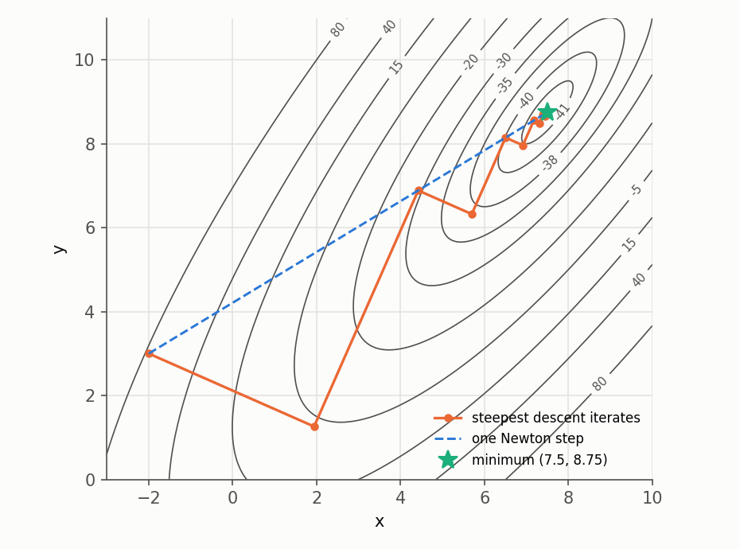

# Chapter 7 — Optimization

[Repository Guide](../../README.md) | [English](Concepts_Lecture.md) | [한국어](Concepts_Lecture.ko.md)

> **Last Updated:** 2026-11-19
>
> Applied Numerical Methods with Python for Engineers and Scientists, Chapra and Clough, Ch 7

> **Learning Objectives:**
> 1. Apply golden-section search to one-dimensional optimization
> 2. Estimate a one-dimensional optimum with parabolic interpolation
> 3. Explain the definitions of local minima, global minima, and convexity
> 4. Implement the steepest descent algorithm

---

<br>

## Table of Contents

- [1. Introduction to Optimization](#1-introduction-to-optimization)
  - [1.1 The Concept of Optimization](#11-the-concept-of-optimization)
  - [1.2 Motivating Example: Aluminum Can Design](#12-motivating-example-aluminum-can-design)
  - [1.3 Mathematical Description](#13-mathematical-description)
  - [1.4 Minimization vs. Maximization](#14-minimization-vs-maximization)
  - [1.5 Feasible Region and Constraints](#15-feasible-region-and-constraints)
- [2. Key Topological Concepts](#2-key-topological-concepts)
  - [2.1 Interior Points](#21-interior-points)
  - [2.2 Boundary Points](#22-boundary-points)
  - [2.3 Feasible Directions](#23-feasible-directions)
- [3. Local and Global Optimality](#3-local-and-global-optimality)
  - [3.1 Global Minimum](#31-global-minimum)
  - [3.2 Infimum and Supremum](#32-infimum-and-supremum)
  - [3.3 Local Minimum](#33-local-minimum)
  - [3.4 Strict Local Minimum](#34-strict-local-minimum)
- [4. Existence of an Optimal Solution](#4-existence-of-an-optimal-solution)
  - [4.1 Weierstrass Theorem](#41-weierstrass-theorem)
  - [4.2 Coercive Functions](#42-coercive-functions)
  - [4.3 Proof Sketch for Coercive Functions](#43-proof-sketch-for-coercive-functions)
- [5. One-Dimensional Optimization](#5-one-dimensional-optimization)
- [6. Golden-Section Search](#6-golden-section-search)
  - [6.1 The Golden Ratio](#61-the-golden-ratio)
  - [6.2 Algorithm: Interval Reduction](#62-algorithm-interval-reduction)
  - [6.3 Reuse of Function Evaluations](#63-reuse-of-function-evaluations)
  - [6.4 Error Analysis](#64-error-analysis)
  - [6.5 Example: Iterations of Golden-Section Search](#65-example-iterations-of-golden-section-search)
  - [6.6 Precision Limit and Cautions of Golden-Section Search](#66-precision-limit-and-cautions-of-golden-section-search)
- [7. Parabolic Interpolation](#7-parabolic-interpolation)
  - [7.1 Constructing the Parabola](#71-constructing-the-parabola)
  - [7.2 Optimal Point Formula](#72-optimal-point-formula)
  - [7.3 Updating Points for the Next Iteration](#73-updating-points-for-the-next-iteration)
  - [7.4 Example: Iterations of Parabolic Interpolation](#74-example-iterations-of-parabolic-interpolation)
  - [7.5 Limitations of Parabolic Interpolation and Brent's Method](#75-limitations-of-parabolic-interpolation-and-brents-method)
- [8. Level Sets and Gradient](#8-level-sets-and-gradient)
  - [8.1 Level Set Definition](#81-level-set-definition)
  - [8.2 Gradient Is Orthogonal to Level Sets](#82-gradient-is-orthogonal-to-level-sets)
- [9. Convex Problems](#9-convex-problems)
  - [9.1 Convex Combination](#91-convex-combination)
  - [9.2 Convex Set](#92-convex-set)
  - [9.3 Hyperplane and Polyhedral Set](#93-hyperplane-and-polyhedral-set)
  - [9.4 Extreme Point](#94-extreme-point)
  - [9.5 Convex Function](#95-convex-function)
  - [9.6 Convex Optimization Problems](#96-convex-optimization-problems)
  - [9.7 Local Minimizers of a Convex Problem](#97-local-minimizers-of-a-convex-problem)
  - [9.8 First-Order Characterization](#98-first-order-characterization)
  - [9.9 Second-Order Characterization](#99-second-order-characterization)
- [10. Steepest Gradient (Descent) Method](#10-steepest-gradient-descent-method)
  - [10.1 Directional Derivative and Cauchy-Schwarz](#101-directional-derivative-and-cauchy-schwarz)
  - [10.2 The Steepest Descent Update Rule](#102-the-steepest-descent-update-rule)
  - [10.3 Convergence and Orthogonality Property](#103-convergence-and-orthogonality-property)
  - [10.4 Example](#104-example)
  - [10.5 Iterations and Rate of Convergence for the Example](#105-iterations-and-rate-of-convergence-for-the-example)
- [11. Newton's Method for Optima](#11-newtons-method-for-optima)
  - [11.1 Newton's Method in One Dimension](#111-newtons-method-in-one-dimension)
  - [11.2 Classifying Stationary Points](#112-classifying-stationary-points)
  - [11.3 Newton's Method in Several Dimensions](#113-newtons-method-in-several-dimensions)
- [12. Optimization with SciPy](#12-optimization-with-scipy)
  - [12.1 One-Dimensional Minimization](#121-one-dimensional-minimization)
  - [12.2 Multidimensional Minimization](#122-multidimensional-minimization)
  - [12.3 Constrained Optimization: Aluminum Can Design](#123-constrained-optimization-aluminum-can-design)
- [Summary](#summary)
- [Self-Check Questions](#self-check-questions)
- [References](#references)

---

<br>

## 1. Introduction to Optimization

### 1.1 The Concept of Optimization

**Optimization** is a methodology to find the **best** among all **feasible solutions**. An **optimal solution** is the feasible solution that yields the best objective function value.

A function $`f(x)`$ can have several types of extreme points:

- **Global maximum**: the point where $`f`$ takes its largest value over the entire domain.
- **Global minimum**: the point where $`f`$ takes its smallest value over the entire domain.
- **Local maximum**: a point where the value of $`f`$ is no smaller than at any nearby point.
- **Local minimum**: a point where the value of $`f`$ is no larger than at any nearby point.

### 1.2 Motivating Example: Aluminum Can Design

A company needs to design an aluminum can in the shape of a cylinder with diameter $`d`$ and height $`h`$.

**Formulas:**

```math
\text{Volume} = \pi \left(\frac{d}{2}\right)^2 h = \frac{\pi d^2 h}{4}
```

```math
\text{Surface Area} = \frac{\pi d^2}{2} + \pi d h
```

Both volume and surface area are functions of the diameter $`d`$ and height $`h`$.

**Goal:** Design a can that requires the **minimum possible amount of aluminum**, that is, a can with minimum surface area, while satisfying the following conditions:

1. The height must be at least 50% greater than the diameter: $`h \geq \frac{3}{2}d \iff \frac{3}{2}d - h \leq 0`$
2. The height cannot be more than twice the diameter: $`h \leq 2d \iff -2d + h \leq 0`$
3. The volume must be at least 330 mL: $`\frac{\pi d^2 h}{4} \geq 330`$
4. $`h > 0, \; d > 0`$ must hold, and this is already guaranteed: conditions 1 and 2 give $`d \geq 0`$ and $`h \geq 0`$, and condition 3 rules out $`d = 0`$ or $`h = 0`$.

**Summary of the optimization problem:**

```math
\text{minimize} \quad \frac{\pi d^2}{2} + \pi d h
```

```math
\text{subject to} \quad \frac{3}{2}d - h \leq 0
```

```math
-2d + h \leq 0
```

```math
\frac{\pi d^2 h}{4} \geq 330
```

### 1.3 Mathematical Description

Let $`\mathbb{X} \subseteq \mathbb{R}^n`$ be a set of $`n`$-dimensional real vectors, so that $`\mathbb{X} \ni x = [x_1, x_2, \ldots, x_n]^T`$.

Let $`f : \mathbb{X} \to \mathbb{R}`$.

An optimization problem has the general form:

```math
\min_{x \in \mathbb{X}} f(x)
```

equivalently written as:

```math
\text{minimize} \quad f(x) \quad \text{subject to} \quad x \in \mathbb{X}
```

where:

- $`\mathbb{X}`$ is the **feasible (admissible) region**.
- $`f`$ is the **objective function**.
- $`x`$ is a **feasible solution** or a **decision variable**.

### 1.4 Minimization vs. Maximization

A minimization problem $`\min_{x \in \mathbb{X}} f(x)`$ can be converted into an equivalent maximization problem:

```math
\max_{x \in \mathbb{X}} (-f(x))
```

and vice versa. Therefore, without loss of generality, we can always consider only minimization problems.

### 1.5 Feasible Region and Constraints

The feasible region $`\mathbb{X}`$ is described by a set of **constraints**:

- **Equality constraints:** These have the form $`h_i(x) = 0`$, where $`h_i : \mathbb{R}^n \to \mathbb{R}`$ and $`i \in \mathcal{E}_i`$ (index set).
- **Inequality constraints:** These have the form $`g_j(x) \leq 0`$, where $`g_j : \mathbb{R}^n \to \mathbb{R}`$ and $`j \in \mathcal{E}_j`$ (index set).

**Example:** Consider a feasible set $`\mathbb{X}`$ defined by two inequality constraints:

```math
\mathbb{X} = \{x \in \mathbb{R}^2 : x_1^2 + x_2^2 \leq 1, \; (x_1 - 1)^2 + x_2^2 \leq 1\}
```

Here $`g_1(x_1, x_2) = x_1^2 + x_2^2 - 1 \leq 0`$ and $`g_2(x_1, x_2) = (x_1 - 1)^2 + x_2^2 - 1 \leq 0`$. The feasible region is the intersection (overlap) of the two disks.

---

<br>

## 2. Key Topological Concepts

### 2.1 Interior Points

**Definition.** A point $`\hat{x} \in \mathbb{X}`$ is an **interior point** of $`\mathbb{X}`$ if there exists $`\varepsilon > 0`$ such that $`\hat{x}`$ is included in $`\mathbb{X}`$ together with the $`\varepsilon`$-ball centered at $`\hat{x}`$:

```math
B(\hat{x}, \varepsilon) \subset \mathbb{X}
```

**Definition.** $`\text{int}(\mathbb{X})`$ is the set of all interior points of $`\mathbb{X}`$.

### 2.2 Boundary Points

**Definition.** A point $`\bar{x}`$ is a **boundary point** of $`\mathbb{X}`$ if:

```math
\bar{x} \in \mathbb{X} \quad \text{and} \quad \bar{x} \notin \text{int}(\mathbb{X})
```

In other words, $`\bar{x}`$ belongs to the set, but no $`\varepsilon`$-ball around it is entirely contained within the set. Geometrically, boundary points lie on the edge of the set, while interior points lie inside the set with room to spare in every direction.

### 2.3 Feasible Directions

**Definition.** A vector $`d \in \mathbb{R}^n`$ is a **feasible direction** for the set $`\mathbb{X} \subseteq \mathbb{R}^n`$ at $`\bar{x} \in \mathbb{X}`$ if there exists $`\delta > 0`$ such that:

```math
\bar{x} + \alpha d \in \mathbb{X} \quad \text{for any } 0 \leq \alpha \leq \delta
```

> **Note:** **Geometric meaning.** A feasible direction is one in which we can move a small positive step from the current point and remain within the feasible set. At interior points, every direction is feasible. At boundary points, directions pointing outward are not feasible. Directions pointing inward are feasible, and directions along the boundary are feasible only where the boundary is flat (for example, on a face of a polyhedral set).

---

<br>

## 3. Local and Global Optimality

Consider the following minimization problem:

```math
\text{minimize} \quad f(x) \quad \text{subject to} \quad x \in \mathbb{X}
```

where $`f : \mathbb{R}^n \to \mathbb{R}`$.

### 3.1 Global Minimum

**Definition (Global Minimum).** The point $`x^* \in \mathbb{X}`$ is a point of **global minimum** (global minimizer) for the problem $`\min_{x \in \mathbb{X}} f(x)`$, written $`x^* = \arg\min_{x \in \mathbb{X}} f(x)`$, if:

```math
f(x^*) \leq f(x) \quad \forall \; x \in \mathbb{X}
```

A global minimizer $`x^*`$ is a **strict global minimizer** if:

```math
f(x^*) < f(x) \quad \forall \; x \in \mathbb{X} \setminus \{x^*\}
```

### 3.2 Infimum and Supremum

Not every function has a global minimizer. Consider $`f(x) = e^x`$ with $`x \in \mathbb{R}`$:

- $`f(x) \geq 0`$, so $`f`$ is bounded from below.
- $`\lim_{x \to -\infty} f(x) = 0`$ and 0 is the greatest lower bound, but no $`x`$ satisfies $`f(x) = 0`$.

**Definition (Infimum, Supremum).** For a function $`f : \mathbb{X} \to \mathbb{R}`$:

- Its **greatest lower bound** is called the **infimum**: $`\inf_{x \in \mathbb{X}} f(x)`$
- Its **least upper bound** is called the **supremum**: $`\sup_{x \in \mathbb{X}} f(x)`$

**Examples:**

- $`\sup_{x \in \mathbb{R}} e^x = +\infty`$
- $`\inf_{x \in (0, +\infty)} \ln(x) = -\infty`$

> **Note:** **Minimum and infimum.** The minimum of a function is the infimum that is actually attained. When there exists some $`x^*`$ with $`f(x^*) = \inf f`$, $`\min f = \inf f`$. When the infimum is not attained, the minimum does not exist even though the infimum is well-defined.

### 3.3 Local Minimum

**Definition (Local Minimum).** $`x^* \in \mathbb{X}`$ is a point of **local minimum** (local minimizer) for the problem $`\min_{x \in \mathbb{X}} f(x)`$ if there exists $`\varepsilon > 0`$ such that:

```math
f(x) \geq f(x^*) \quad \forall \; x \in \mathbb{X} \text{ with } \|x - x^*\| \leq \varepsilon
```

### 3.4 Strict Local Minimum

A local minimizer $`x^*`$ is a **strict local minimizer** if there exists $`\varepsilon > 0`$ such that:

```math
f(x) > f(x^*) \quad \forall \; x \in \mathbb{X} \setminus \{x^*\} \text{ with } \|x - x^*\| \leq \varepsilon
```

> **Key Point:** A global minimizer has the smallest function value over the **entire** feasible set, while a local minimizer only needs to be optimal within some neighborhood. Every global minimizer is a local minimizer, but the converse is not necessarily true.

---

<br>

## 4. Existence of an Optimal Solution

Checking if a global minimizer exists is an extremely difficult problem in general. However, in some situations, we can guarantee the existence of a global minimizer.

### 4.1 Weierstrass Theorem

**Theorem (Weierstrass).** The problems $`\min_{x \in \mathbb{X}} f(x)`$ and $`\max_{x \in \mathbb{X}} f(x)`$, where $`\mathbb{X} \subset \mathbb{R}^n`$ is a nonempty **compact set** (closed and bounded) and $`f : \mathbb{X} \to \mathbb{R}`$ is a **continuous function**, have **global optimal solutions**.

> **Note:** **Compact sets.** A compact set in $`\mathbb{R}^n`$ is one that is both closed (contains the limit of every convergent sequence of its points) and bounded (fits inside a ball of finite radius). The Weierstrass theorem guarantees that continuous functions attain their extreme values on nonempty compact sets.

### 4.2 Coercive Functions

**Definition (Coercive Function).** A function $`f : \mathbb{R}^n \to \mathbb{R}`$ is called **coercive** if:

```math
\lim_{\|x\| \to \infty} f(x) = +\infty
```

As $`x`$ moves arbitrarily far away from the origin, the function value $`f(x)`$ grows to infinity. For example, $`f(x) = x^2`$ is coercive, while $`f(x) = \sin(x)`$ is not.

**Theorem.** Any continuous coercive function $`f : \mathbb{R}^n \to \mathbb{R}`$ has a **global minimizer** in $`\mathbb{R}^n`$.

### 4.3 Proof Sketch for Coercive Functions

1. Fix any point $`\hat{x} \in \mathbb{R}^n`$. Since $`f`$ is coercive, there exists $`C > 0`$ such that $`\|x\| > C`$ implies $`f(x) > f(\hat{x})`$.
2. Represent $`\mathbb{R}^n = \mathbb{X}_1 \cup \mathbb{X}_2`$ as a union of two disjoint sets, where $`\mathbb{X}_1 = \{x : \|x\| \leq C\}`$ and $`\mathbb{X}_2 = \{x : \|x\| > C\}`$.
3. Then $`\hat{x} \in \mathbb{X}_1`$, and $`f(\hat{x}) < f(x)`$ for every $`x \in \mathbb{X}_2`$.
4. Since $`\mathbb{X}_1`$ is a compact set, by the Weierstrass theorem, there exists $`x^* \in \mathbb{X}_1`$ such that $`f(x^*) = \min_{x \in \mathbb{X}_1} f(x)`$.
5. Thus $`f(\hat{x}) \geq f(x^*)`$, which yields $`f(x) \geq f(x^*)`$ for all $`x \in \mathbb{R}^n`$.
6. This implies $`x^*`$ is a global minimizer.

---

<br>

## 5. One-Dimensional Optimization

In one-dimensional optimization, the goal is to find the minimum (or maximum) of a function $`f(x)`$ where $`x \in \mathbb{R}`$.

**Objectives:**

- Understand one-dimensional and multi-dimensional optimization.
- Distinguish between global and local optima.
- Cast maximization problems into minimization problems.
- Learn the **golden-section search** and **parabolic interpolation** methods.

---

<br>

## 6. Golden-Section Search

The golden-section search is an efficient bracketing method for finding the minimum of a unimodal function (a function with a single local minimum in the interval) on a closed interval. It systematically narrows the interval that contains the minimum.

### 6.1 The Golden Ratio

**Definition (Golden Ratio).** Divide a line into two segments $`l_1`$ and $`l_2`$ ($`l_1 > l_2 > 0`$) such that:

```math
\frac{l_1 + l_2}{l_1} = \frac{l_1}{l_2} =: \phi \quad \text{(golden ratio)}
```

The ratio of the **whole line** to the **larger segment** equals the ratio of the **larger segment** to the **smaller segment**.

**Derivation:** From the defining relation:

```math
l_1 l_2 + l_2^2 = l_1^2
```

Dividing by $`l_2^2`$:

```math
\frac{l_1}{l_2} + 1 = \left(\frac{l_1}{l_2}\right)^2
```

```math
\phi^2 - \phi - 1 = 0
```

```math
\phi = \frac{1 \pm \sqrt{5}}{2}
```

Taking $`\phi > 0`$:

```math
\phi = \frac{1 + \sqrt{5}}{2} \approx 1.61803
```

Dividing $`\phi^2 - \phi - 1 = 0`$ by $`\phi`$ gives a useful reciprocal relation:

```math
\frac{1}{\phi} = \phi - 1 = \frac{\sqrt{5} - 1}{2} \approx 0.61803
```

### 6.2 Algorithm: Interval Reduction

Given an interval $`[x_l, x_u]`$ that brackets a minimum, define:

```math
d = (\phi - 1)(x_u - x_l)
```

Choose two interior points:

```math
x_1^{(1)} = x_l + d = x_l(2 - \phi) + x_u(\phi - 1)
```

```math
x_2^{(1)} = x_u - d = x_u(2 - \phi) + x_l(\phi - 1)
```

Note that $`x_2 < x_1`$; Figure 1 shows the placement of the two interior points.

```text
x_l             x_2       x_1             x_u
 |---------------|---------|---------------|
 |<---------- d ---------->|
                 |<---------- d ---------->|
 |<------------ L = x_u - x_l ------------>|
```

*Figure 1. Placement of the two interior points and the distance d in golden-section search*

**Decision rule:**

- If $`f(x_2) > f(x_1)`$, the minimum is in $`[x_2, x_u]`$, so set $`x_l \leftarrow x_2^{(1)}`$.
- If $`f(x_2) < f(x_1)`$, the minimum is in $`[x_l, x_1]`$, so set $`x_u \leftarrow x_1^{(1)}`$.

### 6.3 Reuse of Function Evaluations

The advantage of this method is that after each iteration, one of the two interior points from the previous step coincides with one of the new interior points. Specifically, when $`f(x_2) > f(x_1)`$ and we set $`x_l \leftarrow x_2^{(1)}`$:

```math
x_2^{(2)} = x_u - d_{\text{new}} = x_1^{(1)}
```

This can be verified algebraically using the property $`\phi^2 = \phi + 1`$. Therefore, we **do not need to recalculate** the function value at $`x_2^{(2)}`$ because it is the same as $`f(x_1^{(1)})`$.

> **Note:** **Efficiency.** Each iteration of the golden-section search requires only **one new function evaluation** (instead of two), making it very efficient. The interval shrinks by a constant factor of $`\frac{1}{\phi} \approx 0.61803`$ at each step.

### 6.4 Error Analysis

After one iteration, the interior point with the smaller function value is used as the estimate of the optimum. If $`f(x_2) > f(x_1)`$, the estimate is $`x_1`$, the true optimum $`x^*`$ lies in the new interval $`[x_2, x_u]`$, and the three points for the next iteration are $`x_2, x_1, x_u`$.

**Case 1:** If $`x^*`$ lies between $`x_2`$ and $`x_1`$ ($`x_2 \leq x^* \leq x_1`$), the maximum distance from the estimate $`x_1`$ to $`x^*`$ is:

```math
\Delta x_a = x_1 - x_2 = (2\phi - 3)(x_u - x_l) \approx 0.2361 \cdot (x_u - x_l)
```

**Case 2:** If $`x^*`$ lies between $`x_1`$ and $`x_u`$ ($`x_1 \leq x^* \leq x_u`$), the maximum distance is:

```math
\Delta x_b = x_u - x_1 = (2 - \phi)(x_u - x_l) \approx 0.3820 \cdot (x_u - x_l)
```

If $`f(x_2) < f(x_1)`$, the estimate is $`x_2`$, the three points for the next iteration are $`x_l, x_2, x_1`$, and symmetrically the maximum distance is $`x_2 - x_l = (2 - \phi)(x_u - x_l)`$ or $`x_1 - x_2`$. In either case the worst-case error is $`(2 - \phi)(x_u - x_l)`$, and dividing it by the magnitude of the estimate defines the **relative error**:

```math
\varepsilon_a = (2 - \phi) \left| \frac{x_u - x_l}{x_{\text{opt}}} \right|
```

where $`x_{\text{opt}}`$ is the current best estimate of the optimum.

### 6.5 Example: Iterations of Golden-Section Search

Find the minimum of $`f(x) = \frac{x^2}{10} - 2\sin x`$ on $`[0, 4]`$ by golden-section search. The function is unimodal on this interval, and the true minimizer is the root of $`f'(x) = x/5 - 2\cos x = 0`$, $`x^* = 1.427552`$, with minimum value $`f(x^*) = -1.775726`$.

In the first iteration $`d = 0.61803 \times (4 - 0) = 2.4721`$, so $`x_1 = 0 + 2.4721 = 2.4721`$ and $`x_2 = 4 - 2.4721 = 1.5279`$. Since $`f(x_2) = 1.5279^2/10 - 2\sin 1.5279 = -1.7647`$ and $`f(x_1) = -0.6300`$, $`f(x_2) < f(x_1)`$. The minimum lies in $`[x_l, x_1] = [0, 2.4721]`$, so set $`x_u \leftarrow 2.4721`$, and the previous $`x_2 = 1.5279`$ becomes the new $`x_1`$. The new $`x_2`$ is $`2.4721 - 0.61803 \times 2.4721 = 0.9443`$, and the function is evaluated anew only at this point. Continuing gives the following table.

| $`i`$ | $`x_l`$ | $`x_2`$ | $`f(x_2)`$ | $`x_1`$ | $`f(x_1)`$ | $`x_u`$ | $`d`$ | $`x_{\text{opt}}`$ | $`\varepsilon_a`$ (%) |
|-----:|-----:|-----:|-----:|-----:|-----:|-----:|-----:|-----:|-----:|
| 1 | 0.0000 | 1.5279 | -1.7647 | 2.4721 | -0.6300 | 4.0000 | 2.4721 | 1.5279 | 100.00 |
| 2 | 0.0000 | 0.9443 | -1.5310 | 1.5279 | -1.7647 | 2.4721 | 1.5279 | 1.5279 | 61.80 |
| 3 | 0.9443 | 1.5279 | -1.7647 | 1.8885 | -1.5432 | 2.4721 | 0.9443 | 1.5279 | 38.20 |
| 4 | 0.9443 | 1.3050 | -1.7595 | 1.5279 | -1.7647 | 1.8885 | 0.5836 | 1.5279 | 23.61 |
| 5 | 1.3050 | 1.5279 | -1.7647 | 1.6656 | -1.7136 | 1.8885 | 0.3607 | 1.5279 | 14.59 |
| 6 | 1.3050 | 1.4427 | -1.7755 | 1.5279 | -1.7647 | 1.6656 | 0.2229 | 1.4427 | 9.55 |
| 7 | 1.3050 | 1.3901 | -1.7742 | 1.4427 | -1.7755 | 1.5279 | 0.1378 | 1.4427 | 5.90 |
| 8 | 1.3901 | 1.4427 | -1.7755 | 1.4752 | -1.7732 | 1.5279 | 0.0851 | 1.4427 | 3.65 |

*Table 1. Iterations of golden-section search for f(x) = x²/10 - 2 sin x*

In each iteration the width of the interval $`[x_l, x_u]`$ and $`d`$ shrink by a factor of 0.618, and only one new function value is computed (Section 6.3). After eight iterations the estimate 1.4427 differs from the true minimizer by 0.015. The approximate error $`\varepsilon_a`$ is the bound computed with the formula of Section 6.4.

After $`n`$ iterations the width of the interval is $`L_n = (\phi - 1)^n L_0 = L_0/\phi^n`$. The number of iterations needed to reduce the width below a tolerance $`\varepsilon`$ is therefore:

```math
n \geq \frac{\ln(L_0/\varepsilon)}{\ln \phi}
```

With $`L_0 = 4`$ and $`\varepsilon = 10^{-4}`$, $`n \geq \ln(40000)/\ln(1.618) \approx 22.0`$. This is more than the $`\log_2(40000) \approx 15.3`$ iterations bisection needs in root finding for the same width, because bracketing a minimum takes three points rather than two and one evaluation shrinks the interval only by 0.618 rather than by half.

### 6.6 Precision Limit and Cautions of Golden-Section Search

The following points need care when using golden-section search.

- **Unimodality.** The method assumes that there is only one local minimum in the interval. If there are several, it merely converges to one of them, with no guarantee that it is the global minimum. It is safer to plot the function before choosing the interval.
- **Maximization.** To find a maximum, find the minimum of $`-f`$ or reverse the inequalities of the decision rule (Section 1.4).
- **Limit of precision.** Near the minimizer, $`f(x^* + \delta) \approx f(x^*) + \frac{f''(x^*)}{2}\delta^2`$, so differences in function value are proportional to $`\delta^2`$. Function values can be distinguished only to the relative precision $`\varepsilon_{\text{mach}}`$, so for $`\delta`$ with $`\frac{f''(x^*)}{2}\delta^2 < \varepsilon_{\text{mach}}|f(x^*)|`$ the function values at two points cannot be compared. In this example the limit is $`\delta \approx \sqrt{2\varepsilon_{\text{mach}}|f(x^*)|/f''(x^*)} \approx 1.9 \times 10^{-8}`$, and in general the location of a minimizer can be found only to a relative precision of about $`\sqrt{\varepsilon_{\text{mach}}} \approx 1.5 \times 10^{-8}`$. This is why the precision is lower than in root finding, where the location of a root can be found to the level of $`\varepsilon_{\text{mach}}`$.
- **Tolerance.** For the reason above, a tolerance smaller than $`10^{-8}`$ does not improve the accuracy however many iterations are added.

---

<br>

## 7. Parabolic Interpolation

Parabolic interpolation fits a quadratic (parabola) through three points and then uses the optimum of the parabola as the next estimate. This approach can converge faster than golden-section search for smooth functions.

### 7.1 Constructing the Parabola

Given three points $`(x_1, y_1)`$, $`(x_2, y_2)`$, $`(x_3, y_3)`$ where $`y_i = f(x_i)`$, construct the parabolic equation:

```math
y = ax^2 + bx + c
```

This leads to the linear system:

```math
\begin{bmatrix} y_1 \\ y_2 \\ y_3 \end{bmatrix} = \begin{bmatrix} x_1^2 & x_1 & 1 \\ x_2^2 & x_2 & 1 \\ x_3^2 & x_3 & 1 \end{bmatrix} \begin{bmatrix} a \\ b \\ c \end{bmatrix}
```

Using **Cramer's rule**, let $`D = \begin{vmatrix} x_1^2 & x_1 & 1 \\ x_2^2 & x_2 & 1 \\ x_3^2 & x_3 & 1 \end{vmatrix}`$, then:

```math
a = \frac{1}{D}\begin{vmatrix} y_1 & x_1 & 1 \\ y_2 & x_2 & 1 \\ y_3 & x_3 & 1 \end{vmatrix}, \quad b = \frac{1}{D}\begin{vmatrix} x_1^2 & y_1 & 1 \\ x_2^2 & y_2 & 1 \\ x_3^2 & y_3 & 1 \end{vmatrix}, \quad c = \frac{1}{D}\begin{vmatrix} x_1^2 & x_1 & y_1 \\ x_2^2 & x_2 & y_2 \\ x_3^2 & x_3 & y_3 \end{vmatrix}
```

### 7.2 Optimal Point Formula

The optimal point of the parabola (vertex) is found by setting $`\frac{dy}{dx} = 0`$:

```math
2ax_4 + b = 0 \implies x_4 = -\frac{b}{2a}
```

Substituting $`a`$ and $`b`$ from Cramer's rule and simplifying gives:

```math
x_4 = x_2 - \frac{1}{2} \cdot \frac{(x_2 - x_1)^2(y_2 - y_3) - (x_2 - x_3)^2(y_2 - y_1)}{(x_2 - x_1)(y_2 - y_3) - (x_2 - x_3)(y_2 - y_1)}
```

> **Note:** For a **maximization** problem, the parabola should open downward ($`a < 0`$), and the vertex gives the approximate maximum. For a **minimization** problem, the parabola should open upward ($`a > 0`$), and the vertex gives the approximate minimum.

### 7.3 Updating Points for the Next Iteration

Once we compute $`x_4`$, we need to determine the new triplet $`(x_1, x_2, x_3)`$ for the next iteration. The decision depends on where $`x_4`$ falls relative to $`x_2`$:

**If $`x_4`$ is between $`x_2`$ and $`x_3`$ (i.e., $`x_2 \leq x_4 \leq x_3`$):**

| Condition | Action |
|-----------|--------|
| $`f(x_4) < f(x_2)`$ (Case 4) | $`x_2 \Rightarrow x_1`$, $`x_4 \Rightarrow x_2`$, $`x_3`$ stays |
| $`f(x_4) \geq f(x_2)`$ (Case 3) | $`x_1`$ stays, $`x_2`$ stays, $`x_4 \Rightarrow x_3`$ |

*Table 2. Point update when the new point lies to the right of the middle point*

**If $`x_4`$ is between $`x_1`$ and $`x_2`$ (i.e., $`x_1 \leq x_4 \leq x_2`$):**

| Condition | Action |
|-----------|--------|
| $`f(x_4) < f(x_2)`$ (Case 2) | $`x_2 \Rightarrow x_3`$, $`x_4 \Rightarrow x_2`$, $`x_1`$ stays |
| $`f(x_4) \geq f(x_2)`$ (Case 1) | $`x_4 \Rightarrow x_1`$, $`x_2`$ stays, $`x_3`$ stays |

*Table 3. Point update when the new point lies to the left of the middle point*

> **Note:** **Rate of convergence.** Parabolic interpolation has **superlinear convergence** (approximately order 1.324), which is faster than the linear convergence of golden-section search. However, it can fail if the three points do not bracket a minimum well or if the fitted parabola degenerates.

### 7.4 Example: Iterations of Parabolic Interpolation

Apply parabolic interpolation to the same function as Section 6.5 with the three points $`x_1 = 0`$, $`x_2 = 1`$, and $`x_3 = 4`$. The function values are $`f(0) = 0`$, $`f(1) = -1.5829`$, and $`f(4) = 3.1136`$. Substituting into the formula of Section 7.2 gives:

```math
x_4 = 1 - \frac{1}{2} \cdot \frac{(1 - 0)^2(-1.5829 - 3.1136) - (1 - 4)^2(-1.5829 - 0)}{(1 - 0)(-1.5829 - 3.1136) - (1 - 4)(-1.5829 - 0)} = 1 - \frac{1}{2} \cdot \frac{9.5496}{-9.4452} = 1.5055
```

$`f(1.5055) = -1.7691`$ is smaller than $`f(x_2)`$, and $`x_4`$ lies between $`x_2`$ and $`x_3`$, so by case 4 of Table 2 the next three points are $`(1, 1.5055, 4)`$. Continuing gives the following table.

| $`i`$ | $`x_1`$ | $`x_2`$ | $`x_3`$ | $`x_4`$ | $`f(x_4)`$ |
|-----:|-----:|-----:|-----:|-----:|-----:|
| 1 | 0.0000 | 1.0000 | 4.0000 | 1.5055 | -1.7691 |
| 2 | 1.0000 | 1.5055 | 4.0000 | 1.4903 | -1.7714 |
| 3 | 1.0000 | 1.4903 | 1.5055 | 1.4256 | -1.7757 |
| 4 | 1.0000 | 1.4256 | 1.4903 | 1.4266 | -1.7757 |
| 5 | 1.4256 | 1.4266 | 1.4903 | 1.4275 | -1.7757 |

*Table 4. Iterations of parabolic interpolation for f(x) = x²/10 - 2 sin x*

After five iterations the estimate 1.4275 agrees with the true minimizer 1.427552 to four decimal places. After the same number of iterations the estimate of golden-section search (Table 1) was 1.5279. The function is close to a parabola near the minimizer, so the vertex of the parabola follows the minimizer quickly.

### 7.5 Limitations of Parabolic Interpolation and Brent's Method

Parabolic interpolation fails or slows down in the following cases.

- If the three points lie almost on a straight line, the denominator of the formula of Section 7.2 approaches zero, so $`x_4`$ jumps very far or cannot be computed.
- If the three points do not form an upward-opening parabola ($`a \leq 0`$), the vertex is a maximum, and a minimization moves in the wrong direction.
- If the update rule of Section 7.3 keeps changing only one endpoint, the interval does not shrink enough, and a stagnation similar to the one-sidedness of false position (Chapter 5) can occur.

**Brent's method** applies the same idea as Brent's method for root finding (Chapter 6) to minimization. It keeps an interval bracketing the minimum, uses the candidate from parabolic interpolation when it lies inside the interval and the step shrinks enough, and otherwise takes one step of golden-section search. SciPy's `scipy.optimize.minimize_scalar` uses this method by default when no bounds are given, and its documentation describes it as an algorithm that uses inverse parabolic interpolation when possible to speed up the convergence of golden-section search [1]. Section 12.1 compares the numbers of function evaluations.

---

<br>

## 8. Level Sets and Gradient

In optimization, level sets play a crucial role in analyzing and visualizing objective functions.

### 8.1 Level Set Definition

**Definition (Level Set).** For a function $`f : \mathbb{R}^n \to \mathbb{R}`$ and a constant $`c`$:

- The set $`\{x \in \mathbb{R}^n : f(x) = c\}`$ is called the **level set** of $`f`$ at the level $`c`$.
- The set $`\{x \in \mathbb{R}^n : f(x) \leq c\}`$ is called the **lower level set** of $`f`$ at $`c`$.
- The set $`\{x \in \mathbb{R}^n : f(x) \geq c\}`$ is called the **upper level set** of $`f`$ at $`c`$.

**Example:** For $`f(x_1, x_2) = x_1^2 + x_2^2`$, the level set at $`c = 1`$ is the unit circle $`x_1^2 + x_2^2 = 1`$. The lower level set $`f(x_1, x_2) \leq 1`$ is the unit disk, and the upper level set $`f(x_1, x_2) \geq 1`$ is the exterior of the unit disk (including its boundary, the unit circle).

### 8.2 Gradient Is Orthogonal to Level Sets

Consider a parametric curve $`\gamma = \{x(t) : t \in (a, b)\} \subset S`$ lying on a level set $`S = \{x : f(x) = c\}`$, where $`x(t) : (a, b) \to S`$ is a differentiable function.

Since $`f(x(t)) = c`$ for $`t \in (a, b)`$, differentiating with respect to $`t`$ gives:

```math
\frac{df}{dt} = \nabla f^T \frac{dx}{dt} = 0
```

where $`\nabla f`$ and $`\frac{dx}{dt}`$ are:

```math
\nabla f = \begin{bmatrix} \frac{\partial f}{\partial x_1} \\ \frac{\partial f}{\partial x_2} \end{bmatrix}, \quad \frac{dx}{dt} = \begin{bmatrix} \frac{dx_1}{dt} \\ \frac{dx_2}{dt} \end{bmatrix}
```

Since $`\frac{dx}{dt}`$ is the tangent vector to the curve $`x(t)`$, and $`\nabla f^T \frac{dx}{dt} = 0`$, this means:

```math
\nabla f \perp \frac{dx}{dt}
```

**The gradient $`\nabla f`$ is orthogonal to the level set.**

**Example:** For $`f(x_1, x_2) = x_1^2 + x_2^2`$, the gradient is:

```math
\nabla f = \begin{bmatrix} 2x_1 \\ 2x_2 \end{bmatrix} = 2\begin{bmatrix} x_1 \\ x_2 \end{bmatrix}
```

The gradient points radially outward, perpendicular to the circular level sets, confirming the orthogonality.

> **Note:** **Geometric meaning of the gradient.** Where it is nonzero, the gradient points in the direction of steepest ascent. At every such point it is perpendicular to the level set, pointing uphill toward higher values of $`f`$. This is the foundation for gradient-based optimization methods.

---

<br>

## 9. Convex Problems

### 9.1 Convex Combination

**Definition (Convex Combination).** Given points $`x_1, x_2, \ldots, x_m`$ in $`\mathbb{R}^n`$ and real numbers $`\alpha_i \geq 0`$ with $`\sum_{i=1}^m \alpha_i = 1`$, the point:

```math
\sum_{i=1}^m \alpha_i x_i
```

is called a **convex combination** of these points.

### 9.2 Convex Set

**Definition (Convex Set).** A set $`\mathbb{X} \subseteq \mathbb{R}^n`$ is said to be **convex** if:

```math
\alpha x + (1 - \alpha)y \in \mathbb{X}
```

holds for any $`x, y \in \mathbb{X}`$ and any $`\alpha \in (0, 1)`$.

Geometrically, a set is convex if the line segment connecting any two points in the set lies entirely within the set.

**Example:** Show that $`\mathbb{X} = \{x \in \mathbb{R}^n : A_1 x = b_1, \; A_2 x \leq b_2\}`$ is convex.

For any $`x, y \in \mathbb{X}`$ and any $`\alpha \in (0, 1)`$, let $`z = \alpha x + (1 - \alpha)y`$:

```math
A_1 z = \alpha A_1 x + (1 - \alpha) A_1 y = \alpha b_1 + (1 - \alpha) b_1 = b_1
```

```math
A_2 z = \alpha A_2 x + (1 - \alpha) A_2 y \leq \alpha b_2 + (1 - \alpha) b_2 = b_2
```

Therefore $`z \in \mathbb{X}`$, confirming that $`\mathbb{X}`$ is a convex set.

### 9.3 Hyperplane and Polyhedral Set

**Definition (Hyperplane).** A hyperplane $`\mathbb{H} \subset \mathbb{R}^n`$ is a set of the form:

```math
\mathbb{H} = \{x \in \mathbb{R}^n : c^T x = b\}
```

where $`c \in \mathbb{R}^n \setminus \{0\}`$ and $`b \in \mathbb{R}`$.

A hyperplane is the intersection of two **half-spaces**:

```math
\mathbb{H}_+ = \{x \in \mathbb{R}^n : c^T x \geq b\}, \quad \mathbb{H}_- = \{x \in \mathbb{R}^n : c^T x \leq b\}
```

**Proof that $`\mathbb{H}`$ is convex:** Take $`x, y \in \mathbb{H}`$ so that $`c^T x = b`$ and $`c^T y = b`$. For $`z = \alpha x + (1 - \alpha) y`$:

```math
c^T z = \alpha c^T x + (1 - \alpha) c^T y = \alpha b + (1 - \alpha)b = b
```

Therefore $`z \in \mathbb{H}`$, which implies $`\mathbb{H}`$ is convex.

**Definition (Polyhedral Set).** A set defined by finitely many linear equations and/or inequalities is called a **polyhedral set** (or polyhedron).

### 9.4 Extreme Point

**Definition (Extreme Point).** Given a convex set $`\mathbb{X}`$, a point $`x \in \mathbb{X}`$ is called an **extreme point** of $`\mathbb{X}`$ if it cannot be represented as a convex combination of two **distinct** points in $`\mathbb{X}`$. That is, there do not exist distinct points $`x', x'' \in \mathbb{X}`$ and $`\alpha \in (0, 1)`$ such that $`x = \alpha x' + (1 - \alpha) x''`$.

**Examples:**

- For a circle (disk), every point on the boundary is an extreme point.
- For a rectangle, only the four **vertices (corners)** are extreme points. Points on the edges (other than the vertices) are not extreme points because they can be written as convex combinations of the two endpoints.

If the feasible region is a closed and bounded convex set (for example, a bounded polyhedron) and the objective function is linear, at least one optimal solution occurs at an extreme point. Therefore, we only need to check extreme points to find the optimal value.

### 9.5 Convex Function

**Definition (Convex Function).** Given a convex set $`\mathbb{X} \subseteq \mathbb{R}^n`$, a function $`f : \mathbb{X} \to \mathbb{R}`$ is **convex** if:

```math
f(\alpha x + (1 - \alpha)y) \leq \alpha f(x) + (1 - \alpha) f(y) \quad \forall \; x, y \in \mathbb{X}, \; \alpha \in (0, 1)
```

We say $`f`$ is **strictly convex** if:

```math
f(\alpha x + (1 - \alpha)y) < \alpha f(x) + (1 - \alpha) f(y) \quad \forall \; x, y \in \mathbb{X}, \; x \neq y, \; \alpha \in (0, 1)
```

Geometrically, a function is convex if the line segment connecting any two points on its graph lies on or above the graph.

**Concave functions:** A function $`f`$ is **concave** if $`-f`$ is convex.

**Examples:**

- $`f(x) = \frac{1}{x}`$ for $`x > 0`$ is **convex**.
- $`f(x) = \ln(x)`$ for $`x > 0`$ is **concave**.

**Proof that $`f(x) = \frac{1}{x}`$ is convex on $`(0, \infty)`$:** We need to show $`\frac{1}{z} \leq \frac{\alpha}{x_1} + \frac{(1 - \alpha)}{x_2}`$ where $`z = \alpha x_1 + (1 - \alpha)x_2`$.

Multiplying both sides by $`x_1 x_2 z > 0`$, this is equivalent to showing $`x_1 x_2 \leq z(\alpha x_2 + (1 - \alpha)x_1)`$, which reduces to $`0 \leq (1 - \alpha)\alpha(x_1^2 - 2x_1 x_2 + x_2^2) = (1 - \alpha)\alpha(x_1 - x_2)^2`$, which is always true.

**Properties of convex functions:**

- A convex function is **continuous** in the interior $`\text{int}(\mathbb{X})`$.
- A convex function is **not necessarily differentiable** in $`\text{int}(\mathbb{X})`$.
  - Example: On $`\mathbb{X} = \mathbb{R}`$, $`f(x) = |x|`$ is convex but not differentiable at $`x = 0`$.

> **Note:** **Why convexity matters.** The importance of convexity in optimization cannot be overstated: for a convex function on a convex set, every local minimizer is also a global minimizer. This makes convex optimization problems fundamentally easier to solve.

### 9.6 Convex Optimization Problems

> **Definition:** A **convex optimization problem** is a minimization problem $`\min_{x \in \mathbb{X}} f(x)`$ whose objective function $`f`$ is a convex function and whose feasible region $`\mathbb{X}`$ is a convex set.

Both conditions are needed. For example, the following two problems have the same objective function.

```math
\text{(a)}\ \min\ 3(x - 2)^2 + 2y^4 \ \ \text{subject to}\ \ x^2 + y^2 \leq 4, \qquad \text{(b)}\ \min\ 3(x - 2)^2 + 2y^4 \ \ \text{subject to}\ \ x^2 + y^2 = 4
```

The objective $`3(x - 2)^2 + 2y^4`$ is a sum of convex functions and is therefore convex. The feasible region of (a) is a disk, a convex set, so (a) is a convex problem. The feasible region of (b) is a circle, and the segment joining two points on the circle passes inside it, so it is not a convex set. Problem (b) is therefore not a convex problem even though its objective is convex. An equality constraint $`h(x) = 0`$ always produces a convex set when $`h`$ is linear (affine), but a nonlinear one, as in (b), usually does not, so the equality constraints of a convex optimization problem are normally restricted to affine functions.

### 9.7 Local Minimizers of a Convex Problem

The most important property of convex problems is the following theorem.

**Theorem.** Every local minimizer of a convex optimization problem is a global minimizer.

**Proof.** Suppose, for contradiction, that $`x^*`$ is a local minimizer but not a global minimizer. Then there is $`\tilde{x} \in \mathbb{X}`$ with $`f(\tilde{x}) < f(x^*)`$. Because $`\mathbb{X}`$ is convex, $`z_\alpha = \alpha\tilde{x} + (1 - \alpha)x^* \in \mathbb{X}`$ for all $`\alpha \in (0, 1)`$, and because $`f`$ is convex:

```math
f(z_\alpha) \leq \alpha f(\tilde{x}) + (1 - \alpha) f(x^*) < \alpha f(x^*) + (1 - \alpha) f(x^*) = f(x^*)
```

As $`\alpha \to 0`$, $`z_\alpha \to x^*`$, so every neighborhood of $`x^*`$ contains a feasible point with $`f(z_\alpha) < f(x^*)`$. This contradicts the assumption that $`x^*`$ is a local minimizer. Therefore $`f(x) \geq f(x^*)`$ holds for all $`x \in \mathbb{X}`$. $`\blacksquare`$

Thanks to this theorem, in a convex problem the minimum found by a local search can be trusted as the global minimum. The unimodality condition of golden-section search seen in Section 6.6 and the problem of steepest descent stopping at a local minimum in Section 10 do not arise when the objective function is convex.

### 9.8 First-Order Characterization

Whether a differentiable function is convex can be decided from its derivative instead of the definition.

**Theorem (first-order characterization).** If $`\mathbb{X} \subseteq \mathbb{R}^n`$ is a convex set and $`f`$ is differentiable on an open set containing $`\mathbb{X}`$, then $`f`$ is convex on $`\mathbb{X}`$ if and only if:

```math
f(y) \geq f(x) + \nabla f(x)^T (y - x) \quad \forall\, x, y \in \mathbb{X}
```

The right side is the height at $`y`$ of the tangent plane (the tangent line in one variable) drawn at $`x`$. That is, the graph of a convex function always lies on or above the tangent drawn at any point. An important conclusion follows immediately. For a convex function, if $`\nabla f(x^*) = 0`$, then $`f(y) \geq f(x^*)`$ for all $`y`$, so a point with zero gradient is necessarily a global minimizer. For a general function $`\nabla f = 0`$ may indicate a minimum, a maximum, or a saddle point (Section 11.2), but for a convex function it is a sufficient condition for minimization.

### 9.9 Second-Order Characterization

A twice-differentiable function is tested with its second derivatives.

**Theorem (second-order characterization).** If $`\mathbb{X} \subseteq \mathbb{R}^n`$ is a convex set and $`f`$ is twice differentiable on an open set containing $`\mathbb{X}`$, then $`f`$ is convex on $`\mathbb{X}`$ if and only if the Hessian matrix $`\nabla^2 f(x)`$ is **positive semidefinite** at every $`x \in \mathbb{X}`$.

> **Definition:** A **positive semidefinite matrix** is a symmetric matrix $`M`$ satisfying $`\mathbf{x}^T M \mathbf{x} \geq 0`$ for every vector $`\mathbf{x}`$.

In one variable the Hessian is the single number $`f''(x)`$, so the condition is $`f''(x) \geq 0`$. For example, $`f(x) = 1/x`$ has $`f''(x) = 2/x^3 > 0`$ for $`x > 0`$, so it is convex, matching the result shown from the definition in Section 9.5. As a two-variable example, consider $`f(x_1, x_2) = \frac{1}{2}(x_1 - x_2)^2`$, whose Hessian is $`M = \begin{bmatrix} 1 & -1 \\ -1 & 1 \end{bmatrix}`$:

```math
\mathbf{x}^T M \mathbf{x} = \begin{bmatrix} x_1 & x_2 \end{bmatrix} \begin{bmatrix} x_1 - x_2 \\ -x_1 + x_2 \end{bmatrix} = x_1^2 - 2x_1 x_2 + x_2^2 = (x_1 - x_2)^2 \geq 0
```

$`M`$ is therefore positive semidefinite and $`f`$ is convex. Along the direction $`x_1 = x_2`$, $`\mathbf{x}^T M \mathbf{x} = 0`$, so $`M`$ is not positive definite, and indeed $`f`$ attains its minimum 0 at every point of the line $`x_1 = x_2`$. A symmetric matrix is positive semidefinite if and only if all its eigenvalues are nonnegative (Chapter 13). The Hessian $`\begin{bmatrix} 6 & -4 \\ -4 & 4 \end{bmatrix}`$ of Section 10.4 has eigenvalues $`0.877`$ and $`9.123`$, both positive, so it is positive definite, and that objective function is strictly convex with a unique minimizer.

---

<br>

## 10. Steepest Gradient (Descent) Method

### 10.1 Directional Derivative and Cauchy-Schwarz

Consider the unconstrained minimization problem:

```math
\min_{x \in \mathbb{R}^n} f(x)
```

where $`f`$ is a continuously differentiable function.

Given $`x^{(0)} \in \mathbb{R}^n`$ and a direction $`d \in \mathbb{R}^n`$, the **directional derivative** of $`f`$ at $`x^{(0)}`$ in direction $`d`$ is:

```math
\nabla f\big|_{x=x^{(0)}}^T d
```

> **[Calculus]** The directional derivative is defined as the instantaneous rate of change $`\lim_{t \to 0} \frac{f(x^{(0)} + t d) - f(x^{(0)})}{t}`$ when moving from $`x^{(0)}`$ in the direction $`d`$, and when $`f`$ is differentiable the chain rule makes it equal to the inner product $`\nabla f^T d`$ of the gradient and the direction. Finding the direction of fastest decrease therefore becomes finding, among directions $`d`$ of the same length, the one that makes this inner product smallest, and the Cauchy-Schwarz inequality below determines that direction.

If $`\|d\| = 1`$, this is the rate of increase of $`f`$ when moving from $`x^{(0)}`$ in the direction $`d`$.

By the **Cauchy-Schwarz inequality**:

```math
\nabla f^T d \leq \|\nabla f\| \cdot \|d\|
```

Choosing $`d = \alpha \nabla f`$ for some $`\alpha > 0`$:

```math
\alpha \nabla f^T \nabla f = \alpha \|\nabla f\| \cdot \|\nabla f\|
```

This achieves equality in Cauchy-Schwarz, so $`\alpha \nabla f`$ is the direction of **maximum rate of increase** for $`f`$.

Similarly, for the direction of **maximum rate of decrease**, choose $`d = -\alpha \nabla f`$:

```math
-\nabla f^T d \leq \|\nabla f\| \cdot \|d\|
```

```math
\nabla f^T d \geq -\|\nabla f\| \cdot \|d\|
```

Choosing $`d = -\alpha \nabla f`$ gives $`-\alpha \nabla f^T \nabla f = -\alpha \|\nabla f\| \cdot \|\nabla f\|`$, which achieves the lower bound.

Therefore, $`-\nabla f`$ is the **best direction to take in a minimization method**.

### 10.2 The Steepest Descent Update Rule

The idea is to iteratively update:

```math
x^{(k+1)} = x^{(k)} - \alpha_k \nabla f\big|_{x=x^{(k)}}
```

where $`\alpha_k \geq 0`$ is chosen such that:

```math
f(x^{(k+1)}) < f(x^{(k)}), \quad k \geq 0
```

The step size $`\alpha_k`$ is typically found by **line search**, that is, by minimizing $`\phi_k(\alpha) = f(x^{(k)} - \alpha \nabla f_k)`$ with respect to $`\alpha`$.

The implementation below uses the golden-section search of Section 6 for the line search. First, the golden-section search is implemented as follows:

```python
import numpy as np

def golden_section_search(f, xl, xu, tol=1e-8, max_iter=200):
    """Minimize a unimodal function f on [xl, xu] by golden-section search."""
    phi = (1 + np.sqrt(5)) / 2
    d = (phi - 1) * (xu - xl)
    x1, x2 = xl + d, xu - d
    f1, f2 = f(x1), f(x2)
    for _ in range(max_iter):
        if xu - xl < tol:
            break
        if f2 > f1:                      # minimum in [x2, xu]
            xl, x2, f2 = x2, x1, f1      # old x1 becomes the new x2
            x1 = xl + (phi - 1) * (xu - xl)
            f1 = f(x1)
        else:                            # minimum in [xl, x1]
            xu, x1, f1 = x1, x2, f2      # old x2 becomes the new x1
            x2 = xu - (phi - 1) * (xu - xl)
            f2 = f(x2)
    return (xl + xu) / 2
```

Steepest descent uses this function to find the step size of each iteration in the interval $`[0, 1]`$:

```python
import numpy as np

def steepest_descent(f, grad_f, x0, tol=1e-8, max_iter=10000):
    """
    Steepest descent method with exact line search (golden-section).

    Parameters:
        f      : objective function
        grad_f : gradient function
        x0     : initial point (numpy array)
        tol    : tolerance for convergence
        max_iter: maximum number of iterations

    Returns:
        x      : approximate minimizer
        k      : number of iterations
    """
    x = np.array(x0, dtype=float)

    for k in range(max_iter):
        g = grad_f(x)
        if np.linalg.norm(g) < tol:
            break

        # Line search: minimize f(x - alpha * g)
        # Using golden-section search on alpha in [0, 1]
        phi = lambda a: f(x - a * g)
        alpha = golden_section_search(phi, 0, 1, tol=1e-10)

        x = x - alpha * g

    return x, k
```

Because the line search is restricted to $`[0, 1]`$, it is not an exact line search in iterations whose optimal step size exceeds 1.

### 10.3 Convergence and Orthogonality Property

**Theorem.** If $`x^{(k)} \to x^*`$ where $`\{x^{(k)} : k \geq 0\}`$ is the sequence generated by the steepest descent method with exact line search, then:

```math
\nabla f(x^*) = 0
```

**Proof sketch:** Let $`\phi_k(\alpha) = f(x^{(k)} - \alpha \nabla f_k)`$ and $`\nabla f_k := \nabla f\big|_{x=x^{(k)}}`$. At the $`\alpha`$ that minimizes $`\phi_k(\alpha)`$:

```math
\frac{d\phi_k}{d\alpha} = \frac{df(x^{(k+1)})}{dx^{(k+1)}} \cdot \frac{dx^{(k+1)}}{d\alpha} = -\nabla f_{k+1}^T \nabla f_k = 0
```

This yields the **orthogonality property**:

```math
\nabla f_{k+1}^T \nabla f_k = 0, \quad k \geq 0
```

The gradients of $`f`$ at two **consecutive** points generated by the steepest descent method are **orthogonal to each other**.

Since the gradient of $`f`$ is continuous, taking the limit as $`k \to \infty`$ gives $`\nabla f\big|_{x^*}^T \nabla f\big|_{x^*} = \|\nabla f(x^*)\|^2 = 0`$.

> **Note:** **Zigzag behavior.** The orthogonality property explains the characteristic zigzag pattern of steepest descent: each step is perpendicular to the previous one. This can lead to slow convergence, especially near elongated (ill-conditioned) level sets, as the method repeatedly overshoots across the valley and corrects.

### 10.4 Example

```math
f(x, y) = 3x^2 - 10x - 4xy + 2y^2 - 5y + 18
```

The starting point is $`(x^{(0)}, y^{(0)}) = (-2, 3)`$ and the tolerance is $`10^{-8}`$.

The gradient is:

```math
\nabla f = \begin{bmatrix} 6x - 10 - 4y \\ -4x + 4y - 5 \end{bmatrix}
```

The steepest descent method generates a sequence of iterates that zigzag toward the minimum, with consecutive gradients orthogonal to each other.

Solving $`\nabla f = 0`$ gives $`x = 7.5`$ and $`y = 8.75`$, where $`f = -41.375`$. The Hessian $`\begin{bmatrix} 6 & -4 \\ -4 & 4 \end{bmatrix}`$ has a positive first diagonal entry and determinant $`8 > 0`$, so it is positive definite and this point is the unique minimizer. The code in Section 10.2 also converges to this point.

### 10.5 Iterations and Rate of Convergence for the Example

The objective function of Section 10.4 is the quadratic $`f(\mathbf{x}) = \frac{1}{2}\mathbf{x}^T H \mathbf{x} - \mathbf{b}^T\mathbf{x} + 18`$ with $`H = \begin{bmatrix} 6 & -4 \\ -4 & 4 \end{bmatrix}`$ and $`\mathbf{b} = (10, 5)`$. For a quadratic the line search can be solved exactly. Differentiating $`\phi_k(\alpha) = f(\mathbf{x}^{(k)} - \alpha\mathbf{g}_k)`$ with respect to $`\alpha`$ and setting it to zero gives the optimal step size:

```math
\alpha_k = \frac{\mathbf{g}_k^T \mathbf{g}_k}{\mathbf{g}_k^T H \mathbf{g}_k}
```

At the starting point $`(-2, 3)`$ the gradient is $`\mathbf{g}_0 = (6(-2) - 10 - 4(3),\ -4(-2) + 4(3) - 5) = (-34, 15)`$ and $`\alpha_0 = 1381/11916 \approx 0.115895`$, so $`\mathbf{x}^{(1)} = (-2 + 34\alpha_0,\ 3 - 15\alpha_0) = (1.940416, 1.261581)`$. Continuing gives the following table.

| $`k`$ | $`x^{(k)}`$ | $`y^{(k)}`$ | $`f`$ | $`\Vert \nabla f \Vert`$ | $`\alpha_k`$ |
|-----:|-----:|-----:|-----:|-----:|-----:|
| 0 | -2.000000 | 3.000000 | 77.000000 | $`3.716 \times 10^{1}`$ | 0.115895 |
| 1 | 1.940416 | 1.261581 | -3.025218 | $`8.433 \times 10^{0}`$ | 0.729145 |
| 2 | 4.422298 | 6.887181 | -28.950875 | $`1.204 \times 10^{1}`$ | 0.115895 |
| 3 | 5.698869 | 6.323987 | -37.349974 | $`2.732 \times 10^{0}`$ | 0.729145 |
| 4 | 6.502921 | 8.146505 | -40.071018 | $`3.900 \times 10^{0}`$ | 0.115895 |
| 5 | 6.916490 | 7.964048 | -40.952551 | $`8.851 \times 10^{-1}`$ | 0.729145 |

*Table 5. Iterations of steepest descent for the example of Section 10.4*



*Figure 2. Steepest descent path on the contours and one step of Newton's method*

In Figure 2 the path zigzags, turning at a right angle in every step (the orthogonality of Section 10.3). The step size alternates between 0.1159 and 0.7291, and 39 iterations are needed before the magnitude of the gradient falls below $`10^{-8}`$. In each iteration $`f - f^*`$ is multiplied by exactly 0.324.

For a quadratic, the rate of convergence of steepest descent depends on the **condition number** of the Hessian, $`\kappa = \lambda_{\max}/\lambda_{\min}`$. The contours are ellipses whose axis lengths are in the ratio $`\sqrt{\kappa}`$, and the larger $`\kappa`$, the more elongated the ellipses and the worse the zigzag. For a quadratic with a positive definite Hessian and exact line search, $`f - f^*`$ decreases in each iteration by at most the following ratio [2].

```math
\frac{f(\mathbf{x}^{(k+1)}) - f^*}{f(\mathbf{x}^{(k)}) - f^*} \leq \left(\frac{\kappa - 1}{\kappa + 1}\right)^2
```

In this example the eigenvalues of $`H`$ are $`0.877`$ and $`9.123`$, so $`\kappa \approx 10.40`$ and the bound is $`(9.40/11.40)^2 \approx 0.68`$. The actual ratio 0.324 lies within this bound, which is attained when the starting point lies in the least favorable direction. With a condition number of 1000 the bound is 0.996, and thousands of iterations may be needed. Steepest descent is simple, needing only the gradient in each iteration, but its limitation is that it is very slow for ill-conditioned problems.

---

<br>

## 11. Newton's Method for Optima

### 11.1 Newton's Method in One Dimension

At an optimum of a differentiable function $`f'(x^*) = 0`$, so finding an optimum becomes finding a root of $`f'`$. Applying the Newton-Raphson method of Chapter 6 to $`f'`$ gives the following iteration.

```math
x_{i+1} = x_i - \frac{f'(x_i)}{f''(x_i)}
```

The same formula results from approximating $`f`$ near $`x_i`$ by the second-order Taylor polynomial $`f(x_i) + f'(x_i)(x - x_i) + \frac{1}{2}f''(x_i)(x - x_i)^2`$ and taking the vertex of this parabola as the next estimate. Whereas parabolic interpolation (Section 7) builds a parabola from three points, Newton's method builds it from the first and second derivatives at one point. If $`f''(x^*) \neq 0`$, it converges quadratically like the Newton-Raphson method for roots.

For $`f(x) = \frac{x^2}{10} - 2\sin x`$ of Section 6.5, $`f'(x) = \frac{x}{5} - 2\cos x`$ and $`f''(x) = \frac{1}{5} + 2\sin x`$. Starting from $`x_0 = 2.5`$, $`f'(2.5) = 0.5 - 2(-0.801144) = 2.102288`$ and $`f''(2.5) = 0.2 + 2(0.598472) = 1.396944`$, so $`x_1 = 2.5 - 2.102288/1.396944 = 0.995082`$.

| $`i`$ | $`x_i`$ | $`f(x_i)`$ | $`\vert x_i - x^* \vert`$ | $`f''(x_i)`$ |
|-----:|-----:|-----:|-----:|-----:|
| 1 | 0.9950815513 | -1.5785880072 | $`4.32 \times 10^{-1}`$ | 1.8776 |
| 2 | 1.4690107528 | -1.7738493793 | $`4.15 \times 10^{-2}`$ | 2.1896 |
| 3 | 1.4276423210 | -1.7757256442 | $`9.05 \times 10^{-5}`$ | 2.1795 |
| 4 | 1.4275517793 | -1.7757256531 | $`5.37 \times 10^{-10}`$ | 2.1795 |

*Table 6. Minimizer of f(x) = x²/10 - 2 sin x by Newton's method in one dimension*

The error decreases as $`10^{-1}, 10^{-2}, 10^{-5}, 10^{-10}`$, showing quadratic convergence, and four iterations far exceed the accuracy golden-section search (Table 1) reached in eight. The cost is that both the first and second derivatives are needed.

> **Caution:** Newton's method only finds points where $`f'(x) = 0`$, that is, stationary points, and does not distinguish minima from maxima. For the same function with $`x_0 = 4.5`$, the iterates $`5.2530, 5.2670, 5.2671, \ldots`$ converge to $`x = 5.267116`$, where $`f''(5.267) = -1.500 < 0`$, so it is a local maximum. Check the sign of $`f''`$ at the converged point, or test that $`f`$ actually decreases in each iteration.

### 11.2 Classifying Stationary Points

A point with $`\nabla f(\mathbf{x}^*) = 0`$ is called a **stationary point**. Whether a stationary point is a minimum or a maximum is decided by the second derivatives.

| Dimension | Condition | Classification |
|:-----|:-----|:-----|
| One | $`f'(x^*) = 0`$, $`f''(x^*) > 0`$ | Strict local minimum |
| One | $`f'(x^*) = 0`$, $`f''(x^*) < 0`$ | Strict local maximum |
| One | $`f'(x^*) = 0`$, $`f''(x^*) = 0`$ | Undecided (higher derivatives needed) |
| Several | $`\nabla f = 0`$, Hessian positive definite | Strict local minimum |
| Several | $`\nabla f = 0`$, Hessian negative definite | Strict local maximum |
| Several | $`\nabla f = 0`$, Hessian eigenvalues of mixed sign | Saddle point |

*Table 7. Classification of stationary points by second derivatives*

For a function of two variables, the definiteness of the Hessian $`H = \begin{bmatrix} f_{xx} & f_{xy} \\ f_{xy} & f_{yy} \end{bmatrix}`$ can be decided from the signs of the determinant $`|H| = f_{xx}f_{yy} - f_{xy}^2`$ and of $`f_{xx}`$. If $`|H| > 0`$ and $`f_{xx} > 0`$ the point is a minimum, if $`|H| > 0`$ and $`f_{xx} < 0`$ a maximum, and if $`|H| < 0`$ a saddle point. For example, $`f(x, y) = x^2 - y^2`$ has $`\nabla f = 0`$ at the origin, but $`|H| = (2)(-2) - 0 = -4 < 0`$, so the origin is a saddle point: a minimum along the $`x`$ axis and a maximum along the $`y`$ axis. In the example of Section 10.4, $`|H| = 8 > 0`$ and $`f_{xx} = 6 > 0`$, so $`(7.5, 8.75)`$ is a minimum.

### 11.3 Newton's Method in Several Dimensions

For a function of several variables, approximate $`f`$ by the second-order Taylor polynomial $`f(\mathbf{x}^{(k)}) + \nabla f^T \Delta\mathbf{x} + \frac{1}{2}\Delta\mathbf{x}^T H \Delta\mathbf{x}`$ and set its gradient to zero. The update is then:

```math
H(\mathbf{x}^{(k)})\,\Delta\mathbf{x} = -\nabla f(\mathbf{x}^{(k)}), \qquad \mathbf{x}^{(k+1)} = \mathbf{x}^{(k)} + \Delta\mathbf{x}
```

This is the Newton-Raphson method for systems of nonlinear equations (Section 5.10 of Chapter 6 and Section 9 of Chapter 12) applied to $`\nabla f = \mathbf{0}`$, with the Hessian in place of the Jacobian. A quadratic coincides with its second-order Taylor polynomial, so Newton's method reaches the exact minimizer in one step. In the example of Section 10.4, solving $`H\Delta\mathbf{x} = (34, -15)`$ from $`(-2, 3)`$ gives $`\Delta\mathbf{x} = (9.5, 5.75)`$, reaching $`(7.5, 8.75)`$ at once (the dashed line in Figure 2). This contrasts with the 39 iterations of steepest descent.

The cost is computing the Hessian ($`n^2`$ second derivatives) and solving an $`n \times n`$ linear system ($`O(n^3)`$) in each iteration. Moreover, if the Hessian is not positive definite, $`\Delta\mathbf{x}`$ may not be a descent direction, and the iteration may head to a maximum or a saddle point, as in Section 11.1. Quasi-Newton methods used in practice (such as BFGS) update an approximation of the Hessian from gradients alone, reducing this cost while achieving superlinear convergence; Section 12.2 uses one.

---

<br>

## 12. Optimization with SciPy

### 12.1 One-Dimensional Minimization

`scipy.optimize.minimize_scalar` is the one-dimensional minimization function. With `method` one can choose `'golden'` (golden-section search), `'brent'` (Brent's method of Section 7.5), or `'bounded'` (Brent's method with bound constraints); `'bounded'` is the default when `bounds` are given and `'brent'` otherwise [1].

```python
import numpy as np
from scipy import optimize

f = lambda x: x**2 / 10 - 2 * np.sin(x)
for method, kw in [('golden', dict(bracket=(0, 1, 4))),
                   ('brent', dict(bracket=(0, 1, 4))),
                   ('bounded', dict(bounds=(0, 4)))]:
    r = optimize.minimize_scalar(f, method=method, **kw)
    print(f"{method:8s} {r.x:.8f} {r.fun:.8f} {r.nfev:3d}")
```

```text
golden   1.42755178 -1.77572565  44
brent    1.42755177 -1.77572565  11
bounded  1.42755180 -1.77572565   8
```

All three methods find the minimizer 1.427552, but the numbers of function evaluations (`nfev`) differ: 44 for golden-section search, 11 for Brent's method, which mixes in parabolic interpolation, and 8 for the bounded method. `bracket=(0, 1, 4)` gives three points that bracket the minimum, satisfying $`f(1) < f(0)`$ and $`f(1) < f(4)`$. The slight differences in the last digits are due to the precision limit of Section 6.6.

### 12.2 Multidimensional Minimization

`scipy.optimize.minimize` is the multidimensional minimization function. Applying the Nelder-Mead method, which uses no gradients, and the quasi-Newton method BFGS, which updates an approximation of the Hessian from gradients, to the example of Section 10.4 gives:

```python
import numpy as np
from scipy import optimize

def F(v):
    x, y = v
    return 3*x**2 - 10*x - 4*x*y + 2*y**2 - 5*y + 18

def gradF(v):
    x, y = v
    return np.array([6*x - 10 - 4*y, -4*x + 4*y - 5])

for method in ('Nelder-Mead', 'BFGS'):
    r = optimize.minimize(F, [-2, 3], method=method,
                          jac=gradF if method == 'BFGS' else None)
    print(f"{method:11s} {r.x.round(6)} {r.fun:.6f} {r.nit:3d} {r.nfev:3d}")
```

```text
Nelder-Mead [7.500017 8.749991] -41.375000  48  95
BFGS        [7.5  8.75] -41.375000   5   6
```

The Nelder-Mead method compares only function values while deforming a simplex (a triangle in two dimensions), so after 48 iterations and 95 function evaluations it is correct to about five decimal places. BFGS uses the gradient passed in `jac` and reaches the exact minimizer in five iterations. This is far fewer than the 39 of steepest descent with exact line search, so when the gradient can be computed, gradient-based methods are advantageous.

### 12.3 Constrained Optimization: Aluminum Can Design

The can design problem of Section 1.2 is an optimization problem with inequality constraints. `method='SLSQP'` handles equality and inequality constraints, and inequality constraints are passed as functions of the form $`g(\mathbf{v}) \geq 0`$.

```python
import numpy as np
from scipy import optimize

area = lambda v: np.pi * v[0]**2 / 2 + np.pi * v[0] * v[1]      # v = (d, h)
cons = [{'type': 'ineq', 'fun': lambda v: v[1] - 1.5 * v[0]},      # h >= 1.5 d
        {'type': 'ineq', 'fun': lambda v: 2 * v[0] - v[1]},        # h <= 2 d
        {'type': 'ineq', 'fun': lambda v: np.pi * v[0]**2 * v[1] / 4 - 330}]
r = optimize.minimize(area, x0=[5.0, 10.0], method='SLSQP', constraints=cons)
d, h = r.x
print(r.success, round(d, 4), round(h, 4), round(r.fun, 4), round(np.pi * d**2 * h / 4, 2))
```

```text
True 6.543 9.8145 268.9893 330.0
```

The optimal design has diameter $`d = 6.543`$ cm, height $`h = 9.815`$ cm, and surface area $`268.99`$ cm$`^2`$, with both the volume constraint and the constraint $`h \geq 1.5d`$ holding with equality. The result can be checked by hand. If the volume is exactly 330, $`h = 1320/(\pi d^2)`$, so the surface area is $`S(d) = \frac{\pi d^2}{2} + \frac{1320}{d}`$, and $`S'(d) = \pi d - 1320/d^2 = 0`$ gives $`d = (1320/\pi)^{1/3} \approx 7.49`$ with $`h = d`$. This point violates $`h \geq 1.5d`$, however, so the optimum lies on the boundary $`h = 1.5d`$ of the feasible region. The volume constraint $`\pi d^2(1.5d)/4 = 330`$ then gives $`d = (1320/(1.5\pi))^{1/3} = 6.543`$, matching the SciPy result. That the optimum is pushed to the boundary when the unconstrained optimum lies outside the feasible region is typical of constrained optimization.

---

<br>

## Summary

| Concept | Key Summary |
|-------|-------------|
| Optimization | It is a methodology that finds the best (minimum or maximum) among feasible solutions. |
| Feasible Region | It is defined by equality ($`h_i(x)=0`$) and inequality ($`g_j(x) \leq 0`$) constraints. |
| Minimization vs. Maximization | Since $`\min f(x) \iff \max(-f(x))`$, any maximization problem can be recast as a minimization problem. |
| Interior and Boundary Points | An interior point lies in the set together with some $`\varepsilon`$-ball, and a boundary point belongs to the set but is not an interior point. |
| Global Minimum | It is a point $`x^*`$ with $`f(x^*) \leq f(x)`$ for all $`x \in \mathbb{X}`$. |
| Local Minimum | It is a point $`x^*`$ with $`f(x^*) \leq f(x)`$ for all $`x`$ in some neighborhood. |
| Weierstrass Theorem | A continuous $`f`$ on a nonempty compact set $`\mathbb{X}`$ has global optimal solutions. |
| Coercive Function | It satisfies $`f(x) \to \infty`$ as $`\Vert x \Vert \to \infty`$, and if it is continuous it has a global minimum on $`\mathbb{R}^n`$. |
| Golden-Section Search | This bracket-based 1D method shrinks the interval by a factor of $`\frac{1}{\phi} \approx 0.618`$ per step with one new function evaluation per iteration. |
| Iterations of Golden-Section Search | Reducing the width below $`\varepsilon`$ takes $`n \geq \ln(L_0/\varepsilon)/\ln\phi`$ iterations, and the location of a minimizer is found only to a relative precision of about $`\sqrt{\varepsilon_{\text{mach}}}`$. |
| Parabolic Interpolation | It uses the vertex $`x_4 = -b/(2a)`$ of the quadratic through three points as the next estimate and converges superlinearly. |
| Level Set | It is the set $`\{x : f(x) = c\}`$, and the gradient is orthogonal to it. |
| Convex Set | It is a set in which the line segment between any two points stays inside. |
| Convex Function | It satisfies $`f(\alpha x + (1-\alpha)y) \leq \alpha f(x) + (1-\alpha)f(y)`$, and on a convex set every local minimum is a global minimum. |
| Convex Optimization Problem | A problem whose objective is convex and whose feasible region is a convex set; every local minimizer is a global minimizer. |
| First- and Second-Order Characterizations | For differentiable $`f`$, convexity is equivalent to $`f(y) \geq f(x) + \nabla f(x)^T(y - x)`$, and for twice-differentiable $`f`$, to a positive semidefinite Hessian. |
| Hyperplane | It is a set of the form $`\{x : c^T x = b\}`$ and is always convex. |
| Extreme Point | It is a point that cannot be expressed as a convex combination of two distinct points in the set. |
| Steepest Descent | It updates $`x^{(k+1)} = x^{(k)} - \alpha_k \nabla f_k`$, using $`-\nabla f`$ as the direction of steepest decrease. |
| Orthogonality Property | With exact line search, consecutive steepest descent gradients are perpendicular: $`\nabla f_{k+1}^T \nabla f_k = 0`$. |
| Convergence Rate of Steepest Descent | For a quadratic, $`f - f^*`$ shrinks by at most $`((\kappa - 1)/(\kappa + 1))^2`$ per iteration, very slowly when the Hessian condition number $`\kappa`$ is large. |
| Newton's Method for Optima | $`x_{i+1} = x_i - f'(x_i)/f''(x_i)`$ or $`H\Delta\mathbf{x} = -\nabla f`$ converges quadratically, but it only finds stationary points, so second derivatives must confirm a minimum. |

---

<br>

## Self-Check Questions

1. **Interior points of golden-section search:** Starting golden-section search on $`[0, 4]`$, find the two interior points $`x_1`$ and $`x_2`$, and the interval length after one iteration.

   <details>
   <summary>Answer</summary>

   Since $`d = (\phi - 1)(4 - 0) \approx 0.61803 \times 4 = 2.4721`$, $`x_1 = 0 + 2.4721 = 2.4721`$ and $`x_2 = 4 - 2.4721 = 1.5279`$. Depending on the function values, the new interval is $`[1.5279, 4]`$ or $`[0, 2.4721]`$; either way its length is $`d \approx 2.4721`$, about 0.618 times the original length.

   </details>

2. **Parabolic interpolation:** Apply one step of parabolic interpolation to $`f(x) = x^2 - 4x`$ with the three points $`x_1 = 0`$, $`x_2 = 1`$, $`x_3 = 3`$. Find $`x_4`$ and the three points for the next iteration.

   <details>
   <summary>Answer</summary>

   $`y_1 = 0`$, $`y_2 = -3`$, and $`y_3 = -3`$. Substituting into the formula, the numerator is $`(1)^2(0) - (-2)^2(-3) = 12`$ and the denominator is $`(1)(0) - (-2)(-3) = -6`$, so $`x_4 = 1 - \frac{1}{2} \cdot \frac{12}{-6} = 2`$. Because $`f`$ is quadratic, one step gives the exact minimizer $`x = 2`$. Since $`x_4`$ lies between $`x_2`$ and $`x_3`$ and $`f(x_4) = -4 < f(x_2) = -3`$, Case 4 in Table 2 gives the next triplet $`(1, 2, 3)`$.

   </details>

3. **Local and global minima:** On the interval $`[-3, 3]`$, find the local and global minimizers of $`f(x) = x^3 - 3x`$, and explain why a global minimizer exists.

   <details>
   <summary>Answer</summary>

   $`f'(x) = 3x^2 - 3 = 0`$ gives $`x = \pm 1`$, with $`f(1) = -2`$ and $`f(-1) = 2`$, so the interior local minimizer is $`x = 1`$. At the endpoints, $`f(-3) = -18`$ and $`f(3) = 18`$. The global minimizer is therefore the boundary point $`x = -3`$ with $`f(-3) = -18`$, and $`x = 1`$ is a local minimizer but not a global one. Since $`[-3, 3]`$ is a nonempty compact set and $`f`$ is continuous, the Weierstrass theorem guarantees that a global minimizer exists.

   </details>

4. **One step of steepest descent:** For $`f(x, y) = x^2 + 4y^2`$ and the starting point $`(2, 1)`$, apply one step of steepest descent with exact line search. Find the step size, the new point, and the inner product of the two gradients.

   <details>
   <summary>Answer</summary>

   $`\nabla f = (2x, 8y)`$, so $`\nabla f(2, 1) = (4, 8)`$. From $`\phi_0(\alpha) = (2 - 4\alpha)^2 + 4(1 - 8\alpha)^2`$, $`\phi_0'(\alpha) = -80 + 544\alpha = 0`$ gives $`\alpha = 5/34 \approx 0.147`$. The new point is $`(2 - 20/34, \; 1 - 40/34) = (24/17, -3/17) \approx (1.412, -0.176)`$, and the function value drops from 8 to $`612/289 \approx 2.118`$. The new gradient is $`(48/17, -24/17)`$, and $`(4, 8) \cdot (48/17, -24/17) = (192 - 192)/17 = 0`$, so the orthogonality property holds.

   </details>

5. **Iterations of golden-section search:** Starting from an interval of length 2, how many iterations of golden-section search are needed to reduce the width of the interval bracketing the minimizer below $`10^{-6}`$? How many function evaluations are needed in total?

   <details>
   <summary>Answer</summary>

   $`n \geq \ln(2/10^{-6})/\ln(1.61803) = \ln(2 \times 10^6)/0.48121 \approx 30.2`$, so 31 iterations are needed. The two interior points are evaluated at the start and one new point in each later iteration, so there are about $`2 + 30 = 32`$ function evaluations (the last iteration needs no new evaluation).

   </details>

6. **Newton's method for optima:** For $`f(x) = x^4 - 3x^2 + x`$, apply Newton's method once with $`x_0 = 1`$ to find $`x_1`$, and describe how to decide whether the point it converges to is a minimum.

   <details>
   <summary>Answer</summary>

   $`f'(x) = 4x^3 - 6x + 1`$ and $`f''(x) = 12x^2 - 6`$, so $`f'(1) = -1`$, $`f''(1) = 6`$, and $`x_1 = 1 - (-1)/6 \approx 1.1667`$. The iteration converges to the point where $`f'(x) = 0`$ (about 1.1309), where $`f'' = 12(1.1309)^2 - 6 \approx 9.35 > 0`$, so it is a local minimum. Newton's method only finds stationary points, so the sign of $`f''`$ at the converged point must be checked.

   </details>

7. **Classifying a stationary point:** Find the stationary point of $`f(x, y) = x^2 + 3xy + y^2`$ and classify it.

   <details>
   <summary>Answer</summary>

   $`\nabla f = (2x + 3y,\ 3x + 2y) = \mathbf{0}`$ gives the origin as the stationary point. The Hessian is $`H = \begin{bmatrix} 2 & 3 \\ 3 & 2 \end{bmatrix}`$ and $`|H| = 4 - 9 = -5 < 0`$, so the origin is a saddle point. Indeed the eigenvalues, $`5`$ and $`-1`$, have mixed signs: along $`y = x`$, $`f = 5x^2`$ is a minimum, and along $`y = -x`$, $`f = -x^2`$ is a maximum.

   </details>

8. **Recognizing convex problems:** Decide whether each of the two problems minimizing $`f(x, y) = (x - 1)^2 + (y - 2)^2`$ subject to (a) $`x + y \leq 1`$ and (b) $`xy = 1`$ is a convex problem.

   <details>
   <summary>Answer</summary>

   The Hessian of the objective is $`\begin{bmatrix} 2 & 0 \\ 0 & 2 \end{bmatrix}`$, positive definite, so the objective is strictly convex. The feasible region of (a) is a half-plane, a convex set, so (a) is a convex problem and its local minimizer is the global minimizer. The feasible region of (b) is a hyperbola; for example, the midpoint $`(1.5, 0.75)`$ of $`(1, 1)`$ and $`(2, 0.5)`$ has $`xy = 1.125 \neq 1`$ and does not lie on the hyperbola, so it is not a convex set. Problem (b) is therefore not a convex problem.

   </details>

---

<br>

## References

1. SciPy Developers, "scipy.optimize.minimize_scalar," *SciPy Reference Guide*. [Online]. Available: https://docs.scipy.org/doc/scipy/reference/generated/scipy.optimize.minimize_scalar.html
2. J. R. Shewchuk, "An introduction to the conjugate gradient method without the agonizing pain," School of Computer Science, Carnegie Mellon Univ., Pittsburgh, PA, USA, 1994. [Online]. Available: https://www.cs.cmu.edu/~quake-papers/painless-conjugate-gradient.pdf
