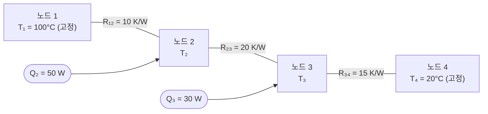

# 10장 실습 — LU 분해와 촐레스키(LU Factorization and Cholesky)

[레포지토리 안내](../../README.ko.md) | [English](Concepts_Lab.md) | [한국어](Concepts_Lab.ko.md)

> **최종 수정일:** 2026-10-18
>
> Applied Numerical Methods with Python for Engineers and Scientists, Chapra and Clough, Ch 10

> **학습 목표:**
> 1. 행렬을 L과 U 인수로 분해할 수 있다
> 2. 효율적인 다중 풀이를 위해 LU 분해를 적용할 수 있다
> 3. 대칭 양정치 행렬에 대해 촐레스키 분해를 구현할 수 있다

---

<br>

## 목차

- [1. Doolittle 알고리즘](#1-doolittle-알고리즘)
  - [1.1 구현](#11-구현)
  - [1.2 SciPy와 비교](#12-scipy와-비교)
- [2. L과 U를 이용한 풀이](#2-l과-u를-이용한-풀이)
  - [2.1 전진 대입(Forward Substitution)](#21-전진-대입forward-substitution)
  - [2.2 후진 대입(Backward Substitution)](#22-후진-대입backward-substitution)
  - [2.3 피봇팅을 포함한 완전한 LU 풀이](#23-피봇팅을-포함한-완전한-lu-풀이)
- [3. 열저항 네트워크(Thermal Resistor Network)](#3-열저항-네트워크thermal-resistor-network)
- [4. 다중 우변: LU가 빛나는 이유](#4-다중-우변-lu가-빛나는-이유)
  - [4.1 성능 비교](#41-성능-비교)
  - [4.2 다중 하중 케이스의 질량-스프링 시스템](#42-다중-하중-케이스의-질량-스프링-시스템)
- [5. 촐레스키 분해(Cholesky Factorization)](#5-촐레스키-분해cholesky-factorization)
  - [5.1 SPD 확인](#51-spd-확인)
  - [5.2 촐레스키 분해 및 풀이](#52-촐레스키-분해-및-풀이)
  - [5.3 FEM 스프링 네트워크 응용](#53-fem-스프링-네트워크-응용)
- [6. 방법 선택 지침](#6-방법-선택-지침)
- [요약](#요약)
- [점검 문제](#점검-문제)

---

<br>

## 1. Doolittle 알고리즘

### 1.1 구현

Doolittle 알고리즘은 $`U`$의 행과 $`L`$의 열을 차례로 구성하여 LU 분해를 계산한다. 각 피봇 인덱스 $`k`$에 대해, 먼저 앞에서 계산한 $`L`$과 $`U`$의 성분으로 $`U`$의 $`k`$번째 행을 계산하고, 그다음 피봇 $`U_{kk}`$로 나누어 $`L`$의 $`k`$번째 열을 계산한다.

```python
import numpy as np
import scipy as sc
from scipy.linalg import lu

def lu_doolittle(A):
    """LU factorization using Doolittle's algorithm (no pivoting)."""
    n = A.shape[0]
    L = np.eye(n)
    U = np.zeros((n, n))
    A = A.astype(float).copy()

    for k in range(n):
        # Compute U row k
        for j in range(k, n):
            U[k, j] = A[k, j] - L[k, :k] @ U[:k, j]
        # Compute L column k
        for i in range(k + 1, n):
            L[i, k] = (A[i, k] - L[i, :k] @ U[:k, k]) / U[k, k]

    return L, U

# Test
A = np.array([[3, -0.1, -0.2], [0.1, 7, -0.3], [0.3, -0.2, 10]])
L, U = lu_doolittle(A)
print(f'||A - LU|| = {np.linalg.norm(A - L @ U):.2e}')  # ≈ 0
```

핵심 공식은 다음과 같다. $`U`$의 $`k`$행은 다음 식으로 계산한다.

```math
U_{kj} = A_{kj} - \sum_{s=1}^{k-1} L_{ks} U_{sj}, \quad j = k, k+1, \ldots, n
```

$`L`$의 $`k`$열은 다음 식으로 계산한다.

```math
L_{ik} = \frac{A_{ik} - \sum_{s=1}^{k-1} L_{is} U_{sk}}{U_{kk}}, \quad i = k+1, k+2, \ldots, n
```

이 공식들은 $`A`$의 성분과 곱 $`LU`$의 대응 성분을 같다고 놓으면 바로 유도된다. 이 함수는 피봇팅을 하지 않으므로, 계산 중 $`U_{kk} = 0`$이 되면 0으로 나누게 된다.

### 1.2 SciPy와 비교

SciPy의 `lu` 함수는 부분 피봇팅을 적용한 LU 분해를 수행하며 치환 행렬 $`P`$, 하삼각 행렬 $`L`$, 상삼각 행렬 $`U`$를 반환한다.

```python
# Compare with scipy
P, L_sp, U_sp = sc.linalg.lu(A)
print(f'scipy: P = \n{P}\nL = \n{L_sp}\nU = \n{U_sp}')
```

> **참고:** SciPy는 $`A = PLU`$, 즉 $`P^T A = LU`$를 만족하는 $`P`$를 반환한다. 이 행렬처럼 각 소거 단계에서 대각 성분이 그 열에서 절댓값이 가장 크면 행 교환이 필요 없으므로 $`P`$는 단위 행렬이고, 결과는 1.1절의 Doolittle 구현과 일치한다.

---

<br>

## 2. L과 U를 이용한 풀이

### 2.1 전진 대입(Forward Substitution)

전진 대입은 위에서 아래로 각 $`d_i`$를 차례로 계산하여 하삼각 시스템 $`Ld = b`$를 푼다. $`L`$이 단위 하삼각 행렬(대각 성분이 1)이므로 대각 성분으로 나눌 필요가 없다.

```python
def forward_sub(L, b):
    """Solve Ld = b by forward substitution."""
    n = len(b)
    d = np.zeros(n)
    for i in range(n):
        d[i] = b[i] - L[i, :i] @ d[:i]
    return d
```

식 `L[i, :i] @ d[:i]`는 NumPy의 슬라이스 표기로 $`\sum_{j=0}^{i-1} L_{ij} d_j`$를 계산한다. $`i = 0`$이면 슬라이스가 비어 내적이 0이 되므로, 기대대로 $`d_0 = b_0`$이다.

### 2.2 후진 대입(Backward Substitution)

후진 대입은 아래에서 위로 각 $`x_i`$를 계산하여 상삼각 시스템 $`Ux = d`$를 푼다. 각 단계에서 대각 성분 $`U_{ii}`$로 나누어야 한다.

```python
def backward_sub(U, d):
    """Solve Ux = d by backward substitution."""
    n = len(d)
    x = np.zeros(n)
    x[n-1] = d[n-1] / U[n-1, n-1]
    for i in range(n - 2, -1, -1):
        x[i] = (d[i] - U[i, i+1:] @ x[i+1:]) / U[i, i]
    return x
```

### 2.3 피봇팅을 포함한 완전한 LU 풀이

분해와 두 대입 단계를 피봇팅까지 처리하는 하나의 함수로 결합한다.

```python
def lu_solve(A, b):
    """Solve Ax = b using LU factorization with pivoting."""
    P, L, U = sc.linalg.lu(A)
    b_perm = P.T @ b        # Apply permutation
    d = forward_sub(L, b_perm)
    x = backward_sub(U, d)
    return x

# Test
b = np.array([7.85, -19.3, 71.4])
x = lu_solve(A, b)
print(f'Solution: {x}')  # [3.0, -2.5, 7.0]
print(f'Residual: {np.linalg.norm(A @ x - b):.2e}')
```

치환은 `P.T @ b`로 적용한다. SciPy의 `lu`는 $`A = PLU`$를 만족하는 $`P`$를 반환하므로 $`Ax = b`$는 $`PLUx = b`$가 된다. 치환 행렬은 $`P^{-1} = P^T`$이므로 양변에 $`P^T`$를 곱하면 $`LUx = P^T b`$가 되고, 따라서 행 교환에 맞게 $`b`$를 재배열한 $`P^T b`$에 전진 대입을 적용한다. 잔차 $`\|Ax - b\|`$는 기계 엡실론 수준(이 예제에서는 약 $`10^{-14}`$)이어야 하며, 이것으로 해의 정확도를 확인한다.

---

<br>

## 3. 열저항 네트워크(Thermal Resistor Network)

연립방정식의 실용적 응용으로 열저항 네트워크 해석이 있다. 경계 노드의 온도가 고정되고 내부 노드에 열원이 있는 4노드 네트워크를 생각한다.

- $`T_1 = 100°C`$ (고정), $`T_4 = 20°C`$ (고정)
- 열원: $`Q_2 = 50\text{W}`$, $`Q_3 = 30\text{W}`$
- 열저항: $`R_{12} = 10`$, $`R_{23} = 20`$, $`R_{34} = 15`$ (K/W)



*그림 1. 4노드 열저항 네트워크의 구조*

각 내부 노드에서 저항을 통해 빠져나가는 열류의 합이 그 노드의 열원과 같다는 에너지 평형에서 다음 식을 얻는다.

```math
\frac{T_2 - T_1}{R_{12}} + \frac{T_2 - T_3}{R_{23}} = Q_2
```

```math
\frac{T_3 - T_2}{R_{23}} + \frac{T_3 - T_4}{R_{34}} = Q_3
```

이를 행렬 형태 $`A \mathbf{T} = \mathbf{b}`$로 정리한다.

```python
# 4-node network: T1=100 (fixed), T4=20 (fixed)
# Heat sources: Q2=50W, Q3=30W
# Resistances: R12=10, R23=20, R34=15 (K/W)

# Energy balance: (T2-T1)/R12 + (T2-T3)/R23 = Q2
#                  (T3-T2)/R23 + (T3-T4)/R34 = Q3

A_net = np.array([
    [1/10 + 1/20, -1/20],
    [-1/20, 1/20 + 1/15]
])
b_net = np.array([50 + 100/10, 30 + 20/15])
T = np.linalg.solve(A_net, b_net)
print(f'T2 = {T[0]:.1f}°C, T3 = {T[1]:.1f}°C')
```

$`A_\text{net}`$의 대각 성분은 각 노드에 연결된 전도도(저항의 역수)의 합이고, 비대각 성분은 노드 사이 전도도에 음의 부호를 붙인 값이다. 우변에는 열원 항과 고정된 경계 온도의 기여가 함께 들어간다. 실행하면 $`T_2 \approx 571.1°C`$, $`T_3 \approx 513.3°C`$를 얻는다.

---

<br>

## 4. 다중 우변: LU가 빛나는 이유

### 4.1 성능 비교

LU 분해의 주요 이점은 같은 계수 행렬을 여러 우변 벡터와 함께 써야 할 때 분명해진다. $`A`$를 한 번 분해하고 인자를 재사용하는 편이 매번 처음부터 푸는 것보다 훨씬 저렴하다.

```python
import time

n = 500
A = np.random.rand(n, n) + n * np.eye(n)
m = 100  # number of different RHS

# Method 1: Repeated np.linalg.solve
start = time.time()
for _ in range(m):
    b = np.random.rand(n)
    x = np.linalg.solve(A, b)
t1 = time.time() - start

# Method 2: Factor once, solve many
start = time.time()
lu_obj = sc.linalg.lu_factor(A)
for _ in range(m):
    b = np.random.rand(n)
    x = sc.linalg.lu_solve(lu_obj, b)
t2 = time.time() - start

print(f'Repeated solve: {t1:.3f}s')
print(f'LU factor + solve: {t2:.3f}s')
print(f'Speedup: {t1/t2:.1f}x')
```

$`n = 500`$이고 우변이 $`m = 100`$개일 때 비용은 다음과 같다.

- **반복 풀이**는 `np.linalg.solve`를 100번 호출하며, 호출마다 내부에서 전체 $`O(n^3)`$ 분해를 수행한다. 총 비용은 $`100 \times O(n^3) = O(100 \, n^3)`$이다.
- **LU 분해 + 풀이**는 $`O(n^3)`$ 분해를 한 번 하고, 각각 $`O(n^2)`$인 전진 대입과 후진 대입을 100번 수행한다. 총 비용은 큰 $`n`$에서 $`O(n^3) + O(100 \, n^2) \approx O(n^3)`$이다.

우변이 많을수록 미리 분해해 두는 이점이 커진다. 분해 비용을 $`n^3/3`$, 우변 하나의 대입 비용을 $`n^2`$으로 근사하면 속도 향상은 $`m`$이 $`n/3`$보다 충분히 작을 때 $`m`$에 거의 비례하고, $`m`$이 그보다 커지면 대입 비용이 지배하여 약 $`n/3`$배에 가까워진다.

### 4.2 다중 하중 케이스의 질량-스프링 시스템

질량-스프링 시스템은 여러 하중 케이스가 같은 강성 행렬을 공유하는 구체적인 공학 예이다.

```python
K = np.array([
    [300, -200, 0],
    [-200, 350, -150],
    [0, -150, 400]
], dtype=float)

F_gravity = np.array([0, 0, -9.81 * 10])  # 10 kg mass at node 3
F_wind = np.array([50, 30, 0])
F_combined = F_gravity + F_wind

lu_K = sc.linalg.lu_factor(K)
x_grav = sc.linalg.lu_solve(lu_K, F_gravity)
x_wind = sc.linalg.lu_solve(lu_K, F_wind)
x_comb = sc.linalg.lu_solve(lu_K, F_combined)

# Superposition check
print(f'||x_comb - (x_grav + x_wind)|| = {np.linalg.norm(x_comb - (x_grav + x_wind)):.2e}')
# Should be ~1e-16 (machine epsilon)
```

> **참고:** **중첩 원리.** 중첩 원리(principle of superposition)에 따르면 선형 시스템에서 결합 하중에 대한 응답은 개별 응답의 합과 같다. 이는 선형성에서 바로 나온다: $`A(x_1 + x_2) = Ax_1 + Ax_2 = b_1 + b_2`$.

중첩 검사는 이 성질을 수치적으로 확인한다. 결합 해와 개별 해의 합의 차이는 기계 엡실론 수준이며, 이는 연립방정식의 해가 부동소수점 정밀도 범위에서 중첩을 정확히 보존함을 보여 준다.

---

<br>

## 5. 촐레스키 분해(Cholesky Factorization)

### 5.1 SPD 확인

촐레스키 분해를 적용하기 전에 행렬이 대칭 양정치(SPD)인지 확인해야 한다. 행렬이 대칭($`A = A^T`$)이고 모든 고유값이 양수이면 SPD이다.

```python
def is_spd(A):
    """Check if A is symmetric positive definite."""
    if not np.allclose(A, A.T):
        return False
    eigenvalues = np.linalg.eigvalsh(A)
    return np.all(eigenvalues > 0)

# Example SPD matrix
A_spd = np.array([[6, 15, 55], [15, 55, 225], [55, 225, 979]], dtype=float)
print(f'Is SPD: {is_spd(A_spd)}')
```

`np.linalg.eigvalsh`는 대칭 행렬에 최적화된 함수이므로(`h`는 에르미트(Hermitian)를 뜻한다) `np.linalg.eigvals` 대신 사용한다. 실수 고유값만 반환하며, 이 목적에서는 더 빠르고 수치적으로 더 안정하다.

### 5.2 촐레스키 분해 및 풀이

SciPy는 `sc.linalg.cholesky`로 촐레스키 분해를 제공한다. 기본적으로 상삼각 인자를 반환하고, `lower=True`를 전달하면 하삼각 인자를 반환한다.

```python
# Cholesky
L_chol = sc.linalg.cholesky(A_spd, lower=True)
print(f'L = \n{L_chol}')
print(f'||A - L L^T|| = {np.linalg.norm(A_spd - L_chol @ L_chol.T):.2e}')

def cholesky_solve(A, b):
    """Solve Ax = b using Cholesky factorization."""
    L = sc.linalg.cholesky(A, lower=True)
    d = forward_sub(L, b)
    x = backward_sub(L.T, d)
    return x
```

풀이 절차는 일반 LU와 같다. 먼저 전진 대입으로 $`Ld = b`$를 풀고, 이어서 후진 대입으로 $`L^T x = d`$를 푼다. 핵심 차이는 $`U = L^T`$이므로 삼각 인자 하나만 계산하면 된다는 점이며, 그 결과 계산량과 저장 공간이 모두 절반으로 줄어든다.

> **참고:** 2절에서 정의한 `forward_sub` 함수는 단위 하삼각 행렬(대각 성분이 1)을 가정한다. 촐레스키 인자 $`L`$의 대각 성분은 1이 아니므로 전진 대입 공식은 $`d_i = (b_i - \sum_{j=1}^{i-1} L_{ij} d_j) / L_{ii}`$가 되어야 한다. 위의 `cholesky_solve`는 이 나눗셈을 하지 않는 `forward_sub`를 그대로 호출하므로 틀린 $`d`$를 만들고, 따라서 틀린 해를 반환한다. 실무에서는 SciPy의 `cho_factor`와 `cho_solve`가 이를 자동으로 처리한다.

대각 성분으로 나누도록 고친 전진 대입은 다음과 같다. `cholesky_solve`에서 `forward_sub` 대신 이 함수를 호출하면 올바른 해를 얻는다.

```python
# Corrected forward substitution for a lower triangular L with a nonunit diagonal
def forward_sub_general(L, b):
    """Solve Ld = b when the diagonal entries of L are not 1."""
    n = len(b)
    d = np.zeros(n)
    for i in range(n):
        d[i] = (b[i] - L[i, :i] @ d[:i]) / L[i, i]
    return d
```

### 5.3 FEM 스프링 네트워크 응용

유한요소법(FEM)으로 조립한 스프링 네트워크의 강성 행렬은 시스템이 올바르게, 완전히 구속되어 있으면 항상 SPD이므로 촐레스키 분해가 이상적이다.


*그림 2. 양 끝이 고정된 3노드 스프링 네트워크*

```python
# Spring constants
k = [100, 200, 150, 250]

# Assembly (stiffness matrix is always SPD for valid spring systems)
K_fem = np.array([
    [k[0]+k[1], -k[1], 0],
    [-k[1], k[1]+k[2], -k[2]],
    [0, -k[2], k[2]+k[3]]
], dtype=float)

F_fem = np.array([50.0, 0.0, -30.0])
print(f'K is SPD: {is_spd(K_fem)}')
x_fem = cholesky_solve(K_fem, F_fem)
print(f'Displacements: {x_fem}')
```

강성 행렬 $`K`$는 각 스프링 요소의 기여를 더하여 조립한다. 고정단을 노드 0과 노드 4로 보고 노드 $`i`$와 $`i+1`$을 잇는 스프링을 $`k_i`$라 하면, $`k_i`$는 대각 성분 $`(i,i)`$와 $`(i+1,i+1)`$에 $`+k_i`$를, 비대각 성분 $`(i,i+1)`$과 $`(i+1,i)`$에 $`-k_i`$를 더한다. 고정단에 해당하는 행과 열은 지우므로 양 끝의 스프링 $`k_0`$와 $`k_3`$은 노드 1과 노드 3의 대각 성분에만 기여한다. 결과 행렬은 구성상 항상 대칭이고, 0이 아닌 모든 변위 $`x`$에 대해 에너지 $`\frac{1}{2} x^T K x > 0`$이므로 양정치이다. 이 $`K`$는 4.2절의 강성 행렬과 같다.

5.2절의 참고처럼 `cholesky_solve`의 전진 대입을 고쳐야 올바른 변위 $`x \approx (0.2584, 0.1377, -0.0234)`$를 얻는다.

---

<br>

## 6. 방법 선택 지침

지금까지 다룬 방법과 함수를 언제 쓰는지 정리하면 다음과 같다.

| 방법 | 함수 | 사용 시기 |
|:-----|:-----|:----------|
| Doolittle LU | `lu_doolittle(A)` | 알고리즘 이해 |
| SciPy LU | `sc.linalg.lu(A)` | 일반 분해 |
| LU 분해 + 풀이 | `lu_factor(A)` + `lu_solve(lu, b)` | 다중 우변 (한 번만 분해) |
| 촐레스키(Cholesky) | `sc.linalg.cholesky(A)` | SPD 행렬 (약 2배 빠름) |
| `np.linalg.solve` | 직접 풀이 | 단일 우변, 실무 사용 |

*표 1. 분해 방법별 함수와 사용 시기*

**실용적 지침:**

1. 우변이 하나이면 항상 `np.linalg.solve`를 사용하고, 역행렬을 직접 계산하지 않는다.
2. 같은 $`A`$로 여러 우변을 풀 때는 `lu_factor`와 `lu_solve`를 사용한다.
3. $`A`$가 SPD이면 촐레스키 분해를 사용한다(더 빠르고 더 안정적이다).
4. 결과를 신뢰하기 전에 조건수(11장)를 확인한다.
5. 잔차 $`\|Ax - b\|`$로 해를 검증한다.

---

<br>

## 요약

| 개념 | 핵심 요약 |
|:-----|:----------|
| Doolittle 알고리즘 | $`U`$의 $`k`$행과 $`L`$의 $`k`$열을 번갈아 계산하여 피봇팅 없이 $`A = LU`$를 구한다. |
| SciPy `lu` | 부분 피봇팅을 적용하여 $`A = PLU`$를 만족하는 $`P`$, $`L`$, $`U`$를 반환한다. |
| 전진 대입과 후진 대입 | $`Ld = b`$를 위에서 아래로, $`Ux = d`$를 아래에서 위로 풀며 각각 $`O(n^2)`$이 든다. |
| 다중 우변 | `lu_factor`로 한 번 분해하고 `lu_solve`로 우변마다 대입만 반복하면 반복 풀이보다 훨씬 빠르다. |
| 열저항 네트워크 | 각 내부 노드의 에너지 평형에서 전도도를 계수로 하는 연립방정식을 얻는다. |
| 중첩 원리 | 선형 시스템에서 결합 하중에 대한 해는 개별 하중에 대한 해의 합과 같다. |
| SPD 판정 | 대칭이고 모든 고유값이 양수이면 SPD이며, `np.linalg.eigvalsh`로 고유값을 구해 판정한다. |
| 촐레스키 풀이 | $`A = LL^T`$로 분해한 뒤 대각 성분으로 나누는 전진 대입과 후진 대입으로 푼다. |

---

<br>

## 점검 문제

1. **Doolittle 알고리즘:** $`A = \begin{bmatrix} 4 & 3 \\ 6 & 3 \end{bmatrix}`$에 `lu_doolittle`을 적용했을 때 얻는 $`L`$과 $`U`$를 손으로 구하라.

   <details>
   <summary>정답</summary>

   $`k = 0`$에서 $`U`$의 첫 행은 $`(4, 3)`$이고, $`L_{21} = 6/4 = 1.5`$이다. $`k = 1`$에서 $`U_{22} = 3 - 1.5 \times 3 = -1.5`$이다. 따라서 $`L = \begin{bmatrix} 1 & 0 \\ 1.5 & 1 \end{bmatrix}`$, $`U = \begin{bmatrix} 4 & 3 \\ 0 & -1.5 \end{bmatrix}`$이고, $`LU = \begin{bmatrix} 4 & 3 \\ 6 & 4.5 - 1.5 \end{bmatrix} = A`$로 확인된다.

   </details>

2. **SciPy의 치환 규약:** `lu_solve` 함수가 우변에 `P @ b`가 아니라 `P.T @ b`를 쓰는 이유를 설명하라.

   <details>
   <summary>정답</summary>

   SciPy의 `lu`는 $`A = PLU`$를 만족하는 $`P`$를 반환한다. 따라서 $`Ax = b`$는 $`PLUx = b`$이고, 치환 행렬은 $`P^{-1} = P^T`$이므로 $`LUx = P^T b`$가 된다. 전진 대입에 넣을 우변은 $`P^T b`$, 즉 `P.T @ b`이다. $`P`$가 단위 행렬이나 한 번의 행 교환처럼 대칭이면 두 식의 결과가 같지만, 일반적인 치환에서는 다르다.

   </details>

3. **촐레스키 풀이의 전진 대입:** $`A = \begin{bmatrix} 4 & 2 \\ 2 & 5 \end{bmatrix}`$의 촐레스키 인자는 $`L = \begin{bmatrix} 2 & 0 \\ 1 & 2 \end{bmatrix}`$이다. $`b = (4, 7)^T`$에 대해 올바른 해를 구하고, 대각 성분으로 나누지 않는 `forward_sub`를 쓰면 어떤 해가 나오는지 비교하라.

   <details>
   <summary>정답</summary>

   올바른 전진 대입은 $`d_1 = 4/2 = 2`$, $`d_2 = (7 - 1 \times 2)/2 = 2.5`$이다. $`L^T x = d`$에서 $`x_2 = 2.5/2 = 1.25`$, $`x_1 = (2 - 1 \times 1.25)/2 = 0.375`$이고, $`Ax = (1.5 + 2.5, 0.75 + 6.25)^T = (4, 7)^T`$로 확인된다. `forward_sub`를 쓰면 $`d = (4, 3)^T`$가 되어 $`x_2 = 1.5`$, $`x_1 = (4 - 1.5)/2 = 1.25`$를 얻고, $`Ax = (8, 10)^T`$이므로 틀린 해이다.

   </details>

4. **중첩 원리:** 4.2절에서 $`x_\text{grav} \approx (-0.1529, -0.2293, -0.3312)`$, $`x_\text{wind} \approx (0.4299, 0.3948, 0.1481)`$이다. `F_combined`에 대한 해를 새로 풀지 않고 구하고, 그렇게 할 수 있는 근거를 쓰라.

   <details>
   <summary>정답</summary>

   $`x_\text{comb} = x_\text{grav} + x_\text{wind} \approx (0.2770, 0.1655, -0.1832)`$이다. $`K`$가 같으므로 $`K(x_\text{grav} + x_\text{wind}) = F_\text{gravity} + F_\text{wind} = F_\text{combined}`$가 성립하고, 비특이 행렬의 해는 유일하므로 이 합이 곧 결합 하중의 해이다.

   </details>
