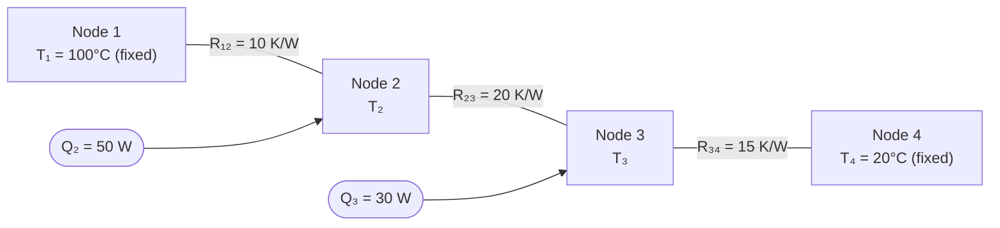
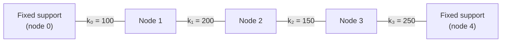

# Chapter 10 Lab — LU and Cholesky Factorizations

[Repository Guide](../../README.md) | [English](Concepts_Lab.md) | [한국어](Concepts_Lab.ko.md)

> **Last Updated:** 2026-10-20
>
> Applied Numerical Methods with Python for Engineers and Scientists, Chapra and Clough, Ch 10

> **Learning Objectives:**
> 1. Decompose matrices into L and U factors
> 2. Apply LU factorization for efficient multiple solves
> 3. Implement Cholesky decomposition for symmetric positive definite matrices

---

<br>

## Table of Contents

- [1. Doolittle's Algorithm](#1-doolittles-algorithm)
  - [1.1 Implementation](#11-implementation)
  - [1.2 Comparison with SciPy](#12-comparison-with-scipy)
- [2. Solving via L and U](#2-solving-via-l-and-u)
  - [2.1 Forward Substitution](#21-forward-substitution)
  - [2.2 Backward Substitution](#22-backward-substitution)
  - [2.3 Complete LU Solve with Pivoting](#23-complete-lu-solve-with-pivoting)
- [3. Thermal Resistor Network](#3-thermal-resistor-network)
- [4. Multiple Right-Hand Sides: The Advantage of LU Factorization](#4-multiple-right-hand-sides-the-advantage-of-lu-factorization)
  - [4.1 Performance Comparison](#41-performance-comparison)
  - [4.2 Spring-Mass System with Multiple Load Cases](#42-spring-mass-system-with-multiple-load-cases)
- [5. Cholesky Factorization](#5-cholesky-factorization)
  - [5.1 Checking for SPD](#51-checking-for-spd)
  - [5.2 Cholesky Decomposition and Solve](#52-cholesky-decomposition-and-solve)
  - [5.3 FEM Spring Network Application](#53-fem-spring-network-application)
- [6. Choosing a Method](#6-choosing-a-method)
- [Summary](#summary)
- [Self-Check Questions](#self-check-questions)

---

<br>

## 1. Doolittle's Algorithm

### 1.1 Implementation

Doolittle's algorithm computes the LU factorization by systematically building the rows of $`U`$ and the columns of $`L`$. For each pivot index $`k`$, the algorithm first computes the $`k`$-th row of $`U`$ using previously computed entries of $`L`$ and $`U`$, then computes the $`k`$-th column of $`L`$ by dividing by the pivot $`U_{kk}`$.

```python
import numpy as np
import scipy as sc
from scipy.linalg import lu

def lu_doolittle(A):
    """LU factorization using Doolittle's algorithm (no pivoting)."""
    n = A.shape[0]
    L = np.eye(n)
    U = np.zeros((n, n))
    A = A.astype(float).copy()

    for k in range(n):
        # Compute U row k
        for j in range(k, n):
            U[k, j] = A[k, j] - L[k, :k] @ U[:k, j]
        # Compute L column k
        for i in range(k + 1, n):
            L[i, k] = (A[i, k] - L[i, :k] @ U[:k, k]) / U[k, k]

    return L, U

# Test
A = np.array([[3, -0.1, -0.2], [0.1, 7, -0.3], [0.3, -0.2, 10]])
L, U = lu_doolittle(A)
print(f'||A - LU|| = {np.linalg.norm(A - L @ U):.2e}')  # ≈ 0
```

The key formulas are as follows. Row $`k`$ of $`U`$ is computed by:

```math
U_{kj} = A_{kj} - \sum_{s=1}^{k-1} L_{ks} U_{sj}, \quad j = k, k+1, \ldots, n
```

Column $`k`$ of $`L`$ is computed by:

```math
L_{ik} = \frac{A_{ik} - \sum_{s=1}^{k-1} L_{is} U_{sk}}{U_{kk}}, \quad i = k+1, k+2, \ldots, n
```

These formulas follow directly from equating the entries of $`A`$ with the corresponding entries of the product $`LU`$. Since the function does not pivot, it divides by zero if $`U_{kk} = 0`$ occurs during the computation.

### 1.2 Comparison with SciPy

SciPy's `lu` function performs LU factorization with partial pivoting, returning the permutation matrix $`P`$, the lower triangular matrix $`L`$, and the upper triangular matrix $`U`$:

```python
# Compare with scipy
P, L_sp, U_sp = sc.linalg.lu(A)
print(f'scipy: P = \n{P}\nL = \n{L_sp}\nU = \n{U_sp}')
```

> **Note:** SciPy returns $`P`$ such that $`A = PLU`$, that is, $`P^T A = LU`$. When the diagonal entry has the largest absolute value in its column at every elimination step, as for this matrix, no row swaps are needed, so $`P`$ is the identity matrix and the results match the Doolittle implementation of Section 1.1.

---

<br>

## 2. Solving via L and U

### 2.1 Forward Substitution

Forward substitution solves the lower triangular system $`Ld = b`$ by computing each $`d_i`$ sequentially from top to bottom. Since $`L`$ is unit lower triangular (diagonal entries are 1), no division by the diagonal is needed:

```python
def forward_sub(L, b):
    """Solve Ld = b by forward substitution."""
    n = len(b)
    d = np.zeros(n)
    for i in range(n):
        d[i] = b[i] - L[i, :i] @ d[:i]
    return d
```

The expression `L[i, :i] @ d[:i]` computes $`\sum_{j=0}^{i-1} L_{ij} d_j`$ using NumPy's slice notation. For $`i = 0`$, the slice is empty and the dot product is zero, so $`d_0 = b_0`$ as expected.

### 2.2 Backward Substitution

Backward substitution solves the upper triangular system $`Ux = d`$ by computing each $`x_i`$ from bottom to top. Division by the diagonal entry $`U_{ii}`$ is required at each step:

```python
def backward_sub(U, d):
    """Solve Ux = d by backward substitution."""
    n = len(d)
    x = np.zeros(n)
    x[n-1] = d[n-1] / U[n-1, n-1]
    for i in range(n - 2, -1, -1):
        x[i] = (d[i] - U[i, i+1:] @ x[i+1:]) / U[i, i]
    return x
```

### 2.3 Complete LU Solve with Pivoting

The factorization and both substitution phases are combined into a single function that handles pivoting:

```python
def lu_solve(A, b):
    """Solve Ax = b using LU factorization with pivoting."""
    P, L, U = sc.linalg.lu(A)
    b_perm = P.T @ b        # Apply permutation
    d = forward_sub(L, b_perm)
    x = backward_sub(U, d)
    return x

# Test
b = np.array([7.85, -19.3, 71.4])
x = lu_solve(A, b)
print(f'Solution: {x}')  # [3.0, -2.5, 7.0]
print(f'Residual: {np.linalg.norm(A @ x - b):.2e}')
```

The permutation is applied as `P.T @ b`. SciPy's `lu` returns $`P`$ such that $`A = PLU`$, so $`Ax = b`$ becomes $`PLUx = b`$. Since a permutation matrix satisfies $`P^{-1} = P^T`$, multiplying both sides by $`P^T`$ gives $`LUx = P^T b`$, so forward substitution is applied to $`P^T b`$, the vector $`b`$ reordered according to the row swaps. The residual $`\|Ax - b\|`$ should be at the level of machine epsilon (about $`10^{-14}`$ in this example), confirming the accuracy of the solution.

---

<br>

## 3. Thermal Resistor Network

A practical application of linear systems is the analysis of thermal resistor networks. Consider a 4-node network where temperatures at the boundary nodes are fixed and heat sources are applied at the interior nodes:

- $`T_1 = 100°C`$ (fixed), $`T_4 = 20°C`$ (fixed)
- Heat sources: $`Q_2 = 50\text{W}`$, $`Q_3 = 30\text{W}`$
- Thermal resistances: $`R_{12} = 10`$, $`R_{23} = 20`$, $`R_{34} = 15`$ (K/W)



*Figure 1. Structure of the 4-node thermal resistor network*

The energy balance at each interior node, stating that the total heat flowing out through the resistors equals the heat source at that node, yields:

```math
\frac{T_2 - T_1}{R_{12}} + \frac{T_2 - T_3}{R_{23}} = Q_2
```

```math
\frac{T_3 - T_2}{R_{23}} + \frac{T_3 - T_4}{R_{34}} = Q_3
```

Rearranging into matrix form $`A \mathbf{T} = \mathbf{b}`$:

```python
# 4-node network: T1=100 (fixed), T4=20 (fixed)
# Heat sources: Q2=50W, Q3=30W
# Resistances: R12=10, R23=20, R34=15 (K/W)

# Energy balance: (T2-T1)/R12 + (T2-T3)/R23 = Q2
#                  (T3-T2)/R23 + (T3-T4)/R34 = Q3

A_net = np.array([
    [1/10 + 1/20, -1/20],
    [-1/20, 1/20 + 1/15]
])
b_net = np.array([50 + 100/10, 30 + 20/15])
T = np.linalg.solve(A_net, b_net)
print(f'T2 = {T[0]:.1f}°C, T3 = {T[1]:.1f}°C')
```

The diagonal entries of $`A_\text{net}`$ are the sum of conductances (reciprocals of resistances) connected to each node, and the off-diagonal entries are the negative conductances between nodes. The right-hand side includes both the heat source terms and the contributions from the fixed boundary temperatures. Running the code gives $`T_2 \approx 571.1°C`$ and $`T_3 \approx 513.3°C`$.

---

<br>

## 4. Multiple Right-Hand Sides: The Advantage of LU Factorization

### 4.1 Performance Comparison

The primary advantage of LU factorization becomes clear when the same coefficient matrix must be used with many different right-hand side vectors. Factoring $`A`$ once and reusing the factors is far cheaper than solving from scratch each time:

```python
import time

n = 500
A = np.random.rand(n, n) + n * np.eye(n)
m = 100  # number of different RHS

# Method 1: Repeated np.linalg.solve
start = time.time()
for _ in range(m):
    b = np.random.rand(n)
    x = np.linalg.solve(A, b)
t1 = time.time() - start

# Method 2: Factor once, solve many
start = time.time()
lu_obj = sc.linalg.lu_factor(A)
for _ in range(m):
    b = np.random.rand(n)
    x = sc.linalg.lu_solve(lu_obj, b)
t2 = time.time() - start

print(f'Repeated solve: {t1:.3f}s')
print(f'LU factor + solve: {t2:.3f}s')
print(f'Speedup: {t1/t2:.1f}x')
```

For $`n = 500`$ and $`m = 100`$ right-hand sides, the costs are as follows.

- **Repeated solve** calls `np.linalg.solve` 100 times, each performing a full $`O(n^3)`$ factorization internally. Total cost: $`100 \times O(n^3) = O(100 \, n^3)`$.
- **LU factor + solve** performs one $`O(n^3)`$ factorization and 100 forward and backward substitutions at $`O(n^2)`$ each. Total cost for large $`n`$: $`O(n^3) + O(100 \, n^2) \approx O(n^3)`$.

The more right-hand sides there are, the greater the benefit of pre-factoring. Approximating the factorization by $`n^3/3`$ and the substitutions for one right-hand side by $`n^2`$, the speedup is nearly proportional to $`m`$ while $`m`$ is well below $`n/3`$, and approaches about $`n/3`$ once $`m`$ is larger and the substitutions dominate.

### 4.2 Spring-Mass System with Multiple Load Cases

A spring-mass system provides a concrete engineering example where multiple load cases share the same stiffness matrix:

```python
K = np.array([
    [300, -200, 0],
    [-200, 350, -150],
    [0, -150, 400]
], dtype=float)

F_gravity = np.array([0, 0, -9.81 * 10])  # 10 kg mass at node 3
F_wind = np.array([50, 30, 0])
F_combined = F_gravity + F_wind

lu_K = sc.linalg.lu_factor(K)
x_grav = sc.linalg.lu_solve(lu_K, F_gravity)
x_wind = sc.linalg.lu_solve(lu_K, F_wind)
x_comb = sc.linalg.lu_solve(lu_K, F_combined)

# Superposition check
print(f'||x_comb - (x_grav + x_wind)|| = {np.linalg.norm(x_comb - (x_grav + x_wind)):.2e}')
# Should be ~1e-16 (machine epsilon)
```

> **Note:** **Superposition principle.** The principle of superposition states that for linear systems, the response to a combined load equals the sum of individual responses. This is a direct consequence of linearity: $`A(x_1 + x_2) = Ax_1 + Ax_2 = b_1 + b_2`$.

The superposition check confirms this property numerically. The difference between the combined solution and the sum of individual solutions is at machine epsilon, demonstrating that the solution of the linear system preserves superposition exactly up to floating-point precision.

---

<br>

## 5. Cholesky Factorization

### 5.1 Checking for SPD

Before applying Cholesky factorization, we must verify that the matrix is symmetric positive definite. A matrix is SPD if it is symmetric ($`A = A^T`$) and all its eigenvalues are strictly positive:

```python
def is_spd(A):
    """Check if A is symmetric positive definite."""
    if not np.allclose(A, A.T):
        return False
    eigenvalues = np.linalg.eigvalsh(A)
    return np.all(eigenvalues > 0)

# Example SPD matrix
A_spd = np.array([[6, 15, 55], [15, 55, 225], [55, 225, 979]], dtype=float)
print(f'Is SPD: {is_spd(A_spd)}')
```

The function `np.linalg.eigvalsh` is used instead of `np.linalg.eigvals` because it is optimized for symmetric matrices (the `h` stands for Hermitian). It returns only real eigenvalues and is both faster and more numerically stable for this purpose.

### 5.2 Cholesky Decomposition and Solve

SciPy provides the Cholesky factorization through `sc.linalg.cholesky`. By default it returns the upper triangular factor; passing `lower=True` returns the lower triangular factor:

```python
# Cholesky
L_chol = sc.linalg.cholesky(A_spd, lower=True)
print(f'L = \n{L_chol}')
print(f'||A - L L^T|| = {np.linalg.norm(A_spd - L_chol @ L_chol.T):.2e}')

def cholesky_solve(A, b):
    """Solve Ax = b using Cholesky factorization."""
    L = sc.linalg.cholesky(A, lower=True)
    d = forward_sub(L, b)
    x = backward_sub(L.T, d)
    return x
```

The solve procedure mirrors general LU: first solve $`Ld = b`$ by forward substitution, then solve $`L^T x = d`$ by backward substitution. The key difference is that only one triangular factor needs to be computed (since $`U = L^T`$), which halves both the computation and the storage.

> **Note:** The `forward_sub` function defined in Section 2 assumes a unit lower triangular matrix (diagonal entries are 1). For Cholesky, the diagonal entries of $`L`$ are not 1, so the forward substitution formula must be $`d_i = (b_i - \sum_{j=1}^{i-1} L_{ij} d_j) / L_{ii}`$. The `cholesky_solve` above calls `forward_sub`, which skips this division, so it produces a wrong $`d`$ and therefore returns a wrong solution. In practice, SciPy's `cho_factor` and `cho_solve` handle this automatically.

The forward substitution corrected to divide by the diagonal entries is shown below. Calling this function instead of `forward_sub` in `cholesky_solve` gives the correct solution.

```python
# Corrected forward substitution for a lower triangular L with a nonunit diagonal
def forward_sub_general(L, b):
    """Solve Ld = b when the diagonal entries of L are not 1."""
    n = len(b)
    d = np.zeros(n)
    for i in range(n):
        d[i] = (b[i] - L[i, :i] @ d[:i]) / L[i, i]
    return d
```

### 5.3 FEM Spring Network Application

The stiffness matrix of a spring network assembled by the finite element method is always SPD for a valid, fully constrained spring system, making Cholesky the ideal factorization.



*Figure 2. Three-node spring network fixed at both ends*

```python
# Spring constants
k = [100, 200, 150, 250]

# Assembly (stiffness matrix is always SPD for valid spring systems)
K_fem = np.array([
    [k[0]+k[1], -k[1], 0],
    [-k[1], k[1]+k[2], -k[2]],
    [0, -k[2], k[2]+k[3]]
], dtype=float)

F_fem = np.array([50.0, 0.0, -30.0])
print(f'K is SPD: {is_spd(K_fem)}')
x_fem = cholesky_solve(K_fem, F_fem)
print(f'Displacements: {x_fem}')
```

The stiffness matrix $`K`$ is assembled by summing the contributions of each spring element. Treating the fixed supports as nodes 0 and 4 and letting $`k_i`$ be the spring connecting nodes $`i`$ and $`i+1`$, spring $`k_i`$ contributes $`+k_i`$ to the diagonal entries $`(i,i)`$ and $`(i+1,i+1)`$, and $`-k_i`$ to the off-diagonal entries $`(i,i+1)`$ and $`(i+1,i)`$. The rows and columns of the fixed supports are removed, so the end springs $`k_0`$ and $`k_3`$ contribute only to the diagonal entries of nodes 1 and 3. The resulting matrix is always symmetric (by construction) and positive definite because the energy $`\frac{1}{2} x^T K x > 0`$ for any nonzero displacement $`x`$. This $`K`$ is the same as the stiffness matrix of Section 4.2.

As the note in Section 5.2 explains, the forward substitution in `cholesky_solve` must be corrected to obtain the correct displacements $`x \approx (0.2584, 0.1377, -0.0234)`$.

---

<br>

## 6. Choosing a Method

The methods and functions covered so far and when to use each are summarized below.

| Method | Function | When to Use |
|:-------|:---------|:-----------|
| Doolittle LU | `lu_doolittle(A)` | Understanding the algorithm |
| SciPy LU | `sc.linalg.lu(A)` | General factorization |
| LU factor + solve | `lu_factor(A)` + `lu_solve(lu, b)` | Multiple RHS (factor only once) |
| Cholesky | `sc.linalg.cholesky(A)` | SPD matrices (about 2x faster) |
| `np.linalg.solve` | Direct solve | Single RHS, production use |

*Table 1. Functions and use cases of each factorization method*

**Practical Guidelines:**

1. Always use `np.linalg.solve` for a single right-hand side, and never invert the matrix manually.
2. For multiple right-hand sides with the same $`A`$, use `lu_factor` and `lu_solve`.
3. If $`A`$ is SPD, use Cholesky factorization (faster and more stable).
4. Check the condition number (Chapter 11) before trusting results.
5. Verify solutions with the residual $`\|Ax - b\|`$.

---

<br>

## Summary

| Concept | Key Summary |
|:--------|:------------|
| Doolittle's algorithm | It alternately computes row $`k`$ of $`U`$ and column $`k`$ of $`L`$ to obtain $`A = LU`$ without pivoting. |
| SciPy `lu` | It applies partial pivoting and returns $`P`$, $`L`$, $`U`$ satisfying $`A = PLU`$. |
| Forward and backward substitution | They solve $`Ld = b`$ from top to bottom and $`Ux = d`$ from bottom to top, each at $`O(n^2)`$ cost. |
| Multiple right-hand sides | Factoring once with `lu_factor` and repeating only the substitutions with `lu_solve` is much faster than repeated solves. |
| Thermal resistor network | The energy balance at each interior node gives a linear system whose coefficients are conductances. |
| Superposition principle | In a linear system, the solution for a combined load equals the sum of the solutions for the individual loads. |
| SPD check | A matrix is SPD if it is symmetric with all eigenvalues positive, which can be tested with `np.linalg.eigvalsh`. |
| Cholesky solve | After factoring $`A = LL^T`$, the system is solved by forward substitution that divides by the diagonal entries and by backward substitution. |

---

<br>

## Self-Check Questions

1. **Doolittle's algorithm:** Compute by hand the $`L`$ and $`U`$ that `lu_doolittle` returns for $`A = \begin{bmatrix} 4 & 3 \\ 6 & 3 \end{bmatrix}`$.

   <details>
   <summary>Answer</summary>

   At $`k = 0`$, the first row of $`U`$ is $`(4, 3)`$ and $`L_{21} = 6/4 = 1.5`$. At $`k = 1`$, $`U_{22} = 3 - 1.5 \times 3 = -1.5`$. Therefore $`L = \begin{bmatrix} 1 & 0 \\ 1.5 & 1 \end{bmatrix}`$ and $`U = \begin{bmatrix} 4 & 3 \\ 0 & -1.5 \end{bmatrix}`$, and $`LU = \begin{bmatrix} 4 & 3 \\ 6 & 4.5 - 1.5 \end{bmatrix} = A`$ confirms it.

   </details>

2. **SciPy's permutation convention:** Explain why the `lu_solve` function uses `P.T @ b` rather than `P @ b` for the right-hand side.

   <details>
   <summary>Answer</summary>

   SciPy's `lu` returns $`P`$ such that $`A = PLU`$. Then $`Ax = b`$ means $`PLUx = b`$, and since a permutation matrix satisfies $`P^{-1} = P^T`$, it becomes $`LUx = P^T b`$. The right-hand side for forward substitution is therefore $`P^T b`$, that is, `P.T @ b`. When $`P`$ is symmetric, as for the identity or a single row swap, both expressions give the same result, but they differ for a general permutation.

   </details>

3. **Forward substitution in the Cholesky solve:** The Cholesky factor of $`A = \begin{bmatrix} 4 & 2 \\ 2 & 5 \end{bmatrix}`$ is $`L = \begin{bmatrix} 2 & 0 \\ 1 & 2 \end{bmatrix}`$. Find the correct solution for $`b = (4, 7)^T`$, and compare it with the solution obtained using `forward_sub`, which does not divide by the diagonal entries.

   <details>
   <summary>Answer</summary>

   The correct forward substitution gives $`d_1 = 4/2 = 2`$ and $`d_2 = (7 - 1 \times 2)/2 = 2.5`$. From $`L^T x = d`$, $`x_2 = 2.5/2 = 1.25`$ and $`x_1 = (2 - 1 \times 1.25)/2 = 0.375`$, and $`Ax = (1.5 + 2.5, 0.75 + 6.25)^T = (4, 7)^T`$ confirms it. Using `forward_sub` gives $`d = (4, 3)^T`$, which leads to $`x_2 = 1.5`$ and $`x_1 = (4 - 1.5)/2 = 1.25`$; since $`Ax = (8, 10)^T`$, this solution is wrong.

   </details>

4. **Superposition principle:** In Section 4.2, $`x_\text{grav} \approx (-0.1529, -0.2293, -0.3312)`$ and $`x_\text{wind} \approx (0.4299, 0.3948, 0.1481)`$. Find the solution for `F_combined` without solving again, and state why this is valid.

   <details>
   <summary>Answer</summary>

   $`x_\text{comb} = x_\text{grav} + x_\text{wind} \approx (0.2770, 0.1655, -0.1832)`$. Because $`K`$ is the same, $`K(x_\text{grav} + x_\text{wind}) = F_\text{gravity} + F_\text{wind} = F_\text{combined}`$ holds, and since the solution of a system with a nonsingular matrix is unique, this sum is the solution for the combined load.

   </details>
