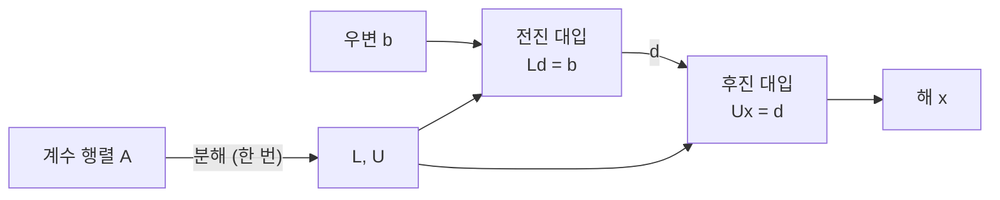

# 10장 — LU 분해

[레포지토리 안내](../../README.ko.md) | [English](Concepts_Lecture.md) | [한국어](Concepts_Lecture.ko.md)

> **최종 수정일:** 2026-11-27
>
> Applied Numerical Methods with Python for Engineers and Scientists, Chapra and Clough, Ch 10

> **학습 목표:**
> 1. 행렬을 L과 U 인수로 분해할 수 있다
> 2. 효율적인 다중 풀이를 위해 LU 분해를 적용할 수 있다
> 3. 대칭 양정치 행렬에 대해 Cholesky 분해를 구현할 수 있다
> 4. 피봇팅을 적용한 LU 분해에서 치환 행렬과 저장된 승수의 교환을 단계별로 추적할 수 있다
> 5. LU 분해와 Cholesky 분해의 연산 횟수를 유도하고 SciPy 함수를 규약에 맞게 사용할 수 있다

---

<br>

## 목차

- [1. LU 분해 개요](#1-lu-분해-개요)
  - [1.1 핵심 아이디어](#11-핵심-아이디어)
  - [1.2 2단계 풀이 과정](#12-2단계-풀이-과정)
  - [1.3 계산상의 이점](#13-계산상의-이점)
  - [1.4 LU 분해가 존재하는 조건](#14-lu-분해가-존재하는-조건)
- [2. Gauss 소거법과 LU 분해의 관계](#2-gauss-소거법과-lu-분해의-관계)
  - [2.1 소거 계수가 L을 형성](#21-소거-계수가-l을-형성)
  - [2.2 3x3 시스템에서의 L과 U의 구조](#22-3x3-시스템에서의-l과-u의-구조)
  - [2.3 검증](#23-검증)
  - [2.4 기본 행렬로 본 LU 분해](#24-기본-행렬로-본-lu-분해)
- [3. 저장 효율성](#3-저장-효율성)
- [4. 전진 대입(Forward Substitution)](#4-전진-대입forward-substitution)
- [5. 후진 대입(Back Substitution)](#5-후진-대입back-substitution)
- [6. 예제 10.1: LU 분해 (전체 단계별 풀이)](#6-예제-101-lu-분해-전체-단계별-풀이)
  - [6.1 문제 설정](#61-문제-설정)
  - [6.2 1단계: L의 첫 번째 열과 U의 첫 번째 행](#62-1단계-l의-첫-번째-열과-u의-첫-번째-행)
  - [6.3 2단계: L의 두 번째 열과 U의 두 번째 행](#63-2단계-l의-두-번째-열과-u의-두-번째-행)
  - [6.4 결과](#64-결과)
- [7. 예제 10.2: LU를 이용한 풀이](#7-예제-102-lu를-이용한-풀이)
  - [7.1 전진 대입](#71-전진-대입)
  - [7.2 후진 대입](#72-후진-대입)
- [8. 피봇팅을 적용한 LU: PA = LU](#8-피봇팅을-적용한-lu-pa--lu)
  - [8.1 피봇팅이 필요한 이유](#81-피봇팅이-필요한-이유)
  - [8.2 치환 행렬 P(Permutation Matrix)](#82-치환-행렬-ppermutation-matrix)
  - [8.3 절차](#83-절차)
  - [8.4 예제 10.3: 작은 피봇이 있는 2x2](#84-예제-103-작은-피봇이-있는-2x2)
  - [8.5 3x3 피봇팅 LU의 단계별 추적](#85-3x3-피봇팅-lu의-단계별-추적)
- [9. Cholesky 분해(Cholesky Factorization)](#9-cholesky-분해cholesky-factorization)
  - [9.1 대칭 양정치 행렬(Symmetric Positive Definite Matrices)](#91-대칭-양정치-행렬symmetric-positive-definite-matrices)
  - [9.2 Cholesky 분해 공식](#92-cholesky-분해-공식)
  - [9.3 예제 10.5: Cholesky 분해](#93-예제-105-cholesky-분해)
  - [9.4 분해 방법 비교](#94-분해-방법-비교)
  - [9.5 Cholesky 공식의 유도](#95-cholesky-공식의-유도)
  - [9.6 Cholesky 분해의 비용과 안정성](#96-cholesky-분해의-비용과-안정성)
  - [9.7 Cholesky 분해를 이용한 풀이](#97-cholesky-분해를-이용한-풀이)
- [10. Python 코드](#10-python-코드)
  - [10.1 scipy.linalg.lu로 연립방정식 풀기](#101-scipylinalglu로-연립방정식-풀기)
  - [10.2 lu_factor와 lu_solve](#102-lu_factor와-lu_solve)
  - [10.3 np.linalg.solve와 LU 분해](#103-nplinalgsolve와-lu-분해)
- [11. LU 분해의 구현과 연산 횟수](#11-lu-분해의-구현과-연산-횟수)
  - [11.1 Doolittle 알고리즘](#111-doolittle-알고리즘)
  - [11.2 NumPy 구현과 여러 우변](#112-numpy-구현과-여러-우변)
  - [11.3 연산 횟수](#113-연산-횟수)
- [12. 흔한 실수](#12-흔한-실수)
- [요약](#요약)
- [점검 문제](#점검-문제)
- [참고 문헌](#참고-문헌)

---

<br>

## 1. LU 분해 개요

### 1.1 핵심 아이디어

LU 분해의 목표는 정방 행렬 $`A`$를 두 삼각 행렬의 곱으로 분해하는 것이다.

```math
A = LU
```

여기서 $`L`$은 대각선 위의 모든 성분이 0인 **하삼각 행렬(lower triangular matrix)** 이고, $`U`$는 대각선 아래의 모든 성분이 0인 **상삼각 행렬(upper triangular matrix)** 이다.

> **용어 정의:** **LU 분해(LU factorization)** 는 정방 행렬 $`A`$를 하삼각 행렬 $`L`$과 상삼각 행렬 $`U`$의 곱 $`A = LU`$로 나타내는 것이다. $`L`$의 대각 성분을 모두 1로 정하는 방식을 Doolittle 분해라 하며, 이 경우 분해가 존재하면 유일하다.

> **[선형대수학]** 선형대수학에서는 Gauss 소거법(Gaussian elimination)의 각 행 연산을 **기본 행렬(elementary matrix)** 의 곱셈으로 나타낸다. $`i`$행에서 $`j`$행의 $`f_{ij}`$배를 빼는 기본 행렬의 역행렬은 같은 위치에 $`+f_{ij}`$를 가진 단위 하삼각 행렬이므로, 소거에 쓴 기본 행렬들의 역행렬을 모두 곱한 $`L`$에는 소거 계수가 그대로 들어가고 $`A = LU`$가 성립한다(2절). 따라서 Gauss 소거법을 수행하는 알고리즘은 모두 암묵적으로 LU 분해를 계산한다.

### 1.2 2단계 풀이 과정

$`A = LU`$를 알면 $`Ax = b`$의 풀이는 두 개의 더 간단한 삼각 풀이로 나뉜다.

1. **전진 대입(Forward substitution):** 중간 벡터 $`d`$에 대해 $`Ld = b`$를 푼다.
2. **후진 대입(Back substitution):** 해 벡터 $`x`$에 대해 $`Ux = d`$를 푼다.

삼각 구조 덕분에 추가 소거 없이 미지수를 하나씩 차례로 계산할 수 있으므로 각 삼각 풀이는 간단하다.

정확성 검증: $`Ax = (LU)x = L(Ux) = Ld = b`$.



*그림 1. LU 분해를 이용한 2단계 풀이 과정*

### 1.3 계산상의 이점

LU 분해의 핵심 이점은 비용이 큰 분해 단계와 상대적으로 저렴한 풀이 단계를 분리한다는 것이다.

| 단계 | 비용 | 의존 대상 |
|:-----|:-----|:----------|
| 분해: $`A = LU`$ | $`O(n^3)`$ | $`A`$만 |
| 전진 대입: $`Ld = b`$ | $`O(n^2)`$ | $`L`$과 $`b`$ |
| 후진 대입: $`Ux = d`$ | $`O(n^2)`$ | $`U`$와 $`d`$ |

*표 1. LU 분해를 이용한 풀이의 단계별 비용*

같은 계수 행렬 $`A`$를 **여러 우변 벡터** $`b_1, b_2, \ldots, b_m`$과 함께 사용할 때는 $`A`$를 한 번만 분해하고($`O(n^3)`$ 비용) 새 우변은 각각 $`O(n^2)`$ 작업으로 푼다. 우변마다 전체 Gauss 소거법($`O(n^3)`$)을 수행하는 것에 비하면 절약이 매우 크다.

이러한 상황은 실무에서 자주 발생한다. 예를 들어 강성 행렬은 같지만 서로 다른 하중 케이스를 적용하는 구조 해석, 네트워크 토폴로지는 고정되어 있지만 서로 다른 입력 신호를 고려하는 회로 해석이 그렇다.

### 1.4 LU 분해가 존재하는 조건

피봇팅 없는 LU 분해는 소거 도중 피봇 $`u_{kk}`$가 하나라도 0이 되면 진행할 수 없다. 이 조건은 $`A`$의 **선행 주부분 행렬(leading principal submatrix)** $`A_k`$, 즉 왼쪽 위 $`k \times k`$ 블록의 행렬식으로 미리 판정할 수 있다. 첫 $`k`$개 열을 소거하는 동안 첫 $`k`$개 행과 열은 서로만 참조하므로, $`A_k`$에 대한 소거는 $`A`$ 전체에 대한 소거의 일부와 같다. 따라서 $`A_k = L_kU_k`$이고, $`L_k`$의 대각이 1이므로 다음이 성립한다.

```math
\det A_k = u_{11}u_{22}\cdots u_{kk}, \qquad u_{kk} = \frac{\det A_k}{\det A_{k-1}} \quad (\det A_0 = 1)
```

즉 정칙 행렬 $`A`$가 피봇팅 없이 LU 분해되기 위한 필요충분조건은 모든 선행 주소행렬식 $`\det A_1, \ldots, \det A_{n-1}`$이 0이 아닌 것이다. 2.4절의 행렬 $`A = \begin{bmatrix} 2 & -1 & 0 \\ -4 & 3 & 1 \\ 6 & -1 & 4 \end{bmatrix}`$에서는 $`\det A_1 = 2`$, $`\det A_2 = 2 \cdot 3 - (-1)(-4) = 2`$, $`\det A_3 = 4`$이므로 피봇은 $`u_{11} = 2`$, $`u_{22} = 2/2 = 1`$, $`u_{33} = 4/2 = 2`$이고, 이는 2.4절에서 얻은 $`U`$의 대각과 같다. 반면 점검 문제 4의 $`\begin{bmatrix} 0 & 1 \\ 1 & 1 \end{bmatrix}`$은 정칙이지만 $`\det A_1 = 0`$이므로 피봇팅 없이는 분해되지 않는다. 행을 적절히 교환하면 모든 정칙 행렬이 $`PA = LU`$로 분해되며, 8절의 피봇팅 LU가 이를 실현한다.

---

<br>

## 2. Gauss 소거법과 LU 분해의 관계

### 2.1 소거 계수가 L을 형성

8장의 Gauss 소거법에서는 다음 계수를 계산했다.

```math
f_{ij} = \frac{a_{ij}}{a_{jj}}
```

$`j`$행의 $`f_{ij}`$배를 $`i`$행에서 빼서 성분 $`a_{ij}`$를 소거한다. 여기서 $`a_{ij}`$와 $`a_{jj}`$는 $`j`$번째 소거 단계 직전의 값, 즉 앞선 단계에서 이미 수정된 값이다. 주목할 점은 이 계수들을 대각 성분이 1인 하삼각 행렬로 모으면 그대로 행렬 $`L`$이 된다는 것이다.

### 2.2 3x3 시스템에서의 L과 U의 구조

$`3 \times 3`$ 시스템을 분해하면 다음을 얻는다.

```math
L = \begin{bmatrix} 1 & 0 & 0 \\ f_{21} & 1 & 0 \\ f_{31} & f_{32} & 1 \end{bmatrix}, \quad U = \begin{bmatrix} a_{11} & a_{12} & a_{13} \\ 0 & a'_{22} & a'_{23} \\ 0 & 0 & a''_{33} \end{bmatrix}
```

각 기호의 뜻은 다음과 같다.

- $`f_{21}, f_{31}`$은 첫 번째 소거 단계(첫 번째 열 소거)에서 계산한 계수이다.
- $`f_{32}`$는 두 번째 소거 단계(두 번째 열 소거)에서 계산한 계수이다.
- $`a'_{22}, a'_{23}`$은 첫 번째 소거 단계 후에 수정된 성분이다.
- $`a''_{33}`$은 두 소거 단계를 모두 거친 후에 수정된 성분이다.

$`L`$은 대각 성분이 모두 1인 **단위 하삼각 행렬(unit lower triangular matrix)** 이고, $`U`$는 전진 소거의 결과인 상삼각 행렬로서 전진 소거로 얻은 $`A`$의 행 사다리꼴(row echelon form)과 정확히 같다.

### 2.3 검증

행렬 곱 $`LU`$를 계산하여 $`A`$와 같은지 확인하면 분해를 검증할 수 있다. $`3 \times 3`$ 경우는 다음과 같다.

```math
(LU)_{11} = 1 \cdot a_{11} = a_{11}
```

```math
(LU)_{21} = f_{21} \cdot a_{11} = \frac{a_{21}}{a_{11}} \cdot a_{11} = a_{21}
```

```math
(LU)_{22} = f_{21} \cdot a_{12} + 1 \cdot a'_{22} = f_{21} \cdot a_{12} + (a_{22} - f_{21} \cdot a_{12}) = a_{22}
```

나머지 성분 중 계산이 가장 긴 3행의 두 성분도 같은 방식으로 확인된다. $`a'_{32} = a_{32} - f_{31}a_{12}`$, $`a'_{33} = a_{33} - f_{31}a_{13}`$, $`a''_{33} = a'_{33} - f_{32}a'_{23}`$을 대입한다.

```math
(LU)_{32} = f_{31}a_{12} + f_{32}a'_{22} = f_{31}a_{12} + \frac{a'_{32}}{a'_{22}}a'_{22} = f_{31}a_{12} + (a_{32} - f_{31}a_{12}) = a_{32}
```

```math
(LU)_{33} = f_{31}a_{13} + f_{32}a'_{23} + a''_{33} = f_{31}a_{13} + f_{32}a'_{23} + (a'_{33} - f_{32}a'_{23}) = f_{31}a_{13} + a'_{33} = a_{33}
```

나머지 성분도 마찬가지이다. 소거 계수가 수행한 행 연산을 정확히 기록하고 있으므로, 각 곱은 $`A`$의 원래 성분을 재구성한다.

### 2.4 기본 행렬로 본 LU 분해

"$`i`$행에서 $`j`$행의 $`f`$배를 뺀다"는 행 연산은 단위 행렬의 $`(i, j)`$ 자리에 $`-f`$를 넣은 행렬을 왼쪽에서 곱하는 것과 같다. 이 행렬을 $`E_{ij}`$라 쓴다.

> **용어 정의:** **기본 행렬(elementary matrix)** 은 단위 행렬에 행 연산 하나를 적용하여 얻은 행렬이다. 어떤 행렬에 기본 행렬을 왼쪽에서 곱하면 그 행렬에 같은 행 연산을 적용한 결과가 된다.

$`A = \begin{bmatrix} 2 & -1 & 0 \\ -4 & 3 & 1 \\ 6 & -1 & 4 \end{bmatrix}`$로 이 관점을 따라간다. 1열의 승수는 $`f_{21} = -4/2 = -2`$, $`f_{31} = 6/2 = 3`$이므로 $`E_{21}`$의 $`(2, 1)`$ 성분은 2, $`E_{31}`$의 $`(3, 1)`$ 성분은 $`-3`$이고, 이를 곱하면 다음과 같다.

```math
E_{31}E_{21}A = \begin{bmatrix} 2 & -1 & 0 \\ 0 & 1 & 1 \\ 0 & 2 & 4 \end{bmatrix}
```

2열의 승수는 $`f_{32} = 2/1 = 2`$이고, $`(3, 2)`$ 성분이 $`-2`$인 $`E_{32}`$를 곱하면 상삼각 행렬을 얻는다.

```math
E_{32}E_{31}E_{21}A = U = \begin{bmatrix} 2 & -1 & 0 \\ 0 & 1 & 1 \\ 0 & 0 & 2 \end{bmatrix}
```

따라서 $`A = (E_{32}E_{31}E_{21})^{-1}U = E_{21}^{-1}E_{31}^{-1}E_{32}^{-1}U`$이다. $`f`$배를 뺀 연산은 $`f`$배를 다시 더하면 되돌아가므로 $`E_{ij}^{-1}`$은 같은 자리에 $`+f_{ij}`$를 가진다. 두 곱을 계산하면 다음과 같다.

```math
E_{21}^{-1}E_{31}^{-1}E_{32}^{-1} = \begin{bmatrix} 1 & 0 & 0 \\ -2 & 1 & 0 \\ 3 & 2 & 1 \end{bmatrix} = L, \qquad E_{32}E_{31}E_{21} = \begin{bmatrix} 1 & 0 & 0 \\ 2 & 1 & 0 \\ -7 & -2 & 1 \end{bmatrix}
```

$`L`$에는 승수 $`-2`$, $`3`$, $`2`$가 제자리에 그대로 들어가지만, 소거에 쓴 행렬의 곱 $`E_{32}E_{31}E_{21}`$의 $`(3, 1)`$ 성분은 $`-7`$로 승수가 섞여 있다. 그 이유는 $`E_{ij} = I - f_{ij}\mathbf{e}_i\mathbf{e}_j^T`$로 쓰면 드러난다($`\mathbf{e}_i`$는 $`i`$번째 단위 벡터). 이런 행렬 두 개를 곱하면 다음과 같다.

```math
(I + f\,\mathbf{e}_i\mathbf{e}_j^T)(I + g\,\mathbf{e}_k\mathbf{e}_l^T) = I + f\,\mathbf{e}_i\mathbf{e}_j^T + g\,\mathbf{e}_k\mathbf{e}_l^T + fg\,\mathbf{e}_i(\mathbf{e}_j^T\mathbf{e}_k)\mathbf{e}_l^T
```

마지막 교차항은 $`j = k`$일 때만 남는다. $`L = E_{21}^{-1}E_{31}^{-1}E_{32}^{-1}`$에서 어느 두 인수를 골라도 왼쪽 인수의 열 번호는 1이고 오른쪽 인수의 행 번호는 3이므로 $`j = k`$인 경우가 없어 교차항이 모두 사라진다. 반면 $`E_{32}E_{31}E_{21}`$에서는 $`E_{32}`$의 열 번호 2와 $`E_{21}`$의 행 번호 2가 같으므로 $`(-f_{32})(-f_{21})\mathbf{e}_3\mathbf{e}_1^T = f_{32}f_{21}\mathbf{e}_3\mathbf{e}_1^T`$가 생기고, $`(3, 1)`$ 성분은 $`-f_{31} + f_{32}f_{21} = -3 + 2(-2) = -7`$이 된다. 소거에 쓴 행렬 $`L^{-1}`$이 아니라 $`L`$을 저장하는 이유가 여기에 있다. $`L`$은 승수를 계산하는 즉시 제자리에 적어 두기만 하면 완성된다.

---

<br>

## 3. 저장 효율성

Doolittle 방법(대각 성분이 1인 $`L`$을 만드는 LU 분해 방식)의 구성상 $`L`$의 대각 성분은 항상 1이므로, 이 값들을 명시적으로 저장할 필요가 없다. 따라서 $`L`$과 $`U`$를 하나의 $`n \times n`$ 행렬에 함께 저장할 수 있다.

```math
\begin{bmatrix} u_{11} & u_{12} & u_{13} \\ l_{21} & u_{22} & u_{23} \\ l_{31} & l_{32} & u_{33} \end{bmatrix}
```

대각을 포함한 상삼각 부분에는 $`U`$를, 대각 아래의 순수 하삼각 부분에는 $`L`$을 저장한다. $`L`$의 대각 성분이 모두 1이라는 사실은 암묵적으로 가정한다.

이 압축 저장 형식은 LAPACK과 SciPy를 포함한 대부분의 수치 라이브러리에서 사용한다. 메모리를 효율적으로 쓰고 중복이 없다. 실제로 분해는 원래 행렬 $`A`$를 결합된 $`[L \setminus U]`$ 저장으로 덮어쓰는 **제자리(in place)** 연산으로 수행할 수도 있다.

---

<br>

## 4. 전진 대입(Forward Substitution)

$`L`$과 $`b`$가 주어지면 위에서 아래로 진행하며 $`Ld = b`$에서 $`d`$를 구한다.

```math
d_1 = b_1
```

```math
d_i = b_i - \sum_{j=1}^{i-1} L_{ij} \, d_j, \quad i = 2, 3, \ldots, n
```

$`L`$이 단위 하삼각 행렬(대각 성분이 1)이므로 대각 성분으로 나눌 필요가 없다. 각 $`d_i`$는 앞에서 계산한 값 $`d_1, d_2, \ldots, d_{i-1}`$에만 의존하므로, 계산은 첫 번째 방정식부터 마지막 방정식까지 차례로 진행된다.

전진 대입의 곱셈 횟수는 다음과 같다.

```math
\sum_{i=2}^{n}(i-1) = \frac{n(n-1)}{2} \approx \frac{n^2}{2}
```

뺄셈도 같은 횟수만큼 필요하므로 총 비용은 $`O(n^2)`$이다.

---

<br>

## 5. 후진 대입(Back Substitution)

$`U`$와 $`d`$가 주어지면 아래에서 위로 진행하며 $`Ux = d`$에서 $`x`$를 구한다.

```math
x_n = \frac{d_n}{U_{nn}}
```

```math
x_i = \frac{d_i - \sum_{j=i+1}^{n} U_{ij} \, x_j}{U_{ii}}, \quad i = n-1, n-2, \ldots, 1
```

각 $`x_i`$는 앞에서 계산한 값 $`x_{i+1}, x_{i+2}, \ldots, x_n`$에만 의존한다. $`U_{ii}`$로 나누려면 $`U`$의 모든 대각 성분이 0이 아니어야 하며, 이는 $`A`$가 비특이(nonsingular)라는 것과 동치이다.

후진 대입의 비용도 전진 대입과 비슷하게 $`O(n^2)`$이다.

---

<br>

## 6. 예제 10.1: LU 분해 (전체 단계별 풀이)

### 6.1 문제 설정

다음 행렬을 $`A = LU`$로 분해한다.

```math
A = \begin{bmatrix} 3 & -0.1 & -0.2 \\ 0.1 & 7 & -0.3 \\ 0.3 & -0.2 & 10 \end{bmatrix}
```

### 6.2 1단계: L의 첫 번째 열과 U의 첫 번째 행

$`U`$의 첫 번째 행은 $`A`$의 첫 번째 행과 같다.

```math
U_{1,:} = \begin{bmatrix} 3 & -0.1 & -0.2 \end{bmatrix}
```

첫 번째 열의 소거 계수를 계산한다.

```math
f_{21} = \frac{a_{21}}{a_{11}} = \frac{0.1}{3} = 0.0333\overline{3}
```

```math
f_{31} = \frac{a_{31}}{a_{11}} = \frac{0.3}{3} = 0.1
```

첫 번째 열을 소거하여 첫 번째 소거 단계 후의 나머지 성분을 계산한다.

- $`a'_{22} = 7 - (0.0333\overline{3})(-0.1) = 7.00333\overline{3}`$
- $`a'_{23} = -0.3 - (0.0333\overline{3})(-0.2) = -0.29333\overline{3}`$
- $`a'_{32} = -0.2 - (0.1)(-0.1) = -0.19`$
- $`a'_{33} = 10 - (0.1)(-0.2) = 10.02`$

### 6.3 2단계: L의 두 번째 열과 U의 두 번째 행

$`U`$의 두 번째 행은 다음과 같다.

```math
U_{2,:} = \begin{bmatrix} 0 & 7.00333 & -0.29333 \end{bmatrix}
```

두 번째 열의 소거 계수를 계산한다.

```math
f_{32} = \frac{a'_{32}}{a'_{22}} = \frac{-0.19}{7.00333} = -0.02713
```

두 번째 열을 소거한다.

- $`a''_{33} = 10.02 - (-0.02713)(-0.29333) = 10.02 - 0.00796 = 10.0120`$

### 6.4 결과

```math
L = \begin{bmatrix} 1 & 0 & 0 \\ 0.0333 & 1 & 0 \\ 0.1 & -0.02713 & 1 \end{bmatrix}, \quad U = \begin{bmatrix} 3 & -0.1 & -0.2 \\ 0 & 7.00333 & -0.29333 \\ 0 & 0 & 10.0120 \end{bmatrix}
```

검증: $`LU`$를 곱하면 원래 행렬 $`A`$가 재현된다.

---

<br>

## 7. 예제 10.2: LU를 이용한 풀이

예제 10.1의 $`L`$과 $`U`$를 사용하여 다음 우변에 대해 $`Ax = b`$를 푼다.

```math
b = \begin{bmatrix} 7.85 \\ -19.3 \\ 71.4 \end{bmatrix}
```

### 7.1 전진 대입

$`Ld = b`$를 푼다.

```math
d_1 = b_1 = 7.85
```

```math
d_2 = b_2 - L_{21} \, d_1 = -19.3 - (0.0333\overline{3})(7.85) = -19.3 - 0.2617 = -19.5617
```

```math
d_3 = b_3 - L_{31} \, d_1 - L_{32} \, d_2 = 71.4 - (0.1)(7.85) - (-0.02713)(-19.5617)
```

```math
= 71.4 - 0.785 - 0.5307 = 70.0843
```

> **참고:** 마지막 자릿수는 중간 계산에서 유지하는 소수 자릿수에 따라 조금씩 달라진다. 예를 들어 $`L_{32}`$를 $`-0.0271`$로 반올림하여 쓰면 $`d_3 \approx 70.0849`$가 된다. 전체 정밀도에서는 $`d_3 \approx 70.0843`$이다.

### 7.2 후진 대입

$`Ux = d`$를 푼다.

```math
x_3 = \frac{d_3}{U_{33}} = \frac{70.0843}{10.0120} = 7.00003
```

```math
x_2 = \frac{d_2 - U_{23} \, x_3}{U_{22}} = \frac{-19.5617 - (-0.29333)(7.00003)}{7.00333} = \frac{-19.5617 + 2.05332}{7.00333} = \frac{-17.50838}{7.00333} = -2.50001
```

```math
x_1 = \frac{d_1 - U_{12} \, x_2 - U_{13} \, x_3}{U_{11}} = \frac{7.85 - (-0.1)(-2.50001) - (-0.2)(7.00003)}{3}
```

```math
= \frac{7.85 - 0.25000 + 1.40001}{3} = \frac{9.00001}{3} = 3.00000
```

**최종 해:**

```math
x_1 = 3.00000, \quad x_2 = -2.50001, \quad x_3 = 7.00003
```

이 해는 8장에서 Gauss 소거법으로 직접 얻은 해와 일치하며, 두 접근법이 동등함을 확인해 준다. 정확한 값 $`(3, -2.5, 7)`$과의 작은 차이는 중간 계산의 반올림 때문이다.

---

<br>

## 8. 피봇팅을 적용한 LU: $`PA = LU`$

### 8.1 피봇팅이 필요한 이유

Gauss 소거법과 마찬가지로, 피봇팅 없는 LU 분해는 다음 경우에 실패하거나 부정확한 결과를 낼 수 있다.

- 피봇이 0이면 0으로 나누게 된다.
- 피봇이 매우 작으면 반올림 오차가 증폭된다.

현재 열에서 절댓값이 가장 큰 성분을 피봇으로 고르는 부분 피봇팅(partial pivoting)은 행렬이 비특이일 때 두 문제를 모두 해결한다.

### 8.2 치환 행렬 P(Permutation Matrix)

분해 과정에서 행 교환을 하면 그 교환을 **치환 행렬(permutation matrix)** $`P`$에 기록한다. 분해는 다음과 같이 된다.

```math
PA = LU
```

여기서 $`P`$는 소거 과정에서 수행한 행 교환에 따라 단위 행렬의 행을 재배열하여 얻은 $`n \times n`$ 행렬이다. 치환 행렬은 각 행과 각 열에 1을 정확히 하나씩 가지며, 나머지 성분은 모두 0이다.

치환 행렬의 주요 성질은 다음과 같다.

- $`P^{-1} = P^T`$ (직교 행렬)
- $`\det(P) = \pm 1`$
- $`PP^T = I`$

### 8.3 절차

피봇팅을 적용한 풀이 절차는 다음과 같다.

1. **분해:** 부분 피봇팅으로 $`A`$를 분해하여 $`PA = LU`$를 만족하는 $`P`$, $`L`$, $`U`$를 얻는다.
2. **우변 치환:** 같은 행 교환에 따라 $`b`$의 성분을 재배열한 $`Pb`$를 계산한다.
3. **전진 대입:** $`Ld = Pb`$를 푼다.
4. **후진 대입:** $`Ux = d`$를 푼다.

### 8.4 예제 10.3: 작은 피봇이 있는 2x2

다음 시스템을 생각한다.

```math
\begin{bmatrix} 0.0003 & 3.0000 \\ 1.0000 & 1.0000 \end{bmatrix} \begin{bmatrix} x_1 \\ x_2 \end{bmatrix} = \begin{bmatrix} 2.0001 \\ 1.0000 \end{bmatrix}
```

정확한 해는 $`x_1 = 1/3`$, $`x_2 = 2/3`$이다.

**피봇팅 없이:**

계수는 $`f_{21} = 1.0000 / 0.0003 = 3333.3\ldots`$으로 매우 큰 수이다. 첫 번째 행에 이 계수를 곱해 두 번째 행에서 빼면 다음과 같다.

```math
a'_{22} = 1.0000 - (3333.3\ldots)(3.0000) = 1 - 10000 = -9999
```

```math
b'_2 = 1.0000 - (3333.3\ldots)(2.0001) = 1 - 6667 = -6666
```

제한된 정밀도에서는 후진 대입에서 크기가 거의 같은 수의 뺄셈이 일어나 정확도가 크게 떨어진다. 유효 숫자 4자리로 후진 대입을 하면 다음과 같다.

```math
x_2 = \frac{-6666}{-9999} = 0.6667
```

```math
x_1 = \frac{2.0001 - (3.0000)(0.6667)}{0.0003} = \frac{2.0001 - 2.0001}{0.0003} = 0.0000
```

정확한 값 $`x_1 = 0.3333`$과 비교하면 $`x_1`$의 상대 오차는 100%이다.

**피봇팅 적용:**

피봇 위치에 절댓값이 가장 큰 성분이 오도록 행을 교환한다.

```math
P = \begin{bmatrix} 0 & 1 \\ 1 & 0 \end{bmatrix}, \quad PA = \begin{bmatrix} 1.0000 & 1.0000 \\ 0.0003 & 3.0000 \end{bmatrix}, \quad Pb = \begin{bmatrix} 1.0000 \\ 2.0001 \end{bmatrix}
```

이제 계수는 $`f_{21} = 0.0003 / 1.0000 = 0.0003`$으로 오차를 증폭하지 않는 작은 수이다.

```math
a'_{22} = 3.0000 - 0.0003 \times 1.0000 = 2.9997
```

```math
b'_2 = 2.0001 - 0.0003 \times 1.0000 = 1.9998
```

후진 대입 결과는 다음과 같다.

```math
x_2 = \frac{1.9998}{2.9997} = 0.6667 \approx \frac{2}{3}
```

```math
x_1 = 1.0000 - 1.0000 \times 0.6667 = 0.3333 \approx \frac{1}{3}
```

피봇팅을 적용하면 정확한 결과를 얻지만, 피봇팅 없이는 오차가 파국적으로 증폭된다.

### 8.5 3x3 피봇팅 LU의 단계별 추적

9장 1.4절의 행렬 $`A = \begin{bmatrix} 0 & 2 & 3 \\ 4 & 6 & 7 \\ 2 & -3 & 6 \end{bmatrix}`$를 $`PA = LU`$로 분해한다. 승수를 3절의 방식대로 행렬의 대각 아래에 저장하면서 진행하는데, 핵심은 **행을 교환할 때 그 행에 이미 저장된 승수도 함께 교환한다**는 점이다. 승수는 행에 딸린 정보이기 때문이다.

**1단계.** 1열의 최대 절댓값 4가 2행에 있으므로 1행과 2행을 교환한다. 행 순서는 원래 번호로 $`(2,\ 1,\ 3)`$이 된다. 승수는 새 2행이 $`0/4 = 0`$, 3행이 $`2/4 = 0.5`$이고, 소거하면 2행은 $`(2,\ 3)`$, 3행은 $`(-6,\ 2.5)`$가 남는다. 승수를 대각 아래에 적으면 저장 행렬은 다음과 같다.

```math
\begin{bmatrix} 4 & 6 & 7 \\ \mathbf{0} & 2 & 3 \\ \mathbf{0.5} & -6 & 2.5 \end{bmatrix}
```

**2단계.** 2열의 후보 $`|2|`$, $`|-6|`$ 중 3행이 크므로 2행과 3행을 교환한다. 이때 1열에 저장된 승수 0과 0.5도 행과 함께 자리를 바꾼다. 행 순서는 $`(2,\ 3,\ 1)`$이 된다. 승수는 $`2/(-6) = -1/3`$이고, $`3 - (-1/3)(2.5) = 23/6`$이 남는다.

```math
\begin{bmatrix} 4 & 6 & 7 \\ \mathbf{0.5} & -6 & 2.5 \\ \mathbf{0} & \mathbf{-1/3} & 23/6 \end{bmatrix}
```

**결과.** 저장 행렬에서 다음 세 행렬을 읽는다. $`P`$는 단위 행렬의 행을 최종 순서 $`(2,\ 3,\ 1)`$로 늘어놓은 것이다.

```math
P = \begin{bmatrix} 0 & 1 & 0 \\ 0 & 0 & 1 \\ 1 & 0 & 0 \end{bmatrix}, \quad L = \begin{bmatrix} 1 & 0 & 0 \\ 0.5 & 1 & 0 \\ 0 & -1/3 & 1 \end{bmatrix}, \quad U = \begin{bmatrix} 4 & 6 & 7 \\ 0 & -6 & 2.5 \\ 0 & 0 & 23/6 \end{bmatrix}
```

$`PA = \begin{bmatrix} 4 & 6 & 7 \\ 2 & -3 & 6 \\ 0 & 2 & 3 \end{bmatrix}`$이고, $`LU`$의 2행은 $`0.5(4,\ 6,\ 7) + (0,\ -6,\ 2.5) = (2,\ -3,\ 6)`$, 3행은 $`(-1/3)(0,\ -6,\ 2.5) + (0,\ 0,\ 23/6) = (0,\ 2,\ 3)`$이므로 $`PA = LU`$가 확인된다. 2단계에서 승수를 교환하지 않았다면 $`L`$의 1열이 $`(1,\ 0,\ 0.5)`$가 되어 $`LU`$의 2행이 $`(0,\ -6,\ 2.5)`$로 나오므로 분해가 틀린다.

**풀이.** $`b = (8,\ -3,\ 5)`$이면 $`Pb = (-3,\ 5,\ 8)`$이다. 전진 대입으로 $`d_1 = -3`$, $`d_2 = 5 - 0.5(-3) = 6.5`$, $`d_3 = 8 - 0(-3) - (-1/3)(6.5) = 61/6`$을 얻고, 후진 대입 $`Ux = d`$는 9장에서 구한 해 $`x = (-499/92,\ 1/46,\ 61/23)`$을 준다. 상삼각 행렬 $`U`$와 우변 $`d`$가 9장의 소거 결과와 정확히 같다는 점에서, 피봇팅 LU 분해가 피봇팅 Gauss 소거법을 행렬 형태로 기록한 것임을 확인할 수 있다.

> **핵심:** 피봇팅 LU 분해는 행 교환을 $`P`$에, 승수를 $`L`$에, 소거 결과를 $`U`$에 기록한다. 행을 교환할 때는 저장된 승수도 함께 교환하고, 풀이할 때는 $`b`$ 대신 $`Pb`$로 전진 대입을 시작한다.

---

<br>

## 9. Cholesky 분해(Cholesky Factorization)

### 9.1 대칭 양정치 행렬(Symmetric Positive Definite Matrices)

특수하고 중요한 행렬 부류로 **대칭 양정치(SPD, symmetric positive definite)** 행렬이 있다. 행렬 $`A`$는 다음 두 조건을 만족할 때 SPD이다.

1. **대칭(Symmetric):** $`A = A^T`$, 즉 모든 $`i, j`$에 대해 $`a_{ij} = a_{ji}`$이다.
2. **양정치(Positive definite):** 0이 아닌 모든 벡터 $`x`$에 대해 $`x^T A x > 0`$이다.

또한 대칭 행렬이 양정치인 것은 모든 고유값이 양수인 것과 동치이다.

> **[선형대수학]** 대칭 양정치 행렬은 0이 아닌 모든 벡터 $`x`$에 대해 이차 형식 $`x^T A x`$가 양수인 대칭 행렬이며, 모든 고유값이 양수인 것, 모든 선행 주소행렬식(leading principal minor)이 양수인 것과 동치이다. 이 성질 때문에 9.2절의 Cholesky 공식에서 제곱근 안의 값이 항상 양수가 되므로 Cholesky 분해는 SPD 행렬에만 적용하며, 이런 행렬은 물리학(질량 행렬과 강성 행렬), 통계학(공분산 행렬), 최적화(볼록 함수의 Hessian 행렬)에서 자연스럽게 나타난다.

SPD 행렬에 대해서는 LU 분해를 **Cholesky 분해(Cholesky factorization)** 로 단순화할 수 있다.

```math
A = U^T U
```

여기서 $`U`$는 상삼각 행렬이다. $`A`$의 상삼각 부분만 저장하고 처리하면 되므로 일반 LU 분해에 비해 계산량과 저장 공간이 대략 절반이다. 따라서 Cholesky 분해는 일반 LU 분해보다 약 2배 빠르고, 피봇팅 없이도 수치적으로 안정하다.

### 9.2 Cholesky 분해 공식

$`U`$의 성분은 다음 공식으로 계산한다.

**대각 성분:**

```math
U_{ii} = \sqrt{a_{ii} - \sum_{k=1}^{i-1} U_{ki}^2}
```

**비대각 성분** ($`j > i`$인 경우):

```math
U_{ij} = \frac{a_{ij} - \sum_{k=1}^{i-1} U_{ki} \, U_{kj}}{U_{ii}}
```

계산은 위에서 아래로 한 행씩 진행한다. 각 행 $`i`$에서 먼저 대각 성분 $`U_{ii}`$를 계산하고(제곱근 필요), 그다음 $`j > i`$인 비대각 성분 $`U_{ij}`$를 계산한다.

대각 공식의 제곱근 안의 값이 모든 $`i`$에 대해 양수가 되어 $`U_{ii} > 0`$이 되는 것은 대칭 행렬 $`A`$가 양정치일 때, 그리고 그때에만이다. $`A`$가 양정치가 아니면 알고리즘은 어느 단계에서 제곱근 안의 값이 0 이하가 되며, 이것이 양정치성을 판정하는 내장 검사 역할을 한다.

### 9.3 예제 10.5: Cholesky 분해

다음 SPD 행렬을 분해한다.

```math
A = \begin{bmatrix} 6 & 15 & 55 \\ 15 & 55 & 225 \\ 55 & 225 & 979 \end{bmatrix}
```

**1행:**

```math
U_{11} = \sqrt{a_{11}} = \sqrt{6} = 2.4495
```

```math
U_{12} = \frac{a_{12}}{U_{11}} = \frac{15}{2.4495} = 6.1237
```

```math
U_{13} = \frac{a_{13}}{U_{11}} = \frac{55}{2.4495} = 22.4537
```

**2행:**

```math
U_{22} = \sqrt{a_{22} - U_{12}^2} = \sqrt{55 - (6.1237)^2} = \sqrt{55 - 37.5} = \sqrt{17.5} = 4.1833
```

```math
U_{23} = \frac{a_{23} - U_{12} \, U_{13}}{U_{22}} = \frac{225 - (6.1237)(22.4537)}{4.1833} = \frac{225 - 137.5}{4.1833} = \frac{87.5}{4.1833} = 20.9165
```

**3행:**

```math
U_{33} = \sqrt{a_{33} - U_{13}^2 - U_{23}^2} = \sqrt{979 - (22.4537)^2 - (20.9165)^2}
```

```math
= \sqrt{979 - 504.1667 - 437.5000} = \sqrt{37.3333} = 6.1101
```

반올림 오차가 쌓이지 않도록 $`U_{13}^2 = 55^2/6 = 504.1667`$과 $`U_{23}^2 = 87.5^2/17.5 = 437.5`$는 정확한 값으로 계산했다.

**결과:**

```math
U = \begin{bmatrix} 2.4495 & 6.1237 & 22.4537 \\ 0 & 4.1833 & 20.9165 \\ 0 & 0 & 6.1101 \end{bmatrix}
```

검증:

```math
U^T U = \begin{bmatrix} 2.4495 & 0 & 0 \\ 6.1237 & 4.1833 & 0 \\ 22.4537 & 20.9165 & 6.1101 \end{bmatrix} \begin{bmatrix} 2.4495 & 6.1237 & 22.4537 \\ 0 & 4.1833 & 20.9165 \\ 0 & 0 & 6.1101 \end{bmatrix} = A
```

### 9.4 분해 방법 비교

지금까지 다룬 세 분해 방법을 비교하면 다음과 같다. 비용은 곱셈 횟수의 근사이다.

| 방법 | 조건 | 비용 | 핵심 성질 |
|:-----|:-----|:-----|:----------|
| LU (Doolittle) | 소거 중 피봇이 0이 되지 않는 정방 행렬 | $`n^3/3`$ | $`A = LU`$ |
| 피봇팅 LU | 일반 (비특이) 정방 행렬 | $`n^3/3`$ | $`PA = LU`$ |
| Cholesky | SPD만 | $`n^3/6`$ | $`A = U^T U`$, 무조건 안정 |

*표 2. LU 분해 방법의 적용 조건, 비용, 핵심 성질*

### 9.5 Cholesky 공식의 유도

9.2절의 공식은 $`U^TU`$를 직접 곱하여 $`A`$와 성분끼리 비교하면 얻어진다. $`2 \times 2`$에서는 다음과 같다.

```math
\begin{bmatrix} a_{11} & a_{12} \\ a_{12} & a_{22} \end{bmatrix} = \begin{bmatrix} U_{11} & 0 \\ U_{12} & U_{22} \end{bmatrix}\begin{bmatrix} U_{11} & U_{12} \\ 0 & U_{22} \end{bmatrix} = \begin{bmatrix} U_{11}^2 & U_{11}U_{12} \\ U_{11}U_{12} & U_{12}^2 + U_{22}^2 \end{bmatrix}
```

$`(1, 1)`$ 성분에서 $`U_{11} = \sqrt{a_{11}}`$, $`(1, 2)`$ 성분에서 $`U_{12} = a_{12}/U_{11}`$, $`(2, 2)`$ 성분에서 $`U_{22} = \sqrt{a_{22} - U_{12}^2}`$를 얻는다. $`A`$가 대칭이므로 $`(2, 1)`$ 성분은 $`(1, 2)`$ 성분과 같은 식을 주어 새 정보가 없다. 이것이 $`A`$의 상삼각 부분만 저장하면 되는 이유이다. $`3 \times 3`$에서는 곱이 다음과 같다(대칭이므로 상삼각 부분만 적는다).

```math
U^TU = \begin{bmatrix} U_{11}^2 & U_{11}U_{12} & U_{11}U_{13} \\ & U_{12}^2 + U_{22}^2 & U_{12}U_{13} + U_{22}U_{23} \\ & & U_{13}^2 + U_{23}^2 + U_{33}^2 \end{bmatrix}
```

1행을 비교하면 $`U_{11}`$, $`U_{12}`$, $`U_{13}`$이, 2행을 비교하면 $`U_{22} = \sqrt{a_{22} - U_{12}^2}`$와 $`U_{23} = (a_{23} - U_{12}U_{13})/U_{22}`$가, 3행에서 $`U_{33} = \sqrt{a_{33} - U_{13}^2 - U_{23}^2}`$가 차례로 정해진다. 일반적으로 $`k > i`$이면 $`U_{ki} = 0`$이므로 $`i \leq j`$에 대해 다음이 성립한다.

```math
a_{ij} = (U^TU)_{ij} = \sum_{k=1}^{i} U_{ki}U_{kj} = \sum_{k=1}^{i-1} U_{ki}U_{kj} + U_{ii}U_{ij}
```

$`j = i`$로 두고 $`U_{ii}`$에 대해 풀면 대각 공식이, $`j > i`$로 두고 $`U_{ij}`$에 대해 풀면 비대각 공식이 나온다. 우변의 합에는 $`i`$보다 위쪽 행의 성분만 나타나므로, 위에서 아래로 한 행씩 계산하면 필요한 값이 항상 먼저 준비되어 있다.

### 9.6 Cholesky 분해의 비용과 안정성

$`i`$행의 대각 성분에는 곱셈 $`i-1`$회와 제곱근 1회가, 비대각 성분 $`n-i`$개에는 각각 곱셈 $`i-1`$회와 나눗셈 1회가 든다. 덧셈과 뺄셈도 비슷한 수만큼 필요하다. 이를 모두 더하면 곱셈과 나눗셈이 약 $`n^3/6`$회, 덧셈과 뺄셈이 약 $`n^3/6`$회, 제곱근이 $`n`$회이다. 다음 표는 정확한 횟수(제곱근 제외)를 11.3절의 LU 분해와 비교한 것이다.

| $`n`$ | LU 분해 | Cholesky 분해 | 비 |
|-----:|-----:|-----:|-----:|
| 10 | 615 | 375 | 0.61 |
| 100 | 661,650 | 338,250 | 0.51 |
| 1000 | 666,166,500 | 333,832,500 | 0.50 |

*표 3. LU 분해와 Cholesky 분해의 연산 횟수 비교*

$`n`$이 커지면 비가 0.5에 가까워지므로 Cholesky 분해는 LU 분해의 약 절반 비용이다. 대칭성 덕분에 $`U`$ 하나만 계산하면 되고 $`L = U^T`$를 따로 구하지 않기 때문이다.

안정성은 대각 공식에서 바로 보인다. $`a_{ii} = \sum_{k=1}^{i}U_{ki}^2`$이므로 $`U`$의 $`i`$열에 있는 모든 성분은 $`|U_{ki}| \leq \sqrt{a_{ii}}`$를 만족한다. 즉 분해 도중 어떤 성분도 $`A`$의 대각 성분의 제곱근보다 커질 수 없어서, 9장에서 본 성분의 성장이 일어나지 않는다. 이 때문에 SPD 행렬의 Cholesky 분해는 피봇팅 없이도 안정적이다.

> **참고:** **LDU 분해와 $`LDL^T`$ 분해.** $`U`$의 각 행을 대각 성분으로 나누어 대각 행렬 $`D = \mathrm{diag}(u_{11}, \ldots, u_{nn})`$를 따로 빼면 $`A = LDU'`$($`L`$과 $`U'`$은 대각이 1인 삼각 행렬)가 된다. $`A`$가 대칭이면 $`U' = L^T`$이므로 $`A = LDL^T`$이고, $`D`$의 성분이 모두 양수인 경우(SPD)에는 $`U = D^{1/2}L^T`$로 두면 Cholesky 분해 $`A = U^TU`$와 같아진다. $`LDL^T`$ 분해는 제곱근을 쓰지 않으므로 대칭이지만 양정치가 아닌 행렬에도 정의될 수 있다는 장점이 있다.

### 9.7 Cholesky 분해를 이용한 풀이

$`A = U^TU`$이면 $`Ax = b`$는 $`U^T(Ux) = b`$이므로 LU 분해와 같은 두 단계로 푼다. $`U^T`$는 하삼각이므로 먼저 $`U^Td = b`$를 전진 대입으로, 이어서 $`Ux = d`$를 후진 대입으로 푼다. 9.3절의 행렬과 $`b = (76,\ 295,\ 1259)`$를 예로 든다($`b`$는 $`x = (1,\ 1,\ 1)`$에 맞추어 정한 값이다).

```math
d_1 = \frac{76}{2.4495} = 31.0269, \quad d_2 = \frac{295 - 6.1237 \times 31.0269}{4.1833} = \frac{295 - 190}{4.1833} = 25.0998
```

```math
d_3 = \frac{1259 - 22.4537 \times 31.0269 - 20.9165 \times 25.0998}{6.1101} = \frac{1259 - 696.667 - 525}{6.1101} = \frac{37.333}{6.1101} = 6.1101
```

후진 대입은 $`x_3 = 6.1101/6.1101 = 1`$, $`x_2 = (25.0998 - 20.9165 \times 1)/4.1833 = 1`$, $`x_1 = (31.0269 - 6.1237 - 22.4537)/2.4495 = 1`$을 준다. SciPy로는 삼각 시스템 전용 함수 `solve_triangular`를 쓴다. 이 함수는 기본적으로 상삼각 부분을 쓰고, `lower=True`이면 하삼각 부분을 쓴다 [1].

```python
import numpy as np
from scipy.linalg import cholesky, solve_triangular

A = np.array([[6, 15, 55], [15, 55, 225], [55, 225, 979]], dtype=float)
b = A @ np.ones(3)
print(b)
U = cholesky(A)                                # A = U.T @ U
d = solve_triangular(U.T, b, lower=True)       # forward: U^T d = b
x = solve_triangular(U, d)                     # backward: U x = d
print(np.round(d, 4))
print(x)
```

```text
[  76.  295. 1259.]
[31.0269 25.0998  6.1101]
[1. 1. 1.]
```

`b = A @ np.ones(3)`은 해가 $`(1,\ 1,\ 1)`$이 되도록 우변을 만든다. 각 삼각 풀이는 $`O(n^2)`$이므로, 분해를 한 번 해 두면 여러 우변을 LU 분해와 같은 방식으로 값싸게 풀 수 있다.

---

<br>

## 10. Python 코드

SciPy는 LU 분해와 Cholesky 분해의 효율적인 구현을 제공한다.

```python
import numpy as np
from scipy.linalg import lu, cholesky

# LU factorization with partial pivoting
A = np.array([[3, -0.1, -0.2],
              [0.1, 7, -0.3],
              [0.3, -0.2, 10]])

P, L, U = lu(A)
print(f'P = \n{P}')
print(f'L = \n{L}')
print(f'U = \n{U}')
print(f'||PA - LU|| = {np.linalg.norm(P @ A - L @ U):.2e}')

# Cholesky factorization (for SPD matrices)
A_spd = np.array([[6, 15, 55],
                   [15, 55, 225],
                   [55, 225, 979]], dtype=float)

U_chol = cholesky(A_spd)          # upper triangular (default)
print(f'U = \n{U_chol}')
print(f'||A - U^T U|| = {np.linalg.norm(A_spd - U_chol.T @ U_chol):.2e}')
```

```text
P =
[[1. 0. 0.]
 [0. 1. 0.]
 [0. 0. 1.]]
L =
[[ 1.          0.          0.        ]
 [ 0.03333333  1.          0.        ]
 [ 0.1        -0.02712994  1.        ]]
U =
[[ 3.         -0.1        -0.2       ]
 [ 0.          7.00333333 -0.29333333]
 [ 0.          0.         10.01204188]]
||PA - LU|| = 0.00e+00
U =
[[ 2.44948974  6.12372436 22.45365598]
 [ 0.          4.18330013 20.91650066]
 [ 0.          0.          6.11010093]]
||A - U^T U|| = 8.88e-16
```

> **참고:** SciPy의 `lu`는 `A = P @ L @ U`를 만족하는 치환 행렬 `P`를 반환하므로, 이 문서의 $`PA = LU`$ 표기로는 `P.T @ A = L @ U`이다. 참고 자료마다 정의가 다르므로 사용하는 라이브러리의 문서를 항상 확인해야 한다. 위 코드의 `P @ A - L @ U` 검사는 이 예제에서 행 교환이 일어나지 않아 `P`가 단위 행렬이므로 0에 가까운 값을 출력하지만, 일반적으로는 `P.T @ A - L @ U`로 검사해야 한다. `cholesky` 함수는 기본적으로 상삼각 인자를 반환하며, 하삼각 인자를 얻으려면 `lower=True`를 전달한다.

### 10.1 scipy.linalg.lu로 연립방정식 풀기

`scipy.linalg.lu`는 $`A = PLU`$를 만족하는 $`P`$, $`L`$, $`U`$를 돌려준다 [2]. 이 문서의 $`PA = LU`$와 비교하면 SciPy의 $`P`$는 이 문서의 $`P^T`$이다. 따라서 $`Ax = PLUx = b`$에서 $`LUx = P^Tb`$이고, 풀이는 $`Ld = P^Tb`$, $`Ux = d`$의 두 단계가 된다. 행 교환이 일어나는 8.5절의 행렬로 확인한다.

```python
import numpy as np
from scipy.linalg import lu, lu_factor, lu_solve

A = np.array([[0, 2, 3], [4, 6, 7], [2, -3, 6]], dtype=float)
b = np.array([8, -3, 5], dtype=float)

P, L, U = lu(A)                    # SciPy: A = P @ L @ U
d = np.linalg.solve(L, P.T @ b)    # L d = P^T b
x = np.linalg.solve(U, d)          # U x = d
print(x)

lu_piv = lu_factor(A)              # factor once
print(lu_piv[1])                   # pivot indices (0-based)
for rhs in (b, np.array([1.0, 0.0, 0.0])):
    print(lu_solve(lu_piv, rhs))   # reuse for each right-hand side
```

```text
[-5.42391304  0.02173913  2.65217391]
[1 2 2]
[-5.42391304  0.02173913  2.65217391]
[-0.61956522  0.10869565  0.26086957]
```

첫 줄의 해는 8.5절의 손 계산과 같다. SciPy가 돌려준 $`L`$과 $`U`$도 8.5절의 결과와 같고, $`P`$는 8.5절의 $`P`$를 전치한 행렬이다.

> **참고:** **$`P`$를 빠뜨린 풀이.** `P, L, U = sc.linalg.lu(A)` 다음에 `d = np.linalg.solve(L, b)`, `x = np.linalg.solve(U, d)`로 푸는 코드는 행 교환이 없어 $`P = I`$인 행렬(예: 6절의 행렬)에서만 맞다. 위 행렬에 그대로 쓰면 $`(-1.4022,\ 1.4565,\ 0.6957)`$이라는 틀린 해가 나오므로 `L`과 짝이 되는 우변은 `P.T @ b`여야 한다. 또 `np.linalg.solve`는 $`L`$과 $`U`$가 삼각 행렬이라는 사실을 쓰지 않고 일반 풀이를 다시 수행하므로, 실제 계산에서는 삼각 구조를 쓰는 `solve_triangular`나 다음 절의 `lu_solve`를 쓰는 편이 효율적이다.

### 10.2 lu_factor와 lu_solve

여러 우변을 풀 때는 `lu_factor`로 한 번 분해하고 `lu_solve`로 우변마다 대입만 하는 조합이 표준이다. `lu_factor`는 3절의 압축 저장 형식으로 $`L`$과 $`U`$를 한 배열에 담은 `lu`와, 피봇 정보를 담은 정수 배열 `piv`를 돌려준다. `piv[i]`는 "$`i`$번째 단계에서 $`i`$행이 `piv[i]`행과 교환되었다"는 뜻이고 인덱스는 0부터 센다 [3]. `lu_solve`는 이 두 값을 튜플 `(lu, piv)`로 받아 $`Ax = b`$를 푼다 [4].

위 출력의 `piv = [1 2 2]`는 0단계에서 0행과 1행을, 1단계에서 1행과 2행을 교환했고, 2단계에서는 교환이 없었다는 뜻이다. 원래 행 번호를 0부터 세어 이 교환을 차례로 적용하면 행 순서가 $`(0,\ 1,\ 2) \to (1,\ 0,\ 2) \to (1,\ 2,\ 0)`$이 되며, 1부터 세면 8.5절의 순서 $`(2,\ 3,\ 1)`$과 같다. `piv`는 최종 행 순서가 아니라 단계별 교환 기록이라는 점에 유의해야 한다.

두 번째 우변 $`(1,\ 0,\ 0)`$에 대한 해는 $`A^{-1}`$의 첫째 열이다. 같은 분해로 단위 벡터 $`n`$개를 모두 풀면 역행렬 전체를 얻으며, 이것이 11장에서 역행렬을 계산하는 방법이다.

### 10.3 np.linalg.solve와 LU 분해

`np.linalg.solve`는 LAPACK의 `gesv` 루틴으로 해를 계산한다 [5]. `gesv`는 부분 피봇팅을 적용한 LU 분해로 $`A = PLU`$를 구한 뒤 두 삼각 풀이로 해를 얻는다 [6]. 즉 `np.linalg.solve(A, b)`를 한 번 호출할 때마다 $`O(n^3)`$의 분해가 새로 일어난다. 같은 계수 행렬로 우변을 하나씩 따로 넘기며 여러 번 호출하면 분해를 우변 수만큼 반복하게 되므로, 우변을 미리 모두 알고 있다면 열로 쌓아 $`n \times m`$ 배열로 한 번에 넘긴다. `b`의 모양이 $`(n, m)`$이면 각 열을 우변으로 보고 같은 모양의 해를 돌려준다 [5].

```python
import numpy as np

A = np.array([[3, -0.1, -0.2], [0.1, 7, -0.3], [0.3, -0.2, 10]])
B = np.array([[7.85, 20, 1], [-19.3, 50, 0], [71.4, 15, 0]])  # one column per right-hand side
X = np.linalg.solve(A, B)
np.set_printoptions(suppress=True)
print(np.round(X, 6))
```

```text
[[ 3.        6.998949  0.332489]
 [-2.5       7.104249 -0.005182]
 [ 7.        1.432116 -0.010078]]
```

출력의 세 열은 11.2절에서 우변 세 개를 따로 푼 결과와 같다. 우변이 한꺼번에 주어지지 않고 계산 도중에 하나씩 생기는 경우(예: 반복 계산의 매 단계마다 새 우변이 나오는 경우)에는 10.2절처럼 `lu_factor`로 분해를 저장해 두고 `lu_solve`를 반복해서 부른다.

---

<br>

## 11. LU 분해의 구현과 연산 횟수

### 11.1 Doolittle 알고리즘

Doolittle 방식의 LU 분해는 우변을 다루지 않는 전진 소거에 승수 저장을 더한 것이다. 의사코드는 다음과 같다.

```text
for k = 1 to n-1                 // pivot column
    for i = k+1 to n             // rows below the pivot
        l[i][k] = u[i][k] / u[k][k]
        for j = k to n
            u[i][j] = u[i][j] - l[i][k] * u[k][j]
```

처음에 $`U`$에는 $`A`$를 복사하고 $`L`$은 단위 행렬로 둔다. 바깥 반복이 끝나면 $`U`$의 대각 아래는 모두 0이 되고, 그 자리에 대응하는 승수가 $`L`$에 쌓인다. 피봇팅을 더하려면 각 $`k`$에서 9장의 피봇 탐색을 하고, $`U`$의 행과 함께 $`L`$의 $`1`$열부터 $`k-1`$열까지의 승수와 행 순서 기록을 교환한다.

### 11.2 NumPy 구현과 여러 우변

다음 코드는 Doolittle 분해와 두 삼각 풀이를 구현하고, 하나의 분해로 우변 세 개를 푼다. 행렬은 6절의 예제 10.1이다.

```python
import numpy as np

def lu_doolittle(A):
    U = np.array(A, dtype=float)
    n = U.shape[0]
    L = np.eye(n)
    for k in range(n - 1):
        for i in range(k + 1, n):
            L[i, k] = U[i, k] / U[k, k]        # store the multiplier
            U[i, k:] -= L[i, k] * U[k, k:]     # eliminate below the pivot
    return L, U

def forward_sub(L, b):
    n = len(b)
    d = np.zeros(n)
    for i in range(n):
        d[i] = b[i] - L[i, :i] @ d[:i]         # L has a unit diagonal
    return d

def back_sub(U, d):
    n = len(d)
    x = np.zeros(n)
    for i in range(n - 1, -1, -1):
        x[i] = (d[i] - U[i, i + 1:] @ x[i + 1:]) / U[i, i]
    return x

A = np.array([[3, -0.1, -0.2], [0.1, 7, -0.3], [0.3, -0.2, 10]])
L, U = lu_doolittle(A)
for b in ([7.85, -19.3, 71.4], [20, 50, 15], [1, 0, 0]):
    x = back_sub(U, forward_sub(L, np.array(b, dtype=float)))
    print(np.round(x, 6))
```

```text
[ 3.  -2.5  7. ]
[6.998949 7.104249 1.432116]
[ 0.332489 -0.005182 -0.010078]
```

각 함수가 하는 일은 다음과 같다.

- `lu_doolittle`은 `U`를 $`A`$의 실수 복사본으로 시작해 11.1절의 반복을 수행한다. `U[i, k:] -= L[i, k] * U[k, k:]`는 $`j`$에 대한 가장 안쪽 반복을 배열 연산 한 줄로 바꾼 것이다.
- `forward_sub`는 4절의 식 $`d_i = b_i - \sum_{j<i}L_{ij}d_j`$를 그대로 옮긴다. `L[i, :i] @ d[:i]`가 그 합이고, $`L`$의 대각이 1이므로 나눗셈이 없다. $`i = 0`$이면 빈 배열의 내적이 0이 되어 $`d_0 = b_0`$이다.
- `back_sub`는 5절의 식을 아래 행부터 계산한다.

첫 우변의 해 $`(3,\ -2.5,\ 7)`$은 7절의 손 계산과 같고, 손 계산에서 보인 끝자리 차이가 없는 것은 배정밀도로 계산했기 때문이다. 둘째 우변은 같은 계수 행렬에 다른 하중을 준 경우에 해당하며, 분해를 다시 하지 않고 두 번의 대입만으로 풀린다. 셋째 우변 $`(1,\ 0,\ 0)`$의 해는 $`A^{-1}`$의 첫째 열이다.

### 11.3 연산 횟수

9장 8절과 같은 방식으로 센다. $`k`$번째 단계에서 대각 아래의 $`n-k`$개 행마다 승수에 나눗셈 1회, $`k+1`$열부터 $`n`$열까지의 갱신에 곱셈과 뺄셈 $`n-k`$회씩이 든다. 우변은 다루지 않는다.

곱셈과 나눗셈의 합과 덧셈과 뺄셈의 합은 각각 다음과 같다.

```math
\sum_{k=1}^{n-1}(n-k)(n-k+1) = \frac{n^3 - n}{3}, \qquad \sum_{k=1}^{n-1}(n-k)^2 = \frac{(n-1)n(2n-1)}{6}
```

두 합을 더하면 분해의 비용은 $`\frac{2}{3}n^3 - \frac{1}{2}n^2 - \frac{1}{6}n`$이다. 전진 대입은 $`i`$행마다 곱셈과 뺄셈이 $`i-1`$회씩이므로 $`n^2 - n`$회, 후진 대입은 9장에서 구한 대로 $`n^2`$회이다. 분해와 전진 대입을 더하면 $`\frac{2}{3}n^3 + \frac{1}{2}n^2 - \frac{7}{6}n`$으로 9장의 전진 소거 횟수와 정확히 같은데, 이는 Gauss 소거법이 우변의 갱신(전진 대입)을 소거와 동시에 할 뿐 같은 계산을 한다는 뜻이다.

우변이 $`m`$개이면 비용은 다음과 같이 비교된다.

| 방법 | 연산 횟수의 근사 | $`n = 1000`$, $`m = 100`$ |
|:-----|:-----|-----:|
| 우변마다 Gauss 소거법 | $`m\left(\frac{2}{3}n^3 + n^2\right)`$ | 약 $`6.68 \times 10^{10}`$ |
| LU 분해 한 번과 대입 $`m`$번 | $`\frac{2}{3}n^3 + 2mn^2`$ | 약 $`8.67 \times 10^{8}`$ |

*표 4. 여러 우변을 풀 때의 연산 횟수 비교*

이 예에서는 LU 분해를 재사용하면 연산이 약 77배 줄어든다. 우변이 늘어날수록 차이는 더 커진다.

---

<br>

## 12. 흔한 실수

LU 분해를 손으로 계산하거나 라이브러리로 쓸 때 자주 나오는 실수는 다음과 같다.

1. **$`Pb`$ 대신 $`b`$로 전진 대입하는 실수.** $`PA = LU`$이면 $`Ld = Pb`$이다. 행 교환을 우변에 반영하지 않으면 틀린 해가 나온다.
2. **치환 행렬의 규약을 혼동하는 실수.** SciPy의 `lu`는 $`A = PLU`$이고, 이 문서와 많은 교재는 $`PA = LU`$를 쓴다. 두 $`P`$는 서로의 전치이다.
3. **행을 교환할 때 저장된 승수를 그대로 두는 실수.** 8.5절에서 본 것처럼 승수는 행에 딸린 값이므로 함께 교환해야 한다.
4. **승수의 부호를 바꾸어 저장하는 실수.** $`L`$에는 소거에서 뺄 때 곱한 승수 $`f_{ij}`$를 그대로 저장한다. 기본 행렬 $`E_{ij}`$의 성분 $`-f_{ij}`$와 혼동하면 $`L`$의 부호가 모두 틀린다.
5. **`lu_factor`의 `piv`를 최종 행 순서로 읽는 실수.** `piv`는 단계별 교환 기록이므로 차례로 적용해야 최종 순서가 나온다.
6. **삼각 시스템을 일반 풀이로 푸는 실수.** `np.linalg.solve(L, ...)`는 결과는 맞아도 삼각 구조를 버리고 $`O(n^3)`$ 계산을 다시 한다. 삼각 시스템은 $`O(n^2)`$인 대입으로 푼다.
7. **SPD가 아닌 행렬에 Cholesky 분해를 쓰는 실수.** 양정치가 아니면 제곱근 안이 0 이하가 되어 손 계산이 멈추고, SciPy의 `cholesky`는 분해에 실패하면 `LinAlgError`를 일으킨다 [7]. 대칭이지만 부정치인 행렬은 피봇팅 LU 분해로 푼다.

---

<br>

## 요약

| 개념 | 핵심 요약 |
|:-----|:----------|
| 핵심 아이디어 | $`A = LU`$로 분해한 뒤 두 삼각 시스템을 차례로 푼다. |
| 핵심 이점 | 분해는 한 번($`O(n^3)`$)만 하고, 여러 우변은 각각 $`O(n^2)`$의 대입으로 푼다. |
| Gauss 소거법과의 연결 | 소거 계수 $`f_{ij}`$가 $`L`$의 성분이 되고, 전진 소거의 결과가 $`U`$가 된다. |
| 저장 | $`L`$과 $`U`$를 하나의 행렬에 저장하며, $`L`$의 대각 성분 1은 암묵적으로 둔다. |
| 전진 대입 | $`d_i = b_i - \sum_{j=1}^{i-1} L_{ij} d_j`$로 위에서 아래로 계산한다. |
| 후진 대입 | $`x_i = (d_i - \sum_{j=i+1}^{n} U_{ij} x_j) / U_{ii}`$로 아래에서 위로 계산한다. |
| 피봇팅 | 수치 안정성을 위해 행 교환을 치환 행렬 $`P`$에 기록하여 $`PA = LU`$로 분해한다. |
| Cholesky | SPD 행렬을 $`A = U^T U`$로 분해하며, 일반 LU의 절반 비용으로 피봇팅 없이 안정하게 계산한다. |
| 기본 행렬과 $`L`$ | 소거에 쓴 기본 행렬의 곱은 승수가 섞이지만, 그 역행렬의 곱인 $`L`$에는 승수가 제자리에 그대로 들어간다. |
| 피봇팅 LU의 추적 | 행을 교환할 때 저장된 승수도 함께 교환하고, 최종 행 순서로 $`P`$를 만든 뒤 $`Ld = Pb`$, $`Ux = d`$로 푼다. |
| Cholesky 공식의 유도 | $`a_{ij} = \sum_{k=1}^{i}U_{ki}U_{kj}`$를 위에서 아래로 풀며, $`\vert U_{ki} \vert \leq \sqrt{a_{ii}}`$이므로 성분이 커지지 않는다. |
| 연산 횟수 | LU 분해는 $`\frac{2}{3}n^3`$, Cholesky 분해는 약 $`\frac{1}{3}n^3`$, 우변 하나의 두 대입은 약 $`2n^2`$이다. |
| SciPy 규약 | `lu`는 $`A = PLU`$를 돌려주므로 $`Ld = P^Tb`$로 풀고, `lu_factor`와 `lu_solve`는 분해 한 번으로 여러 우변을 푼다. |
| LU 분해의 존재 조건 | 피봇팅 없는 LU 분해는 선행 주소행렬식이 모두 0이 아닐 때 존재하며, 피봇은 $`u_{kk} = \det A_k/\det A_{k-1}`$이다. |

---

<br>

## 점검 문제

1. **LU 분해:** 피봇팅 없이 $`A = \begin{bmatrix} 2 & 1 & 1 \\ 4 & 3 & 3 \\ 8 & 7 & 9 \end{bmatrix}`$를 $`A = LU`$로 분해하라.

   <details>
   <summary>정답</summary>

   첫 번째 열의 계수는 $`f_{21} = 4/2 = 2`$, $`f_{31} = 8/2 = 4`$이다. 소거하면 2행은 $`(0, 1, 1)`$, 3행은 $`(0, 3, 5)`$가 된다. 두 번째 열의 계수는 $`f_{32} = 3/1 = 3`$이고, $`a''_{33} = 5 - 3 \times 1 = 2`$이다. 따라서 $`L = \begin{bmatrix} 1 & 0 & 0 \\ 2 & 1 & 0 \\ 4 & 3 & 1 \end{bmatrix}`$, $`U = \begin{bmatrix} 2 & 1 & 1 \\ 0 & 1 & 1 \\ 0 & 0 & 2 \end{bmatrix}`$이다.

   </details>

2. **LU를 이용한 풀이:** 1번의 $`L`$과 $`U`$로 $`b = (4, 10, 24)^T`$에 대해 $`Ax = b`$를 풀라.

   <details>
   <summary>정답</summary>

   전진 대입으로 $`d_1 = 4`$, $`d_2 = 10 - 2 \times 4 = 2`$, $`d_3 = 24 - 4 \times 4 - 3 \times 2 = 2`$를 얻는다. 후진 대입으로 $`x_3 = 2/2 = 1`$, $`x_2 = (2 - 1 \times 1)/1 = 1`$, $`x_1 = (4 - 1 - 1)/2 = 1`$을 얻는다. 따라서 $`x = (1, 1, 1)^T`$이고, $`A`$에 곱하면 $`(4, 10, 24)^T`$가 되어 확인된다.

   </details>

3. **다중 우변의 비용:** $`n = 1000`$인 시스템을 우변 100개에 대해 풀 때, 우변마다 Gauss 소거법을 다시 하는 경우와 LU 분해를 한 번 하고 대입만 반복하는 경우의 곱셈 횟수를 비교하라. 분해는 $`n^3/3`$, 우변 하나의 전진 대입과 후진 대입은 합쳐서 $`n^2`$으로 근사한다.

   <details>
   <summary>정답</summary>

   반복하는 경우는 $`100 \times (n^3/3 + n^2) = 100 \times (3.33 \times 10^8 + 10^6) \approx 3.34 \times 10^{10}`$회이다. LU 분해를 재사용하는 경우는 $`n^3/3 + 100 n^2 = 3.33 \times 10^8 + 10^8 \approx 4.33 \times 10^8`$회이다. 따라서 LU 분해를 재사용하면 약 77배 적은 곱셈으로 풀 수 있다.

   </details>

4. **피봇팅:** $`A = \begin{bmatrix} 0 & 1 \\ 1 & 1 \end{bmatrix}`$에 피봇팅 없는 LU 분해를 적용할 수 없는 이유를 설명하고, $`PA = LU`$를 이용해 $`b = (2, 3)^T`$에 대해 $`Ax = b`$를 풀라.

   <details>
   <summary>정답</summary>

   첫 번째 피봇 $`a_{11}`$이 0이므로 $`f_{21} = a_{21}/a_{11}`$을 계산할 수 없다. 두 행을 교환하는 $`P = \begin{bmatrix} 0 & 1 \\ 1 & 0 \end{bmatrix}`$를 쓰면 $`PA = \begin{bmatrix} 1 & 1 \\ 0 & 1 \end{bmatrix}`$이고, 이미 상삼각이므로 $`L = I`$, $`U = PA`$이다. $`Pb = (3, 2)^T`$이므로 $`d = (3, 2)^T`$이고, 후진 대입으로 $`x_2 = 2`$, $`x_1 = 3 - 2 = 1`$을 얻는다. 확인하면 $`Ax = (0 \times 1 + 1 \times 2, 1 \times 1 + 1 \times 2)^T = (2, 3)^T`$이다.

   </details>

5. **Cholesky 분해:** $`A = \begin{bmatrix} 4 & 2 \\ 2 & 5 \end{bmatrix}`$의 Cholesky 분해 $`A = U^T U`$를 구하라. 또 $`B = \begin{bmatrix} 1 & 2 \\ 2 & 1 \end{bmatrix}`$에 같은 공식을 적용하면 어떻게 되는지 설명하라.

   <details>
   <summary>정답</summary>

   $`U_{11} = \sqrt{4} = 2`$, $`U_{12} = 2/2 = 1`$, $`U_{22} = \sqrt{5 - 1^2} = 2`$이므로 $`U = \begin{bmatrix} 2 & 1 \\ 0 & 2 \end{bmatrix}`$이다. $`U^T U = \begin{bmatrix} 4 & 2 \\ 2 & 5 \end{bmatrix}`$로 확인된다. $`B`$에서는 $`U_{11} = 1`$, $`U_{12} = 2`$이고 $`U_{22} = \sqrt{1 - 2^2} = \sqrt{-3}`$이 되어 계산이 실패한다. 이는 $`B`$가 양정치가 아니라는 뜻이며, 실제로 $`B`$의 고유값은 $`3`$과 $`-1`$이다.

   </details>

6. **피봇팅 LU:** $`A = \begin{bmatrix} 1 & 2 \\ 3 & 4 \end{bmatrix}`$를 부분 피봇팅으로 $`PA = LU`$로 분해하고 $`b = (5,\ 11)`$에 대해 $`Ax = b`$를 풀라.

   <details>
   <summary>정답</summary>

   1열의 최대 절댓값 3이 2행에 있으므로 두 행을 교환한다. $`P = \begin{bmatrix} 0 & 1 \\ 1 & 0 \end{bmatrix}`$, $`PA = \begin{bmatrix} 3 & 4 \\ 1 & 2 \end{bmatrix}`$이고 승수는 $`1/3`$, $`u_{22} = 2 - (1/3)(4) = 2/3`$이므로 $`L = \begin{bmatrix} 1 & 0 \\ 1/3 & 1 \end{bmatrix}`$, $`U = \begin{bmatrix} 3 & 4 \\ 0 & 2/3 \end{bmatrix}`$이다. $`Pb = (11,\ 5)`$에서 $`d_1 = 11`$, $`d_2 = 5 - 11/3 = 4/3`$이고, $`x_2 = (4/3)/(2/3) = 2`$, $`x_1 = (11 - 4 \times 2)/3 = 1`$이다.

   </details>

7. **Cholesky 분해를 이용한 풀이:** 5번에서 구한 $`U = \begin{bmatrix} 2 & 1 \\ 0 & 2 \end{bmatrix}`$로 $`\begin{bmatrix} 4 & 2 \\ 2 & 5 \end{bmatrix}x = (6,\ 9)`$를 풀라.

   <details>
   <summary>정답</summary>

   $`U^Td = b`$에서 $`d_1 = 6/2 = 3`$, $`d_2 = (9 - 1 \times 3)/2 = 3`$이다. $`Ux = d`$에서 $`x_2 = 3/2 = 1.5`$, $`x_1 = (3 - 1 \times 1.5)/2 = 0.75`$이다. 확인하면 $`4(0.75) + 2(1.5) = 6`$, $`2(0.75) + 5(1.5) = 9`$이다.

   </details>

8. **피봇 기록의 해석:** $`3 \times 3`$ 행렬에 `lu_factor`를 적용했더니 `piv = [2, 2, 2]`가 나왔다. 원래 행 번호를 0부터 셀 때 분해에 쓰인 최종 행 순서를 구하라.

   <details>
   <summary>정답</summary>

   처음 순서는 $`(0,\ 1,\ 2)`$이다. 0단계에서 0행과 2행을 교환하여 $`(2,\ 1,\ 0)`$, 1단계에서 1행과 2행을 교환하여 $`(2,\ 0,\ 1)`$이 되고, 2단계는 자기 자신과의 교환이므로 바뀌지 않는다. 최종 순서는 $`(2,\ 0,\ 1)`$이다. `piv`를 최종 순서로 잘못 읽으면 $`(2,\ 2,\ 2)`$라는 불가능한 순서가 되므로, `piv`가 단계별 교환 기록임을 알 수 있다.

   </details>

---

<br>

## 참고 문헌

1. SciPy Developers, "scipy.linalg.solve_triangular," *SciPy Documentation*. [Online]. Available: https://docs.scipy.org/doc/scipy/reference/generated/scipy.linalg.solve_triangular.html
2. SciPy Developers, "scipy.linalg.lu," *SciPy Documentation*. [Online]. Available: https://docs.scipy.org/doc/scipy/reference/generated/scipy.linalg.lu.html
3. SciPy Developers, "scipy.linalg.lu_factor," *SciPy Documentation*. [Online]. Available: https://docs.scipy.org/doc/scipy/reference/generated/scipy.linalg.lu_factor.html
4. SciPy Developers, "scipy.linalg.lu_solve," *SciPy Documentation*. [Online]. Available: https://docs.scipy.org/doc/scipy/reference/generated/scipy.linalg.lu_solve.html
5. NumPy Developers, "numpy.linalg.solve," *NumPy Documentation*. [Online]. Available: https://numpy.org/doc/stable/reference/generated/numpy.linalg.solve.html
6. LAPACK, "dgesv," *LAPACK Documentation*, Netlib. [Online]. Available: https://www.netlib.org/lapack/explore-html/d8/da6/group__gesv_ga831ce6a40e7fd16295752d18aed2d541.html
7. SciPy Developers, "scipy.linalg.cholesky," *SciPy Documentation*. [Online]. Available: https://docs.scipy.org/doc/scipy/reference/generated/scipy.linalg.cholesky.html
