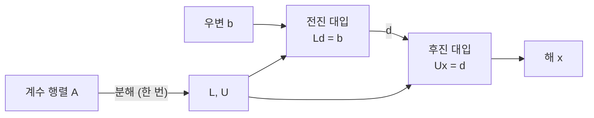

# 10장 — LU 분해(LU Factorization)

[레포지토리 안내](../../README.ko.md) | [English](Concepts_Lecture.md) | [한국어](Concepts_Lecture.ko.md)

> **최종 수정일:** 2026-10-18
>
> Applied Numerical Methods with Python for Engineers and Scientists, Chapra and Clough, Ch 10

> **학습 목표:**
> 1. 행렬을 L과 U 인수로 분해할 수 있다
> 2. 효율적인 다중 풀이를 위해 LU 분해를 적용할 수 있다
> 3. 대칭 양정치 행렬에 대해 촐레스키 분해를 구현할 수 있다

---

<br>

## 목차

- [1. LU 분해 개요](#1-lu-분해-개요)
  - [1.1 핵심 아이디어](#11-핵심-아이디어)
  - [1.2 2단계 풀이 과정](#12-2단계-풀이-과정)
  - [1.3 계산상의 이점](#13-계산상의-이점)
- [2. 가우스 소거법과 LU 분해의 관계](#2-가우스-소거법과-lu-분해의-관계)
  - [2.1 소거 계수가 L을 형성](#21-소거-계수가-l을-형성)
  - [2.2 3x3 시스템에서의 L과 U의 구조](#22-3x3-시스템에서의-l과-u의-구조)
  - [2.3 검증](#23-검증)
- [3. 저장 효율성](#3-저장-효율성)
- [4. 전진 대입(Forward Substitution)](#4-전진-대입forward-substitution)
- [5. 후진 대입(Back Substitution)](#5-후진-대입back-substitution)
- [6. 예제 10.1: LU 분해 (전체 단계별 풀이)](#6-예제-101-lu-분해-전체-단계별-풀이)
  - [6.1 문제 설정](#61-문제-설정)
  - [6.2 1단계: L의 첫 번째 열과 U의 첫 번째 행](#62-1단계-l의-첫-번째-열과-u의-첫-번째-행)
  - [6.3 2단계: L의 두 번째 열과 U의 두 번째 행](#63-2단계-l의-두-번째-열과-u의-두-번째-행)
  - [6.4 결과](#64-결과)
- [7. 예제 10.2: LU를 이용한 풀이](#7-예제-102-lu를-이용한-풀이)
  - [7.1 전진 대입](#71-전진-대입)
  - [7.2 후진 대입](#72-후진-대입)
- [8. 피봇팅을 적용한 LU: PA = LU](#8-피봇팅을-적용한-lu-pa--lu)
  - [8.1 피봇팅이 필요한 이유](#81-피봇팅이-필요한-이유)
  - [8.2 치환 행렬 P(Permutation Matrix)](#82-치환-행렬-ppermutation-matrix)
  - [8.3 절차](#83-절차)
  - [8.4 예제 10.3: 작은 피봇이 있는 2x2](#84-예제-103-작은-피봇이-있는-2x2)
- [9. 촐레스키 분해(Cholesky Factorization)](#9-촐레스키-분해cholesky-factorization)
  - [9.1 대칭 양정치 행렬(Symmetric Positive Definite Matrices)](#91-대칭-양정치-행렬symmetric-positive-definite-matrices)
  - [9.2 촐레스키 분해 공식](#92-촐레스키-분해-공식)
  - [9.3 예제 10.5: 촐레스키 분해](#93-예제-105-촐레스키-분해)
  - [9.4 분해 방법 비교](#94-분해-방법-비교)
- [10. Python 코드](#10-python-코드)
- [요약](#요약)
- [점검 문제](#점검-문제)

---

<br>

## 1. LU 분해 개요

### 1.1 핵심 아이디어

LU 분해의 목표는 정방 행렬 $`A`$를 두 삼각 행렬의 곱으로 분해하는 것이다.

```math
A = LU
```

여기서 $`L`$은 대각선 위의 모든 성분이 0인 **하삼각 행렬(lower triangular matrix)** 이고, $`U`$는 대각선 아래의 모든 성분이 0인 **상삼각 행렬(upper triangular matrix)** 이다.

> **[선형대수학]** LU 분해는 수학적으로 가우스 소거법(Gaussian elimination)과 동등하다. 소거 계수가 정확히 L의 성분이 된다. 이 연결은 깊어서, 가우스 소거법을 수행하는 모든 알고리즘은 암묵적으로 LU 분해를 계산한다.

### 1.2 2단계 풀이 과정

$`A = LU`$를 알면 $`Ax = b`$의 풀이는 두 개의 더 간단한 삼각 풀이로 나뉜다.

1. **전진 대입(Forward substitution):** 중간 벡터 $`d`$에 대해 $`Ld = b`$를 푼다.
2. **후진 대입(Back substitution):** 해 벡터 $`x`$에 대해 $`Ux = d`$를 푼다.

삼각 구조 덕분에 추가 소거 없이 미지수를 하나씩 차례로 계산할 수 있으므로 각 삼각 풀이는 간단하다.

정확성 검증: $`Ax = (LU)x = L(Ux) = Ld = b`$.



*그림 1. LU 분해를 이용한 2단계 풀이 과정*

### 1.3 계산상의 이점

LU 분해의 핵심 이점은 비용이 큰 분해 단계와 상대적으로 저렴한 풀이 단계를 분리한다는 것이다.

| 단계 | 비용 | 의존 대상 |
|:-----|:-----|:----------|
| 분해: $`A = LU`$ | $`O(n^3)`$ | $`A`$만 |
| 전진 대입: $`Ld = b`$ | $`O(n^2)`$ | $`L`$과 $`b`$ |
| 후진 대입: $`Ux = d`$ | $`O(n^2)`$ | $`U`$와 $`d`$ |

*표 1. LU 분해를 이용한 풀이의 단계별 비용*

같은 계수 행렬 $`A`$를 **여러 우변 벡터** $`b_1, b_2, \ldots, b_m`$과 함께 사용할 때는 $`A`$를 한 번만 분해하고($`O(n^3)`$ 비용) 새 우변은 각각 $`O(n^2)`$ 작업으로 푼다. 우변마다 전체 가우스 소거법($`O(n^3)`$)을 수행하는 것에 비하면 절약이 매우 크다.

이러한 상황은 실무에서 자주 발생한다. 예를 들어 강성 행렬은 같지만 서로 다른 하중 케이스를 적용하는 구조 해석, 네트워크 토폴로지는 고정되어 있지만 서로 다른 입력 신호를 고려하는 회로 해석이 그렇다.

---

<br>

## 2. 가우스 소거법과 LU 분해의 관계

### 2.1 소거 계수가 L을 형성

8장의 가우스 소거법에서는 다음 계수를 계산했다.

```math
f_{ij} = \frac{a_{ij}}{a_{jj}}
```

$`j`$행의 $`f_{ij}`$배를 $`i`$행에서 빼서 성분 $`a_{ij}`$를 소거한다. 여기서 $`a_{ij}`$와 $`a_{jj}`$는 $`j`$번째 소거 단계 직전의 값, 즉 앞선 단계에서 이미 수정된 값이다. 주목할 점은 이 계수들을 대각 성분이 1인 하삼각 행렬로 모으면 그대로 행렬 $`L`$이 된다는 것이다.

### 2.2 3x3 시스템에서의 L과 U의 구조

$`3 \times 3`$ 시스템을 분해하면 다음을 얻는다.

```math
L = \begin{bmatrix} 1 & 0 & 0 \\ f_{21} & 1 & 0 \\ f_{31} & f_{32} & 1 \end{bmatrix}, \quad U = \begin{bmatrix} a_{11} & a_{12} & a_{13} \\ 0 & a'_{22} & a'_{23} \\ 0 & 0 & a''_{33} \end{bmatrix}
```

각 기호의 뜻은 다음과 같다.

- $`f_{21}, f_{31}`$은 첫 번째 소거 단계(첫 번째 열 소거)에서 계산한 계수이다.
- $`f_{32}`$는 두 번째 소거 단계(두 번째 열 소거)에서 계산한 계수이다.
- $`a'_{22}, a'_{23}`$은 첫 번째 소거 단계 후에 수정된 성분이다.
- $`a''_{33}`$은 두 소거 단계를 모두 거친 후에 수정된 성분이다.

$`L`$은 대각 성분이 모두 1인 **단위 하삼각 행렬(unit lower triangular matrix)** 이고, $`U`$는 전진 소거의 결과인 상삼각 행렬로서 전진 소거로 얻은 $`A`$의 행 사다리꼴(row echelon form)과 정확히 같다.

### 2.3 검증

행렬 곱 $`LU`$를 계산하여 $`A`$와 같은지 확인하면 분해를 검증할 수 있다. $`3 \times 3`$ 경우는 다음과 같다.

```math
(LU)_{11} = 1 \cdot a_{11} = a_{11}
```

```math
(LU)_{21} = f_{21} \cdot a_{11} = \frac{a_{21}}{a_{11}} \cdot a_{11} = a_{21}
```

```math
(LU)_{22} = f_{21} \cdot a_{12} + 1 \cdot a'_{22} = f_{21} \cdot a_{12} + (a_{22} - f_{21} \cdot a_{12}) = a_{22}
```

나머지 성분도 마찬가지이다. 소거 계수가 수행한 행 연산을 정확히 기록하고 있으므로, 각 곱은 $`A`$의 원래 성분을 재구성한다.

---

<br>

## 3. 저장 효율성

Doolittle 방법(대각 성분이 1인 $`L`$을 만드는 LU 분해 방식)의 구성상 $`L`$의 대각 성분은 항상 1이므로, 이 값들을 명시적으로 저장할 필요가 없다. 따라서 $`L`$과 $`U`$를 하나의 $`n \times n`$ 행렬에 함께 저장할 수 있다.

```math
\begin{bmatrix} u_{11} & u_{12} & u_{13} \\ l_{21} & u_{22} & u_{23} \\ l_{31} & l_{32} & u_{33} \end{bmatrix}
```

대각을 포함한 상삼각 부분에는 $`U`$를, 대각 아래의 순수 하삼각 부분에는 $`L`$을 저장한다. $`L`$의 대각 성분이 모두 1이라는 사실은 암묵적으로 가정한다.

이 압축 저장 형식은 LAPACK과 SciPy를 포함한 대부분의 수치 라이브러리에서 사용한다. 메모리를 효율적으로 쓰고 중복이 없다. 실제로 분해는 원래 행렬 $`A`$를 결합된 $`[L \setminus U]`$ 저장으로 덮어쓰는 **제자리(in place)** 연산으로 수행할 수도 있다.

---

<br>

## 4. 전진 대입(Forward Substitution)

$`L`$과 $`b`$가 주어지면 위에서 아래로 진행하며 $`Ld = b`$에서 $`d`$를 구한다.

```math
d_1 = b_1
```

```math
d_i = b_i - \sum_{j=1}^{i-1} L_{ij} \, d_j, \quad i = 2, 3, \ldots, n
```

$`L`$이 단위 하삼각 행렬(대각 성분이 1)이므로 대각 성분으로 나눌 필요가 없다. 각 $`d_i`$는 앞에서 계산한 값 $`d_1, d_2, \ldots, d_{i-1}`$에만 의존하므로, 계산은 첫 번째 방정식부터 마지막 방정식까지 차례로 진행된다.

전진 대입의 곱셈 횟수는 다음과 같다.

```math
\sum_{i=2}^{n}(i-1) = \frac{n(n-1)}{2} \approx \frac{n^2}{2}
```

뺄셈도 같은 횟수만큼 필요하므로 총 비용은 $`O(n^2)`$이다.

---

<br>

## 5. 후진 대입(Back Substitution)

$`U`$와 $`d`$가 주어지면 아래에서 위로 진행하며 $`Ux = d`$에서 $`x`$를 구한다.

```math
x_n = \frac{d_n}{U_{nn}}
```

```math
x_i = \frac{d_i - \sum_{j=i+1}^{n} U_{ij} \, x_j}{U_{ii}}, \quad i = n-1, n-2, \ldots, 1
```

각 $`x_i`$는 앞에서 계산한 값 $`x_{i+1}, x_{i+2}, \ldots, x_n`$에만 의존한다. $`U_{ii}`$로 나누려면 $`U`$의 모든 대각 성분이 0이 아니어야 하며, 이는 $`A`$가 비특이(nonsingular)라는 것과 동치이다.

후진 대입의 비용도 전진 대입과 비슷하게 $`O(n^2)`$이다.

---

<br>

## 6. 예제 10.1: LU 분해 (전체 단계별 풀이)

### 6.1 문제 설정

다음 행렬을 $`A = LU`$로 분해한다.

```math
A = \begin{bmatrix} 3 & -0.1 & -0.2 \\ 0.1 & 7 & -0.3 \\ 0.3 & -0.2 & 10 \end{bmatrix}
```

### 6.2 1단계: L의 첫 번째 열과 U의 첫 번째 행

$`U`$의 첫 번째 행은 $`A`$의 첫 번째 행과 같다.

```math
U_{1,:} = \begin{bmatrix} 3 & -0.1 & -0.2 \end{bmatrix}
```

첫 번째 열의 소거 계수를 계산한다.

```math
f_{21} = \frac{a_{21}}{a_{11}} = \frac{0.1}{3} = 0.0333\overline{3}
```

```math
f_{31} = \frac{a_{31}}{a_{11}} = \frac{0.3}{3} = 0.1
```

첫 번째 열을 소거하여 첫 번째 소거 단계 후의 나머지 성분을 계산한다.

- $`a'_{22} = 7 - (0.0333\overline{3})(-0.1) = 7.00333\overline{3}`$
- $`a'_{23} = -0.3 - (0.0333\overline{3})(-0.2) = -0.29333\overline{3}`$
- $`a'_{32} = -0.2 - (0.1)(-0.1) = -0.19`$
- $`a'_{33} = 10 - (0.1)(-0.2) = 10.02`$

### 6.3 2단계: L의 두 번째 열과 U의 두 번째 행

$`U`$의 두 번째 행은 다음과 같다.

```math
U_{2,:} = \begin{bmatrix} 0 & 7.00333 & -0.29333 \end{bmatrix}
```

두 번째 열의 소거 계수를 계산한다.

```math
f_{32} = \frac{a'_{32}}{a'_{22}} = \frac{-0.19}{7.00333} = -0.02713
```

두 번째 열을 소거한다.

- $`a''_{33} = 10.02 - (-0.02713)(-0.29333) = 10.02 - 0.00796 = 10.0120`$

### 6.4 결과

```math
L = \begin{bmatrix} 1 & 0 & 0 \\ 0.0333 & 1 & 0 \\ 0.1 & -0.02713 & 1 \end{bmatrix}, \quad U = \begin{bmatrix} 3 & -0.1 & -0.2 \\ 0 & 7.00333 & -0.29333 \\ 0 & 0 & 10.0120 \end{bmatrix}
```

검증: $`LU`$를 곱하면 원래 행렬 $`A`$가 재현된다.

---

<br>

## 7. 예제 10.2: LU를 이용한 풀이

예제 10.1의 $`L`$과 $`U`$를 사용하여 다음 우변에 대해 $`Ax = b`$를 푼다.

```math
b = \begin{bmatrix} 7.85 \\ -19.3 \\ 71.4 \end{bmatrix}
```

### 7.1 전진 대입

$`Ld = b`$를 푼다.

```math
d_1 = b_1 = 7.85
```

```math
d_2 = b_2 - L_{21} \, d_1 = -19.3 - (0.0333\overline{3})(7.85) = -19.3 - 0.2617 = -19.5617
```

```math
d_3 = b_3 - L_{31} \, d_1 - L_{32} \, d_2 = 71.4 - (0.1)(7.85) - (-0.02713)(-19.5617)
```

```math
= 71.4 - 0.785 - 0.5307 = 70.0843
```

> **참고:** 마지막 자릿수는 중간 계산에서 유지하는 소수 자릿수에 따라 조금씩 달라진다. 예를 들어 $`L_{32}`$를 $`-0.0271`$로 반올림하여 쓰면 $`d_3 \approx 70.0849`$가 된다. 전체 정밀도에서는 $`d_3 \approx 70.0843`$이다.

### 7.2 후진 대입

$`Ux = d`$를 푼다.

```math
x_3 = \frac{d_3}{U_{33}} = \frac{70.0843}{10.0120} = 7.00003
```

```math
x_2 = \frac{d_2 - U_{23} \, x_3}{U_{22}} = \frac{-19.5617 - (-0.29333)(7.00003)}{7.00333} = \frac{-19.5617 + 2.05332}{7.00333} = \frac{-17.50838}{7.00333} = -2.50001
```

```math
x_1 = \frac{d_1 - U_{12} \, x_2 - U_{13} \, x_3}{U_{11}} = \frac{7.85 - (-0.1)(-2.50001) - (-0.2)(7.00003)}{3}
```

```math
= \frac{7.85 - 0.25000 + 1.40001}{3} = \frac{9.00001}{3} = 3.00000
```

**최종 해:**

```math
x_1 = 3.00000, \quad x_2 = -2.50001, \quad x_3 = 7.00003
```

이 해는 8장에서 가우스 소거법으로 직접 얻은 해와 일치하며, 두 접근법이 동등함을 확인해 준다. 정확한 값 $`(3, -2.5, 7)`$과의 작은 차이는 중간 계산의 반올림 때문이다.

---

<br>

## 8. 피봇팅을 적용한 LU: $`PA = LU`$

### 8.1 피봇팅이 필요한 이유

가우스 소거법과 마찬가지로, 피봇팅 없는 LU 분해는 다음 경우에 실패하거나 부정확한 결과를 낼 수 있다.

- 피봇이 0이면 0으로 나누게 된다.
- 피봇이 매우 작으면 반올림 오차가 증폭된다.

현재 열에서 절댓값이 가장 큰 성분을 피봇으로 고르는 부분 피봇팅(partial pivoting)은 행렬이 비특이일 때 두 문제를 모두 해결한다.

### 8.2 치환 행렬 P(Permutation Matrix)

분해 과정에서 행 교환을 하면 그 교환을 **치환 행렬(permutation matrix)** $`P`$에 기록한다. 분해는 다음과 같이 된다.

```math
PA = LU
```

여기서 $`P`$는 소거 과정에서 수행한 행 교환에 따라 단위 행렬의 행을 재배열하여 얻은 $`n \times n`$ 행렬이다. 치환 행렬은 각 행과 각 열에 1을 정확히 하나씩 가지며, 나머지 성분은 모두 0이다.

치환 행렬의 주요 성질은 다음과 같다.

- $`P^{-1} = P^T`$ (직교 행렬)
- $`\det(P) = \pm 1`$
- $`PP^T = I`$

### 8.3 절차

피봇팅을 적용한 풀이 절차는 다음과 같다.

1. **분해:** 부분 피봇팅으로 $`A`$를 분해하여 $`PA = LU`$를 만족하는 $`P`$, $`L`$, $`U`$를 얻는다.
2. **우변 치환:** 같은 행 교환에 따라 $`b`$의 성분을 재배열한 $`Pb`$를 계산한다.
3. **전진 대입:** $`Ld = Pb`$를 푼다.
4. **후진 대입:** $`Ux = d`$를 푼다.

### 8.4 예제 10.3: 작은 피봇이 있는 2x2

다음 시스템을 생각한다.

```math
\begin{bmatrix} 0.0003 & 3.0000 \\ 1.0000 & 1.0000 \end{bmatrix} \begin{bmatrix} x_1 \\ x_2 \end{bmatrix} = \begin{bmatrix} 2.0001 \\ 1.0000 \end{bmatrix}
```

정확한 해는 $`x_1 = 1/3`$, $`x_2 = 2/3`$이다.

**피봇팅 없이:**

계수는 $`f_{21} = 1.0000 / 0.0003 = 3333.3\ldots`$으로 매우 큰 수이다. 첫 번째 행에 이 계수를 곱해 두 번째 행에서 빼면 다음과 같다.

```math
a'_{22} = 1.0000 - (3333.3\ldots)(3.0000) = 1 - 10000 = -9999
```

```math
b'_2 = 1.0000 - (3333.3\ldots)(2.0001) = 1 - 6667 = -6666
```

제한된 정밀도에서는 후진 대입에서 크기가 거의 같은 수의 뺄셈이 일어나 정확도가 크게 떨어진다. 유효 숫자 4자리로 후진 대입을 하면 다음과 같다.

```math
x_2 = \frac{-6666}{-9999} = 0.6667
```

```math
x_1 = \frac{2.0001 - (3.0000)(0.6667)}{0.0003} = \frac{2.0001 - 2.0001}{0.0003} = 0.0000
```

정확한 값 $`x_1 = 0.3333`$과 비교하면 $`x_1`$의 상대 오차는 100%이다.

**피봇팅 적용:**

피봇 위치에 절댓값이 가장 큰 성분이 오도록 행을 교환한다.

```math
P = \begin{bmatrix} 0 & 1 \\ 1 & 0 \end{bmatrix}, \quad PA = \begin{bmatrix} 1.0000 & 1.0000 \\ 0.0003 & 3.0000 \end{bmatrix}, \quad Pb = \begin{bmatrix} 1.0000 \\ 2.0001 \end{bmatrix}
```

이제 계수는 $`f_{21} = 0.0003 / 1.0000 = 0.0003`$으로 오차를 증폭하지 않는 작은 수이다.

```math
a'_{22} = 3.0000 - 0.0003 \times 1.0000 = 2.9997
```

```math
b'_2 = 2.0001 - 0.0003 \times 1.0000 = 1.9998
```

후진 대입 결과는 다음과 같다.

```math
x_2 = \frac{1.9998}{2.9997} = 0.6667 \approx \frac{2}{3}
```

```math
x_1 = 1.0000 - 1.0000 \times 0.6667 = 0.3333 \approx \frac{1}{3}
```

피봇팅을 적용하면 정확한 결과를 얻지만, 피봇팅 없이는 오차가 파국적으로 증폭된다.

---

<br>

## 9. 촐레스키 분해(Cholesky Factorization)

### 9.1 대칭 양정치 행렬(Symmetric Positive Definite Matrices)

특수하고 중요한 행렬 부류로 **대칭 양정치(SPD, symmetric positive definite)** 행렬이 있다. 행렬 $`A`$는 다음 두 조건을 만족할 때 SPD이다.

1. **대칭(Symmetric):** $`A = A^T`$, 즉 모든 $`i, j`$에 대해 $`a_{ij} = a_{ji}`$이다.
2. **양정치(Positive definite):** 0이 아닌 모든 벡터 $`x`$에 대해 $`x^T A x > 0`$이다.

동등하게, 대칭 행렬이 양정치인 것은 모든 고유값이 양수인 것과 동치이다.

> **[선형대수학]** SPD 행렬은 물리학(질량 행렬과 강성 행렬), 통계학(공분산 행렬), 최적화(볼록 함수의 헤시안)에서 자연스럽게 나타난다.

SPD 행렬에 대해서는 LU 분해를 **촐레스키 분해(Cholesky factorization)** 로 단순화할 수 있다.

```math
A = U^T U
```

여기서 $`U`$는 상삼각 행렬이다. $`A`$의 상삼각 부분만 저장하고 처리하면 되므로 일반 LU 분해에 비해 계산량과 저장 공간이 대략 절반이다. 따라서 촐레스키 분해는 일반 LU 분해보다 약 2배 빠르고, 피봇팅 없이도 수치적으로 안정하다.

### 9.2 촐레스키 분해 공식

$`U`$의 성분은 다음 공식으로 계산한다.

**대각 성분:**

```math
U_{ii} = \sqrt{a_{ii} - \sum_{k=1}^{i-1} U_{ki}^2}
```

**비대각 성분** ($`j > i`$인 경우):

```math
U_{ij} = \frac{a_{ij} - \sum_{k=1}^{i-1} U_{ki} \, U_{kj}}{U_{ii}}
```

계산은 위에서 아래로 한 행씩 진행한다. 각 행 $`i`$에서 먼저 대각 성분 $`U_{ii}`$를 계산하고(제곱근 필요), 그다음 $`j > i`$인 비대각 성분 $`U_{ij}`$를 계산한다.

대각 공식의 제곱근 안의 값이 모든 $`i`$에 대해 양수가 되어 $`U_{ii} > 0`$이 되는 것은 대칭 행렬 $`A`$가 양정치일 때, 그리고 그때에만이다. $`A`$가 양정치가 아니면 알고리즘은 어느 단계에서 제곱근 안의 값이 0 이하가 되며, 이것이 양정치성을 판정하는 내장 검사 역할을 한다.

### 9.3 예제 10.5: 촐레스키 분해

다음 SPD 행렬을 분해한다.

```math
A = \begin{bmatrix} 6 & 15 & 55 \\ 15 & 55 & 225 \\ 55 & 225 & 979 \end{bmatrix}
```

**1행:**

```math
U_{11} = \sqrt{a_{11}} = \sqrt{6} = 2.4495
```

```math
U_{12} = \frac{a_{12}}{U_{11}} = \frac{15}{2.4495} = 6.1237
```

```math
U_{13} = \frac{a_{13}}{U_{11}} = \frac{55}{2.4495} = 22.4537
```

**2행:**

```math
U_{22} = \sqrt{a_{22} - U_{12}^2} = \sqrt{55 - (6.1237)^2} = \sqrt{55 - 37.5} = \sqrt{17.5} = 4.1833
```

```math
U_{23} = \frac{a_{23} - U_{12} \, U_{13}}{U_{22}} = \frac{225 - (6.1237)(22.4537)}{4.1833} = \frac{225 - 137.5}{4.1833} = \frac{87.5}{4.1833} = 20.9165
```

**3행:**

```math
U_{33} = \sqrt{a_{33} - U_{13}^2 - U_{23}^2} = \sqrt{979 - (22.4537)^2 - (20.9165)^2}
```

```math
= \sqrt{979 - 504.1667 - 437.5000} = \sqrt{37.3333} = 6.1101
```

반올림 오차가 쌓이지 않도록 $`U_{13}^2 = 55^2/6 = 504.1667`$과 $`U_{23}^2 = 87.5^2/17.5 = 437.5`$는 정확한 값으로 계산했다.

**결과:**

```math
U = \begin{bmatrix} 2.4495 & 6.1237 & 22.4537 \\ 0 & 4.1833 & 20.9165 \\ 0 & 0 & 6.1101 \end{bmatrix}
```

검증:

```math
U^T U = \begin{bmatrix} 2.4495 & 0 & 0 \\ 6.1237 & 4.1833 & 0 \\ 22.4537 & 20.9165 & 6.1101 \end{bmatrix} \begin{bmatrix} 2.4495 & 6.1237 & 22.4537 \\ 0 & 4.1833 & 20.9165 \\ 0 & 0 & 6.1101 \end{bmatrix} = A
```

### 9.4 분해 방법 비교

지금까지 다룬 세 분해 방법을 비교하면 다음과 같다. 비용은 곱셈 횟수의 근사이다.

| 방법 | 조건 | 비용 | 핵심 성질 |
|:-----|:-----|:-----|:----------|
| LU (Doolittle) | 소거 중 피봇이 0이 되지 않는 정방 행렬 | $`n^3/3`$ | $`A = LU`$ |
| 피봇팅 LU | 일반 (비특이) 정방 행렬 | $`n^3/3`$ | $`PA = LU`$ |
| 촐레스키(Cholesky) | SPD만 | $`n^3/6`$ | $`A = U^T U`$, 무조건 안정 |

*표 2. LU 분해 방법의 적용 조건, 비용, 핵심 성질*

---

<br>

## 10. Python 코드

SciPy는 LU 분해와 촐레스키 분해의 효율적인 구현을 제공한다.

```python
import numpy as np
from scipy.linalg import lu, cholesky

# LU factorization with partial pivoting
A = np.array([[3, -0.1, -0.2],
              [0.1, 7, -0.3],
              [0.3, -0.2, 10]])

P, L, U = lu(A)
print(f'P = \n{P}')
print(f'L = \n{L}')
print(f'U = \n{U}')
print(f'||PA - LU|| = {np.linalg.norm(P @ A - L @ U):.2e}')

# Cholesky factorization (for SPD matrices)
A_spd = np.array([[6, 15, 55],
                   [15, 55, 225],
                   [55, 225, 979]], dtype=float)

U_chol = cholesky(A_spd)          # upper triangular (default)
print(f'U = \n{U_chol}')
print(f'||A - U^T U|| = {np.linalg.norm(A_spd - U_chol.T @ U_chol):.2e}')
```

> **참고:** SciPy의 `lu`는 `A = P @ L @ U`를 만족하는 치환 행렬 `P`를 반환하므로, 이 문서의 $`PA = LU`$ 표기로는 `P.T @ A = L @ U`이다. 참고 자료마다 정의가 다르므로 사용하는 라이브러리의 문서를 항상 확인해야 한다. 위 코드의 `P @ A - L @ U` 검사는 이 예제에서 행 교환이 일어나지 않아 `P`가 단위 행렬이므로 0에 가까운 값을 출력하지만, 일반적으로는 `P.T @ A - L @ U`로 검사해야 한다. `cholesky` 함수는 기본적으로 상삼각 인자를 반환하며, 하삼각 인자를 얻으려면 `lower=True`를 전달한다.

---

<br>

## 요약

| 개념 | 핵심 요약 |
|:-----|:----------|
| 핵심 아이디어 | $`A = LU`$로 분해한 뒤 두 삼각 시스템을 차례로 푼다. |
| 핵심 이점 | 분해는 한 번($`O(n^3)`$)만 하고, 여러 우변은 각각 $`O(n^2)`$의 대입으로 푼다. |
| 가우스 소거법과의 연결 | 소거 계수 $`f_{ij}`$가 $`L`$의 성분이 되고, 전진 소거의 결과가 $`U`$가 된다. |
| 저장 | $`L`$과 $`U`$를 하나의 행렬에 저장하며, $`L`$의 대각 성분 1은 암묵적으로 둔다. |
| 전진 대입 | $`d_i = b_i - \sum_{j=1}^{i-1} L_{ij} d_j`$로 위에서 아래로 계산한다. |
| 후진 대입 | $`x_i = (d_i - \sum_{j=i+1}^{n} U_{ij} x_j) / U_{ii}`$로 아래에서 위로 계산한다. |
| 피봇팅 | 수치 안정성을 위해 행 교환을 치환 행렬 $`P`$에 기록하여 $`PA = LU`$로 분해한다. |
| 촐레스키 | SPD 행렬을 $`A = U^T U`$로 분해하며, 일반 LU의 절반 비용으로 피봇팅 없이 안정하게 계산한다. |

---

<br>

## 점검 문제

1. **LU 분해:** 피봇팅 없이 $`A = \begin{bmatrix} 2 & 1 & 1 \\ 4 & 3 & 3 \\ 8 & 7 & 9 \end{bmatrix}`$를 $`A = LU`$로 분해하라.

   <details>
   <summary>정답</summary>

   첫 번째 열의 계수는 $`f_{21} = 4/2 = 2`$, $`f_{31} = 8/2 = 4`$이다. 소거하면 2행은 $`(0, 1, 1)`$, 3행은 $`(0, 3, 5)`$가 된다. 두 번째 열의 계수는 $`f_{32} = 3/1 = 3`$이고, $`a''_{33} = 5 - 3 \times 1 = 2`$이다. 따라서 $`L = \begin{bmatrix} 1 & 0 & 0 \\ 2 & 1 & 0 \\ 4 & 3 & 1 \end{bmatrix}`$, $`U = \begin{bmatrix} 2 & 1 & 1 \\ 0 & 1 & 1 \\ 0 & 0 & 2 \end{bmatrix}`$이다.

   </details>

2. **LU를 이용한 풀이:** 1번의 $`L`$과 $`U`$로 $`b = (4, 10, 24)^T`$에 대해 $`Ax = b`$를 풀라.

   <details>
   <summary>정답</summary>

   전진 대입으로 $`d_1 = 4`$, $`d_2 = 10 - 2 \times 4 = 2`$, $`d_3 = 24 - 4 \times 4 - 3 \times 2 = 2`$를 얻는다. 후진 대입으로 $`x_3 = 2/2 = 1`$, $`x_2 = (2 - 1 \times 1)/1 = 1`$, $`x_1 = (4 - 1 - 1)/2 = 1`$을 얻는다. 따라서 $`x = (1, 1, 1)^T`$이고, $`A`$에 곱하면 $`(4, 10, 24)^T`$가 되어 확인된다.

   </details>

3. **다중 우변의 비용:** $`n = 1000`$인 시스템을 우변 100개에 대해 풀 때, 우변마다 가우스 소거법을 다시 하는 경우와 LU 분해를 한 번 하고 대입만 반복하는 경우의 곱셈 횟수를 비교하라. 분해는 $`n^3/3`$, 우변 하나의 전진 대입과 후진 대입은 합쳐서 $`n^2`$으로 근사한다.

   <details>
   <summary>정답</summary>

   반복하는 경우는 $`100 \times (n^3/3 + n^2) = 100 \times (3.33 \times 10^8 + 10^6) \approx 3.34 \times 10^{10}`$회이다. LU 분해를 재사용하는 경우는 $`n^3/3 + 100 n^2 = 3.33 \times 10^8 + 10^8 \approx 4.33 \times 10^8`$회이다. 따라서 LU 분해를 재사용하면 약 77배 적은 곱셈으로 풀 수 있다.

   </details>

4. **피봇팅:** $`A = \begin{bmatrix} 0 & 1 \\ 1 & 1 \end{bmatrix}`$에 피봇팅 없는 LU 분해를 적용할 수 없는 이유를 설명하고, $`PA = LU`$를 이용해 $`b = (2, 3)^T`$에 대해 $`Ax = b`$를 풀라.

   <details>
   <summary>정답</summary>

   첫 번째 피봇 $`a_{11}`$이 0이므로 $`f_{21} = a_{21}/a_{11}`$을 계산할 수 없다. 두 행을 교환하는 $`P = \begin{bmatrix} 0 & 1 \\ 1 & 0 \end{bmatrix}`$를 쓰면 $`PA = \begin{bmatrix} 1 & 1 \\ 0 & 1 \end{bmatrix}`$이고, 이미 상삼각이므로 $`L = I`$, $`U = PA`$이다. $`Pb = (3, 2)^T`$이므로 $`d = (3, 2)^T`$이고, 후진 대입으로 $`x_2 = 2`$, $`x_1 = 3 - 2 = 1`$을 얻는다. 확인하면 $`Ax = (0 \times 1 + 1 \times 2, 1 \times 1 + 1 \times 2)^T = (2, 3)^T`$이다.

   </details>

5. **촐레스키 분해:** $`A = \begin{bmatrix} 4 & 2 \\ 2 & 5 \end{bmatrix}`$의 촐레스키 분해 $`A = U^T U`$를 구하라. 또 $`B = \begin{bmatrix} 1 & 2 \\ 2 & 1 \end{bmatrix}`$에 같은 공식을 적용하면 어떻게 되는지 설명하라.

   <details>
   <summary>정답</summary>

   $`U_{11} = \sqrt{4} = 2`$, $`U_{12} = 2/2 = 1`$, $`U_{22} = \sqrt{5 - 1^2} = 2`$이므로 $`U = \begin{bmatrix} 2 & 1 \\ 0 & 2 \end{bmatrix}`$이다. $`U^T U = \begin{bmatrix} 4 & 2 \\ 2 & 5 \end{bmatrix}`$로 확인된다. $`B`$에서는 $`U_{11} = 1`$, $`U_{12} = 2`$이고 $`U_{22} = \sqrt{1 - 2^2} = \sqrt{-3}`$이 되어 계산이 실패한다. 이는 $`B`$가 양정치가 아니라는 뜻이며, 실제로 $`B`$의 고유값은 $`3`$과 $`-1`$이다.

   </details>
