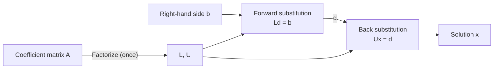

# Chapter 10 — LU Factorization

[Repository Guide](../../README.md) | [English](Concepts_Lecture.md) | [한국어](Concepts_Lecture.ko.md)

> **Last Updated:** 2026-10-27
>
> Applied Numerical Methods with Python for Engineers and Scientists, Chapra and Clough, Ch 10

> **Learning Objectives:**
> 1. Decompose matrices into L and U factors
> 2. Apply LU factorization for efficient multiple solves
> 3. Implement Cholesky decomposition for symmetric positive definite matrices

---

<br>

## Table of Contents

- [1. Overview of LU Factorization](#1-overview-of-lu-factorization)
  - [1.1 The Core Idea](#11-the-core-idea)
  - [1.2 Two-Phase Solution Process](#12-two-phase-solution-process)
  - [1.3 Computational Advantage](#13-computational-advantage)
- [2. Gauss Elimination as LU Factorization](#2-gauss-elimination-as-lu-factorization)
  - [2.1 Elimination Factors Form L](#21-elimination-factors-form-l)
  - [2.2 Structure of L and U for a 3x3 System](#22-structure-of-l-and-u-for-a-3x3-system)
  - [2.3 Verification](#23-verification)
- [3. Storage Efficiency](#3-storage-efficiency)
- [4. Forward Substitution](#4-forward-substitution)
- [5. Back Substitution](#5-back-substitution)
- [6. Example 10.1: LU Decomposition (Complete Step-by-Step)](#6-example-101-lu-decomposition-complete-step-by-step)
  - [6.1 Problem Setup](#61-problem-setup)
  - [6.2 Step 1: First Column of L and First Row of U](#62-step-1-first-column-of-l-and-first-row-of-u)
  - [6.3 Step 2: Second Column of L and Second Row of U](#63-step-2-second-column-of-l-and-second-row-of-u)
  - [6.4 Result](#64-result)
- [7. Example 10.2: Solving with LU](#7-example-102-solving-with-lu)
  - [7.1 Forward Substitution](#71-forward-substitution)
  - [7.2 Back Substitution](#72-back-substitution)
- [8. LU with Pivoting: PA = LU](#8-lu-with-pivoting-pa--lu)
  - [8.1 Why Pivoting is Needed](#81-why-pivoting-is-needed)
  - [8.2 The Permutation Matrix P](#82-the-permutation-matrix-p)
  - [8.3 Procedure](#83-procedure)
  - [8.4 Example 10.3: 2x2 with Small Pivot](#84-example-103-2x2-with-small-pivot)
- [9. Cholesky Factorization](#9-cholesky-factorization)
  - [9.1 Symmetric Positive Definite Matrices](#91-symmetric-positive-definite-matrices)
  - [9.2 Cholesky Decomposition Formulas](#92-cholesky-decomposition-formulas)
  - [9.3 Example 10.5: Cholesky Decomposition](#93-example-105-cholesky-decomposition)
  - [9.4 Comparison of Factorization Methods](#94-comparison-of-factorization-methods)
- [10. Python Code](#10-python-code)
- [Summary](#summary)
- [Self-Check Questions](#self-check-questions)

---

<br>

## 1. Overview of LU Factorization

### 1.1 The Core Idea

The goal of LU factorization is to decompose a square matrix $`A`$ into the product of two triangular matrices.

```math
A = LU
```

Here $`L`$ is a **lower triangular matrix**, in which all entries above the diagonal are zero, and $`U`$ is an **upper triangular matrix**, in which all entries below the diagonal are zero.

> **[Linear Algebra]** Linear algebra represents each row operation of Gaussian elimination as multiplication by an **elementary matrix**. The inverse of the elementary matrix that subtracts $`f_{ij}`$ times row $`j`$ from row $`i`$ is the unit lower triangular matrix with $`+f_{ij}`$ in the same position, so the product $`L`$ of the inverses of the elementary matrices used in elimination contains the elimination factors as they are, and $`A = LU`$ holds (Section 2). Therefore any algorithm that performs Gaussian elimination implicitly computes an LU factorization.

### 1.2 Two-Phase Solution Process

Once $`A = LU`$ is known, solving $`Ax = b`$ splits into two simpler triangular solves.

1. **Forward substitution:** Solve $`Ld = b`$ for the intermediate vector $`d`$.
2. **Back substitution:** Solve $`Ux = d`$ for the solution vector $`x`$.

Each triangular solve is straightforward because the triangular structure allows us to compute each unknown sequentially without any further elimination.

To verify correctness: $`Ax = (LU)x = L(Ux) = Ld = b`$.



*Figure 1. Two-phase solution process with LU factorization*

### 1.3 Computational Advantage

The key advantage of LU factorization is the separation of the expensive decomposition step from the relatively cheap solution step.

| Phase | Cost | Depends on |
|:------|:-----|:-----------|
| Decomposition: $`A = LU`$ | $`O(n^3)`$ | Only $`A`$ |
| Forward substitution: $`Ld = b`$ | $`O(n^2)`$ | $`L`$ and $`b`$ |
| Back substitution: $`Ux = d`$ | $`O(n^2)`$ | $`U`$ and $`d`$ |

*Table 1. Cost of each phase of the LU-based solution*

When the same coefficient matrix $`A`$ is used with **multiple right-hand side vectors** $`b_1, b_2, \ldots, b_m`$, we decompose $`A`$ only once (at $`O(n^3)`$ cost) and then solve each new right-hand side with just $`O(n^2)`$ work. This is a dramatic saving compared to performing full Gaussian elimination ($`O(n^3)`$) for each right-hand side separately.

This situation arises frequently in practice. Examples include structural analysis, where the stiffness matrix remains the same but different load cases are applied, and circuit analysis, where the network topology is fixed but different input signals are considered.

---

<br>

## 2. Gauss Elimination as LU Factorization

### 2.1 Elimination Factors Form L

Gaussian elimination in Chapter 8 computes the factors:

```math
f_{ij} = \frac{a_{ij}}{a_{jj}}
```

Element $`a_{ij}`$ is eliminated by subtracting $`f_{ij}`$ times row $`j`$ from row $`i`$. Here $`a_{ij}`$ and $`a_{jj}`$ denote the values just before the $`j`$-th elimination step, that is, values already modified by the earlier steps. The remarkable insight is that these same factors, collected into a lower triangular matrix with 1s on the diagonal, give us the matrix $`L`$.

### 2.2 Structure of L and U for a 3x3 System

For a $`3 \times 3`$ system, the factorization produces:

```math
L = \begin{bmatrix} 1 & 0 & 0 \\ f_{21} & 1 & 0 \\ f_{31} & f_{32} & 1 \end{bmatrix}, \quad U = \begin{bmatrix} a_{11} & a_{12} & a_{13} \\ 0 & a'_{22} & a'_{23} \\ 0 & 0 & a''_{33} \end{bmatrix}
```

The symbols mean the following.

- $`f_{21}, f_{31}`$ are the factors computed in the first elimination step (eliminating the first column).
- $`f_{32}`$ is the factor computed in the second elimination step (eliminating the second column).
- $`a'_{22}, a'_{23}`$ are the entries modified by the first elimination step.
- $`a''_{33}`$ is the entry modified by both elimination steps.

$`L`$ is a **unit lower triangular matrix** (diagonal entries are all 1), and $`U`$ is the upper triangular matrix that results from forward elimination; it is exactly the row-echelon form of $`A`$ obtained by forward elimination.

### 2.3 Verification

The factorization can be verified by performing the matrix multiplication $`LU`$ and confirming that it equals $`A`$. For the $`3 \times 3`$ case:

```math
(LU)_{11} = 1 \cdot a_{11} = a_{11}
```

```math
(LU)_{21} = f_{21} \cdot a_{11} = \frac{a_{21}}{a_{11}} \cdot a_{11} = a_{21}
```

```math
(LU)_{22} = f_{21} \cdot a_{12} + 1 \cdot a'_{22} = f_{21} \cdot a_{12} + (a_{22} - f_{21} \cdot a_{12}) = a_{22}
```

The same holds for all other entries. Each multiplication reconstructs the original entry of $`A`$ because the elimination factors encode exactly the row operations performed.

---

<br>

## 3. Storage Efficiency

Since the diagonal of $`L`$ is always 1 by construction of the Doolittle method (the LU factorization variant that produces an $`L`$ with unit diagonal), there is no need to store these values explicitly. This means $`L`$ and $`U`$ can be stored together in a single $`n \times n`$ matrix:

```math
\begin{bmatrix} u_{11} & u_{12} & u_{13} \\ l_{21} & u_{22} & u_{23} \\ l_{31} & l_{32} & u_{33} \end{bmatrix}
```

The upper triangular part (including the diagonal) stores $`U`$, and the strictly lower triangular part stores $`L`$. The fact that the diagonal of $`L`$ is all 1s is implicit.

This compact storage format is used by most numerical libraries (including LAPACK and SciPy). It is memory-efficient and avoids any redundancy. In practice, the decomposition can even be performed **in place**, overwriting the original matrix $`A`$ with the combined $`[L \setminus U]`$ storage.

---

<br>

## 4. Forward Substitution

Given $`L`$ and $`b`$, we solve $`Ld = b`$ for $`d`$ by working from top to bottom:

```math
d_1 = b_1
```

```math
d_i = b_i - \sum_{j=1}^{i-1} L_{ij} \, d_j, \quad i = 2, 3, \ldots, n
```

Since $`L`$ is unit lower triangular (diagonal entries are 1), there is no division by a diagonal element. Each $`d_i`$ depends only on previously computed values $`d_1, d_2, \ldots, d_{i-1}`$, so the computation proceeds sequentially from the first equation to the last.

The number of multiplications in forward substitution is:

```math
\sum_{i=2}^{n}(i-1) = \frac{n(n-1)}{2} \approx \frac{n^2}{2}
```

The same number of subtractions is needed, giving a total cost of $`O(n^2)`$.

---

<br>

## 5. Back Substitution

Given $`U`$ and $`d`$, we solve $`Ux = d`$ for $`x`$ by working from bottom to top:

```math
x_n = \frac{d_n}{U_{nn}}
```

```math
x_i = \frac{d_i - \sum_{j=i+1}^{n} U_{ij} \, x_j}{U_{ii}}, \quad i = n-1, n-2, \ldots, 1
```

Each $`x_i`$ depends only on previously computed values $`x_{i+1}, x_{i+2}, \ldots, x_n`$. The division by $`U_{ii}`$ requires that all diagonal entries of $`U`$ be nonzero, which is equivalent to $`A`$ being nonsingular.

The cost of back substitution is also $`O(n^2)`$, similar to forward substitution.

---

<br>

## 6. Example 10.1: LU Decomposition (Complete Step-by-Step)

### 6.1 Problem Setup

Decompose the following matrix into $`A = LU`$:

```math
A = \begin{bmatrix} 3 & -0.1 & -0.2 \\ 0.1 & 7 & -0.3 \\ 0.3 & -0.2 & 10 \end{bmatrix}
```

### 6.2 Step 1: First Column of L and First Row of U

The first row of $`U`$ is identical to the first row of $`A`$:

```math
U_{1,:} = \begin{bmatrix} 3 & -0.1 & -0.2 \end{bmatrix}
```

Compute the elimination factors for the first column:

```math
f_{21} = \frac{a_{21}}{a_{11}} = \frac{0.1}{3} = 0.0333\overline{3}
```

```math
f_{31} = \frac{a_{31}}{a_{11}} = \frac{0.3}{3} = 0.1
```

Eliminate the first column, computing the remaining entries after the first elimination step:

- $`a'_{22} = 7 - (0.0333\overline{3})(-0.1) = 7.00333\overline{3}`$
- $`a'_{23} = -0.3 - (0.0333\overline{3})(-0.2) = -0.29333\overline{3}`$
- $`a'_{32} = -0.2 - (0.1)(-0.1) = -0.19`$
- $`a'_{33} = 10 - (0.1)(-0.2) = 10.02`$

### 6.3 Step 2: Second Column of L and Second Row of U

The second row of $`U`$ is:

```math
U_{2,:} = \begin{bmatrix} 0 & 7.00333 & -0.29333 \end{bmatrix}
```

Compute the elimination factor for the second column:

```math
f_{32} = \frac{a'_{32}}{a'_{22}} = \frac{-0.19}{7.00333} = -0.02713
```

Eliminate the second column:

- $`a''_{33} = 10.02 - (-0.02713)(-0.29333) = 10.02 - 0.00796 = 10.0120`$

### 6.4 Result

```math
L = \begin{bmatrix} 1 & 0 & 0 \\ 0.0333 & 1 & 0 \\ 0.1 & -0.02713 & 1 \end{bmatrix}, \quad U = \begin{bmatrix} 3 & -0.1 & -0.2 \\ 0 & 7.00333 & -0.29333 \\ 0 & 0 & 10.0120 \end{bmatrix}
```

Verification: multiplying $`LU`$ reproduces the original matrix $`A`$.

---

<br>

## 7. Example 10.2: Solving with LU

Using the $`L`$ and $`U`$ from Example 10.1, solve $`Ax = b`$ where:

```math
b = \begin{bmatrix} 7.85 \\ -19.3 \\ 71.4 \end{bmatrix}
```

### 7.1 Forward Substitution

Solve $`Ld = b`$:

```math
d_1 = b_1 = 7.85
```

```math
d_2 = b_2 - L_{21} \, d_1 = -19.3 - (0.0333\overline{3})(7.85) = -19.3 - 0.2617 = -19.5617
```

```math
d_3 = b_3 - L_{31} \, d_1 - L_{32} \, d_2 = 71.4 - (0.1)(7.85) - (-0.02713)(-19.5617)
```

```math
= 71.4 - 0.785 - 0.5307 = 70.0843
```

> **Note:** The last digits vary slightly with how many decimal places are carried through the intermediate calculations. For example, rounding $`L_{32}`$ to $`-0.0271`$ gives $`d_3 \approx 70.0849`$. With full precision, $`d_3 \approx 70.0843`$.

### 7.2 Back Substitution

Solve $`Ux = d`$:

```math
x_3 = \frac{d_3}{U_{33}} = \frac{70.0843}{10.0120} = 7.00003
```

```math
x_2 = \frac{d_2 - U_{23} \, x_3}{U_{22}} = \frac{-19.5617 - (-0.29333)(7.00003)}{7.00333} = \frac{-19.5617 + 2.05332}{7.00333} = \frac{-17.50838}{7.00333} = -2.50001
```

```math
x_1 = \frac{d_1 - U_{12} \, x_2 - U_{13} \, x_3}{U_{11}} = \frac{7.85 - (-0.1)(-2.50001) - (-0.2)(7.00003)}{3}
```

```math
= \frac{7.85 - 0.25000 + 1.40001}{3} = \frac{9.00001}{3} = 3.00000
```

**Final solution:**

```math
x_1 = 3.00000, \quad x_2 = -2.50001, \quad x_3 = 7.00003
```

This matches the solution obtained by direct Gaussian elimination in Chapter 8, confirming the equivalence of the two approaches. The small deviations from the exact values $`(3, -2.5, 7)`$ are due to roundoff in the intermediate calculations.

---

<br>

## 8. LU with Pivoting: $`PA = LU`$

### 8.1 Why Pivoting is Needed

Just as with Gaussian elimination, LU factorization without pivoting can fail or produce inaccurate results in the following cases.

- A zero pivot causes division by zero.
- A very small pivot amplifies roundoff errors.

Partial pivoting, which selects the entry of largest absolute value in the current column as the pivot, resolves both issues when the matrix is nonsingular.

### 8.2 The Permutation Matrix P

When row swaps are performed during the factorization, they are recorded in a **permutation matrix** $`P`$. The factorization becomes:

```math
PA = LU
```

where $`P`$ is an $`n \times n`$ matrix obtained by reordering the rows of the identity matrix according to the row swaps performed during elimination. The permutation matrix has exactly one entry of 1 in each row and each column, with all other entries being 0.

Key properties of permutation matrices:

- $`P^{-1} = P^T`$ (orthogonal matrix)
- $`\det(P) = \pm 1`$
- $`PP^T = I`$

### 8.3 Procedure

The solution procedure with pivoting is:

1. **Factorize:** Decompose $`A`$ with partial pivoting to obtain $`P`$, $`L`$, and $`U`$ such that $`PA = LU`$.
2. **Permute the RHS:** Compute $`Pb`$ by reordering the entries of $`b`$ according to the same row swaps.
3. **Forward substitution:** Solve $`Ld = Pb`$.
4. **Back substitution:** Solve $`Ux = d`$.

### 8.4 Example 10.3: 2x2 with Small Pivot

Consider the system:

```math
\begin{bmatrix} 0.0003 & 3.0000 \\ 1.0000 & 1.0000 \end{bmatrix} \begin{bmatrix} x_1 \\ x_2 \end{bmatrix} = \begin{bmatrix} 2.0001 \\ 1.0000 \end{bmatrix}
```

The exact solution is $`x_1 = 1/3`$ and $`x_2 = 2/3`$.

**Without pivoting:**

The factor is $`f_{21} = 1.0000 / 0.0003 = 3333.3\ldots`$, an extremely large number. When this factor multiplies the first row and is subtracted from the second row:

```math
a'_{22} = 1.0000 - (3333.3\ldots)(3.0000) = 1 - 10000 = -9999
```

```math
b'_2 = 1.0000 - (3333.3\ldots)(2.0001) = 1 - 6667 = -6666
```

With limited precision, back substitution then subtracts nearly equal numbers, which causes a significant loss of accuracy. Back substitution with 4 significant digits gives:

```math
x_2 = \frac{-6666}{-9999} = 0.6667
```

```math
x_1 = \frac{2.0001 - (3.0000)(0.6667)}{0.0003} = \frac{2.0001 - 2.0001}{0.0003} = 0.0000
```

Compared with the exact value $`x_1 = 0.3333`$, the relative error in $`x_1`$ is 100%.

**With pivoting:**

Swap rows to put the entry of largest absolute value in the pivot position:

```math
P = \begin{bmatrix} 0 & 1 \\ 1 & 0 \end{bmatrix}, \quad PA = \begin{bmatrix} 1.0000 & 1.0000 \\ 0.0003 & 3.0000 \end{bmatrix}, \quad Pb = \begin{bmatrix} 1.0000 \\ 2.0001 \end{bmatrix}
```

Now the factor is $`f_{21} = 0.0003 / 1.0000 = 0.0003`$, a small number that does not amplify errors:

```math
a'_{22} = 3.0000 - 0.0003 \times 1.0000 = 2.9997
```

```math
b'_2 = 2.0001 - 0.0003 \times 1.0000 = 1.9998
```

Back substitution gives:

```math
x_2 = \frac{1.9998}{2.9997} = 0.6667 \approx \frac{2}{3}
```

```math
x_1 = 1.0000 - 1.0000 \times 0.6667 = 0.3333 \approx \frac{1}{3}
```

The pivoted version produces accurate results, while the unpivoted version suffers from catastrophic error amplification.

---

<br>

## 9. Cholesky Factorization

### 9.1 Symmetric Positive Definite Matrices

A special and important class of matrices are **symmetric positive definite (SPD)** matrices. A matrix $`A`$ is SPD if it satisfies both of the following conditions.

1. **Symmetric:** $`A = A^T`$, that is, $`a_{ij} = a_{ji}`$ for all $`i, j`$.
2. **Positive definite:** $`x^T A x > 0`$ for all nonzero vectors $`x`$.

Also, a symmetric matrix is positive definite if and only if all its eigenvalues are strictly positive.

> **[Linear Algebra]** A symmetric positive definite matrix is a symmetric matrix whose quadratic form $`x^T A x`$ is positive for every nonzero vector $`x`$; this is equivalent to all eigenvalues being positive and to all leading principal minors being positive. Because of this property, the value under the square root in the Cholesky formula of Section 9.2 is always positive, so Cholesky factorization is applied only to SPD matrices, which arise naturally in physics (mass and stiffness matrices), statistics (covariance matrices), and optimization (Hessians of convex functions).

For SPD matrices, LU factorization can be simplified to the **Cholesky factorization**:

```math
A = U^T U
```

where $`U`$ is an upper triangular matrix. Only the upper triangle of $`A`$ needs to be stored and processed, resulting in roughly half the computation and half the storage compared to general LU factorization. As a result, Cholesky is about 2x faster than general LU and is numerically stable without pivoting.

### 9.2 Cholesky Decomposition Formulas

The entries of $`U`$ are computed using the following formulas.

**Diagonal entries:**

```math
U_{ii} = \sqrt{a_{ii} - \sum_{k=1}^{i-1} U_{ki}^2}
```

**Off-diagonal entries** (for $`j > i`$):

```math
U_{ij} = \frac{a_{ij} - \sum_{k=1}^{i-1} U_{ki} \, U_{kj}}{U_{ii}}
```

The computation proceeds row by row, from top to bottom. For each row $`i`$, the diagonal entry $`U_{ii}`$ is computed first (requiring a square root), and then the off-diagonal entries $`U_{ij}`$ for $`j > i`$ are computed.

The quantity under the square root in the diagonal formula is positive for all $`i`$, giving $`U_{ii} > 0`$, if and only if the symmetric matrix $`A`$ is positive definite. If $`A`$ is not positive definite, the algorithm encounters a zero or negative quantity under the square root at some step, which serves as a built-in test for positive definiteness.

### 9.3 Example 10.5: Cholesky Decomposition

Decompose the following SPD matrix:

```math
A = \begin{bmatrix} 6 & 15 & 55 \\ 15 & 55 & 225 \\ 55 & 225 & 979 \end{bmatrix}
```

**Row 1:**

```math
U_{11} = \sqrt{a_{11}} = \sqrt{6} = 2.4495
```

```math
U_{12} = \frac{a_{12}}{U_{11}} = \frac{15}{2.4495} = 6.1237
```

```math
U_{13} = \frac{a_{13}}{U_{11}} = \frac{55}{2.4495} = 22.4537
```

**Row 2:**

```math
U_{22} = \sqrt{a_{22} - U_{12}^2} = \sqrt{55 - (6.1237)^2} = \sqrt{55 - 37.5} = \sqrt{17.5} = 4.1833
```

```math
U_{23} = \frac{a_{23} - U_{12} \, U_{13}}{U_{22}} = \frac{225 - (6.1237)(22.4537)}{4.1833} = \frac{225 - 137.5}{4.1833} = \frac{87.5}{4.1833} = 20.9165
```

**Row 3:**

```math
U_{33} = \sqrt{a_{33} - U_{13}^2 - U_{23}^2} = \sqrt{979 - (22.4537)^2 - (20.9165)^2}
```

```math
= \sqrt{979 - 504.1667 - 437.5000} = \sqrt{37.3333} = 6.1101
```

To keep roundoff from accumulating, $`U_{13}^2 = 55^2/6 = 504.1667`$ and $`U_{23}^2 = 87.5^2/17.5 = 437.5`$ are computed exactly.

**Result:**

```math
U = \begin{bmatrix} 2.4495 & 6.1237 & 22.4537 \\ 0 & 4.1833 & 20.9165 \\ 0 & 0 & 6.1101 \end{bmatrix}
```

Verification:

```math
U^T U = \begin{bmatrix} 2.4495 & 0 & 0 \\ 6.1237 & 4.1833 & 0 \\ 22.4537 & 20.9165 & 6.1101 \end{bmatrix} \begin{bmatrix} 2.4495 & 6.1237 & 22.4537 \\ 0 & 4.1833 & 20.9165 \\ 0 & 0 & 6.1101 \end{bmatrix} = A
```

### 9.4 Comparison of Factorization Methods

The three factorization methods covered so far compare as follows. The costs are approximate multiplication counts.

| Method | Condition | Cost | Key Property |
|:-------|:---------|:-----|:------------|
| LU (Doolittle) | Square matrix with no zero pivot during elimination | $`n^3/3`$ | $`A = LU`$ |
| LU with pivoting | General (nonsingular) square matrix | $`n^3/3`$ | $`PA = LU`$ |
| Cholesky | SPD only | $`n^3/6`$ | $`A = U^T U`$, unconditionally stable |

*Table 2. Conditions, costs, and key properties of LU factorization methods*

---

<br>

## 10. Python Code

SciPy provides efficient implementations of both LU and Cholesky factorizations:

```python
import numpy as np
from scipy.linalg import lu, cholesky

# LU factorization with partial pivoting
A = np.array([[3, -0.1, -0.2],
              [0.1, 7, -0.3],
              [0.3, -0.2, 10]])

P, L, U = lu(A)
print(f'P = \n{P}')
print(f'L = \n{L}')
print(f'U = \n{U}')
print(f'||PA - LU|| = {np.linalg.norm(P @ A - L @ U):.2e}')

# Cholesky factorization (for SPD matrices)
A_spd = np.array([[6, 15, 55],
                   [15, 55, 225],
                   [55, 225, 979]], dtype=float)

U_chol = cholesky(A_spd)          # upper triangular (default)
print(f'U = \n{U_chol}')
print(f'||A - U^T U|| = {np.linalg.norm(A_spd - U_chol.T @ U_chol):.2e}')
```

> **Note:** SciPy's `lu` returns the permutation matrix `P` such that `A = P @ L @ U`, so in the $`PA = LU`$ notation of this note it satisfies `P.T @ A = L @ U`. References define it differently, so always check the documentation for your library. The check `P @ A - L @ U` in the code above prints a value near zero only because no row swaps occur in this example and `P` is the identity matrix; in general the check should be `P.T @ A - L @ U`. The `cholesky` function returns the upper triangular factor by default; pass `lower=True` to get the lower triangular factor.

---

<br>

## Summary

| Concept | Key Summary |
|:--------|:------------|
| Core idea | Decompose $`A = LU`$, then solve two triangular systems in turn. |
| Key advantage | Factor once ($`O(n^3)`$) and solve each of many right-hand sides by substitution ($`O(n^2)`$ each). |
| Gauss elimination link | The elimination factors $`f_{ij}`$ become the entries of $`L`$, and the result of forward elimination becomes $`U`$. |
| Storage | $`L`$ and $`U`$ are stored in one matrix, with the diagonal 1s of $`L`$ left implicit. |
| Forward substitution | $`d_i = b_i - \sum_{j=1}^{i-1} L_{ij} d_j`$ is computed from top to bottom. |
| Back substitution | $`x_i = (d_i - \sum_{j=i+1}^{n} U_{ij} x_j) / U_{ii}`$ is computed from bottom to top. |
| Pivoting | Row swaps are recorded in a permutation matrix $`P`$ to factor $`PA = LU`$ for numerical stability. |
| Cholesky | SPD matrices are factored as $`A = U^T U`$ at half the cost of general LU, stably and without pivoting. |

---

<br>

## Self-Check Questions

1. **LU factorization:** Without pivoting, factor $`A = \begin{bmatrix} 2 & 1 & 1 \\ 4 & 3 & 3 \\ 8 & 7 & 9 \end{bmatrix}`$ as $`A = LU`$.

   <details>
   <summary>Answer</summary>

   The first-column factors are $`f_{21} = 4/2 = 2`$ and $`f_{31} = 8/2 = 4`$. Elimination turns row 2 into $`(0, 1, 1)`$ and row 3 into $`(0, 3, 5)`$. The second-column factor is $`f_{32} = 3/1 = 3`$, and $`a''_{33} = 5 - 3 \times 1 = 2`$. Therefore $`L = \begin{bmatrix} 1 & 0 & 0 \\ 2 & 1 & 0 \\ 4 & 3 & 1 \end{bmatrix}`$ and $`U = \begin{bmatrix} 2 & 1 & 1 \\ 0 & 1 & 1 \\ 0 & 0 & 2 \end{bmatrix}`$.

   </details>

2. **Solving with LU:** Using $`L`$ and $`U`$ from Question 1, solve $`Ax = b`$ for $`b = (4, 10, 24)^T`$.

   <details>
   <summary>Answer</summary>

   Forward substitution gives $`d_1 = 4`$, $`d_2 = 10 - 2 \times 4 = 2`$, and $`d_3 = 24 - 4 \times 4 - 3 \times 2 = 2`$. Back substitution gives $`x_3 = 2/2 = 1`$, $`x_2 = (2 - 1 \times 1)/1 = 1`$, and $`x_1 = (4 - 1 - 1)/2 = 1`$. Therefore $`x = (1, 1, 1)^T`$, and multiplying by $`A`$ gives $`(4, 10, 24)^T`$ as a check.

   </details>

3. **Cost of multiple right-hand sides:** For a system with $`n = 1000`$ and 100 right-hand sides, compare the multiplication counts of repeating Gaussian elimination for every right-hand side and of factoring once with LU and repeating only the substitutions. Approximate the factorization by $`n^3/3`$ and the forward and back substitutions for one right-hand side together by $`n^2`$.

   <details>
   <summary>Answer</summary>

   Repeating elimination costs $`100 \times (n^3/3 + n^2) = 100 \times (3.33 \times 10^8 + 10^6) \approx 3.34 \times 10^{10}`$ multiplications. Reusing the LU factors costs $`n^3/3 + 100 n^2 = 3.33 \times 10^8 + 10^8 \approx 4.33 \times 10^8`$ multiplications. Reusing the LU factorization therefore needs about 77 times fewer multiplications.

   </details>

4. **Pivoting:** Explain why LU factorization without pivoting cannot be applied to $`A = \begin{bmatrix} 0 & 1 \\ 1 & 1 \end{bmatrix}`$, and solve $`Ax = b`$ for $`b = (2, 3)^T`$ using $`PA = LU`$.

   <details>
   <summary>Answer</summary>

   The first pivot $`a_{11}`$ is zero, so $`f_{21} = a_{21}/a_{11}`$ cannot be computed. With the row swap $`P = \begin{bmatrix} 0 & 1 \\ 1 & 0 \end{bmatrix}`$, $`PA = \begin{bmatrix} 1 & 1 \\ 0 & 1 \end{bmatrix}`$ is already upper triangular, so $`L = I`$ and $`U = PA`$. Since $`Pb = (3, 2)^T`$, $`d = (3, 2)^T`$, and back substitution gives $`x_2 = 2`$ and $`x_1 = 3 - 2 = 1`$. As a check, $`Ax = (0 \times 1 + 1 \times 2, 1 \times 1 + 1 \times 2)^T = (2, 3)^T`$.

   </details>

5. **Cholesky factorization:** Find the Cholesky factorization $`A = U^T U`$ of $`A = \begin{bmatrix} 4 & 2 \\ 2 & 5 \end{bmatrix}`$. Also explain what happens when the same formulas are applied to $`B = \begin{bmatrix} 1 & 2 \\ 2 & 1 \end{bmatrix}`$.

   <details>
   <summary>Answer</summary>

   $`U_{11} = \sqrt{4} = 2`$, $`U_{12} = 2/2 = 1`$, and $`U_{22} = \sqrt{5 - 1^2} = 2`$, so $`U = \begin{bmatrix} 2 & 1 \\ 0 & 2 \end{bmatrix}`$. The check $`U^T U = \begin{bmatrix} 4 & 2 \\ 2 & 5 \end{bmatrix}`$ confirms it. For $`B`$, $`U_{11} = 1`$ and $`U_{12} = 2`$, but $`U_{22} = \sqrt{1 - 2^2} = \sqrt{-3}`$, so the computation fails. This means $`B`$ is not positive definite; indeed, the eigenvalues of $`B`$ are $`3`$ and $`-1`$.

   </details>
