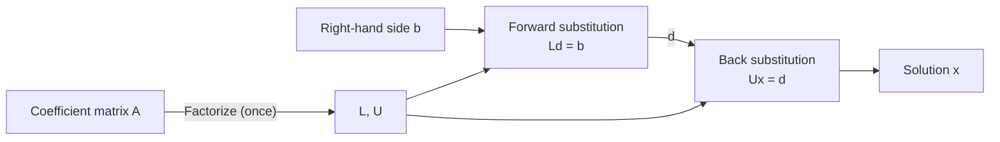

# Chapter 10 — LU Factorization

[Repository Guide](../../README.md) | [English](Concepts_Lecture.md) | [한국어](Concepts_Lecture.ko.md)

> **Last Updated:** 2026-11-19
>
> Applied Numerical Methods with Python for Engineers and Scientists, Chapra and Clough, Ch 10

> **Learning Objectives:**
> 1. Decompose matrices into L and U factors
> 2. Apply LU factorization for efficient multiple solves
> 3. Implement Cholesky decomposition for symmetric positive definite matrices
> 4. Trace, step by step, the permutation matrix and the interchange of stored multipliers in LU factorization with pivoting
> 5. Derive the operation counts of LU and Cholesky factorization and use the SciPy functions according to their conventions

---

<br>

## Table of Contents

- [1. Overview of LU Factorization](#1-overview-of-lu-factorization)
  - [1.1 The Core Idea](#11-the-core-idea)
  - [1.2 Two-Phase Solution Process](#12-two-phase-solution-process)
  - [1.3 Computational Advantage](#13-computational-advantage)
  - [1.4 Conditions for the Existence of an LU Factorization](#14-conditions-for-the-existence-of-an-lu-factorization)
- [2. Gauss Elimination as LU Factorization](#2-gauss-elimination-as-lu-factorization)
  - [2.1 Elimination Factors Form L](#21-elimination-factors-form-l)
  - [2.2 Structure of L and U for a 3x3 System](#22-structure-of-l-and-u-for-a-3x3-system)
  - [2.3 Verification](#23-verification)
  - [2.4 LU Factorization Through Elementary Matrices](#24-lu-factorization-through-elementary-matrices)
- [3. Storage Efficiency](#3-storage-efficiency)
- [4. Forward Substitution](#4-forward-substitution)
- [5. Back Substitution](#5-back-substitution)
- [6. Example 10.1: LU Decomposition (Complete Step-by-Step)](#6-example-101-lu-decomposition-complete-step-by-step)
  - [6.1 Problem Setup](#61-problem-setup)
  - [6.2 Step 1: First Column of L and First Row of U](#62-step-1-first-column-of-l-and-first-row-of-u)
  - [6.3 Step 2: Second Column of L and Second Row of U](#63-step-2-second-column-of-l-and-second-row-of-u)
  - [6.4 Result](#64-result)
- [7. Example 10.2: Solving with LU](#7-example-102-solving-with-lu)
  - [7.1 Forward Substitution](#71-forward-substitution)
  - [7.2 Back Substitution](#72-back-substitution)
- [8. LU with Pivoting: PA = LU](#8-lu-with-pivoting-pa--lu)
  - [8.1 Why Pivoting is Needed](#81-why-pivoting-is-needed)
  - [8.2 The Permutation Matrix P](#82-the-permutation-matrix-p)
  - [8.3 Procedure](#83-procedure)
  - [8.4 Example 10.3: 2x2 with Small Pivot](#84-example-103-2x2-with-small-pivot)
  - [8.5 Step-by-Step Trace of a 3x3 Pivoted LU](#85-step-by-step-trace-of-a-3x3-pivoted-lu)
- [9. Cholesky Factorization](#9-cholesky-factorization)
  - [9.1 Symmetric Positive Definite Matrices](#91-symmetric-positive-definite-matrices)
  - [9.2 Cholesky Decomposition Formulas](#92-cholesky-decomposition-formulas)
  - [9.3 Example 10.5: Cholesky Decomposition](#93-example-105-cholesky-decomposition)
  - [9.4 Comparison of Factorization Methods](#94-comparison-of-factorization-methods)
  - [9.5 Deriving the Cholesky Formulas](#95-deriving-the-cholesky-formulas)
  - [9.6 Cost and Stability of Cholesky Factorization](#96-cost-and-stability-of-cholesky-factorization)
  - [9.7 Solving with Cholesky Factorization](#97-solving-with-cholesky-factorization)
- [10. Python Code](#10-python-code)
  - [10.1 Solving Linear Systems with scipy.linalg.lu](#101-solving-linear-systems-with-scipylinalglu)
  - [10.2 lu_factor and lu_solve](#102-lu_factor-and-lu_solve)
  - [10.3 np.linalg.solve and LU Factorization](#103-nplinalgsolve-and-lu-factorization)
- [11. Implementation and Operation Count of LU Factorization](#11-implementation-and-operation-count-of-lu-factorization)
  - [11.1 Doolittle Algorithm](#111-doolittle-algorithm)
  - [11.2 NumPy Implementation and Several Right-Hand Sides](#112-numpy-implementation-and-several-right-hand-sides)
  - [11.3 Operation Count](#113-operation-count)
- [12. Common Mistakes](#12-common-mistakes)
- [Summary](#summary)
- [Self-Check Questions](#self-check-questions)
- [References](#references)

---

<br>

## 1. Overview of LU Factorization

### 1.1 The Core Idea

The goal of LU factorization is to decompose a square matrix $`A`$ into the product of two triangular matrices.

```math
A = LU
```

Here $`L`$ is a **lower triangular matrix**, in which all entries above the diagonal are zero, and $`U`$ is an **upper triangular matrix**, in which all entries below the diagonal are zero.

> **Definition:** **LU factorization** is the representation of a square matrix $`A`$ as the product $`A = LU`$ of a lower triangular matrix $`L`$ and an upper triangular matrix $`U`$. The variant that fixes every diagonal entry of $`L`$ at 1 is called the Doolittle factorization, and in that case the factorization is unique whenever it exists.

> **[Linear Algebra]** Linear algebra represents each row operation of Gaussian elimination as multiplication by an **elementary matrix**. The inverse of the elementary matrix that subtracts $`f_{ij}`$ times row $`j`$ from row $`i`$ is the unit lower triangular matrix with $`+f_{ij}`$ in the same position, so the product $`L`$ of the inverses of the elementary matrices used in elimination contains the elimination factors as they are, and $`A = LU`$ holds (Section 2). Therefore any algorithm that performs Gaussian elimination implicitly computes an LU factorization.

### 1.2 Two-Phase Solution Process

Once $`A = LU`$ is known, solving $`Ax = b`$ splits into two simpler triangular solves.

1. **Forward substitution:** Solve $`Ld = b`$ for the intermediate vector $`d`$.
2. **Back substitution:** Solve $`Ux = d`$ for the solution vector $`x`$.

Each triangular solve is straightforward because the triangular structure allows us to compute each unknown sequentially without any further elimination.

To verify correctness: $`Ax = (LU)x = L(Ux) = Ld = b`$.



*Figure 1. Two-phase solution process with LU factorization*

### 1.3 Computational Advantage

The key advantage of LU factorization is the separation of the expensive decomposition step from the relatively cheap solution step.

| Phase | Cost | Depends on |
|:------|:-----|:-----------|
| Decomposition: $`A = LU`$ | $`O(n^3)`$ | Only $`A`$ |
| Forward substitution: $`Ld = b`$ | $`O(n^2)`$ | $`L`$ and $`b`$ |
| Back substitution: $`Ux = d`$ | $`O(n^2)`$ | $`U`$ and $`d`$ |

*Table 1. Cost of each phase of the LU-based solution*

When the same coefficient matrix $`A`$ is used with **multiple right-hand side vectors** $`b_1, b_2, \ldots, b_m`$, we decompose $`A`$ only once (at $`O(n^3)`$ cost) and then solve each new right-hand side with just $`O(n^2)`$ work. This is a dramatic saving compared to performing full Gaussian elimination ($`O(n^3)`$) for each right-hand side separately.

This situation arises frequently in practice. Examples include structural analysis, where the stiffness matrix remains the same but different load cases are applied, and circuit analysis, where the network topology is fixed but different input signals are considered.

### 1.4 Conditions for the Existence of an LU Factorization

LU factorization without pivoting cannot proceed if any pivot $`u_{kk}`$ becomes zero during elimination. This condition can be decided in advance with the determinants of the **leading principal submatrices** $`A_k`$ of $`A`$, that is, the upper-left $`k \times k`$ blocks. While the first $`k`$ columns are eliminated, the first $`k`$ rows and columns refer only to one another, so elimination on $`A_k`$ is part of elimination on the whole of $`A`$. Hence $`A_k = L_kU_k`$, and since the diagonal of $`L_k`$ is 1, the following holds.

```math
\det A_k = u_{11}u_{22}\cdots u_{kk}, \qquad u_{kk} = \frac{\det A_k}{\det A_{k-1}} \quad (\det A_0 = 1)
```

That is, a nonsingular matrix $`A`$ has an LU factorization without pivoting if and only if all leading principal minors $`\det A_1, \ldots, \det A_{n-1}`$ are nonzero. For the matrix $`A = \begin{bmatrix} 2 & -1 & 0 \\ -4 & 3 & 1 \\ 6 & -1 & 4 \end{bmatrix}`$ of Section 2.4, $`\det A_1 = 2`$, $`\det A_2 = 2 \cdot 3 - (-1)(-4) = 2`$, and $`\det A_3 = 4`$, so the pivots are $`u_{11} = 2`$, $`u_{22} = 2/2 = 1`$, and $`u_{33} = 4/2 = 2`$, the same as the diagonal of the $`U`$ obtained in Section 2.4. In contrast, $`\begin{bmatrix} 0 & 1 \\ 1 & 1 \end{bmatrix}`$ of Self-Check Question 4 is nonsingular, but $`\det A_1 = 0`$, so it cannot be factored without pivoting. With suitable row interchanges, every nonsingular matrix can be factored as $`PA = LU`$, and the pivoted LU of Section 8 achieves this.

---

<br>

## 2. Gauss Elimination as LU Factorization

### 2.1 Elimination Factors Form L

Gaussian elimination in Chapter 8 computes the factors:

```math
f_{ij} = \frac{a_{ij}}{a_{jj}}
```

Element $`a_{ij}`$ is eliminated by subtracting $`f_{ij}`$ times row $`j`$ from row $`i`$. Here $`a_{ij}`$ and $`a_{jj}`$ denote the values just before the $`j`$-th elimination step, that is, values already modified by the earlier steps. The remarkable insight is that these same factors, collected into a lower triangular matrix with 1s on the diagonal, give us the matrix $`L`$.

### 2.2 Structure of L and U for a 3x3 System

For a $`3 \times 3`$ system, the factorization produces:

```math
L = \begin{bmatrix} 1 & 0 & 0 \\ f_{21} & 1 & 0 \\ f_{31} & f_{32} & 1 \end{bmatrix}, \quad U = \begin{bmatrix} a_{11} & a_{12} & a_{13} \\ 0 & a'_{22} & a'_{23} \\ 0 & 0 & a''_{33} \end{bmatrix}
```

The symbols mean the following.

- $`f_{21}, f_{31}`$ are the factors computed in the first elimination step (eliminating the first column).
- $`f_{32}`$ is the factor computed in the second elimination step (eliminating the second column).
- $`a'_{22}, a'_{23}`$ are the entries modified by the first elimination step.
- $`a''_{33}`$ is the entry modified by both elimination steps.

$`L`$ is a **unit lower triangular matrix** (diagonal entries are all 1), and $`U`$ is the upper triangular matrix that results from forward elimination; it is exactly the row-echelon form of $`A`$ obtained by forward elimination.

### 2.3 Verification

The factorization can be verified by performing the matrix multiplication $`LU`$ and confirming that it equals $`A`$. For the $`3 \times 3`$ case:

```math
(LU)_{11} = 1 \cdot a_{11} = a_{11}
```

```math
(LU)_{21} = f_{21} \cdot a_{11} = \frac{a_{21}}{a_{11}} \cdot a_{11} = a_{21}
```

```math
(LU)_{22} = f_{21} \cdot a_{12} + 1 \cdot a'_{22} = f_{21} \cdot a_{12} + (a_{22} - f_{21} \cdot a_{12}) = a_{22}
```

The two entries of row 3, whose computations are the longest of the remaining ones, are checked in the same way by substituting $`a'_{32} = a_{32} - f_{31}a_{12}`$, $`a'_{33} = a_{33} - f_{31}a_{13}`$, and $`a''_{33} = a'_{33} - f_{32}a'_{23}`$.

```math
(LU)_{32} = f_{31}a_{12} + f_{32}a'_{22} = f_{31}a_{12} + \frac{a'_{32}}{a'_{22}}a'_{22} = f_{31}a_{12} + (a_{32} - f_{31}a_{12}) = a_{32}
```

```math
(LU)_{33} = f_{31}a_{13} + f_{32}a'_{23} + a''_{33} = f_{31}a_{13} + f_{32}a'_{23} + (a'_{33} - f_{32}a'_{23}) = f_{31}a_{13} + a'_{33} = a_{33}
```

The same holds for all other entries. Each multiplication reconstructs the original entry of $`A`$ because the elimination factors encode exactly the row operations performed.

### 2.4 LU Factorization Through Elementary Matrices

The row operation "subtract $`f`$ times row $`j`$ from row $`i`$" is the same as multiplying on the left by the identity matrix with $`-f`$ placed at position $`(i, j)`$. This matrix is written $`E_{ij}`$.

> **Definition:** An **elementary matrix** is a matrix obtained by applying a single row operation to the identity matrix. Multiplying a matrix on the left by an elementary matrix gives the result of applying the same row operation to that matrix.

The viewpoint is followed with $`A = \begin{bmatrix} 2 & -1 & 0 \\ -4 & 3 & 1 \\ 6 & -1 & 4 \end{bmatrix}`$. The multipliers of column 1 are $`f_{21} = -4/2 = -2`$ and $`f_{31} = 6/2 = 3`$, so the $`(2, 1)`$ entry of $`E_{21}`$ is 2 and the $`(3, 1)`$ entry of $`E_{31}`$ is $`-3`$, and multiplying gives the following.

```math
E_{31}E_{21}A = \begin{bmatrix} 2 & -1 & 0 \\ 0 & 1 & 1 \\ 0 & 2 & 4 \end{bmatrix}
```

The multiplier of column 2 is $`f_{32} = 2/1 = 2`$, and multiplying by $`E_{32}`$, whose $`(3, 2)`$ entry is $`-2`$, gives the upper triangular matrix.

```math
E_{32}E_{31}E_{21}A = U = \begin{bmatrix} 2 & -1 & 0 \\ 0 & 1 & 1 \\ 0 & 0 & 2 \end{bmatrix}
```

Hence $`A = (E_{32}E_{31}E_{21})^{-1}U = E_{21}^{-1}E_{31}^{-1}E_{32}^{-1}U`$. Subtracting $`f`$ times a row is undone by adding $`f`$ times it back, so $`E_{ij}^{-1}`$ has $`+f_{ij}`$ in the same position. Computing the two products gives the following.

```math
E_{21}^{-1}E_{31}^{-1}E_{32}^{-1} = \begin{bmatrix} 1 & 0 & 0 \\ -2 & 1 & 0 \\ 3 & 2 & 1 \end{bmatrix} = L, \qquad E_{32}E_{31}E_{21} = \begin{bmatrix} 1 & 0 & 0 \\ 2 & 1 & 0 \\ -7 & -2 & 1 \end{bmatrix}
```

The multipliers $`-2`$, $`3`$, and $`2`$ fall into place unchanged in $`L`$, whereas the $`(3, 1)`$ entry of the product $`E_{32}E_{31}E_{21}`$ of the matrices used for elimination is $`-7`$, a mixture of multipliers. The reason becomes visible when $`E_{ij}`$ is written as $`I - f_{ij}\mathbf{e}_i\mathbf{e}_j^T`$ (with $`\mathbf{e}_i`$ the $`i`$th unit vector). The product of two such matrices is the following.

```math
(I + f\,\mathbf{e}_i\mathbf{e}_j^T)(I + g\,\mathbf{e}_k\mathbf{e}_l^T) = I + f\,\mathbf{e}_i\mathbf{e}_j^T + g\,\mathbf{e}_k\mathbf{e}_l^T + fg\,\mathbf{e}_i(\mathbf{e}_j^T\mathbf{e}_k)\mathbf{e}_l^T
```

The last cross term survives only when $`j = k`$. In $`L = E_{21}^{-1}E_{31}^{-1}E_{32}^{-1}`$, whichever two factors are chosen, the column index of the left factor is 1 and the row index of the right factor is 3, so $`j = k`$ never occurs and every cross term vanishes. In $`E_{32}E_{31}E_{21}`$, on the other hand, the column index 2 of $`E_{32}`$ equals the row index 2 of $`E_{21}`$, which produces $`(-f_{32})(-f_{21})\mathbf{e}_3\mathbf{e}_1^T = f_{32}f_{21}\mathbf{e}_3\mathbf{e}_1^T`$, and the $`(3, 1)`$ entry becomes $`-f_{31} + f_{32}f_{21} = -3 + 2(-2) = -7`$. This is why $`L`$, rather than the elimination matrix $`L^{-1}`$, is stored: $`L`$ is complete as soon as each multiplier is written into its place when it is computed.

---

<br>

## 3. Storage Efficiency

Since the diagonal of $`L`$ is always 1 by construction of the Doolittle method (the LU factorization variant that produces an $`L`$ with unit diagonal), there is no need to store these values explicitly. This means $`L`$ and $`U`$ can be stored together in a single $`n \times n`$ matrix:

```math
\begin{bmatrix} u_{11} & u_{12} & u_{13} \\ l_{21} & u_{22} & u_{23} \\ l_{31} & l_{32} & u_{33} \end{bmatrix}
```

The upper triangular part (including the diagonal) stores $`U`$, and the strictly lower triangular part stores $`L`$. The fact that the diagonal of $`L`$ is all 1s is implicit.

This compact storage format is used by most numerical libraries (including LAPACK and SciPy). It is memory-efficient and avoids any redundancy. In practice, the decomposition can even be performed **in place**, overwriting the original matrix $`A`$ with the combined $`[L \setminus U]`$ storage.

---

<br>

## 4. Forward Substitution

Given $`L`$ and $`b`$, we solve $`Ld = b`$ for $`d`$ by working from top to bottom:

```math
d_1 = b_1
```

```math
d_i = b_i - \sum_{j=1}^{i-1} L_{ij} \, d_j, \quad i = 2, 3, \ldots, n
```

Since $`L`$ is unit lower triangular (diagonal entries are 1), there is no division by a diagonal element. Each $`d_i`$ depends only on previously computed values $`d_1, d_2, \ldots, d_{i-1}`$, so the computation proceeds sequentially from the first equation to the last.

The number of multiplications in forward substitution is:

```math
\sum_{i=2}^{n}(i-1) = \frac{n(n-1)}{2} \approx \frac{n^2}{2}
```

The same number of subtractions is needed, giving a total cost of $`O(n^2)`$.

---

<br>

## 5. Back Substitution

Given $`U`$ and $`d`$, we solve $`Ux = d`$ for $`x`$ by working from bottom to top:

```math
x_n = \frac{d_n}{U_{nn}}
```

```math
x_i = \frac{d_i - \sum_{j=i+1}^{n} U_{ij} \, x_j}{U_{ii}}, \quad i = n-1, n-2, \ldots, 1
```

Each $`x_i`$ depends only on previously computed values $`x_{i+1}, x_{i+2}, \ldots, x_n`$. The division by $`U_{ii}`$ requires that all diagonal entries of $`U`$ be nonzero, which is equivalent to $`A`$ being nonsingular.

The cost of back substitution is also $`O(n^2)`$, similar to forward substitution.

---

<br>

## 6. Example 10.1: LU Decomposition (Complete Step-by-Step)

### 6.1 Problem Setup

Decompose the following matrix into $`A = LU`$:

```math
A = \begin{bmatrix} 3 & -0.1 & -0.2 \\ 0.1 & 7 & -0.3 \\ 0.3 & -0.2 & 10 \end{bmatrix}
```

### 6.2 Step 1: First Column of L and First Row of U

The first row of $`U`$ is identical to the first row of $`A`$:

```math
U_{1,:} = \begin{bmatrix} 3 & -0.1 & -0.2 \end{bmatrix}
```

Compute the elimination factors for the first column:

```math
f_{21} = \frac{a_{21}}{a_{11}} = \frac{0.1}{3} = 0.0333\overline{3}
```

```math
f_{31} = \frac{a_{31}}{a_{11}} = \frac{0.3}{3} = 0.1
```

Eliminate the first column, computing the remaining entries after the first elimination step:

- $`a'_{22} = 7 - (0.0333\overline{3})(-0.1) = 7.00333\overline{3}`$
- $`a'_{23} = -0.3 - (0.0333\overline{3})(-0.2) = -0.29333\overline{3}`$
- $`a'_{32} = -0.2 - (0.1)(-0.1) = -0.19`$
- $`a'_{33} = 10 - (0.1)(-0.2) = 10.02`$

### 6.3 Step 2: Second Column of L and Second Row of U

The second row of $`U`$ is:

```math
U_{2,:} = \begin{bmatrix} 0 & 7.00333 & -0.29333 \end{bmatrix}
```

Compute the elimination factor for the second column:

```math
f_{32} = \frac{a'_{32}}{a'_{22}} = \frac{-0.19}{7.00333} = -0.02713
```

Eliminate the second column:

- $`a''_{33} = 10.02 - (-0.02713)(-0.29333) = 10.02 - 0.00796 = 10.0120`$

### 6.4 Result

```math
L = \begin{bmatrix} 1 & 0 & 0 \\ 0.0333 & 1 & 0 \\ 0.1 & -0.02713 & 1 \end{bmatrix}, \quad U = \begin{bmatrix} 3 & -0.1 & -0.2 \\ 0 & 7.00333 & -0.29333 \\ 0 & 0 & 10.0120 \end{bmatrix}
```

Verification: multiplying $`LU`$ reproduces the original matrix $`A`$.

---

<br>

## 7. Example 10.2: Solving with LU

Using the $`L`$ and $`U`$ from Example 10.1, solve $`Ax = b`$ where:

```math
b = \begin{bmatrix} 7.85 \\ -19.3 \\ 71.4 \end{bmatrix}
```

### 7.1 Forward Substitution

Solve $`Ld = b`$:

```math
d_1 = b_1 = 7.85
```

```math
d_2 = b_2 - L_{21} \, d_1 = -19.3 - (0.0333\overline{3})(7.85) = -19.3 - 0.2617 = -19.5617
```

```math
d_3 = b_3 - L_{31} \, d_1 - L_{32} \, d_2 = 71.4 - (0.1)(7.85) - (-0.02713)(-19.5617)
```

```math
= 71.4 - 0.785 - 0.5307 = 70.0843
```

> **Note:** The last digits vary slightly with how many decimal places are carried through the intermediate calculations. For example, rounding $`L_{32}`$ to $`-0.0271`$ gives $`d_3 \approx 70.0849`$. With full precision, $`d_3 \approx 70.0843`$.

### 7.2 Back Substitution

Solve $`Ux = d`$:

```math
x_3 = \frac{d_3}{U_{33}} = \frac{70.0843}{10.0120} = 7.00003
```

```math
x_2 = \frac{d_2 - U_{23} \, x_3}{U_{22}} = \frac{-19.5617 - (-0.29333)(7.00003)}{7.00333} = \frac{-19.5617 + 2.05332}{7.00333} = \frac{-17.50838}{7.00333} = -2.50001
```

```math
x_1 = \frac{d_1 - U_{12} \, x_2 - U_{13} \, x_3}{U_{11}} = \frac{7.85 - (-0.1)(-2.50001) - (-0.2)(7.00003)}{3}
```

```math
= \frac{7.85 - 0.25000 + 1.40001}{3} = \frac{9.00001}{3} = 3.00000
```

**Final solution:**

```math
x_1 = 3.00000, \quad x_2 = -2.50001, \quad x_3 = 7.00003
```

This matches the solution obtained by direct Gaussian elimination in Chapter 8, confirming the equivalence of the two approaches. The small deviations from the exact values $`(3, -2.5, 7)`$ are due to roundoff in the intermediate calculations.

---

<br>

## 8. LU with Pivoting: $`PA = LU`$

### 8.1 Why Pivoting is Needed

Just as with Gaussian elimination, LU factorization without pivoting can fail or produce inaccurate results in the following cases.

- A zero pivot causes division by zero.
- A very small pivot amplifies roundoff errors.

Partial pivoting, which selects the entry of largest absolute value in the current column as the pivot, resolves both issues when the matrix is nonsingular.

### 8.2 The Permutation Matrix P

When row swaps are performed during the factorization, they are recorded in a **permutation matrix** $`P`$. The factorization becomes:

```math
PA = LU
```

where $`P`$ is an $`n \times n`$ matrix obtained by reordering the rows of the identity matrix according to the row swaps performed during elimination. The permutation matrix has exactly one entry of 1 in each row and each column, with all other entries being 0.

Key properties of permutation matrices:

- $`P^{-1} = P^T`$ (orthogonal matrix)
- $`\det(P) = \pm 1`$
- $`PP^T = I`$

### 8.3 Procedure

The solution procedure with pivoting is:

1. **Factorize:** Decompose $`A`$ with partial pivoting to obtain $`P`$, $`L`$, and $`U`$ such that $`PA = LU`$.
2. **Permute the RHS:** Compute $`Pb`$ by reordering the entries of $`b`$ according to the same row swaps.
3. **Forward substitution:** Solve $`Ld = Pb`$.
4. **Back substitution:** Solve $`Ux = d`$.

### 8.4 Example 10.3: 2x2 with Small Pivot

Consider the system:

```math
\begin{bmatrix} 0.0003 & 3.0000 \\ 1.0000 & 1.0000 \end{bmatrix} \begin{bmatrix} x_1 \\ x_2 \end{bmatrix} = \begin{bmatrix} 2.0001 \\ 1.0000 \end{bmatrix}
```

The exact solution is $`x_1 = 1/3`$ and $`x_2 = 2/3`$.

**Without pivoting:**

The factor is $`f_{21} = 1.0000 / 0.0003 = 3333.3\ldots`$, an extremely large number. When this factor multiplies the first row and is subtracted from the second row:

```math
a'_{22} = 1.0000 - (3333.3\ldots)(3.0000) = 1 - 10000 = -9999
```

```math
b'_2 = 1.0000 - (3333.3\ldots)(2.0001) = 1 - 6667 = -6666
```

With limited precision, back substitution then subtracts nearly equal numbers, which causes a significant loss of accuracy. Back substitution with 4 significant digits gives:

```math
x_2 = \frac{-6666}{-9999} = 0.6667
```

```math
x_1 = \frac{2.0001 - (3.0000)(0.6667)}{0.0003} = \frac{2.0001 - 2.0001}{0.0003} = 0.0000
```

Compared with the exact value $`x_1 = 0.3333`$, the relative error in $`x_1`$ is 100%.

**With pivoting:**

Swap rows to put the entry of largest absolute value in the pivot position:

```math
P = \begin{bmatrix} 0 & 1 \\ 1 & 0 \end{bmatrix}, \quad PA = \begin{bmatrix} 1.0000 & 1.0000 \\ 0.0003 & 3.0000 \end{bmatrix}, \quad Pb = \begin{bmatrix} 1.0000 \\ 2.0001 \end{bmatrix}
```

Now the factor is $`f_{21} = 0.0003 / 1.0000 = 0.0003`$, a small number that does not amplify errors:

```math
a'_{22} = 3.0000 - 0.0003 \times 1.0000 = 2.9997
```

```math
b'_2 = 2.0001 - 0.0003 \times 1.0000 = 1.9998
```

Back substitution gives:

```math
x_2 = \frac{1.9998}{2.9997} = 0.6667 \approx \frac{2}{3}
```

```math
x_1 = 1.0000 - 1.0000 \times 0.6667 = 0.3333 \approx \frac{1}{3}
```

The pivoted version produces accurate results, while the unpivoted version suffers from catastrophic error amplification.

### 8.5 Step-by-Step Trace of a 3x3 Pivoted LU

The matrix $`A = \begin{bmatrix} 0 & 2 & 3 \\ 4 & 6 & 7 \\ 2 & -3 & 6 \end{bmatrix}`$ of Chapter 9, Section 1.4 is factored as $`PA = LU`$. The multipliers are stored below the diagonal as in Section 3, and the key point is that **when rows are interchanged, the multipliers already stored in those rows are interchanged with them**, because a multiplier is information that belongs to its row.

**Step 1.** The largest absolute value 4 in column 1 is in row 2, so rows 1 and 2 are interchanged. In terms of the original numbers, the row order becomes $`(2,\ 1,\ 3)`$. The multipliers are $`0/4 = 0`$ for the new row 2 and $`2/4 = 0.5`$ for row 3, and after elimination row 2 holds $`(2,\ 3)`$ and row 3 holds $`(-6,\ 2.5)`$. Writing the multipliers below the diagonal gives the following storage matrix.

```math
\begin{bmatrix} 4 & 6 & 7 \\ \mathbf{0} & 2 & 3 \\ \mathbf{0.5} & -6 & 2.5 \end{bmatrix}
```

**Step 2.** Of the candidates $`|2|`$ and $`|-6|`$ in column 2, row 3 is larger, so rows 2 and 3 are interchanged. The multipliers 0 and 0.5 stored in column 1 move along with their rows. The row order becomes $`(2,\ 3,\ 1)`$. The multiplier is $`2/(-6) = -1/3`$, leaving $`3 - (-1/3)(2.5) = 23/6`$.

```math
\begin{bmatrix} 4 & 6 & 7 \\ \mathbf{0.5} & -6 & 2.5 \\ \mathbf{0} & \mathbf{-1/3} & 23/6 \end{bmatrix}
```

**Result.** The three matrices are read from the storage matrix. $`P`$ arranges the rows of the identity matrix in the final order $`(2,\ 3,\ 1)`$.

```math
P = \begin{bmatrix} 0 & 1 & 0 \\ 0 & 0 & 1 \\ 1 & 0 & 0 \end{bmatrix}, \quad L = \begin{bmatrix} 1 & 0 & 0 \\ 0.5 & 1 & 0 \\ 0 & -1/3 & 1 \end{bmatrix}, \quad U = \begin{bmatrix} 4 & 6 & 7 \\ 0 & -6 & 2.5 \\ 0 & 0 & 23/6 \end{bmatrix}
```

$`PA = \begin{bmatrix} 4 & 6 & 7 \\ 2 & -3 & 6 \\ 0 & 2 & 3 \end{bmatrix}`$, and row 2 of $`LU`$ is $`0.5(4,\ 6,\ 7) + (0,\ -6,\ 2.5) = (2,\ -3,\ 6)`$ while row 3 is $`(-1/3)(0,\ -6,\ 2.5) + (0,\ 0,\ 23/6) = (0,\ 2,\ 3)`$, which confirms $`PA = LU`$. Had the multipliers not been interchanged in step 2, column 1 of $`L`$ would be $`(1,\ 0,\ 0.5)`$ and row 2 of $`LU`$ would come out as $`(0,\ -6,\ 2.5)`$, so the factorization would be wrong.

**Solution.** For $`b = (8,\ -3,\ 5)`$, $`Pb = (-3,\ 5,\ 8)`$. Forward substitution gives $`d_1 = -3`$, $`d_2 = 5 - 0.5(-3) = 6.5`$, and $`d_3 = 8 - 0(-3) - (-1/3)(6.5) = 61/6`$, and back substitution $`Ux = d`$ gives the solution $`x = (-499/92,\ 1/46,\ 61/23)`$ found in Chapter 9. The upper triangular matrix $`U`$ and the right-hand side $`d`$ coincide exactly with the elimination results of Chapter 9, which confirms that pivoted LU factorization is pivoted Gauss elimination recorded in matrix form.

> **Key Point:** Pivoted LU factorization records the row interchanges in $`P`$, the multipliers in $`L`$, and the elimination result in $`U`$. When rows are interchanged, the stored multipliers are interchanged too, and solving starts forward substitution from $`Pb`$ instead of $`b`$.

---

<br>

## 9. Cholesky Factorization

### 9.1 Symmetric Positive Definite Matrices

A special and important class of matrices are **symmetric positive definite (SPD)** matrices. A matrix $`A`$ is SPD if it satisfies both of the following conditions.

1. **Symmetric:** $`A = A^T`$, that is, $`a_{ij} = a_{ji}`$ for all $`i, j`$.
2. **Positive definite:** $`x^T A x > 0`$ for all nonzero vectors $`x`$.

Also, a symmetric matrix is positive definite if and only if all its eigenvalues are strictly positive.

> **[Linear Algebra]** A symmetric positive definite matrix is a symmetric matrix whose quadratic form $`x^T A x`$ is positive for every nonzero vector $`x`$; this is equivalent to all eigenvalues being positive and to all leading principal minors being positive. Because of this property, the value under the square root in the Cholesky formula of Section 9.2 is always positive, so Cholesky factorization is applied only to SPD matrices, which arise naturally in physics (mass and stiffness matrices), statistics (covariance matrices), and optimization (Hessians of convex functions).

For SPD matrices, LU factorization can be simplified to the **Cholesky factorization**:

```math
A = U^T U
```

where $`U`$ is an upper triangular matrix. Only the upper triangle of $`A`$ needs to be stored and processed, resulting in roughly half the computation and half the storage compared to general LU factorization. As a result, Cholesky is about 2x faster than general LU and is numerically stable without pivoting.

### 9.2 Cholesky Decomposition Formulas

The entries of $`U`$ are computed using the following formulas.

**Diagonal entries:**

```math
U_{ii} = \sqrt{a_{ii} - \sum_{k=1}^{i-1} U_{ki}^2}
```

**Off-diagonal entries** (for $`j > i`$):

```math
U_{ij} = \frac{a_{ij} - \sum_{k=1}^{i-1} U_{ki} \, U_{kj}}{U_{ii}}
```

The computation proceeds row by row, from top to bottom. For each row $`i`$, the diagonal entry $`U_{ii}`$ is computed first (requiring a square root), and then the off-diagonal entries $`U_{ij}`$ for $`j > i`$ are computed.

The quantity under the square root in the diagonal formula is positive for all $`i`$, giving $`U_{ii} > 0`$, if and only if the symmetric matrix $`A`$ is positive definite. If $`A`$ is not positive definite, the algorithm encounters a zero or negative quantity under the square root at some step, which serves as a built-in test for positive definiteness.

### 9.3 Example 10.5: Cholesky Decomposition

Decompose the following SPD matrix:

```math
A = \begin{bmatrix} 6 & 15 & 55 \\ 15 & 55 & 225 \\ 55 & 225 & 979 \end{bmatrix}
```

**Row 1:**

```math
U_{11} = \sqrt{a_{11}} = \sqrt{6} = 2.4495
```

```math
U_{12} = \frac{a_{12}}{U_{11}} = \frac{15}{2.4495} = 6.1237
```

```math
U_{13} = \frac{a_{13}}{U_{11}} = \frac{55}{2.4495} = 22.4537
```

**Row 2:**

```math
U_{22} = \sqrt{a_{22} - U_{12}^2} = \sqrt{55 - (6.1237)^2} = \sqrt{55 - 37.5} = \sqrt{17.5} = 4.1833
```

```math
U_{23} = \frac{a_{23} - U_{12} \, U_{13}}{U_{22}} = \frac{225 - (6.1237)(22.4537)}{4.1833} = \frac{225 - 137.5}{4.1833} = \frac{87.5}{4.1833} = 20.9165
```

**Row 3:**

```math
U_{33} = \sqrt{a_{33} - U_{13}^2 - U_{23}^2} = \sqrt{979 - (22.4537)^2 - (20.9165)^2}
```

```math
= \sqrt{979 - 504.1667 - 437.5000} = \sqrt{37.3333} = 6.1101
```

To keep roundoff from accumulating, $`U_{13}^2 = 55^2/6 = 504.1667`$ and $`U_{23}^2 = 87.5^2/17.5 = 437.5`$ are computed exactly.

**Result:**

```math
U = \begin{bmatrix} 2.4495 & 6.1237 & 22.4537 \\ 0 & 4.1833 & 20.9165 \\ 0 & 0 & 6.1101 \end{bmatrix}
```

Verification:

```math
U^T U = \begin{bmatrix} 2.4495 & 0 & 0 \\ 6.1237 & 4.1833 & 0 \\ 22.4537 & 20.9165 & 6.1101 \end{bmatrix} \begin{bmatrix} 2.4495 & 6.1237 & 22.4537 \\ 0 & 4.1833 & 20.9165 \\ 0 & 0 & 6.1101 \end{bmatrix} = A
```

### 9.4 Comparison of Factorization Methods

The three factorization methods covered so far compare as follows. The costs are approximate multiplication counts.

| Method | Condition | Cost | Key Property |
|:-------|:---------|:-----|:------------|
| LU (Doolittle) | Square matrix with no zero pivot during elimination | $`n^3/3`$ | $`A = LU`$ |
| LU with pivoting | General (nonsingular) square matrix | $`n^3/3`$ | $`PA = LU`$ |
| Cholesky | SPD only | $`n^3/6`$ | $`A = U^T U`$, unconditionally stable |

*Table 2. Conditions, costs, and key properties of LU factorization methods*

### 9.5 Deriving the Cholesky Formulas

The formulas of Section 9.2 follow from multiplying out $`U^TU`$ and comparing it with $`A`$ entry by entry. For $`2 \times 2`$:

```math
\begin{bmatrix} a_{11} & a_{12} \\ a_{12} & a_{22} \end{bmatrix} = \begin{bmatrix} U_{11} & 0 \\ U_{12} & U_{22} \end{bmatrix}\begin{bmatrix} U_{11} & U_{12} \\ 0 & U_{22} \end{bmatrix} = \begin{bmatrix} U_{11}^2 & U_{11}U_{12} \\ U_{11}U_{12} & U_{12}^2 + U_{22}^2 \end{bmatrix}
```

The $`(1, 1)`$ entry gives $`U_{11} = \sqrt{a_{11}}`$, the $`(1, 2)`$ entry gives $`U_{12} = a_{12}/U_{11}`$, and the $`(2, 2)`$ entry gives $`U_{22} = \sqrt{a_{22} - U_{12}^2}`$. Because $`A`$ is symmetric, the $`(2, 1)`$ entry gives the same equation as the $`(1, 2)`$ entry and adds no information. This is why only the upper triangle of $`A`$ needs to be stored. For $`3 \times 3`$ the product is the following (only the upper triangle is shown because of symmetry).

```math
U^TU = \begin{bmatrix} U_{11}^2 & U_{11}U_{12} & U_{11}U_{13} \\ & U_{12}^2 + U_{22}^2 & U_{12}U_{13} + U_{22}U_{23} \\ & & U_{13}^2 + U_{23}^2 + U_{33}^2 \end{bmatrix}
```

Comparing row 1 fixes $`U_{11}`$, $`U_{12}`$, and $`U_{13}`$; comparing row 2 fixes $`U_{22} = \sqrt{a_{22} - U_{12}^2}`$ and $`U_{23} = (a_{23} - U_{12}U_{13})/U_{22}`$; and row 3 fixes $`U_{33} = \sqrt{a_{33} - U_{13}^2 - U_{23}^2}`$, in that order. In general $`U_{ki} = 0`$ for $`k > i`$, so for $`i \leq j`$ the following holds.

```math
a_{ij} = (U^TU)_{ij} = \sum_{k=1}^{i} U_{ki}U_{kj} = \sum_{k=1}^{i-1} U_{ki}U_{kj} + U_{ii}U_{ij}
```

Setting $`j = i`$ and solving for $`U_{ii}`$ gives the diagonal formula, and setting $`j > i`$ and solving for $`U_{ij}`$ gives the off-diagonal formula. The sum on the right involves only entries of rows above row $`i`$, so computing one row at a time from top to bottom always has the needed values ready.

### 9.6 Cost and Stability of Cholesky Factorization

The diagonal entry of row $`i`$ needs $`i-1`$ multiplications and one square root, and each of the $`n-i`$ off-diagonal entries needs $`i-1`$ multiplications and one division. Additions and subtractions are needed in similar numbers. Adding everything gives about $`n^3/6`$ multiplications and divisions, about $`n^3/6`$ additions and subtractions, and $`n`$ square roots. The table below compares the exact counts (square roots excluded) with the LU factorization of Section 11.3.

| $`n`$ | LU factorization | Cholesky factorization | Ratio |
|-----:|-----:|-----:|-----:|
| 10 | 615 | 375 | 0.61 |
| 100 | 661,650 | 338,250 | 0.51 |
| 1000 | 666,166,500 | 333,832,500 | 0.50 |

*Table 3. Operation counts of LU and Cholesky factorization*

As $`n`$ grows the ratio approaches 0.5, so Cholesky factorization costs about half of LU factorization. Thanks to symmetry only $`U`$ has to be computed, and $`L = U^T`$ is not computed separately.

Stability is visible directly in the diagonal formula. Since $`a_{ii} = \sum_{k=1}^{i}U_{ki}^2`$, every entry in column $`i`$ of $`U`$ satisfies $`|U_{ki}| \leq \sqrt{a_{ii}}`$. No entry can therefore exceed the square root of a diagonal entry of $`A`$ during the factorization, and the growth of entries seen in Chapter 9 does not occur. This is why the Cholesky factorization of an SPD matrix is stable without pivoting.

> **Note:** **LDU and $`LDL^T`$ factorizations.** Dividing each row of $`U`$ by its diagonal entry and pulling out the diagonal matrix $`D = \mathrm{diag}(u_{11}, \ldots, u_{nn})`$ gives $`A = LDU'`$ (with $`L`$ and $`U'`$ unit triangular). If $`A`$ is symmetric, $`U' = L^T`$, so $`A = LDL^T`$, and when every entry of $`D`$ is positive (SPD), setting $`U = D^{1/2}L^T`$ makes it identical to the Cholesky factorization $`A = U^TU`$. Because the $`LDL^T`$ factorization uses no square roots, it has the advantage that it can be defined for symmetric matrices that are not positive definite.

### 9.7 Solving with Cholesky Factorization

If $`A = U^TU`$, then $`Ax = b`$ is $`U^T(Ux) = b`$, so it is solved in the same two steps as with LU factorization. $`U^T`$ is lower triangular, so $`U^Td = b`$ is solved first by forward substitution and then $`Ux = d`$ by back substitution. The matrix of Section 9.3 with $`b = (76,\ 295,\ 1259)`$ serves as an example ($`b`$ is chosen to match $`x = (1,\ 1,\ 1)`$).

```math
d_1 = \frac{76}{2.4495} = 31.0269, \quad d_2 = \frac{295 - 6.1237 \times 31.0269}{4.1833} = \frac{295 - 190}{4.1833} = 25.0998
```

```math
d_3 = \frac{1259 - 22.4537 \times 31.0269 - 20.9165 \times 25.0998}{6.1101} = \frac{1259 - 696.667 - 525}{6.1101} = \frac{37.333}{6.1101} = 6.1101
```

Back substitution gives $`x_3 = 6.1101/6.1101 = 1`$, $`x_2 = (25.0998 - 20.9165 \times 1)/4.1833 = 1`$, and $`x_1 = (31.0269 - 6.1237 - 22.4537)/2.4495 = 1`$. In SciPy the function dedicated to triangular systems, `solve_triangular`, is used. By default it uses the upper triangle, and with `lower=True` it uses the lower triangle [1].

```python
import numpy as np
from scipy.linalg import cholesky, solve_triangular

A = np.array([[6, 15, 55], [15, 55, 225], [55, 225, 979]], dtype=float)
b = A @ np.ones(3)
print(b)
U = cholesky(A)                                # A = U.T @ U
d = solve_triangular(U.T, b, lower=True)       # forward: U^T d = b
x = solve_triangular(U, d)                     # backward: U x = d
print(np.round(d, 4))
print(x)
```

```text
[  76.  295. 1259.]
[31.0269 25.0998  6.1101]
[1. 1. 1.]
```

`b = A @ np.ones(3)` builds the right-hand side so that the solution is $`(1,\ 1,\ 1)`$. Each triangular solve is $`O(n^2)`$, so once the factorization is done, several right-hand sides can be solved cheaply in the same way as with LU factorization.

---

<br>

## 10. Python Code

SciPy provides efficient implementations of both LU and Cholesky factorizations:

```python
import numpy as np
from scipy.linalg import lu, cholesky

# LU factorization with partial pivoting
A = np.array([[3, -0.1, -0.2],
              [0.1, 7, -0.3],
              [0.3, -0.2, 10]])

P, L, U = lu(A)
print(f'P = \n{P}')
print(f'L = \n{L}')
print(f'U = \n{U}')
print(f'||PA - LU|| = {np.linalg.norm(P @ A - L @ U):.2e}')

# Cholesky factorization (for SPD matrices)
A_spd = np.array([[6, 15, 55],
                   [15, 55, 225],
                   [55, 225, 979]], dtype=float)

U_chol = cholesky(A_spd)          # upper triangular (default)
print(f'U = \n{U_chol}')
print(f'||A - U^T U|| = {np.linalg.norm(A_spd - U_chol.T @ U_chol):.2e}')
```

```text
P =
[[1. 0. 0.]
 [0. 1. 0.]
 [0. 0. 1.]]
L =
[[ 1.          0.          0.        ]
 [ 0.03333333  1.          0.        ]
 [ 0.1        -0.02712994  1.        ]]
U =
[[ 3.         -0.1        -0.2       ]
 [ 0.          7.00333333 -0.29333333]
 [ 0.          0.         10.01204188]]
||PA - LU|| = 0.00e+00
U =
[[ 2.44948974  6.12372436 22.45365598]
 [ 0.          4.18330013 20.91650066]
 [ 0.          0.          6.11010093]]
||A - U^T U|| = 8.88e-16
```

> **Note:** SciPy's `lu` returns the permutation matrix `P` such that `A = P @ L @ U`, so in the $`PA = LU`$ notation of this note it satisfies `P.T @ A = L @ U`. References define it differently, so always check the documentation for your library. The check `P @ A - L @ U` in the code above prints a value near zero only because no row swaps occur in this example and `P` is the identity matrix; in general the check should be `P.T @ A - L @ U`. The `cholesky` function returns the upper triangular factor by default; pass `lower=True` to get the lower triangular factor.

### 10.1 Solving Linear Systems with scipy.linalg.lu

`scipy.linalg.lu` returns $`P`$, $`L`$, and $`U`$ satisfying $`A = PLU`$ [2]. Compared with this document's $`PA = LU`$, SciPy's $`P`$ is this document's $`P^T`$. Therefore $`Ax = PLUx = b`$ gives $`LUx = P^Tb`$, and the solution takes the two steps $`Ld = P^Tb`$ and $`Ux = d`$. The matrix of Section 8.5, which requires row interchanges, is used to check this.

```python
import numpy as np
from scipy.linalg import lu, lu_factor, lu_solve

A = np.array([[0, 2, 3], [4, 6, 7], [2, -3, 6]], dtype=float)
b = np.array([8, -3, 5], dtype=float)

P, L, U = lu(A)                    # SciPy: A = P @ L @ U
d = np.linalg.solve(L, P.T @ b)    # L d = P^T b
x = np.linalg.solve(U, d)          # U x = d
print(x)

lu_piv = lu_factor(A)              # factor once
print(lu_piv[1])                   # pivot indices (0-based)
for rhs in (b, np.array([1.0, 0.0, 0.0])):
    print(lu_solve(lu_piv, rhs))   # reuse for each right-hand side
```

```text
[-5.42391304  0.02173913  2.65217391]
[1 2 2]
[-5.42391304  0.02173913  2.65217391]
[-0.61956522  0.10869565  0.26086957]
```

The solution on the first line agrees with the hand computation of Section 8.5. The $`L`$ and $`U`$ returned by SciPy also agree with Section 8.5, and $`P`$ is the transpose of the $`P`$ of Section 8.5.

> **Note:** **Solving without $`P`$.** Code that follows `P, L, U = sc.linalg.lu(A)` with `d = np.linalg.solve(L, b)` and `x = np.linalg.solve(U, d)` is correct only for matrices without row interchanges, where $`P = I`$ (for example, the matrix of Section 6). Applied to the matrix above, it gives the wrong solution $`(-1.4022,\ 1.4565,\ 0.6957)`$, so the right-hand side that pairs with `L` must be `P.T @ b`. Moreover, `np.linalg.solve` ignores the fact that $`L`$ and $`U`$ are triangular and performs a general solve again, so in practice `solve_triangular`, which exploits the triangular structure, or the `lu_solve` of the next section is more efficient.

### 10.2 lu_factor and lu_solve

To solve several right-hand sides, the standard combination is to factor once with `lu_factor` and to perform only the substitutions for each right-hand side with `lu_solve`. `lu_factor` returns `lu`, which holds $`L`$ and $`U`$ in one array in the compact storage format of Section 3, and the integer array `piv` with the pivot information. `piv[i]` means "at step $`i`$, row $`i`$ was interchanged with row `piv[i]`", with indices counted from 0 [3]. `lu_solve` takes these two values as the tuple `(lu, piv)` and solves $`Ax = b`$ [4].

The output `piv = [1 2 2]` above means that rows 0 and 1 were interchanged at step 0, rows 1 and 2 at step 1, and no interchange occurred at step 2. Applying these interchanges in turn to the original row numbers counted from 0 changes the row order as $`(0,\ 1,\ 2) \to (1,\ 0,\ 2) \to (1,\ 2,\ 0)`$, which, counted from 1, is the order $`(2,\ 3,\ 1)`$ of Section 8.5. Note that `piv` is a record of interchanges step by step, not the final row order.

The solution for the second right-hand side $`(1,\ 0,\ 0)`$ is the first column of $`A^{-1}`$. Solving for all $`n`$ unit vectors with the same factorization gives the whole inverse, which is how the inverse is computed in Chapter 11.

### 10.3 np.linalg.solve and LU Factorization

`np.linalg.solve` computes the solution with the LAPACK routine `gesv` [5]. `gesv` computes $`A = PLU`$ by LU factorization with partial pivoting and then obtains the solution by two triangular solves [6]. Thus every call to `np.linalg.solve(A, b)` performs a new $`O(n^3)`$ factorization. Calling it many times with the same coefficient matrix and one right-hand side at a time repeats the factorization once per right-hand side, so when all right-hand sides are known in advance they are stacked as columns and passed at once as an $`n \times m`$ array. If `b` has shape $`(n, m)`$, each column is treated as a right-hand side and a solution of the same shape is returned [5].

```python
import numpy as np

A = np.array([[3, -0.1, -0.2], [0.1, 7, -0.3], [0.3, -0.2, 10]])
B = np.array([[7.85, 20, 1], [-19.3, 50, 0], [71.4, 15, 0]])  # one column per right-hand side
X = np.linalg.solve(A, B)
np.set_printoptions(suppress=True)
print(np.round(X, 6))
```

```text
[[ 3.        6.998949  0.332489]
 [-2.5       7.104249 -0.005182]
 [ 7.        1.432116 -0.010078]]
```

The three columns of the output agree with the results of solving the three right-hand sides separately in Section 11.2. When the right-hand sides are not given all at once but arise one at a time during a computation (for example, when each step of an iteration produces a new right-hand side), the factorization is stored with `lu_factor` as in Section 10.2 and `lu_solve` is called repeatedly.

---

<br>

## 11. Implementation and Operation Count of LU Factorization

### 11.1 Doolittle Algorithm

Doolittle LU factorization is forward elimination without the right-hand side plus the storage of multipliers. The pseudocode is as follows.

```text
for k = 1 to n-1                 // pivot column
    for i = k+1 to n             // rows below the pivot
        l[i][k] = u[i][k] / u[k][k]
        for j = k to n
            u[i][j] = u[i][j] - l[i][k] * u[k][j]
```

Initially $`U`$ holds a copy of $`A`$ and $`L`$ is the identity matrix. When the outer loop ends, everything below the diagonal of $`U`$ is zero, and the corresponding multipliers have accumulated in $`L`$. To add pivoting, the pivot search of Chapter 9 is performed at each $`k`$, and the rows of $`U`$ are interchanged together with the multipliers in columns $`1`$ through $`k-1`$ of $`L`$ and the record of the row order.

### 11.2 NumPy Implementation and Several Right-Hand Sides

The following code implements Doolittle factorization and the two triangular solves and solves three right-hand sides with one factorization. The matrix is that of Example 10.1 in Section 6.

```python
import numpy as np

def lu_doolittle(A):
    U = np.array(A, dtype=float)
    n = U.shape[0]
    L = np.eye(n)
    for k in range(n - 1):
        for i in range(k + 1, n):
            L[i, k] = U[i, k] / U[k, k]        # store the multiplier
            U[i, k:] -= L[i, k] * U[k, k:]     # eliminate below the pivot
    return L, U

def forward_sub(L, b):
    n = len(b)
    d = np.zeros(n)
    for i in range(n):
        d[i] = b[i] - L[i, :i] @ d[:i]         # L has a unit diagonal
    return d

def back_sub(U, d):
    n = len(d)
    x = np.zeros(n)
    for i in range(n - 1, -1, -1):
        x[i] = (d[i] - U[i, i + 1:] @ x[i + 1:]) / U[i, i]
    return x

A = np.array([[3, -0.1, -0.2], [0.1, 7, -0.3], [0.3, -0.2, 10]])
L, U = lu_doolittle(A)
for b in ([7.85, -19.3, 71.4], [20, 50, 15], [1, 0, 0]):
    x = back_sub(U, forward_sub(L, np.array(b, dtype=float)))
    print(np.round(x, 6))
```

```text
[ 3.  -2.5  7. ]
[6.998949 7.104249 1.432116]
[ 0.332489 -0.005182 -0.010078]
```

Each function works as follows.

- `lu_doolittle` starts `U` as a floating-point copy of $`A`$ and performs the loops of Section 11.1. `U[i, k:] -= L[i, k] * U[k, k:]` replaces the innermost loop over $`j`$ with a single array operation.
- `forward_sub` translates the formula $`d_i = b_i - \sum_{j<i}L_{ij}d_j`$ of Section 4 directly. `L[i, :i] @ d[:i]` is that sum, and because the diagonal of $`L`$ is 1 there is no division. For $`i = 0`$ the dot product of empty arrays is 0, so $`d_0 = b_0`$.
- `back_sub` computes the formula of Section 5 starting from the bottom row.

The solution $`(3,\ -2.5,\ 7)`$ for the first right-hand side matches the hand computation of Section 7, and the last-digit differences of the hand computation are absent because the computation is in double precision. The second right-hand side corresponds to applying a different load to the same coefficient matrix and is solved with two substitutions and no new factorization. The solution for the third right-hand side $`(1,\ 0,\ 0)`$ is the first column of $`A^{-1}`$.

### 11.3 Operation Count

The count follows Chapter 9, Section 8. At step $`k`$, each of the $`n-k`$ rows below the diagonal needs one division for the multiplier and $`n-k`$ multiplications and $`n-k`$ subtractions to update columns $`k+1`$ through $`n`$. The right-hand side is not involved.

The sum for multiplications and divisions and the sum for additions and subtractions are, respectively, the following.

```math
\sum_{k=1}^{n-1}(n-k)(n-k+1) = \frac{n^3 - n}{3}, \qquad \sum_{k=1}^{n-1}(n-k)^2 = \frac{(n-1)n(2n-1)}{6}
```

Adding the two sums, the factorization costs $`\frac{2}{3}n^3 - \frac{1}{2}n^2 - \frac{1}{6}n`$. Forward substitution needs $`i-1`$ multiplications and $`i-1`$ subtractions in row $`i`$, which is $`n^2 - n`$ in total, and back substitution needs $`n^2`$, as found in Chapter 9. The factorization plus forward substitution gives $`\frac{2}{3}n^3 + \frac{1}{2}n^2 - \frac{7}{6}n`$, exactly the forward-elimination count of Chapter 9, which means that Gauss elimination performs the same computation and merely updates the right-hand side (forward substitution) at the same time as the elimination.

With $`m`$ right-hand sides the costs compare as follows.

| Method | Approximate operation count | $`n = 1000`$, $`m = 100`$ |
|:-----|:-----|-----:|
| Gauss elimination for each right-hand side | $`m\left(\frac{2}{3}n^3 + n^2\right)`$ | about $`6.68 \times 10^{10}`$ |
| One LU factorization and $`m`$ substitutions | $`\frac{2}{3}n^3 + 2mn^2`$ | about $`8.67 \times 10^{8}`$ |

*Table 4. Operation counts for solving several right-hand sides*

In this example, reusing the LU factorization reduces the work by a factor of about 77. The gap widens as the number of right-hand sides grows.

---

<br>

## 12. Common Mistakes

The following mistakes are common when LU factorization is computed by hand or used through a library.

1. **Forward substitution with $`b`$ instead of $`Pb`$.** If $`PA = LU`$, then $`Ld = Pb`$. Not applying the row interchanges to the right-hand side gives a wrong solution.
2. **Confusing permutation-matrix conventions.** SciPy's `lu` uses $`A = PLU`$, while this document and many textbooks use $`PA = LU`$. The two $`P`$ matrices are transposes of each other.
3. **Leaving stored multipliers in place when rows are interchanged.** As seen in Section 8.5, multipliers belong to their rows and must be interchanged with them.
4. **Storing multipliers with the wrong sign.** $`L`$ stores the multiplier $`f_{ij}`$ exactly as it was multiplied in the subtraction. Confusing it with the entry $`-f_{ij}`$ of the elementary matrix $`E_{ij}`$ makes every sign in $`L`$ wrong.
5. **Reading `piv` from `lu_factor` as the final row order.** `piv` is a record of interchanges step by step and must be applied in turn to obtain the final order.
6. **Solving triangular systems with a general solver.** `np.linalg.solve(L, ...)` gives a correct result but discards the triangular structure and repeats an $`O(n^3)`$ computation. Triangular systems are solved by $`O(n^2)`$ substitution.
7. **Applying Cholesky factorization to a matrix that is not SPD.** If the matrix is not positive definite, the quantity under a square root becomes zero or negative and the hand computation stops, and SciPy's `cholesky` raises `LinAlgError` when the factorization fails [7]. A symmetric but indefinite matrix is solved with pivoted LU factorization.

---

<br>

## Summary

| Concept | Key Summary |
|:--------|:------------|
| Core idea | Decompose $`A = LU`$, then solve two triangular systems in turn. |
| Key advantage | Factor once ($`O(n^3)`$) and solve each of many right-hand sides by substitution ($`O(n^2)`$ each). |
| Gauss elimination link | The elimination factors $`f_{ij}`$ become the entries of $`L`$, and the result of forward elimination becomes $`U`$. |
| Storage | $`L`$ and $`U`$ are stored in one matrix, with the diagonal 1s of $`L`$ left implicit. |
| Forward substitution | $`d_i = b_i - \sum_{j=1}^{i-1} L_{ij} d_j`$ is computed from top to bottom. |
| Back substitution | $`x_i = (d_i - \sum_{j=i+1}^{n} U_{ij} x_j) / U_{ii}`$ is computed from bottom to top. |
| Pivoting | Row swaps are recorded in a permutation matrix $`P`$ to factor $`PA = LU`$ for numerical stability. |
| Cholesky | SPD matrices are factored as $`A = U^T U`$ at half the cost of general LU, stably and without pivoting. |
| Elementary matrices and $`L`$ | The product of the elementary matrices used for elimination mixes the multipliers, but in $`L`$, the product of their inverses, the multipliers fall into place unchanged. |
| Tracing pivoted LU | When rows are interchanged, the stored multipliers are interchanged too; $`P`$ is formed from the final row order, and the system is solved by $`Ld = Pb`$, $`Ux = d`$. |
| Deriving the Cholesky formulas | Solve $`a_{ij} = \sum_{k=1}^{i}U_{ki}U_{kj}`$ from top to bottom; since $`\vert U_{ki} \vert \leq \sqrt{a_{ii}}`$, entries do not grow. |
| Operation counts | LU factorization costs $`\frac{2}{3}n^3`$, Cholesky factorization about $`\frac{1}{3}n^3`$, and the two substitutions for one right-hand side about $`2n^2`$. |
| SciPy conventions | `lu` returns $`A = PLU`$, so solve with $`Ld = P^Tb`$; `lu_factor` and `lu_solve` solve several right-hand sides with one factorization. |
| Existence of an LU factorization | LU factorization without pivoting exists when all leading principal minors are nonzero, and the pivots are $`u_{kk} = \det A_k/\det A_{k-1}`$. |

---

<br>

## Self-Check Questions

1. **LU factorization:** Without pivoting, factor $`A = \begin{bmatrix} 2 & 1 & 1 \\ 4 & 3 & 3 \\ 8 & 7 & 9 \end{bmatrix}`$ as $`A = LU`$.

   <details>
   <summary>Answer</summary>

   The first-column factors are $`f_{21} = 4/2 = 2`$ and $`f_{31} = 8/2 = 4`$. Elimination turns row 2 into $`(0, 1, 1)`$ and row 3 into $`(0, 3, 5)`$. The second-column factor is $`f_{32} = 3/1 = 3`$, and $`a''_{33} = 5 - 3 \times 1 = 2`$. Therefore $`L = \begin{bmatrix} 1 & 0 & 0 \\ 2 & 1 & 0 \\ 4 & 3 & 1 \end{bmatrix}`$ and $`U = \begin{bmatrix} 2 & 1 & 1 \\ 0 & 1 & 1 \\ 0 & 0 & 2 \end{bmatrix}`$.

   </details>

2. **Solving with LU:** Using $`L`$ and $`U`$ from Question 1, solve $`Ax = b`$ for $`b = (4, 10, 24)^T`$.

   <details>
   <summary>Answer</summary>

   Forward substitution gives $`d_1 = 4`$, $`d_2 = 10 - 2 \times 4 = 2`$, and $`d_3 = 24 - 4 \times 4 - 3 \times 2 = 2`$. Back substitution gives $`x_3 = 2/2 = 1`$, $`x_2 = (2 - 1 \times 1)/1 = 1`$, and $`x_1 = (4 - 1 - 1)/2 = 1`$. Therefore $`x = (1, 1, 1)^T`$, and multiplying by $`A`$ gives $`(4, 10, 24)^T`$ as a check.

   </details>

3. **Cost of multiple right-hand sides:** For a system with $`n = 1000`$ and 100 right-hand sides, compare the multiplication counts of repeating Gaussian elimination for every right-hand side and of factoring once with LU and repeating only the substitutions. Approximate the factorization by $`n^3/3`$ and the forward and back substitutions for one right-hand side together by $`n^2`$.

   <details>
   <summary>Answer</summary>

   Repeating elimination costs $`100 \times (n^3/3 + n^2) = 100 \times (3.33 \times 10^8 + 10^6) \approx 3.34 \times 10^{10}`$ multiplications. Reusing the LU factors costs $`n^3/3 + 100 n^2 = 3.33 \times 10^8 + 10^8 \approx 4.33 \times 10^8`$ multiplications. Reusing the LU factorization therefore needs about 77 times fewer multiplications.

   </details>

4. **Pivoting:** Explain why LU factorization without pivoting cannot be applied to $`A = \begin{bmatrix} 0 & 1 \\ 1 & 1 \end{bmatrix}`$, and solve $`Ax = b`$ for $`b = (2, 3)^T`$ using $`PA = LU`$.

   <details>
   <summary>Answer</summary>

   The first pivot $`a_{11}`$ is zero, so $`f_{21} = a_{21}/a_{11}`$ cannot be computed. With the row swap $`P = \begin{bmatrix} 0 & 1 \\ 1 & 0 \end{bmatrix}`$, $`PA = \begin{bmatrix} 1 & 1 \\ 0 & 1 \end{bmatrix}`$ is already upper triangular, so $`L = I`$ and $`U = PA`$. Since $`Pb = (3, 2)^T`$, $`d = (3, 2)^T`$, and back substitution gives $`x_2 = 2`$ and $`x_1 = 3 - 2 = 1`$. As a check, $`Ax = (0 \times 1 + 1 \times 2, 1 \times 1 + 1 \times 2)^T = (2, 3)^T`$.

   </details>

5. **Cholesky factorization:** Find the Cholesky factorization $`A = U^T U`$ of $`A = \begin{bmatrix} 4 & 2 \\ 2 & 5 \end{bmatrix}`$. Also explain what happens when the same formulas are applied to $`B = \begin{bmatrix} 1 & 2 \\ 2 & 1 \end{bmatrix}`$.

   <details>
   <summary>Answer</summary>

   $`U_{11} = \sqrt{4} = 2`$, $`U_{12} = 2/2 = 1`$, and $`U_{22} = \sqrt{5 - 1^2} = 2`$, so $`U = \begin{bmatrix} 2 & 1 \\ 0 & 2 \end{bmatrix}`$. The check $`U^T U = \begin{bmatrix} 4 & 2 \\ 2 & 5 \end{bmatrix}`$ confirms it. For $`B`$, $`U_{11} = 1`$ and $`U_{12} = 2`$, but $`U_{22} = \sqrt{1 - 2^2} = \sqrt{-3}`$, so the computation fails. This means $`B`$ is not positive definite; indeed, the eigenvalues of $`B`$ are $`3`$ and $`-1`$.

   </details>

6. **Pivoted LU:** Factor $`A = \begin{bmatrix} 1 & 2 \\ 3 & 4 \end{bmatrix}`$ as $`PA = LU`$ with partial pivoting and solve $`Ax = b`$ for $`b = (5,\ 11)`$.

   <details>
   <summary>Answer</summary>

   The largest absolute value 3 in column 1 is in row 2, so the two rows are interchanged. $`P = \begin{bmatrix} 0 & 1 \\ 1 & 0 \end{bmatrix}`$ and $`PA = \begin{bmatrix} 3 & 4 \\ 1 & 2 \end{bmatrix}`$; the multiplier is $`1/3`$ and $`u_{22} = 2 - (1/3)(4) = 2/3`$, so $`L = \begin{bmatrix} 1 & 0 \\ 1/3 & 1 \end{bmatrix}`$ and $`U = \begin{bmatrix} 3 & 4 \\ 0 & 2/3 \end{bmatrix}`$. From $`Pb = (11,\ 5)`$, $`d_1 = 11`$ and $`d_2 = 5 - 11/3 = 4/3`$, and then $`x_2 = (4/3)/(2/3) = 2`$ and $`x_1 = (11 - 4 \times 2)/3 = 1`$.

   </details>

7. **Solving with Cholesky factorization:** With the $`U = \begin{bmatrix} 2 & 1 \\ 0 & 2 \end{bmatrix}`$ found in Question 5, solve $`\begin{bmatrix} 4 & 2 \\ 2 & 5 \end{bmatrix}x = (6,\ 9)`$.

   <details>
   <summary>Answer</summary>

   From $`U^Td = b`$, $`d_1 = 6/2 = 3`$ and $`d_2 = (9 - 1 \times 3)/2 = 3`$. From $`Ux = d`$, $`x_2 = 3/2 = 1.5`$ and $`x_1 = (3 - 1 \times 1.5)/2 = 0.75`$. As a check, $`4(0.75) + 2(1.5) = 6`$ and $`2(0.75) + 5(1.5) = 9`$.

   </details>

8. **Interpreting the pivot record:** Applying `lu_factor` to a $`3 \times 3`$ matrix gave `piv = [2, 2, 2]`. Counting the original rows from 0, find the final row order used in the factorization.

   <details>
   <summary>Answer</summary>

   The initial order is $`(0,\ 1,\ 2)`$. Step 0 interchanges rows 0 and 2, giving $`(2,\ 1,\ 0)`$; step 1 interchanges rows 1 and 2, giving $`(2,\ 0,\ 1)`$; and step 2 interchanges row 2 with itself, changing nothing. The final order is $`(2,\ 0,\ 1)`$. Reading `piv` as the final order would give the impossible order $`(2,\ 2,\ 2)`$, which shows that `piv` is a step-by-step record of interchanges.

   </details>

---

<br>

## References

1. SciPy Developers, "scipy.linalg.solve_triangular," *SciPy Documentation*. [Online]. Available: https://docs.scipy.org/doc/scipy/reference/generated/scipy.linalg.solve_triangular.html
2. SciPy Developers, "scipy.linalg.lu," *SciPy Documentation*. [Online]. Available: https://docs.scipy.org/doc/scipy/reference/generated/scipy.linalg.lu.html
3. SciPy Developers, "scipy.linalg.lu_factor," *SciPy Documentation*. [Online]. Available: https://docs.scipy.org/doc/scipy/reference/generated/scipy.linalg.lu_factor.html
4. SciPy Developers, "scipy.linalg.lu_solve," *SciPy Documentation*. [Online]. Available: https://docs.scipy.org/doc/scipy/reference/generated/scipy.linalg.lu_solve.html
5. NumPy Developers, "numpy.linalg.solve," *NumPy Documentation*. [Online]. Available: https://numpy.org/doc/stable/reference/generated/numpy.linalg.solve.html
6. LAPACK, "dgesv," *LAPACK Documentation*, Netlib. [Online]. Available: https://www.netlib.org/lapack/explore-html/d8/da6/group__gesv_ga831ce6a40e7fd16295752d18aed2d541.html
7. SciPy Developers, "scipy.linalg.cholesky," *SciPy Documentation*. [Online]. Available: https://docs.scipy.org/doc/scipy/reference/generated/scipy.linalg.cholesky.html
