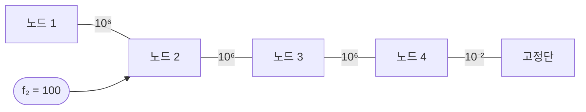

# 11장 실습 — 역행렬과 조건수

[레포지토리 안내](../../README.ko.md) | [English](Concepts_Lab.md) | [한국어](Concepts_Lab.ko.md)

> **최종 수정일:** 2026-10-18
>
> Applied Numerical Methods with Python for Engineers and Scientists, Chapra and Clough, Ch 11

> **학습 목표:**
> 1. 행렬의 역행렬을 수치적으로 계산할 수 있다
> 2. 조건수를 계산하고 해석할 수 있다
> 3. 입력 변동에 대한 해의 민감도를 평가할 수 있다

---

<br>

## 목차

- [1. 역행렬](#1-역행렬)
  - [1.1 LU 분해를 이용한 역행렬 계산](#11-lu-분해를-이용한-역행렬-계산)
  - [1.2 황금 규칙: 역행렬 대신 직접 풀기](#12-황금-규칙-역행렬-대신-직접-풀기)
- [2. 조건수와 악조건](#2-조건수와-비정상-조건)
  - [2.1 조건수 계산](#21-조건수-계산)
  - [2.2 기하학적 해석](#22-기하학적-해석)
  - [2.3 힐베르트 행렬: 지수적 악조건](#23-힐베르트-행렬-지수적-비정상-조건)
  - [2.4 오차 증폭 시연](#24-오차-증폭-시연)
  - [2.5 진단 실습: 의심스러운 강성행렬](#25-진단-실습-의심스러운-강성행렬)
- [3. 함수 정리와 핵심 규칙](#3-함수-정리와-핵심-규칙)
- [요약](#요약)
- [점검 문제](#점검-문제)

---

<br>

## 1. 역행렬

### 1.1 LU 분해를 이용한 역행렬 계산

행렬 $`[A]`$의 역행렬은 LU 분해로 열별로 계산할 수 있다. $`[A]`$를 한 번 분해한 뒤 단위 행렬의 각 열 $`\{e_k\}`$에 대해 $`[A]\{x_k\} = \{e_k\}`$를 푼다. 역행렬에 관한 유용한 항등식은 다음과 같다.

- $`(AB)^{-1} = B^{-1}A^{-1}`$ ($`A`$와 $`B`$가 가역일 때)
- $`(A^T)^{-1} = (A^{-1})^T`$
- $`2 \times 2`$ 행렬의 경우($`ad - bc \neq 0`$): $`\begin{bmatrix} a & b \\ c & d \end{bmatrix}^{-1} = \frac{1}{ad - bc} \begin{bmatrix} d & -b \\ -c & a \end{bmatrix}`$

```python
import numpy as np
import scipy as sc

def lu_inverse(A):
    """Compute A^{-1} using LU factorization."""
    n = A.shape[0]
    A_inv = np.zeros((n, n))
    lu_obj = sc.linalg.lu_factor(A)
    I = np.eye(n)

    for j in range(n):
        A_inv[:, j] = sc.linalg.lu_solve(lu_obj, I[:, j])

    return A_inv

A = np.array([[3, -0.1, -0.2], [0.1, 7, -0.3], [0.3, -0.2, 10]])
A_inv = lu_inverse(A)
print(f'A^{{-1}} = \n{A_inv}')
print(f'||A A^{{-1}} - I|| = {np.linalg.norm(A @ A_inv - np.eye(3)):.2e}')
```

LU 기반 접근법은 $`[A]`$를 하삼각 인수와 상삼각 인수로 한 번 분해한 뒤 $`n`$개의 우변 모두에 재사용한다. 이는 독립적인 가우스 소거를 $`n`$번 하는 것보다 효율적이다.

---

<br>

### 1.2 황금 규칙: 역행렬 대신 직접 풀기

$`[A]\{x\} = \{b\}`$를 풀기 위해 $`[A]^{-1}\{b\}`$를 명시적으로 계산하는 것은 거의 항상 **잘못된** 접근법이다. LU 분해를 통한 직접 풀이가 더 빠르고 수치적으로 더 정확하다.

```python
import time

n = 500
A = np.random.rand(n, n) + n * np.eye(n)
b = np.random.rand(n)

# Method 1: Invert then multiply (SLOW, LESS ACCURATE)
start = time.time()
for _ in range(100):
    x_inv = np.linalg.inv(A) @ b
t_inv = (time.time() - start) / 100

# Method 2: Direct solve (FAST, MORE ACCURATE)
start = time.time()
for _ in range(100):
    x_solve = np.linalg.solve(A, b)
t_solve = (time.time() - start) / 100

print(f'Inverse + multiply: {t_inv:.6f}s')
print(f'Direct solve:       {t_solve:.6f}s')
print(f'Speedup: {t_inv/t_solve:.1f}x')
print(f'Error (inv):   {np.linalg.norm(A @ x_inv - b):.2e}')
print(f'Error (solve): {np.linalg.norm(A @ x_solve - b):.2e}')
```

> **참고:** $`Ax = b`$를 직접 풀 수 있으면 $`A^{-1}b`$를 계산하지 않는다. 역행렬 계산에는 LU 분해 한 번에 더해 $`n`$개 열의 대입이 필요하므로, 연산량으로 보면 직접 풀이가 약 3배 빠르고 더 정확한 결과를 낸다. 실제 측정 시간은 실행 환경에 따라 다르다. 전체 역행렬을 계산할 유일한 이유는 물리적 해석이나 공분산 분석처럼 행렬 원소 자체가 필요한 경우이다.

---

<br>

## 2. 조건수와 악조건

### 2.1 조건수 계산

조건수 $`\kappa(A) = \|A\| \cdot \|A^{-1}\|`$는 여러 노름으로 계산할 수 있다. NumPy는 모든 경우를 하나의 함수로 제공한다.

```python
# Computing condition number
A = np.array([[1, 2], [1.0001, 2]])
print(f'κ_2(A) = {np.linalg.cond(A, 2):.2e}')
print(f'κ_1(A) = {np.linalg.cond(A, 1):.2e}')
print(f'κ_∞(A) = {np.linalg.cond(A, np.inf):.2e}')

# 2-norm condition = ratio of singular values
U, S, Vt = np.linalg.svd(A)
print(f'σ_max/σ_min = {S[0]/S[-1]:.2e}')  # equals κ_2
```

2-노름 조건수는 특이값 분해(SVD)를 통해 깔끔하게 해석된다. $`\kappa_2(A) = \sigma_{max} / \sigma_{min}`$, 즉 최대 특이값과 최소 특이값의 비이다. 매우 작은 특이값을 가진 행렬은 거의 특이하므로 조건수가 크다. 이 예의 행렬에서는 $`\kappa_2 \approx 5.0 \times 10^4`$, $`\kappa_1 = \kappa_\infty \approx 6.0 \times 10^4`$이다.

---

<br>

### 2.2 기하학적 해석

악조건은 $`2 \times 2`$ 시스템에서 분명한 기하학적 의미를 갖는다. 각 방정식은 평면에서 직선 하나를 정의한다. 양조건 시스템은 직선들이 큰 각도로 교차하므로 교점이 잘 정해진다. 악조건 시스템은 직선들이 거의 평행하므로 작은 섭동만으로도 교점이 크게 이동한다.

```python
import matplotlib.pyplot as plt

fig, axes = plt.subplots(1, 2, figsize=(12, 5))

# Well-conditioned
x_range = np.linspace(-2, 4, 100)
axes[0].plot(x_range, (5 - 2*x_range), label='2x + y = 5')
axes[0].plot(x_range, (x_range - 1), label='x - y = 1')
axes[0].set_title(f'Well-conditioned (κ ≈ {np.linalg.cond(np.array([[2,1],[1,-1]])):.1f})')
axes[0].legend()
axes[0].grid(True)

# Ill-conditioned
axes[1].plot(x_range, (5 - 2*x_range), label='2x + y = 5')
axes[1].plot(x_range, (5.001 - 2*x_range), label='2x + y = 5.001')
axes[1].set_title(f'Ill-conditioned (nearly parallel)')
axes[1].legend()
axes[1].grid(True)

plt.tight_layout()
plt.show()
```

양조건의 경우 두 직선은 기울기가 서로 다르며 분명한 각도로 교차한다(교점 $`(2, 1)`$, $`\kappa \approx 1.8`$). 교점은 작은 섭동에도 안정적이다. 악조건의 경우 두 직선은 거의 같으므로(거의 평행), 계수의 작은 변화가 교점을 그래프의 한쪽 끝에서 다른 쪽 끝으로 옮긴다.

> **참고:** 위 코드의 오른쪽 그래프에 그린 $`2x + y = 5`$와 $`2x + y = 5.001`$은 기울기가 $`-2`$로 같으므로 거의 평행한 것이 아니라 정확히 평행하다. 따라서 교점이 없고 계수 행렬 $`\begin{bmatrix} 2 & 1 \\ 2 & 1 \end{bmatrix}`$은 특이하다. 악조건이지만 풀 수 있는 시스템을 보이려면 두 번째 직선의 기울기를 조금 바꾸어 $`2.001x + y = 5.001`$처럼 그려야 한다. 이때 교점은 $`(1, 3)`$이고 $`\kappa_2 \approx 10^4`$이다.

---

<br>

### 2.3 힐베르트 행렬: 지수적 악조건

힐베르트 행렬 $`H_{ij} = 1/(i + j - 1)`$은 악조건의 표준적인 교과서 예제이다. 조건수가 크기에 따라 **지수적으로** 증가하여, 차원이 조금만 커져도 사실상 풀 수 없게 된다.

```python
from scipy.linalg import hilbert

print(f'{"n":>4} {"κ(H_n)":>15} {"digits lost":>12}')
print('-' * 35)
for n in range(2, 16):
    H = hilbert(n)
    kappa = np.linalg.cond(H)
    digits = int(np.log10(kappa)) if kappa > 1 else 0
    print(f'{n:4d} {kappa:15.2e} {digits:12d}')
```

배정밀도(유효 숫자 약 16자리)에서 표를 보면 $`n = 12`$일 때 힐베르트 행렬의 조건수가 약 $`10^{16}`$이 되어, 계산된 해에는 신뢰할 수 있는 자릿수가 사실상 **전혀 없음**을 알 수 있다. $`n \geq 13`$에서는 계산된 조건수가 약 $`10^{17}`$~$`10^{18}`$에 머물거나 오히려 줄어드는데, 이는 최소 특이값이 기계 정밀도보다 작아져 조건수 자체를 정확히 계산할 수 없기 때문이다. 힐베르트 행렬은 다항식 최소제곱 적합에서 자연스럽게 나타나며, 이것이 차수가 어느 정도 이상인 다항식 적합이 수치적으로 위험한 이유 중 하나이다.

---

<br>

### 2.4 오차 증폭 시연

다음 실험은 조건수가 오차 증폭을 어떻게 좌우하는지 보여 준다. $`\{x_{true}\} = \{1, 1, \ldots, 1\}`$인 $`[H]\{x\} = \{b\}`$를 풀고, $`\{b\}`$를 매우 작은 양($`10^{-10}`$ 규모의 난수)만큼 섭동한 뒤 다시 푼다.

```python
for n in [4, 8, 12]:
    H = hilbert(n)
    x_true = np.ones(n)
    b = H @ x_true

    # Solve
    x_computed = np.linalg.solve(H, b)

    # Perturb b
    b_pert = b + 1e-10 * np.random.randn(n)
    x_pert = np.linalg.solve(H, b_pert)

    rel_err = np.linalg.norm(x_computed - x_true) / np.linalg.norm(x_true)
    pert_err = np.linalg.norm(x_pert - x_computed) / np.linalg.norm(x_computed)

    print(f'n={n:2d}: κ={np.linalg.cond(H):.2e}, '
          f'solve error={rel_err:.2e}, perturbation effect={pert_err:.2e}')
```

결과는 분명한 패턴을 보인다. $`n`$이 커지면 조건수가 지수적으로 커지고, 풀이 오차와 섭동 민감도도 조건수에 거의 비례하여 커진다. 풀이 오차는 $`b`$를 $`x_{true}`$로부터 만들었으므로 정확한 산술이라면 0이어야 하지만, 반올림 오차가 조건수만큼 증폭되어 나타난다. 실행 예에서 풀이 오차는 $`n = 4, 8, 12`$일 때 각각 약 $`10^{-14}`$, $`10^{-7}`$, $`10^{-1}`$이었다. $`n = 12`$인 경우 $`\{b\}`$의 $`10^{-10}`$ 규모 섭동이 $`\{x\}`$에 $`10^6`$ 규모의 변화를 일으킬 수 있으며, 이는 조건수에 맞먹는 약 $`10^{16}`$의 증폭 계수이다.

---

<br>

### 2.5 진단 실습: 의심스러운 강성행렬

실제로 악조건은 경계 조건이 부적절하게 적용되었거나 메시에 거의 퇴화한 요소가 있을 때 유한요소법(FEM) 강성 행렬에서 자주 나타난다. 이 예제는 의심스러운 행렬을 진단하는 방법을 보여 준다.

```python
# A suspicious stiffness matrix from a FEM simulation
K_susp = np.array([
    [1e6, -1e6, 0, 0],
    [-1e6, 2e6, -1e6, 0],
    [0, -1e6, 2e6, -1e6],
    [0, 0, -1e6, 1e6+1e-2]
])

f_susp = np.array([0, 100, 0, 0])

kappa = np.linalg.cond(K_susp)
digits_lost = int(np.log10(kappa))
x_susp = np.linalg.solve(K_susp, f_susp)

print(f'Condition number: {kappa:.2e}')
print(f'Digits of accuracy lost: ~{digits_lost}')
print(f'Solution: {x_susp}')
print(f'Residual: {np.linalg.norm(K_susp @ x_susp - f_susp):.2e}')
```



*그림 1. 의심스러운 강성 행렬에 대응하는 스프링 사슬*

이 행렬은 그림 1처럼 강성 $`10^6`$인 스프링 세 개로 이어진 노드 4개가 강성 $`10^{-2}`$인 스프링 하나로만 고정단에 연결된 구조에 해당한다. 구조 전체가 거의 구속되지 않은 강체 운동을 할 수 있으므로 행렬이 거의 특이하며, 실행하면 조건수는 약 $`1.4 \times 10^9`$이고 약 9자리를 잃는다. 정확한 해는 $`x_4 = 100/10^{-2} = 10^4`$, $`x_3 = x_4 + 10^{-4}`$, $`x_1 = x_2 = x_4 + 2 \times 10^{-4}`$로 거의 같은 큰 변위이다. 실행 예에서 계산된 해의 상대 오차는 약 $`10^{-9}`$로, 정밀도 규칙이 최악의 경우로 보장하는 약 7자리($`16 - 9`$)보다 정확했고 잔차는 약 $`2 \times 10^{-6}`$이었다.

> **참고:** 큰 조건수가 계산된 답이 반드시 틀렸다는 뜻은 아니며, 주의해서 검증해야 한다는 뜻이다. 잔차 $`\|Ax - b\|`$를 확인한다. $`\kappa`$가 커도 잔차가 작으면 계산된 해는 주어진 데이터에 매우 가까운 문제의 정확한 해(후방 오차가 작은 해)이다. 다만 참값과의 상대 오차 $`\|x - x_{true}\| / \|x_{true}\|`$는 여전히 상대 잔차 $`\|Ax - b\| / \|b\|`$의 최대 $`\kappa`$배까지 커질 수 있다.

---

<br>

## 3. 함수 정리와 핵심 규칙

이 실습에서 사용한 함수와 공식을 정리하면 다음과 같다.

| 개념 | 함수 / 공식 |
|:--------|:------------------|
| 역행렬 계산 | `np.linalg.inv(A)` 또는 `lu_inverse(A)` |
| 풀기 (권장) | `np.linalg.solve(A, b)` |
| 조건수 | `np.linalg.cond(A)`, `np.linalg.cond(A, 2)` |
| 노름 | `np.linalg.norm(A, ord)` (ord=1, 2, np.inf, 'fro') |
| 특이값 | `np.linalg.svd(A)`, $`\kappa_2 = \sigma_{max} / \sigma_{min}`$ |

*표 1. 역행렬과 조건수 계산에 쓰는 함수와 공식*

**핵심 규칙:**

1. **역행렬 대신 직접 푼다.** `solve(A, b)`가 `inv(A) @ b`보다 빠르고 정확하다.
2. 결과를 신뢰하기 전에 항상 $`\kappa(A)`$를 확인한다.
3. 잃는 자릿수는 대략 $`\log_{10}\kappa(A)`$이다.
4. 힐베르트 행렬은 조건수가 지수적으로 증가하는 악조건의 전형적인 예이다.
5. $`\kappa`$가 크면 작은 잔차 $`\|Ax - b\|`$가 작은 오차 $`\|x - x_{true}\|`$를 보장하지 않는다.

---

<br>

## 요약

| 개념 | 핵심 요약 |
|:--------|:------------------|
| LU를 이용한 역행렬 | `lu_factor`로 한 번 분해하고 단위 행렬의 각 열에 `lu_solve`를 적용하여 역행렬을 구한다. |
| 직접 풀이 | 연립방정식은 `np.linalg.solve(A, b)`로 직접 푸는 것이 `inv(A) @ b`보다 빠르고 정확하다. |
| 조건수 계산 | `np.linalg.cond(A, p)`로 노름별 조건수를 구하며, 기본값은 2-노름이다. |
| 2-노름 조건수 | $`\kappa_2 = \sigma_{max} / \sigma_{min}`$이므로 최소 특이값이 매우 작으면 조건수가 크다. |
| 기하학적 해석 | $`2 \times 2`$ 시스템에서 악조건은 두 직선이 거의 평행하여 교점이 섭동에 민감한 상태이다. |
| 힐베르트 행렬 | 조건수가 $`n`$에 따라 지수적으로 커져 $`n = 12`$에서 약 $`10^{16}`$에 이른다. |
| 오차 증폭 | 우변의 작은 섭동이 해에서 최대 조건수 배까지 증폭된다. |
| 잔차와 오차 | 작은 잔차는 가까운 문제의 정확한 해임을 뜻하지만, $`\kappa`$가 크면 작은 오차를 보장하지 않는다. |

---

<br>

## 점검 문제

1. **SVD와 조건수:** 어떤 행렬의 특이값이 $`10`$, $`2`$, $`0.01`$이다. $`\kappa_2`$를 구하고, 배정밀도로 풀 때 해가 대략 몇 자리까지 유효한지 쓰라.

   <details>
   <summary>정답</summary>

   $`\kappa_2 = \sigma_{max} / \sigma_{min} = 10 / 0.01 = 1000`$이다. 잃는 자릿수는 $`\log_{10} 1000 = 3`$이므로, 유효 숫자 약 16자리에서 대략 13자리가 남는다.

   </details>

2. **조건수 손 계산:** 2.1절의 $`A = \begin{bmatrix} 1 & 2 \\ 1.0001 & 2 \end{bmatrix}`$에 대해 $`\kappa_\infty(A)`$를 손으로 구하라.

   <details>
   <summary>정답</summary>

   행합은 $`3`$과 $`3.0001`$이므로 $`\|A\|_\infty = 3.0001`$이다. $`\det(A) = 1 \times 2 - 2 \times 1.0001 = -0.0002`$이므로 $`A^{-1} = \frac{1}{-0.0002}\begin{bmatrix} 2 & -2 \\ -1.0001 & 1 \end{bmatrix} = \begin{bmatrix} -10000 & 10000 \\ 5000.5 & -5000 \end{bmatrix}`$이다. 절댓값 행합은 $`20000`$과 $`10000.5`$이므로 $`\|A^{-1}\|_\infty = 20000`$이고, $`\kappa_\infty(A) = 3.0001 \times 20000 = 60002`$이다.

   </details>

3. **힐베르트 행렬의 증가율:** 조건수가 대략 $`e^{3.5n}`$에 비례한다면 $`n`$이 1 커질 때 조건수는 몇 배가 되는가? $`\kappa(H_8) \approx 1.53 \times 10^{10}`$일 때 $`\kappa(H_9)`$를 추정하라.

   <details>
   <summary>정답</summary>

   $`n`$이 1 커질 때마다 약 $`e^{3.5} \approx 33`$배가 된다. 따라서 $`\kappa(H_9) \approx 1.53 \times 10^{10} \times 33 \approx 5.1 \times 10^{11}`$이며, 실제 값 약 $`4.93 \times 10^{11}`$과 가깝다.

   </details>

4. **잔차와 오차:** $`\kappa(A) = 10^8`$인 시스템을 풀었더니 상대 잔차가 $`\|Ax - b\| / \|b\| = 10^{-12}`$였다. 해의 상대 오차에 대해 무엇을 말할 수 있는가?

   <details>
   <summary>정답</summary>

   상대 오차는 $`\|x - x_{true}\| / \|x_{true}\| \leq \kappa(A) \cdot \|Ax - b\| / \|b\| = 10^8 \times 10^{-12} = 10^{-4}`$로 한정된다. 즉 잔차는 $`10^{-12}`$ 수준으로 작아도 해는 최악의 경우 유효 숫자 약 4자리까지만 보장된다.

   </details>
