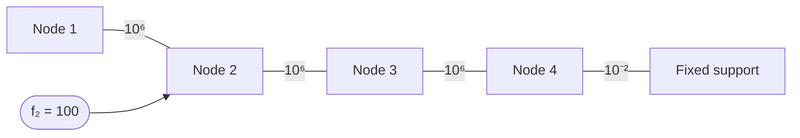

# Chapter 11 Lab — Matrix Inverse and Condition Number

[Repository Guide](../../README.md) | [English](Concepts_Lab.md) | [한국어](Concepts_Lab.ko.md)

> **Last Updated:** 2026-10-20
>
> Applied Numerical Methods with Python for Engineers and Scientists, Chapra and Clough, Ch 11

> **Learning Objectives:**
> 1. Compute matrix inverses numerically
> 2. Calculate and interpret condition numbers
> 3. Assess solution sensitivity to input perturbations

---

<br>

## Table of Contents

- [1. Matrix Inverse](#1-matrix-inverse)
  - [1.1 Computing the Inverse via LU Factorization](#11-computing-the-inverse-via-lu-factorization)
  - [1.2 Golden Rule: Solve, Do Not Invert](#12-golden-rule-solve-do-not-invert)
- [2. Condition Number and Ill-Conditioning](#2-condition-number-and-ill-conditioning)
  - [2.1 Computing the Condition Number](#21-computing-the-condition-number)
  - [2.2 Geometric Interpretation](#22-geometric-interpretation)
  - [2.3 Hilbert Matrix: Exponential Ill-Conditioning](#23-hilbert-matrix-exponential-ill-conditioning)
  - [2.4 Error Amplification Demo](#24-error-amplification-demo)
  - [2.5 Diagnostic Exercise: Suspicious Stiffness Matrix](#25-diagnostic-exercise-suspicious-stiffness-matrix)
- [3. Function Reference and Key Rules](#3-function-reference-and-key-rules)
- [Summary](#summary)
- [Self-Check Questions](#self-check-questions)

---

<br>

## 1. Matrix Inverse

### 1.1 Computing the Inverse via LU Factorization

The inverse of a matrix $`[A]`$ can be computed column-by-column using LU factorization: decompose $`[A]`$ once, then solve $`[A]\{x_k\} = \{e_k\}`$ for each column $`\{e_k\}`$ of the identity matrix. Some useful identities for matrix inverses:

- $`(AB)^{-1} = B^{-1}A^{-1}`$ (when $`A`$ and $`B`$ are invertible)
- $`(A^T)^{-1} = (A^{-1})^T`$
- For a $`2 \times 2`$ matrix ($`ad - bc \neq 0`$): $`\begin{bmatrix} a & b \\ c & d \end{bmatrix}^{-1} = \frac{1}{ad - bc} \begin{bmatrix} d & -b \\ -c & a \end{bmatrix}`$

```python
import numpy as np
import scipy as sc

def lu_inverse(A):
    """Compute A^{-1} using LU factorization."""
    n = A.shape[0]
    A_inv = np.zeros((n, n))
    lu_obj = sc.linalg.lu_factor(A)
    I = np.eye(n)

    for j in range(n):
        A_inv[:, j] = sc.linalg.lu_solve(lu_obj, I[:, j])

    return A_inv

A = np.array([[3, -0.1, -0.2], [0.1, 7, -0.3], [0.3, -0.2, 10]])
A_inv = lu_inverse(A)
print(f'A^{{-1}} = \n{A_inv}')
print(f'||A A^{{-1}} - I|| = {np.linalg.norm(A @ A_inv - np.eye(3)):.2e}')
```

The LU-based approach decomposes $`[A]`$ into lower and upper triangular factors once, then reuses them for all $`n`$ right-hand sides. This is more efficient than computing $`n`$ independent Gauss eliminations.

---

<br>

### 1.2 Golden Rule: Solve, Do Not Invert

Computing $`[A]^{-1}\{b\}`$ explicitly is almost always the **wrong** approach to solving $`[A]\{x\} = \{b\}`$. Direct solving via LU factorization is both faster and more numerically accurate:

```python
import time

n = 500
A = np.random.rand(n, n) + n * np.eye(n)
b = np.random.rand(n)

# Method 1: Invert then multiply (SLOW, LESS ACCURATE)
start = time.time()
for _ in range(100):
    x_inv = np.linalg.inv(A) @ b
t_inv = (time.time() - start) / 100

# Method 2: Direct solve (FAST, MORE ACCURATE)
start = time.time()
for _ in range(100):
    x_solve = np.linalg.solve(A, b)
t_solve = (time.time() - start) / 100

print(f'Inverse + multiply: {t_inv:.6f}s')
print(f'Direct solve:       {t_solve:.6f}s')
print(f'Speedup: {t_inv/t_solve:.1f}x')
print(f'Error (inv):   {np.linalg.norm(A @ x_inv - b):.2e}')
print(f'Error (solve): {np.linalg.norm(A @ x_solve - b):.2e}')
```

> **Note:** Never compute $`A^{-1}b`$ when you can solve $`Ax = b`$ directly. Computing the inverse needs substitutions for $`n`$ columns on top of one LU factorization, so by operation count direct solving is approximately 3x faster, and it produces more accurate results. Measured times depend on the computing environment. The only reason to compute the full inverse is when you need the matrix entries themselves (e.g., for physical interpretation or covariance analysis).

---

<br>

## 2. Condition Number and Ill-Conditioning

### 2.1 Computing the Condition Number

The condition number $`\kappa(A) = \|A\| \cdot \|A^{-1}\|`$ can be computed using different norms. NumPy provides a single function for all variants:

```python
# Computing condition number
A = np.array([[1, 2], [1.0001, 2]])
print(f'κ_2(A) = {np.linalg.cond(A, 2):.2e}')
print(f'κ_1(A) = {np.linalg.cond(A, 1):.2e}')
print(f'κ_∞(A) = {np.linalg.cond(A, np.inf):.2e}')

# 2-norm condition = ratio of singular values
U, S, Vt = np.linalg.svd(A)
print(f'σ_max/σ_min = {S[0]/S[-1]:.2e}')  # equals κ_2
```

The 2-norm condition number has a clean interpretation via the singular value decomposition (SVD): $`\kappa_2(A) = \sigma_{max} / \sigma_{min}`$, the ratio of the largest to smallest singular value. A matrix with one very small singular value is nearly singular, producing a large condition number. For the matrix in this example, $`\kappa_2 \approx 5.0 \times 10^4`$ and $`\kappa_1 = \kappa_\infty \approx 6.0 \times 10^4`$.

---

<br>

### 2.2 Geometric Interpretation

Ill-conditioning has a clear geometric meaning for $`2 \times 2`$ systems. Each equation defines a line in the plane. A well-conditioned system has lines that cross at a steep angle, so the intersection point is well-defined. An ill-conditioned system has nearly parallel lines, so even a tiny perturbation shifts the intersection point dramatically:

```python
import matplotlib.pyplot as plt

fig, axes = plt.subplots(1, 2, figsize=(12, 5))

# Well-conditioned
x_range = np.linspace(-2, 4, 100)
axes[0].plot(x_range, (5 - 2*x_range), label='2x + y = 5')
axes[0].plot(x_range, (x_range - 1), label='x - y = 1')
axes[0].set_title(f'Well-conditioned (κ ≈ {np.linalg.cond(np.array([[2,1],[1,-1]])):.1f})')
axes[0].legend()
axes[0].grid(True)

# Ill-conditioned
axes[1].plot(x_range, (5 - 2*x_range), label='2x + y = 5')
axes[1].plot(x_range, (5.001 - 2*x_range), label='2x + y = 5.001')
axes[1].set_title(f'Ill-conditioned (nearly parallel)')
axes[1].legend()
axes[1].grid(True)

plt.tight_layout()
plt.show()
```

In the well-conditioned case, the two lines have different slopes and intersect at a clear angle (intersection $`(2, 1)`$, $`\kappa \approx 1.8`$). The intersection point is stable under small perturbations. In the ill-conditioned case, the two lines are nearly identical (almost parallel), so a tiny change in the coefficients shifts the intersection from one end of the plot to the other.

> **Note:** The lines $`2x + y = 5`$ and $`2x + y = 5.001`$ in the right panel of the code above both have slope $`-2`$, so they are exactly parallel rather than nearly parallel. They have no intersection, and the coefficient matrix $`\begin{bmatrix} 2 & 1 \\ 2 & 1 \end{bmatrix}`$ is singular. To show an ill-conditioned but solvable system, the slope of the second line should be changed slightly, for example to $`2.001x + y = 5.001`$. The intersection is then $`(1, 3)`$ and $`\kappa_2 \approx 10^4`$.

---

<br>

### 2.3 Hilbert Matrix: Exponential Ill-Conditioning

The Hilbert matrix $`H_{ij} = 1/(i + j - 1)`$ is the standard textbook example of ill-conditioning. Its condition number grows **exponentially** with size, making it practically unsolvable beyond modest dimensions:

```python
from scipy.linalg import hilbert

print(f'{"n":>4} {"κ(H_n)":>15} {"digits lost":>12}')
print('-' * 35)
for n in range(2, 16):
    H = hilbert(n)
    kappa = np.linalg.cond(H)
    digits = int(np.log10(kappa)) if kappa > 1 else 0
    print(f'{n:4d} {kappa:15.2e} {digits:12d}')
```

For double precision (about 16 significant digits), the table shows that by $`n = 12`$, the Hilbert matrix has a condition number around $`10^{16}`$, meaning the computed solution has essentially **zero** reliable digits. For $`n \geq 13`$, the computed condition number stays around $`10^{17}`$-$`10^{18}`$ or even decreases, because the smallest singular value falls below machine epsilon times the largest singular value and the condition number itself can no longer be computed accurately. Hilbert matrices arise naturally in polynomial least-squares fitting, which is one reason polynomial fitting beyond modest degrees is numerically dangerous.

---

<br>

### 2.4 Error Amplification Demo

The following experiment demonstrates how the condition number controls error amplification. We solve $`[H]\{x\} = \{b\}`$ where $`\{x_{true}\} = \{1, 1, \ldots, 1\}`$, then perturb $`\{b\}`$ by a tiny amount (random values of order $`10^{-10}`$) and re-solve:

```python
for n in [4, 8, 12]:
    H = hilbert(n)
    x_true = np.ones(n)
    b = H @ x_true

    # Solve
    x_computed = np.linalg.solve(H, b)

    # Perturb b
    b_pert = b + 1e-10 * np.random.randn(n)
    x_pert = np.linalg.solve(H, b_pert)

    rel_err = np.linalg.norm(x_computed - x_true) / np.linalg.norm(x_true)
    pert_err = np.linalg.norm(x_pert - x_computed) / np.linalg.norm(x_computed)

    print(f'n={n:2d}: κ={np.linalg.cond(H):.2e}, '
          f'solve error={rel_err:.2e}, perturbation effect={pert_err:.2e}')
```

The results show a clear pattern: as $`n`$ increases, the condition number grows exponentially, and both the solve error and the perturbation sensitivity grow nearly in proportion to it. Because $`b`$ is built from $`x_{true}`$, the solve error would be zero in exact arithmetic; it appears because round-off is amplified by the condition number. In a sample run, the solve errors for $`n = 4, 8, 12`$ were about $`10^{-14}`$, $`10^{-7}`$, and $`10^{-1}`$. For $`n = 12`$, a perturbation of order $`10^{-10}`$ in $`\{b\}`$ can produce changes of order $`10^6`$ in $`\{x\}`$, a magnification factor of about $`10^{16}`$ that matches the condition number.

---

<br>

### 2.5 Diagnostic Exercise: Suspicious Stiffness Matrix

In practice, ill-conditioning often appears in finite element method (FEM) stiffness matrices when boundary conditions are improperly applied or when the mesh has nearly degenerate elements. This example shows how to diagnose a suspicious matrix:

```python
# A suspicious stiffness matrix from a FEM simulation
K_susp = np.array([
    [1e6, -1e6, 0, 0],
    [-1e6, 2e6, -1e6, 0],
    [0, -1e6, 2e6, -1e6],
    [0, 0, -1e6, 1e6+1e-2]
])

f_susp = np.array([0, 100, 0, 0])

kappa = np.linalg.cond(K_susp)
digits_lost = int(np.log10(kappa))
x_susp = np.linalg.solve(K_susp, f_susp)

print(f'Condition number: {kappa:.2e}')
print(f'Digits of accuracy lost: ~{digits_lost}')
print(f'Solution: {x_susp}')
print(f'Residual: {np.linalg.norm(K_susp @ x_susp - f_susp):.2e}')
```



*Figure 1. Spring chain corresponding to the suspicious stiffness matrix*

As Figure 1 shows, this matrix corresponds to four nodes joined by three springs of stiffness $`10^6`$ and attached to a fixed support only through one spring of stiffness $`10^{-2}`$. The whole structure can undergo an almost unrestrained rigid-body motion, so the matrix is nearly singular; running the code gives a condition number of about $`1.4 \times 10^9`$ and about 9 lost digits. The exact solution is $`x_4 = 100/10^{-2} = 10^4`$, $`x_3 = x_4 + 10^{-4}`$, and $`x_1 = x_2 = x_4 + 2 \times 10^{-4}`$, a set of nearly equal large displacements. In a sample run, the relative error of the computed solution was about $`10^{-9}`$, more accurate than the roughly 7 digits ($`16 - 9`$) that the precision rule guarantees in the worst case, and the residual was about $`2 \times 10^{-6}`$.

> **Note:** A large condition number does not necessarily mean the computed answer is wrong; it means you should be careful and verify. Check the residual $`\|Ax - b\|`$. A small residual with high $`\kappa`$ means the computed solution is the exact solution of a problem very close to the given data (a solution with small backward error). The relative error $`\|x - x_{true}\| / \|x_{true}\|`$, however, can still be as large as $`\kappa`$ times the relative residual $`\|Ax - b\| / \|b\|`$.

---

<br>

## 3. Function Reference and Key Rules

The functions and formulas used in this lab are summarized below.

| Concept | Function / Formula |
|:--------|:------------------|
| Compute inverse | `np.linalg.inv(A)` or `lu_inverse(A)` |
| Solve (preferred) | `np.linalg.solve(A, b)` |
| Condition number | `np.linalg.cond(A)`, `np.linalg.cond(A, 2)` |
| Norms | `np.linalg.norm(A, ord)` with ord=1, 2, np.inf, 'fro' |
| Singular values | `np.linalg.svd(A)`, $`\kappa_2 = \sigma_{max} / \sigma_{min}`$ |

*Table 1. Functions and formulas for computing inverses and condition numbers*

**Key Rules:**

1. **Solve rather than invert.** `solve(A, b)` is faster and more accurate than `inv(A) @ b`.
2. Always check $`\kappa(A)`$ before trusting results.
3. The number of digits lost is approximately $`\log_{10}\kappa(A)`$.
4. Hilbert matrices are the classic example of ill-conditioning, with a condition number that grows exponentially.
5. When $`\kappa`$ is large, a small residual $`\|Ax - b\|`$ does not guarantee a small error $`\|x - x_{true}\|`$.

---

<br>

## Summary

| Concept | Key Summary |
|:--------|:------------------|
| Inverse via LU | Factoring once with `lu_factor` and applying `lu_solve` to each column of the identity matrix gives the inverse. |
| Direct solve | Solving a linear system directly with `np.linalg.solve(A, b)` is faster and more accurate than `inv(A) @ b`. |
| Computing the condition number | `np.linalg.cond(A, p)` gives the condition number for each norm, with the 2-norm as the default. |
| 2-norm condition number | Since $`\kappa_2 = \sigma_{max} / \sigma_{min}`$, a very small smallest singular value makes the condition number large. |
| Geometric interpretation | In a $`2 \times 2`$ system, ill-conditioning means two nearly parallel lines whose intersection is sensitive to perturbations. |
| Hilbert matrix | Its condition number grows exponentially with $`n`$ and reaches about $`10^{16}`$ at $`n = 12`$. |
| Error amplification | A small perturbation of the right-hand side can be amplified in the solution by up to the condition number. |
| Residual and error | A small residual means the solution exactly solves a nearby problem, but it does not guarantee a small error when $`\kappa`$ is large. |

---

<br>

## Self-Check Questions

1. **SVD and condition number:** A matrix has singular values $`10`$, $`2`$, and $`0.01`$. Find $`\kappa_2`$, and state to about how many digits the solution is valid when solved in double precision.

   <details>
   <summary>Answer</summary>

   $`\kappa_2 = \sigma_{max} / \sigma_{min} = 10 / 0.01 = 1000`$. The number of digits lost is $`\log_{10} 1000 = 3`$, so about 13 of the roughly 16 significant digits remain.

   </details>

2. **Condition number by hand:** For $`A = \begin{bmatrix} 1 & 2 \\ 1.0001 & 2 \end{bmatrix}`$ from Section 2.1, compute $`\kappa_\infty(A)`$ by hand.

   <details>
   <summary>Answer</summary>

   The row sums are $`3`$ and $`3.0001`$, so $`\|A\|_\infty = 3.0001`$. Since $`\det(A) = 1 \times 2 - 2 \times 1.0001 = -0.0002`$, $`A^{-1} = \frac{1}{-0.0002}\begin{bmatrix} 2 & -2 \\ -1.0001 & 1 \end{bmatrix} = \begin{bmatrix} -10000 & 10000 \\ 5000.5 & -5000 \end{bmatrix}`$. The absolute row sums are $`20000`$ and $`10000.5`$, so $`\|A^{-1}\|_\infty = 20000`$ and $`\kappa_\infty(A) = 3.0001 \times 20000 = 60002`$.

   </details>

3. **Growth rate of Hilbert matrices:** If the condition number is roughly proportional to $`e^{3.5n}`$, by what factor does it grow when $`n`$ increases by 1? Estimate $`\kappa(H_9)`$ given $`\kappa(H_8) \approx 1.53 \times 10^{10}`$.

   <details>
   <summary>Answer</summary>

   Each increase of $`n`$ by 1 multiplies it by about $`e^{3.5} \approx 33`$. Therefore $`\kappa(H_9) \approx 1.53 \times 10^{10} \times 33 \approx 5.1 \times 10^{11}`$, close to the actual value of about $`4.93 \times 10^{11}`$.

   </details>

4. **Residual and error:** Solving a system with $`\kappa(A) = 10^8`$ gave a relative residual of $`\|Ax - b\| / \|b\| = 10^{-12}`$. What can be said about the relative error of the solution?

   <details>
   <summary>Answer</summary>

   The relative error is bounded by $`\|x - x_{true}\| / \|x_{true}\| \leq \kappa(A) \cdot \|Ax - b\| / \|b\| = 10^8 \times 10^{-12} = 10^{-4}`$. Even though the residual is as small as $`10^{-12}`$, in the worst case the solution is guaranteed only to about 4 significant digits.

   </details>
