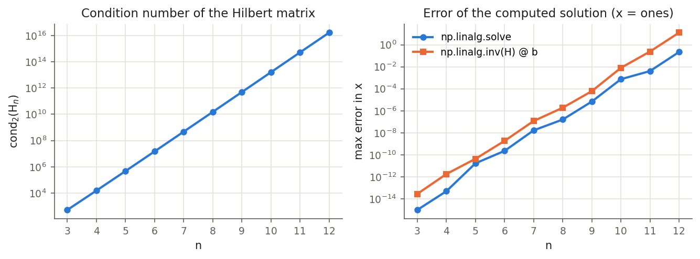
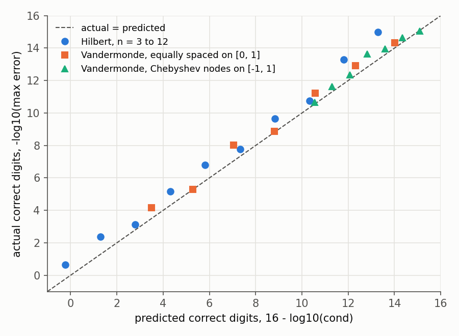

# 11장 — 역행렬과 조건수

[레포지토리 안내](../../README.ko.md) | [English](Concepts_Lecture.md) | [한국어](Concepts_Lecture.ko.md)

> **최종 수정일:** 2026-11-27
>
> Applied Numerical Methods with Python for Engineers and Scientists, Chapra and Clough, Ch 11

> **학습 목표:**
> 1. 행렬의 역행렬을 수치적으로 계산할 수 있다
> 2. 조건수를 계산하고 해석할 수 있다
> 3. 입력 변동에 대한 해의 민감도를 평가할 수 있다
> 4. 벡터 노름과 유도 행렬 노름의 성질을 증명하고 행렬 노름을 손으로 계산할 수 있다
> 5. 조건수의 오차 한계를 유도하고 잔차와 오차의 차이를 설명할 수 있다
> 6. Hilbert 행렬과 Vandermonde 행렬로 정밀도 규칙을 수치적으로 확인하고, 행의 스케일링이 조건수에 미치는 영향을 설명할 수 있다

---

<br>

## 목차

- [1. 역행렬의 정의](#1-역행렬의-정의)
- [2. LU 분해를 이용한 역행렬 계산](#2-lu-분해를-이용한-역행렬-계산)
  - [2.1 열별 방법](#21-열별-방법)
  - [2.2 예제 11.1: 3x3 역행렬](#22-예제-111-3x3-역행렬)
  - [2.3 나머지 두 열의 계산](#23-나머지-두-열의-계산)
  - [2.4 역행렬 계산의 비용과 역행렬로 풀지 않는 이유](#24-역행렬-계산의-비용과-역행렬로-풀지-않는-이유)
- [3. 물리적 해석: 질량-스프링 시스템](#3-물리적-해석-질량-스프링-시스템)
- [4. 오차 분석: 악조건 판별을 위한 세 가지 검사](#4-오차-분석-악조건-판별을-위한-세-가지-검사)
- [5. 벡터 노름(Vector Norms)](#5-벡터-노름vector-norms)
- [6. 행렬 노름(Matrix Norms)](#6-행렬-노름matrix-norms)
- [7. 행렬 조건수(Matrix Condition Number)](#7-행렬-조건수matrix-condition-number)
- [8. 오차 한계 정리(Error Bound Theorem)](#8-오차-한계-정리error-bound-theorem)
- [9. 정밀도 규칙(Precision Rule)](#9-정밀도-규칙precision-rule)
- [10. 예제 11.3: Hilbert 행렬(Hilbert Matrix)](#10-예제-113-hilbert-행렬hilbert-matrix)
- [11. Python 구현](#11-python-구현)
- [12. 흔한 실수](#12-흔한-실수)
- [13. 조건수 한계와 정밀도 규칙의 수치 확인](#13-조건수-한계와-정밀도-규칙의-수치-확인)
  - [13.1 한계가 등호가 되는 섭동](#131-한계가-등호가-되는-섭동)
  - [13.2 Vandermonde 행렬과 정밀도 규칙](#132-vandermonde-행렬과-정밀도-규칙)
- [요약](#요약)
- [점검 문제](#점검-문제)
- [참고 문헌](#참고-문헌)

---

<br>

## 1. 역행렬의 정의

정방 행렬 $`[A]`$의 역행렬(inverse)은 다음을 만족하는 유일한 행렬 $`[A]^{-1}`$로 정의한다.

```math
[A][A]^{-1} = [A]^{-1}[A] = [I]
```

여기서 $`[I]`$는 단위 행렬이다. 역행렬이 존재하기 위한 필요충분조건은 다음과 같다.

- $`[A]`$가 **정방 행렬**($`n \times n`$)이다.
- $`[A]`$가 **비특이**(non-singular), 즉 $`\det(A) \neq 0`$이다.

$`[A]`$가 특이 행렬(singular matrix), 즉 행렬식이 0이면 역행렬이 존재하지 않는다. 기하학적으로 특이 행렬은 공간을 찌그러뜨린다. 0이 아닌 벡터 중 적어도 하나를 영벡터로 보내므로 변환을 되돌릴 수 없다.

$`[A]\{x\} = \{b\}`$가 주어지면 형식적인 해는 다음과 같다.

```math
\{x\} = [A]^{-1}\{b\}
```

그러나 실제로 역행렬을 명시적으로 계산하는 것이 선형계를 푸는 최선의 방법인 경우는 거의 없다. 역행렬은 주로 이론적 분석과 물리적 해석에 유용하다.

---

<br>

## 2. LU 분해를 이용한 역행렬 계산

### 2.1 열별 방법

역행렬은 단위 행렬의 각 열에 대해 하나씩, 모두 $`n`$개의 선형계를 풀어 계산할 수 있다.

```math
[A]\{x_k\} = \{e_k\}, \quad k = 1, 2, \ldots, n
```

여기서 $`\{e_k\}`$는 단위 행렬의 $`k`$번째 열(위치 $`k`$만 1이고 나머지는 0)이다. 각 해 $`\{x_k\}`$가 $`[A]^{-1}`$의 $`k`$번째 열이 된다.

이 작업에 LU 분해를 쓰는 핵심 장점은 분해 $`[A] = [L][U]`$를 **한 번만** 수행하면 된다는 것이다. 그다음에는 $`n`$개의 우변 각각에 대해 전진 대입($`[L]\{d\} = \{e_k\}`$)과 후진 대입($`[U]\{x_k\} = \{d\}`$)만 하면 되며, 둘 다 $`O(n^2)`$ 연산이다. 따라서 총 비용은 다음과 같다.

- **1회** LU 분해: $`O(n^3)`$
- **$`n`$회** 전진 대입과 후진 대입: $`n \times O(n^2) = O(n^3)`$
- **총합**: $`O(n^3)`$, 즉 Gauss 소거법 한 번과 같은 차수이다.

### 2.2 예제 11.1: 3x3 역행렬

교재의 행렬을 생각한다.

```math
[A] = \begin{bmatrix} 3 & -0.1 & -0.2 \\ 0.1 & 7 & -0.3 \\ 0.3 & -0.2 & 10 \end{bmatrix}
```

10장에서 얻은 LU 분해로 역행렬의 각 열을 구한다.

**1열**: $`[L]\{d\} = \{1, 0, 0\}^T`$를 풀고, 이어서 $`[U]\{x_1\} = \{d\}`$를 푼다.

전진 대입 ($`[L]\{d\} = \{1, 0, 0\}^T`$):

```math
d_1 = 1, \quad d_2 = 0 - (0.033333)(1) = -0.033333, \quad d_3 = 0 - (0.1)(1) - (-0.02713)(-0.033333) = -0.1009
```

후진 대입 ($`[U]\{x_1\} = \{d\}`$):

```math
x_3 = \frac{-0.1009}{10.012} = -0.010078, \quad x_2 = \frac{-0.033333 - (-0.29333)(-0.010078)}{7.00333} = -0.005182
```

```math
x_1 = \frac{1 - (-0.1)(-0.005182) - (-0.2)(-0.010078)}{3} = 0.3325
```

**2열**: $`\{e_2\} = \{0, 1, 0\}^T`$로 같은 절차를 반복하여 두 번째 열을 구한다.

**3열**: $`\{e_3\} = \{0, 0, 1\}^T`$로 같은 절차를 반복하여 세 번째 열을 구한다.

**결과:**

```math
[A]^{-1} = \begin{bmatrix} 0.3325 & 0.0049 & 0.0068 \\ -0.0052 & 0.1429 & 0.0042 \\ -0.0101 & 0.0027 & 0.0999 \end{bmatrix}
```

$`[A][A]^{-1} \approx [I]`$인지 확인하면 반올림 오차 범위 안에서 결과를 검증할 수 있다.

### 2.3 나머지 두 열의 계산

2열과 3열도 1열과 같은 $`[L]`$, $`[U]`$로 계산한다. 우변이 단위 벡터이므로 전진 대입에서 앞쪽 성분은 계산 없이 0이 된다.

**2열** ($`\{e_2\} = \{0, 1, 0\}^T`$): 전진 대입은 $`d_1 = 0`$, $`d_2 = 1`$, $`d_3 = 0 - (0.1)(0) - (-0.02713)(1) = 0.02713`$이다. 후진 대입은 다음과 같다.

```math
x_3 = \frac{0.02713}{10.012} = 0.00271, \quad x_2 = \frac{1 - (-0.29333)(0.00271)}{7.00333} = 0.142903, \quad x_1 = \frac{0 - (-0.1)(0.142903) - (-0.2)(0.00271)}{3} = 0.004944
```

**3열** ($`\{e_3\} = \{0, 0, 1\}^T`$): 전진 대입은 $`d = (0,\ 0,\ 1)`$로 바로 끝난다. 후진 대입은 다음과 같다.

```math
x_3 = \frac{1}{10.012} = 0.09988, \quad x_2 = \frac{0 - (-0.29333)(0.09988)}{7.00333} = 0.004183, \quad x_1 = \frac{0 - (-0.1)(0.004183) - (-0.2)(0.09988)}{3} = 0.006798
```

세 열을 모으면 2.2절의 $`[A]^{-1}`$이 된다. 대각 성분 $`0.3325`$, $`0.1429`$, $`0.0999`$가 대략 $`1/3`$, $`1/7`$, $`1/10`$인 것은 $`[A]`$가 대각 성분이 큰 대각 우위 행렬이어서 역행렬도 대각 행렬의 역행렬에 가깝기 때문이다.

### 2.4 역행렬 계산의 비용과 역행렬로 풀지 않는 이유

10장에서 LU 분해는 약 $`\frac{2}{3}n^3`$회, 우변 하나의 전진 대입과 후진 대입은 합쳐 약 $`2n^2`$회임을 보였다. 우변 $`n`$개를 그대로 풀면 $`\frac{2}{3}n^3 + 2n^3 = \frac{8}{3}n^3`$회이지만, 단위 벡터 $`\{e_k\}`$의 앞쪽 $`k-1`$개 성분이 0이라는 점을 쓰면 전진 대입은 $`k`$행부터 시작하면 되어 전체가 약 $`\frac{1}{3}n^3`$회로 줄어든다. 후진 대입은 줄일 수 없어 $`n \times n^2 = n^3`$회이다. 따라서 역행렬 전체의 비용은 다음과 같다.

```math
\frac{2}{3}n^3 + \frac{1}{3}n^3 + n^3 = 2n^3
```

$`\{x\} = [A]^{-1}\{b\}`$로 해를 구하면 역행렬 계산 $`2n^3`$회에 행렬과 벡터의 곱 $`2n^2`$회가 더해진다. LU 분해로 직접 풀면 $`\frac{2}{3}n^3 + 2n^2`$회이므로, 역행렬을 거치는 방법은 약 3배 비싸다.

정확도도 나쁘다. 역행렬의 각 성분에는 반올림 오차가 들어 있고, $`[A]^{-1}\{b\}`$를 곱하는 과정에서 그 오차가 다시 더해진다. 10절의 Hilbert 행렬 실험(표 4)에서 같은 시스템을 두 방법으로 풀면, 역행렬을 거친 해의 오차가 모든 $`n`$에서 LU 분해로 직접 푼 해의 오차보다 크며, 그 차이는 2.5배에서 60배 정도이다. 역행렬은 3절처럼 원소 자체에 의미가 있을 때만 계산한다.

---

<br>

## 3. 물리적 해석: 질량-스프링 시스템

시스템 $`[A]\{x\} = \{b\}`$가 물리적 의미를 가질 때 역행렬은 직접적인 물리적 통찰을 준다. 형식적인 해는 다음과 같다.

```math
\{x\} = [A]^{-1}\{b\}
```

역행렬의 각 원소 $`a_{ij}^{-1}`$는 다음과 같이 해석된다.

```math
a_{ij}^{-1} = \text{힘 } b_j \text{가 변위 } x_i \text{에 기여하는 정도}
```

즉 $`a_{ij}^{-1}`$는 $`j`$번째 입력(힘)이 $`i`$번째 출력(변위)에 얼마나 영향을 미치는지를 나타낸다. 이는 공학의 **영향 계수(influence coefficient)** 나 **전달 함수(transfer function)** 와 비슷하다.

질량-스프링 시스템에서 $`[A]^{-1}`$의 열을 읽으면 개별 힘 성분이 시스템을 통해 어떻게 전파되는지 알 수 있다. 역행렬의 $`j`$번째 열은 위치 $`j`$에 단위 힘을 가하고 나머지 위치의 힘은 0일 때의 변위 패턴이다.

> **참고:** **유연성 행렬.** 구조공학에서는 강성 행렬(stiffness matrix)의 역행렬을 **유연성 행렬(flexibility matrix)** 또는 컴플라이언스 행렬이라 한다. 그 원소는 구조물이 얼마나 유연한지를 직접 나타내며, 값이 크면 작은 힘으로도 큰 변위가 생긴다는 뜻이다. 이 물리적 해석은 전체 역행렬을 계산하는 것이 실제로 유용한 몇 안 되는 경우 중 하나이다.

**예제.** 벽에 고정된 스프링 하나와 질량 세 개를 스프링으로 차례로 이은 시스템에서 모든 스프링 상수가 $`k = 100\ \text{N/m}`$이면 강성 행렬과 그 역행렬은 다음과 같다.

```math
[K] = k\begin{bmatrix} 2 & -1 & 0 \\ -1 & 2 & -1 \\ 0 & -1 & 1 \end{bmatrix}, \qquad [K]^{-1} = \frac{1}{k}\begin{bmatrix} 1 & 1 & 1 \\ 1 & 2 & 2 \\ 1 & 2 & 3 \end{bmatrix} = \begin{bmatrix} 0.01 & 0.01 & 0.01 \\ 0.01 & 0.02 & 0.02 \\ 0.01 & 0.02 & 0.03 \end{bmatrix}\ \text{m/N}
```

역행렬의 성분은 $`(K^{-1})_{ij} = \min(i, j)/k`$라는 단순한 규칙을 따른다. 3열 $`(0.01,\ 0.02,\ 0.03)`$은 맨 끝 질량에 1 N을 가했을 때 세 질량이 각각 1 cm, 2 cm, 3 cm 움직인다는 뜻이며, 50 N을 가하면 변위는 $`50 \times (0.01,\ 0.02,\ 0.03) = (0.5,\ 1.0,\ 1.5)`$ m이다. 반면 1열은 모두 0.01이어서 첫 질량을 당기면 그 바깥의 질량들이 함께 1 cm씩 끌려간다. 역행렬이 대칭인 것은 $`j`$에 가한 힘이 $`i`$의 변위에 미치는 영향과 $`i`$에 가한 힘이 $`j`$의 변위에 미치는 영향이 같다는 상반 관계를 나타낸다.

**자극과 응답의 예제.** 교재는 역행렬의 원소를 자극(입력)과 응답(출력)의 관계로 읽는 방법을 오염 물질이 섞이는 여러 공간의 질량 수지에 적용한다. 같은 발상을 서로 연결된 세 개의 혼합 반응조에 적용한다. 반응조 $`i`$의 정상 상태 농도를 $`c_i`$(g/m³), 외부에서 들어오는 오염 부하를 $`W_i`$(g/h)라 하고, 유량과 반응조 사이의 교환으로 질량 수지가 다음과 같이 정리되었다고 하자(계수의 단위는 m³/h).

```math
\begin{bmatrix} 5 & -1 & 0 \\ -3 & 6 & -1 \\ 0 & -4 & 5 \end{bmatrix}\begin{Bmatrix} c_1 \\ c_2 \\ c_3 \end{Bmatrix} = \begin{Bmatrix} W_1 \\ W_2 \\ W_3 \end{Bmatrix} = \begin{Bmatrix} 100 \\ 50 \\ 20 \end{Bmatrix}
```

행렬식은 115이고 역행렬은 다음과 같다.

```math
[A]^{-1} = \frac{1}{115}\begin{bmatrix} 26 & 5 & 1 \\ 15 & 25 & 5 \\ 12 & 20 & 27 \end{bmatrix} = \begin{bmatrix} 0.2261 & 0.0435 & 0.0087 \\ 0.1304 & 0.2174 & 0.0435 \\ 0.1043 & 0.1739 & 0.2348 \end{bmatrix}\ \text{h/m}^3
```

농도는 $`\{c\} = [A]^{-1}\{W\} = (24.957,\ 24.783,\ 23.826)`$ g/m³이다. 역행렬의 $`j`$열에 $`W_j`$를 곱하면 각 부하가 각 농도에 기여하는 몫이 된다. 예를 들어 $`c_3 = 0.1043 \times 100 + 0.1739 \times 50 + 0.2348 \times 20 = 10.435 + 8.696 + 4.696`$이므로, 반응조 3의 농도에는 자기 부하보다 반응조 1과 2의 부하가 더 크게 기여한다. 반응조 1에서 출발한 물질이 흐름을 따라 2와 3으로 옮겨 가기 때문이다.

이 해석은 관리 문제에 바로 쓰인다. $`c_3`$을 23.826에서 15 g/m³로 낮추려면 $`\Delta c_3 = a_{3j}^{-1}\Delta W_j`$이므로, $`W_1`$만 줄일 때는 $`8.826/0.1043 = 84.6`$ g/h를 줄여야 한다. $`W_3`$만 줄일 때는 $`8.826/0.2348 = 37.6`$ g/h를 줄여야 하는데, 이는 $`W_3 = 20`$ g/h보다 커서 $`W_3`$를 모두 없애도($`c_3`$이 4.696만큼 줄어) 목표에 도달할 수 없다. 이처럼 역행렬은 한 번 계산해 두면 어느 입력을 얼마나 바꿀 때 어느 출력이 얼마나 바뀌는지를 시스템을 다시 풀지 않고 알려 준다.

이런 해석이 가능한 것은 시스템이 선형이기 때문이다. 선형 시스템에서는 **중첩(superposition)** 과 **비례성(proportionality)** 이 성립한다. 중첩은 여러 자극이 함께 작용할 때의 응답이 각 자극이 따로 작용할 때의 응답의 합이라는 성질이고, 비례성은 자극을 몇 배 하면 응답도 같은 배수가 된다는 성질이다. 앞의 $`c_3 = 10.435 + 8.696 + 4.696`$은 중첩의 예이고, $`\Delta c_i = a_{ij}^{-1}\Delta W_j`$는 비례성의 예이다. 이 반응조의 역행렬은 성분이 모두 양수이므로, 어느 반응조에 부하를 더하든 모든 반응조의 농도가 오른다.

> **참고:** **성분이 모두 0 이상인 역행렬.** 대각 성분이 양수이고 비대각 성분이 0 이하이며, 각 행에서 대각 성분이 나머지 성분의 절댓값 합보다 큰 행렬은 역행렬의 성분이 모두 0 이상이다. $`A`$의 대각 성분으로 만든 대각 행렬을 $`D`$라 하고 $`A = D(I - B)`$로 쓰면 $`B = I - D^{-1}A`$의 성분은 0 이상이고 행합이 1보다 작으므로 $`\|B\|_\infty < 1`$이다. 그러면 급수 $`(I - B)^{-1} = I + B + B^2 + \cdots`$가 수렴하고 각 항이 0 이상이므로 $`A^{-1} = (I - B)^{-1}D^{-1}`$도 0 이상이다. 위의 반응조 행렬은 $`B`$의 행합이 0.2, 0.667, 0.8이어서 이 조건을 만족한다. 질량 수지에서 나온 계수 행렬은 흔히 이런 꼴이다.

역행렬은 우변(자극)의 변화에 대한 응답을 시스템을 다시 풀지 않고 알려 주지만, 계수 행렬이 바뀌면 역행렬 자체가 바뀐다. 예를 들어 반응조 2와 3 사이의 교환이 줄어 $`a_{22}`$와 $`a_{33}`$이 각각 0.5 줄고 $`a_{23}`$과 $`a_{32}`$가 각각 0.5 늘었다고 하자. 새 계수 행렬로 다시 풀면 $`\{c\} = (24.975,\ 24.877,\ 23.793)`$ g/m³이고, 원래 해와의 차이는 $`(0.019,\ 0.094,\ -0.033)`$이다. 변화가 작으면 다시 풀지 않고 추정할 수 있다. $`(A + \delta A)(c + \delta c) = W`$에서 $`Ac = W`$를 빼고 작은 곱 $`\delta A\,\delta c`$를 버리면 $`A\,\delta c \approx -\delta A\,c`$이므로 $`\delta c \approx -A^{-1}\delta A\,c = (0.017,\ 0.083,\ -0.029)`$이다. 이 1차 추정은 변화의 방향을 맞히지만 크기가 약 12% 작으며, 계수의 변화가 클수록 차이가 커진다. 같은 관계식은 8절에서 계수 행렬의 섭동에 대한 오차 한계를 유도하는 출발점이기도 하다.

---

<br>

## 4. 오차 분석: 악조건 판별을 위한 세 가지 검사

선형계를 수치적으로 풀 때는 결과를 신뢰할 수 있는지 판단하는 것이 중요하다. 입력 데이터(계수나 우변)의 작은 변화가 해에 불균형적으로 큰 변화를 일으키면 그 시스템을 **악조건(ill-conditioned)** 이라 한다. 다음 세 가지 실용적 검사로 악조건을 감지할 수 있다.

1. **역행렬을 스케일링하여 검사하기:** 각 행에서 절댓값이 가장 큰 원소가 1이 되도록 행렬을 정규화한 뒤 역행렬을 계산한다. 역행렬의 원소 중 **1보다 훨씬 큰** 것이 있으면 시스템이 악조건일 가능성이 크다.

2. **$`[A]^{-1}[A] = [I]`$ 확인하기:** 행렬과 계산한 역행렬의 곱을 구한다. 결과가 단위 행렬에서 크게 벗어나면 역행렬이 부정확하다는 뜻이며, 이는 악조건의 신호이다.

3. **$`([A]^{-1})^{-1} = [A]`$ 확인하기:** 역행렬의 역행렬을 계산한다. 이것이 원래 행렬을 충분한 정밀도로 복원하지 못하면 시스템은 악조건이다.

이러한 검사는 유용하지만 정성적이다. 조건을 정량적으로 측정하려면 **조건수(condition number)** 가 필요하고, 조건수를 정의하려면 행렬 노름의 개념이 필요하다.

**검사의 적용.** 10절의 Hilbert 행렬에 세 검사를 적용하면 다음과 같다. $`3 \times 3`$에서는 행을 스케일링한 행렬의 역행렬 성분 중 가장 큰 절댓값이 96으로, 1보다 두 자릿수 가까이 크므로 첫째 검사는 악조건의 가능성을 알린다. 그러나 배정밀도로 계산한 $`H_3^{-1}H_3 - I`$의 최대 성분은 약 $`1.6 \times 10^{-14}`$, $`(H_3^{-1})^{-1} - H_3`$의 최대 성분은 약 $`3.1 \times 10^{-15}`$에 불과하여 둘째와 셋째 검사로는 문제가 드러나지 않는다. $`10 \times 10`$에서는 스케일링한 역행렬의 최대 성분이 약 $`5.0 \times 10^{11}`$이고, $`H_{10}^{-1}H_{10} - I`$의 최대 성분이 약 $`1.3 \times 10^{-3}`$, $`(H_{10}^{-1})^{-1} - H_{10}`$의 최대 성분이 약 $`1.8 \times 10^{-6}`$으로 세 검사가 모두 경고를 낸다. 둘째와 셋째 검사는 사용하는 정밀도에서 이미 피해가 생긴 경우에만 반응하므로, 첫째 검사나 조건수가 더 일찍 경고를 준다.

---

<br>

## 5. 벡터 노름(Vector Norms)

**노름(norm)** 은 벡터에 음이 아닌 크기, 즉 길이를 부여하는 함수이다. 일반적인 $`L_p`$ 노름($`p \geq 1`$)은 다음과 같이 정의한다.

```math
\|x\|_p = \left(\sum_{i=1}^{n} |x_i|^p\right)^{1/p}
```

가장 널리 쓰는 세 가지 노름은 다음과 같다.

| 노름 | 공식 | 명칭 |
|:-----|:--------|:-----|
| $`L_1`$ | $`\Vert x \Vert_1 = \sum_{i=1}^{n} \vert x_i \vert`$ | Manhattan 노름(택시캡 노름) |
| $`L_2`$ | $`\Vert x \Vert_2 = \sqrt{\sum_{i=1}^{n} x_i^2}`$ | Euclidean 노름 |
| $`L_\infty`$ | $`\Vert x \Vert_\infty = \max_{i} \vert x_i \vert`$ | 최대 노름(Chebyshev 노름) |

*표 1. 자주 쓰는 세 가지 벡터 노름*

**예시:** $`x = [1, 2, 3]`$인 경우는 다음과 같다.

- $`\|x\|_1 = |1| + |2| + |3| = 6`$
- $`\|x\|_2 = \sqrt{1^2 + 2^2 + 3^2} = \sqrt{14} \approx 3.742`$
- $`\|x\|_\infty = \max(|1|, |2|, |3|) = 3`$

모든 노름은 다음 네 가지 기본 성질을 만족한다.

1. **비음수성:** $`\|x\| \geq 0`$
2. **양정치성:** $`\|x\| = 0`$인 것은 $`x = 0`$일 때, 그리고 그때에만이다.
3. **동차성:** $`\|\alpha x\| = |\alpha| \cdot \|x\|`$
4. **삼각 부등식:** $`\|x + y\| \leq \|x\| + \|y\|`$

> **[선형대수학]** 노름은 길이의 개념을 임의의 벡터 공간으로 일반화한다. 유한 차원에서는 모든 노름이 동등하여 수렴성은 같지만, 수치 값은 다르다. 따라서 노름의 선택은 조건수의 값에 영향을 준다.

노름은 수렴을 정의하는 도구이기도 하다. 벡터 열 $`x_k`$가 $`\lim_{k \to \infty}\|x_k - x\| = 0`$을 만족하면 $`x_k`$가 $`x`$로 수렴한다고 한다. 유한 차원에서는 어느 노름으로 수렴하면 다른 모든 노름으로도 수렴하는데, 세 노름 사이에 다음 부등식이 성립하기 때문이다.

```math
\|x\|_\infty \leq \|x\|_2 \leq \|x\|_1 \leq \sqrt{n}\,\|x\|_2 \leq n\,\|x\|_\infty
```

$`x = [1, 2, 3]`$이면 $`3 \leq 3.742 \leq 6 \leq 6.481 \leq 9`$로 확인된다. 따라서 12장에서 반복법의 수렴을 판정할 때 어느 노름을 쓰든 수렴 여부는 같고, 정해진 허용 오차에 도달하는 반복 횟수만 조금 달라진다.

---

<br>

## 6. 행렬 노름(Matrix Norms)

행렬 노름은 벡터 노름의 개념을 행렬로 확장한 것이다. 주요 유형은 두 가지이다.

**원소 기반 노름:**

- **Frobenius 노름(Frobenius norm):** $`\|A\|_F = \sqrt{\sum_i \sum_j a_{ij}^2}`$. 행렬을 하나의 긴 벡터로 보고 Euclidean 노름을 취한 값이다.

**유도(연산자) 노름:** 행렬이 벡터를 늘이는 최대 배율로 정의한다.

```math
\|A\|_a = \max_{\|x\|_a = 1} \|Ax\|_a
```

이는 최악의 경우의 증폭, 즉 $`A`$가 임의의 벡터의 노름을 키울 수 있는 최대 배율을 측정한다.

일반적인 벡터 노름에 대응하는 유도 노름은 다음과 같다.

| 행렬 노름 | 공식 | 계산 방법 |
|:------------|:--------|:------------|
| 열합 ($`L_1`$) | $`\Vert A \Vert_1 = \max_j \sum_i \vert a_{ij} \vert`$ | 절댓값 열합의 최댓값 |
| 스펙트럼 ($`L_2`$) | $`\Vert A \Vert_2 = \sqrt{\mu_{max}}`$ | $`\mu_{max}`$ = $`A^T A`$의 최대 고유값 |
| 행합 ($`L_\infty`$) | $`\Vert A \Vert_\infty = \max_i \sum_j \vert a_{ij} \vert`$ | 절댓값 행합의 최댓값 |

*표 2. 벡터 노름에 대응하는 유도 행렬 노름*

행렬 노름은 벡터 노름과 같은 네 가지 성질(비음수성, 양정치성, 동차성, 삼각 부등식)을 만족하며, 유도 노름과 Frobenius 노름은 다음의 중요한 성질을 추가로 갖는다.

**서브곱셈성(submultiplicativity):** $`\|AB\| \leq \|A\| \cdot \|B\|`$이며, 유도 노름에서는 특히 $`\|Ax\| \leq \|A\| \cdot \|x\|`$가 성립한다.

이 성질 덕분에 곱의 노름을 노름의 곱으로 한정할 수 있으므로, 행렬 노름은 오차 한계를 세우는 데 유용하다.

> **[선형대수학]** 행렬 $`A`$의 특이값(singular value)은 $`A^T A`$의 고유값의 제곱근이며, 특이값 분해(SVD)는 $`A`$를 직교 행렬, 특이값을 대각에 둔 행렬, 직교 행렬의 곱으로 나타낸다. 따라서 위 표의 스펙트럼 노름 $`\sqrt{\mu_{max}}`$는 $`A`$의 최대 특이값 $`\sigma_{max}`$와 같고, 이는 행렬이 단위 벡터를 늘일 수 있는 최대 배율이다.

**기하학적 의미.** $`\|x\|_a = 1`$을 만족하는 벡터 전체는 노름 $`a`$의 단위 구이다($`L_2`$에서는 원이나 구, $`L_\infty`$에서는 정사각형이나 정육면체, $`L_1`$에서는 마름모). 행렬 $`A`$는 단위 구의 각 점 $`x`$를 $`Ax`$로 옮기므로 단위 구의 상은 찌그러진 도형이 되고, $`\|A\|_a`$는 그 상을 모두 감싸는 가장 작은 구의 반지름이다. $`L_2`$에서 단위 원의 상은 타원이 되며, $`\|A\|_2`$는 그 타원의 긴 반지름, 즉 최대 특이값이다.

**열합 공식의 유도.** 표 2의 $`\|A\|_1`$이 절댓값 열합의 최댓값인 이유는 다음과 같다. 임의의 $`x`$에 대해 삼각 부등식으로

```math
\|Ax\|_1 = \sum_i \Bigl|\sum_j a_{ij}x_j\Bigr| \leq \sum_j |x_j| \sum_i |a_{ij}| \leq \Bigl(\max_j \sum_i |a_{ij}|\Bigr)\|x\|_1
```

이므로 $`\|A\|_1`$은 최대 열합을 넘지 않는다. 또 최대 열합을 주는 열이 $`j^*`$이면 $`x = e_{j^*}`$에서 $`\|Ax\|_1`$이 그 열합과 같아지므로 등호가 성립한다. $`\|A\|_\infty`$도 같은 방식으로, $`x`$의 성분을 $`\pm 1`$로 골라 최대 행합을 그대로 얻을 수 있다.

**두 부등식의 증명.** $`\|Ax\| \leq \|A\|\,\|x\|`$는 $`x = 0`$이면 양변이 0이고, $`x \neq 0`$이면 정의 $`\|A\| = \max_{y \neq 0}\|Ay\|/\|y\|`$에서 $`\|Ax\|/\|x\| \leq \|A\|`$이므로 성립한다. 이를 두 번 쓰면 $`\|ABx\| = \|A(Bx)\| \leq \|A\|\,\|Bx\| \leq \|A\|\,\|B\|\,\|x\|`$이고, 양변을 $`\|x\|`$로 나누어 $`x \neq 0`$에 대해 최댓값을 취하면 $`\|AB\| \leq \|A\|\,\|B\|`$를 얻는다.

**계산 예제.** $`A = \begin{bmatrix} 1 & -2 & 3 \\ 4 & 5 & -6 \\ -7 & 8 & 9 \end{bmatrix}`$에서 절댓값 열합은 12, 15, 18이므로 $`\|A\|_1 = 18`$, 절댓값 행합은 6, 15, 24이므로 $`\|A\|_\infty = 24`$이다. Frobenius 노름은 $`\sqrt{1 + 4 + 9 + 16 + 25 + 36 + 49 + 64 + 81} = \sqrt{285} \approx 16.882`$이다. $`\|A\|_2`$는 손으로 구하기 어렵다. $`A^TA`$의 고유값을 구해 가장 큰 값의 제곱근을 취하면 $`\|A\|_2 \approx 14.428`$이고, 이 값이 $`\|A\|_2 \leq \|A\|_F`$를 만족함을 확인할 수 있다.

**2-노름의 손 계산.** $`B = \begin{bmatrix} 2 & 1 \\ 0 & 2 \end{bmatrix}`$이면 $`B^TB = \begin{bmatrix} 4 & 2 \\ 2 & 5 \end{bmatrix}`$이고, 특성 방정식 $`\mu^2 - 9\mu + 16 = 0`$에서 고유값은 $`\mu = (9 \pm \sqrt{17})/2 = 6.5616,\ 2.4384`$이다. 따라서 $`\|B\|_2 = \sqrt{6.5616} = 2.5616`$이고 가장 작은 특이값은 $`\sqrt{2.4384} = 1.5616`$이며, 두 특이값의 곱 4는 $`|\det B|`$와 같다. 한편 $`\|B\|_1 = \|B\|_\infty = \|B\|_F = 3`$이다. $`B`$ 자신의 고유값은 대각 성분인 2(중근)인데 $`\|B\|_2`$는 이보다 크다. 비대칭 행렬의 2-노름은 $`B`$의 고유값이 아니라 $`B^TB`$의 고유값으로 구해야 한다.

고유값과 유도 노름 사이에는 일반적인 관계가 있다. $`Bx = \lambda x`$($`x \neq 0`$)이면 $`|\lambda|\,\|x\| = \|Bx\| \leq \|B\|\,\|x\|`$이므로 $`|\lambda| \leq \|B\|`$이다. 즉 고유값의 절댓값 가운데 가장 큰 값인 **스펙트럼 반지름(spectral radius)** $`\rho(B)`$는 어떤 유도 노름보다도 크지 않다. 대칭 행렬에서는 $`\|B\|_2 = \rho(B)`$로 등호가 성립한다. 이 부등식은 12장에서 반복법의 수렴 조건을 다룰 때 쓰인다.

---

<br>

## 7. 행렬 조건수(Matrix Condition Number)

행렬 $`[A]`$의 **조건수(condition number)** 는 다음과 같이 정의한다.

```math
\text{Cond}[A] = \|A\| \cdot \|A^{-1}\|
```

조건수는 $`\kappa(A)`$로도 쓴다. 조건수는 사용하는 행렬 노름에 따라 값이 달라지지만(그래서 노름에 따라 $`\kappa_1`$, $`\kappa_2`$, $`\kappa_\infty`$로 쓰기도 한다), 정성적 해석은 노름 선택과 무관하게 같다.

유도 노름을 쓸 때 주요 성질은 다음과 같다.

- $`\text{Cond}[I] = 1`$이다. 단위 행렬은 조건이 가장 좋은 경우이다.
- 임의의 비특이 행렬에 대해 $`\text{Cond}[A] \geq 1`$이다.
- $`\text{Cond}[A] \approx 1`$이면 시스템은 **양조건(well-conditioned)** 이다. 입력의 작은 섭동은 출력에 비례적으로 작은 변화만 일으킨다.
- $`\text{Cond}[A] \gg 1`$이면 시스템은 **악조건(ill-conditioned)** 이다. 입력의 작은 섭동이 출력에 불균형적으로 큰 변화를 일으킬 수 있다.
- $`\text{Cond}[A] = \infty`$이면 행렬은 역행렬이 없는 **특이** 행렬이다.

조건수는 행렬이 특이에 얼마나 가까운지를 정량화한다. 조건수가 크면 행렬이 거의 특이하다는 뜻이며, 행(또는 열)이 거의 선형종속이다.

**특이값과 조건수.** 2-노름 조건수는 특이값으로 간단히 표현된다. $`\|A\|_2 = \sigma_{max}`$이고, $`A^{-1}`$의 특이값은 $`A`$의 특이값의 역수이므로 $`\|A^{-1}\|_2 = 1/\sigma_{min}`$이다. 따라서 다음이 성립한다.

```math
\kappa_2(A) = \frac{\sigma_{max}}{\sigma_{min}}
```

기하학적으로는 단위 원이 $`A`$에 의해 옮겨진 타원의 가장 긴 반지름과 가장 짧은 반지름의 비이다. 타원이 납작할수록, 즉 $`A`$가 어떤 방향을 거의 없애 버릴수록 조건수가 크다. 대칭 행렬에서는 특이값이 고유값의 절댓값과 같으므로 $`\kappa_2(A) = |\lambda|_{max}/|\lambda|_{min}`$이다. 8절의 행렬 $`\begin{bmatrix} 1 & 1 \\ 1 & 1.0001 \end{bmatrix}`$은 대칭이고 고유값이 약 $`2.00005`$와 $`5.0 \times 10^{-5}`$이므로 $`\kappa_2 \approx 40002`$이다. 2.2절의 행렬은 특이값이 약 10.03, 6.98, 3.01이어서 $`\kappa_2 \approx 3.34`$에 불과하다.

$`1/\kappa_2(A) = \sigma_{min}/\sigma_{max}`$는 행렬이 특이 행렬에서 얼마나 떨어져 있는지를 상대적으로 나타낸다. $`A`$에 2-노름이 $`\sigma_{min}`$인 섭동을 더하면 가장 작은 특이값을 0으로 만들 수 있으므로, $`A`$와 가장 가까운 특이 행렬까지의 상대 거리 $`\min\|\delta A\|_2/\|A\|_2`$는 $`1/\kappa_2(A)`$이다. 조건수가 $`10^{4}`$이면 계수를 상대적으로 $`10^{-4}`$만큼만 바꾸어도 행렬이 특이해질 수 있다는 뜻이다.

**조건수의 성질.** 유도 노름으로 정의한 조건수는 다음 성질을 가진다. 첫째, $`1 = \|I\| = \|AA^{-1}\| \leq \|A\|\,\|A^{-1}\|`$이므로 $`\text{Cond}[A] \geq 1`$이다. 둘째, 0이 아닌 스칼라 $`\alpha`$에 대해 $`(\alpha A)^{-1} = \alpha^{-1}A^{-1}`$이므로 $`\text{Cond}[\alpha A] = \text{Cond}[A]`$이다. 행렬 전체를 몇 배 해도 조건은 변하지 않지만 행렬식은 $`\det(\alpha A) = \alpha^n\det A`$로 변하므로, 행렬식의 크기로 조건을 판단할 수 없다. 셋째, 정의가 $`A`$와 $`A^{-1}`$에 대해 대칭이므로 $`\text{Cond}[A^{-1}] = \text{Cond}[A]`$이다. 넷째, 서브곱셈성에서 $`\|AB\|\,\|B^{-1}A^{-1}\| \leq \|A\|\,\|B\|\,\|B^{-1}\|\,\|A^{-1}\|`$이므로 $`\text{Cond}[AB] \leq \text{Cond}[A]\,\text{Cond}[B]`$이다.

**행의 스케일링.** 행렬 전체를 몇 배 하는 것과 달리, 각 행을 서로 다른 배수로 바꾸면 조건수가 달라진다. $`x_1 + 2x_2 = 3`$, $`3x_1 + x_2 = 4`$의 계수 행렬 $`\begin{bmatrix} 1 & 2 \\ 3 & 1 \end{bmatrix}`$은 역행렬의 행합 노름이 0.8이므로 $`\text{Cond}_\infty = 4 \times 0.8 = 3.2`$이다. 둘째 방정식만 다른 단위로 적어 $`10^{-4}`$배 하면 해 $`(1, 1)`$은 그대로인데, 계수 행렬 $`\begin{bmatrix} 1 & 2 \\ 0.0003 & 0.0001 \end{bmatrix}`$의 역행렬은 $`\begin{bmatrix} -0.2 & 4000 \\ 0.6 & -2000 \end{bmatrix}`$이 되어 $`\text{Cond}_\infty = 3 \times 4000.2 \approx 12000.6`$이다. 각 방정식의 계수가 그 방정식 안에서 같은 상대 정확도로 알려져 있다면 단위를 바꾼다고 해의 민감도가 달라지지 않으므로, 이 큰 조건수는 단위 선택이 만든 값이다. 조건수의 한계는 $`\|\delta A\| \approx \varepsilon\|A\|`$를 가정하므로, 크기가 $`10^{-4}`$인 둘째 행에도 첫째 행만큼 큰 섭동을 허용하기 때문이다. 각 행을 그 행의 최대 절댓값으로 나누어 최대 성분을 1로 맞추면 두 행렬 모두 $`\begin{bmatrix} 0.5 & 1 \\ 1 & 1/3 \end{bmatrix}`$이 되고 $`\text{Cond}_\infty = 1.5 \times 1.8 = 2.7`$이다. 4절의 첫째 검사와 10절의 계산이 먼저 행을 스케일링하는 이유가 이것이며, 11절에서 스케일링한 $`H_3`$의 조건수 451.2가 스케일링하지 않은 $`H_3`$의 748.0과 다른 것도 같은 현상이다.

---

<br>

## 8. 오차 한계 정리(Error Bound Theorem)

조건수는 계수 행렬의 오차가 해의 오차로 어떻게 전파되는지에 대해 엄밀한 한계를 준다. $`[A]`$가 작은 양 $`[\delta A]`$만큼 섭동되어 $`(A + \delta A)(x + \delta x) = b`$를 풀면, 섭동이 작을 때 다음이 성립한다.

```math
\frac{\|\delta x\|}{\|x\|} \leq \text{Cond}[A] \cdot \frac{\|\delta A\|}{\|A\|}
```

엄밀하게는 좌변의 분모가 $`\|x + \delta x\|`$일 때 부등식이 정확히 성립하며, 섭동이 작으면 $`\|x\|`$와의 차이는 무시할 수 있다. 이 식은 **해의 상대 오차**가 조건수와 **계수의 상대 오차**의 곱으로 한정됨을 뜻한다.

조건수는 **증폭 계수**로 작용한다. 입력의 상대 오차가 출력에서 증폭되는 최악의 비율을 알려 준다. 양조건 시스템($`\text{Cond} \approx 1`$)에서는 오차가 증폭되지 않는다. 악조건 시스템($`\text{Cond} \gg 1`$)에서는 계수의 미세한 섭동도 해에 매우 큰 변화를 일으킬 수 있다.

마찬가지로 우변의 섭동 $`A(x + \delta x) = b + \delta b`$에 대해서는 다음이 성립한다.

```math
\frac{\|\delta x\|}{\|x\|} \leq \text{Cond}[A] \cdot \frac{\|\delta b\|}{\|b\|}
```

이처럼 한계는 $`[A]`$의 섭동과 $`\{b\}`$의 섭동 각각에 적용된다.

**한계의 유도.** 우변에 오차가 있는 경우부터 유도한다. $`Ax = b`$의 해는 $`x = A^{-1}b`$이고, $`b`$에 오차 $`e`$가 섞이면 해는 $`A^{-1}(b + e) = x + A^{-1}e`$가 되므로 해의 오차는 $`\delta x = A^{-1}e`$이다. 해의 상대 오차가 우변의 상대 오차에 비례한다고 보고 그 비례 상수를 $`K`$라 쓰면 다음과 같다.

```math
\frac{\|A^{-1}e\|}{\|A^{-1}b\|} = K\,\frac{\|e\|}{\|b\|} \quad\Longrightarrow\quad K = \frac{\|A^{-1}e\|}{\|e\|} \cdot \frac{\|b\|}{\|A^{-1}b\|} = \frac{\|A^{-1}e\|}{\|e\|} \cdot \frac{\|Ax\|}{\|x\|}
```

마지막 등호는 $`b = Ax`$, $`A^{-1}b = x`$를 대입한 것이다. 최악의 경우를 알려면 $`e`$와 $`x`$를 각각 따로 바꾸어 가며 최댓값을 취한다. 두 인수는 서로 다른 벡터에만 의존하므로 최댓값이 나누어진다.

```math
\max_{e \neq 0,\ x \neq 0} K = \max_{e \neq 0}\frac{\|A^{-1}e\|}{\|e\|} \cdot \max_{x \neq 0}\frac{\|Ax\|}{\|x\|} = \|A^{-1}\|\,\|A\| = \text{Cond}[A]
```

즉 조건수는 우변의 상대 오차가 해의 상대 오차로 증폭되는 최대 배율로서 자연스럽게 나타난다. 계수 행렬의 섭동도 같은 방식으로 다룬다. $`(A + \delta A)(x + \delta x) = b`$에서 $`Ax = b`$를 빼면 $`A\,\delta x = -\delta A\,(x + \delta x)`$이므로 $`\delta x = -A^{-1}\delta A\,(x + \delta x)`$이고, 노름을 취하면 $`\|\delta x\| \leq \|A^{-1}\|\,\|\delta A\|\,\|x + \delta x\|`$이다. 양변을 $`\|x + \delta x\|`$로 나누고 $`\|A^{-1}\| = \text{Cond}[A]/\|A\|`$를 쓰면 앞의 정리가 나온다.

**수치 예.** $`A = \begin{bmatrix} 1 & 1 \\ 1 & 1.0001 \end{bmatrix}`$, $`b = (2,\ 2.0001)`$이면 해는 $`x = (1,\ 1)`$이다. $`A^{-1} = \begin{bmatrix} 10001 & -10000 \\ -10000 & 10000 \end{bmatrix}`$이므로 $`\|A\|_\infty = 2.0001`$, $`\|A^{-1}\|_\infty = 20001`$, $`\text{Cond}_\infty[A] \approx 40004`$이다. 우변의 둘째 성분만 0.0001만큼 바꾸어 $`b + \delta b = (2,\ 2.0002)`$로 두면 해는 $`(0,\ 2)`$가 된다. 상대 변화를 $`L_\infty`$ 노름으로 재면 다음과 같다.

| 양 | 값 |
|:-----|-----:|
| 우변의 상대 변화 $`\Vert \delta b \Vert / \Vert b \Vert`$ | $`0.0001/2.0001 \approx 5.0 \times 10^{-5}`$ |
| 해의 상대 변화 $`\Vert \delta x \Vert / \Vert x \Vert`$ | $`1/1 = 1`$ |
| 오차 한계 $`\text{Cond}_\infty[A] \cdot \Vert \delta b \Vert / \Vert b \Vert`$ | $`40004 \times 5.0 \times 10^{-5} \approx 2.0`$ |

*표 3. 거의 특이한 2x2 시스템에서 우변 섭동의 증폭*

해의 상대 변화 1은 한계 2.0 안에 있고, 우변의 변화가 약 20000배로 증폭되었다. 한계가 실제 증폭의 두 배 정도에 불과하므로 이 예에서는 조건수가 증폭을 꽤 정확하게 예측한다.

> **용어 정의:** **잔차(residual)** 는 근사해 $`\hat{x}`$를 원래 방정식에 대입했을 때 남는 차이 $`r = b - A\hat{x}`$이다. 잔차는 참해를 몰라도 계산할 수 있지만, 오차 $`x - \hat{x}`$와는 다른 양이다.

같은 시스템에서 근사해 $`\hat{x} = (2,\ 0)`$을 생각하면 잔차는 $`r = (2 - 2,\ 2.0001 - 2) = (0,\ 0.0001)`$로 매우 작지만, 오차는 $`x - \hat{x} = (-1,\ 1)`$로 해 자체만큼 크다. $`A(x - \hat{x}) = r`$이므로 우변 섭동의 정리를 그대로 적용하면 $`\|x - \hat{x}\|/\|x\| \leq \text{Cond}[A]\,\|r\|/\|b\|`$이다. 즉 잔차가 작다는 사실은 조건수가 작을 때에만 오차가 작다는 보장이 된다.

---

<br>

## 9. 정밀도 규칙(Precision Rule)

오차 한계 정리에서 악조건 때문에 잃는 유효 자릿수를 추정하는 실용적 규칙이 나온다.

$`[A]`$의 계수가 유효 숫자 $`t`$자리까지 알려져 있으면 해 $`\{x\}`$는 대략 다음 자릿수까지 유효하다.

```math
t - \log_{10}(\text{Cond}[A]) \quad \text{유효 자릿수}
```

**예시:** $`\text{Cond}[A] = 10^3`$이고 계수가 유효 숫자 7자리까지 알려져 있으면(단정밀도 반올림 수준), 해는 대략 $`7 - 3 = 4`$자리까지 유효하다.

이 규칙은 즉각적인 실용적 경고를 준다. $`\log_{10}(\text{Cond}[A]) \geq t`$이면 계산된 해에는 신뢰할 수 있는 유효 자릿수가 **전혀 없을** 수 있다. 배정밀도($`t \approx 16`$)에서 조건수가 $`10^{16}`$ 이상이면 해는 사실상 의미가 없다.

> **참고:** 이것은 최악의 경우의 한계이다. 실제 오차는 훨씬 작을 수 있지만 추가 분석 없이는 보장할 수 없다. 확신이 서지 않으면 잔차 $`\|Ax - b\|`$를 실용적인 정확도 지표로 확인한다. 다만 조건수가 크면 작은 잔차도 작은 오차를 보장하지 않는다.

**규칙의 유도.** 계수가 유효 숫자 $`t`$자리까지 정확하면 계수의 상대 오차는 대략 $`\|\delta A\|/\|A\| \approx 10^{-t}`$이다. 8절의 한계에 대입하면 해의 상대 오차는 다음과 같다.

```math
\frac{\|\delta x\|}{\|x\|} \leq \text{Cond}[A] \times 10^{-t} = 10^{\log_{10}\text{Cond}[A] - t}
```

상대 오차가 $`10^{-s}`$이면 유효 숫자가 약 $`s`$자리이므로, 해의 유효 숫자는 $`s = t - \log_{10}\text{Cond}[A]`$자리이다. 표 4에서 $`n = 9`$이면 $`16 - 11.7 = 4.3`$자리가 남는다고 예측되고, 실제 오차 $`6.9 \times 10^{-6}`$은 약 5자리의 정확도에 해당하여 예측과 비슷하다.

---

<br>

## 10. 예제 11.3: Hilbert 행렬(Hilbert Matrix)

**Hilbert 행렬(Hilbert matrix)** 은 악조건 행렬의 전형적인 예이며, 다음과 같이 정의한다.

```math
H_{ij} = \frac{1}{i + j - 1}
```

$`n = 3`$이면 다음과 같다.

```math
[H] = \begin{bmatrix} 1 & 1/2 & 1/3 \\ 1/2 & 1/3 & 1/4 \\ 1/3 & 1/4 & 1/5 \end{bmatrix}
```

**행합 노름($`L_\infty`$)을 사용한 조건수 계산:**

1. 각 행의 최대 원소가 1이 되도록 행렬을 **정규화**한다. 1행은 1로, 2행은 1/2로, 3행은 1/3으로 나누어 스케일링된 행렬 $`[A'] = \begin{bmatrix} 1 & 1/2 & 1/3 \\ 1 & 2/3 & 1/2 \\ 1 & 3/4 & 3/5 \end{bmatrix}`$를 얻는다.

2. **$`\|A'\|_\infty`$ 계산:** 각 행의 절댓값 합을 구해 최댓값을 취한다. 행합은 $`1.8333`$, $`2.1667`$, $`2.35`$이므로 $`\|A'\|_\infty = 2.35`$이다.

3. 스케일링된 행렬의 **역행렬을 계산**하고 $`\|[A']^{-1}\|_\infty`$를 구한다. $`[A']^{-1} = \begin{bmatrix} 9 & -18 & 10 \\ -36 & 96 & -60 \\ 30 & -90 & 60 \end{bmatrix}`$이고 각 행의 절댓값 합은 $`37`$, $`192`$, $`180`$이다. 2행의 $`36 + 96 + 60 = 192`$가 최대이므로 $`\|[A']^{-1}\|_\infty = 192`$이다.

4. **조건수:** $`\text{Cond}[A'] = 2.35 \times 192 = 451.2`$

$`\text{Cond}[A'] = 451.2 \gg 1`$이므로 $`3 \times 3`$ Hilbert 행렬은 이미 조건이 나쁘다. 이 행렬을 포함하는 시스템의 해는 대략 $`\log_{10}(451) \approx 2.7`$자리의 정확도를 잃는다.

크기가 커지면 상황은 급격히 나빠진다. 더 큰 Hilbert 행렬의 조건수는 대략 $`\kappa(H_n) \sim e^{3.5n}`$, 즉 $`e^{3.5n}`$에 비례하여 증가하므로, 배정밀도에서는 $`n > 12`$ 정도면 사실상 풀 수 없다.

> **참고:** **Hilbert 행렬의 등장.** Hilbert 행렬은 다항식 최소제곱 적합에서 자연스럽게 나타난다. 구간 $`[0, 1]`$에서 기저 $`1, x, \ldots, x^{n-1}`$으로 연속 최소제곱 적합의 정규 방정식을 세우면 계수 행렬의 원소가 $`\int_0^1 x^{i-1} x^{j-1}\,dx = 1/(i + j - 1)`$, 즉 $`H_{ij}`$가 되기 때문이다.

**크기에 따른 조건수의 증가.** 다음 코드는 $`n = 3`$부터 12까지 Hilbert 행렬의 2-노름 조건수를 계산하고, 해가 $`x = (1, \ldots, 1)`$이 되도록 만든 시스템을 `np.linalg.solve`와 `np.linalg.inv(H) @ b`로 각각 풀어 해의 최대 오차를 비교한다.

```python
import numpy as np
from scipy.linalg import hilbert

for n in range(3, 13):
    H = hilbert(n)                   # H[i, j] = 1/(i + j + 1), 0-based
    x_true = np.ones(n)
    b = H @ x_true
    es = np.abs(np.linalg.solve(H, b) - x_true).max()
    ei = np.abs(np.linalg.inv(H) @ b - x_true).max()
    print(f"{n:2d}  {np.linalg.cond(H):.3e}  {es:.2e}  {ei:.2e}")
```

```text
 3  5.241e+02  9.99e-16  2.84e-14
 4  1.551e+04  5.00e-14  1.82e-12
 5  4.766e+05  1.72e-11  4.37e-11
 6  1.495e+07  2.29e-10  1.86e-09
 7  4.754e+08  1.69e-08  1.19e-07
 8  1.526e+10  1.61e-07  1.91e-06
 9  4.932e+11  6.94e-06  6.10e-05
10  1.603e+13  7.44e-04  8.00e-03
11  5.218e+14  4.08e-03  2.43e-01
12  1.659e+16  2.20e-01  1.26e+01
```

| $`n`$ | $`\text{Cond}_2[H_n]`$ | $`\log_{10}\text{Cond}`$ | 남는 유효 자릿수 ($`16 - \log_{10}\text{Cond}`$) | 오차 (`solve`) | 오차 (`inv`) |
|-----:|-----:|-----:|-----:|-----:|-----:|
| 3 | $`5.2 \times 10^{2}`$ | 2.7 | 13.3 | $`1.0 \times 10^{-15}`$ | $`2.8 \times 10^{-14}`$ |
| 6 | $`1.5 \times 10^{7}`$ | 7.2 | 8.8 | $`2.3 \times 10^{-10}`$ | $`1.9 \times 10^{-9}`$ |
| 9 | $`4.9 \times 10^{11}`$ | 11.7 | 4.3 | $`6.9 \times 10^{-6}`$ | $`6.1 \times 10^{-5}`$ |
| 12 | $`1.7 \times 10^{16}`$ | 16.2 | 0 이하 | $`2.2 \times 10^{-1}`$ | $`1.3 \times 10^{1}`$ |

*표 4. Hilbert 행렬의 조건수, 남는 유효 자릿수, 해의 오차*



*그림 1. 크기 n에 따른 Hilbert 행렬의 조건수와 두 풀이 방법의 오차*

조건수는 $`n`$이 하나 늘 때마다 약 30배씩 커지며, 이 비율은 앞에서 말한 $`e^{3.5} \approx 33`$에 가깝다. 오차는 대략 $`\text{Cond} \times 10^{-16}`$ 수준을 따라 커지므로 9절의 정밀도 규칙이 실제로 잘 맞는다. $`n = 12`$에서는 조건수가 배정밀도의 역수인 $`10^{16}`$을 넘어 유효 자릿수가 남지 않고, 실제로 `solve`의 오차가 0.22, `inv`를 거친 오차는 12.6에 이른다. 모든 $`n`$에서 `inv`를 거친 해가 더 부정확하다는 점도 2.4절의 설명과 일치한다.

---

<br>

## 11. Python 구현

Python의 NumPy는 역행렬, 노름, 조건수를 계산하는 내장 함수를 제공한다.

```python
import numpy as np

# Matrix inverse
A_inv = np.linalg.inv(A)

# Condition number (2-norm by default)
kappa = np.linalg.cond(A)

# Condition number with specific norms
kappa_1   = np.linalg.cond(A, 1)       # 1-norm condition number
kappa_2   = np.linalg.cond(A, 2)       # 2-norm (default)
kappa_inf = np.linalg.cond(A, np.inf)  # infinity-norm condition number

# Norms
norm_1   = np.linalg.norm(A, ord=1)       # max abs column sum
norm_2   = np.linalg.norm(A, ord=2)       # spectral norm
norm_inf = np.linalg.norm(A, ord=np.inf)  # max abs row sum
norm_fro = np.linalg.norm(A, ord='fro')   # Frobenius norm
```

> **참고:** 실제로 선형계를 풀 때는 `np.linalg.inv(A) @ b` 대신 항상 `np.linalg.solve(A, b)`를 사용해야 한다. 직접 풀이가 더 빠르고 수치적으로 더 정확하다. 역행렬은 물리적 해석이나 공분산 분석처럼 행렬 원소 자체가 필요한 경우에만 계산한다.

위 함수들을 2.2절의 행렬과 10절의 $`3 \times 3`$ Hilbert 행렬에 적용하면 다음과 같다.

```python
import numpy as np
from scipy.linalg import hilbert

A = np.array([[3, -0.1, -0.2], [0.1, 7, -0.3], [0.3, -0.2, 10]])
print(np.round(np.linalg.inv(A), 4))
print(round(np.linalg.cond(A, np.inf), 4))

H = hilbert(3)
Hs = H / H.max(axis=1, keepdims=True)  # scale rows so that the largest entry is 1
print(round(np.linalg.cond(Hs, np.inf), 1), round(np.linalg.cond(H, np.inf), 1))
```

```text
[[ 0.3325  0.0049  0.0068]
 [-0.0052  0.1429  0.0042]
 [-0.0101  0.0027  0.0999]]
3.6144
451.2 748.0
```

첫 행렬의 조건수는 약 3.61로 작아 양조건이다. 행을 스케일링한 Hilbert 행렬의 행합 노름 조건수 451.2는 10절의 손 계산과 같다. 스케일링하지 않은 $`H_3`$의 조건수 748.0과 다르다는 점에서 보듯이, 조건수는 행의 스케일링에 따라 달라진다.

---

<br>

## 12. 흔한 실수

역행렬과 조건수를 다룰 때 자주 나오는 실수는 다음과 같다.

1. **역행렬을 구해 해를 계산하는 실수.** $`x = A^{-1}b`$는 2.4절에서 본 것처럼 LU 분해로 직접 푸는 것보다 약 3배 비싸고 덜 정확하다.
2. **행렬식의 크기로 조건을 판단하는 실수.** $`0.1I`$처럼 행렬식이 매우 작아도 조건수가 1인 행렬이 있다. 조건은 조건수로 판단한다.
3. **서로 다른 노름을 섞는 실수.** $`\text{Cond}[A] = \|A\|\,\|A^{-1}\|`$의 두 노름은 같은 종류여야 하며, 오차 한계에 쓰는 벡터 노름도 그 행렬 노름을 유도한 노름이어야 한다.
4. **열합과 행합을 바꾸어 쓰는 실수.** $`\|A\|_1`$은 열의 절댓값 합, $`\|A\|_\infty`$는 행의 절댓값 합의 최댓값이다.
5. **작은 잔차를 정확한 해의 증거로 보는 실수.** 8절의 예처럼 악조건 시스템에서는 잔차가 $`10^{-4}`$이어도 오차가 해만큼 클 수 있다.
6. **조건수가 크면 알고리즘이 잘못되었다고 보는 실수.** 조건수는 문제 자체의 성질이다. 피봇팅 같은 안정적인 알고리즘은 알고리즘이 만드는 오차를 줄일 뿐, 악조건 문제의 민감도를 없애지 못한다.
7. **계수 행렬이 바뀐 뒤에도 옛 역행렬을 쓰는 실수.** 역행렬은 계수 행렬이 고정되어 있을 때 우변의 변화에 대한 응답만 알려 준다. 계수가 바뀌면 다시 풀거나 3절의 1차 추정 $`\delta x \approx -A^{-1}\delta A\,x`$를 써야 한다.
8. **단위가 다른 방정식을 그대로 둔 채 조건수를 해석하는 실수.** 행마다 크기가 크게 다르면 조건수가 인위적으로 커진다. 행을 스케일링한 뒤의 조건수가 문제의 실제 민감도에 가깝다(7절).
9. **비대칭 행렬의 2-노름을 고유값으로 구하는 실수.** $`\|A\|_2`$는 $`A^TA`$의 최대 고유값의 제곱근이다. 6절의 $`B`$는 고유값이 2이지만 $`\|B\|_2 = 2.5616`$이다.
10. **정밀도 규칙을 정확한 자릿수 예측으로 보는 실수.** 규칙은 최악의 경우에 가까운 추정이다. 13절의 실험에서 실제로 맞은 자릿수는 예측보다 0~2자리 많았고, 섭동의 방향에 따라 증폭은 $`1/\kappa`$에서 $`\kappa`$까지 달라진다.

---

<br>

## 13. 조건수 한계와 정밀도 규칙의 수치 확인

### 13.1 한계가 등호가 되는 섭동

8절의 한계는 최악의 경우에 대한 것이다. 2-노름에서는 특이값 분해로 그 최악의 경우를 직접 만들 수 있다. $`A = U\Sigma V^T`$이면 오른쪽 특이 벡터 $`v_i`$와 왼쪽 특이 벡터 $`u_i`$ 사이에 $`Av_i = \sigma_i u_i`$, 즉 $`A^{-1}u_i = v_i/\sigma_i`$가 성립한다. 우변을 $`b = u_1`$로 두면 해는 $`x = v_1/\sigma_1`$이고, 섭동을 $`\delta b = \varepsilon u_n`$으로 두면 해의 변화는 $`\delta x = \varepsilon v_n/\sigma_n`$이다. 특이 벡터의 2-노름은 1이므로 증폭 배율은 다음과 같다.

```math
\frac{\|\delta x\|_2/\|x\|_2}{\|\delta b\|_2/\|b\|_2} = \frac{\varepsilon/\sigma_n}{1/\sigma_1} \cdot \frac{1}{\varepsilon} = \frac{\sigma_1}{\sigma_n} = \kappa_2(A)
```

즉 해 $`x`$가 $`A`$가 가장 크게 늘리는 방향 $`v_1`$에 있고 해의 변화 $`\delta x`$가 $`A`$가 가장 적게 늘리는 방향 $`v_n`$에 있으면 한계가 등호로 성립한다. 반대로 $`b = u_n`$, $`\delta b = \varepsilon u_1`$이면 배율은 $`1/\kappa_2(A)`$로, 우변의 상대 오차가 오히려 줄어든다. 다음 코드는 8절의 거의 특이한 행렬로 두 경우를 확인한다.

```python
import numpy as np

A = np.array([[1.0, 1.0], [1.0, 1.0001]])
U, s, Vt = np.linalg.svd(A)                 # A = U @ np.diag(s) @ Vt
print(s, s[0] / s[1], np.linalg.cond(A))

def amplification(b, db):
    x = np.linalg.solve(A, b)
    dx = np.linalg.solve(A, b + db) - x
    rel_x = np.linalg.norm(dx) / np.linalg.norm(x)
    rel_b = np.linalg.norm(db) / np.linalg.norm(b)
    return rel_x / rel_b

print(amplification(U[:, 0], 1e-6 * U[:, 1]))   # worst case
print(amplification(U[:, 1], 1e-6 * U[:, 0]))   # best case
```

```text
[2.000050e+00 4.999875e-05] 40002.00007494912 40002.000074949116
40002.00007478308
2.4998727798873004e-05
```

- 특이값은 2.00005와 $`5.0 \times 10^{-5}`$이고, 그 비 40002는 `np.linalg.cond`의 값과 같다. `cond`는 노름을 지정하지 않으면 특이값 분해로 2-노름 조건수를 계산한다 [1].
- 최악의 방향에서 계산한 배율은 조건수와 유효 숫자 열 자리까지 같다. 그 뒤의 자릿수가 다른 것은 해를 구하는 과정의 반올림 오차 때문이다.
- 최선의 방향에서는 배율이 $`2.5 \times 10^{-5} = 1/40002`$이다. 같은 행렬이라도 우변과 섭동의 방향에 따라 증폭이 $`1/\kappa`$에서 $`\kappa`$까지 달라지며, 조건수는 그 위쪽 끝을 알려 준다.

### 13.2 Vandermonde 행렬과 정밀도 규칙

**Vandermonde 행렬(Vandermonde matrix)** 은 점 $`x_1, \ldots, x_n`$에 대해 $`V_{ij} = x_i^{\,j-1}`$로 정의한다. $`n`$개의 점을 지나는 다항식 $`p(x) = c_0 + c_1x + \cdots + c_{n-1}x^{n-1}`$의 계수는 $`V\{c\} = \{y\}`$의 해이므로(17장), 이 행렬의 조건이 다항식 보간의 계수를 얼마나 정확히 구할 수 있는지를 정한다. 다음 코드는 $`[0, 1]`$의 등간격 점과 $`[-1, 1]`$의 Chebyshev 노드 $`x_i = \cos\frac{(2i-1)\pi}{2n}`$으로 Vandermonde 행렬을 만들고, 해가 모두 1이 되도록 만든 시스템을 풀어 9절의 규칙이 예측한 자릿수 $`16 - \log_{10}\text{Cond}_2`$와 실제로 맞은 자릿수 $`-\log_{10}(\text{최대 오차})`$를 비교한다.

```python
import numpy as np

for n in range(4, 17, 2):
    row = [f"{n:2d}"]
    for x in (np.linspace(0.0, 1.0, n),                                  # equally spaced
              np.cos((2 * np.arange(1, n + 1) - 1) * np.pi / (2 * n))):  # Chebyshev
        V = np.vander(x, increasing=True)          # V[i, j] = x[i]**j
        c = np.linalg.solve(V, V @ np.ones(n))     # the exact solution is all ones
        k = np.linalg.cond(V)
        err = np.abs(c - 1.0).max()
        row += [f"{k:9.2e}", f"{16 - np.log10(k):4.1f}", f"{-np.log10(err):4.1f}"]
    print("  ".join(row))
```

```text
 4   9.89e+01  14.0  14.3   8.05e+00  15.1  15.1
 6   4.92e+03  12.3  12.9   4.52e+01  14.3  14.7
 8   2.68e+05  10.6  11.2   2.57e+02  13.6  13.9
10   1.52e+07   8.8   8.9   1.47e+03  12.8  13.6
12   8.83e+08   7.1   8.0   8.47e+03  12.1  12.4
14   5.22e+10   5.3   5.3   4.89e+04  11.3  11.6
16   3.12e+12   3.5   4.2   2.83e+05  10.5  10.7
```

| $`n`$ | 등간격 $`\text{Cond}_2`$ | 예측 자릿수 | 실제 자릿수 | Chebyshev $`\text{Cond}_2`$ | 예측 자릿수 | 실제 자릿수 |
|-----:|-----:|-----:|-----:|-----:|-----:|-----:|
| 4 | $`9.9 \times 10^{1}`$ | 14.0 | 14.3 | 8.1 | 15.1 | 15.1 |
| 8 | $`2.7 \times 10^{5}`$ | 10.6 | 11.2 | $`2.6 \times 10^{2}`$ | 13.6 | 13.9 |
| 12 | $`8.8 \times 10^{8}`$ | 7.1 | 8.0 | $`8.5 \times 10^{3}`$ | 12.1 | 12.4 |
| 16 | $`3.1 \times 10^{12}`$ | 3.5 | 4.2 | $`2.8 \times 10^{5}`$ | 10.5 | 10.7 |

*표 5. Vandermonde 행렬의 조건수, 정밀도 규칙이 예측한 자릿수, 실제로 맞은 자릿수*



*그림 2. Hilbert 행렬과 Vandermonde 행렬에서 정밀도 규칙이 예측한 자릿수와 실제로 맞은 자릿수*

- 참해의 성분이 모두 1이므로, 최대 오차로 센 자릿수는 해의 상대 오차로 센 유효 자릿수와 같다.
- 등간격 점의 조건수는 $`n`$이 2 늘 때마다 약 50~60배씩 커져 $`n = 16`$에서 $`3.1 \times 10^{12}`$에 이르고, 해는 약 4자리만 맞는다. $`[0, 1]`$에서는 차수가 높은 단항식들의 모양이 서로 비슷하여 $`V`$의 열이 거의 평행하다. 등간격 16개 점에서 $`x^{14}`$ 열과 $`x^{15}`$ 열이 이루는 각의 코사인은 0.9996이다.
- 점을 $`[-1, 1]`$에 대칭으로 두면 짝수 차의 열과 홀수 차의 열이 서로 직교하므로, 거의 평행한 열이 같은 홀짝의 열끼리로 줄어든다. 같은 16개 등간격 점을 $`[-1, 1]`$에 두기만 해도 조건수가 $`3.3 \times 10^6`$으로 줄고, Chebyshev 노드는 이를 다시 열 배쯤 줄여 $`2.8 \times 10^5`$이 되므로 약 11자리가 맞는다.

그림 2는 10절의 Hilbert 행렬과 두 Vandermonde 행렬의 결과를 함께 그린 것이다. 모든 점이 점선 위나 그 근처에 있으며, 실제로 맞은 자릿수는 예측보다 0~2자리 많다. 정밀도 규칙은 최악의 경우를 가정하므로 조금 비관적이지만, 잃는 자릿수의 크기를 믿을 만하게 알려 준다. 따라서 해를 구하기 전에 조건수만 보고도 결과를 몇 자리까지 믿을 수 있는지 판단할 수 있다.

---

<br>

## 요약

| 개념 | 핵심 요약 |
|:------|:---------------------|
| 역행렬의 정의 | 역행렬은 $`[A][A]^{-1} = [A]^{-1}[A] = [I]`$를 만족하며, 정방 비특이 행렬에만 존재한다. |
| LU를 이용한 역행렬 | 한 번 분해한 뒤 각 열 $`k`$에 대해 $`[A]\{x_k\} = \{e_k\}`$를 풀어 $`O(n^3)`$으로 계산한다. |
| 역행렬의 물리적 해석 | $`a_{ij}^{-1}`$는 $`j`$번째 입력이 $`i`$번째 출력에 미치는 영향을 나타낸다. |
| $`L_1`$ 노름 | 벡터는 $`\Vert x \Vert_1 = \sum \vert x_i \vert`$이고, 행렬 $`\Vert A \Vert_1`$은 절댓값 열합의 최댓값이다. |
| $`L_2`$ 노름 | 벡터는 $`\Vert x \Vert_2 = \sqrt{\sum x_i^2}`$이고, 행렬 $`\Vert A \Vert_2`$는 최대 특이값 $`\sigma_{max}`$이다. |
| $`L_\infty`$ 노름 | 벡터는 $`\Vert x \Vert_\infty = \max \vert x_i \vert`$이고, 행렬 $`\Vert A \Vert_\infty`$는 절댓값 행합의 최댓값이다. |
| 조건수 | $`\kappa(A) = \Vert A \Vert \cdot \Vert A^{-1} \Vert`$이며, 행렬이 특이에 얼마나 가까운지를 나타낸다. |
| 오차 한계 | $`\Vert \delta x \Vert / \Vert x \Vert \leq \kappa(A) \cdot \Vert \delta A \Vert / \Vert A \Vert`$이므로 조건수는 상대 오차의 증폭 계수이다. |
| 정밀도 손실 | 계수가 $`t`$자리까지 정확하면 해는 대략 $`t - \log_{10}\kappa`$자리까지 유효하다. |
| Hilbert 행렬 | $`H_{ij} = 1/(i+j-1)`$이며, 조건수가 $`n`$에 따라 지수적으로 증가한다. |
| 역행렬의 비용 | 단위 벡터의 0을 활용하면 약 $`2n^3`$회이며, 역행렬을 거쳐 푸는 방법은 직접 푸는 방법보다 약 3배 비싸고 덜 정확하다. |
| 노름의 동등성 | 유한 차원에서는 $`\Vert x \Vert_\infty \leq \Vert x \Vert_2 \leq \Vert x \Vert_1 \leq n \Vert x \Vert_\infty`$이므로 한 노름으로 수렴하면 모든 노름으로 수렴한다. |
| 조건수의 유도 | $`\delta x = A^{-1}e`$에서 상대 오차의 증폭 배율의 최댓값을 구하면 $`\Vert A^{-1} \Vert \, \Vert A \Vert`$가 된다. |
| 잔차와 오차 | 잔차 $`r = b - A\hat{x}`$가 작아도 오차는 최대 $`\text{Cond}[A] \cdot \Vert r \Vert / \Vert b \Vert`$배까지 클 수 있다. |
| 자극과 응답 | $`a_{ij}^{-1}`$는 입력 $`j`$의 단위 변화가 출력 $`i`$를 바꾸는 양이므로, $`\Delta c_i = a_{ij}^{-1}\Delta W_j`$로 관리 목표에 필요한 입력 변화를 구한다. |
| 중첩과 비례성, 계수의 변화 | 선형 시스템의 응답은 자극별 응답의 합이고 자극에 비례하며, 계수 행렬이 바뀌면 $`\delta x \approx -A^{-1}\delta A\,x`$로 추정하거나 다시 푼다. |
| 스펙트럼 반지름 | 고유값의 절댓값의 최댓값 $`\rho(A)`$는 모든 유도 노름 이하이며, 비대칭 행렬의 2-노름은 $`A^TA`$의 고유값으로 구한다. |
| 조건수의 성질과 스케일링 | $`\text{Cond} \geq 1`$이고 $`\text{Cond}[\alpha A] = \text{Cond}[A^{-1}] = \text{Cond}[A]`$이지만, 행마다 다른 배수를 곱하면 조건수가 바뀌므로 행을 스케일링한 뒤 해석한다. |
| 한계의 등호 | 2-노름에서 $`b = u_1`$, $`\delta b \parallel u_n`$이면 증폭이 정확히 $`\kappa_2`$이고, 반대 방향이면 $`1/\kappa_2`$이다. |
| Vandermonde 행렬 | $`V_{ij} = x_i^{\,j-1}`$은 $`[0, 1]`$의 등간격 점에서 조건수가 빠르게 커지며, 실제로 맞는 자릿수는 정밀도 규칙의 예측보다 0~2자리 많다. |

---

<br>

## 점검 문제

1. **벡터 노름:** $`x = (3, -4, 12)`$의 $`L_1`$, $`L_2`$, $`L_\infty`$ 노름을 구하라.

   <details>
   <summary>정답</summary>

   $`\|x\|_1 = 3 + 4 + 12 = 19`$, $`\|x\|_2 = \sqrt{9 + 16 + 144} = \sqrt{169} = 13`$, $`\|x\|_\infty = \max(3, 4, 12) = 12`$이다.

   </details>

2. **행렬 노름과 조건수:** $`A = \begin{bmatrix} 4 & 2 \\ 1 & 3 \end{bmatrix}`$의 $`\|A\|_1`$, $`\|A\|_\infty`$, $`A^{-1}`$, 행합 노름 조건수 $`\kappa_\infty(A)`$를 구하라.

   <details>
   <summary>정답</summary>

   열합은 $`5, 5`$이므로 $`\|A\|_1 = 5`$이고, 행합은 $`6, 4`$이므로 $`\|A\|_\infty = 6`$이다. $`\det(A) = 12 - 2 = 10`$이므로 $`A^{-1} = \frac{1}{10}\begin{bmatrix} 3 & -2 \\ -1 & 4 \end{bmatrix} = \begin{bmatrix} 0.3 & -0.2 \\ -0.1 & 0.4 \end{bmatrix}`$이다. $`A^{-1}`$의 절댓값 행합은 $`0.5, 0.5`$이므로 $`\|A^{-1}\|_\infty = 0.5`$이고, $`\kappa_\infty(A) = 6 \times 0.5 = 3`$이다.

   </details>

3. **정밀도 규칙:** 배정밀도($`t \approx 16`$)로 저장된 계수의 조건수가 $`10^{10}`$일 때 해는 대략 몇 자리까지 유효한가? 또 계수가 유효 숫자 7자리인 $`3 \times 3`$ Hilbert 행렬 시스템($`\text{Cond} = 451.2`$)은 어떤가?

   <details>
   <summary>정답</summary>

   첫 번째 경우는 $`16 - \log_{10}(10^{10}) = 16 - 10 = 6`$자리이다. 두 번째 경우는 $`\log_{10}(451.2) \approx 2.65`$이므로 $`7 - 2.65 \approx 4.3`$, 즉 약 4자리이다.

   </details>

4. **오차 한계:** $`\text{Cond}[A] = 1000`$인 시스템에서 우변의 상대 오차가 $`\|\delta b\| / \|b\| = 10^{-6}`$이면 해의 상대 오차는 최대 얼마인가?

   <details>
   <summary>정답</summary>

   $`\|\delta x\| / \|x\| \leq \text{Cond}[A] \cdot \|\delta b\| / \|b\| = 1000 \times 10^{-6} = 10^{-3}`$이다. 즉 해의 상대 오차는 최대 0.1%이다.

   </details>

5. **LU를 이용한 역행렬과 해석:** $`n \times n`$ 행렬의 역행렬을 LU 분해로 구할 때 분해와 대입의 연산 차수를 쓰고, 질량-스프링 시스템에서 역행렬의 원소 $`a_{23}^{-1}`$이 뜻하는 바를 설명하라.

   <details>
   <summary>정답</summary>

   LU 분해는 한 번만 하며 $`O(n^3)`$이다. 단위 행렬의 열 $`n`$개마다 $`O(n^2)`$인 전진 대입과 후진 대입을 하므로 대입 전체도 $`n \times O(n^2) = O(n^3)`$이고, 총 비용은 $`O(n^3)`$이다. $`a_{23}^{-1}`$은 3번 위치에 단위 힘을 가했을 때 2번 질량의 변위, 즉 힘 $`b_3`$이 변위 $`x_2`$에 기여하는 정도이다.

   </details>

6. **행렬 노름 계산:** $`A = \begin{bmatrix} 2 & 1 \\ 1 & 3 \end{bmatrix}`$의 $`\|A\|_1`$, $`\|A\|_\infty`$, $`\|A\|_F`$와 $`L_1`$ 노름 조건수를 구하라.

   <details>
   <summary>정답</summary>

   열합과 행합이 모두 3, 4이므로 $`\|A\|_1 = \|A\|_\infty = 4`$이다. $`\|A\|_F = \sqrt{4 + 1 + 1 + 9} = \sqrt{15} \approx 3.873`$이다. $`\det A = 5`$이므로 $`A^{-1} = \frac{1}{5}\begin{bmatrix} 3 & -1 \\ -1 & 2 \end{bmatrix}`$이고 절댓값 열합은 $`0.8`$, $`0.6`$이므로 $`\|A^{-1}\|_1 = 0.8`$, $`\kappa_1(A) = 4 \times 0.8 = 3.2`$이다.

   </details>

7. **잔차와 오차:** $`A = \begin{bmatrix} 1 & 1 \\ 1 & 1.0001 \end{bmatrix}`$, $`b = (2,\ 2.0001)`$인 시스템의 근사해 $`\hat{x} = (1.5,\ 0.5)`$에 대해 잔차와 오차를 구하고, 잔차만 보고 해를 판단하면 안 되는 이유를 설명하라.

   <details>
   <summary>정답</summary>

   $`A\hat{x} = (2,\ 1.5 + 0.50005) = (2,\ 2.00005)`$이므로 잔차는 $`r = (0,\ 0.00005)`$이다. 참해가 $`(1,\ 1)`$이므로 오차는 $`(-0.5,\ 0.5)`$로 50%이다. $`\text{Cond}_\infty[A] \approx 40004`$이므로 상대 잔차 $`0.00005/2.0001 \approx 2.5 \times 10^{-5}`$는 상대 오차를 최대 $`40004 \times 2.5 \times 10^{-5} \approx 1.0`$까지 허용한다. 조건수가 클 때는 작은 잔차가 작은 오차를 보장하지 않는다.

   </details>

8. **역행렬의 물리적 해석:** 3절의 질량 세 개 시스템($`k = 100\ \text{N/m}`$)에서 둘째 질량에만 20 N을 가할 때 각 질량의 변위를 역행렬로 구하라.

   <details>
   <summary>정답</summary>

   변위는 $`[K]^{-1}`$의 2열 $`(0.01,\ 0.02,\ 0.02)`$ m/N에 20 N을 곱한 $`(0.2,\ 0.4,\ 0.4)`$ m이다. 둘째 질량보다 바깥에 있는 셋째 질량은 그 사이의 스프링에 힘이 걸리지 않으므로 둘째 질량과 같은 거리만큼 함께 움직인다.

   </details>

9. **자극과 응답:** 3절의 세 반응조 예제에서 반응조 2의 부하 $`W_2`$만 10 g/h 늘리면 세 농도는 각각 얼마나 바뀌는가?

   <details>
   <summary>정답</summary>

   역행렬의 2열 $`(0.0435,\ 0.2174,\ 0.1739)`$에 10을 곱하면 $`\Delta c = (0.435,\ 2.174,\ 1.739)`$ g/m³이다. 반응조 2의 농도가 가장 크게 오르고, 흐름의 아래쪽인 반응조 3이 그다음, 위쪽인 반응조 1은 조금만 오른다.

   </details>

10. **행 스케일링과 조건수:** $`A = \begin{bmatrix} 4 & 1 \\ 2 & 5 \end{bmatrix}`$와, 둘째 행만 $`10^{-3}`$배 한 $`A' = \begin{bmatrix} 4 & 1 \\ 0.002 & 0.005 \end{bmatrix}`$의 $`\text{Cond}_\infty`$를 각각 구하라. 두 시스템의 민감도가 실제로 다른지 설명하고, 각 행의 최대 절댓값이 1이 되도록 스케일링한 행렬의 $`\text{Cond}_\infty`$를 구하라.

   <details>
   <summary>정답</summary>

   $`\det A = 18`$이므로 $`A^{-1} = \frac{1}{18}\begin{bmatrix} 5 & -1 \\ -2 & 4 \end{bmatrix}`$이고 $`\|A^{-1}\|_\infty = 6/18 = 1/3`$, $`\|A\|_\infty = 7`$이므로 $`\text{Cond}_\infty = 7/3 \approx 2.33`$이다. $`A'`$는 $`\det A' = 0.018`$이고 $`A'^{-1} = \begin{bmatrix} 0.2778 & -55.556 \\ -0.1111 & 222.22 \end{bmatrix}`$이므로 $`\|A'^{-1}\|_\infty \approx 222.33`$, $`\|A'\|_\infty = 5`$에서 $`\text{Cond}_\infty \approx 1111.7`$이다. 둘째 방정식의 단위만 바꾼 것이므로 각 방정식의 계수를 같은 상대 정확도로 안다면 실제 민감도는 같고, 큰 조건수는 인위적인 값이다. 두 행렬 모두 스케일링하면 $`\begin{bmatrix} 1 & 0.25 \\ 0.4 & 1 \end{bmatrix}`$이 되고, 역행렬 $`\frac{1}{0.9}\begin{bmatrix} 1 & -0.25 \\ -0.4 & 1 \end{bmatrix}`$의 행합 노름이 $`1.4/0.9 \approx 1.556`$이므로 $`\text{Cond}_\infty = 1.4 \times 1.556 \approx 2.18`$이다.

   </details>

---

<br>

## 참고 문헌

1. NumPy Developers, "numpy.linalg.cond," *NumPy Reference*. [Online]. Available: https://numpy.org/doc/stable/reference/generated/numpy.linalg.cond.html
