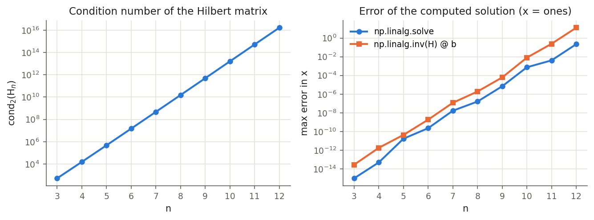

# Chapter 11 — Matrix Inverse and Condition Number

[Repository Guide](../../README.md) | [English](Concepts_Lecture.md) | [한국어](Concepts_Lecture.ko.md)

> **Last Updated:** 2026-11-19
>
> Applied Numerical Methods with Python for Engineers and Scientists, Chapra and Clough, Ch 11

> **Learning Objectives:**
> 1. Compute matrix inverses numerically
> 2. Calculate and interpret condition numbers
> 3. Assess solution sensitivity to input perturbations
> 4. Prove the properties of vector norms and induced matrix norms and compute matrix norms by hand
> 5. Derive the error bound of the condition number and explain the difference between the residual and the error

---

<br>

## Table of Contents

- [1. Matrix Inverse Definition](#1-matrix-inverse-definition)
- [2. Computing the Inverse via LU Decomposition](#2-computing-the-inverse-via-lu-decomposition)
  - [2.1 The Column-by-Column Method](#21-the-column-by-column-method)
  - [2.2 Example 11.1: 3x3 Inverse](#22-example-111-3x3-inverse)
  - [2.3 Computing the Remaining Two Columns](#23-computing-the-remaining-two-columns)
  - [2.4 Cost of Computing the Inverse and Why Not to Solve with It](#24-cost-of-computing-the-inverse-and-why-not-to-solve-with-it)
- [3. Physical Interpretation: Mass-Spring System](#3-physical-interpretation-mass-spring-system)
- [4. Error Analysis: Three Checks for Ill-Conditioning](#4-error-analysis-three-checks-for-ill-conditioning)
- [5. Vector Norms](#5-vector-norms)
- [6. Matrix Norms](#6-matrix-norms)
- [7. Matrix Condition Number](#7-matrix-condition-number)
- [8. Error Bound Theorem](#8-error-bound-theorem)
- [9. Precision Rule](#9-precision-rule)
- [10. Example 11.3: Hilbert Matrix](#10-example-113-hilbert-matrix)
- [11. Python Implementation](#11-python-implementation)
- [12. Common Mistakes](#12-common-mistakes)
- [Summary](#summary)
- [Self-Check Questions](#self-check-questions)

---

<br>

## 1. Matrix Inverse Definition

The inverse of a square matrix $`[A]`$ is defined as the unique matrix $`[A]^{-1}`$ satisfying:

```math
[A][A]^{-1} = [A]^{-1}[A] = [I]
```

where $`[I]`$ is the identity matrix. The inverse exists if and only if:

- $`[A]`$ is **square** ($`n \times n`$).
- $`[A]`$ is **non-singular**, that is, $`\det(A) \neq 0`$.

If $`[A]`$ is singular, that is, its determinant is zero, the matrix has no inverse. Geometrically, a singular matrix collapses space. It maps at least one non-zero vector to the zero vector, so the transformation cannot be reversed.

Given $`[A]\{x\} = \{b\}`$, the formal solution is:

```math
\{x\} = [A]^{-1}\{b\}
```

However, in practice, computing the inverse explicitly is rarely the best way to solve a linear system. The inverse is primarily useful for theoretical analysis and physical interpretation.

---

<br>

## 2. Computing the Inverse via LU Decomposition

### 2.1 The Column-by-Column Method

The inverse can be computed by solving $`n`$ linear systems, one for each column of the identity matrix:

```math
[A]\{x_k\} = \{e_k\}, \quad k = 1, 2, \ldots, n
```

where $`\{e_k\}`$ is the $`k`$th column of the identity matrix (all zeros except a 1 in position $`k`$). Each solution $`\{x_k\}`$ becomes the $`k`$th column of $`[A]^{-1}`$.

The key advantage of using LU decomposition for this task is that the decomposition $`[A] = [L][U]`$ is performed **only once**. After that, each of the $`n`$ right-hand sides requires only a forward substitution ($`[L]\{d\} = \{e_k\}`$) and a back substitution ($`[U]\{x_k\} = \{d\}`$), both of which are $`O(n^2)`$ operations. The total cost is therefore:

- **One** LU decomposition: $`O(n^3)`$
- **$`n`$** forward and back substitutions: $`n \times O(n^2) = O(n^3)`$
- **Total**: $`O(n^3)`$, the same order as a single Gauss elimination.

### 2.2 Example 11.1: 3x3 Inverse

Consider the matrix from the textbook:

```math
[A] = \begin{bmatrix} 3 & -0.1 & -0.2 \\ 0.1 & 7 & -0.3 \\ 0.3 & -0.2 & 10 \end{bmatrix}
```

Using the LU decomposition obtained in Chapter 10, we solve for each column of the inverse.

**Column 1**: Solve $`[L]\{d\} = \{1, 0, 0\}^T`$, then $`[U]\{x_1\} = \{d\}`$.

Forward substitution ($`[L]\{d\} = \{1, 0, 0\}^T`$):

```math
d_1 = 1, \quad d_2 = 0 - (0.033333)(1) = -0.033333, \quad d_3 = 0 - (0.1)(1) - (-0.02713)(-0.033333) = -0.1009
```

Back substitution ($`[U]\{x_1\} = \{d\}`$):

```math
x_3 = \frac{-0.1009}{10.012} = -0.010078, \quad x_2 = \frac{-0.033333 - (-0.29333)(-0.010078)}{7.00333} = -0.005182
```

```math
x_1 = \frac{1 - (-0.1)(-0.005182) - (-0.2)(-0.010078)}{3} = 0.3325
```

**Column 2**: Repeating the same procedure with $`\{e_2\} = \{0, 1, 0\}^T`$ yields the second column.

**Column 3**: Repeating the same procedure with $`\{e_3\} = \{0, 0, 1\}^T`$ yields the third column.

**Result:**

```math
[A]^{-1} = \begin{bmatrix} 0.3325 & 0.0049 & 0.0068 \\ -0.0052 & 0.1429 & 0.0042 \\ -0.0101 & 0.0027 & 0.0999 \end{bmatrix}
```

The result can be verified by checking that $`[A][A]^{-1} \approx [I]`$ within rounding error.

### 2.3 Computing the Remaining Two Columns

Columns 2 and 3 are computed with the same $`[L]`$ and $`[U]`$ as column 1. Because the right-hand side is a unit vector, the leading entries of forward substitution become zero without any computation.

**Column 2** ($`\{e_2\} = \{0, 1, 0\}^T`$): forward substitution gives $`d_1 = 0`$, $`d_2 = 1`$, and $`d_3 = 0 - (0.1)(0) - (-0.02713)(1) = 0.02713`$. Back substitution is as follows.

```math
x_3 = \frac{0.02713}{10.012} = 0.00271, \quad x_2 = \frac{1 - (-0.29333)(0.00271)}{7.00333} = 0.142903, \quad x_1 = \frac{0 - (-0.1)(0.142903) - (-0.2)(0.00271)}{3} = 0.004944
```

**Column 3** ($`\{e_3\} = \{0, 0, 1\}^T`$): forward substitution ends immediately with $`d = (0,\ 0,\ 1)`$. Back substitution is as follows.

```math
x_3 = \frac{1}{10.012} = 0.09988, \quad x_2 = \frac{0 - (-0.29333)(0.09988)}{7.00333} = 0.004183, \quad x_1 = \frac{0 - (-0.1)(0.004183) - (-0.2)(0.09988)}{3} = 0.006798
```

Collecting the three columns gives the $`[A]^{-1}`$ of Section 2.2. The diagonal entries $`0.3325`$, $`0.1429`$, and $`0.0999`$ are roughly $`1/3`$, $`1/7`$, and $`1/10`$ because $`[A]`$ is a diagonally dominant matrix with large diagonal entries, so its inverse is also close to the inverse of a diagonal matrix.

### 2.4 Cost of Computing the Inverse and Why Not to Solve with It

Chapter 10 showed that LU factorization costs about $`\frac{2}{3}n^3`$ operations and that forward plus back substitution for one right-hand side costs about $`2n^2`$. Solving the $`n`$ right-hand sides as they are would cost $`\frac{2}{3}n^3 + 2n^3 = \frac{8}{3}n^3`$, but exploiting the fact that the first $`k-1`$ entries of the unit vector $`\{e_k\}`$ are zero lets forward substitution start at row $`k`$, which reduces its total to about $`\frac{1}{3}n^3`$. Back substitution cannot be shortened and costs $`n \times n^2 = n^3`$. The cost of the whole inverse is therefore the following.

```math
\frac{2}{3}n^3 + \frac{1}{3}n^3 + n^3 = 2n^3
```

Computing the solution as $`\{x\} = [A]^{-1}\{b\}`$ adds a matrix-vector product of $`2n^2`$ operations to the $`2n^3`$ operations of the inverse. Solving directly by LU factorization costs $`\frac{2}{3}n^3 + 2n^2`$, so going through the inverse is about three times as expensive.

The accuracy is also worse. Every entry of the inverse carries roundoff error, and multiplying $`[A]^{-1}\{b\}`$ adds those errors again. In the Hilbert-matrix experiment of Section 10 (Table 4), solving the same system both ways gives a solution through the inverse whose error is larger than that of the direct LU solution for every $`n`$, by a factor of about 2.5 to 60. The inverse is computed only when its entries themselves carry meaning, as in Section 3.

---

<br>

## 3. Physical Interpretation: Mass-Spring System

The inverse provides direct physical insight when the system $`[A]\{x\} = \{b\}`$ has a physical meaning. The formal solution is:

```math
\{x\} = [A]^{-1}\{b\}
```

Each element $`a_{ij}^{-1}`$ of the inverse matrix has the interpretation:

```math
a_{ij}^{-1} = \text{contribution of force } b_j \text{ to displacement } x_i
```

In other words, $`a_{ij}^{-1}`$ tells us how much the $`j`$th input (force) affects the $`i`$th output (displacement). This is analogous to an **influence coefficient** or **transfer function** in engineering.

For a mass-spring system, reading the columns of $`[A]^{-1}`$ reveals how each individual force component propagates through the system. The $`j`$th column of the inverse shows the displacement pattern that results from a unit force applied at position $`j`$ and zero forces elsewhere.

> **Note:** **Flexibility matrix.** In structural engineering, the inverse of the stiffness matrix is called the **flexibility matrix** (or compliance matrix). Its entries directly measure how flexible the structure is: large values indicate that a small force produces a large displacement. This physical interpretation is one of the few situations where computing the full inverse is genuinely useful.

**Example.** In a system of three masses connected in a chain by springs, with the first spring fixed to a wall and every spring constant equal to $`k = 100\ \text{N/m}`$, the stiffness matrix and its inverse are as follows.

```math
[K] = k\begin{bmatrix} 2 & -1 & 0 \\ -1 & 2 & -1 \\ 0 & -1 & 1 \end{bmatrix}, \qquad [K]^{-1} = \frac{1}{k}\begin{bmatrix} 1 & 1 & 1 \\ 1 & 2 & 2 \\ 1 & 2 & 3 \end{bmatrix} = \begin{bmatrix} 0.01 & 0.01 & 0.01 \\ 0.01 & 0.02 & 0.02 \\ 0.01 & 0.02 & 0.03 \end{bmatrix}\ \text{m/N}
```

The entries of the inverse follow the simple rule $`(K^{-1})_{ij} = \min(i, j)/k`$. Column 3, $`(0.01,\ 0.02,\ 0.03)`$, means that a force of 1 N on the last mass moves the three masses by 1 cm, 2 cm, and 3 cm, and a force of 50 N gives the displacements $`50 \times (0.01,\ 0.02,\ 0.03) = (0.5,\ 1.0,\ 1.5)`$ m. Column 1, in contrast, is all 0.01, so pulling the first mass drags the outer masses along by 1 cm each. The symmetry of the inverse expresses the reciprocity relation that the effect of a force at $`j`$ on the displacement at $`i`$ equals the effect of a force at $`i`$ on the displacement at $`j`$.

**Stimulus-response example.** The textbook applies the reading of inverse-matrix entries as relations between stimuli (inputs) and responses (outputs) to mass balances of several spaces in which a pollutant mixes. The same idea is applied here to three interconnected mixed reactors. Let $`c_i`$ (g/m³) be the steady-state concentration in reactor $`i`$ and $`W_i`$ (g/h) the pollutant load entering from outside, and suppose that the mass balances, through the flows and exchanges between reactors, reduce to the following (coefficients in m³/h).

```math
\begin{bmatrix} 5 & -1 & 0 \\ -3 & 6 & -1 \\ 0 & -4 & 5 \end{bmatrix}\begin{Bmatrix} c_1 \\ c_2 \\ c_3 \end{Bmatrix} = \begin{Bmatrix} W_1 \\ W_2 \\ W_3 \end{Bmatrix} = \begin{Bmatrix} 100 \\ 50 \\ 20 \end{Bmatrix}
```

The determinant is 115 and the inverse is the following.

```math
[A]^{-1} = \frac{1}{115}\begin{bmatrix} 26 & 5 & 1 \\ 15 & 25 & 5 \\ 12 & 20 & 27 \end{bmatrix} = \begin{bmatrix} 0.2261 & 0.0435 & 0.0087 \\ 0.1304 & 0.2174 & 0.0435 \\ 0.1043 & 0.1739 & 0.2348 \end{bmatrix}\ \text{h/m}^3
```

The concentrations are $`\{c\} = [A]^{-1}\{W\} = (24.957,\ 24.783,\ 23.826)`$ g/m³. Multiplying column $`j`$ of the inverse by $`W_j`$ gives the share each load contributes to each concentration. For example, $`c_3 = 0.1043 \times 100 + 0.1739 \times 50 + 0.2348 \times 20 = 10.435 + 8.696 + 4.696`$, so the loads of reactors 1 and 2 contribute more to the concentration of reactor 3 than its own load does, because material starting in reactor 1 moves with the flow into reactors 2 and 3.

This interpretation applies directly to management problems. To lower $`c_3`$ from 23.826 to 15 g/m³, since $`\Delta c_3 = a_{3j}^{-1}\Delta W_j`$, reducing $`W_1`$ alone requires a reduction of $`8.826/0.1043 = 84.6`$ g/h. Reducing $`W_3`$ alone would require $`8.826/0.2348 = 37.6`$ g/h, which exceeds $`W_3 = 20`$ g/h, so even removing $`W_3`$ entirely (lowering $`c_3`$ by 4.696) cannot reach the target. Once computed, the inverse thus tells, without solving the system again, how much each output changes when a given input changes by a given amount.

---

<br>

## 4. Error Analysis: Three Checks for Ill-Conditioning

When solving a linear system numerically, it is important to determine whether the results can be trusted. A system is **ill-conditioned** when small changes in the input data (coefficients or right-hand side) produce disproportionately large changes in the solution. Three practical checks can detect ill-conditioning:

1. **Scale and inspect the inverse:** Normalize the matrix so that the element of largest absolute value in each row is 1, then compute the inverse. If any elements of the inverse are **much larger than 1**, the system is likely ill-conditioned.

2. **Check if $`[A]^{-1}[A] = [I]`$:** Compute the product of the matrix and its computed inverse. If the result deviates significantly from the identity matrix, the inverse is inaccurate, which signals ill-conditioning.

3. **Check if $`([A]^{-1})^{-1} = [A]`$:** Compute the inverse of the inverse. If this does not recover the original matrix to adequate precision, the system is ill-conditioned.

These checks are useful but qualitative. A quantitative measure of conditioning requires the **condition number**, and defining the condition number requires the concept of matrix norms.

**Applying the checks.** Applying the three checks to the Hilbert matrix of Section 10 gives the following. For $`3 \times 3`$, the largest absolute entry of the inverse of the row-scaled matrix is 96, nearly two orders of magnitude above 1, so the first check signals possible ill-conditioning. In double precision, however, the largest entry of $`H_3^{-1}H_3 - I`$ is only about $`1.6 \times 10^{-14}`$ and that of $`(H_3^{-1})^{-1} - H_3`$ is only about $`3.1 \times 10^{-15}`$, so the second and third checks reveal no problem. For $`10 \times 10`$, the largest entry of the scaled inverse is about $`5.0 \times 10^{11}`$, the largest entry of $`H_{10}^{-1}H_{10} - I`$ is about $`1.3 \times 10^{-3}`$, and that of $`(H_{10}^{-1})^{-1} - H_{10}`$ is about $`1.8 \times 10^{-6}`$, so all three checks warn. The second and third checks respond only when damage has already occurred at the working precision, so the first check or the condition number gives an earlier warning.

---

<br>

## 5. Vector Norms

A **norm** is a function that assigns a non-negative size, or length, to a vector. The general $`L_p`$ norm ($`p \geq 1`$) is defined as:

```math
\|x\|_p = \left(\sum_{i=1}^{n} |x_i|^p\right)^{1/p}
```

The three most commonly used norms are:

| Norm | Formula | Name |
|:-----|:--------|:-----|
| $`L_1`$ | $`\Vert x \Vert_1 = \sum_{i=1}^{n} \vert x_i \vert`$ | Manhattan (taxicab) norm |
| $`L_2`$ | $`\Vert x \Vert_2 = \sqrt{\sum_{i=1}^{n} x_i^2}`$ | Euclidean norm |
| $`L_\infty`$ | $`\Vert x \Vert_\infty = \max_{i} \vert x_i \vert`$ | Max (Chebyshev) norm |

*Table 1. Three commonly used vector norms*

**Example:** For $`x = [1, 2, 3]`$:

- $`\|x\|_1 = |1| + |2| + |3| = 6`$
- $`\|x\|_2 = \sqrt{1^2 + 2^2 + 3^2} = \sqrt{14} \approx 3.742`$
- $`\|x\|_\infty = \max(|1|, |2|, |3|) = 3`$

All norms satisfy four fundamental properties:

1. **Non-negativity:** $`\|x\| \geq 0`$
2. **Definiteness:** $`\|x\| = 0`$ if and only if $`x = 0`$.
3. **Homogeneity:** $`\|\alpha x\| = |\alpha| \cdot \|x\|`$
4. **Triangle inequality:** $`\|x + y\| \leq \|x\| + \|y\|`$

> **[Linear Algebra]** Norms generalize the concept of length to arbitrary vector spaces. All norms in finite dimensions are equivalent (same convergence), but they give different numerical values. The choice of norm therefore affects the value of the condition number.

Norms are also the tool for defining convergence. A sequence of vectors $`x_k`$ is said to converge to $`x`$ if $`\lim_{k \to \infty}\|x_k - x\| = 0`$. In finite dimensions, convergence in one norm implies convergence in every other norm, because the three norms satisfy the following inequalities.

```math
\|x\|_\infty \leq \|x\|_2 \leq \|x\|_1 \leq \sqrt{n}\,\|x\|_2 \leq n\,\|x\|_\infty
```

For $`x = [1, 2, 3]`$ this reads $`3 \leq 3.742 \leq 6 \leq 6.481 \leq 9`$. Hence, when the convergence of iterative methods is judged in Chapter 12, whether an iteration converges does not depend on the norm, and only the number of iterations needed to reach a given tolerance changes slightly.

---

<br>

## 6. Matrix Norms

Matrix norms extend the concept of vector norms to matrices. There are two main types:

**Element-based norm:**

- **Frobenius norm:** $`\|A\|_F = \sqrt{\sum_i \sum_j a_{ij}^2}`$. It treats the matrix as a long vector and takes its Euclidean norm.

**Induced (operator) norms:** They are defined as the maximum factor by which the matrix stretches a vector:

```math
\|A\|_a = \max_{\|x\|_a = 1} \|Ax\|_a
```

This measures the worst-case amplification: the largest factor by which $`A`$ can multiply the norm of any vector.

The induced norms corresponding to the common vector norms are:

| Matrix Norm | Formula | Computation |
|:------------|:--------|:------------|
| Column-sum ($`L_1`$) | $`\Vert A \Vert_1 = \max_j \sum_i \vert a_{ij} \vert`$ | Maximum absolute column sum |
| Spectral ($`L_2`$) | $`\Vert A \Vert_2 = \sqrt{\mu_{max}}`$ | $`\mu_{max}`$ = largest eigenvalue of $`A^T A`$ |
| Row-sum ($`L_\infty`$) | $`\Vert A \Vert_\infty = \max_i \sum_j \vert a_{ij} \vert`$ | Maximum absolute row sum |

*Table 2. Induced matrix norms corresponding to vector norms*

Matrix norms satisfy the same four properties as vector norms (non-negativity, definiteness, homogeneity, triangle inequality), and the induced norms and the Frobenius norm have an additional crucial property:

**Submultiplicativity:** $`\|AB\| \leq \|A\| \cdot \|B\|`$, and in particular $`\|Ax\| \leq \|A\| \cdot \|x\|`$ holds for induced norms.

This property is what makes matrix norms useful for bounding errors: it allows us to bound the norm of a product by the product of the norms.

> **[Linear Algebra]** The singular values of a matrix $`A`$ are the square roots of the eigenvalues of $`A^T A`$, and the singular value decomposition (SVD) writes $`A`$ as the product of an orthogonal matrix, a matrix with the singular values on its diagonal, and another orthogonal matrix. The spectral norm $`\sqrt{\mu_{max}}`$ in the table above therefore equals the largest singular value $`\sigma_{max}`$ of $`A`$, which is the maximum stretching the matrix can apply to a unit vector.

**Geometric meaning.** The set of vectors with $`\|x\|_a = 1`$ is the unit sphere of norm $`a`$ (a circle or sphere for $`L_2`$, a square or cube for $`L_\infty`$, and a diamond for $`L_1`$). The matrix $`A`$ maps each point $`x`$ of the unit sphere to $`Ax`$, so the image of the unit sphere is a distorted shape, and $`\|A\|_a`$ is the radius of the smallest sphere that encloses the whole image. For $`L_2`$ the image of the unit circle is an ellipse, and $`\|A\|_2`$ is the semi-major axis of that ellipse, that is, the largest singular value.

**Deriving the column-sum formula.** The reason why $`\|A\|_1`$ in Table 2 is the largest absolute column sum is as follows. For any $`x`$, the triangle inequality gives

```math
\|Ax\|_1 = \sum_i \Bigl|\sum_j a_{ij}x_j\Bigr| \leq \sum_j |x_j| \sum_i |a_{ij}| \leq \Bigl(\max_j \sum_i |a_{ij}|\Bigr)\|x\|_1
```

so $`\|A\|_1`$ does not exceed the largest column sum. Moreover, if column $`j^*`$ gives the largest column sum, then $`x = e_{j^*}`$ makes $`\|Ax\|_1`$ equal to that column sum, so equality holds. $`\|A\|_\infty`$ is handled in the same way, choosing the entries of $`x`$ as $`\pm 1`$ to obtain the largest row sum exactly.

**Proofs of the two inequalities.** For $`\|Ax\| \leq \|A\|\,\|x\|`$, both sides are zero if $`x = 0`$, and if $`x \neq 0`$, the definition $`\|A\| = \max_{y \neq 0}\|Ay\|/\|y\|`$ gives $`\|Ax\|/\|x\| \leq \|A\|`$. Using it twice gives $`\|ABx\| = \|A(Bx)\| \leq \|A\|\,\|Bx\| \leq \|A\|\,\|B\|\,\|x\|`$, and dividing both sides by $`\|x\|`$ and taking the maximum over $`x \neq 0`$ yields $`\|AB\| \leq \|A\|\,\|B\|`$.

**Worked example.** For $`A = \begin{bmatrix} 1 & -2 & 3 \\ 4 & 5 & -6 \\ -7 & 8 & 9 \end{bmatrix}`$, the absolute column sums are 12, 15, and 18, so $`\|A\|_1 = 18`$, and the absolute row sums are 6, 15, and 24, so $`\|A\|_\infty = 24`$. The Frobenius norm is $`\sqrt{1 + 4 + 9 + 16 + 25 + 36 + 49 + 64 + 81} = \sqrt{285} \approx 16.882`$. $`\|A\|_2`$ is hard to obtain by hand. Computing the eigenvalues of $`A^TA`$ and taking the square root of the largest gives $`\|A\|_2 \approx 14.428`$, which can be seen to satisfy $`\|A\|_2 \leq \|A\|_F`$.

---

<br>

## 7. Matrix Condition Number

The **condition number** of a matrix $`[A]`$ is defined as:

```math
\text{Cond}[A] = \|A\| \cdot \|A^{-1}\|
```

The condition number is also written $`\kappa(A)`$. Its value depends on which matrix norm is used (hence we may write $`\kappa_1`$, $`\kappa_2`$, $`\kappa_\infty`$ for different norms), but the qualitative interpretation is the same regardless of norm choice.

Key properties for induced norms:

- $`\text{Cond}[I] = 1`$. The identity matrix is perfectly conditioned (best possible).
- $`\text{Cond}[A] \geq 1`$ for any non-singular matrix.
- If $`\text{Cond}[A] \approx 1`$, the system is **well-conditioned**. Small perturbations in input produce proportionally small changes in output.
- If $`\text{Cond}[A] \gg 1`$, the system is **ill-conditioned**. Small perturbations in input may produce disproportionately large changes in output.
- If $`\text{Cond}[A] = \infty`$, the matrix is **singular** and has no inverse.

The condition number quantifies how close to singular a matrix is. A large condition number means the matrix is nearly singular: its rows (or columns) are nearly linearly dependent.

**Singular values and the condition number.** The 2-norm condition number has a simple expression in terms of singular values. $`\|A\|_2 = \sigma_{max}`$, and the singular values of $`A^{-1}`$ are the reciprocals of those of $`A`$, so $`\|A^{-1}\|_2 = 1/\sigma_{min}`$. Therefore the following holds.

```math
\kappa_2(A) = \frac{\sigma_{max}}{\sigma_{min}}
```

Geometrically, it is the ratio of the longest to the shortest semi-axis of the ellipse into which $`A`$ maps the unit circle. The flatter the ellipse, that is, the more nearly $`A`$ annihilates some direction, the larger the condition number. For a symmetric matrix the singular values equal the absolute values of the eigenvalues, so $`\kappa_2(A) = |\lambda|_{max}/|\lambda|_{min}`$. The matrix $`\begin{bmatrix} 1 & 1 \\ 1 & 1.0001 \end{bmatrix}`$ of Section 8 is symmetric with eigenvalues of about $`2.00005`$ and $`5.0 \times 10^{-5}`$, so $`\kappa_2 \approx 40002`$. The matrix of Section 2.2 has singular values of about 10.03, 6.98, and 3.01, so $`\kappa_2 \approx 3.34`$ only.

$`1/\kappa_2(A) = \sigma_{min}/\sigma_{max}`$ expresses, in relative terms, how far the matrix is from being singular. Adding to $`A`$ a perturbation of 2-norm $`\sigma_{min}`$ can make its smallest singular value zero, so the relative distance $`\min\|\delta A\|_2/\|A\|_2`$ from $`A`$ to the nearest singular matrix is $`1/\kappa_2(A)`$. A condition number of $`10^{4}`$ means that changing the coefficients by a relative amount of only $`10^{-4}`$ can make the matrix singular.

---

<br>

## 8. Error Bound Theorem

The condition number provides a rigorous bound on how errors in the coefficient matrix propagate to errors in the solution. If $`[A]`$ is perturbed by a small amount $`[\delta A]`$ and we solve $`(A + \delta A)(x + \delta x) = b`$, then for small perturbations:

```math
\frac{\|\delta x\|}{\|x\|} \leq \text{Cond}[A] \cdot \frac{\|\delta A\|}{\|A\|}
```

Strictly, the inequality holds exactly with $`\|x + \delta x\|`$ in the denominator of the left side, and for small perturbations the difference from $`\|x\|`$ is negligible. This states that the **relative error in the solution** is bounded by the condition number times the **relative error in the coefficients**.

The condition number acts as an **amplification factor**: it tells us the worst-case ratio by which relative errors in the input are magnified in the output. For a well-conditioned system ($`\text{Cond} \approx 1`$), errors are not amplified. For an ill-conditioned system ($`\text{Cond} \gg 1`$), even tiny perturbations in the coefficients can produce enormous changes in the solution.

Similarly, for perturbations in the right-hand side, $`A(x + \delta x) = b + \delta b`$:

```math
\frac{\|\delta x\|}{\|x\|} \leq \text{Cond}[A] \cdot \frac{\|\delta b\|}{\|b\|}
```

The bounds thus apply to perturbations in $`[A]`$ and in $`\{b\}`$ separately.

**Deriving the bound.** The case of an error in the right-hand side is derived first. The solution of $`Ax = b`$ is $`x = A^{-1}b`$, and if an error $`e`$ enters $`b`$, the solution becomes $`A^{-1}(b + e) = x + A^{-1}e`$, so the error in the solution is $`\delta x = A^{-1}e`$. Assuming that the relative error of the solution is proportional to the relative error of the right-hand side and calling the constant of proportionality $`K`$ gives the following.

```math
\frac{\|A^{-1}e\|}{\|A^{-1}b\|} = K\,\frac{\|e\|}{\|b\|} \quad\Longrightarrow\quad K = \frac{\|A^{-1}e\|}{\|e\|} \cdot \frac{\|b\|}{\|A^{-1}b\|} = \frac{\|A^{-1}e\|}{\|e\|} \cdot \frac{\|Ax\|}{\|x\|}
```

The last equality substitutes $`b = Ax`$ and $`A^{-1}b = x`$. To find the worst case, the maximum is taken by varying $`e`$ and $`x`$ independently. The two factors depend on different vectors, so the maximum splits.

```math
\max_{e \neq 0,\ x \neq 0} K = \max_{e \neq 0}\frac{\|A^{-1}e\|}{\|e\|} \cdot \max_{x \neq 0}\frac{\|Ax\|}{\|x\|} = \|A^{-1}\|\,\|A\| = \text{Cond}[A]
```

That is, the condition number arises naturally as the largest factor by which the relative error of the right-hand side is amplified into the relative error of the solution. A perturbation of the coefficient matrix is treated in the same way. Subtracting $`Ax = b`$ from $`(A + \delta A)(x + \delta x) = b`$ gives $`A\,\delta x = -\delta A\,(x + \delta x)`$, so $`\delta x = -A^{-1}\delta A\,(x + \delta x)`$, and taking norms gives $`\|\delta x\| \leq \|A^{-1}\|\,\|\delta A\|\,\|x + \delta x\|`$. Dividing both sides by $`\|x + \delta x\|`$ and using $`\|A^{-1}\| = \text{Cond}[A]/\|A\|`$ yields the theorem above.

**Numerical example.** For $`A = \begin{bmatrix} 1 & 1 \\ 1 & 1.0001 \end{bmatrix}`$ and $`b = (2,\ 2.0001)`$, the solution is $`x = (1,\ 1)`$. Since $`A^{-1} = \begin{bmatrix} 10001 & -10000 \\ -10000 & 10000 \end{bmatrix}`$, we have $`\|A\|_\infty = 2.0001`$, $`\|A^{-1}\|_\infty = 20001`$, and $`\text{Cond}_\infty[A] \approx 40004`$. Changing only the second entry of the right-hand side by 0.0001 to $`b + \delta b = (2,\ 2.0002)`$ makes the solution $`(0,\ 2)`$. Measuring the relative changes in the $`L_\infty`$ norm gives the following.

| Quantity | Value |
|:-----|-----:|
| Relative change of the right-hand side $`\Vert \delta b \Vert / \Vert b \Vert`$ | $`0.0001/2.0001 \approx 5.0 \times 10^{-5}`$ |
| Relative change of the solution $`\Vert \delta x \Vert / \Vert x \Vert`$ | $`1/1 = 1`$ |
| Error bound $`\text{Cond}_\infty[A] \cdot \Vert \delta b \Vert / \Vert b \Vert`$ | $`40004 \times 5.0 \times 10^{-5} \approx 2.0`$ |

*Table 3. Amplification of a right-hand-side perturbation in a nearly singular 2x2 system*

The relative change of the solution, 1, lies within the bound 2.0, and the change in the right-hand side was amplified by a factor of about 20000. The bound is only about twice the actual amplification, so in this example the condition number predicts the amplification quite accurately.

> **Definition:** The **residual** is the difference $`r = b - A\hat{x}`$ that remains when an approximate solution $`\hat{x}`$ is substituted into the original equation. The residual can be computed without knowing the true solution, but it is a different quantity from the error $`x - \hat{x}`$.

For the same system, the approximate solution $`\hat{x} = (2,\ 0)`$ has the very small residual $`r = (2 - 2,\ 2.0001 - 2) = (0,\ 0.0001)`$, yet its error $`x - \hat{x} = (-1,\ 1)`$ is as large as the solution itself. Since $`A(x - \hat{x}) = r`$, applying the right-hand-side theorem directly gives $`\|x - \hat{x}\|/\|x\| \leq \text{Cond}[A]\,\|r\|/\|b\|`$. A small residual therefore guarantees a small error only when the condition number is small.

---

<br>

## 9. Precision Rule

The error bound theorem leads to a practical rule for estimating how many significant digits of accuracy are lost due to ill-conditioning.

If the coefficients of $`[A]`$ are known to $`t`$ significant digits, then the solution $`\{x\}`$ is valid to approximately:

```math
t - \log_{10}(\text{Cond}[A]) \quad \text{significant digits}
```

**Example:** If $`\text{Cond}[A] = 10^3`$ and the coefficients are known to 7 significant digits (the level of single-precision rounding), then the solution is valid to approximately $`7 - 3 = 4`$ significant digits.

This rule provides an immediate practical warning: if $`\log_{10}(\text{Cond}[A]) \geq t`$, then the computed solution may have **no** reliable significant digits. In double precision ($`t \approx 16`$), a condition number of $`10^{16}`$ or larger means the solution is essentially meaningless.

> **Note:** This is a worst-case bound. The actual error may be much smaller, but you cannot guarantee it without further analysis. When in doubt, check the residual $`\|Ax - b\|`$ as a practical accuracy indicator. When the condition number is large, however, even a small residual does not guarantee a small error.

**Deriving the rule.** If the coefficients are accurate to $`t`$ significant digits, their relative error is roughly $`\|\delta A\|/\|A\| \approx 10^{-t}`$. Substituting into the bound of Section 8 gives the relative error of the solution.

```math
\frac{\|\delta x\|}{\|x\|} \leq \text{Cond}[A] \times 10^{-t} = 10^{\log_{10}\text{Cond}[A] - t}
```

A relative error of $`10^{-s}`$ corresponds to about $`s`$ significant digits, so the solution has $`s = t - \log_{10}\text{Cond}[A]`$ significant digits. In Table 4, for $`n = 9`$, the rule predicts $`16 - 11.7 = 4.3`$ remaining digits, and the actual error $`6.9 \times 10^{-6}`$ corresponds to about five digits of accuracy, close to the prediction.

---

<br>

## 10. Example 11.3: Hilbert Matrix

The **Hilbert matrix** is the canonical example of an ill-conditioned matrix. It is defined by:

```math
H_{ij} = \frac{1}{i + j - 1}
```

For $`n = 3`$:

```math
[H] = \begin{bmatrix} 1 & 1/2 & 1/3 \\ 1/2 & 1/3 & 1/4 \\ 1/3 & 1/4 & 1/5 \end{bmatrix}
```

**Computing the condition number using the row-sum norm ($`L_\infty`$):**

1. **Normalize** the matrix so the maximum element in each row is 1. Divide row 1 by 1, row 2 by 1/2, and row 3 by 1/3 to obtain the scaled matrix $`[A'] = \begin{bmatrix} 1 & 1/2 & 1/3 \\ 1 & 2/3 & 1/2 \\ 1 & 3/4 & 3/5 \end{bmatrix}`$.

2. **Compute $`\|A'\|_\infty`$:** Sum the absolute values of each row and take the maximum. The row sums are $`1.8333`$, $`2.1667`$, and $`2.35`$, so $`\|A'\|_\infty = 2.35`$.

3. **Compute the inverse** of the scaled matrix and find $`\|[A']^{-1}\|_\infty`$. The inverse is $`[A']^{-1} = \begin{bmatrix} 9 & -18 & 10 \\ -36 & 96 & -60 \\ 30 & -90 & 60 \end{bmatrix}`$, and its absolute row sums are $`37`$, $`192`$, and $`180`$. The maximum is row 2 with $`36 + 96 + 60 = 192`$, giving $`\|[A']^{-1}\|_\infty = 192`$.

4. **Condition number:** $`\text{Cond}[A'] = 2.35 \times 192 = 451.2`$

Since $`\text{Cond}[A'] = 451.2 \gg 1`$, the $`3 \times 3`$ Hilbert matrix is already poorly conditioned. This means solutions to systems involving this matrix will lose approximately $`\log_{10}(451) \approx 2.7`$ digits of accuracy.

The situation deteriorates rapidly with increasing size. For larger Hilbert matrices, the condition number grows approximately as $`\kappa(H_n) \sim e^{3.5n}`$, that is, in proportion to $`e^{3.5n}`$, making them practically unsolvable for $`n > 12`$ or so in double precision.

> **Note:** **Where Hilbert matrices arise.** Hilbert matrices arise naturally in polynomial least-squares fitting. If the normal equations of a continuous least-squares fit on the interval $`[0, 1]`$ are set up with the basis $`1, x, \ldots, x^{n-1}`$, the entries of the coefficient matrix are $`\int_0^1 x^{i-1} x^{j-1}\,dx = 1/(i + j - 1)`$, that is, $`H_{ij}`$.

**Growth of the condition number with size.** The following code computes the 2-norm condition number of the Hilbert matrix for $`n = 3`$ through 12, solves a system built so that the solution is $`x = (1, \ldots, 1)`$ both with `np.linalg.solve` and with `np.linalg.inv(H) @ b`, and compares the maximum errors of the solutions.

```python
import numpy as np
from scipy.linalg import hilbert

for n in range(3, 13):
    H = hilbert(n)                   # H[i, j] = 1/(i + j + 1), 0-based
    x_true = np.ones(n)
    b = H @ x_true
    es = np.abs(np.linalg.solve(H, b) - x_true).max()
    ei = np.abs(np.linalg.inv(H) @ b - x_true).max()
    print(f"{n:2d}  {np.linalg.cond(H):.3e}  {es:.2e}  {ei:.2e}")
```

```text
 3  5.241e+02  9.99e-16  2.84e-14
 4  1.551e+04  5.00e-14  1.82e-12
 5  4.766e+05  1.72e-11  4.37e-11
 6  1.495e+07  2.29e-10  1.86e-09
 7  4.754e+08  1.69e-08  1.19e-07
 8  1.526e+10  1.61e-07  1.91e-06
 9  4.932e+11  6.94e-06  6.10e-05
10  1.603e+13  7.44e-04  8.00e-03
11  5.218e+14  4.08e-03  2.43e-01
12  1.659e+16  2.20e-01  1.26e+01
```

| $`n`$ | $`\text{Cond}_2[H_n]`$ | $`\log_{10}\text{Cond}`$ | Remaining significant digits ($`16 - \log_{10}\text{Cond}`$) | Error (`solve`) | Error (`inv`) |
|-----:|-----:|-----:|-----:|-----:|-----:|
| 3 | $`5.2 \times 10^{2}`$ | 2.7 | 13.3 | $`1.0 \times 10^{-15}`$ | $`2.8 \times 10^{-14}`$ |
| 6 | $`1.5 \times 10^{7}`$ | 7.2 | 8.8 | $`2.3 \times 10^{-10}`$ | $`1.9 \times 10^{-9}`$ |
| 9 | $`4.9 \times 10^{11}`$ | 11.7 | 4.3 | $`6.9 \times 10^{-6}`$ | $`6.1 \times 10^{-5}`$ |
| 12 | $`1.7 \times 10^{16}`$ | 16.2 | 0 or fewer | $`2.2 \times 10^{-1}`$ | $`1.3 \times 10^{1}`$ |

*Table 4. Condition number, remaining significant digits, and solution error for the Hilbert matrix*



*Figure 1. Condition number of the Hilbert matrix and errors of the two solution methods versus size n*

The condition number grows by a factor of about 30 each time $`n`$ increases by one, close to the $`e^{3.5} \approx 33`$ mentioned above. The error grows roughly at the level of $`\text{Cond} \times 10^{-16}`$, so the precision rule of Section 9 holds well in practice. At $`n = 12`$ the condition number exceeds $`10^{16}`$, the reciprocal of double precision, no significant digits remain, and indeed the error of `solve` reaches 0.22 and the error through `inv` reaches 12.6. That the solution through `inv` is less accurate for every $`n`$ also agrees with Section 2.4.

---

<br>

## 11. Python Implementation

Python's NumPy provides built-in functions for computing matrix inverses, norms, and condition numbers:

```python
import numpy as np

# Matrix inverse
A_inv = np.linalg.inv(A)

# Condition number (2-norm by default)
kappa = np.linalg.cond(A)

# Condition number with specific norms
kappa_1   = np.linalg.cond(A, 1)       # 1-norm condition number
kappa_2   = np.linalg.cond(A, 2)       # 2-norm (default)
kappa_inf = np.linalg.cond(A, np.inf)  # infinity-norm condition number

# Norms
norm_1   = np.linalg.norm(A, ord=1)       # max abs column sum
norm_2   = np.linalg.norm(A, ord=2)       # spectral norm
norm_inf = np.linalg.norm(A, ord=np.inf)  # max abs row sum
norm_fro = np.linalg.norm(A, ord='fro')   # Frobenius norm
```

> **Note:** In practice, always use `np.linalg.solve(A, b)` instead of `np.linalg.inv(A) @ b` for solving linear systems. Direct solving is faster and more numerically accurate. The inverse should only be computed when the matrix entries themselves are needed (e.g., for physical interpretation or covariance analysis).

Applying the functions above to the matrix of Section 2.2 and to the $`3 \times 3`$ Hilbert matrix of Section 10 gives the following.

```python
import numpy as np
from scipy.linalg import hilbert

A = np.array([[3, -0.1, -0.2], [0.1, 7, -0.3], [0.3, -0.2, 10]])
print(np.round(np.linalg.inv(A), 4))
print(round(np.linalg.cond(A, np.inf), 4))

H = hilbert(3)
Hs = H / H.max(axis=1, keepdims=True)  # scale rows so that the largest entry is 1
print(round(np.linalg.cond(Hs, np.inf), 1), round(np.linalg.cond(H, np.inf), 1))
```

```text
[[ 0.3325  0.0049  0.0068]
 [-0.0052  0.1429  0.0042]
 [-0.0101  0.0027  0.0999]]
3.6144
451.2 748.0
```

The condition number of the first matrix, about 3.61, is small, so the matrix is well-conditioned. The row-sum-norm condition number 451.2 of the row-scaled Hilbert matrix agrees with the hand computation of Section 10. As its difference from the condition number 748.0 of the unscaled $`H_3`$ shows, the condition number depends on the scaling of the rows.

---

<br>

## 12. Common Mistakes

The following mistakes are common when working with inverses and condition numbers.

1. **Computing the solution through the inverse.** As shown in Section 2.4, $`x = A^{-1}b`$ is about three times as expensive as solving directly by LU factorization and less accurate.
2. **Judging conditioning by the size of the determinant.** Some matrices, such as $`0.1I`$, have a very small determinant and a condition number of 1. Conditioning is judged by the condition number.
3. **Mixing different norms.** The two norms in $`\text{Cond}[A] = \|A\|\,\|A^{-1}\|`$ must be of the same kind, and the vector norm used in the error bound must be the norm that induces that matrix norm.
4. **Swapping column sums and row sums.** $`\|A\|_1`$ is the largest absolute column sum and $`\|A\|_\infty`$ is the largest absolute row sum.
5. **Taking a small residual as evidence of an accurate solution.** As in the example of Section 8, an ill-conditioned system can have an error as large as the solution even with a residual of $`10^{-4}`$.
6. **Concluding that the algorithm is wrong because the condition number is large.** The condition number is a property of the problem itself. Stable algorithms such as pivoting only reduce the errors produced by the algorithm; they cannot remove the sensitivity of an ill-conditioned problem.

---

<br>

## Summary

| Concept | Key Summary |
|:------|:---------------------|
| Inverse definition | The inverse satisfies $`[A][A]^{-1} = [A]^{-1}[A] = [I]`$ and exists only for square non-singular matrices. |
| Inverse via LU | After factoring once, solving $`[A]\{x_k\} = \{e_k\}`$ for each column $`k`$ gives the inverse in $`O(n^3)`$. |
| Physical meaning of the inverse | $`a_{ij}^{-1}`$ measures how much the $`j`$th input affects the $`i`$th output. |
| $`L_1`$ norm | For vectors $`\Vert x \Vert_1 = \sum \vert x_i \vert`$, and the matrix norm $`\Vert A \Vert_1`$ is the maximum absolute column sum. |
| $`L_2`$ norm | For vectors $`\Vert x \Vert_2 = \sqrt{\sum x_i^2}`$, and the matrix norm $`\Vert A \Vert_2`$ is the largest singular value $`\sigma_{max}`$. |
| $`L_\infty`$ norm | For vectors $`\Vert x \Vert_\infty = \max \vert x_i \vert`$, and the matrix norm $`\Vert A \Vert_\infty`$ is the maximum absolute row sum. |
| Condition number | $`\kappa(A) = \Vert A \Vert \cdot \Vert A^{-1} \Vert`$ measures how close a matrix is to being singular. |
| Error bound | Since $`\Vert \delta x \Vert / \Vert x \Vert \leq \kappa(A) \cdot \Vert \delta A \Vert / \Vert A \Vert`$, the condition number is the amplification factor of relative errors. |
| Precision loss | If the coefficients are accurate to $`t`$ digits, the solution is valid to approximately $`t - \log_{10}\kappa`$ digits. |
| Hilbert matrix | It is defined by $`H_{ij} = 1/(i+j-1)`$, and its condition number grows exponentially with $`n`$. |
| Cost of the inverse | Exploiting the zeros of the unit vectors costs about $`2n^3`$ operations, and solving through the inverse is about three times as expensive as solving directly and less accurate. |
| Equivalence of norms | In finite dimensions $`\Vert x \Vert_\infty \leq \Vert x \Vert_2 \leq \Vert x \Vert_1 \leq n \Vert x \Vert_\infty`$, so convergence in one norm implies convergence in all norms. |
| Deriving the condition number | Maximizing the amplification factor of the relative error from $`\delta x = A^{-1}e`$ gives $`\Vert A^{-1} \Vert \, \Vert A \Vert`$. |
| Residual and error | Even when the residual $`r = b - A\hat{x}`$ is small, the relative error can be as large as $`\text{Cond}[A] \cdot \Vert r \Vert / \Vert b \Vert`$. |
| Stimulus and response | $`a_{ij}^{-1}`$ is the change in output $`i`$ per unit change of input $`j`$, so $`\Delta c_i = a_{ij}^{-1}\Delta W_j`$ gives the input change needed for a management target. |

---

<br>

## Self-Check Questions

1. **Vector norms:** Find the $`L_1`$, $`L_2`$, and $`L_\infty`$ norms of $`x = (3, -4, 12)`$.

   <details>
   <summary>Answer</summary>

   $`\|x\|_1 = 3 + 4 + 12 = 19`$, $`\|x\|_2 = \sqrt{9 + 16 + 144} = \sqrt{169} = 13`$, and $`\|x\|_\infty = \max(3, 4, 12) = 12`$.

   </details>

2. **Matrix norms and condition number:** For $`A = \begin{bmatrix} 4 & 2 \\ 1 & 3 \end{bmatrix}`$, find $`\|A\|_1`$, $`\|A\|_\infty`$, $`A^{-1}`$, and the row-sum condition number $`\kappa_\infty(A)`$.

   <details>
   <summary>Answer</summary>

   The column sums are $`5, 5`$, so $`\|A\|_1 = 5`$, and the row sums are $`6, 4`$, so $`\|A\|_\infty = 6`$. Since $`\det(A) = 12 - 2 = 10`$, $`A^{-1} = \frac{1}{10}\begin{bmatrix} 3 & -2 \\ -1 & 4 \end{bmatrix} = \begin{bmatrix} 0.3 & -0.2 \\ -0.1 & 0.4 \end{bmatrix}`$. The absolute row sums of $`A^{-1}`$ are $`0.5, 0.5`$, so $`\|A^{-1}\|_\infty = 0.5`$ and $`\kappa_\infty(A) = 6 \times 0.5 = 3`$.

   </details>

3. **Precision rule:** If coefficients stored in double precision ($`t \approx 16`$) have a condition number of $`10^{10}`$, to about how many digits is the solution valid? What about a $`3 \times 3`$ Hilbert system ($`\text{Cond} = 451.2`$) whose coefficients have 7 significant digits?

   <details>
   <summary>Answer</summary>

   The first case gives $`16 - \log_{10}(10^{10}) = 16 - 10 = 6`$ digits. In the second case, $`\log_{10}(451.2) \approx 2.65`$, so $`7 - 2.65 \approx 4.3`$, that is, about 4 digits.

   </details>

4. **Error bound:** In a system with $`\text{Cond}[A] = 1000`$, the relative error in the right-hand side is $`\|\delta b\| / \|b\| = 10^{-6}`$. What is the largest possible relative error in the solution?

   <details>
   <summary>Answer</summary>

   $`\|\delta x\| / \|x\| \leq \text{Cond}[A] \cdot \|\delta b\| / \|b\| = 1000 \times 10^{-6} = 10^{-3}`$. The relative error in the solution is therefore at most 0.1%.

   </details>

5. **Inverse via LU and its meaning:** State the operation orders of the factorization and the substitutions when computing the inverse of an $`n \times n`$ matrix with LU decomposition, and explain what the element $`a_{23}^{-1}`$ of the inverse means for a mass-spring system.

   <details>
   <summary>Answer</summary>

   The LU factorization is done only once at $`O(n^3)`$. Each of the $`n`$ columns of the identity matrix needs a forward and a back substitution at $`O(n^2)`$, so all substitutions together also cost $`n \times O(n^2) = O(n^3)`$, and the total cost is $`O(n^3)`$. $`a_{23}^{-1}`$ is the displacement of mass 2 caused by a unit force at position 3, that is, the contribution of force $`b_3`$ to displacement $`x_2`$.

   </details>

6. **Computing matrix norms:** Find $`\|A\|_1`$, $`\|A\|_\infty`$, $`\|A\|_F`$, and the $`L_1`$-norm condition number of $`A = \begin{bmatrix} 2 & 1 \\ 1 & 3 \end{bmatrix}`$.

   <details>
   <summary>Answer</summary>

   The column sums and row sums are both 3 and 4, so $`\|A\|_1 = \|A\|_\infty = 4`$. $`\|A\|_F = \sqrt{4 + 1 + 1 + 9} = \sqrt{15} \approx 3.873`$. Since $`\det A = 5`$, $`A^{-1} = \frac{1}{5}\begin{bmatrix} 3 & -1 \\ -1 & 2 \end{bmatrix}`$, whose absolute column sums are $`0.8`$ and $`0.6`$, so $`\|A^{-1}\|_1 = 0.8`$ and $`\kappa_1(A) = 4 \times 0.8 = 3.2`$.

   </details>

7. **Residual and error:** For the system with $`A = \begin{bmatrix} 1 & 1 \\ 1 & 1.0001 \end{bmatrix}`$ and $`b = (2,\ 2.0001)`$, find the residual and the error of the approximate solution $`\hat{x} = (1.5,\ 0.5)`$, and explain why the solution must not be judged by the residual alone.

   <details>
   <summary>Answer</summary>

   $`A\hat{x} = (2,\ 1.5 + 0.50005) = (2,\ 2.00005)`$, so the residual is $`r = (0,\ 0.00005)`$. The true solution is $`(1,\ 1)`$, so the error is $`(-0.5,\ 0.5)`$, or 50%. Since $`\text{Cond}_\infty[A] \approx 40004`$, the relative residual $`0.00005/2.0001 \approx 2.5 \times 10^{-5}`$ allows a relative error of up to $`40004 \times 2.5 \times 10^{-5} \approx 1.0`$. When the condition number is large, a small residual does not guarantee a small error.

   </details>

8. **Physical interpretation of the inverse:** In the three-mass system of Section 3 ($`k = 100\ \text{N/m}`$), find the displacement of each mass from the inverse when a force of 20 N acts on the second mass only.

   <details>
   <summary>Answer</summary>

   The displacements are column 2 of $`[K]^{-1}`$, $`(0.01,\ 0.02,\ 0.02)`$ m/N, times 20 N, that is, $`(0.2,\ 0.4,\ 0.4)`$ m. The third mass, which lies outside the second, moves the same distance as the second mass because the spring between them carries no force.

   </details>

9. **Stimulus and response:** In the three-reactor example of Section 3, how much does each concentration change when only the load $`W_2`$ of reactor 2 increases by 10 g/h?

   <details>
   <summary>Answer</summary>

   Multiplying column 2 of the inverse, $`(0.0435,\ 0.2174,\ 0.1739)`$, by 10 gives $`\Delta c = (0.435,\ 2.174,\ 1.739)`$ g/m³. The concentration of reactor 2 rises the most, reactor 3 downstream comes next, and reactor 1 upstream rises only slightly.

   </details>
