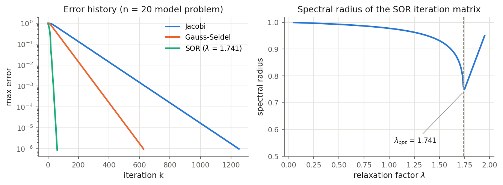

# Chapter 12 — Iterative Methods for Linear Systems

[Repository Guide](../../README.md) | [English](Concepts_Lecture.md) | [한국어](Concepts_Lecture.ko.md)

> **Last Updated:** 2026-11-19
>
> Applied Numerical Methods with Python for Engineers and Scientists, Chapra and Clough, Ch 12

> **Learning Objectives:**
> 1. Solve linear systems iteratively with the Gauss-Seidel and Jacobi methods
> 2. Assess diagonal dominance and explain its role as a convergence condition
> 3. Explain and apply how relaxation improves the convergence of iterative methods
> 4. Analyze the convergence of iterative methods through the preconditioner and the spectral radius of the iteration matrix
> 5. Show that diagonal dominance makes the norm of the iteration matrix less than 1 and compare convergence rates for different relaxation factors
> 6. Solve systems of nonlinear equations by successive substitution and the Newton-Raphson method

---

<br>

## Table of Contents

- [1. Introduction to Iterative Methods](#1-introduction-to-iterative-methods)
- [2. Gauss-Seidel Method](#2-gauss-seidel-method)
  - [2.1 Problem Setup](#21-problem-setup)
  - [2.2 Derivation for a 3x3 System](#22-derivation-for-a-3x3-system)
  - [2.3 Iteration Scheme with Superscripts](#23-iteration-scheme-with-superscripts)
  - [2.4 Convergence Criterion](#24-convergence-criterion)
  - [2.5 Example 12.1: Gauss-Seidel Iteration](#25-example-121-gauss-seidel-iteration)
- [3. Convergence and Diagonal Dominance](#3-convergence-and-diagonal-dominance)
  - [3.1 Diagonal Dominance Condition](#31-diagonal-dominance-condition)
  - [3.2 Example: 3x3 Diagonal Dominance Check](#32-example-3x3-diagonal-dominance-check)
  - [3.3 Sufficient vs. Necessary Condition](#33-sufficient-vs-necessary-condition)
  - [3.4 Why Diagonal Dominance Guarantees Convergence](#34-why-diagonal-dominance-guarantees-convergence)
- [4. Gauss-Seidel Method in Matrix Form](#4-gauss-seidel-method-in-matrix-form)
  - [4.1 Matrix Splitting: L, D, U Decomposition](#41-matrix-splitting-l-d-u-decomposition)
  - [4.2 Matrix Form of the Iteration](#42-matrix-form-of-the-iteration)
- [5. Jacobi Iteration](#5-jacobi-iteration)
  - [5.1 Comparison with Gauss-Seidel](#51-comparison-with-gauss-seidel)
  - [5.2 Component Form](#52-component-form)
  - [5.3 Matrix Form](#53-matrix-form)
  - [5.4 Jacobi Iteration Example](#54-jacobi-iteration-example)
- [6. Relaxation Method](#6-relaxation-method)
  - [6.1 Relaxation Formula](#61-relaxation-formula)
  - [6.2 Types of Relaxation](#62-types-of-relaxation)
  - [6.3 Relaxation Applied to 3x3 System](#63-relaxation-applied-to-3x3-system)
  - [6.4 Matrix Form of Relaxation (SOR)](#64-matrix-form-of-relaxation-sor)
  - [6.5 Example 12.2: Relaxation with lambda = 1.2](#65-example-122-relaxation-with-lambda--12)
  - [6.6 Relaxation Factor and Convergence Rate](#66-relaxation-factor-and-convergence-rate)
- [7. Preconditioning](#7-preconditioning)
  - [7.1 General Framework](#71-general-framework)
  - [7.2 Preconditioners for Each Method](#72-preconditioners-for-each-method)
  - [7.3 Error Analysis and Convergence](#73-error-analysis-and-convergence)
  - [7.4 Spectral Radius](#74-spectral-radius)
  - [7.5 Eigenvalue Relationship for I - A](#75-eigenvalue-relationship-for-i---a)
- [8. Python Implementations](#8-python-implementations)
  - [8.1 Gauss-Seidel Method](#81-gauss-seidel-method)
  - [8.2 Jacobi Method](#82-jacobi-method)
  - [8.3 Relaxation Method (SOR)](#83-relaxation-method-sor)
  - [8.4 Diagonal Dominance Check](#84-diagonal-dominance-check)
- [9. Systems of Nonlinear Equations](#9-systems-of-nonlinear-equations)
  - [9.1 Successive Substitution](#91-successive-substitution)
  - [9.2 Newton-Raphson Method](#92-newton-raphson-method)
  - [9.3 Newton-Raphson Example](#93-newton-raphson-example)
  - [9.4 scipy.optimize.root](#94-scipyoptimizeroot)
  - [9.5 Convergence Tests and Error Estimates](#95-convergence-tests-and-error-estimates)
- [10. Common Mistakes](#10-common-mistakes)
- [Summary](#summary)
- [Self-Check Questions](#self-check-questions)
- [References](#references)

---

<br>

## 1. Introduction to Iterative Methods

Iterative methods solve a linear system $`[A]\{x\} = \{b\}`$ by generating a sequence of approximations:

```math
\mathbf{x}^{k+1} := \Psi(\mathbf{x}^k), \quad k \geq 0
```

Starting from an initial guess $`\mathbf{x}^0`$, the method repeatedly applies a mapping $`\Psi`$ until convergence to the true solution. Unlike direct methods (Gauss elimination, LU decomposition) that produce an exact answer in a finite number of operations when roundoff error is ignored, iterative methods approach the solution gradually and can be stopped when the approximation is sufficiently accurate.

> **Note:** **Cost of direct and iterative methods.** Direct methods cost $`O(n^3)`$ and work well for small-to-moderate systems. For very large, sparse systems (common in engineering and scientific computing), iterative methods are often far more efficient because they only require work on the order of matrix-vector products and can exploit sparsity.

---

<br>

## 2. Gauss-Seidel Method

### 2.1 Problem Setup

Suppose we are given $`n`$ equations in the standard form:

```math
[A]_{n \times n} \{x\}_{n \times 1} = \{b\}_{n \times 1}
```

where $`[A]`$ is the coefficient matrix, $`\{x\}`$ is the unknown vector, and $`\{b\}`$ is the right-hand side vector.

### 2.2 Derivation for a 3x3 System

For simplicity, consider a $`3 \times 3`$ system:

```math
\begin{bmatrix} a_{11} & a_{12} & a_{13} \\ a_{21} & a_{22} & a_{23} \\ a_{31} & a_{32} & a_{33} \end{bmatrix} \begin{Bmatrix} x_1 \\ x_2 \\ x_3 \end{Bmatrix} = \begin{Bmatrix} b_1 \\ b_2 \\ b_3 \end{Bmatrix}
```

Expanding the rows:

```math
a_{11} x_1 = b_1 - a_{12} x_2 - a_{13} x_3
```

```math
a_{22} x_2 = b_2 - a_{21} x_1 - a_{23} x_3
```

```math
a_{33} x_3 = b_3 - a_{31} x_1 - a_{32} x_2
```

Solving each equation for the diagonal unknown:

```math
x_1 = \frac{b_1 - a_{12} x_2 - a_{13} x_3}{a_{11}}
```

```math
x_2 = \frac{b_2 - a_{21} x_1 - a_{23} x_3}{a_{22}}
```

```math
x_3 = \frac{b_3 - a_{31} x_1 - a_{32} x_2}{a_{33}}
```

### 2.3 Iteration Scheme with Superscripts

The Gauss-Seidel method introduces iteration indices. At iteration $`j`$, we compute:

```math
x_1^{j} = \frac{b_1 - a_{12} x_2^{j-1} - a_{13} x_3^{j-1}}{a_{11}}
```

```math
x_2^{j} = \frac{b_2 - a_{21} x_1^{j} - a_{23} x_3^{j-1}}{a_{22}}
```

```math
x_3^{j} = \frac{b_3 - a_{31} x_1^{j} - a_{32} x_2^{j}}{a_{33}}
```

The key feature of Gauss-Seidel is that it **uses the most recently computed values** as soon as they are available. When computing $`x_2^{j}`$, we already use $`x_1^{j}`$ (just computed in the current iteration), not $`x_1^{j-1}`$. Similarly, when computing $`x_3^{j}`$, we use both $`x_1^{j}`$ and $`x_2^{j}`$.

> **Note:** **Sequential update.** This property of using newly computed values within the same iteration is what distinguishes Gauss-Seidel from the Jacobi method. It typically results in faster convergence because new information is incorporated immediately, but it also means the computation is inherently sequential: $`x_2^j`$ cannot be computed until $`x_1^j`$ is known.

### 2.4 Convergence Criterion

We repeat the procedure until our solution converges to the true solution. The **approximate relative error** for each variable is:

```math
\varepsilon_{a,i} = \left| \frac{x_i^{j} - x_i^{j-1}}{x_i^{j}} \right| \times 100\%
```

The iteration stops when $`\varepsilon_{a,i} \leq \varepsilon_s`$ for **all** variables, where $`\varepsilon_s`$ is the user-specified tolerance.

### 2.5 Example 12.1: Gauss-Seidel Iteration

**Given system:**

```math
3x_1 - 0.1x_2 - 0.2x_3 = 7.85
```

```math
0.1x_1 + 7x_2 - 0.3x_3 = -19.3
```

```math
0.3x_1 - 0.2x_2 + 10x_3 = 71.4
```

**Step 1 (rearrangement):** Solve each equation for its unknown on the diagonal.

```math
x_1 = \frac{7.85 + 0.1x_2 + 0.2x_3}{3}
```

```math
x_2 = \frac{-19.3 - 0.1x_1 + 0.3x_3}{7}
```

```math
x_3 = \frac{71.4 - 0.3x_1 + 0.2x_2}{10}
```

**Step 2 (first iteration):** With the initial guess $`\{x\}^0 = \{0, 0, 0\}`$, compute the values for $`j = 1`$.

```math
x_1^1 = \frac{7.85 + 0.1(0) + 0.2(0)}{3} = 2.616667
```

```math
x_2^1 = \frac{-19.3 - 0.1(2.616667) + 0.3(0)}{7} = -2.794524
```

```math
x_3^1 = \frac{71.4 - 0.3(2.616667) + 0.2(-2.794524)}{10} = 7.005610
```

Note how $`x_1^1`$ was used immediately when computing $`x_2^1`$, and both $`x_1^1`$ and $`x_2^1`$ were used when computing $`x_3^1`$.

**Step 3 (second iteration):** Compute the values for $`j = 2`$.

```math
x_1^2 = \frac{7.85 + 0.1(-2.794524) + 0.2(7.005610)}{3} = 2.990557
```

```math
x_2^2 = \frac{-19.3 - 0.1(2.990557) + 0.3(7.005610)}{7} = -2.499625
```

```math
x_3^2 = \frac{71.4 - 0.3(2.990557) + 0.2(-2.499625)}{10} = 7.000291
```

**Step 4 (relative errors):** Compute the relative errors for iteration 2.

```math
\varepsilon_{a,1}^2 = \left| \frac{2.990557 - 2.616667}{2.990557} \right| \times 100\% = 12.5\%
```

The relative errors of $`x_2`$ and $`x_3`$ are $`11.8\%`$ and $`0.0760\%`$, respectively.

We repeat this procedure until **all** relative errors are smaller than $`\varepsilon_s`$, the user-specified tolerance. The third iteration gives $`x_1 = 3.000032`$, $`x_2 = -2.499988`$, $`x_3 = 6.999999`$, and the true solution is $`x_1 = 3`$, $`x_2 = -2.5`$, $`x_3 = 7`$.

---

<br>

## 3. Convergence and Diagonal Dominance

### 3.1 Diagonal Dominance Condition

The Gauss-Seidel method **may diverge** for some systems. However, if the system is **diagonally dominant**, it will **definitely converge**.

A matrix is diagonally dominant if, for every row $`i`$:

```math
|a_{ii}| > \sum_{\substack{j=1 \\ j \neq i}}^{n} |a_{ij}|
```

In words: the absolute value of each diagonal element is **strictly greater than** the sum of the absolute values of all other elements in that row. This condition is also called strict diagonal dominance, and in this chapter diagonal dominance means this strict condition.

### 3.2 Example: 3x3 Diagonal Dominance Check

For a $`3 \times 3`$ system:

```math
\begin{bmatrix} a_{11} & a_{12} & a_{13} \\ a_{21} & a_{22} & a_{23} \\ a_{31} & a_{32} & a_{33} \end{bmatrix} \begin{Bmatrix} x_1 \\ x_2 \\ x_3 \end{Bmatrix} = \begin{Bmatrix} b_1 \\ b_2 \\ b_3 \end{Bmatrix}
```

The three conditions to verify are:

```math
|a_{11}| > |a_{12}| + |a_{13}|
```

```math
|a_{22}| > |a_{21}| + |a_{23}|
```

```math
|a_{33}| > |a_{31}| + |a_{32}|
```

For Example 12.1: $`|3| > |-0.1| + |-0.2|`$, $`|7| > |0.1| + |-0.3|`$, $`|10| > |0.3| + |-0.2|`$. All conditions hold, so convergence is guaranteed.

### 3.3 Sufficient vs. Necessary Condition

Diagonal dominance is a **sufficient condition** but **not a necessary condition** for convergence.

- If the matrix is diagonally dominant, convergence is guaranteed.
- If the matrix is **not** diagonally dominant, the method **may still converge** (it is just not guaranteed).
- The Gauss-Seidel method also converges for **symmetric positive definite** matrices.

> **Note:** **Achieving diagonal dominance by swapping rows.** If the system is not diagonally dominant in its original form, it may be possible to swap rows (pivot) to achieve diagonal dominance. This is the strategy used in Example 12.2 (Section 6.5).

### 3.4 Why Diagonal Dominance Guarantees Convergence

The iteration matrix of the Jacobi method, $`M_J = -\tilde{D}^{-1}(\tilde{L} + \tilde{U})`$ (Sections 4 and 7), has zero diagonal entries and off-diagonal entries $`(M_J)_{ij} = -a_{ij}/a_{ii}`$. The absolute sum of row $`i`$ is therefore the following.

```math
\sum_{j \neq i}\left|\frac{a_{ij}}{a_{ii}}\right| = \frac{\sum_{j \neq i}|a_{ij}|}{|a_{ii}|}
```

If the coefficient matrix is strictly diagonally dominant, this value is below 1 in every row, so in the row-sum norm (Chapter 11) $`\|M_J\|_\infty < 1`$. On the other hand, no eigenvalue can exceed any induced norm: if $`M\mathbf{v} = \mu\mathbf{v}`$, then $`|\mu|\,\|\mathbf{v}\| = \|M\mathbf{v}\| \leq \|M\|\,\|\mathbf{v}\|`$. Hence $`\rho(M_J) \leq \|M_J\|_\infty < 1`$, and by the condition of Section 7.4 the Jacobi method converges from any initial guess. The inequality also gives the quantitative guarantee that the error shrinks by at least the factor $`\|M_J\|_\infty`$ in each iteration, that is, $`\|\mathbf{e}^{k+1}\|_\infty \leq \|M_J\|_\infty\,\|\mathbf{e}^k\|_\infty`$.

For the matrix of Example 12.1 the rows give $`0.3/3 = 0.1`$, $`0.4/7 \approx 0.057`$, and $`0.5/10 = 0.05`$, so $`\|M_J\|_\infty = 0.1`$. The error shrinks to at most one tenth per iteration, and the actual spectral radius, $`\rho(M_J) \approx 0.048`$, is even smaller than this bound.

A similar argument holds for the Gauss-Seidel method. Writing the relative sizes of the entries before and after the diagonal in row $`i`$ as $`\alpha_i = \sum_{j<i}|a_{ij}|/|a_{ii}|`$ and $`\beta_i = \sum_{j>i}|a_{ij}|/|a_{ii}|`$, the leading components use new values, so $`|e_i^{k+1}| \leq \alpha_i\|\mathbf{e}^{k+1}\|_\infty + \beta_i\|\mathbf{e}^k\|_\infty`$. Rearranging this inequality in the row where the largest error component occurs gives $`\|\mathbf{e}^{k+1}\|_\infty \leq \max_i \frac{\beta_i}{1 - \alpha_i}\,\|\mathbf{e}^k\|_\infty`$. With strict diagonal dominance $`\alpha_i + \beta_i < 1`$, so $`\beta_i/(1 - \alpha_i) < 1`$, and the Gauss-Seidel method converges as well. In Example 12.1 this value is 0.1, 0.0435, and 0 for the three rows, so the bound is 0.1, while the actual $`\rho(M_{GS}) \approx 0.0065`$.

The results so far can be summarized with their conditions as follows. The textbook also presents diagonal dominance as a sufficient condition for the convergence of the Gauss-Seidel method.

**Theorem.** If the coefficient matrix $`A`$ is strictly row diagonally dominant, that is, $`|a_{ii}| > \sum_{j \neq i}|a_{ij}|`$ for every $`i`$, then the Jacobi and Gauss-Seidel methods converge to the unique solution of $`A\mathbf{x} = \mathbf{b}`$ from any initial guess. Moreover, if $`A`$ is symmetric positive definite, the Gauss-Seidel method converges even without diagonal dominance.

Three conditions in this theorem need attention. First, the inequality must hold strictly in every row (weak diagonal dominance with equality in some rows, as in the matrix of Section 6.6, does not guarantee convergence without further conditions). Second, the condition is sufficient, so matrices that do not satisfy the theorem can still converge, as in Section 3.3. Third, the symmetric positive definite condition concerns the Gauss-Seidel method; under the same condition the Jacobi method may fail to converge. The theorem also contains the facts that a strictly diagonally dominant matrix has nonzero diagonal entries, so the divisions in the iteration are always defined, and that it is nonsingular, so the solution is unique.

---

<br>

## 4. Gauss-Seidel Method in Matrix Form

### 4.1 Matrix Splitting: L, D, U Decomposition

The coefficient matrix $`[A]`$ can be decomposed as:

```math
[A] = \tilde{L} + \tilde{D} + \tilde{U}
```

where:

- $`\tilde{L}`$ is the **strictly lower triangular** part of $`[A]`$ (below diagonal, zeros on and above diagonal).
- $`\tilde{D}`$ is the **diagonal** matrix of $`[A]`$ (diagonal elements only).
- $`\tilde{U}`$ is the **strictly upper triangular** part of $`[A]`$ (above diagonal, zeros on and below diagonal).

For the $`3 \times 3`$ case:

```math
\tilde{L} = \begin{bmatrix} 0 & 0 & 0 \\ a_{21} & 0 & 0 \\ a_{31} & a_{32} & 0 \end{bmatrix}, \quad \tilde{D} = \begin{bmatrix} a_{11} & 0 & 0 \\ 0 & a_{22} & 0 \\ 0 & 0 & a_{33} \end{bmatrix}, \quad \tilde{U} = \begin{bmatrix} 0 & a_{12} & a_{13} \\ 0 & 0 & a_{23} \\ 0 & 0 & 0 \end{bmatrix}
```

> **Note:** **Difference from the LU factorization.** This $`\tilde{L} + \tilde{D} + \tilde{U}`$ splitting is different from the LU factorization in Chapter 10. Here, $`\tilde{L}`$, $`\tilde{D}`$, $`\tilde{U}`$ are simply the parts of the original matrix $`A`$, and no elimination is performed. The notation uses tildes to distinguish them from the LU factors.

### 4.2 Matrix Form of the Iteration

Rearranging the Gauss-Seidel equations into matrix form:

```math
[\tilde{L} + \tilde{D}]\{x\}^{j} = \{b\} - [\tilde{U}]\{x\}^{j-1}
```

Let $`\tilde{L}_* = \tilde{L} + \tilde{D}`$ (the lower triangular part of $`A`$ including the diagonal). The matrix-vector form is:

```math
\{x\}^{j} = (\tilde{L}_*)^{-1}\left(\{b\} - [\tilde{U}]\{x\}^{j-1}\right)
```

The left-hand side involves a **lower triangular** system, which can be solved efficiently by **forward substitution**, so no explicit matrix inversion is needed.

---

<br>

## 5. Jacobi Iteration

### 5.1 Comparison with Gauss-Seidel

The **Jacobi iteration** is similar to the Gauss-Seidel method, except all variables in the $`j`$th iteration are updated using **only** the $`(j-1)`$th iteration values. No newly computed values are used within the same iteration.

| Feature | Gauss-Seidel | Jacobi |
|---|---|---|
| Update strategy | Uses latest values immediately | Uses only previous iteration values |
| Parallelism | Sequential (depends on update order) | **Naturally parallel** (all updates independent) |
| Convergence speed | Generally faster | Generally slower |
| Storage | One copy of solution vector | Two copies needed (old and new) |

*Table 1. Comparison of the Gauss-Seidel and Jacobi methods*

The Jacobi method also converges to the true solution if $`[A]`$ is diagonally dominant.

### 5.2 Component Form

For a $`3 \times 3`$ system, the Jacobi iteration computes:

```math
x_1^{j} = \frac{b_1 - a_{12} x_2^{j-1} - a_{13} x_3^{j-1}}{a_{11}}
```

```math
x_2^{j} = \frac{b_2 - a_{21} x_1^{j-1} - a_{23} x_3^{j-1}}{a_{22}}
```

```math
x_3^{j} = \frac{b_3 - a_{31} x_1^{j-1} - a_{32} x_2^{j-1}}{a_{33}}
```

Note that **all** right-hand side values use the superscript $`j-1`$. This means each $`x_i^j`$ can be computed **independently**, which is why the Jacobi method is well suited to parallel computation.

### 5.3 Matrix Form

```math
[\tilde{D}]\{x\}^{j} = \{b\} - [\tilde{L} + \tilde{U}]\{x\}^{j-1}
```

```math
\{x\}^{j} = [\tilde{D}]^{-1}\left(\{b\} - [\tilde{L} + \tilde{U}]\{x\}^{j-1}\right)
```

Since $`\tilde{D}`$ is diagonal, its inverse is obtained directly from the reciprocals of the diagonal elements: $`[\tilde{D}]^{-1}_{ii} = 1/a_{ii}`$.

### 5.4 Jacobi Iteration Example

The system of Example 12.1 is solved by the Jacobi method from the same initial guess $`\{x\}^0 = \{0, 0, 0\}`$. In the first iteration all previous values are zero, so $`x_1^1 = 7.85/3 = 2.616667`$, $`x_2^1 = -19.3/7 = -2.757143`$, and $`x_3^1 = 71.4/10 = 7.14`$. Unlike the Gauss-Seidel method, $`x_2^1`$ does not use $`x_1^1`$, so $`x_2^1`$ is not $`-2.794524`$. The second iteration uses only the values of the first iteration.

```math
x_1^2 = \frac{7.85 + 0.1(-2.757143) + 0.2(7.14)}{3} = 3.000762, \quad x_2^2 = \frac{-19.3 - 0.1(2.616667) + 0.3(7.14)}{7} = -2.488524
```

```math
x_3^2 = \frac{71.4 - 0.3(2.616667) + 0.2(-2.757143)}{10} = 7.006357
```

Continuing the iteration and comparing the maximum error from the true solution $`(3,\ -2.5,\ 7)`$ with that of the Gauss-Seidel method gives the following.

| $`k`$ | Jacobi $`x_1^k`$ | Jacobi $`x_2^k`$ | Jacobi $`x_3^k`$ | Jacobi maximum error | Gauss-Seidel maximum error |
|-----:|-----:|-----:|-----:|-----:|-----:|
| 1 | 2.616667 | -2.757143 | 7.140000 | $`3.83 \times 10^{-1}`$ | $`3.83 \times 10^{-1}`$ |
| 2 | 3.000762 | -2.488524 | 7.006357 | $`1.15 \times 10^{-2}`$ | $`9.44 \times 10^{-3}`$ |
| 3 | 3.000806 | -2.499738 | 7.000207 | $`8.06 \times 10^{-4}`$ | $`3.19 \times 10^{-5}`$ |
| 4 | 3.000022 | -2.500003 | 6.999981 | $`2.25 \times 10^{-5}`$ | $`3.52 \times 10^{-7}`$ |
| 5 | 2.999999 | -2.500001 | 6.999999 | $`1.35 \times 10^{-6}`$ | - |
| 6 | 3.000000 | -2.500000 | 7.000000 | $`8.63 \times 10^{-8}`$ | - |

*Table 2. Jacobi iterates for Example 12.1 and maximum errors of the two methods*

The error of the Jacobi method shrinks roughly by the factor $`\rho(M_J) \approx 0.048`$ per iteration, and that of the Gauss-Seidel method by $`\rho(M_{GS}) \approx 0.0065`$. The number of correct digits gained per iteration is $`-\log_{10}\rho`$, about 1.3 and 2.2 digits respectively, so the Gauss-Seidel method needs only about 60% as many iterations for the same accuracy. In return, the computations within one Jacobi iteration are independent of one another and can be processed in parallel.

---

<br>

## 6. Relaxation Method

### 6.1 Relaxation Formula

Relaxation is a slight modification of the Gauss-Seidel method designed to **enhance convergence**. The idea is to combine the old value and the newly calculated Gauss-Seidel value using a weighting factor:

```math
x_i^{\text{new}} = \lambda \, x_i^{\text{new(GS)}} + (1 - \lambda) \, x_i^{\text{old}}
```

where $`\lambda`$ is a weighting factor assigned a value between $`0`$ and $`2`$, and $`x_i^{\text{new(GS)}}`$ is the value that the standard Gauss-Seidel method would produce.

### 6.2 Types of Relaxation

| $`\lambda`$ Range | Name | Effect |
|---|---|---|
| $`\lambda = 1`$ | No modification | Standard Gauss-Seidel method |
| $`0 < \lambda < 1`$ | **Under-relaxation** | Dampens oscillations; may help non-convergent systems |
| $`1 < \lambda < 2`$ | **Over-relaxation** (SOR) | Accelerates convergence when Gauss-Seidel is slow |

*Table 3. Types of relaxation by the range of the relaxation factor*

> **Note:** **Optimal relaxation factor.** The optimal value of $`\lambda`$ depends on the specific problem and is generally not known in advance. For the SOR (Successive Over-Relaxation) method, theoretical results exist for special matrix structures (e.g., tridiagonal systems), but in practice $`\lambda`$ is often determined experimentally. If $`\lambda`$ lies outside $`0 < \lambda < 2`$, the SOR iteration does not converge.

### 6.3 Relaxation Applied to 3x3 System

For a $`3 \times 3`$ system, the relaxation update is:

```math
x_1^{\text{new}} = \frac{b_1 - a_{12} x_2^{\text{old}} - a_{13} x_3^{\text{old}}}{a_{11}} \cdot \lambda + (1 - \lambda) \, x_1^{\text{old}}
```

```math
x_2^{\text{new}} = \frac{b_2 - a_{21} x_1^{\text{new}} - a_{23} x_3^{\text{old}}}{a_{22}} \cdot \lambda + (1 - \lambda) \, x_2^{\text{old}}
```

```math
x_3^{\text{new}} = \frac{b_3 - a_{31} x_1^{\text{new}} - a_{32} x_2^{\text{new}}}{a_{33}} \cdot \lambda + (1 - \lambda) \, x_3^{\text{old}}
```

Notice the Gauss-Seidel pattern is preserved: $`x_1^{\text{new}}`$ is used in the computation of $`x_2^{\text{new}}`$, and both are used for $`x_3^{\text{new}}`$.

### 6.4 Matrix Form of Relaxation (SOR)

Expanding the component form and collecting terms, the relaxation method in matrix form is:

```math
[\tilde{D} + \lambda \tilde{L}]\{x\}^{\text{new}} = \lambda\{b\} - \left(\lambda[\tilde{U}] + (\lambda - 1)[\tilde{D}]\right)\{x\}^{\text{old}}
```

**Derivation outline:**

Starting from the component form and multiplying both sides by $`a_{ii}`$:

```math
a_{ii} x_i^{\text{new}} = \left(b_i - \sum_{k<i} a_{ik} x_k^{\text{new}} - \sum_{k>i} a_{ik} x_k^{\text{old}}\right) \lambda + (1-\lambda) \, a_{ii} \, x_i^{\text{old}}
```

Expanding and rearranging yields:

```math
a_{ii} x_i^{\text{new}} = \lambda b_i - \lambda \sum_{k>i} a_{ik} x_k^{\text{old}} + (1-\lambda) a_{ii} x_i^{\text{old}} - \lambda \sum_{k<i} a_{ik} x_k^{\text{new}}
```

Moving the terms with superscript new to the left and those with old to the right and collecting them in matrix notation gives the final matrix form.

### 6.5 Example 12.2: Relaxation with lambda = 1.2

**Given:** $`\lambda = 1.2`$, $`\varepsilon_s = 10\%`$

**Original system:**

```math
-3x_1 + 12x_2 = 9
```

```math
10x_1 - 2x_2 = 8
```

**Step 1 (swap rows):** Swap the two rows to obtain diagonal dominance.

```math
10x_1 - 2x_2 = 8
```

```math
-3x_1 + 12x_2 = 9
```

After swapping, $`|10| > |-2|`$ and $`|12| > |-3|`$, so the system is now diagonally dominant.

Solving each equation for its unknown on the diagonal:

```math
x_1^{j} = \frac{8 + 2x_2^{j-1}}{10}, \quad x_2^{j} = \frac{9 + 3x_1^{j}}{12}
```

**Iteration 1** (initial guess $`x_1^0 = 0`$, $`x_2^0 = 0`$):

Gauss-Seidel step:

```math
x_1^1 = \frac{8 + 2(0)}{10} = 0.8
```

Apply relaxation:

```math
x_1^{\text{new}} = \lambda \cdot x_1^1 + (1-\lambda) \cdot x_1^0 = 1.2(0.8) + (-0.2)(0) = 0.96
```

Gauss-Seidel step (using relaxed $`x_1^{\text{new}} = 0.96`$):

```math
x_2^1 = \frac{9 + 3(0.96)}{12} = 0.99
```

Apply relaxation:

```math
x_2^{\text{new}} = 1.2(0.99) + (-0.2)(0) = 1.188
```

**Iteration 2** (using the relaxed values from iteration 1, $`x_1 = 0.96`$, $`x_2 = 1.188`$):

Gauss-Seidel step:

```math
x_1^2 = \frac{8 + 2(1.188)}{10} = 1.0376
```

Apply relaxation:

```math
x_1^{\text{new}} = 1.2(1.0376) + (-0.2)(0.96) = 1.05312
```

Gauss-Seidel step:

```math
x_2^2 = \frac{9 + 3(1.05312)}{12} = 1.01328
```

Apply relaxation:

```math
x_2^{\text{new}} = 1.2(1.01328) + (-0.2)(1.188) = 0.978336
```

Relative errors:

```math
\varepsilon_{a,1} = \left|\frac{1.05312 - 0.96}{1.05312}\right| \times 100\% = 8.84\%
```

```math
\varepsilon_{a,2} = \left|\frac{0.978336 - 1.188}{0.978336}\right| \times 100\% = 21.43\%
```

Since $`\varepsilon_{a,2} > \varepsilon_s = 10\%`$, we continue iterating.

**Iteration 3** (values after relaxation):

```math
x_1^3 = 0.984177, \quad \varepsilon_{a,1} = 7.01\%
```

```math
x_2^3 = 0.999586, \quad \varepsilon_{a,2} = 2.13\%
```

Both errors are below $`10\%`$, so the iteration stops. The true solution is $`x_1 = 1`$, $`x_2 = 1`$.

### 6.6 Relaxation Factor and Convergence Rate

The effect of the relaxation factor on the convergence rate shows clearly in a larger problem. The coefficient matrix is the $`20 \times 20`$ tridiagonal matrix with diagonal entries 2 and super- and sub-diagonal entries $`-1`$ (Chapter 9), $`b`$ is chosen so that the solution is all ones, and the iteration starts from zero and stops when the maximum error falls below $`10^{-6}`$. This matrix is only weakly diagonally dominant, its diagonal entry equaling the sum of the off-diagonal entries, so the iterations converge but slowly.

| Method | Spectral radius $`\rho(M)`$ | Iterations |
|:-----|-----:|-----:|
| Jacobi | 0.9888 | 1252 |
| Gauss-Seidel ($`\lambda = 1`$) | 0.9778 | 627 |
| SOR, $`\lambda = 1.2`$ | 0.9666 | 416 |
| SOR, $`\lambda = 1.5`$ | 0.9317 | 201 |
| SOR, $`\lambda = 1.7`$ | 0.8479 | 90 |
| SOR, $`\lambda = 1.7406`$ (optimal) | 0.7406 | 61 |
| SOR, $`\lambda = 1.9`$ | 0.9000 | 127 |

*Table 4. Spectral radius and number of iterations versus relaxation factor for the 20x20 tridiagonal problem*



*Figure 1. Error history for the 20x20 tridiagonal problem and spectral radius of the SOR iteration matrix versus relaxation factor*

The number of iterations needed to reduce the error by a factor of $`10^{-6}`$ is $`k \approx \log(10^{-6})/\log\rho`$, so the closer $`\rho`$ is to 1, the more sharply the count grows. For the Jacobi method with $`\rho = 0.9888`$ the prediction is $`6/0.00488 \approx 1230`$ iterations, and for optimal SOR with $`\rho = 0.7406`$ it is $`6/0.130 \approx 46`$; the actual counts (1252 and 61) are somewhat larger because of the size of the initial error and transient behavior in the early iterations. The spectral radius of the Gauss-Seidel method is the square of that of the Jacobi method ($`0.9888^2 = 0.9778`$), so its iteration count is almost exactly half.

On the right of Figure 1, $`\rho(M)`$ decreases slowly as $`\lambda`$ grows, reaches a sharp minimum near the optimal value, and then rises along the straight line $`\rho = \lambda - 1`$ (0.9 at $`\lambda = 1.9`$). Choosing slightly below the optimum slows convergence greatly, while choosing slightly above slows it less, so when the exact optimum is unknown it is safer to overestimate slightly.

> **Note:** **Optimal relaxation factor for tridiagonal matrices.** For matrices with a block tridiagonal structure like this example (consistently ordered matrices), there is a classical result that the optimal relaxation factor can be computed in advance from the spectral radius $`\rho_J`$ of the Jacobi method. Its value is $`\lambda_{opt} = 2/\bigl(1 + \sqrt{1 - \rho_J^2}\bigr)`$, and then $`\rho(M) = \lambda_{opt} - 1`$. Substituting this example's $`\rho_J = \cos(\pi/21) \approx 0.98883`$ gives $`\lambda_{opt} \approx 1.7406`$ and $`\rho \approx 0.7406`$, in agreement with Table 4. General matrices have no such formula, and the factor is chosen experimentally as in the note of Section 6.2.

---

<br>

## 7. Preconditioning

### 7.1 General Framework

The three iterative methods (Gauss-Seidel, Jacobi, Relaxation) are all **traditional iteration methods** to solve a linear system $`A\mathbf{x} = \mathbf{b}`$, labeled as equation (1).

We introduce a **preconditioner** $`P`$, which is an approximation to $`A`$. Adding $`P\mathbf{x}`$ to both sides of $`A\mathbf{x} = \mathbf{b}`$ and rearranging:

```math
P\mathbf{x} + A\mathbf{x} = P\mathbf{x} + \mathbf{b}
```

```math
P\mathbf{x} = (P - A)\mathbf{x} + \mathbf{b} \quad \cdots (2)
```

Iteratively updating the solution $`\mathbf{x}^{k+1}`$:

```math
P\mathbf{x}^{k+1} = (P - A)\mathbf{x}^k + \mathbf{b} \quad \cdots (3)
```

The goal is that equation (3) is **easier to solve** than equation (1), because $`P`$ is chosen to be a matrix whose system is cheap to solve (e.g., triangular or diagonal).

### 7.2 Preconditioners for Each Method

Each iterative method corresponds to a specific choice of preconditioner $`P`$:

| Method | Preconditioner $`P`$ | $`P - A`$ |
|---|---|---|
| **Gauss-Seidel** | $`P = \tilde{L} + \tilde{D}`$ | $`P - A = -\tilde{U}`$ |
| **Jacobi** | $`P = \tilde{D}`$ | $`P - A = -\tilde{L} - \tilde{U}`$ |
| **Relaxation (SOR)** | $`P = \frac{1}{\lambda}(\tilde{D} + \lambda\tilde{L})`$ | $`P - A = \frac{1-\lambda}{\lambda}\tilde{D} - \tilde{U}`$ |

*Table 5. Preconditioner and P - A for each iterative method*

The factor $`1/\lambda`$ in the relaxation preconditioner ensures that multiplying both sides of $`P\mathbf{x}^{k+1} = (P - A)\mathbf{x}^k + \mathbf{b}`$ by $`\lambda`$ gives exactly the matrix form of Section 6.4.

The resulting iteration equations:

- **Gauss-Seidel:** $`[\tilde{L} + \tilde{D}]\{x\}^j = \{b\} - [\tilde{U}]\{x\}^{j-1}`$
- **Jacobi:** $`[\tilde{D}]\{x\}^j = \{b\} - [\tilde{L} + \tilde{U}]\{x\}^{j-1}`$
- **Relaxation:** $`[\tilde{D} + \lambda\tilde{L}]\{x\}^{\text{new}} = \lambda\{b\} - (\lambda[\tilde{U}] + (\lambda-1)[\tilde{D}])\{x\}^{\text{old}}`$

### 7.3 Error Analysis and Convergence

Define the error at iteration $`k`$ as:

```math
\mathbf{e}^k = \mathbf{x} - \mathbf{x}^k
```

where $`\mathbf{x}`$ is the true solution. Subtracting equation (3) from equation (2):

```math
P(\mathbf{x} - \mathbf{x}^{k+1}) = (P - A)(\mathbf{x} - \mathbf{x}^k)
```

```math
P\mathbf{e}^{k+1} = (P - A)\mathbf{e}^k
```

```math
\mathbf{e}^{k+1} = (I - P^{-1}A)\mathbf{e}^k
```

Define the **iteration matrix**:

```math
M = I - P^{-1}A
```

Then each step multiplies the error vector by $`M`$:

```math
\mathbf{e}^{k+1} = M\mathbf{e}^k
```

The convergence is governed by the **eigenvalues of $`M`$**. For convergence from every initial guess, every eigenvalue of $`M`$ must satisfy $`|\lambda(M)| < 1`$.

### 7.4 Spectral Radius

The largest absolute value among the eigenvalues of $`M`$ is called the **spectral radius**:

```math
\rho(M) = \max(|\lambda(M)|)
```

**Necessary and sufficient condition for convergence:**

```math
\rho(M) < 1
```

When the error vector happens to be an eigenvector of $`M`$, the error at the next step becomes:

```math
\mathbf{e}^{k+1} = M\mathbf{e}^k = \lambda \mathbf{e}^k
```

```math
\Rightarrow \mathbf{e}^k = \lambda^k \mathbf{e}^0
```

So the error decays geometrically as $`\lambda^k`$. The smaller $`\rho(M)`$, the faster the convergence.

> **[Linear Algebra]** If the iteration matrix $`M`$ is diagonalizable, its eigenvectors $`\mathbf{v}_1, \ldots, \mathbf{v}_n`$ form a basis, so any initial error can be expanded as $`\mathbf{e}^0 = \sum_i c_i \mathbf{v}_i`$, which gives $`\mathbf{e}^k = \sum_i c_i \lambda_i^k \mathbf{v}_i`$. Each component of the error therefore shrinks by a power of its own eigenvalue, and $`\rho(M)`$, the factor by which the slowest-decaying component shrinks per iteration, determines the overall rate of convergence.

> **Note:** **Diagonal dominance and the spectral radius.** This is the fundamental reason why diagonal dominance ensures convergence. For a diagonally dominant matrix, the iteration matrix $`M`$ of both Gauss-Seidel and Jacobi methods has spectral radius less than 1. The choice of $`\lambda`$ in SOR aims to minimize $`\rho(M)`$.

### 7.5 Eigenvalue Relationship for I - A

If no preconditioner is used ($`P = I`$), then $`M = I - A`$.

**Theorem:** If $`[A]`$ has eigenvalues $`\lambda_1, \lambda_2, \ldots, \lambda_n`$, then $`[I - A]`$ has eigenvalues $`1 - \lambda_1, 1 - \lambda_2, \ldots, 1 - \lambda_n`$.

**Proof:**

Given $`A\mathbf{v} = \lambda\mathbf{v}`$ where $`\mathbf{v}`$ is an eigenvector:

```math
(I - A)\mathbf{v} = \mathbf{v} - A\mathbf{v} = \mathbf{v} - \lambda\mathbf{v} = (1 - \lambda)\mathbf{v}
```

Therefore $`(1 - \lambda)`$ is an eigenvalue of $`[I - A]`$ with the same eigenvector $`\mathbf{v}`$.

**Consequence:** Without preconditioning, all eigenvalues of $`A`$ must be inside a unit circle centered at $`1`$ in the complex plane for the iteration to converge.

---

<br>

## 8. Python Implementations

### 8.1 Gauss-Seidel Method

Each iteration updates `x[i]` in place, so newly computed values are used within the same iteration. The tolerance `tol` is in percent; applying the function to Example 12.1 with `tol=0.1` gives the solution $`[3.00000035, -2.50000004, 6.99999999]`$ after 4 iterations.

```python
import numpy as np

def gauss_seidel(A, b, x0=None, tol=1e-6, max_iter=100):
    """Gauss-Seidel iterative method for solving Ax = b."""
    n = len(b)
    x = np.zeros(n) if x0 is None else np.array(x0, dtype=float)

    for iteration in range(1, max_iter + 1):
        x_old = x.copy()

        for i in range(n):
            sigma = sum(A[i][j] * x[j] for j in range(n) if j != i)
            x[i] = (b[i] - sigma) / A[i][i]

        # Check convergence (max approximate relative error)
        errors = [abs((x[i] - x_old[i]) / x[i]) * 100
                  for i in range(n) if x[i] != 0]
        if max(errors) < tol:
            return x, iteration

    return x, max_iter


# Example 12.1
A = np.array([[3, -0.1, -0.2],
              [0.1, 7, -0.3],
              [0.3, -0.2, 10]], dtype=float)
b = np.array([7.85, -19.3, 71.4], dtype=float)

x, iters = gauss_seidel(A, b, tol=0.1)
print(f"Solution: {x}")
print(f"Iterations: {iters}")
```

### 8.2 Jacobi Method

The new values are collected in a separate array `x_new` and replaced all at once after the sweep, so every update uses only the values of the previous iteration.

```python
def jacobi(A, b, x0=None, tol=1e-6, max_iter=100):
    """Jacobi iterative method for solving Ax = b."""
    n = len(b)
    x = np.zeros(n) if x0 is None else np.array(x0, dtype=float)

    for iteration in range(1, max_iter + 1):
        x_new = np.zeros(n)

        for i in range(n):
            sigma = sum(A[i][j] * x[j] for j in range(n) if j != i)
            x_new[i] = (b[i] - sigma) / A[i][i]

        # Check convergence
        errors = [abs((x_new[i] - x[i]) / x_new[i]) * 100
                  for i in range(n) if x_new[i] != 0]
        if max(errors) < tol:
            return x_new, iteration

        x = x_new

    return x, max_iter
```

### 8.3 Relaxation Method (SOR)

For each element, the Gauss-Seidel value `x_gs` is computed and then averaged with the old value `x_old[i]` using the weight. Applying the function to Example 12.2 with `lam=1.2` and `tol=10` gives $`[0.98417664, 0.99958579]`$ after 3 iterations, matching the hand calculation in Section 6.5.

```python
def sor(A, b, lam=1.2, x0=None, tol=1e-6, max_iter=100):
    """Successive Over-Relaxation (SOR) method for solving Ax = b."""
    n = len(b)
    x = np.zeros(n) if x0 is None else np.array(x0, dtype=float)

    for iteration in range(1, max_iter + 1):
        x_old = x.copy()

        for i in range(n):
            sigma = sum(A[i][j] * x[j] for j in range(n) if j != i)
            x_gs = (b[i] - sigma) / A[i][i]          # Gauss-Seidel value
            x[i] = lam * x_gs + (1 - lam) * x_old[i]  # Relaxation

        # Check convergence
        errors = [abs((x[i] - x_old[i]) / x[i]) * 100
                  for i in range(n) if x[i] != 0]
        if max(errors) < tol:
            return x, iteration

    return x, max_iter


# Example 12.2
A2 = np.array([[10, -2],
               [-3, 12]], dtype=float)
b2 = np.array([8, 9], dtype=float)

x2, iters2 = sor(A2, b2, lam=1.2, tol=10)
print(f"Solution: {x2}")
print(f"Iterations: {iters2}")
```

### 8.4 Diagonal Dominance Check

The function checks whether, in every row, the absolute value of the diagonal element is strictly greater than the sum of the absolute values of the other elements, and it prints `True` for the matrix of Example 12.1.

```python
def is_diagonally_dominant(A):
    """Check if a matrix is strictly diagonally dominant."""
    n = len(A)
    for i in range(n):
        diag = abs(A[i][i])
        off_diag_sum = sum(abs(A[i][j]) for j in range(n) if j != i)
        if diag <= off_diag_sum:
            return False
    return True


# Check Example 12.1
print(is_diagonally_dominant(A))   # True
```

---

<br>

## 9. Systems of Nonlinear Equations

The idea of iteration carries over directly to systems of nonlinear equations. The $`n`$ equations $`f_1(\mathbf{x}) = 0, \ldots, f_n(\mathbf{x}) = 0`$ in $`n`$ unknowns are written in vector form as $`\mathbf{f}(\mathbf{x}) = \mathbf{0}`$. Unlike linear systems, there is no direct method that obtains the solution in one pass, so iterative methods are the only general approach. This section uses the following system as an example.

```math
f_1(x, y) = 10x - y^2 - 2 = 0, \qquad f_2(x, y) = 10y - x^2 - 3 = 0
```

The two curves meet near the origin at $`(0.209265,\ 0.304379)`$ and far away at $`(9.726429,\ 9.760343)`$.

### 9.1 Successive Substitution

**Successive substitution** solves each equation for one unknown to obtain the form $`x = g_1(x, y)`$, $`y = g_2(x, y)`$ and then iterates, using new values immediately as in the Gauss-Seidel method. It extends the fixed-point iteration of Chapter 6 to systems. In the example, $`f_1`$ is solved for $`x`$ and $`f_2`$ for $`y`$.

```math
x^{k+1} = \frac{(y^k)^2 + 2}{10}, \qquad y^{k+1} = \frac{(x^{k+1})^2 + 3}{10}
```

Starting from $`(0, 0)`$ gives $`x^1 = 0.2`$ and $`y^1 = (0.04 + 3)/10 = 0.304`$, and continuing gives the following.

| $`k`$ | $`x^k`$ | $`y^k`$ | Maximum error |
|-----:|-----:|-----:|-----:|
| 1 | 0.20000000 | 0.30400000 | $`9.26 \times 10^{-3}`$ |
| 2 | 0.20924160 | 0.30437820 | $`2.31 \times 10^{-5}`$ |
| 3 | 0.20926461 | 0.30437917 | $`5.88 \times 10^{-8}`$ |
| 4 | 0.20926467 | 0.30437917 | $`1.50 \times 10^{-10}`$ |

*Table 6. Successive-substitution iterates and maximum errors*

The error shrinks by a roughly constant factor of about 1/400 per iteration, which is first-order convergence. Whether the iteration converges depends on how the equations are rearranged. Convergence is guaranteed if the following conditions hold near the solution.

```math
\left|\frac{\partial g_1}{\partial x}\right| + \left|\frac{\partial g_1}{\partial y}\right| < 1, \qquad \left|\frac{\partial g_2}{\partial x}\right| + \left|\frac{\partial g_2}{\partial y}\right| < 1
```

These conditions say that the row-sum norm of the Jacobian matrix of $`\mathbf{g}`$ is below 1, the same structure as $`\|M_J\|_\infty < 1`$ in Section 3.4. With the example's rearrangement, $`\partial g_1/\partial y = y/5 \approx 0.061`$ and $`\partial g_2/\partial x = x/5 \approx 0.042`$, and the other partial derivatives are zero, so the conditions hold comfortably. If instead the equations are rearranged as $`y = \sqrt{10x - 2}`$ and $`x = \sqrt{10y - 3}`$, the partial derivatives at the solution become about 16.4 and 23.9 and the conditions fail. Indeed, even starting from $`(0.210265,\ 0.304379)`$, which moves $`x`$ by only 0.001 from the solution, the iterates move away as $`(0.4516,\ 0.3204)`$, $`(3.586,\ 1.586)`$, $`(7.429,\ 5.819)`$.

### 9.2 Newton-Raphson Method

The Newton-Raphson method approximates each $`f_i`$ by its first-order Taylor expansion at the current point $`\mathbf{x}^k`$ and takes the point where that approximation vanishes as the next point. For two unknowns, with $`\Delta x = x^{k+1} - x^k`$ and $`\Delta y = y^{k+1} - y^k`$:

```math
f_i(x^{k+1}, y^{k+1}) \approx f_i(x^k, y^k) + \frac{\partial f_i}{\partial x}\Delta x + \frac{\partial f_i}{\partial y}\Delta y = 0, \qquad i = 1, 2
```

Calling the matrix of partial derivatives the **Jacobian matrix** $`J`$, the two equations become a single linear system.

```math
J(\mathbf{x}^k)\,\Delta\mathbf{x} = -\mathbf{f}(\mathbf{x}^k), \qquad J = \begin{bmatrix} \partial f_1/\partial x & \partial f_1/\partial y \\ \partial f_2/\partial x & \partial f_2/\partial y \end{bmatrix}, \qquad \mathbf{x}^{k+1} = \mathbf{x}^k + \Delta\mathbf{x}
```

That is, the Newton-Raphson method turns the nonlinear problem into one linear system per iteration, which is solved with the methods of Chapters 9 and 10. For $`2 \times 2`$, Cramer's rule gives the following.

```math
\Delta x = \frac{-f_1\,\dfrac{\partial f_2}{\partial y} + f_2\,\dfrac{\partial f_1}{\partial y}}{\det J}, \qquad \Delta y = \frac{-f_2\,\dfrac{\partial f_1}{\partial x} + f_1\,\dfrac{\partial f_2}{\partial x}}{\det J}
```

If $`J`$ is nonsingular at the solution and the initial guess is close enough, the convergence is quadratic, with the error roughly squared in each iteration. If $`\det J`$ is close to zero, however, $`\Delta\mathbf{x}`$ becomes very large and the iteration jumps away, and if the initial guess is far away the iteration can diverge or converge to a different solution. With $`n`$ unknowns there is also the cost of computing $`n^2`$ partial derivatives and solving an $`O(n^3)`$ linear system in every iteration.

### 9.3 Newton-Raphson Example

The Jacobian matrix of the example system is $`J = \begin{bmatrix} 10 & -2y \\ -2x & 10 \end{bmatrix}`$. The iteration starts from $`(0, 0)`$.

**First iteration.** $`\mathbf{f}(0, 0) = (-2,\ -3)`$ and $`J = 10I`$, so $`\Delta\mathbf{x} = (0.2,\ 0.3)`$ and $`\mathbf{x}^1 = (0.2,\ 0.3)`$.

**Second iteration.** $`\mathbf{f}(0.2, 0.3) = (2 - 0.09 - 2,\ 3 - 0.04 - 3) = (-0.09,\ -0.04)`$, $`J = \begin{bmatrix} 10 & -0.6 \\ -0.4 & 10 \end{bmatrix}`$, and $`\det J = 100 - 0.24 = 99.76`$. The Cramer formulas give the following.

```math
\Delta x = \frac{0.09 \times 10 + (-0.04)(-0.6)}{99.76} = 0.0092622, \qquad \Delta y = \frac{0.04 \times 10 + (-0.09)(-0.4)}{99.76} = 0.0043705
```

Therefore $`\mathbf{x}^2 = (0.2092622,\ 0.3043705)`$. Continuing the iteration gives the following.

| $`k`$ | $`x^k`$ | $`y^k`$ | Maximum error |
|-----:|-----:|-----:|-----:|
| 1 | 0.2000000000 | 0.3000000000 | $`9.26 \times 10^{-3}`$ |
| 2 | 0.2092622294 | 0.3043704892 | $`8.68 \times 10^{-6}`$ |
| 3 | 0.2092646679 | 0.3043791701 | $`7.59 \times 10^{-12}`$ |
| 4 | 0.2092646679 | 0.3043791701 | $`1.60 \times 10^{-17}`$ |

*Table 7. Newton-Raphson iterates and maximum errors*

The error goes $`9.3 \times 10^{-3} \to 8.7 \times 10^{-6} \to 7.6 \times 10^{-12}`$, roughly squared each time (the exponent doubles), and three iterations reach nearly double-precision accuracy. Successive substitution from the same starting point (Table 6) increases the exponent by only about 2.6 per iteration. Successive substitution is fast in this example because its partial derivatives are small, but in general the quadratic convergence of the Newton-Raphson method wins by a wide margin in the number of iterations.

### 9.4 scipy.optimize.root

SciPy's `scipy.optimize.root` is a general-purpose function for systems of nonlinear equations. Its default method `'hybr'` uses a modification of the Powell hybrid method as implemented in MINPACK; if a function computing the Jacobian matrix is passed as `jac`, it is used, and otherwise the Jacobian is estimated numerically [1].

```python
import numpy as np
from scipy.optimize import root

def f(v):
    x, y = v
    return [10 * x - y**2 - 2, 10 * y - x**2 - 3]

def jac(v):
    x, y = v
    return [[10, -2 * y], [-2 * x, 10]]

sol = root(f, [0, 0], jac=jac)
print(sol.success, sol.x)
print(root(f, [10, 10], jac=jac).x)
```

```text
True [0.20926467 0.30437917]
[9.72642943 9.76034294]
```

In the returned object, `x` is the solution and `success` tells whether the method converged [1]. As the second call shows, a different initial guess gives a different solution, so for systems of nonlinear equations it is important to choose an initial guess near the desired solution from a graph or from the physical meaning of the problem.

### 9.5 Convergence Tests and Error Estimates

Iterations for systems of nonlinear equations must stop without knowing the true solution, so the test uses two computable quantities. One is the size of the correction $`\|\Delta\mathbf{x}^{(k)}\|`$ (or the componentwise relative change, as in Section 2.4), and the other is the residual of the equations $`\|\mathbf{f}(\mathbf{x}^{(k)})\|`$. For the Newton-Raphson iteration of Section 9.3, the two quantities compare with the actual error as follows ($`L_\infty`$ norm).

| $`k`$ | $`\Vert\mathbf{f}(\mathbf{x}^{(k-1)})\Vert`$ | $`\Vert\Delta\mathbf{x}^{(k)}\Vert`$ | $`\Vert\mathbf{f}(\mathbf{x}^{(k)})\Vert`$ | Actual error $`\Vert\mathbf{x}^{(k)} - \mathbf{x}^*\Vert`$ |
|-----:|-----:|-----:|-----:|-----:|
| 1 | $`3.00 \times 10^{0}`$ | $`3.00 \times 10^{-1}`$ | $`9.00 \times 10^{-2}`$ | $`9.26 \times 10^{-3}`$ |
| 2 | $`9.00 \times 10^{-2}`$ | $`9.26 \times 10^{-3}`$ | $`8.58 \times 10^{-5}`$ | $`8.68 \times 10^{-6}`$ |
| 3 | $`8.58 \times 10^{-5}`$ | $`8.68 \times 10^{-6}`$ | $`7.54 \times 10^{-11}`$ | $`7.59 \times 10^{-12}`$ |
| 4 | $`7.54 \times 10^{-11}`$ | $`7.59 \times 10^{-12}`$ | $`2.22 \times 10^{-16}`$ | $`1.60 \times 10^{-17}`$ |

*Table 8. Corrections, residuals, and actual errors of the Newton-Raphson iteration*

The $`k`$th correction is almost equal to the actual error of the previous iterate $`\mathbf{x}^{(k-1)}`$ (for example, $`\Vert\Delta\mathbf{x}^{(2)}\Vert = 9.26 \times 10^{-3}`$ equals the error of $`\mathbf{x}^{(1)}`$). With quadratic convergence the error of the new iterate is much smaller than the correction, so the correction is a conservative estimate that reports the error of the point just discarded. Stopping when $`\Vert\Delta\mathbf{x}^{(k)}\Vert \leq \varepsilon_s`$ therefore usually leaves an actual error far below it. The residual alone must not be used as the test, for the same reason seen in Chapter 11: if the Jacobian matrix is ill-conditioned, the error can be large even when the residual is small, so in practice both criteria are used together with an upper limit on the number of iterations.

---

<br>

## 10. Common Mistakes

The following mistakes are common when using iterative methods.

1. **Starting the iteration without checking diagonal dominance.** As in Example 12.2, merely reordering the rows can make a system diagonally dominant, so the row order should be checked before iterating.
2. **Believing that an iteration must diverge without diagonal dominance.** Diagonal dominance is only a sufficient condition. The necessary and sufficient condition for convergence is $`\rho(M) < 1`$.
3. **Swapping the Gauss-Seidel and Jacobi methods in an implementation.** Collecting new values in a separate array and replacing them all at once turns Gauss-Seidel code into the Jacobi method, and updating the same array in place turns Jacobi code into the Gauss-Seidel method.
4. **Using the relative error when a solution component is near zero.** If the denominator $`x_i^j`$ of $`\varepsilon_{a,i}`$ is close to zero, the test loses its meaning. In that case use the absolute error or the relative change of a vector norm, $`\|\mathbf{x}^{j} - \mathbf{x}^{j-1}\|/\|\mathbf{x}^{j}\|`$.
5. **Setting no upper limit on the number of iterations.** If the iteration diverges or converges very slowly it never ends, so set `max_iter` and report whether it was reached.
6. **Choosing a relaxation factor outside $`0 < \lambda < 2`$.** Outside this range SOR does not converge, and even inside it a value far from the optimum slows convergence greatly, as in Section 6.6.
7. **Dropping the sign of the right-hand side in the Newton-Raphson method.** The update is $`J\,\Delta\mathbf{x} = -\mathbf{f}`$. Dropping the sign moves away from the solution.

---

<br>

## Summary

| Concept | Key Summary |
|---|---|
| General iteration | Starting from an initial guess, the method repeats $`\mathbf{x}^{k+1} := \Psi(\mathbf{x}^k)`$ ($`k \geq 0`$) to build a sequence of approximations. |
| Gauss-Seidel | The update $`x_i^j = \frac{1}{a_{ii}}\left(b_i - \sum_{k<i} a_{ik} x_k^j - \sum_{k>i} a_{ik} x_k^{j-1}\right)`$ uses newly computed values within the same iteration. |
| Gauss-Seidel (matrix) | The matrix form is $`[\tilde{L} + \tilde{D}]\{x\}^j = \{b\} - [\tilde{U}]\{x\}^{j-1}`$, solved by forward substitution. |
| Jacobi | The update $`x_i^j = \frac{1}{a_{ii}}\left(b_i - \sum_{k \neq i} a_{ik} x_k^{j-1}\right)`$ takes every value from the previous iteration, which allows parallel computation. |
| Jacobi (matrix) | The matrix form is $`[\tilde{D}]\{x\}^j = \{b\} - [\tilde{L} + \tilde{U}]\{x\}^{j-1}`$. |
| Relaxation (SOR) | The update $`x_i^{\text{new}} = \lambda \, x_i^{\text{GS}} + (1-\lambda) \, x_i^{\text{old}}`$ is a weighted average of the Gauss-Seidel value and the old value, with $`0 < \lambda < 1`$ for under-relaxation and $`1 < \lambda < 2`$ for over-relaxation. |
| Relaxation (matrix) | The matrix form is $`[\tilde{D} + \lambda\tilde{L}]\{x\}^{\text{new}} = \lambda\{b\} - (\lambda[\tilde{U}] + (\lambda-1)[\tilde{D}])\{x\}^{\text{old}}`$. |
| Diagonal dominance | If $`\vert a_{ii}\vert > \sum_{j \neq i} \vert a_{ij}\vert`$ in every row, the Gauss-Seidel and Jacobi methods converge, and this condition is sufficient but not necessary. |
| Convergence criterion | The iteration stops when $`\varepsilon_{a,i} = \left\vert\frac{x_i^j - x_i^{j-1}}{x_i^j}\right\vert \times 100\% \leq \varepsilon_s`$ for all $`i`$. |
| Preconditioning | In the iteration $`P\mathbf{x}^{k+1} = (P-A)\mathbf{x}^k + \mathbf{b}`$, the error is multiplied at each step by the iteration matrix $`M = I - P^{-1}A`$. |
| Spectral radius | The condition $`\rho(M) = \max\vert\lambda(M)\vert < 1`$ is necessary and sufficient for convergence, and a smaller $`\rho(M)`$ means faster convergence. |
| Eigenvalues of I - A | If $`A`$ has eigenvalues $`\lambda_i`$, then $`I-A`$ has eigenvalues $`1-\lambda_i`$. |
| Diagonal dominance and convergence | With strict diagonal dominance $`\Vert M_J \Vert_\infty < 1`$, and since eigenvalues cannot exceed the norm, $`\rho(M_J) < 1`$ and the iteration converges. |
| Choosing the relaxation factor | The number of iterations is about $`\log(\text{tol})/\log\rho`$, and with the optimal $`\lambda`$ a tridiagonal problem converges in tens of times fewer iterations than with the Jacobi method. |
| Successive substitution | Rearrange as $`x = g_1(x, y)`$, $`y = g_2(x, y)`$ and iterate; it converges if the row-sum norm of the Jacobian matrix of $`\mathbf{g}`$ is below 1. |
| Newton-Raphson method | Solve $`J\,\Delta\mathbf{x} = -\mathbf{f}`$ in every iteration to update; near the solution the convergence is quadratic. |

---

<br>

## Self-Check Questions

1. **Diagonal dominance and row swapping:** Is the system with coefficient matrix $`\begin{bmatrix} 2 & 5 \\ 6 & 1 \end{bmatrix}`$ diagonally dominant? If not, what can be done to guarantee convergence of the Gauss-Seidel method?

   <details>
   <summary>Answer</summary>

   It is not diagonally dominant: the first row has $`|2| < |5|`$ and the second row has $`|1| < |6|`$. Swapping the two rows gives the coefficient matrix $`\begin{bmatrix} 6 & 1 \\ 2 & 5 \end{bmatrix}`$ with $`|6| > |1|`$ and $`|5| > |2|`$, which is diagonally dominant, so convergence is guaranteed.

   </details>

2. **Jacobi iteration:** Apply one Jacobi iteration to the system of Example 12.1 with the initial guess $`\{x\}^0 = \{0, 0, 0\}`$ to find $`\{x\}^1`$, and explain why its $`x_2^1`$ differs from that of the Gauss-Seidel method.

   <details>
   <summary>Answer</summary>

   The Jacobi method uses only $`\{x\}^0`$ on the right-hand side, so $`x_1^1 = 7.85/3 = 2.616667`$, $`x_2^1 = -19.3/7 = -2.757143`$, and $`x_3^1 = 71.4/10 = 7.140000`$. The Gauss-Seidel method uses the just computed $`x_1^1 = 2.616667`$ immediately when computing $`x_2^1`$, which gives $`x_2^1 = -2.794524`$.

   </details>

3. **Iteration matrix and spectral radius:** For the Jacobi method applied to $`A = \begin{bmatrix} 4 & 1 \\ 2 & 5 \end{bmatrix}`$, find the iteration matrix $`M = I - \tilde{D}^{-1}A`$ and its spectral radius, and decide whether the iteration converges.

   <details>
   <summary>Answer</summary>

   Since $`\tilde{D}^{-1}A = \begin{bmatrix} 1 & 1/4 \\ 2/5 & 1 \end{bmatrix}`$, the iteration matrix is $`M = \begin{bmatrix} 0 & -1/4 \\ -2/5 & 0 \end{bmatrix}`$. Its characteristic equation $`\mu^2 - 1/10 = 0`$ gives the eigenvalues $`\mu = \pm 1/\sqrt{10} \approx \pm 0.316`$, so $`\rho(M) \approx 0.316 < 1`$ and the iteration converges. The error shrinks by a factor of about 0.316 per iteration. The matrix is diagonally dominant ($`4 > 1`$, $`5 > 2`$), which agrees with the result of Section 3.1.

   </details>

4. **Iteration without preconditioning:** Without a preconditioner ($`P = I`$), does the iteration converge if the eigenvalues of $`A`$ are 0.5 and 1.8? What happens if the eigenvalue 1.8 changes to 2.5?

   <details>
   <summary>Answer</summary>

   The eigenvalues of $`M = I - A`$ are $`1 - 0.5 = 0.5`$ and $`1 - 1.8 = -0.8`$, so $`\rho(M) = 0.8 < 1`$ and the iteration converges. If 1.8 changes to 2.5, $`M`$ gets the eigenvalue $`1 - 2.5 = -1.5`$, so $`\rho(M) = 1.5 > 1`$ and the iteration diverges. The value 2.5 lies outside the unit circle centered at 1.

   </details>

5. **Relaxation factor:** For the row-swapped system of Example 12.2 with the initial guess 0, find $`x_1`$ and $`x_2`$ of the first iteration with $`\lambda = 1`$, and compare them with the case $`\lambda = 1.2`$ (Section 6.5). When is $`0 < \lambda < 1`$ used?

   <details>
   <summary>Answer</summary>

   With $`\lambda = 1`$ the method is the standard Gauss-Seidel method, so $`x_1 = (8 + 2(0))/10 = 0.8`$ and $`x_2 = (9 + 3(0.8))/12 = 0.95`$. With $`\lambda = 1.2`$, over-relaxation moves each update further, giving $`x_1 = 0.96`$ and $`x_2 = 1.188`$. Under-relaxation with $`0 < \lambda < 1`$ dampens oscillations and is used to make a nonconvergent system converge or to help convergence.

   </details>

6. **Guaranteed convergence rate:** For the Jacobi method applied to $`A = \begin{bmatrix} 5 & 1 & 1 \\ 1 & 4 & 2 \\ 0 & 1 & 3 \end{bmatrix}`$, find $`\|M_J\|_\infty`$ and an upper bound on the number of iterations needed to reduce the initial error by a factor of $`10^{-6}`$.

   <details>
   <summary>Answer</summary>

   The rows give $`(1 + 1)/5 = 0.4`$, $`(1 + 2)/4 = 0.75`$, and $`(0 + 1)/3 \approx 0.333`$, so $`\|M_J\|_\infty = 0.75`$. For $`0.75^k \leq 10^{-6}`$ we need $`k \geq \log(10^{-6})/\log 0.75 \approx 48.02`$, so 49 iterations suffice. The actual spectral radius is 0.5, so convergence is faster than this.

   </details>

7. **Estimating the iteration count:** Roughly how many iterations do methods with spectral radii 0.95 and 0.75 need to reduce the error by a factor of $`10^{-6}`$?

   <details>
   <summary>Answer</summary>

   Since $`k \approx \log(10^{-6})/\log\rho`$, about $`-13.82/-0.0513 \approx 269`$ iterations are needed for 0.95 and about $`-13.82/-0.288 \approx 48`$ for 0.75. When the spectral radius is close to 1, even a small difference changes the iteration count greatly.

   </details>

8. **One Newton-Raphson step:** For $`f_1 = x^2 + y^2 - 4`$ and $`f_2 = xy - 1`$, apply the Newton-Raphson method once at $`(x, y) = (2,\ 0.5)`$.

   <details>
   <summary>Answer</summary>

   $`\mathbf{f} = (4 + 0.25 - 4,\ 1 - 1) = (0.25,\ 0)`$, $`J = \begin{bmatrix} 2x & 2y \\ y & x \end{bmatrix} = \begin{bmatrix} 4 & 1 \\ 0.5 & 2 \end{bmatrix}`$, and $`\det J = 8 - 0.5 = 7.5`$. $`\Delta x = (-0.25 \times 2 + 0 \times 1)/7.5 = -0.066667`$ and $`\Delta y = (-0 \times 4 + 0.25 \times 0.5)/7.5 = 0.016667`$, so the new point is $`(1.933333,\ 0.516667)`$. A single step brings it much closer to the true solution $`(1.931852,\ 0.517638)`$.

   </details>

---

<br>

## References

1. SciPy Developers, "scipy.optimize.root," *SciPy Documentation*. [Online]. Available: https://docs.scipy.org/doc/scipy/reference/generated/scipy.optimize.root.html
