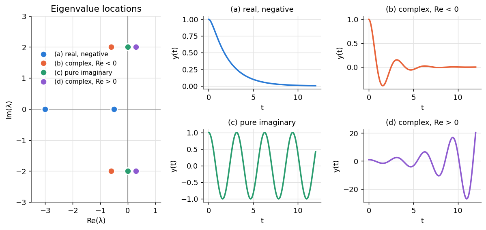
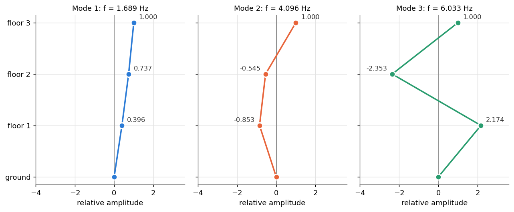

# 13장 — 고유값 방법: 대칭 행렬

[레포지토리 안내](../../README.ko.md) | [English](Concepts_Lecture.md) | [한국어](Concepts_Lecture.ko.md)

> **최종 수정일:** 2026-11-27
>
> Applied Numerical Methods with Python for Engineers and Scientists, Chapra and Clough, Ch 13

> **학습 목표:**
> 1. 특성 방정식으로 고유값과 고유벡터를 구할 수 있다
> 2. 고유값의 위치로 선형 ODE 시스템의 안정성과 진동 여부를 판정할 수 있다
> 3. 결합 진동계와 질량-스프링 시스템을 고유값 문제로 세우고 고유 주파수와 모드를 구할 수 있다
> 4. 거듭제곱법과 역거듭제곱법으로 가장 큰 고유값과 가장 작은 고유값을 구할 수 있다
> 5. 거듭제곱법의 수렴을 고유벡터 전개로 유도하고 Rayleigh 몫과 편이로 수렴을 가속할 수 있다
> 6. 대칭 행렬의 고유값이 실수이고 고유벡터가 직교함을 증명할 수 있다

---

<br>

## 목차

- [1. 고유값과 고유벡터(Eigenvalues and Eigenvectors)](#1-고유값과-고유벡터eigenvalues-and-eigenvectors)
  - [1.1 정의](#11-정의)
  - [1.2 기하학적 해석](#12-기하학적-해석)
  - [1.3 예제: 투영 행렬(Projection Matrix)](#13-예제-투영-행렬projection-matrix)
  - [1.4 예제: 반사 행렬(Reflection Matrix)](#14-예제-반사-행렬reflection-matrix)
- [2. 고유값과 고유벡터 계산](#2-고유값과-고유벡터-계산)
  - [2.1 특성 방정식(Characteristic Equation)](#21-특성-방정식characteristic-equation)
  - [2.2 2x2 경우](#22-2x2-경우)
  - [2.3 예제: 고유값과 고유벡터 구하기](#23-예제-고유값과-고유벡터-구하기)
  - [2.4 고차 행렬의 특성 다항식](#24-고차-행렬의-특성-다항식)
- [3. 응용: 미분방정식](#3-응용-미분방정식)
  - [3.1 1차 ODE: 스칼라 경우](#31-1차-ode-스칼라-경우)
  - [3.2 2차를 1차 시스템으로 변환](#32-2차를-1차-시스템으로-변환)
  - [3.3 행렬 지수함수와 안정성](#33-행렬-지수함수와-안정성)
  - [3.4 고유값 위치와 시스템 거동](#34-고유값-위치와-시스템-거동)
  - [3.5 복소 고유값과 감쇠 진동](#35-복소-고유값과-감쇠-진동)
- [4. 예제 13.2: 1차 시스템의 안정성](#4-예제-132-1차-시스템의-안정성)
- [5. 고유값과 상미분방정식](#5-고유값과-상미분방정식)
  - [5.1 순수 진동: 단일 2차 ODE](#51-순수-진동-단일-2차-ode)
  - [5.2 진동 시스템의 고유벡터](#52-진동-시스템의-고유벡터)
- [6. 결합 2차 ODE 시스템](#6-결합-2차-ode-시스템)
  - [6.1 일반 형태](#61-일반-형태)
  - [6.2 주기적 해의 제안](#62-주기적-해의-제안)
  - [6.3 2차 시스템의 특성 방정식](#63-2차-시스템의-특성-방정식)
- [7. 예제 13.3: 결합 시스템의 거동](#7-예제-133-결합-시스템의-거동)
  - [7.1 고유값 계산](#71-고유값-계산)
  - [7.2 고유벡터 계산](#72-고유벡터-계산)
  - [7.3 주파수와 일반해](#73-주파수와-일반해)
  - [7.4 초기 조건 적용](#74-초기-조건-적용)
- [8. 물리적 설정: 질량-스프링 시스템](#8-물리적-설정-질량-스프링-시스템)
  - [8.1 두 질량, 세 스프링 시스템](#81-두-질량-세-스프링-시스템)
  - [8.2 질량-스프링 시스템의 고유값 공식](#82-질량-스프링-시스템의-고유값-공식)
  - [8.3 운동 방정식의 행렬 형태와 평형 상태](#83-운동-방정식의-행렬-형태와-평형-상태)
- [9. 예제 13.4: 질량-스프링 시스템](#9-예제-134-질량-스프링-시스템)
- [10. 거듭제곱법(Power Method)](#10-거듭제곱법power-method)
  - [10.1 세 질량, 네 스프링 시스템 (예제 13.5)](#101-세-질량-네-스프링-시스템-예제-135)
  - [10.2 알고리즘](#102-알고리즘)
  - [10.3 반복 과정](#103-반복-과정)
  - [10.4 수렴과 최소 고유값 찾기](#104-수렴과-최소-고유값-찾기)
  - [10.5 거듭제곱법의 수렴 원리](#105-거듭제곱법의-수렴-원리)
  - [10.6 Rayleigh 몫](#106-rayleigh-몫)
  - [10.7 편이 역거듭제곱법](#107-편이-역거듭제곱법)
  - [10.8 수축법](#108-수축법)
- [11. Python 구현](#11-python-구현)
  - [11.1 NumPy를 이용한 고유값 계산](#111-numpy를-이용한-고유값-계산)
  - [11.2 거듭제곱법 구현](#112-거듭제곱법-구현)
  - [11.3 질량-스프링 시스템 (예제 13.4)](#113-질량-스프링-시스템-예제-134)
  - [11.4 최소 고유값을 위한 역거듭제곱법](#114-최소-고유값을-위한-역거듭제곱법)
- [12. 대칭 행렬의 고유값 문제](#12-대칭-행렬의-고유값-문제)
  - [12.1 실수 고유값과 직교 고유벡터](#121-실수-고유값과-직교-고유벡터)
  - [12.2 진동 모드와 고유벡터의 정규화](#122-진동-모드와-고유벡터의-정규화)
  - [12.3 질량이 서로 다른 시스템의 대칭화](#123-질량이-서로-다른-시스템의-대칭화)
  - [12.4 응용: 3층 건물의 고유 진동](#124-응용-3층-건물의-고유-진동)
- [13. 흔한 실수](#13-흔한-실수)
- [요약](#요약)
- [점검 문제](#점검-문제)
- [참고 문헌](#참고-문헌)

---

<br>

## 1. 고유값과 고유벡터(Eigenvalues and Eigenvectors)

### 1.1 정의

**정방행렬(square matrix)** 을 다룬다. $`n \times n`$ 행렬 $`[A]`$가 주어졌을 때 다음 방정식을 생각한다.

```math
[A]\{x\} = \lambda \{x\}
```

여기서 $`\{x\}`$는 $`n \times 1`$ 벡터이고 $`\lambda \in \mathbb{R}`$ 또는 $`\lambda \in \mathbb{C}`$이다.

임의의 $`\lambda`$ 값에 대해 **자명해(trivial solution)** $`\{x\} = \{0\}`$는 항상 존재한다.

$`[A]\{x\} = \lambda \{x\}`$를 만족하는 **비자명해(non-trivial solution)** $`\{x\} \neq \{0\}`$가 존재하면 다음과 같이 부른다.

- $`\{x\}`$를 $`[A]`$의 **고유벡터(eigenvector)** 라 한다.
- $`\lambda`$를 $`\{x\}`$에 대응하는 **고유값(eigenvalue)** 이라 한다.

> **[선형대수학]** "eigen"은 독일어로 "고유한" 또는 "특성적인"을 의미한다. 고유벡터는 행렬이 단순히 스칼라 배로 작용하는 특별한 방향이다. $`n \times n`$ 행렬은 특성 다항식의 근으로서 중복도를 포함해 정확히 $`n`$개의 (복소) 고유값을 가지며, 서로 다른 고유값은 최대 $`n`$개이다.

### 1.2 기하학적 해석

고유벡터 $`\{x\}`$는 $`[A]\{x\}`$와 **평행**하다. 즉, $`\{x\}`$에 행렬 $`[A]`$를 곱해도 원점을 지나는 같은 직선 위에 머물며 $`\lambda`$배로 스케일될 뿐이다. $`\lambda > 0`$이면 같은 방향, $`\lambda < 0`$이면 반대 방향을 가리키고, $`\lambda = 0`$이면 영벡터가 된다.

```math
\lambda \{x\} \quad \longrightarrow \quad \text{(} [A]\{x\}\text{와 같은 방향)}
```

### 1.3 예제: 투영 행렬(Projection Matrix)

$`P`$가 평면 위로의 투영 행렬이라고 하자.

**경우 1:** **평면 위에** 놓인 벡터 $`\{x\}`$에 대해서는 다음이 성립한다.

```math
[P]\{x\} = \{x\} = 1 \cdot \{x\}
```

여기서 $`\lambda = 1`$이 고유값이고, $`\{x\}`$(평면 위의 영이 아닌 임의의 벡터)가 고유벡터이다.

**경우 2:** 벡터 $`\{x\}`$가 평면에 **수직**이면 다음이 성립한다.

```math
[P]\{x\} = \{0\} = 0 \cdot \{x\}
```

여기서 $`\lambda = 0`$이 고유값이고, $`\{x\}`$(평면의 법선 방향 벡터)가 고유벡터이다.

### 1.4 예제: 반사 행렬(Reflection Matrix)

다음 반사 행렬을 생각한다.

```math
A = \begin{bmatrix} 0 & 1 \\ 1 & 0 \end{bmatrix}
```

이 행렬은 직선 $`x_1 = x_2`$에 대한 반사 사상이다. 고유벡터는 $`\begin{Bmatrix} 1 \\ 1 \end{Bmatrix}`$(고유값 1)과 $`\begin{Bmatrix} 1 \\ -1 \end{Bmatrix}`$(고유값 $`-1`$)이다.

두 고유벡터가 **전체 공간을 생성(span)** 하므로 $`\mathbb{R}^2`$의 임의의 벡터를 이 고유벡터들의 선형결합으로 쓸 수 있다.

> **[선형대수학]** $`n \times n`$ 행렬의 고유벡터들이 전체 $`\mathbb{R}^n`$을 생성하면 그 행렬을 **대각화 가능(diagonalizable)** 하다고 한다. 실수 대칭 행렬은 항상 직교 행렬로 대각화할 수 있고 실수 고유값을 갖는데, 이것이 **스펙트럼 정리(spectral theorem)** 라는 중요한 결과이다.

---

<br>

## 2. 고유값과 고유벡터 계산

### 2.1 특성 방정식(Characteristic Equation)

고유값 방정식에서 출발한다.

```math
[A]\{x\} = \lambda \{x\}
```

재정렬하면 다음과 같다.

```math
[A]\{x\} - \lambda [I]\{x\} = \{0\}
```

```math
[A - \lambda I]\{x\} = \{0\}
```

**비자명해** $`\{x\} \neq \{0\}`$가 존재하려면 행렬 $`[A - \lambda I]`$가 비가역, 즉 **특이(singular)** 해야 한다. 이를 위한 조건은 다음과 같다.

```math
\det(A - \lambda I) = |A - \lambda I| = 0
```

이 식을 **특성 방정식(characteristic equation)** 이라 하고, 좌변의 행렬식을 $`\lambda`$의 다항식으로 본 것을 특성 다항식이라 한다. $`n \times n`$ 행렬에서 특성 다항식은 $`\lambda`$에 관한 $`n`$차 다항식이다.

### 2.2 2x2 경우

$`2 \times 2`$ 행렬에서는 다음과 같다.

```math
\begin{vmatrix} a_{11} - \lambda & a_{12} \\ a_{21} & a_{22} - \lambda \end{vmatrix} = 0
```

전개하면 다음과 같다.

```math
\lambda^2 - (a_{11} + a_{22})\lambda + (a_{11}a_{22} - a_{12}a_{21}) = 0
```

근의 공식을 사용하면 다음을 얻는다.

```math
\lambda = \frac{(a_{11} + a_{22}) \pm \sqrt{(a_{11} + a_{22})^2 - 4(a_{11}a_{22} - a_{12}a_{21})}}{2}
```

> **[선형대수학]** $`a_{11} + a_{22}`$는 $`A`$의 **대각합(trace)** 이고, $`a_{11}a_{22} - a_{12}a_{21}`$는 $`A`$의 **행렬식(determinant)** 이다. $`2 \times 2`$ 행렬에서 고유값의 합은 대각합과 같고 고유값의 곱은 행렬식과 같으며, 이 관계는 일반적인 $`n \times n`$ 행렬에서도 성립한다(13장 실습 1.1절).

### 2.3 예제: 고유값과 고유벡터 구하기

다음 행렬을 생각한다.

```math
A = \begin{bmatrix} 3 & 1 \\ 1 & 3 \end{bmatrix}
```

**단계 1: 특성 방정식**

```math
|A - \lambda I| = \begin{vmatrix} 3 - \lambda & 1 \\ 1 & 3 - \lambda \end{vmatrix} = (3 - \lambda)^2 - 1 = \lambda^2 - 6\lambda + 8 = (\lambda - 4)(\lambda - 2) = 0
```

따라서 $`\lambda_1 = 4`$, $`\lambda_2 = 2`$이다.

**단계 2: $`\lambda_1 = 4`$의 고유벡터**

```math
\begin{bmatrix} 3 - 4 & 1 \\ 1 & 3 - 4 \end{bmatrix} \begin{Bmatrix} x_1 \\ x_2 \end{Bmatrix} = \begin{Bmatrix} 0 \\ 0 \end{Bmatrix}
```

```math
-x_1 + x_2 = 0 \quad \text{와} \quad x_1 - x_2 = 0 \quad \Rightarrow \quad \text{같은 방정식}
```

고유벡터는 상수배를 제외하고 정해지므로 $`x_1 = 1`$로 놓으면 $`x_2 = 1`$이고, 고유벡터는 다음과 같다.

```math
\{x\}_1 = \begin{Bmatrix} 1 \\ 1 \end{Bmatrix}
```

**단계 3: $`\lambda_2 = 2`$의 고유벡터**

```math
\begin{bmatrix} 3 - 2 & 1 \\ 1 & 3 - 2 \end{bmatrix} \begin{Bmatrix} x_1 \\ x_2 \end{Bmatrix} = \begin{Bmatrix} 0 \\ 0 \end{Bmatrix}
```

```math
x_1 + x_2 = 0
```

$`x_1 = 1`$로 놓으면 $`x_2 = -1`$이고, 고유벡터는 다음과 같다.

```math
\{x\}_2 = \begin{Bmatrix} 1 \\ -1 \end{Bmatrix}
```

### 2.4 고차 행렬의 특성 다항식

$`n \geq 3`$이면 특성 다항식을 행렬식의 여인수 전개로 구한다. 예제 13.5(10.1절)의 행렬을 첫 행으로 전개하면 다음과 같다.

```math
\det(A - \lambda I) = \begin{vmatrix} 40 - \lambda & -20 & 0 \\ -20 & 40 - \lambda & -20 \\ 0 & -20 & 40 - \lambda \end{vmatrix} = (40 - \lambda)\left[(40 - \lambda)^2 - 400\right] - (-20)\left[(-20)(40 - \lambda) - 0\right]
```

```math
= (40 - \lambda)\left[(40 - \lambda)^2 - 800\right] = -\lambda^3 + 120\lambda^2 - 4000\lambda + 32000
```

인수 $`40 - \lambda`$가 드러나므로 한 근은 $`\lambda = 40`$이고, 나머지 두 근은 $`(40 - \lambda)^2 = 800`$에서 $`\lambda = 40 \pm 20\sqrt{2}`$이다. 세 근의 합 120은 대각합 $`40 + 40 + 40`$과 같고, 곱 $`40(1600 - 800) = 32000`$은 행렬식과 같다. 이 예처럼 인수가 바로 보이는 경우는 드물며, 일반적으로는 특성 다항식의 계수를 구한 뒤 6장의 다항식 근 찾기로 푼다. `np.poly`에 정방 행렬을 넘기면 $`\det(\lambda I - A)`$의 계수를 최고차항부터 돌려준다 [1].

```python
import numpy as np

A = np.array([[40, -20, 0], [-20, 40, -20], [0, -20, 40]], dtype=float)
c = np.poly(A)                    # coefficients of det(lambda I - A), highest power first
print(c.round(6).tolist())
print(np.roots(c))                # roots of the characteristic polynomial

lam_true = np.arange(1.0, 21.0)   # 1, 2, ..., 20
c20 = np.poly(lam_true)           # coefficients of (lambda - 1)(lambda - 2)...(lambda - 20)
r = np.sort(np.roots(c20).real)
print(f"largest coefficient = {np.abs(c20).max():.2e}")
print(f"max root error = {np.abs(r - lam_true).max():.1e}")
```

```text
[1.0, -120.0, 4000.0, -32000.0]
[68.28427125 40.         11.71572875]
largest coefficient = 1.38e+19
max root error = 3.9e-02
```

첫 줄의 계수는 손 계산한 다항식의 부호를 바꾼 $`\lambda^3 - 120\lambda^2 + 4000\lambda - 32000`$과 같고, `np.roots`는 세 고유값을 돌려준다. 뒤의 네 줄은 이 방법의 한계를 보인다. 고유값이 1, 2, ..., 20인 경우의 특성 다항식 $`(\lambda - 1)(\lambda - 2)\cdots(\lambda - 20)`$은 계수의 크기가 1부터 약 $`1.4 \times 10^{19}`$까지 퍼져 있고, 근이 계수에 극도로 민감하다. 각 계수를 배정밀도의 상대 반올림 오차 정도(약 $`10^{-16}`$)만 바꾸어도 1차 근사로 근 14와 15가 최대 0.08 정도까지 움직일 수 있으며, 실제로 `np.roots`가 구한 근은 참값에서 최대 0.039(근 14)만큼 벗어난다. 대칭 행렬의 고유값은 행렬 성분의 작은 변화에 둔감한데도(12.1절), 특성 다항식의 계수를 거치는 순간 근이 계수에 극도로 민감한 문제로 바뀌는 것이다. 따라서 특성 방정식은 손 계산과 이론에 쓰고, 수치 계산에서는 10절의 반복법이나 12.1절 끝 참고 상자의 QR 알고리즘처럼 행렬에 직접 작용하는 방법을 쓴다.

---

<br>

## 3. 응용: 미분방정식

### 3.1 1차 ODE: 스칼라 경우

다음 스칼라 ODE를 생각한다.

```math
\frac{dx}{dt} = ax, \quad a \in \mathbb{R}
```

해는 다음과 같다.

```math
x(t) = e^{at} C, \quad C \text{는 상수}
```

$`a`$의 값에 따른 거동은 다음 표와 같다. 마지막 행은 $`a`$를 복소수로 확장한 경우이다.

| $`a`$의 값 | 해의 거동 |
|---|---|
| $`a > 0`$ (실수, 양수) | 지수적 성장 (불안정) |
| $`a < 0`$ (실수, 음수) | 지수적 감쇠 (안정) |
| $`a = 0`$ | 상수: $`x(t) = C`$ |
| $`a = i\beta`$ (허수) | 진동: $`x(t) = e^{i\beta t}C = (\cos \beta t + i\sin \beta t)C`$ |

*표 1. 계수 a의 값에 따른 스칼라 ODE 해의 거동*

### 3.2 2차를 1차 시스템으로 변환

상수 계수를 가진 다음 2차 ODE를 생각한다.

```math
\frac{d^2 y}{dt^2} + a\frac{dy}{dt} + by = 0
```

이 식은 다음 치환으로 **1차** ODE 시스템으로 변환할 수 있다.

```math
x_1 = y, \quad x_2 = \frac{dx_1}{dt}
```

이 치환으로 다음을 얻는다.

```math
\frac{dx_1}{dt} = x_2
```

```math
\frac{dx_2}{dt} = -bx_1 - ax_2
```

행렬 형태로 쓰면 다음과 같다.

```math
\frac{d}{dt}\begin{Bmatrix} x_1 \\ x_2 \end{Bmatrix} = \begin{bmatrix} 0 & 1 \\ -b & -a \end{bmatrix} \begin{Bmatrix} x_1 \\ x_2 \end{Bmatrix}
```

하나의 2차 ODE를 **두 개의 1차** ODE로 변환하였다.

### 3.3 행렬 지수함수와 안정성

다음 벡터 ODE를 생각한다.

```math
\frac{d\mathbf{x}}{dt} = A\mathbf{x}, \quad \mathbf{x} \in \mathbb{R}^n, \quad A \in \mathbb{R}^{n \times n}
```

해는 다음과 같다.

```math
\mathbf{x}(t) = e^{At}\mathbf{C}, \quad \mathbf{C} \in \mathbb{R}^n
```

여기서 $`e^{At}`$는 **행렬 지수함수(matrix exponential)** 이다. $`A`$가 대칭이면 고유값의 대각 행렬 $`D`$와 정규직교 고유벡터를 열로 갖는 행렬 $`U`$로 $`A = U D U^T`$와 같이 대각화할 수 있고, 이때 다음이 성립한다(일반적인 대각화 가능 행렬에서는 $`U^T`$ 대신 $`U^{-1}`$을 쓴다).

```math
e^{At} = U \, e^{Dt} \, U^T
```

이 식은 다음을 의미한다.

- **음의 실수 고유값**은 안정적인(감쇠하는) 해를 만든다.
- **양의 실수 고유값**은 불안정한(성장하는) 해를 만든다.
- **허수 고유값**은 진동하는 해를 만든다.

### 3.4 고유값 위치와 시스템 거동

복소평면은 안정성을 직관적으로 보여 주는 지도이다.

| 영역 | 고유값 유형 | 시스템 거동 |
|---|---|---|
| 좌반면 ($`\text{Re}(\lambda) < 0`$) | 음의 실수부 | **안정** (해가 감쇠) |
| 우반면 ($`\text{Re}(\lambda) > 0`$) | 양의 실수부 | **불안정** (해가 성장) |
| 허수축 ($`\text{Re}(\lambda) = 0`$) | 순허수 | **진동** (유계 주기 운동) |
| 왼쪽 멀리 | 큰 음의 실수 | 더 빠른 수렴 |
| 오른쪽 멀리 | 큰 양의 실수 | 더 빠른 발산 |

*표 2. 복소평면에서 고유값의 위치와 시스템 거동*

### 3.5 복소 고유값과 감쇠 진동

질량 $`m`$, 감쇠 계수 $`c`$, 스프링 상수 $`k`$인 진동자 $`m\ddot{y} + c\dot{y} + ky = 0`$을 $`m`$으로 나누고 $`\omega_n = \sqrt{k/m}`$, $`\zeta = c/(2\sqrt{km})`$로 쓰면 $`\ddot{y} + 2\zeta\omega_n\dot{y} + \omega_n^2y = 0`$이다. 3.2절의 변환으로 얻은 행렬 $`\begin{bmatrix} 0 & 1 \\ -\omega_n^2 & -2\zeta\omega_n \end{bmatrix}`$의 특성 방정식은 $`\lambda^2 + 2\zeta\omega_n\lambda + \omega_n^2 = 0`$이므로 고유값은 다음과 같다.

```math
\lambda = -\zeta\omega_n \pm \omega_n\sqrt{\zeta^2 - 1}
```

$`\omega_n`$을 **고유 각주파수(natural angular frequency)**, $`\zeta`$를 **감쇠비(damping ratio)** 라 한다. $`\zeta > 1`$이면 두 고유값이 서로 다른 음의 실수여서 진동 없이 감쇠하고(과감쇠), $`\zeta = 1`$이면 중근 $`-\omega_n`$을 가지며(임계 감쇠), $`0 < \zeta < 1`$이면 켤레 복소수 $`\lambda = \alpha \pm i\beta`$($`\alpha = -\zeta\omega_n`$, $`\beta = \omega_n\sqrt{1 - \zeta^2}`$)가 된다(부족 감쇠). $`\zeta = 0`$은 5.1절의 순수 진동이다. 켤레 복소 고유값에 대응하는 해는 Euler 공식으로 실수 형태로 쓸 수 있다.

```math
e^{(\alpha \pm i\beta)t} = e^{\alpha t}(\cos\beta t \pm i\sin\beta t) \quad\Longrightarrow\quad y(t) = e^{\alpha t}(C_1\cos\beta t + C_2\sin\beta t)
```

실수부 $`\alpha`$가 포락선 $`e^{\alpha t}`$의 감쇠 속도를, 허수부 $`\beta`$가 진동의 각주파수를 정한다. 예를 들어 $`\ddot{y} + 2\dot{y} + 5y = 0`$은 $`\omega_n = \sqrt{5} = 2.2361`$, $`\zeta = 1/\sqrt{5} = 0.4472`$이고 고유값은 $`\lambda = -1 \pm 2i`$이다. $`y(0) = 1`$, $`\dot{y}(0) = 0`$이면 $`C_1 = 1`$이고, $`\dot{y}(0) = \alpha C_1 + \beta C_2 = -1 + 2C_2 = 0`$에서 $`C_2 = 0.5`$이므로 $`y(t) = e^{-t}(\cos 2t + 0.5\sin 2t)`$이다. 진동의 주기는 $`2\pi/2 = 3.1416`$ s이고, 포락선은 $`\ln 2 = 0.693`$ s마다 절반으로 줄어 $`y(1) = 0.0142`$, $`y(2) = -0.1397`$, $`y(3) = 0.0408`$이다. 감쇠 때문에 진동의 각주파수 $`\beta = 2`$는 고유 각주파수 $`\omega_n = 2.2361`$보다 조금 작으며, $`\omega_n`$은 고유값의 절댓값 $`|\lambda| = \sqrt{1 + 4}`$와 같다.



*그림 1. 고유값의 위치와 그에 대응하는 해의 모양*

그림 1은 $`y(0) = 1`$, $`\dot{y}(0) = 0`$에서 출발한 네 시스템의 해이다. (a)의 두 음의 실수 고유값 $`-0.5`$, $`-3`$은 진동 없는 감쇠를, (b)의 $`-0.6 \pm 2i`$는 감쇠 진동을, (c)의 $`\pm 2i`$는 진폭이 일정한 진동을, (d)의 $`0.3 \pm 2i`$는 진폭이 커지는 진동을 만든다. (b), (c), (d)는 허수부가 같으므로 진동의 주기 $`\pi`$가 같고, 실수부만 포락선을 바꾼다. 표 2의 분류가 해의 모양에서 그대로 확인된다.

---

<br>

## 4. 예제 13.2: 1차 시스템의 안정성

다음 시스템을 생각한다.

```math
\frac{dx_1}{dt} = -3x_1 + x_2
```

```math
\frac{dx_2}{dt} = x_1 - 3x_2
```

행렬 형태로 쓰면 다음과 같다.

```math
\frac{d}{dt}\begin{Bmatrix} x_1 \\ x_2 \end{Bmatrix} = \begin{bmatrix} -3 & 1 \\ 1 & -3 \end{bmatrix} \begin{Bmatrix} x_1 \\ x_2 \end{Bmatrix}
```

**특성 방정식:**

```math
\begin{vmatrix} -3 - \lambda & 1 \\ 1 & -3 - \lambda \end{vmatrix} = (3 + \lambda)^2 - 1 = \lambda^2 + 6\lambda + 8 = (\lambda + 4)(\lambda + 2) = 0
```

```math
\therefore \lambda = -2 \text{ 또는 } -4
```

**두 고유값이 모두 음의 실수**이므로 해는 **안정적**이며, 허수부가 없으므로 진동 없이 0으로 소멸한다.

거동은 고유값만으로 판정했지만, 고유벡터를 쓰면 해 자체도 구할 수 있다. $`A`$의 고유벡터는 2.3절과 같은 $`(1,\ 1)`$($`\lambda = -2`$)과 $`(1,\ -1)`$($`\lambda = -4`$)이므로, 3.3절의 대각화에 따라 해는 각 고유벡터 방향의 성분이 자기 고유값으로 따로 감쇠하는 합 $`\mathbf{x}(t) = c_1e^{-2t}(1,\ 1) + c_2e^{-4t}(1,\ -1)`$이다. 초기 조건 $`\mathbf{x}(0) = (1,\ 0)`$에서 $`c_1 + c_2 = 1`$, $`c_1 - c_2 = 0`$이므로 $`c_1 = c_2 = 1/2`$이고 다음을 얻는다.

```math
x_1(t) = \frac{1}{2}\left(e^{-2t} + e^{-4t}\right), \qquad x_2(t) = \frac{1}{2}\left(e^{-2t} - e^{-4t}\right)
```

$`x_2`$는 0에서 출발해 $`\dot{x}_2 = -e^{-2t} + 2e^{-4t} = 0`$인 $`t = \ln 2/2 = 0.3466`$에서 최댓값 0.125에 이른 뒤 감쇠한다. $`e^{-4t}`$ 성분이 먼저 사라지므로 시간이 지나면 해는 느린 모드의 방향 $`(1,\ 1)`$에 붙어 $`x_1 \approx x_2`$가 된다. 다음 코드는 이 고유벡터 전개를 `scipy.linalg.expm`이 계산한 행렬 지수함수 $`e^{At}\mathbf{x}(0)`$과 비교한다. `expm`은 데이터에 따라 차수를 정하는 Pade 근사로 행렬 지수함수를 계산한다 [2].

```python
import numpy as np
from scipy.linalg import expm

A = np.array([[-3.0, 1.0], [1.0, -3.0]])
x0 = np.array([1.0, 0.0])
lam, V = np.linalg.eigh(A)             # eigenvalues -4, -2 and orthonormal eigenvectors
c = V.T @ x0                           # coefficients of x0 along the eigenvectors
for t in (0.0, 0.25, 0.5, 1.0, 2.0):
    x_eig = V @ (c * np.exp(lam * t))  # sum of c_i e^(lambda_i t) v_i
    x_expm = expm(A * t) @ x0          # matrix exponential
    print(t, np.round(x_eig, 6), np.round(x_expm, 6))
```

```text
0.0 [1. 0.] [1. 0.]
0.25 [0.487205 0.119326] [0.487205 0.119326]
0.5 [0.251607 0.116272] [0.251607 0.116272]
1.0 [0.076825 0.05851 ] [0.076825 0.05851 ]
2.0 [0.009326 0.00899 ] [0.009326 0.00899 ]
```

`np.linalg.eigh`는 고유값을 오름차순 $`-4,\ -2`$로 돌려주고 고유벡터를 정규직교 열로 주므로, 전개 계수를 역행렬 대신 전치 행렬로 `V.T @ x0`처럼 구한다(12.1절). `c * np.exp(lam * t)`가 각 모드의 계수에 $`e^{\lambda_it}`$를 곱하고, `V @`의 행렬 곱이 모드를 다시 합친다. 두 방법의 값이 모든 시각에서 같으며, $`t = 0.5`$의 $`(0.251607,\ 0.116272)`$는 위 식에 $`e^{-1}`$과 $`e^{-2}`$를 넣은 값과 같다. $`t = 2`$에서는 두 성분의 비가 거의 1이 되어 느린 모드만 남은 것이 보인다. 대칭이 아닌 행렬의 같은 계산은 13장 실습 7절에서 다룬다.

---

<br>

## 5. 고유값과 상미분방정식

### 5.1 순수 진동: 단일 2차 ODE

비감쇠 진동자를 생각한다($`a > 0`$).

```math
\ddot{y} = -ay \quad \Longleftrightarrow \quad \frac{d^2 y}{dt^2} = -ay
```

$`x_1 = y`$, $`x_2 = \frac{dx_1}{dt}`$로 놓아 1차 ODE로 바꾸면 다음과 같다.

```math
\frac{d}{dt}\begin{Bmatrix} x_1 \\ x_2 \end{Bmatrix} = \begin{bmatrix} 0 & 1 \\ -a & 0 \end{bmatrix} \begin{Bmatrix} x_1 \\ x_2 \end{Bmatrix}
```

**$`A`$의 고유값 구하기:**

```math
|A - \lambda I| = \begin{vmatrix} -\lambda & 1 \\ -a & -\lambda \end{vmatrix} = \lambda^2 + a = 0
```

```math
\therefore \lambda = \pm \sqrt{-a} = \pm \sqrt{a}\, i
```

고유값이 **순허수**(허수축에 위치)이므로 해는 주파수 $`\sqrt{a}/2\pi`$로 **진동**한다.

Euler 공식과 주기, 주파수의 관계는 다음과 같다.

```math
e^{i\sqrt{a}\,t} = \cos(\sqrt{a}\,t) + i\sin(\sqrt{a}\,t)
```

```math
\text{주기} = \frac{2\pi}{\sqrt{a}}, \qquad \text{주파수} = \frac{1}{\text{주기}} = \frac{\sqrt{a}}{2\pi}
```

> **참고:** **고유값과 주파수.** 고유값은 **진동의 주파수**와 직접 관련된다. 이것이 진동 시스템을 분석할 때마다 물리학과 공학 전반에서 고유값 문제가 나타나는 이유이다.

### 5.2 진동 시스템의 고유벡터

$`[A - \lambda I]\{x\} = \{0\}`$를 푼다.

```math
\begin{bmatrix} -\lambda & 1 \\ -a & -\lambda \end{bmatrix} \begin{Bmatrix} x_1 \\ x_2 \end{Bmatrix} = \begin{Bmatrix} 0 \\ 0 \end{Bmatrix}
```

**경우 i)** $`\lambda = \sqrt{a}\, i`$:

```math
-\sqrt{a}\,i \cdot x_1 + x_2 = 0
```

$`x_1 = 1`$로 놓으면 $`x_2 = \sqrt{a}\,i`$이다.

```math
\{x\} = \begin{Bmatrix} 1 \\ \sqrt{a}\,i \end{Bmatrix}
```

**경우 ii)** $`\lambda = -\sqrt{a}\, i`$:

```math
\sqrt{a}\,i \cdot x_1 + x_2 = 0
```

$`x_1 = 1`$로 놓으면 $`x_2 = -\sqrt{a}\,i`$이다.

```math
\{x\} = \begin{Bmatrix} 1 \\ -\sqrt{a}\,i \end{Bmatrix}
```

---

<br>

## 6. 결합 2차 ODE 시스템

### 6.1 일반 형태

결합된 두 2차 ODE의 시스템은 다음과 같다.

```math
\frac{d^2 y_1}{dt^2} = -a_{11}y_1 + a_{12}y_2
```

```math
\frac{d^2 y_2}{dt^2} = a_{21}y_1 - a_{22}y_2
```

행렬 형태로 쓰면 다음과 같다.

```math
\frac{d^2}{dt^2}\begin{Bmatrix} y_1 \\ y_2 \end{Bmatrix} = \begin{bmatrix} -a_{11} & a_{12} \\ a_{21} & -a_{22} \end{bmatrix} \begin{Bmatrix} y_1 \\ y_2 \end{Bmatrix} \quad \cdots \quad (*)
```

### 6.2 주기적 해의 제안

주기적인 해의 형태를 바탕으로 다음 해를 가정한다.

```math
\begin{Bmatrix} y_1 \\ y_2 \end{Bmatrix} = \begin{Bmatrix} X_1 \\ X_2 \end{Bmatrix} e^{i\omega t}
```

여기서 $`\omega`$는 각주파수이다. $`(*)`$에 대입하면 다음과 같다.

```math
-\omega^2 \begin{Bmatrix} X_1 \\ X_2 \end{Bmatrix} e^{i\omega t} = \begin{bmatrix} -a_{11} & a_{12} \\ a_{21} & -a_{22} \end{bmatrix} \begin{Bmatrix} X_1 \\ X_2 \end{Bmatrix} e^{i\omega t}
```

$`e^{i\omega t}`$를 소거하면 다음과 같다.

```math
\underbrace{-\omega^2}_{\lambda} \begin{Bmatrix} X_1 \\ X_2 \end{Bmatrix} = \underbrace{\begin{bmatrix} -a_{11} & a_{12} \\ a_{21} & -a_{22} \end{bmatrix}}_{A} \begin{Bmatrix} X_1 \\ X_2 \end{Bmatrix}
```

**이것은 고유값 문제이다.** 고유값은 $`\lambda = -\omega^2`$이므로 $`\omega^2 = -\lambda`$이다.

### 6.3 2차 시스템의 특성 방정식

$`|A - \lambda I| = 0`$에서 다음을 얻는다.

```math
\begin{vmatrix} -a_{11} - \lambda & a_{12} \\ a_{21} & -a_{22} - \lambda \end{vmatrix} = 0
```

```math
(a_{11} + \lambda)(a_{22} + \lambda) - a_{12}a_{21} = 0
```

```math
\lambda^2 + (a_{11} + a_{22})\lambda + a_{11}a_{22} - a_{12}a_{21} = 0
```

```math
\therefore \lambda = \frac{-(a_{11} + a_{22}) \pm \sqrt{(a_{11} + a_{22})^2 - 4(a_{11}a_{22} - a_{12}a_{21})}}{2}
```

$`\omega^2 = -\lambda`$로 표현하면 다음과 같다.

```math
|A + \omega^2 I| = \begin{vmatrix} -a_{11} + \omega^2 & a_{12} \\ a_{21} & -a_{22} + \omega^2 \end{vmatrix} = 0
```

```math
(\omega^2 - a_{11})(\omega^2 - a_{22}) - a_{12}a_{21} = 0
```

```math
\omega^4 - (a_{11} + a_{22})\omega^2 + a_{11}a_{22} - a_{12}a_{21} = 0
```

```math
\therefore \omega^2 = \frac{(a_{11} + a_{22}) \pm \sqrt{(a_{11} + a_{22})^2 - 4(a_{11}a_{22} - a_{12}a_{21})}}{2}
```

---

<br>

## 7. 예제 13.3: 결합 시스템의 거동

### 7.1 고유값 계산

주어진 시스템은 다음과 같다.

```math
\frac{d^2 y_1}{dt^2} = -5y_1 + 2y_2, \qquad \frac{d^2 y_2}{dt^2} = 2y_1 - 2y_2
```

행렬 형태는 다음과 같다.

```math
\frac{d^2}{dt^2}\begin{Bmatrix} y_1 \\ y_2 \end{Bmatrix} = \underbrace{\begin{bmatrix} -5 & 2 \\ 2 & -2 \end{bmatrix}}_{A}\begin{Bmatrix} y_1 \\ y_2 \end{Bmatrix}
```

특성 방정식은 다음과 같다.

```math
\begin{vmatrix} -5 - \lambda & 2 \\ 2 & -2 - \lambda \end{vmatrix} = (5 + \lambda)(2 + \lambda) - 4 = \lambda^2 + 7\lambda + 6 = (\lambda + 6)(\lambda + 1) = 0
```

```math
\therefore \lambda_1 = -1, \quad \lambda_2 = -6
```

### 7.2 고유벡터 계산

**$`\lambda_1 = -1`$의 경우:**

```math
\begin{bmatrix} -5 + 1 & 2 \\ 2 & -2 + 1 \end{bmatrix}\begin{Bmatrix} x_1 \\ x_2 \end{Bmatrix} = \begin{Bmatrix} 0 \\ 0 \end{Bmatrix} \quad \Rightarrow \quad -4x_1 + 2x_2 = 0 \quad \Rightarrow \quad 2x_1 - x_2 = 0
```

$`x_1 = 1`$, $`x_2 = 2`$로 놓으면 고유벡터는 다음과 같다.

```math
\{x\}_1 = \begin{Bmatrix} 1 \\ 2 \end{Bmatrix}
```

**$`\lambda_2 = -6`$의 경우:**

```math
\begin{bmatrix} -5 + 6 & 2 \\ 2 & -2 + 6 \end{bmatrix}\begin{Bmatrix} x_1 \\ x_2 \end{Bmatrix} = \begin{Bmatrix} 0 \\ 0 \end{Bmatrix} \quad \Rightarrow \quad x_1 + 2x_2 = 0
```

$`x_2 = -1`$, $`x_1 = 2`$로 놓으면 고유벡터는 다음과 같다.

```math
\{x\}_2 = \begin{Bmatrix} 2 \\ -1 \end{Bmatrix}
```

### 7.3 주파수와 일반해

고유값에서 $`\omega^2 = -\lambda`$를 구한다.

```math
\omega_1^2 = 1 \quad \Rightarrow \quad \omega_1 = \pm 1
```

```math
\omega_2^2 = 6 \quad \Rightarrow \quad \omega_2 = \pm \sqrt{6}
```

해의 거동은 다음과 같다.

```math
\{x\}_1 e^{\pm it} = \{x\}_1 (\cos t \pm i\sin t)
```

```math
\{x\}_2 e^{\pm i\sqrt{6}t} = \{x\}_2 (\cos\sqrt{6}t \pm i\sin\sqrt{6}t)
```

일반해는 다음과 같다.

```math
\mathbf{y} = C_1 \{x\}_1 e^{+it} + C_2 \{x\}_2 e^{+i\sqrt{6}t} + C_3 \{x\}_1 e^{-it} + C_4 \{x\}_2 e^{-i\sqrt{6}t}
```

시간 도함수는 다음과 같다.

```math
\dot{\mathbf{y}} = iC_1 \{x\}_1 e^{+it} + i\sqrt{6}C_2 \{x\}_2 e^{+i\sqrt{6}t} - iC_3 \{x\}_1 e^{-it} - i\sqrt{6}C_4 \{x\}_2 e^{-i\sqrt{6}t}
```

### 7.4 초기 조건 적용

주어진 초기 조건은 다음과 같다.

```math
\mathbf{y}(t=0) = \begin{Bmatrix} 1 \\ -1 \end{Bmatrix}, \quad \dot{\mathbf{y}}(t=0) = \begin{Bmatrix} 0 \\ 0 \end{Bmatrix}
```

$`t = 0`$에서 속도는 $`i(C_1 - C_3)\{x\}_1 + i\sqrt{6}(C_2 - C_4)\{x\}_2 = \{0\}`$이고 두 고유벡터는 선형독립이므로, $`C_1 = C_3`$이고 $`C_2 = C_4`$이어야 한다. $`\tilde{C}_1 = C_1 = C_3`$, $`\tilde{C}_2 = C_2 = C_4`$로 놓는다.

$`t = 0`$을 위치 방정식에 대입하면 $`\mathbf{y}(0) = 2\tilde{C}_1\{x\}_1 + 2\tilde{C}_2\{x\}_2`$이다.

$`y_1`$에서: $`1 = 2\tilde{C}_1 + 4\tilde{C}_2`$

$`y_2`$에서: $`-1 = 4\tilde{C}_1 - 2\tilde{C}_2`$

두 번째 방정식에 2를 곱해 첫 번째 방정식과 나란히 쓰면 다음과 같다.

```math
-2 = 8\tilde{C}_1 - 4\tilde{C}_2
```

```math
1 = 2\tilde{C}_1 + 4\tilde{C}_2
```

두 식을 더하면 $`-1 = 10\tilde{C}_1`$이므로 $`\tilde{C}_1 = -\frac{1}{10}`$이다.

이를 $`1 = 2(-\frac{1}{10}) + 4\tilde{C}_2`$에 대입하면 $`\tilde{C}_2 = \frac{1}{4}(1 + \frac{1}{5}) = \frac{3}{10}`$이다.

**최종 해:** $`e^{it} + e^{-it} = 2\cos t`$를 이용하면 다음과 같다.

```math
\begin{Bmatrix} y_1 \\ y_2 \end{Bmatrix} = -\frac{1}{5}\begin{Bmatrix} 1 \\ 2 \end{Bmatrix}\cos(t) + \frac{3}{5}\begin{Bmatrix} 2 \\ -1 \end{Bmatrix}\cos(\sqrt{6}\,t)
```

---

<br>

## 8. 물리적 설정: 질량-스프링 시스템

### 8.1 두 질량, 세 스프링 시스템

마찰 없는 롤러 위에서 두 벽 사이에 놓여 진동하는 두 질량, 세 스프링 시스템을 생각한다.

```text
Wall ─[k]─ m₁ ─[k]─ m₂ ─[k]─ Wall
```

*그림 2. 두 벽 사이의 두 질량, 세 스프링 시스템*

두 질량 $`m_1`$과 $`m_2`$가 강성 $`k`$의 스프링으로 연결되어 있다. 각 질량에 Newton의 제2법칙을 적용하면 다음과 같다.

```math
m_1 \frac{d^2 x_1}{dt^2} = -kx_1 + k(x_2 - x_1)
```

```math
m_2 \frac{d^2 x_2}{dt^2} = -k(x_2 - x_1) - kx_2
```

행렬 형태는 다음과 같다.

```math
\frac{d^2}{dt^2}\begin{Bmatrix} x_1 \\ x_2 \end{Bmatrix} = \begin{bmatrix} -2k/m_1 & k/m_1 \\ k/m_2 & -2k/m_2 \end{bmatrix} \begin{Bmatrix} x_1 \\ x_2 \end{Bmatrix}
```

### 8.2 질량-스프링 시스템의 고유값 공식

$`|A - \lambda I| = 0`$에서 다음을 얻는다.

```math
\begin{vmatrix} -2k/m_1 - \lambda & k/m_1 \\ k/m_2 & -2k/m_2 - \lambda \end{vmatrix} = 0
```

```math
(\lambda + 2k/m_1)(\lambda + 2k/m_2) - k^2/(m_1 m_2) = 0
```

```math
\lambda^2 + \lambda(2k/m_1 + 2k/m_2) + 4k^2/(m_1 m_2) - k^2/(m_1 m_2) = 0
```

근의 공식으로 풀면 다음과 같다.

```math
-\omega^2 = \lambda = -\frac{k}{m_1 m_2}(m_1 + m_2) \pm \frac{k}{m_1 m_2}\sqrt{m_2^2 + m_1^2 - m_1 m_2}
```

### 8.3 운동 방정식의 행렬 형태와 평형 상태

스프링 상수가 서로 다른 일반적인 경우(왼쪽부터 $`k_1, k_2, k_3`$)에 8.1절의 두 식을 정리하면 다음 행렬 형태가 된다.

```math
\underbrace{\begin{bmatrix} m_1 & 0 \\ 0 & m_2 \end{bmatrix}}_{M}\frac{d^2}{dt^2}\begin{Bmatrix} x_1 \\ x_2 \end{Bmatrix} + \underbrace{\begin{bmatrix} k_1 + k_2 & -k_2 \\ -k_2 & k_2 + k_3 \end{bmatrix}}_{K}\begin{Bmatrix} x_1 \\ x_2 \end{Bmatrix} = \begin{Bmatrix} 0 \\ 0 \end{Bmatrix}
```

$`M`$을 **질량 행렬(mass matrix)**, $`K`$를 **강성 행렬(stiffness matrix)** 이라 한다. $`K`$의 $`(i, j)`$ 성분의 크기는 질량 $`j`$만 단위 길이만큼 움직였을 때 질량 $`i`$에 걸리는 복원력이며, 작용과 반작용 때문에 $`K`$는 대칭이다(12절). 8.1절의 행렬은 $`k_1 = k_2 = k_3 = k`$일 때의 $`-M^{-1}K`$이다.

같은 $`K`$는 8장 2.11절의 정역학 문제에도 나타난다. 중력 같은 일정한 외력 $`\mathbf{f}`$가 걸리면 평형 위치는 연립방정식 $`K\mathbf{x}_{eq} = \mathbf{f}`$의 해이다. 운동 방정식 $`M\ddot{\mathbf{x}} + K\mathbf{x} = \mathbf{f}`$에 $`\mathbf{x} = \mathbf{x}_{eq} + \mathbf{u}`$를 넣으면 $`K\mathbf{x}_{eq} = \mathbf{f}`$가 상쇄되어 $`M\ddot{\mathbf{u}} + K\mathbf{u} = \mathbf{0}`$만 남는다. 즉 일정한 외력은 진동의 중심을 평형 위치로 옮길 뿐 진동수와 모드를 바꾸지 않는다. 평형 위치는 8장의 연립방정식이, 그 주위의 진동은 이 장의 고유값 문제가 정하며, 평형에서 벗어난 위치나 속도에서 출발한 운동은 고유 진동 모드의 합이 된다.

질량이 서로 다르면 $`M^{-1}K`$는 대칭이 아니다. 예를 들어 $`m_1 = 40`$ kg, $`m_2 = 20`$ kg, $`k_1 = k_2 = k_3 = 200`$ N/m이면 다음과 같다.

```math
M^{-1}K = \begin{bmatrix} 400/40 & -200/40 \\ -200/20 & 400/20 \end{bmatrix} = \begin{bmatrix} 10 & -5 \\ -10 & 20 \end{bmatrix}
```

특성 방정식 $`\lambda^2 - 30\lambda + 150 = 0`$에서 $`\omega^2 = \lambda = 15 \pm \sqrt{75}`$, 즉 6.3397과 23.6603이므로 $`\omega = 2.5179`$, $`4.8642`$ rad/s이다. 고유벡터는 $`(10 - \lambda)x_1 - 5x_2 = 0`$에서 $`(1,\ 0.7321)`$과 $`(1,\ -2.7321)`$이다(정확히는 $`x_2/x_1 = \sqrt{3} - 1`$과 $`-(\sqrt{3} + 1)`$). 두 벡터의 내적은 $`1 - 0.7321 \times 2.7321 = -1`$로 0이 아니어서, 질량이 같을 때와 달리 모드가 보통의 의미로 직교하지 않는다. 12.3절은 이 경우에도 고유값이 실수이고 모드가 다른 의미로 직교함을 보인다.

---

<br>

## 9. 예제 13.4: 질량-스프링 시스템

주어진 조건은 $`m_1 = m_2 = 40`$ kg, $`k = 200`$ N/m이다.

**고유값 계산:**

```math
\lambda = -\frac{k}{m_1 m_2}(m_1 + m_2) \pm \frac{k}{m_1 m_2}\sqrt{m_2^2 + m_1^2 - m_1 m_2}
```

```math
= -\frac{200}{1600}(80) \pm \frac{1}{8}\sqrt{1600}
```

```math
= -10 \pm 5
```

```math
\therefore \lambda_1 = -5, \quad \lambda_2 = -15
```

**주파수:**

```math
\omega^2 = -\lambda \quad \Rightarrow \quad \omega_1 = \sqrt{5}, \quad f_1 = \frac{\sqrt{5}}{2\pi}
```

```math
\omega_2 = \sqrt{15}, \quad f_2 = \frac{\sqrt{15}}{2\pi}
```

여기서 $`\omega = 2\pi f`$이다.

**고유벡터:**

$`\lambda_1 = -5`$의 경우, $`A = \begin{bmatrix} -10 & 5 \\ 5 & -10 \end{bmatrix}`$에서 다음을 얻는다.

```math
\begin{bmatrix} -10 - (-5) & 5 \\ 5 & -10 - (-5) \end{bmatrix}\begin{Bmatrix} x_1 \\ x_2 \end{Bmatrix} = \begin{bmatrix} -5 & 5 \\ 5 & -5 \end{bmatrix}\begin{Bmatrix} x_1 \\ x_2 \end{Bmatrix} = \begin{Bmatrix} 0 \\ 0 \end{Bmatrix}
```

```math
-x_1 + x_2 = 0 \quad \Rightarrow \quad \{x\}_1 = \begin{Bmatrix} 1 \\ 1 \end{Bmatrix}
```

두 질량이 **같은 방향**으로 움직인다(동위상 모드).

$`\lambda_2 = -15`$의 경우는 다음과 같다.

```math
\begin{bmatrix} -10 + 15 & 5 \\ 5 & -10 + 15 \end{bmatrix}\begin{Bmatrix} x_1 \\ x_2 \end{Bmatrix} = \begin{bmatrix} 5 & 5 \\ 5 & 5 \end{bmatrix}\begin{Bmatrix} x_1 \\ x_2 \end{Bmatrix} = \begin{Bmatrix} 0 \\ 0 \end{Bmatrix}
```

```math
x_1 + x_2 = 0 \quad \Rightarrow \quad \{x\}_2 = \begin{Bmatrix} 1 \\ -1 \end{Bmatrix}
```

두 질량이 **반대 방향**으로 움직인다(역위상 모드).

**일반해:**

```math
\mathbf{y} = C_1 \{x\}_1 \cos\sqrt{5}\,t + C_2 \{x\}_1 \sin\sqrt{5}\,t + C_3 \{x\}_2 \cos\sqrt{15}\,t + C_4 \{x\}_2 \sin\sqrt{15}\,t
```

계수 $`C_1, C_2, C_3, C_4`$는 초기 조건으로 정해진다.

각 성분으로 전개하면 다음과 같다.

```math
y_1 = C_1 \cdot 1 \cdot \cos\sqrt{5}\,t + C_2 \cdot 1 \cdot \sin\sqrt{5}\,t + C_3 \cdot 1 \cdot \cos\sqrt{15}\,t + C_4 \cdot 1 \cdot \sin\sqrt{15}\,t
```

```math
y_2 = C_1 \cdot 1 \cdot \cos\sqrt{5}\,t + C_2 \cdot 1 \cdot \sin\sqrt{5}\,t + C_3 \cdot (-1) \cdot \cos\sqrt{15}\,t + C_4 \cdot (-1) \cdot \sin\sqrt{15}\,t
```

---

<br>

## 10. 거듭제곱법(Power Method)

거듭제곱법은 절댓값이 **가장 큰** 지배 고유값과 이에 대응하는 고유벡터를 **반복적으로** 구한다.

### 10.1 세 질량, 네 스프링 시스템 (예제 13.5)

두 벽 사이의 세 질량, 네 스프링 시스템을 생각한다. $`m = m_1 = m_2 = m_3 = 1`$ kg, $`k = 20`$ N/m이다.

```text
Wall ─[k]─ m₁ ─[k]─ m₂ ─[k]─ m₃ ─[k]─ Wall
```

*그림 3. 두 벽 사이의 세 질량, 네 스프링 시스템*

각 질량에 Newton의 제2법칙을 적용하면 다음과 같다.

```math
m_1 \frac{d^2 x_1}{dt^2} = -kx_1 + k(x_2 - x_1)
```

```math
m_2 \frac{d^2 x_2}{dt^2} = -k(x_2 - x_1) + k(x_3 - x_2)
```

```math
m_3 \frac{d^2 x_3}{dt^2} = -k(x_3 - x_2) - kx_3
```

주기적인 해 $`\{x_i\} = \{X_i\}e^{i\omega t}`$를 가정하고 대입하면 다음과 같다.

```math
\begin{bmatrix} 40 - \omega^2 & -20 & 0 \\ -20 & 40 - \omega^2 & -20 \\ 0 & -20 & 40 - \omega^2 \end{bmatrix} \begin{Bmatrix} X_1 \\ X_2 \\ X_3 \end{Bmatrix} = \begin{Bmatrix} 0 \\ 0 \\ 0 \end{Bmatrix}
```

이것은 다음 $`A`$에 대한 고유값 문제 $`A\{X\} = \lambda\{X\}`$와 동등하다. 이 절에서는 부호를 바꾸어 $`\lambda = \omega^2`$로 둔다.

```math
A = \begin{bmatrix} 40 & -20 & 0 \\ -20 & 40 & -20 \\ 0 & -20 & 40 \end{bmatrix}, \quad \lambda = \omega^2
```

### 10.2 알고리즘

1. 초기 추정 벡터 $`\{x\}^{(0)}`$로 **시작**한다.
2. **곱하기:** $`\{y\}^{(k)} = [A]\{x\}^{(k-1)}`$를 계산한다.
3. **정규화:** 절댓값이 가장 큰 성분을 고유값 추정치 $`\lambda^{(k)}`$로 잡고, $`\{y\}^{(k)}`$를 이 성분으로 나누어 새 정규화 벡터 $`\{x\}^{(k)}`$를 얻는다.
4. 고유값 추정치가 수렴할 때까지 **반복**한다.

각 단계의 정규화 인자가 **지배 고유값의 추정치**이다.

### 10.3 반복 과정

**반복 1:** $`X_1 = X_2 = X_3 = 1`$을 초기 추정으로 쓴다.

```math
\begin{bmatrix} 40 & -20 & 0 \\ -20 & 40 & -20 \\ 0 & -20 & 40 \end{bmatrix} \begin{Bmatrix} 1 \\ 1 \\ 1 \end{Bmatrix} = \begin{Bmatrix} 20 \\ 0 \\ 20 \end{Bmatrix} = 20 \begin{Bmatrix} 1 \\ 0 \\ 1 \end{Bmatrix}
```

고유값 추정치는 $`\lambda \approx 20`$이다.

**반복 2:** $`\{1, 0, 1\}^T`$를 쓴다.

```math
\begin{bmatrix} 40 & -20 & 0 \\ -20 & 40 & -20 \\ 0 & -20 & 40 \end{bmatrix} \begin{Bmatrix} 1 \\ 0 \\ 1 \end{Bmatrix} = \begin{Bmatrix} 40 \\ -40 \\ 40 \end{Bmatrix} = 40 \begin{Bmatrix} 1 \\ -1 \\ 1 \end{Bmatrix}
```

고유값 추정치는 $`\lambda \approx 40`$이고, 근사 오차는 $`\varepsilon_a = \left|\frac{40 - 20}{40}\right| \times 100\% = 50\%`$이다.

**반복 3:** $`\{1, -1, 1\}^T`$를 쓴다.

```math
\begin{bmatrix} 40 & -20 & 0 \\ -20 & 40 & -20 \\ 0 & -20 & 40 \end{bmatrix} \begin{Bmatrix} 1 \\ -1 \\ 1 \end{Bmatrix} = \begin{Bmatrix} 60 \\ -80 \\ 60 \end{Bmatrix} = -80 \begin{Bmatrix} -3/4 \\ 1 \\ -3/4 \end{Bmatrix}
```

고유값 추정치는 $`\lambda \approx -80`$이고, 오차는 $`\varepsilon_a = \left|\frac{-80 - 40}{-80}\right| \times 100\% = 150\%`$이다.

**반복 4:** $`\{-3/4, 1, -3/4\}^T`$를 쓴다.

```math
A\begin{Bmatrix} -3/4 \\ 1 \\ -3/4 \end{Bmatrix} = \begin{Bmatrix} -50 \\ 70 \\ -50 \end{Bmatrix} = 70\begin{Bmatrix} -5/7 \\ 1 \\ -5/7 \end{Bmatrix}
```

고유값 추정치는 $`\lambda \approx 70`$이고, 오차는 $`\varepsilon_a = \left|\frac{70 - (-80)}{70}\right| \times 100\% \approx 214\%`$이다.

**반복 5:** $`\{-5/7, 1, -5/7\}^T`$를 쓴다.

```math
A\begin{Bmatrix} -5/7 \\ 1 \\ -5/7 \end{Bmatrix} = \begin{Bmatrix} -48.57 \\ 68.57 \\ -48.57 \end{Bmatrix} = 68.57\begin{Bmatrix} -0.71 \\ 1 \\ -0.71 \end{Bmatrix}
```

고유값 추정치는 $`\lambda \approx 68.57`$이고, 오차는 $`\varepsilon_a = \left|\frac{68.57 - 70}{68.57}\right| \times 100\% \approx 2.08\%`$이다.

### 10.4 수렴과 최소 고유값 찾기

고유값이 수렴하고 있다. 충분히 반복하면 다음을 얻는다.

```math
\lambda = 68.28427..., \quad \{x\} = \begin{Bmatrix} -0.70711 \\ 1 \\ -0.70711 \end{Bmatrix}
```

이 값은 $`40 + 20\sqrt{2}`$이며, 가장 높은 모드의 각주파수는 $`\omega = \sqrt{68.284} \approx 8.263`$ rad/s이다.

> **참고:** **거듭제곱법의 수렴 속도.** 거듭제곱법은 **절댓값이 가장 큰** 고유값으로 수렴한다. 수렴 속도는 비율 $`|\lambda_2/\lambda_1|`$에 따라 달라지며, $`\lambda_1`$은 지배 고유값, $`\lambda_2`$는 절댓값이 두 번째로 큰 고유값이다. 이 비율이 1에 가까울수록 수렴이 느려지며, 이 예에서는 $`40/68.284 \approx 0.586`$이다. 시작 벡터에 $`\lambda_1`$의 고유벡터 성분이 있어야 한다는 조건도 필요하다.

**최소 고유값을 찾으려면** $`A`$의 **역행렬**에 거듭제곱법을 적용할 수 있다.

```math
[A]^{-1}\{x\} = \frac{1}{\lambda}\{x\}
```

$`A^{-1}`$의 고유값 중 절댓값이 가장 큰 것이 $`1/\lambda_{\min}`$이므로, $`A^{-1}`$에 적용한 거듭제곱법은 $`1/\lambda_{\min}`$으로 수렴한다. 여기서 $`\lambda_{\min}`$은 절댓값이 가장 작은 고유값이다. 이것을 **역거듭제곱법(inverse power method)** 이라 한다.

### 10.5 거듭제곱법의 수렴 원리

$`n \times n`$ 행렬 $`A`$가 일차독립인 고유벡터 $`\mathbf{v}_1, \ldots, \mathbf{v}_n`$을 가지고 고유값이 $`|\lambda_1| > |\lambda_2| \geq \cdots \geq |\lambda_n|`$이라 하자. 초기 벡터를 고유벡터로 전개하면 $`\mathbf{x}^{(0)} = c_1\mathbf{v}_1 + c_2\mathbf{v}_2 + \cdots + c_n\mathbf{v}_n`$이고, $`A`$를 $`k`$번 곱하면 각 성분에 자기 고유값의 $`k`$제곱이 곱해진다.

```math
A^k\mathbf{x}^{(0)} = \sum_{i=1}^{n} c_i\lambda_i^k\mathbf{v}_i = \lambda_1^k\left[c_1\mathbf{v}_1 + \sum_{i=2}^{n} c_i\left(\frac{\lambda_i}{\lambda_1}\right)^k\mathbf{v}_i\right]
```

$`|\lambda_i/\lambda_1| < 1`$이므로 괄호 안의 둘째 항은 $`k`$가 커질수록 0으로 가고, 정규화된 벡터는 $`\mathbf{v}_1`$의 방향으로 수렴한다. 남은 성분 중 가장 느리게 줄어드는 것은 $`(\lambda_2/\lambda_1)^k`$이므로 고유벡터의 오차는 반복마다 대략 $`|\lambda_2/\lambda_1|`$배로 줄어드는 1차 수렴을 한다. 이 유도에서 두 가지 조건이 드러난다. 첫째, $`c_1 \neq 0`$이어야 한다. 초기 벡터가 $`\mathbf{v}_1`$과 직교하면(대칭 행렬에서) $`\mathbf{v}_1`$ 성분이 처음부터 없으므로 이론상 $`\mathbf{v}_1`$에 도달하지 못한다. 둘째, $`|\lambda_1| > |\lambda_2|`$여야 한다. 절댓값이 같은 두 고유값(예: $`\lambda`$와 $`-\lambda`$)이 있으면 반복 벡터가 한 방향으로 모이지 않고 진동한다.

예제 13.5의 고유값은 $`40 + 20\sqrt{2} \approx 68.284`$, 40, $`40 - 20\sqrt{2} \approx 11.716`$이고, 지배 고유벡터는 $`(-0.707,\ 1,\ -0.707)`$에 비례한다. 초기 벡터 $`(1,\ 1,\ 1)`$과의 내적은 $`-0.414`$로 0이 아니므로 $`c_1 \neq 0`$이다. 수렴비는 $`40/68.284 \approx 0.586`$이어서 오차가 한 반복에 약 0.59배가 된다. 10.3절에서 추정치가 20, 40, $`-80`$, 70처럼 크게 흔들린 것은 초기 벡터에 다른 고유벡터 성분이 많이 섞여 있었고, 절댓값이 가장 큰 성분을 부호와 함께 나누는 정규화 때문에 벡터의 부호가 바뀌었기 때문이다. 다음 표는 반복을 이어 간 결과이다.

| $`k`$ | 정규화 인자 $`\lambda^{(k)}`$ | 오차 $`\vert\lambda^{(k)} - \lambda_1\vert`$ | Rayleigh 몫 $`r(\mathbf{x}^{(k)})`$ | 오차 $`\vert r - \lambda_1\vert`$ |
|-----:|-----:|-----:|-----:|-----:|
| 1 | 20 | $`4.83 \times 10^{1}`$ | 40.000000 | $`2.83 \times 10^{1}`$ |
| 2 | 40 | $`2.83 \times 10^{1}`$ | 66.666667 | $`1.62 \times 10^{0}`$ |
| 3 | $`-80`$ | $`1.48 \times 10^{2}`$ | 68.235294 | $`4.90 \times 10^{-2}`$ |
| 4 | 70 | $`1.72 \times 10^{0}`$ | 68.282828 | $`1.44 \times 10^{-3}`$ |
| 5 | 68.57143 | $`2.87 \times 10^{-1}`$ | 68.284229 | $`4.25 \times 10^{-5}`$ |
| 6 | 68.33333 | $`4.91 \times 10^{-2}`$ | 68.284270 | $`1.25 \times 10^{-6}`$ |
| 7 | 68.29268 | $`8.41 \times 10^{-3}`$ | 68.284271 | $`3.68 \times 10^{-8}`$ |
| 8 | 68.28571 | $`1.44 \times 10^{-3}`$ | 68.284271 | $`1.08 \times 10^{-9}`$ |

*표 3. 예제 13.5의 거듭제곱법에서 정규화 인자와 Rayleigh 몫의 수렴*

4번째 반복 이후 정규화 인자의 오차는 반복마다 약 0.17배로 줄어드는데, 이는 $`0.586^2 \approx 0.34`$보다도 작다. 이 행렬의 고유벡터 성분이 대칭적으로 섞여 있어 둘째 고유벡터 $`(1,\ 0,\ -1)`$의 성분이 초기 벡터 $`(1,\ 1,\ 1)`$에 들어 있지 않으므로, 실제로는 셋째 고유값과의 비 $`11.716/68.284 \approx 0.172`$가 수렴을 결정하기 때문이다.

### 10.6 Rayleigh 몫

정규화 인자 대신 다음 **Rayleigh 몫(Rayleigh quotient)** 으로 고유값을 추정할 수 있다.

```math
r(\mathbf{x}) = \frac{\mathbf{x}^TA\mathbf{x}}{\mathbf{x}^T\mathbf{x}}
```

$`\mathbf{x}`$가 고유벡터이면 $`A\mathbf{x} = \lambda\mathbf{x}`$이므로 $`r(\mathbf{x}) = \lambda`$이다. 대칭 행렬에서는 $`\mathbf{x}`$가 고유벡터와 $`\varepsilon`$만큼 다를 때 $`r(\mathbf{x})`$의 오차가 $`\varepsilon^2`$ 정도로 작다. 정규직교 고유벡터로 $`\mathbf{x} = \mathbf{v}_1 + \varepsilon\mathbf{w}`$($`\mathbf{w}`$는 $`\mathbf{v}_1`$과 직교하는 단위 벡터)라 쓰면, 분자와 분모의 $`\varepsilon`$에 대한 1차 항이 직교성 때문에 사라지기 때문이다.

```math
r(\mathbf{x}) = \frac{\lambda_1 + \varepsilon^2\,\mathbf{w}^TA\mathbf{w}}{1 + \varepsilon^2} = \lambda_1 + \varepsilon^2\left(\mathbf{w}^TA\mathbf{w} - \lambda_1\right) + O(\varepsilon^4)
```

따라서 고유벡터의 정확도가 $`k`$자리이면 Rayleigh 몫은 약 $`2k`$자리까지 정확하다. 표 3에서 같은 반복 벡터로 계산한 Rayleigh 몫의 오차는 정규화 인자의 오차보다 훨씬 빨리 줄어, 8번째 반복에서 $`10^{-9}`$에 이른다. 2번째 반복의 벡터 $`(1,\ -1,\ 1)`$로 직접 계산하면 $`A\mathbf{x} = (60,\ -80,\ 60)`$이므로 $`r = (60 + 80 + 60)/3 = 66.667`$이고, 같은 단계의 정규화 인자 40보다 참값 68.284에 훨씬 가깝다.

### 10.7 편이 역거듭제곱법

$`A - \sigma I`$의 고유값은 $`\lambda_i - \sigma`$이고 고유벡터는 $`A`$와 같다($`(A - \sigma I)\mathbf{v} = (\lambda - \sigma)\mathbf{v}`$). 따라서 $`(A - \sigma I)^{-1}`$의 고유값은 $`1/(\lambda_i - \sigma)`$이며, 그중 절댓값이 가장 큰 것은 $`\sigma`$에 가장 가까운 고유값에 대응한다. $`(A - \sigma I)^{-1}`$에 거듭제곱법을 적용하는 **편이 역거듭제곱법(shifted inverse power method)** 은 $`\sigma`$ 근처에 있는 고유값을 골라서 구한다. 역거듭제곱법은 $`\sigma = 0`$인 특수한 경우이고, 수렴비는 $`\sigma`$에 가장 가까운 고유값과 두 번째로 가까운 고유값의 거리 비이다.

예제 13.5에서 가운데 고유값을 구하려고 $`\sigma = 35`$를 쓰면 $`(A - 35I)^{-1}`$의 고유값은 $`1/33.284 = 0.030`$, $`1/5 = 0.2`$, $`1/(-23.284) = -0.043`$이다. 0.2가 지배적이고 수렴비는 $`0.043/0.2 \approx 0.215`$이다. 매 반복 $`(A - 35I)\mathbf{y} = \mathbf{x}`$를 풀고 2-노름으로 정규화한 뒤 Rayleigh 몫으로 고유값을 추정한다.

```python
import numpy as np

A = np.array([[40, -20, 0], [-20, 40, -20], [0, -20, 40]], dtype=float)
sigma = 35.0
B = A - sigma * np.eye(3)
x = np.array([1.0, 0.0, 0.0])
for k in range(1, 7):
    y = np.linalg.solve(B, x)          # y = (A - sigma I)^(-1) x
    x = y / np.linalg.norm(y)          # 2-norm normalization
    lam = x @ A @ x                    # Rayleigh quotient (x has unit length)
    print(k, np.round(x, 6), round(lam, 8))
```

```text
1 [ 0.672842 -0.179425 -0.717698] 39.67806841
2 [ 0.730907  0.011765 -0.682376] 39.9771611
3 [ 0.704785 -0.006646 -0.70939 ] 39.99877596
4 [ 0.708038  0.000809 -0.706174] 39.99993973
5 [ 7.06972e-01 -2.67000e-04 -7.07241e-01] 39.99999713
6 [ 7.07146e-01  4.30000e-05 -7.07068e-01] 39.99999987
```

벡터는 $`(1,\ 0,\ -1)/\sqrt{2}`$로, 고유값은 40으로 수렴한다. 고유값의 오차는 반복마다 약 0.05배로 줄어드는데, 이는 벡터의 수렴비 0.215의 제곱으로 Rayleigh 몫의 성질과 일치한다. 이 예에서 초기 벡터를 $`(1,\ 1,\ 1)`$로 두면 가운데 고유벡터 $`(1,\ 0,\ -1)`$과 직교하므로 40을 찾지 못하고 다른 고유값 쪽으로 가는데, 10.5절의 조건 $`c_1 \neq 0`$이 실제로 중요한 이유이다. 정규화를 절댓값이 가장 큰 성분으로 하지 않은 것도 같은 맥락이다. 고유벡터의 두 성분 0.707과 $`-0.707`$의 절댓값이 같아 어느 성분으로 나누느냐에 따라 부호가 반복마다 바뀌고, 정규화 인자로 읽은 고유값의 부호까지 틀어질 수 있다.

> **참고:** **Rayleigh 몫 반복.** 매 반복에서 편이 $`\sigma`$를 직전의 Rayleigh 몫으로 바꾸면 편이가 고유값에 계속 가까워져 수렴비가 0에 가까워진다. 이 방법을 Rayleigh 몫 반복이라 하며, 대칭 행렬에서는 3차 수렴을 한다고 알려져 있다. 대신 반복마다 행렬 $`A - \sigma_k I`$가 바뀌므로 LU 분해를 다시 해야 한다.

### 10.8 수축법

거듭제곱법으로 지배 고유값 $`\lambda_1`$과 고유벡터를 구한 뒤 둘째 고유값을 구하는 방법으로 **수축법(deflation)** 이 있다. 대칭 행렬에서 단위 고유벡터 $`\mathbf{v}_1`$을 쓰면 다음 행렬은 $`\lambda_1`$을 0으로 바꾸고 나머지 고유값과 고유벡터는 그대로 유지한다.

```math
A_2 = A - \lambda_1\mathbf{v}_1\mathbf{v}_1^T
```

12.1절에서 증명할 직교성에 의해 $`A_2\mathbf{v}_1 = \lambda_1\mathbf{v}_1 - \lambda_1\mathbf{v}_1(\mathbf{v}_1^T\mathbf{v}_1) = \mathbf{0}`$이고, 다른 고유벡터 $`\mathbf{v}_i`$에 대해서는 $`\mathbf{v}_1^T\mathbf{v}_i = 0`$이므로 $`A_2\mathbf{v}_i = \lambda_i\mathbf{v}_i`$이다. 따라서 $`A_2`$에 거듭제곱법을 적용하면 둘째로 큰 고유값으로 수렴한다. 예제 13.5에서 $`\mathbf{v}_1 = (-1,\ \sqrt{2},\ -1)/2`$를 쓴다.

```python
import numpy as np

A = np.array([[40, -20, 0], [-20, 40, -20], [0, -20, 40]], dtype=float)
v1 = np.array([-1.0, np.sqrt(2.0), -1.0]) / 2.0   # unit dominant eigenvector
lam1 = v1 @ A @ v1                                # 68.28427...
A2 = A - lam1 * np.outer(v1, v1)                  # deflated matrix
print(np.round(np.linalg.eigvalsh(A2), 6))
x = np.array([1.0, 0.0, 0.0])
for k in range(1, 6):
    y = A2 @ x
    x = y / np.linalg.norm(y)
    print(k, np.round(x, 6), round(x @ A2 @ x, 6))
```

```text
[-0.       11.715729 40.      ]
1 [ 0.793814  0.143403 -0.591011] 38.836694
2 [ 0.736084  0.042815 -0.675535] 39.896305
3 [ 0.715877  0.012561 -0.698113] 39.991074
4 [ 0.709699  0.00368  -0.704495] 39.999234
5 [ 0.707868  0.001078 -0.706344] 39.999934
```

`np.outer(v1, v1)`이 $`\mathbf{v}_1\mathbf{v}_1^T`$이다. 수축한 행렬의 고유값은 $`0,\ 11.716,\ 40`$으로 68.284만 0으로 바뀌었고, 거듭제곱법은 Rayleigh 몫 40과 고유벡터 $`(1,\ 0,\ -1)/\sqrt{2}`$로 수렴한다. 수렴비는 $`11.716/40 \approx 0.29`$이다. 수축을 되풀이하면 고유값을 차례로 모두 구할 수 있지만, 앞 단계의 고유값과 고유벡터에 남은 오차가 다음 단계로 그대로 넘어가 쌓이므로 고유값을 몇 개만 구할 때 쓰고, 전부 필요하면 12.1절 끝의 참고 상자에서 설명하는 QR 알고리즘을 쓴다.

---

<br>

## 11. Python 구현

### 11.1 NumPy를 이용한 고유값 계산

2.3절의 행렬에 `np.linalg.eig`를 적용하면 고유값 4와 2, 그리고 열마다 단위 길이로 정규화된 고유벡터를 얻는다.

```python
import numpy as np

# Example: 2x2 matrix from Section 2.3
A = np.array([[3, 1],
              [1, 3]])

eigenvalues, eigenvectors = np.linalg.eig(A)
print("Eigenvalues:", eigenvalues)       # [4. 2.]
print("Eigenvectors:\n", eigenvectors)   # columns are eigenvectors
```

```text
Eigenvalues: [4. 2.]
Eigenvectors:
 [[ 0.70710678 -0.70710678]
 [ 0.70710678  0.70710678]]
```

고유벡터는 결과 행렬의 **열**이다. 첫 열 $`(0.7071,\ 0.7071)`$은 2.3절의 $`(1,\ 1)`$을 길이 1로 정규화한 것이고, 둘째 열 $`(-0.7071,\ 0.7071)`$은 $`(1,\ -1)`$을 정규화하고 부호를 바꾼 것이다. 고유값만 필요하면 `np.linalg.eigvals`를 쓰고, 대칭 행렬이면 12.2절의 `eigh`나 고유값만 계산하는 `eigvalsh`를 쓴다.

### 11.2 거듭제곱법 구현

10.2절의 알고리즘을 그대로 구현하며, 절댓값이 가장 큰 성분으로 정규화한다. 예제 13.5의 행렬에 적용하면 11번 반복 후 지배 고유값 68.28428과 고유벡터 $`[-0.70710681, 1, -0.70710681]`$을 얻는다.

```python
import numpy as np

def power_method(A, x0, tol=1e-6, max_iter=100):
    """
    Power method to find the dominant eigenvalue and eigenvector.

    Parameters
    ----------
    A : ndarray
        Square matrix (n x n).
    x0 : ndarray
        Initial guess vector (n x 1).
    tol : float
        Convergence tolerance.
    max_iter : int
        Maximum number of iterations.

    Returns
    -------
    lam : float
        Dominant eigenvalue estimate.
    x : ndarray
        Corresponding eigenvector (normalized).
    """
    x = x0.copy().astype(float)
    lam_old = 0.0

    for k in range(max_iter):
        y = A @ x
        # Find the element with the largest absolute value
        idx = np.argmax(np.abs(y))
        lam = y[idx]
        x = y / lam

        # Check convergence
        if abs(lam - lam_old) / abs(lam) < tol:
            print(f"Converged in {k + 1} iterations")
            return lam, x
        lam_old = lam

    print("Did not converge within max_iter iterations")
    return lam, x


# Example 13.5: Three-mass four-spring system
A = np.array([[ 40, -20,   0],
              [-20,  40, -20],
              [  0, -20,  40]])

x0 = np.array([1, 1, 1])
lam, x = power_method(A, x0)
print(f"Dominant eigenvalue: {lam:.5f}")
print(f"Eigenvector: {x}")
```

```text
Converged in 11 iterations
Dominant eigenvalue: 68.28428
Eigenvector: [-0.70710681  1.         -0.70710681]
```

반복문의 한 바퀴가 10.2절의 한 단계이다. `A @ x`가 곱하기, `np.argmax(np.abs(y))`가 절댓값이 가장 큰 성분의 위치이고, `lam = y[idx]`가 부호를 포함한 정규화 인자, `x = y / lam`이 그 성분을 1로 만든 새 벡터이다. `x0.copy().astype(float)`는 정수로 입력한 초기 벡터의 실수 사본을 만든다. 정지 조건은 정규화 인자의 상대 변화 $`|\lambda^{(k)} - \lambda^{(k-1)}|/|\lambda^{(k)}|`$가 `tol`보다 작아지는 것이다. 수렴한 값 68.28428의 실제 오차는 $`7.3 \times 10^{-6}`$으로, 상대 변화의 한계 $`10^{-6}`$에 고유값의 크기를 곱한 마지막 변화의 상한 $`6.8 \times 10^{-5}`$보다 작다. 1차 수렴에서 오차가 반복마다 비율 $`\rho`$로 줄면 $`e_k = \rho e_{k-1}`$이고 마지막 변화는 $`e_{k-1} - e_k = e_k(1 - \rho)/\rho`$이므로, 남은 오차는 마지막 변화의 $`\rho/(1 - \rho)`$배이다. 10.5절의 실효 수렴비 0.172에서는 이 배수가 0.21이어서 오차가 $`0.21 \times 6.8 \times 10^{-5} \approx 1.4 \times 10^{-5}`$ 이하로 예상되고, 실제 오차가 그 안에 든다.

### 11.3 질량-스프링 시스템 (예제 13.4)

9절의 계수 행렬로 고유값 $`-5`$, $`-15`$를 구하고, $`\omega = \sqrt{-\lambda}`$에서 각주파수 2.23607, 3.87298 rad/s와 주파수 0.35588, 0.61640 Hz를 얻는다.

```python
import numpy as np

# Parameters
m1, m2 = 40.0, 40.0  # kg
k = 200.0             # N/m

# Coefficient matrix
A = np.array([[-2*k/m1,    k/m1],
              [   k/m2, -2*k/m2]])

eigenvalues, eigenvectors = np.linalg.eig(A)
print("Eigenvalues (lambda):", eigenvalues)  # [-5. -15.]

# Natural frequencies
omega = np.sqrt(-eigenvalues)
freq = omega / (2 * np.pi)
print("Angular frequencies (omega):", omega)
print("Frequencies (Hz):", freq)
print("Eigenvectors:\n", eigenvectors)
```

```text
Eigenvalues (lambda): [ -5. -15.]
Angular frequencies (omega): [2.23606798 3.87298335]
Frequencies (Hz): [0.35588127 0.61640444]
Eigenvectors:
 [[ 0.70710678 -0.70710678]
 [ 0.70710678  0.70710678]]
```

`np.sqrt(-eigenvalues)`가 6.2절의 관계 $`\omega^2 = -\lambda`$를 배열 전체에 한 번에 적용하고, `omega / (2 * np.pi)`가 rad/s를 Hz로 바꾼다. 고유벡터의 첫 열은 동위상 모드 $`(1,\ 1)`$, 둘째 열은 역위상 모드 $`(1,\ -1)`$의 방향이다. 이 계수 행렬은 대칭이므로 `eigh`를 써도 되며, 그러면 고유값이 오름차순 $`-15,\ -5`$로 나온다.

### 11.4 최소 고유값을 위한 역거듭제곱법

역행렬을 만들지 않고 반복마다 `np.linalg.solve`로 $`A\mathbf{y} = \mathbf{x}`$를 푼다. 예제 13.5의 행렬에 적용하면 9번 반복 후 최소 고유값 11.71573($`= 40 - 20\sqrt{2}`$)과 고유벡터 $`[0.70710681, 1, 0.70710681]`$을 얻는다. `np.linalg.solve`는 호출할 때마다 행렬을 다시 분해하므로, 큰 행렬에서는 13장 실습 3.3절처럼 LU 분해를 한 번만 해 두는 편이 효율적이다.

```python
import numpy as np

def inverse_power_method(A, x0, tol=1e-6, max_iter=100):
    """
    Inverse power method to find the smallest eigenvalue.
    """
    x = x0.copy().astype(float)
    lam_old = 0.0

    for k in range(max_iter):
        # Solve A @ y = x instead of computing A_inv @ x
        y = np.linalg.solve(A, x)
        idx = np.argmax(np.abs(y))
        lam_inv = y[idx]
        x = y / lam_inv

        lam = 1.0 / lam_inv
        if abs(lam - lam_old) / abs(lam) < tol:
            print(f"Converged in {k + 1} iterations")
            return lam, x
        lam_old = lam

    print("Did not converge within max_iter iterations")
    return lam, x


# Example: find smallest eigenvalue of the 3x3 spring system
A = np.array([[ 40, -20,   0],
              [-20,  40, -20],
              [  0, -20,  40]])

x0 = np.array([1, 1, 1])
lam_min, x_min = inverse_power_method(A, x0)
print(f"Smallest eigenvalue: {lam_min:.5f}")
print(f"Eigenvector: {x_min}")
```

```text
Converged in 9 iterations
Smallest eigenvalue: 11.71573
Eigenvector: [0.70710681 1.         0.70710681]
```

`np.linalg.solve(A, x)`가 $`\mathbf{y} = A^{-1}\mathbf{x}`$를 계산하고, 정규화 인자 `lam_inv`는 $`A^{-1}`$의 지배 고유값 $`1/\lambda_{\min}`$의 추정치이므로 그 역수가 $`\lambda_{\min}`$이다. $`A^{-1}`$의 고유값은 $`1/11.716 = 0.0854`$, $`1/40 = 0.025`$, $`1/68.284 = 0.0146`$이므로 수렴비는 $`0.025/0.0854 = 0.293`$이어야 하지만, 10.5절과 같은 이유로 초기 벡터 $`(1,\ 1,\ 1)`$에 $`(1,\ 0,\ -1)`$ 성분이 없어 실효 수렴비는 $`0.0146/0.0854 = 0.172`$이다. 결과의 고유벡터는 표 4의 1번 모드와 같은 모양이다.

---

<br>

## 12. 대칭 행렬의 고유값 문제

이 장의 질량-스프링 시스템에서 나온 행렬은 모두 실수 대칭 행렬이었다. 강성 행렬은 $`j`$의 변위가 $`i`$에 주는 힘과 $`i`$의 변위가 $`j`$에 주는 힘이 같다는 작용과 반작용의 관계 때문에 대칭이 된다. 대칭 행렬의 고유값 문제는 일반 행렬보다 좋은 성질을 가지며, 이 절에서 그 이유를 증명한다.

### 12.1 실수 고유값과 직교 고유벡터

**정리.** 실수 대칭 행렬 $`A = A^T`$의 고유값은 모두 실수이고, 서로 다른 고유값에 대응하는 고유벡터는 직교한다.

**실수성의 증명.** $`A\mathbf{v} = \lambda\mathbf{v}`$($`\mathbf{v} \neq \mathbf{0}`$, 복소수일 수 있음)라 하고 $`\bar{\mathbf{v}}`$를 켤레 벡터라 하자. 양변에 왼쪽에서 $`\bar{\mathbf{v}}^T`$를 곱하면 $`\bar{\mathbf{v}}^TA\mathbf{v} = \lambda\,\bar{\mathbf{v}}^T\mathbf{v}`$이다. 좌변의 켤레를 취하면 $`A`$가 실수이고 대칭이므로 $`\overline{\bar{\mathbf{v}}^TA\mathbf{v}} = \mathbf{v}^TA\bar{\mathbf{v}} = (\mathbf{v}^TA\bar{\mathbf{v}})^T = \bar{\mathbf{v}}^TA^T\mathbf{v} = \bar{\mathbf{v}}^TA\mathbf{v}`$가 되어 좌변은 실수이다. $`\bar{\mathbf{v}}^T\mathbf{v} = \sum|v_i|^2 > 0`$도 실수이므로 $`\lambda`$는 실수이다.

**직교성의 증명.** $`A\mathbf{v}_1 = \lambda_1\mathbf{v}_1`$, $`A\mathbf{v}_2 = \lambda_2\mathbf{v}_2`$, $`\lambda_1 \neq \lambda_2`$라 하자. $`\mathbf{v}_2^TA\mathbf{v}_1`$을 두 가지로 계산하면 $`\mathbf{v}_2^T(A\mathbf{v}_1) = \lambda_1\mathbf{v}_2^T\mathbf{v}_1`$이고, $`A = A^T`$이므로 $`(A\mathbf{v}_2)^T\mathbf{v}_1 = \lambda_2\mathbf{v}_2^T\mathbf{v}_1`$이기도 하다. 두 값을 빼면 $`(\lambda_1 - \lambda_2)\mathbf{v}_2^T\mathbf{v}_1 = 0`$이고, $`\lambda_1 \neq \lambda_2`$이므로 $`\mathbf{v}_2^T\mathbf{v}_1 = 0`$이다.

예제 13.5의 세 고유벡터 $`(1,\ \sqrt{2},\ 1)`$, $`(1,\ 0,\ -1)`$, $`(1,\ -\sqrt{2},\ 1)`$은 실제로 서로의 내적이 0이다. 예를 들어 첫째와 셋째의 내적은 $`1 - 2 + 1 = 0`$이다. 각 벡터를 길이 1로 나누어 열로 모은 행렬을 $`V`$, 고유값의 대각 행렬을 $`\Lambda`$라 하면 $`V^TV = I`$이고 다음 **스펙트럼 분해**가 성립한다.

```math
A = V\Lambda V^T = \sum_{i=1}^{n}\lambda_i\,\mathbf{v}_i\mathbf{v}_i^T
```

물리적으로 이는 진동계의 모드들이 서로 직교하여, 임의의 운동을 독립적인 모드의 합으로 분해할 수 있다는 뜻이다. 7절에서 초기 조건을 모드의 계수로 나눌 수 있었던 것도 이 성질 덕분이다. 수치적으로는 고유값에 허수부가 생기지 않고 고유벡터 행렬이 직교 행렬이어서 조건이 좋다는 장점이 있다.

> **참고:** **QR 알고리즘.** 거듭제곱법은 고유값을 하나씩 구하지만, 라이브러리는 모든 고유값을 한꺼번에 구하는 QR 알고리즘을 바탕으로 한다. $`A_0 = A`$에서 시작해 $`A_k`$를 직교 행렬과 상삼각 행렬의 곱 $`A_k = Q_kR_k`$로 분해하고, 순서를 바꾼 곱 $`A_{k+1} = R_kQ_k`$를 다음 행렬로 삼는다. $`A_{k+1} = Q_k^TA_kQ_k`$는 $`A_k`$와 닮은 행렬이어서 고유값이 같고, 일정한 조건 아래에서 $`A_k`$는 고유값이 대각에 놓인 상삼각 행렬(대칭이면 대각 행렬)로 수렴한다. 이 과정은 여러 벡터에 동시에 거듭제곱법을 적용하면서 서로 직교하도록 유지하는 것으로 해석할 수 있으며, 대각 아래 성분은 인접한 고유값의 비 $`|\lambda_{i+1}/\lambda_i|`$에 따라 줄어든다. 예제 13.5의 행렬에 이 기본 반복을 20번 적용하면 대각 성분이 68.2843, 40.0000, 11.7157이 되고 비대각 성분의 최대 절댓값은 $`9.05 \times 10^{-4}`$로 줄어든다. 실용적인 구현은 먼저 직교 변환으로 행렬을 Hessenberg 형태(대칭이면 삼중대각 형태)로 바꾸고 편이로 수렴을 크게 가속한다.

### 12.2 진동 모드와 고유벡터의 정규화

교재는 질량-스프링 시스템의 고유값 문제를 `eig` 함수로 풀어 진동 모드를 해석한다. NumPy의 `np.linalg.eig`는 일반 정방 행렬용 LAPACK 루틴 `_geev`를 쓰며 고유값의 순서를 보장하지 않는다 [3]. `np.linalg.eigh`는 대칭 또는 Hermitian 행렬용 루틴 `_syevd`, `_heevd`를 쓰고 고유값을 오름차순으로 돌려주며, 행렬의 한쪽 삼각 부분(기본값은 아래쪽)만 읽는다 [4]. 따라서 대칭 행렬에는 `eigh`가 알맞다. 예제 13.5의 세 질량 시스템($`k/m = 20\ \text{s}^{-2}`$)을 `eigh`로 풀면 다음과 같다.

```python
import numpy as np

A = np.array([[40, -20, 0], [-20, 40, -20], [0, -20, 40]], dtype=float)  # k/m = 20 per s^2
lam, V = np.linalg.eigh(A)              # ascending eigenvalues, unit eigenvectors
omega = np.sqrt(lam)
np.set_printoptions(precision=4, suppress=True)
print(lam)
print(omega, 2 * np.pi / omega)        # angular frequencies and periods
print(V)
print(V / np.abs(V).max(axis=0))       # each mode scaled so its largest entry is 1
```

```text
[11.7157 40.     68.2843]
[3.4228 6.3246 8.2634] [1.8357 0.9935 0.7604]
[[-0.5     0.7071 -0.5   ]
 [-0.7071 -0.      0.7071]
 [-0.5    -0.7071 -0.5   ]]
[[-0.7071  1.     -0.7071]
 [-1.     -0.      1.    ]
 [-0.7071 -1.     -0.7071]]
```

고유값 $`\lambda = \omega^2`$에서 세 고유 각주파수는 3.4228, 6.3246, 8.2634 rad/s이고 주기는 1.8357, 0.9935, 0.7604 s이다. `V`의 각 열이 한 모드의 모양이다.

| 모드 | $`\omega`$ (rad/s) | 최대 성분을 1로 맞춘 모양 | 운동의 특징 |
|-----:|-----:|:-----|:-----|
| 1 | 3.4228 | $`(0.707,\ 1,\ 0.707)`$ | 세 질량이 같은 방향으로 움직이며 가운데가 가장 크게 움직인다 |
| 2 | 6.3246 | $`(1,\ 0,\ -1)`$ | 가운데 질량은 멈춰 있고 양 끝이 반대 방향으로 움직인다 |
| 3 | 8.2634 | $`(0.707,\ -1,\ 0.707)`$ | 이웃한 질량이 서로 반대 방향으로 움직인다 |

*표 4. 세 질량 시스템의 고유 진동 모드*

주파수가 높은 모드일수록 이웃한 질량이 반대로 움직이는 횟수, 즉 모양이 부호를 바꾸는 횟수가 늘어난다. 이는 줄이나 막대의 진동에서 높은 고조파일수록 마디가 많아지는 것과 같은 성질이다.

고유벡터는 상수배만큼 정해지지 않으므로 어떤 기준으로 크기를 맞출지 정해야 한다. `eig`는 길이가 1인 고유벡터를 돌려주며 [3], 위 출력의 `eigh` 결과도 각 열의 길이가 1이다($`0.5^2 + 0.7071^2 + 0.5^2 = 1`$). 부호는 정해지지 않으므로 1열의 성분이 모두 음수로 나왔지만, 물리적으로는 부호를 모두 바꾼 모양과 같다. 모양을 비교하거나 그림으로 그릴 때는 표 4처럼 절댓값이 가장 큰 성분을 1로 맞추는 방법이 흔하다. 질량이 서로 다른 시스템의 일반화 고유값 문제 $`K\mathbf{v} = \omega^2M\mathbf{v}`$에서는 $`\mathbf{v}^TM\mathbf{v} = 1`$이 되도록 맞추는 질량 정규화를 쓰며, 그때 모드는 $`M`$에 대해 직교한다. 이 예처럼 $`M`$이 단위 행렬의 상수배이면 질량 정규화는 길이 정규화와 상수배만 다르다.

### 12.3 질량이 서로 다른 시스템의 대칭화

8.3절의 $`M^{-1}K`$는 대칭이 아니지만, 대각 행렬 $`M^{1/2} = \mathrm{diag}(\sqrt{m_1}, \ldots, \sqrt{m_n})`$을 쓰면 대칭 행렬로 바꿀 수 있다. 고유값 문제 $`K\mathbf{v} = \lambda M\mathbf{v}`$에서 $`\mathbf{u} = M^{1/2}\mathbf{v}`$로 놓고 양변에 왼쪽에서 $`M^{-1/2}`$을 곱하면 다음을 얻는다.

```math
\tilde{K}\mathbf{u} = \lambda\mathbf{u}, \qquad \tilde{K} = M^{-1/2}KM^{-1/2}, \qquad \tilde{K}_{ij} = \frac{K_{ij}}{\sqrt{m_im_j}}
```

$`\tilde{K}^T = M^{-1/2}K^TM^{-1/2} = \tilde{K}`$이므로 $`\tilde{K}`$는 대칭이다. 또 $`M^{-1}K = M^{-1/2}\tilde{K}M^{1/2}`$이어서 두 행렬은 닮음이고 고유값이 같다. 따라서 12.1절의 정리가 그대로 적용된다.

1. 고유값 $`\lambda = \omega^2`$은 모두 실수이다. 또 $`K`$가 양정치(8장 2.11절)이면 $`\mathbf{u}^T\tilde{K}\mathbf{u} = \mathbf{v}^TK\mathbf{v} > 0`$이므로 $`\tilde{K}`$도 양정치이고 고유값이 모두 양수이다. 고유 각주파수 $`\omega = \sqrt{\lambda}`$가 항상 실수로 정해지는 이유이다.
2. $`\tilde{K}`$의 서로 다른 고유값에 대응하는 고유벡터는 직교하므로 $`\mathbf{u}_i^T\mathbf{u}_j = \mathbf{v}_i^TM\mathbf{v}_j = 0`$이다. 즉 원래 모드 $`\mathbf{v}_i`$는 보통의 내적이 아니라 질량으로 가중한 내적에 대해 직교하며, 이 성질을 $`M`$-직교성이라 한다. 12.2절의 질량 정규화 $`\mathbf{v}^TM\mathbf{v} = 1`$은 이 내적으로 잰 길이를 1로 맞추는 것이다.

8.3절의 예에서 $`\tilde{K}_{12} = -200/\sqrt{40 \times 20} = -7.0711`$이므로 $`\tilde{K} = \begin{bmatrix} 10 & -7.0711 \\ -7.0711 & 20 \end{bmatrix}`$이다. 대각합 30과 행렬식 $`200 - 50 = 150`$이 $`M^{-1}K`$와 같으므로 고유값도 6.3397과 23.6603으로 같다. 두 모드의 질량 가중 내적은 $`40(1)(1) + 20(0.7321)(-2.7321) = 40 - 40 = 0`$으로 $`M`$-직교성이 확인된다. 수치 계산에서는 대칭이 아닌 $`M^{-1}K`$에 `eig`를 쓰는 대신 $`\tilde{K}`$에 `eigh`를 써서 12.2절의 장점(실수 결과, 정렬, 정규직교 고유벡터)을 얻은 뒤 $`\mathbf{v} = M^{-1/2}\mathbf{u}`$로 되돌릴 수 있다. `scipy.linalg.eigh(K, M)`은 $`M`$의 Cholesky 분해로 같은 종류의 환원을 내부에서 처리하며(대각 행렬 $`M`$의 Cholesky 인자는 $`M^{1/2}`$이다), 그 사용법은 13장 실습 6.1~6.2절에서 다룬다.

### 12.4 응용: 3층 건물의 고유 진동

지진처럼 지반이 수평으로 흔들릴 때 건물의 응답을 대략 파악하려고, 각 층의 질량을 한 점에 모으고 층 사이의 기둥과 벽을 수평 스프링으로 보는 모델을 쓴다. 아래층부터 층 질량을 $`m_1, m_2, m_3`$, $`i`$층과 그 아래층 사이의 강성을 $`k_i`$라 하면 8.3절과 같은 방법으로 $`M\ddot{\mathbf{x}} + K\mathbf{x} = \mathbf{0}`$을 얻는다. 맨 위층 위에는 스프링이 없으므로 $`K`$의 마지막 대각 성분은 $`k_3`$뿐이다.

```math
K = \begin{bmatrix} k_1 + k_2 & -k_2 & 0 \\ -k_2 & k_2 + k_3 & -k_3 \\ 0 & -k_3 & k_3 \end{bmatrix}
```

층 질량이 $`m = (10000,\ 9000,\ 7000)`$ kg이고 층간 강성이 $`k = (5.0,\ 4.5,\ 3.0) \times 10^{6}`$ N/m인 건물의 고유 진동수와 모드를 구하고, 모드는 맨 위층의 변위가 1이 되도록 맞춘다.

```python
import numpy as np

m = np.array([10000.0, 9000.0, 7000.0])         # floor masses (kg)
k = np.array([5.0e6, 4.5e6, 3.0e6])             # story stiffnesses (N/m)
K = np.array([[k[0] + k[1], -k[1], 0.0],
              [-k[1], k[1] + k[2], -k[2]],
              [0.0, -k[2], k[2]]])
A = K / m[:, None]                              # A = M^(-1) K (row i divided by m_i)
lam, V = np.linalg.eig(A)
order = np.argsort(lam)                         # lowest frequency first
lam, V = lam[order], V[:, order]
np.set_printoptions(precision=4, suppress=True)
print(lam)
print(np.sqrt(lam) / (2 * np.pi))               # natural frequencies (Hz)
print(V / V[2, :])                              # scale each mode so the top floor is 1
print(np.linalg.eigvalsh(K / np.sqrt(np.outer(m, m))))   # symmetric form M^(-1/2) K M^(-1/2)
```

```text
[ 112.5724  662.3281 1437.0042]
[1.6886 4.096  6.0332]
[[ 0.3962 -0.8532  2.1742]
 [ 0.7373 -0.5454 -2.353 ]
 [ 1.      1.      1.    ]]
[ 112.5724  662.3281 1437.0042]
```

`K / m[:, None]`은 $`K`$의 $`i`$번째 행을 $`m_i`$로 나누므로 $`M^{-1}K`$이다. `eig`는 순서를 보장하지 않으므로(12.2절) `np.argsort`로 고유값을 오름차순으로 정렬하고 고유벡터 열도 같은 순서로 바꾼다. `V / V[2, :]`는 각 열을 맨 위층 성분으로 나누며, 마지막 줄은 12.3절의 대칭 행렬 $`\tilde{K}`$에 `eigvalsh`를 쓴 결과로 고유값이 정확히 같다. 결과를 정리하면 다음과 같다.

| 모드 | $`\omega^2`$ | $`f`$ (Hz) | 주기 (s) | 1층 | 2층 | 3층 |
|-----:|-----:|-----:|-----:|-----:|-----:|-----:|
| 1 | 112.57 | 1.689 | 0.592 | 0.396 | 0.737 | 1 |
| 2 | 662.33 | 4.096 | 0.244 | -0.853 | -0.545 | 1 |
| 3 | 1437.00 | 6.033 | 0.166 | 2.174 | -2.353 | 1 |

*표 5. 3층 건물 모델의 고유 진동수와 맨 위층을 1로 맞춘 모드 모양*



*그림 4. 3층 건물 모델의 세 진동 모드*

1차 모드에서는 세 층이 같은 방향으로 움직이며 위층일수록 크게 움직인다. 2차 모드에서는 1층과 2층이 3층과 반대로 움직여 모양의 부호가 한 번 바뀌고, 3차 모드에서는 부호가 두 번 바뀐다. 12.2절의 세 질량 시스템과 같이 진동수가 높을수록 부호 변화가 많다. `eig`가 돌려준 고유벡터 열은 길이가 1이지만 서로 직교하지 않으며(1열과 2열의 내적 0.14), 질량으로 가중한 내적은 12.3절대로 0이다.

일반해는 9절과 같이 세 모드의 합 $`\mathbf{x}(t) = \sum_{i=1}^{3}\mathbf{v}_i(a_i\cos\omega_it + b_i\sin\omega_it)`$이고, 계수 여섯 개는 초기 변위와 초기 속도로 정해진다. 초기 변위가 1차 모드의 모양에 비례하고 초기 속도가 0이면 $`a_2 = b_2 = a_3 = b_3 = 0`$이 되어, 건물은 세 층의 진폭 비 0.396 : 0.737 : 1을 유지하며 1.689 Hz 한 진동수로만 진동한다. 고유값 문제는 응답의 크기를 직접 주지 않지만, 지반 운동에 고유 진동수 근처의 성분이 강하게 들어 있으면 그 모드가 크게 증폭되는 공진이 일어나므로 설계의 기준이 된다. $`K\mathbf{v} = \omega^2M\mathbf{v}`$에 $`\mathbf{v}^T`$를 곱하면 $`\omega^2 = \mathbf{v}^TK\mathbf{v}/\mathbf{v}^TM\mathbf{v}`$이다. 즉 $`\omega^2`$은 모드 모양의 변형 에너지 $`\frac{1}{2}\mathbf{v}^TK\mathbf{v}`$를 질량으로 가중한 진폭의 제곱 $`\frac{1}{2}\mathbf{v}^TM\mathbf{v}`$로 나눈 값으로, 10.6절의 Rayleigh 몫에서 분모를 질량으로 가중한 일반화된 Rayleigh 몫이며 그 최솟값은 가장 작은 고유값 $`\omega_1^2`$이다. 1차 모드는 질량으로 가중한 크기가 같을 때 변형 에너지가 가장 적어 가장 쉽게 들뜨므로, 대개 그 진동수와 모양이 가장 먼저 검토된다.

---

<br>

## 13. 흔한 실수

고유값 문제를 다룰 때 자주 나오는 실수는 다음과 같다.

1. **$`\det(A - \lambda I) = 0`$ 대신 $`\det A = 0`$을 푸는 실수.** 특성 방정식은 $`\lambda`$에 대한 $`n`$차 다항식이다.
2. **고유벡터의 크기와 부호를 정답의 일부로 보는 실수.** 고유벡터는 0이 아닌 상수배를 곱해도 고유벡터이므로 $`(1,\ \sqrt{2},\ 1)`$과 $`(-0.5,\ -0.707,\ -0.5)`$는 같은 고유벡터이다. 라이브러리 결과와 비교할 때는 방향만 비교한다.
3. **$`\lambda = \omega^2`$와 $`\omega`$를 혼동하는 실수.** 질량-스프링 시스템의 고유값은 각주파수의 제곱이다. 주파수는 $`f = \omega/(2\pi)`$, 주기는 $`T = 2\pi/\omega`$이다.
4. **초기 벡터를 지배 고유벡터와 직교하게 고르는 실수.** 10.7절의 예처럼 대칭성 때문에 원하는 고유벡터 성분이 0인 초기 벡터는 그 고유벡터에 도달하지 못한다. 난수 벡터를 쓰면 이 위험이 사실상 사라진다.
5. **역거듭제곱법에서 역행렬을 직접 계산하는 실수.** $`A^{-1}\mathbf{x}`$ 대신 $`A\mathbf{y} = \mathbf{x}`$를 풀고, 같은 행렬을 반복해서 쓰므로 LU 분해를 한 번만 해 둔다(10장).
6. **`np.linalg.eig`의 결과가 정렬되어 있다고 가정하는 실수.** `eig`는 순서를 보장하지 않으므로 필요하면 직접 정렬하고, 대칭 행렬에는 오름차순을 보장하는 `eigh`를 쓴다.
7. **고차 행렬의 고유값을 특성 다항식의 근으로 구하는 실수.** 2.4절처럼 계수의 반올림만으로 근이 크게 틀어질 수 있으므로 `eigvals`, `eigh` 같은 행렬 방법을 쓴다.
8. **질량이 서로 다른 시스템에서 `eig`의 고유벡터가 직교하리라 기대하는 실수.** $`M^{-1}K`$는 대칭이 아니므로 모드는 보통의 의미로 직교하지 않고 $`M`$-직교성만 가진다(12.3절).
9. **감쇠 진동에서 고유값의 허수부를 고유 각주파수로 읽는 실수.** 고유값 $`\alpha \pm i\beta`$의 허수부 $`\beta`$는 감쇠 진동의 각주파수이며, 고유 각주파수 $`\omega_n = |\lambda| = \sqrt{\alpha^2 + \beta^2}`$보다 작다(3.5절).

---

<br>

## 요약

| 개념 | 핵심 요약 |
|---|---|
| 고유값 방정식 | $`[A]\{x\} = \lambda\{x\}`$를 만족하는 영이 아닌 $`\{x\}`$가 고유벡터, $`\lambda`$가 고유값이다. |
| 특성 방정식 | 고유값은 $`\det(A - \lambda I) = 0`$의 근이다. |
| 2x2 고유값 | $`2 \times 2`$ 행렬의 고유값은 $`\lambda = \frac{(a_{11}+a_{22}) \pm \sqrt{(a_{11}+a_{22})^2 - 4(a_{11}a_{22} - a_{12}a_{21})}}{2}`$이다. |
| 비자명해 조건 | 비자명해가 있으려면 $`[A - \lambda I]`$가 특이해야 한다. |
| 고유벡터 성질 | 고유벡터 $`\{x\}`$는 $`[A]\{x\}`$와 평행하다. |
| 스칼라 ODE $`dx/dt = ax`$ | 해는 $`x(t) = Ce^{at}`$이다. |
| 행렬 ODE $`d\mathbf{x}/dt = A\mathbf{x}`$ | 해는 $`\mathbf{x}(t) = e^{At}\mathbf{C}`$이며, $`A`$가 대칭이면 $`e^{At} = Ue^{Dt}U^T`$이다. |
| 안정성 | $`\text{Re}(\lambda) < 0`$이면 안정, $`\text{Re}(\lambda) > 0`$이면 불안정, 고유값이 순허수($`\text{Re}(\lambda) = 0`$, $`\lambda \neq 0`$)이면 진동한다. |
| 2차 ODE에서 고유값 | $`\ddot{y} = Ay`$에서 $`\lambda = -\omega^2`$이므로 $`\omega = \sqrt{-\lambda}`$이다. |
| 주파수 관계 | 주기는 $`2\pi/\omega`$이고 주파수는 $`f = \omega/(2\pi)`$이다. |
| 질량-스프링 시스템 | $`m\ddot{x} = -kx + k(x_{\text{neighbor}} - x)`$ 꼴의 운동 방정식은 고유값 문제가 된다. |
| 거듭제곱법 | 행렬을 반복해서 곱하고 정규화하여 절댓값이 가장 큰 지배 고유값을 계산한다. |
| 역거듭제곱법 | $`A^{-1}`$에 거듭제곱법을 적용하여 절댓값이 가장 작은 고유값을 찾는다. |
| 수렴 속도 | 거듭제곱법의 수렴은 $`\vert\lambda_2/\lambda_1\vert`$에 따라 달라지며, 이 비가 1에 가까울수록 느리다. |
| 수렴 원리 | $`A^k\mathbf{x}^{(0)} = \lambda_1^k[c_1\mathbf{v}_1 + \sum_{i \geq 2}c_i(\lambda_i/\lambda_1)^k\mathbf{v}_i]`$이므로 $`c_1 \neq 0`$이고 $`\vert\lambda_1\vert > \vert\lambda_2\vert`$일 때 수렴한다. |
| Rayleigh 몫 | $`r(\mathbf{x}) = \mathbf{x}^TA\mathbf{x}/\mathbf{x}^T\mathbf{x}`$는 대칭 행렬에서 고유벡터 오차의 제곱 정도의 오차로 고유값을 추정한다. |
| 편이 역거듭제곱법 | $`(A - \sigma I)^{-1}`$에 거듭제곱법을 적용하여 $`\sigma`$에 가장 가까운 고유값을 구한다. |
| 대칭 행렬 | 고유값이 모두 실수이고 서로 다른 고유값의 고유벡터는 직교하며, $`A = V\Lambda V^T`$로 분해된다. |
| 수축법 | $`A_2 = A - \lambda_1\mathbf{v}_1\mathbf{v}_1^T`$은 $`\lambda_1`$만 0으로 바꾸므로 거듭제곱법으로 둘째 고유값을 구할 수 있다. |
| 진동 모드 | $`\omega = \sqrt{\lambda}`$이고 고유벡터가 모드 모양이며, 주파수가 높을수록 모양의 부호 변화가 많다. |
| 고차 특성 다항식 | 여인수 전개로 구할 수 있지만 근이 계수의 반올림에 극도로 민감하므로, 수치 계산에서는 행렬에 직접 작용하는 방법을 쓴다. |
| 감쇠 진동 | 감쇠비가 $`\zeta < 1`$이면 고유값이 $`\alpha \pm i\beta`$이고 해는 $`e^{\alpha t}(C_1\cos\beta t + C_2\sin\beta t)`$이다. |
| 평형과 진동 | 일정한 외력은 평형 위치 $`K\mathbf{x}_{eq} = \mathbf{f}`$만 옮기고, 그 주위의 진동은 $`M\ddot{\mathbf{u}} + K\mathbf{u} = \mathbf{0}`$의 고유값 문제가 정한다. |
| 대칭화와 $`M`$-직교성 | $`\tilde{K} = M^{-1/2}KM^{-1/2}`$는 대칭이고 $`M^{-1}K`$와 고유값이 같으며, 모드는 $`\mathbf{v}_i^TM\mathbf{v}_j = 0`$을 만족한다. |
| 건물의 진동 모드 | 층 질량과 층간 강성으로 만든 $`M^{-1}K`$의 고유값에서 고유 진동수를, 고유벡터에서 층별 모드 모양을 얻는다. |

---

<br>

## 점검 문제

1. **고유값과 고유벡터:** $`A = \begin{bmatrix} 4 & 1 \\ 2 & 3 \end{bmatrix}`$의 고유값과 고유벡터를 구하고, 대각합과 행렬식으로 확인하라.

   <details>
   <summary>정답</summary>

   특성 방정식은 $`(4-\lambda)(3-\lambda) - 2 = \lambda^2 - 7\lambda + 10 = (\lambda - 5)(\lambda - 2) = 0`$이므로 $`\lambda_1 = 5`$, $`\lambda_2 = 2`$이다. $`\lambda_1 = 5`$이면 $`-x_1 + x_2 = 0`$에서 $`\{x\}_1 = \{1, 1\}^T`$이고, $`\lambda_2 = 2`$이면 $`2x_1 + x_2 = 0`$에서 $`\{x\}_2 = \{1, -2\}^T`$이다. 고유값의 합 7은 대각합 $`4 + 3`$과 같고, 곱 10은 행렬식 $`4 \cdot 3 - 1 \cdot 2`$와 같다.

   </details>

2. **안정성 판정:** $`\frac{d\mathbf{x}}{dt} = \begin{bmatrix} -1 & 2 \\ -2 & -1 \end{bmatrix}\mathbf{x}`$의 고유값을 구하고, 해의 거동을 설명하라.

   <details>
   <summary>정답</summary>

   특성 방정식은 $`(-1-\lambda)^2 + 4 = 0`$이므로 $`\lambda = -1 \pm 2i`$이다. 실수부가 $`-1 < 0`$이므로 해는 안정하여 $`e^{-t}`$에 비례해 감쇠하고, 허수부 때문에 각주파수 2(주기 $`\pi`$)로 진동한다. 따라서 해는 진동하면서 0으로 수렴한다.

   </details>

3. **질량-스프링 시스템:** 8절의 두 질량, 세 스프링 시스템에서 $`m_1 = m_2 = 10`$ kg, $`k = 100`$ N/m일 때 고유값, 각주파수, 모드 형상을 구하라.

   <details>
   <summary>정답</summary>

   $`k/(m_1 m_2) = 100/100 = 1`$이므로 8.2절의 식에서 $`\lambda = -1 \cdot 20 \pm 1 \cdot \sqrt{100 + 100 - 100} = -20 \pm 10`$, 즉 $`\lambda_1 = -10`$, $`\lambda_2 = -30`$이다. 각주파수는 $`\omega_1 = \sqrt{10} \approx 3.162`$ rad/s, $`\omega_2 = \sqrt{30} \approx 5.477`$ rad/s이다. 계수 행렬이 $`\begin{bmatrix} -20 & 10 \\ 10 & -20 \end{bmatrix}`$이므로 예제 13.4와 같이 $`\lambda_1`$의 모드는 $`\{1, 1\}^T`$(동위상), $`\lambda_2`$의 모드는 $`\{1, -1\}^T`$(역위상)이다.

   </details>

4. **역거듭제곱법과 최저 모드:** 예제 13.5의 행렬에 역거듭제곱법을 적용하면 어떤 고유값으로 수렴하는가? 이 값에 해당하는 각주파수를 구하고, 거듭제곱법으로 구한 값과 비교하라.

   <details>
   <summary>정답</summary>

   고유값은 $`40 - 20\sqrt{2} \approx 11.716`$, $`40`$, $`40 + 20\sqrt{2} \approx 68.284`$이므로 역거듭제곱법은 절댓값이 가장 작은 11.716으로 수렴한다. 이 예제에서는 $`\lambda = \omega^2`$이므로 최저 모드의 각주파수는 $`\omega = \sqrt{11.716} \approx 3.423`$ rad/s이고, 거듭제곱법이 구한 최고 모드의 각주파수 $`\sqrt{68.284} \approx 8.263`$ rad/s보다 작다.

   </details>

5. **수렴비:** 고유값이 10, 9, 1인 행렬과 10, 2, 1인 행렬에 거듭제곱법을 적용할 때 각각의 수렴비를 구하고, 지배 고유벡터의 오차를 $`10^{-6}`$배로 줄이는 데 필요한 대략의 반복 횟수를 비교하라.

   <details>
   <summary>정답</summary>

   수렴비는 각각 $`9/10 = 0.9`$와 $`2/10 = 0.2`$이다. 반복 횟수는 $`\log(10^{-6})/\log 0.9 \approx 131`$회와 $`\log(10^{-6})/\log 0.2 \approx 8.6`$회, 즉 약 9회이다. 두 번째로 큰 고유값이 지배 고유값에 가까울수록 수렴이 느리다.

   </details>

6. **Rayleigh 몫:** 예제 13.5의 행렬 $`A`$와 벡터 $`\mathbf{x} = (-0.75,\ 1,\ -0.75)`$에 대해 Rayleigh 몫을 계산하라.

   <details>
   <summary>정답</summary>

   $`A\mathbf{x} = (-30 - 20,\ 15 + 40 + 15,\ -20 - 30) = (-50,\ 70,\ -50)`$이다. $`\mathbf{x}^TA\mathbf{x} = 37.5 + 70 + 37.5 = 145`$, $`\mathbf{x}^T\mathbf{x} = 0.5625 + 1 + 0.5625 = 2.125`$이므로 $`r = 145/2.125 \approx 68.235`$이다. 표 3의 3번째 행과 같으며, 같은 벡터의 정규화 인자보다 참값 68.284에 훨씬 가깝다.

   </details>

7. **대칭 행렬의 직교성:** $`A = \begin{bmatrix} 2 & 1 \\ 1 & 2 \end{bmatrix}`$의 고유값과 고유벡터를 구하고 고유벡터가 직교함을 확인하라.

   <details>
   <summary>정답</summary>

   특성 방정식은 $`(2 - \lambda)^2 - 1 = 0`$이므로 $`\lambda = 3, 1`$이다. $`\lambda = 3`$의 고유벡터는 $`(1,\ 1)`$, $`\lambda = 1`$의 고유벡터는 $`(1,\ -1)`$이고, 내적이 $`1 - 1 = 0`$이므로 직교한다.

   </details>

8. **수축법:** 대칭 행렬 $`A = \begin{bmatrix} 2 & 1 \\ 1 & 2 \end{bmatrix}`$의 지배 고유값 3과 단위 고유벡터 $`(1,\ 1)/\sqrt{2}`$로 수축한 행렬 $`A_2`$를 구하고, 그 고유값을 확인하라.

   <details>
   <summary>정답</summary>

   $`\mathbf{v}_1\mathbf{v}_1^T = \frac{1}{2}\begin{bmatrix} 1 & 1 \\ 1 & 1 \end{bmatrix}`$이므로 $`A_2 = A - 3\mathbf{v}_1\mathbf{v}_1^T = \begin{bmatrix} 0.5 & -0.5 \\ -0.5 & 0.5 \end{bmatrix}`$이다. 대각합이 1, 행렬식이 0이므로 고유값은 1과 0이며, 원래 고유값 3이 0으로 바뀌고 1은 그대로 남았다.

   </details>

9. **감쇠 진동:** $`\ddot{y} + 4\dot{y} + 13y = 0`$의 고유값, 고유 각주파수, 감쇠비, 진동의 주기를 구하라.

   <details>
   <summary>정답</summary>

   특성 방정식 $`\lambda^2 + 4\lambda + 13 = 0`$에서 $`\lambda = -2 \pm 3i`$이다. $`\omega_n = \sqrt{13} = 3.606`$ rad/s이고, $`2\zeta\omega_n = 4`$에서 $`\zeta = 2/\sqrt{13} = 0.555`$이다. 허수부 3이 진동의 각주파수이므로 주기는 $`2\pi/3 = 2.094`$ s이며, 진폭은 $`e^{-2t}`$로 감쇠한다.

   </details>

10. **대칭화:** $`M = \mathrm{diag}(2,\ 1)`$, $`K = \begin{bmatrix} 3 & -1 \\ -1 & 1 \end{bmatrix}`$일 때 $`M^{-1}K`$와 $`\tilde{K} = M^{-1/2}KM^{-1/2}`$를 구하고, 고유값이 같으며 $`M^{-1}K`$의 고유벡터가 $`M`$-직교함을 확인하라.

   <details>
   <summary>정답</summary>

   $`M^{-1}K = \begin{bmatrix} 1.5 & -0.5 \\ -1 & 1 \end{bmatrix}`$이고 $`\tilde{K} = \begin{bmatrix} 1.5 & -1/\sqrt{2} \\ -1/\sqrt{2} & 1 \end{bmatrix}`$이다. 두 행렬 모두 대각합이 2.5, 행렬식이 $`1.5 - 0.5 = 1`$이므로 고유값은 $`\lambda^2 - 2.5\lambda + 1 = 0`$의 근 2와 0.5로 같다. $`M^{-1}K`$의 고유벡터는 $`\lambda = 2`$에서 $`(1,\ -1)`$, $`\lambda = 0.5`$에서 $`(1,\ 2)`$이다. 보통의 내적은 $`1 - 2 = -1`$이지만 질량 가중 내적은 $`2(1)(1) + 1(-1)(2) = 0`$이다.

   </details>

---

<br>

## 참고 문헌

1. NumPy Developers, "numpy.poly," *NumPy Documentation*. [Online]. Available: https://numpy.org/doc/stable/reference/generated/numpy.poly.html
2. SciPy Developers, "scipy.linalg.expm," *SciPy Documentation*. [Online]. Available: https://docs.scipy.org/doc/scipy/reference/generated/scipy.linalg.expm.html
3. NumPy Developers, "numpy.linalg.eig," *NumPy Documentation*. [Online]. Available: https://numpy.org/doc/stable/reference/generated/numpy.linalg.eig.html
4. NumPy Developers, "numpy.linalg.eigh," *NumPy Documentation*. [Online]. Available: https://numpy.org/doc/stable/reference/generated/numpy.linalg.eigh.html
