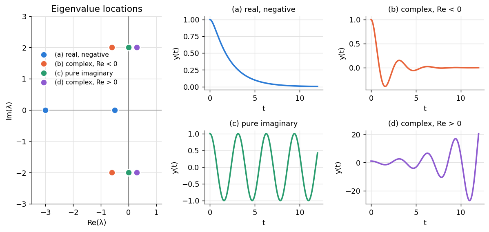
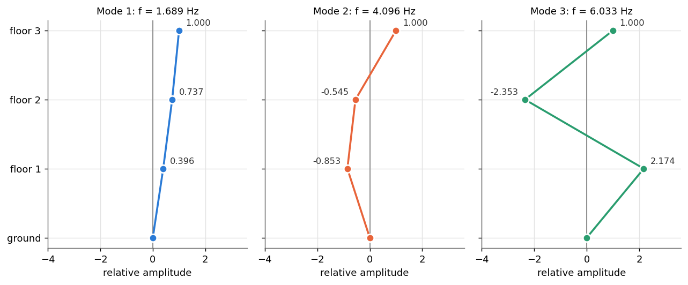

# Chapter 13 — Eigenvalue Methods: Symmetric Matrices

[Repository Guide](../../README.md) | [English](Concepts_Lecture.md) | [한국어](Concepts_Lecture.ko.md)

> **Last Updated:** 2026-11-19
>
> Applied Numerical Methods with Python for Engineers and Scientists, Chapra and Clough, Ch 13

> **Learning Objectives:**
> 1. Compute eigenvalues and eigenvectors from the characteristic equation
> 2. Determine the stability and oscillation of a linear ODE system from the location of its eigenvalues
> 3. Formulate coupled oscillators and mass-spring systems as eigenvalue problems and find their natural frequencies and modes
> 4. Find the largest and smallest eigenvalues with the power method and the inverse power method
> 5. Derive the convergence of the power method from an eigenvector expansion and accelerate it with the Rayleigh quotient and shifts
> 6. Prove that a symmetric matrix has real eigenvalues and orthogonal eigenvectors

---

<br>

## Table of Contents

- [1. Eigenvalues and Eigenvectors](#1-eigenvalues-and-eigenvectors)
  - [1.1 Definition](#11-definition)
  - [1.2 Geometric Interpretation](#12-geometric-interpretation)
  - [1.3 Example: Projection Matrix](#13-example-projection-matrix)
  - [1.4 Example: Reflection Matrix](#14-example-reflection-matrix)
- [2. Computing Eigenvalues and Eigenvectors](#2-computing-eigenvalues-and-eigenvectors)
  - [2.1 The Characteristic Equation](#21-the-characteristic-equation)
  - [2.2 The 2x2 Case](#22-the-2x2-case)
  - [2.3 Example: Finding Eigenvalues and Eigenvectors](#23-example-finding-eigenvalues-and-eigenvectors)
  - [2.4 Characteristic Polynomials of Larger Matrices](#24-characteristic-polynomials-of-larger-matrices)
- [3. Applications: Differential Equations](#3-applications-differential-equations)
  - [3.1 First-Order ODE: Scalar Case](#31-first-order-ode-scalar-case)
  - [3.2 Converting 2nd-Order to 1st-Order System](#32-converting-2nd-order-to-1st-order-system)
  - [3.3 Matrix Exponential and Stability](#33-matrix-exponential-and-stability)
  - [3.4 Eigenvalue Location and System Behavior](#34-eigenvalue-location-and-system-behavior)
  - [3.5 Complex Eigenvalues and Damped Oscillation](#35-complex-eigenvalues-and-damped-oscillation)
- [4. Example 13.2: Stability of a First-Order System](#4-example-132-stability-of-a-first-order-system)
- [5. Eigenvalues and Ordinary Differential Equations](#5-eigenvalues-and-ordinary-differential-equations)
  - [5.1 Pure Oscillations: Single 2nd-Order ODE](#51-pure-oscillations-single-2nd-order-ode)
  - [5.2 Eigenvectors of the Oscillation System](#52-eigenvectors-of-the-oscillation-system)
- [6. Coupled 2nd-Order ODE Systems](#6-coupled-2nd-order-ode-systems)
  - [6.1 General Form](#61-general-form)
  - [6.2 Proposed Periodic Solution](#62-proposed-periodic-solution)
  - [6.3 Characteristic Equation for 2nd-Order Systems](#63-characteristic-equation-for-2nd-order-systems)
- [7. Example 13.3: Behavior of a Coupled System](#7-example-133-behavior-of-a-coupled-system)
  - [7.1 Eigenvalue Computation](#71-eigenvalue-computation)
  - [7.2 Eigenvector Computation](#72-eigenvector-computation)
  - [7.3 Frequencies and General Solution](#73-frequencies-and-general-solution)
  - [7.4 Applying Initial Conditions](#74-applying-initial-conditions)
- [8. Physical Settings: Mass-Spring Systems](#8-physical-settings-mass-spring-systems)
  - [8.1 Two-Mass, Three-Spring System](#81-two-mass-three-spring-system)
  - [8.2 Eigenvalue Formula for the Mass-Spring System](#82-eigenvalue-formula-for-the-mass-spring-system)
  - [8.3 Matrix Form of the Equations of Motion and Equilibrium](#83-matrix-form-of-the-equations-of-motion-and-equilibrium)
- [9. Example 13.4: Mass-Spring System](#9-example-134-mass-spring-system)
- [10. The Power Method](#10-the-power-method)
  - [10.1 Three-Mass, Four-Spring System (Ex 13.5)](#101-three-mass-four-spring-system-ex-135)
  - [10.2 Algorithm](#102-algorithm)
  - [10.3 Iteration Walkthrough](#103-iteration-walkthrough)
  - [10.4 Convergence and Finding the Smallest Eigenvalue](#104-convergence-and-finding-the-smallest-eigenvalue)
  - [10.5 Why the Power Method Converges](#105-why-the-power-method-converges)
  - [10.6 Rayleigh Quotient](#106-rayleigh-quotient)
  - [10.7 Shifted Inverse Power Method](#107-shifted-inverse-power-method)
  - [10.8 Deflation](#108-deflation)
- [11. Python Implementation](#11-python-implementation)
  - [11.1 Eigenvalue computation using NumPy](#111-eigenvalue-computation-using-numpy)
  - [11.2 Power Method implementation](#112-power-method-implementation)
  - [11.3 Mass-Spring System (Ex 13.4)](#113-mass-spring-system-ex-134)
  - [11.4 Inverse Power Method for smallest eigenvalue](#114-inverse-power-method-for-smallest-eigenvalue)
- [12. Eigenvalue Problems of Symmetric Matrices](#12-eigenvalue-problems-of-symmetric-matrices)
  - [12.1 Real Eigenvalues and Orthogonal Eigenvectors](#121-real-eigenvalues-and-orthogonal-eigenvectors)
  - [12.2 Vibration Modes and Eigenvector Normalization](#122-vibration-modes-and-eigenvector-normalization)
  - [12.3 Symmetrizing Systems with Unequal Masses](#123-symmetrizing-systems-with-unequal-masses)
  - [12.4 Application: Natural Vibration of a Three-Story Building](#124-application-natural-vibration-of-a-three-story-building)
- [13. Common Mistakes](#13-common-mistakes)
- [Summary](#summary)
- [Self-Check Questions](#self-check-questions)
- [References](#references)

---

<br>

## 1. Eigenvalues and Eigenvectors

### 1.1 Definition

We work on **square matrices**. Given an $`n \times n`$ matrix $`[A]`$, consider the equation:

```math
[A]\{x\} = \lambda \{x\}
```

where $`\{x\}`$ is an $`n \times 1`$ vector and $`\lambda \in \mathbb{R}`$ or $`\lambda \in \mathbb{C}`$.

For any value of $`\lambda`$, a **trivial solution** $`\{x\} = \{0\}`$ always exists.

If there is a **non-trivial solution** $`\{x\} \neq \{0\}`$ such that $`[A]\{x\} = \lambda \{x\}`$, then:

- $`\{x\}`$ is called an **eigenvector** of $`[A]`$.
- $`\lambda`$ is called the **eigenvalue** associated with $`\{x\}`$.

> **[Linear Algebra]** The word "eigen" comes from German, meaning "own" or "characteristic." An eigenvector is a special direction in which the matrix acts simply as a scalar multiplier. An $`n \times n`$ matrix has exactly $`n`$ (complex) eigenvalues counting multiplicities, which are the roots of the characteristic polynomial, so it has at most $`n`$ distinct eigenvalues.

### 1.2 Geometric Interpretation

The eigenvector $`\{x\}`$ is **parallel** to $`[A]\{x\}`$. That is, multiplying $`\{x\}`$ by the matrix $`[A]`$ keeps it on the same line through the origin and only scales it by the factor $`\lambda`$: it points in the same direction if $`\lambda > 0`$, in the opposite direction if $`\lambda < 0`$, and becomes the zero vector if $`\lambda = 0`$.

```math
\lambda \{x\} \quad \longrightarrow \quad \text{(same direction as } [A]\{x\}\text{)}
```

### 1.3 Example: Projection Matrix

Suppose $`P`$ is the projection matrix onto a plane.

**Case 1:** For any vector $`\{x\}`$ that lies **in the plane**:

```math
[P]\{x\} = \{x\} = 1 \cdot \{x\}
```

Here $`\lambda = 1`$ is the eigenvalue, and $`\{x\}`$ (any nonzero vector in the plane) is the eigenvector.

**Case 2:** If a vector $`\{x\}`$ is **perpendicular** to the plane:

```math
[P]\{x\} = \{0\} = 0 \cdot \{x\}
```

Here $`\lambda = 0`$ is the eigenvalue, and $`\{x\}`$ (a vector normal to the plane) is the eigenvector.

### 1.4 Example: Reflection Matrix

Consider the reflection matrix:

```math
A = \begin{bmatrix} 0 & 1 \\ 1 & 0 \end{bmatrix}
```

This is the reflection across the line $`x_1 = x_2`$. Its eigenvectors are $`\begin{Bmatrix} 1 \\ 1 \end{Bmatrix}`$ (eigenvalue 1) and $`\begin{Bmatrix} 1 \\ -1 \end{Bmatrix}`$ (eigenvalue $`-1`$).

The two eigenvectors **span the whole space**, meaning any vector in $`\mathbb{R}^2`$ can be written as a linear combination of these eigenvectors.

> **[Linear Algebra]** When the eigenvectors of an $`n \times n`$ matrix span the entire $`\mathbb{R}^n`$, the matrix is said to be **diagonalizable**. Real symmetric matrices are always diagonalizable by an orthogonal matrix and have real eigenvalues, a key result known as the **spectral theorem**.

---

<br>

## 2. Computing Eigenvalues and Eigenvectors

### 2.1 The Characteristic Equation

Starting from the eigenvalue equation:

```math
[A]\{x\} = \lambda \{x\}
```

Rearranging:

```math
[A]\{x\} - \lambda [I]\{x\} = \{0\}
```

```math
[A - \lambda I]\{x\} = \{0\}
```

For a **non-trivial solution** $`\{x\} \neq \{0\}`$ to exist, the matrix $`[A - \lambda I]`$ must be non-invertible, that is, **singular**. This requires:

```math
\det(A - \lambda I) = |A - \lambda I| = 0
```

This is called the **characteristic equation**, and the determinant on the left, viewed as a polynomial in $`\lambda`$, is the characteristic polynomial. For an $`n \times n`$ matrix, the characteristic polynomial has degree $`n`$ in $`\lambda`$.

### 2.2 The 2x2 Case

For a $`2 \times 2`$ matrix:

```math
\begin{vmatrix} a_{11} - \lambda & a_{12} \\ a_{21} & a_{22} - \lambda \end{vmatrix} = 0
```

Expanding:

```math
\lambda^2 - (a_{11} + a_{22})\lambda + (a_{11}a_{22} - a_{12}a_{21}) = 0
```

Using the quadratic formula:

```math
\lambda = \frac{(a_{11} + a_{22}) \pm \sqrt{(a_{11} + a_{22})^2 - 4(a_{11}a_{22} - a_{12}a_{21})}}{2}
```

> **[Linear Algebra]** The quantity $`a_{11} + a_{22}`$ is the **trace** of $`A`$, and $`a_{11}a_{22} - a_{12}a_{21}`$ is the **determinant** of $`A`$. For any $`2 \times 2`$ matrix, the sum of eigenvalues equals the trace and the product of eigenvalues equals the determinant, and these relations hold for general $`n \times n`$ matrices as well (Chapter 13 Lab, Section 1.1).

### 2.3 Example: Finding Eigenvalues and Eigenvectors

Consider:

```math
A = \begin{bmatrix} 3 & 1 \\ 1 & 3 \end{bmatrix}
```

**Step 1: Characteristic equation**

```math
|A - \lambda I| = \begin{vmatrix} 3 - \lambda & 1 \\ 1 & 3 - \lambda \end{vmatrix} = (3 - \lambda)^2 - 1 = \lambda^2 - 6\lambda + 8 = (\lambda - 4)(\lambda - 2) = 0
```

Therefore: $`\lambda_1 = 4`$ and $`\lambda_2 = 2`$.

**Step 2: Eigenvector for $`\lambda_1 = 4`$**

```math
\begin{bmatrix} 3 - 4 & 1 \\ 1 & 3 - 4 \end{bmatrix} \begin{Bmatrix} x_1 \\ x_2 \end{Bmatrix} = \begin{Bmatrix} 0 \\ 0 \end{Bmatrix}
```

```math
-x_1 + x_2 = 0 \quad \text{and} \quad x_1 - x_2 = 0 \quad \Rightarrow \quad \text{same equation}
```

An eigenvector is determined only up to a scalar multiple, so let $`x_1 = 1`$; then $`x_2 = 1`$ and the eigenvector is:

```math
\{x\}_1 = \begin{Bmatrix} 1 \\ 1 \end{Bmatrix}
```

**Step 3: Eigenvector for $`\lambda_2 = 2`$**

```math
\begin{bmatrix} 3 - 2 & 1 \\ 1 & 3 - 2 \end{bmatrix} \begin{Bmatrix} x_1 \\ x_2 \end{Bmatrix} = \begin{Bmatrix} 0 \\ 0 \end{Bmatrix}
```

```math
x_1 + x_2 = 0
```

Let $`x_1 = 1`$; then $`x_2 = -1`$ and the eigenvector is:

```math
\{x\}_2 = \begin{Bmatrix} 1 \\ -1 \end{Bmatrix}
```

### 2.4 Characteristic Polynomials of Larger Matrices

For $`n \geq 3`$, the characteristic polynomial is obtained by cofactor expansion of the determinant. Expanding the matrix of Example 13.5 (Section 10.1) along its first row gives the following.

```math
\det(A - \lambda I) = \begin{vmatrix} 40 - \lambda & -20 & 0 \\ -20 & 40 - \lambda & -20 \\ 0 & -20 & 40 - \lambda \end{vmatrix} = (40 - \lambda)\left[(40 - \lambda)^2 - 400\right] - (-20)\left[(-20)(40 - \lambda) - 0\right]
```

```math
= (40 - \lambda)\left[(40 - \lambda)^2 - 800\right] = -\lambda^3 + 120\lambda^2 - 4000\lambda + 32000
```

The factor $`40 - \lambda`$ appears, so one root is $`\lambda = 40`$, and the other two follow from $`(40 - \lambda)^2 = 800`$ as $`\lambda = 40 \pm 20\sqrt{2}`$. The sum of the three roots, 120, equals the trace $`40 + 40 + 40`$, and their product $`40(1600 - 800) = 32000`$ equals the determinant. A factor rarely appears this readily; in general the coefficients of the characteristic polynomial are computed and the polynomial is solved with the root-finding methods of Chapter 6. Given a square matrix, `np.poly` returns the coefficients of $`\det(\lambda I - A)`$, highest power first [1].

```python
import numpy as np

A = np.array([[40, -20, 0], [-20, 40, -20], [0, -20, 40]], dtype=float)
c = np.poly(A)                    # coefficients of det(lambda I - A), highest power first
print(c.round(6).tolist())
print(np.roots(c))                # roots of the characteristic polynomial

lam_true = np.arange(1.0, 21.0)   # 1, 2, ..., 20
c20 = np.poly(lam_true)           # coefficients of (lambda - 1)(lambda - 2)...(lambda - 20)
r = np.sort(np.roots(c20).real)
print(f"largest coefficient = {np.abs(c20).max():.2e}")
print(f"max root error = {np.abs(r - lam_true).max():.1e}")
```

```text
[1.0, -120.0, 4000.0, -32000.0]
[68.28427125 40.         11.71572875]
largest coefficient = 1.38e+19
max root error = 3.9e-02
```

The coefficients in the first line equal $`\lambda^3 - 120\lambda^2 + 4000\lambda - 32000`$, the hand-computed polynomial with its sign reversed, and `np.roots` returns the three eigenvalues. The last four lines show the limitation of this approach. The characteristic polynomial $`(\lambda - 1)(\lambda - 2)\cdots(\lambda - 20)`$ for the eigenvalues 1, 2, ..., 20 has coefficients whose sizes range from 1 to about $`1.4 \times 10^{19}`$, and its roots are extremely sensitive to them. Changing each coefficient by only the double-precision relative rounding error (about $`10^{-16}`$) can, to first order, move the roots 14 and 15 by up to about 0.08, and the roots that `np.roots` actually returns deviate from the true values by up to 0.039 (at the root 14). Although the eigenvalues of a symmetric matrix are insensitive to small changes in its entries (Section 12.1), passing through the coefficients of the characteristic polynomial turns the task into one whose roots are extremely sensitive to the coefficients. The characteristic equation is therefore used for hand calculation and theory, and numerical computation uses methods that act on the matrix directly, such as the iterative methods of Section 10 or the QR algorithm in the note at the end of Section 12.1.

---

<br>

## 3. Applications: Differential Equations

### 3.1 First-Order ODE: Scalar Case

Consider the scalar ODE:

```math
\frac{dx}{dt} = ax, \quad a \in \mathbb{R}
```

The solution is:

```math
x(t) = e^{at} C, \quad C \text{ is a constant}
```

The behavior depends on $`a`$ as shown below. The last row extends $`a`$ to complex values.

| Value of $`a`$ | Solution behavior |
|---|---|
| $`a > 0`$ (real, positive) | Exponential growth (unstable) |
| $`a < 0`$ (real, negative) | Exponential decay (stable) |
| $`a = 0`$ | Constant: $`x(t) = C`$ |
| $`a = i\beta`$ (imaginary) | Oscillation: $`x(t) = e^{i\beta t}C = (\cos \beta t + i\sin \beta t)C`$ |

*Table 1. Behavior of the scalar ODE solution by the value of a*

### 3.2 Converting 2nd-Order to 1st-Order System

Consider the following second-order ODE with constant coefficients:

```math
\frac{d^2 y}{dt^2} + a\frac{dy}{dt} + by = 0
```

It can be converted to a system of **first-order** ODEs by the substitution:

```math
x_1 = y, \quad x_2 = \frac{dx_1}{dt}
```

This gives:

```math
\frac{dx_1}{dt} = x_2
```

```math
\frac{dx_2}{dt} = -bx_1 - ax_2
```

In matrix form:

```math
\frac{d}{dt}\begin{Bmatrix} x_1 \\ x_2 \end{Bmatrix} = \begin{bmatrix} 0 & 1 \\ -b & -a \end{bmatrix} \begin{Bmatrix} x_1 \\ x_2 \end{Bmatrix}
```

We have converted one 2nd-order ODE into **two first-order** ODEs.

### 3.3 Matrix Exponential and Stability

For the vector ODE:

```math
\frac{d\mathbf{x}}{dt} = A\mathbf{x}, \quad \mathbf{x} \in \mathbb{R}^n, \quad A \in \mathbb{R}^{n \times n}
```

The solution is:

```math
\mathbf{x}(t) = e^{At}\mathbf{C}, \quad \mathbf{C} \in \mathbb{R}^n
```

Here $`e^{At}`$ is the **matrix exponential**. If $`A`$ is symmetric, it can be diagonalized as $`A = U D U^T`$, where $`D`$ is the diagonal matrix of eigenvalues and $`U`$ has orthonormal eigenvectors as its columns, and then the following holds (for a general diagonalizable matrix, $`U^{-1}`$ replaces $`U^T`$):

```math
e^{At} = U \, e^{Dt} \, U^T
```

This means:

- **Negative real eigenvalues** produce stable (decaying) solutions.
- **Positive real eigenvalues** produce unstable (growing) solutions.
- **Imaginary eigenvalues** produce oscillatory solutions.

### 3.4 Eigenvalue Location and System Behavior

The complex plane provides an intuitive map for stability:

| Region | Eigenvalue type | System behavior |
|---|---|---|
| Left half-plane ($`\text{Re}(\lambda) < 0`$) | Negative real part | **Stable** (solution decays) |
| Right half-plane ($`\text{Re}(\lambda) > 0`$) | Positive real part | **Unstable** (solution grows) |
| Imaginary axis ($`\text{Re}(\lambda) = 0`$) | Pure imaginary | **Oscillation** (bounded periodic motion) |
| Far left | Large negative real | Faster convergence |
| Far right | Large positive real | Faster divergence |

*Table 2. Eigenvalue location in the complex plane and system behavior*

### 3.5 Complex Eigenvalues and Damped Oscillation

Dividing the oscillator $`m\ddot{y} + c\dot{y} + ky = 0`$ with mass $`m`$, damping coefficient $`c`$, and spring constant $`k`$ by $`m`$ and writing $`\omega_n = \sqrt{k/m}`$ and $`\zeta = c/(2\sqrt{km})`$ gives $`\ddot{y} + 2\zeta\omega_n\dot{y} + \omega_n^2y = 0`$. The matrix $`\begin{bmatrix} 0 & 1 \\ -\omega_n^2 & -2\zeta\omega_n \end{bmatrix}`$ obtained by the conversion of Section 3.2 has the characteristic equation $`\lambda^2 + 2\zeta\omega_n\lambda + \omega_n^2 = 0`$, so its eigenvalues are the following.

```math
\lambda = -\zeta\omega_n \pm \omega_n\sqrt{\zeta^2 - 1}
```

$`\omega_n`$ is called the **natural angular frequency** and $`\zeta`$ the **damping ratio**. If $`\zeta > 1`$, the two eigenvalues are distinct negative real numbers and the solution decays without oscillation (overdamped); if $`\zeta = 1`$, there is a double root $`-\omega_n`$ (critically damped); and if $`0 < \zeta < 1`$, the eigenvalues are a complex conjugate pair $`\lambda = \alpha \pm i\beta`$ with $`\alpha = -\zeta\omega_n`$ and $`\beta = \omega_n\sqrt{1 - \zeta^2}`$ (underdamped). $`\zeta = 0`$ is the pure oscillation of Section 5.1. The solution for a complex conjugate pair can be written in real form with Euler's formula.

```math
e^{(\alpha \pm i\beta)t} = e^{\alpha t}(\cos\beta t \pm i\sin\beta t) \quad\Longrightarrow\quad y(t) = e^{\alpha t}(C_1\cos\beta t + C_2\sin\beta t)
```

The real part $`\alpha`$ sets the decay rate of the envelope $`e^{\alpha t}`$, and the imaginary part $`\beta`$ sets the angular frequency of the oscillation. For example, $`\ddot{y} + 2\dot{y} + 5y = 0`$ has $`\omega_n = \sqrt{5} = 2.2361`$ and $`\zeta = 1/\sqrt{5} = 0.4472`$, and its eigenvalues are $`\lambda = -1 \pm 2i`$. With $`y(0) = 1`$ and $`\dot{y}(0) = 0`$, $`C_1 = 1`$, and $`\dot{y}(0) = \alpha C_1 + \beta C_2 = -1 + 2C_2 = 0`$ gives $`C_2 = 0.5`$, so $`y(t) = e^{-t}(\cos 2t + 0.5\sin 2t)`$. The period of the oscillation is $`2\pi/2 = 3.1416`$ s, and the envelope halves every $`\ln 2 = 0.693`$ s, giving $`y(1) = 0.0142`$, $`y(2) = -0.1397`$, and $`y(3) = 0.0408`$. Because of the damping, the angular frequency of the oscillation, $`\beta = 2`$, is slightly smaller than the natural angular frequency $`\omega_n = 2.2361`$, and $`\omega_n`$ equals the magnitude of the eigenvalue, $`|\lambda| = \sqrt{1 + 4}`$.



*Figure 1. Eigenvalue locations and the corresponding solution shapes*

Figure 1 shows the solutions of four systems starting from $`y(0) = 1`$ and $`\dot{y}(0) = 0`$. In (a) the two negative real eigenvalues $`-0.5`$ and $`-3`$ produce decay without oscillation, in (b) $`-0.6 \pm 2i`$ produces a damped oscillation, in (c) $`\pm 2i`$ produces an oscillation of constant amplitude, and in (d) $`0.3 \pm 2i`$ produces an oscillation of growing amplitude. Cases (b), (c), and (d) share the same imaginary part, so they share the period $`\pi`$, and only the real part changes the envelope. The classification of Table 2 is confirmed directly in the shapes of the solutions.

---

<br>

## 4. Example 13.2: Stability of a First-Order System

Consider the system:

```math
\frac{dx_1}{dt} = -3x_1 + x_2
```

```math
\frac{dx_2}{dt} = x_1 - 3x_2
```

In matrix form:

```math
\frac{d}{dt}\begin{Bmatrix} x_1 \\ x_2 \end{Bmatrix} = \begin{bmatrix} -3 & 1 \\ 1 & -3 \end{bmatrix} \begin{Bmatrix} x_1 \\ x_2 \end{Bmatrix}
```

**Characteristic equation:**

```math
\begin{vmatrix} -3 - \lambda & 1 \\ 1 & -3 - \lambda \end{vmatrix} = (3 + \lambda)^2 - 1 = \lambda^2 + 6\lambda + 8 = (\lambda + 4)(\lambda + 2) = 0
```

```math
\therefore \lambda = -2 \text{ or } -4
```

**Both eigenvalues are negative real numbers**, so the solutions will be **stable**, and since they have no imaginary part, the solutions die out to zero **without oscillation**.

The behavior was judged from the eigenvalues alone, but the eigenvectors give the solution itself. The eigenvectors of $`A`$ are $`(1,\ 1)`$ ($`\lambda = -2`$) and $`(1,\ -1)`$ ($`\lambda = -4`$), as in Section 2.3, so by the diagonalization of Section 3.3 the solution is a sum in which the component along each eigenvector decays separately with its own eigenvalue, $`\mathbf{x}(t) = c_1e^{-2t}(1,\ 1) + c_2e^{-4t}(1,\ -1)`$. The initial condition $`\mathbf{x}(0) = (1,\ 0)`$ gives $`c_1 + c_2 = 1`$ and $`c_1 - c_2 = 0`$, so $`c_1 = c_2 = 1/2`$, and the result is the following.

```math
x_1(t) = \frac{1}{2}\left(e^{-2t} + e^{-4t}\right), \qquad x_2(t) = \frac{1}{2}\left(e^{-2t} - e^{-4t}\right)
```

$`x_2`$ starts at 0, reaches its maximum 0.125 at $`t = \ln 2/2 = 0.3466`$, where $`\dot{x}_2 = -e^{-2t} + 2e^{-4t} = 0`$, and then decays. The $`e^{-4t}`$ component disappears first, so after a while the solution follows the direction $`(1,\ 1)`$ of the slow mode and $`x_1 \approx x_2`$. The following code compares this eigenvector expansion with the matrix exponential $`e^{At}\mathbf{x}(0)`$ computed by `scipy.linalg.expm`. `expm` computes the matrix exponential with a Pade approximation whose order is chosen from the data [2].

```python
import numpy as np
from scipy.linalg import expm

A = np.array([[-3.0, 1.0], [1.0, -3.0]])
x0 = np.array([1.0, 0.0])
lam, V = np.linalg.eigh(A)             # eigenvalues -4, -2 and orthonormal eigenvectors
c = V.T @ x0                           # coefficients of x0 along the eigenvectors
for t in (0.0, 0.25, 0.5, 1.0, 2.0):
    x_eig = V @ (c * np.exp(lam * t))  # sum of c_i e^(lambda_i t) v_i
    x_expm = expm(A * t) @ x0          # matrix exponential
    print(t, np.round(x_eig, 6), np.round(x_expm, 6))
```

```text
0.0 [1. 0.] [1. 0.]
0.25 [0.487205 0.119326] [0.487205 0.119326]
0.5 [0.251607 0.116272] [0.251607 0.116272]
1.0 [0.076825 0.05851 ] [0.076825 0.05851 ]
2.0 [0.009326 0.00899 ] [0.009326 0.00899 ]
```

`np.linalg.eigh` returns the eigenvalues in ascending order, $`-4,\ -2`$, and the eigenvectors as orthonormal columns, so the expansion coefficients are obtained with the transpose instead of the inverse, as `V.T @ x0` (Section 12.1). `c * np.exp(lam * t)` multiplies the coefficient of each mode by $`e^{\lambda_it}`$, and `V @` recombines the modes. The two methods agree at every time, and $`(0.251607,\ 0.116272)`$ at $`t = 0.5`$ equals the formula above evaluated with $`e^{-1}`$ and $`e^{-2}`$. At $`t = 2`$ the ratio of the two components is nearly 1, showing that only the slow mode remains. The same computation for a nonsymmetric matrix is covered in Section 7 of the Chapter 13 Lab.

---

<br>

## 5. Eigenvalues and Ordinary Differential Equations

### 5.1 Pure Oscillations: Single 2nd-Order ODE

Consider the undamped oscillator ($`a > 0`$):

```math
\ddot{y} = -ay \quad \Longleftrightarrow \quad \frac{d^2 y}{dt^2} = -ay
```

Cast into first-order ODEs with $`x_1 = y`$, $`x_2 = \frac{dx_1}{dt}`$:

```math
\frac{d}{dt}\begin{Bmatrix} x_1 \\ x_2 \end{Bmatrix} = \begin{bmatrix} 0 & 1 \\ -a & 0 \end{bmatrix} \begin{Bmatrix} x_1 \\ x_2 \end{Bmatrix}
```

**Finding eigenvalues of $`A`$:**

```math
|A - \lambda I| = \begin{vmatrix} -\lambda & 1 \\ -a & -\lambda \end{vmatrix} = \lambda^2 + a = 0
```

```math
\therefore \lambda = \pm \sqrt{-a} = \pm \sqrt{a}\, i
```

The eigenvalues are **pure imaginary** (lie on the imaginary axis), so the solution will be **oscillatory** with frequency $`\sqrt{a}/2\pi`$.

Euler's formula and the relations for the period and frequency are:

```math
e^{i\sqrt{a}\,t} = \cos(\sqrt{a}\,t) + i\sin(\sqrt{a}\,t)
```

```math
\text{Period} = \frac{2\pi}{\sqrt{a}}, \qquad \text{Frequency} = \frac{1}{\text{Period}} = \frac{\sqrt{a}}{2\pi}
```

> **Note:** **Eigenvalues and frequency.** Eigenvalues are directly related to the **frequency of oscillations**. This is why eigenvalue problems appear throughout physics and engineering whenever we analyze vibrating systems.

### 5.2 Eigenvectors of the Oscillation System

Solve $`[A - \lambda I]\{x\} = \{0\}`$:

```math
\begin{bmatrix} -\lambda & 1 \\ -a & -\lambda \end{bmatrix} \begin{Bmatrix} x_1 \\ x_2 \end{Bmatrix} = \begin{Bmatrix} 0 \\ 0 \end{Bmatrix}
```

**Case i)** $`\lambda = \sqrt{a}\, i`$:

```math
-\sqrt{a}\,i \cdot x_1 + x_2 = 0
```

Take $`x_1 = 1`$; then $`x_2 = \sqrt{a}\,i`$:

```math
\{x\} = \begin{Bmatrix} 1 \\ \sqrt{a}\,i \end{Bmatrix}
```

**Case ii)** $`\lambda = -\sqrt{a}\, i`$:

```math
\sqrt{a}\,i \cdot x_1 + x_2 = 0
```

Take $`x_1 = 1`$; then $`x_2 = -\sqrt{a}\,i`$:

```math
\{x\} = \begin{Bmatrix} 1 \\ -\sqrt{a}\,i \end{Bmatrix}
```

---

<br>

## 6. Coupled 2nd-Order ODE Systems

### 6.1 General Form

A system of two coupled second-order ODEs:

```math
\frac{d^2 y_1}{dt^2} = -a_{11}y_1 + a_{12}y_2
```

```math
\frac{d^2 y_2}{dt^2} = a_{21}y_1 - a_{22}y_2
```

In matrix form:

```math
\frac{d^2}{dt^2}\begin{Bmatrix} y_1 \\ y_2 \end{Bmatrix} = \begin{bmatrix} -a_{11} & a_{12} \\ a_{21} & -a_{22} \end{bmatrix} \begin{Bmatrix} y_1 \\ y_2 \end{Bmatrix} \quad \cdots \quad (*)
```

### 6.2 Proposed Periodic Solution

Based on the periodic solution form, we propose:

```math
\begin{Bmatrix} y_1 \\ y_2 \end{Bmatrix} = \begin{Bmatrix} X_1 \\ X_2 \end{Bmatrix} e^{i\omega t}
```

where $`\omega`$ is the angular frequency. Substituting into $`(*)`$:

```math
-\omega^2 \begin{Bmatrix} X_1 \\ X_2 \end{Bmatrix} e^{i\omega t} = \begin{bmatrix} -a_{11} & a_{12} \\ a_{21} & -a_{22} \end{bmatrix} \begin{Bmatrix} X_1 \\ X_2 \end{Bmatrix} e^{i\omega t}
```

Cancel $`e^{i\omega t}`$:

```math
\underbrace{-\omega^2}_{\lambda} \begin{Bmatrix} X_1 \\ X_2 \end{Bmatrix} = \underbrace{\begin{bmatrix} -a_{11} & a_{12} \\ a_{21} & -a_{22} \end{bmatrix}}_{A} \begin{Bmatrix} X_1 \\ X_2 \end{Bmatrix}
```

**This is an eigenvalue problem.** The eigenvalue is $`\lambda = -\omega^2`$, so $`\omega^2 = -\lambda`$.

### 6.3 Characteristic Equation for 2nd-Order Systems

From $`|A - \lambda I| = 0`$:

```math
\begin{vmatrix} -a_{11} - \lambda & a_{12} \\ a_{21} & -a_{22} - \lambda \end{vmatrix} = 0
```

```math
(a_{11} + \lambda)(a_{22} + \lambda) - a_{12}a_{21} = 0
```

```math
\lambda^2 + (a_{11} + a_{22})\lambda + a_{11}a_{22} - a_{12}a_{21} = 0
```

```math
\therefore \lambda = \frac{-(a_{11} + a_{22}) \pm \sqrt{(a_{11} + a_{22})^2 - 4(a_{11}a_{22} - a_{12}a_{21})}}{2}
```

Equivalently, in terms of $`\omega^2 = -\lambda`$:

```math
|A + \omega^2 I| = \begin{vmatrix} -a_{11} + \omega^2 & a_{12} \\ a_{21} & -a_{22} + \omega^2 \end{vmatrix} = 0
```

```math
(\omega^2 - a_{11})(\omega^2 - a_{22}) - a_{12}a_{21} = 0
```

```math
\omega^4 - (a_{11} + a_{22})\omega^2 + a_{11}a_{22} - a_{12}a_{21} = 0
```

```math
\therefore \omega^2 = \frac{(a_{11} + a_{22}) \pm \sqrt{(a_{11} + a_{22})^2 - 4(a_{11}a_{22} - a_{12}a_{21})}}{2}
```

---

<br>

## 7. Example 13.3: Behavior of a Coupled System

### 7.1 Eigenvalue Computation

Given:

```math
\frac{d^2 y_1}{dt^2} = -5y_1 + 2y_2, \qquad \frac{d^2 y_2}{dt^2} = 2y_1 - 2y_2
```

Matrix form:

```math
\frac{d^2}{dt^2}\begin{Bmatrix} y_1 \\ y_2 \end{Bmatrix} = \underbrace{\begin{bmatrix} -5 & 2 \\ 2 & -2 \end{bmatrix}}_{A}\begin{Bmatrix} y_1 \\ y_2 \end{Bmatrix}
```

Characteristic equation:

```math
\begin{vmatrix} -5 - \lambda & 2 \\ 2 & -2 - \lambda \end{vmatrix} = (5 + \lambda)(2 + \lambda) - 4 = \lambda^2 + 7\lambda + 6 = (\lambda + 6)(\lambda + 1) = 0
```

```math
\therefore \lambda_1 = -1, \quad \lambda_2 = -6
```

### 7.2 Eigenvector Computation

**For $`\lambda_1 = -1`$:**

```math
\begin{bmatrix} -5 + 1 & 2 \\ 2 & -2 + 1 \end{bmatrix}\begin{Bmatrix} x_1 \\ x_2 \end{Bmatrix} = \begin{Bmatrix} 0 \\ 0 \end{Bmatrix} \quad \Rightarrow \quad -4x_1 + 2x_2 = 0 \quad \Rightarrow \quad 2x_1 - x_2 = 0
```

Take $`x_1 = 1`$, $`x_2 = 2`$; the eigenvector is:

```math
\{x\}_1 = \begin{Bmatrix} 1 \\ 2 \end{Bmatrix}
```

**For $`\lambda_2 = -6`$:**

```math
\begin{bmatrix} -5 + 6 & 2 \\ 2 & -2 + 6 \end{bmatrix}\begin{Bmatrix} x_1 \\ x_2 \end{Bmatrix} = \begin{Bmatrix} 0 \\ 0 \end{Bmatrix} \quad \Rightarrow \quad x_1 + 2x_2 = 0
```

Take $`x_2 = -1`$, $`x_1 = 2`$; the eigenvector is:

```math
\{x\}_2 = \begin{Bmatrix} 2 \\ -1 \end{Bmatrix}
```

### 7.3 Frequencies and General Solution

From the eigenvalues, $`\omega^2 = -\lambda`$:

```math
\omega_1^2 = 1 \quad \Rightarrow \quad \omega_1 = \pm 1
```

```math
\omega_2^2 = 6 \quad \Rightarrow \quad \omega_2 = \pm \sqrt{6}
```

The solution behaves as:

```math
\{x\}_1 e^{\pm it} = \{x\}_1 (\cos t \pm i\sin t)
```

```math
\{x\}_2 e^{\pm i\sqrt{6}t} = \{x\}_2 (\cos\sqrt{6}t \pm i\sin\sqrt{6}t)
```

General solution:

```math
\mathbf{y} = C_1 \{x\}_1 e^{+it} + C_2 \{x\}_2 e^{+i\sqrt{6}t} + C_3 \{x\}_1 e^{-it} + C_4 \{x\}_2 e^{-i\sqrt{6}t}
```

Its time derivative:

```math
\dot{\mathbf{y}} = iC_1 \{x\}_1 e^{+it} + i\sqrt{6}C_2 \{x\}_2 e^{+i\sqrt{6}t} - iC_3 \{x\}_1 e^{-it} - i\sqrt{6}C_4 \{x\}_2 e^{-i\sqrt{6}t}
```

### 7.4 Applying Initial Conditions

Given initial conditions:

```math
\mathbf{y}(t=0) = \begin{Bmatrix} 1 \\ -1 \end{Bmatrix}, \quad \dot{\mathbf{y}}(t=0) = \begin{Bmatrix} 0 \\ 0 \end{Bmatrix}
```

At $`t = 0`$, the velocity is $`i(C_1 - C_3)\{x\}_1 + i\sqrt{6}(C_2 - C_4)\{x\}_2 = \{0\}`$, and the two eigenvectors are linearly independent, so we require $`C_1 = C_3`$ and $`C_2 = C_4`$. Let $`\tilde{C}_1 = C_1 = C_3`$ and $`\tilde{C}_2 = C_2 = C_4`$.

Substituting $`t = 0`$ into the position equations gives $`\mathbf{y}(0) = 2\tilde{C}_1\{x\}_1 + 2\tilde{C}_2\{x\}_2`$.

From $`y_1`$: $`1 = 2\tilde{C}_1 + 4\tilde{C}_2`$

From $`y_2`$: $`-1 = 4\tilde{C}_1 - 2\tilde{C}_2`$

Multiplying the second equation by 2 and writing it alongside the first:

```math
-2 = 8\tilde{C}_1 - 4\tilde{C}_2
```

```math
1 = 2\tilde{C}_1 + 4\tilde{C}_2
```

Adding the two equations: $`-1 = 10\tilde{C}_1 \Rightarrow \tilde{C}_1 = -\frac{1}{10}`$

Substituting into $`1 = 2(-\frac{1}{10}) + 4\tilde{C}_2`$ gives $`\tilde{C}_2 = \frac{1}{4}(1 + \frac{1}{5}) = \frac{3}{10}`$.

**Final solution:** Using $`e^{it} + e^{-it} = 2\cos t`$:

```math
\begin{Bmatrix} y_1 \\ y_2 \end{Bmatrix} = -\frac{1}{5}\begin{Bmatrix} 1 \\ 2 \end{Bmatrix}\cos(t) + \frac{3}{5}\begin{Bmatrix} 2 \\ -1 \end{Bmatrix}\cos(\sqrt{6}\,t)
```

---

<br>

## 8. Physical Settings: Mass-Spring Systems

### 8.1 Two-Mass, Three-Spring System

Consider a two-mass, three-spring system with frictionless rollers, vibrating between two walls.

```text
Wall ─[k]─ m₁ ─[k]─ m₂ ─[k]─ Wall
```

*Figure 2. Two-mass, three-spring system between two walls*

Two masses $`m_1`$ and $`m_2`$ are connected by springs of stiffness $`k`$. Newton's second law for each mass:

```math
m_1 \frac{d^2 x_1}{dt^2} = -kx_1 + k(x_2 - x_1)
```

```math
m_2 \frac{d^2 x_2}{dt^2} = -k(x_2 - x_1) - kx_2
```

In matrix form:

```math
\frac{d^2}{dt^2}\begin{Bmatrix} x_1 \\ x_2 \end{Bmatrix} = \begin{bmatrix} -2k/m_1 & k/m_1 \\ k/m_2 & -2k/m_2 \end{bmatrix} \begin{Bmatrix} x_1 \\ x_2 \end{Bmatrix}
```

### 8.2 Eigenvalue Formula for the Mass-Spring System

From $`|A - \lambda I| = 0`$:

```math
\begin{vmatrix} -2k/m_1 - \lambda & k/m_1 \\ k/m_2 & -2k/m_2 - \lambda \end{vmatrix} = 0
```

```math
(\lambda + 2k/m_1)(\lambda + 2k/m_2) - k^2/(m_1 m_2) = 0
```

```math
\lambda^2 + \lambda(2k/m_1 + 2k/m_2) + 4k^2/(m_1 m_2) - k^2/(m_1 m_2) = 0
```

Solving via the quadratic formula:

```math
-\omega^2 = \lambda = -\frac{k}{m_1 m_2}(m_1 + m_2) \pm \frac{k}{m_1 m_2}\sqrt{m_2^2 + m_1^2 - m_1 m_2}
```

### 8.3 Matrix Form of the Equations of Motion and Equilibrium

In the general case of different spring constants ($`k_1, k_2, k_3`$ from the left), the two equations of Section 8.1 take the following matrix form.

```math
\underbrace{\begin{bmatrix} m_1 & 0 \\ 0 & m_2 \end{bmatrix}}_{M}\frac{d^2}{dt^2}\begin{Bmatrix} x_1 \\ x_2 \end{Bmatrix} + \underbrace{\begin{bmatrix} k_1 + k_2 & -k_2 \\ -k_2 & k_2 + k_3 \end{bmatrix}}_{K}\begin{Bmatrix} x_1 \\ x_2 \end{Bmatrix} = \begin{Bmatrix} 0 \\ 0 \end{Bmatrix}
```

$`M`$ is called the **mass matrix** and $`K`$ the **stiffness matrix**. The magnitude of the $`(i, j)`$ entry of $`K`$ is the restoring force on mass $`i`$ when only mass $`j`$ moves by a unit length, and the action-reaction relation makes $`K`$ symmetric (Section 12). The matrix of Section 8.1 is $`-M^{-1}K`$ with $`k_1 = k_2 = k_3 = k`$.

The same $`K`$ appears in the statics problem of Section 2.11 of Chapter 8. Under a constant external force $`\mathbf{f}`$ such as gravity, the equilibrium position solves the linear system $`K\mathbf{x}_{eq} = \mathbf{f}`$. Substituting $`\mathbf{x} = \mathbf{x}_{eq} + \mathbf{u}`$ into the equation of motion $`M\ddot{\mathbf{x}} + K\mathbf{x} = \mathbf{f}`$ cancels $`K\mathbf{x}_{eq} = \mathbf{f}`$ and leaves only $`M\ddot{\mathbf{u}} + K\mathbf{u} = \mathbf{0}`$. A constant external force therefore only moves the center of the oscillation to the equilibrium position and changes neither the frequencies nor the modes. The equilibrium position is determined by the linear system of Chapter 8 and the oscillation about it by the eigenvalue problem of this chapter, and a motion starting from a position or velocity away from equilibrium is a sum of natural vibration modes.

If the masses differ, $`M^{-1}K`$ is not symmetric. For example, with $`m_1 = 40`$ kg, $`m_2 = 20`$ kg, and $`k_1 = k_2 = k_3 = 200`$ N/m:

```math
M^{-1}K = \begin{bmatrix} 400/40 & -200/40 \\ -200/20 & 400/20 \end{bmatrix} = \begin{bmatrix} 10 & -5 \\ -10 & 20 \end{bmatrix}
```

The characteristic equation $`\lambda^2 - 30\lambda + 150 = 0`$ gives $`\omega^2 = \lambda = 15 \pm \sqrt{75}`$, that is, 6.3397 and 23.6603, so $`\omega = 2.5179`$ and $`4.8642`$ rad/s. The eigenvectors follow from $`(10 - \lambda)x_1 - 5x_2 = 0`$ as $`(1,\ 0.7321)`$ and $`(1,\ -2.7321)`$ (exactly, $`x_2/x_1 = \sqrt{3} - 1`$ and $`-(\sqrt{3} + 1)`$). Their dot product is $`1 - 0.7321 \times 2.7321 = -1`$, which is not zero, so unlike the equal-mass case the modes are not orthogonal in the ordinary sense. Section 12.3 shows that even in this case the eigenvalues are real and the modes are orthogonal in another sense.

---

<br>

## 9. Example 13.4: Mass-Spring System

Given: $`m_1 = m_2 = 40`$ kg, $`k = 200`$ N/m.

**Eigenvalue computation:**

```math
\lambda = -\frac{k}{m_1 m_2}(m_1 + m_2) \pm \frac{k}{m_1 m_2}\sqrt{m_2^2 + m_1^2 - m_1 m_2}
```

```math
= -\frac{200}{1600}(80) \pm \frac{1}{8}\sqrt{1600}
```

```math
= -10 \pm 5
```

```math
\therefore \lambda_1 = -5, \quad \lambda_2 = -15
```

**Frequencies:**

```math
\omega^2 = -\lambda \quad \Rightarrow \quad \omega_1 = \sqrt{5}, \quad f_1 = \frac{\sqrt{5}}{2\pi}
```

```math
\omega_2 = \sqrt{15}, \quad f_2 = \frac{\sqrt{15}}{2\pi}
```

Here $`\omega = 2\pi f`$.

**Eigenvectors:**

For $`\lambda_1 = -5`$, with $`A = \begin{bmatrix} -10 & 5 \\ 5 & -10 \end{bmatrix}`$:

```math
\begin{bmatrix} -10 - (-5) & 5 \\ 5 & -10 - (-5) \end{bmatrix}\begin{Bmatrix} x_1 \\ x_2 \end{Bmatrix} = \begin{bmatrix} -5 & 5 \\ 5 & -5 \end{bmatrix}\begin{Bmatrix} x_1 \\ x_2 \end{Bmatrix} = \begin{Bmatrix} 0 \\ 0 \end{Bmatrix}
```

```math
-x_1 + x_2 = 0 \quad \Rightarrow \quad \{x\}_1 = \begin{Bmatrix} 1 \\ 1 \end{Bmatrix}
```

Both masses move **in the same direction** (in-phase mode).

For $`\lambda_2 = -15`$:

```math
\begin{bmatrix} -10 + 15 & 5 \\ 5 & -10 + 15 \end{bmatrix}\begin{Bmatrix} x_1 \\ x_2 \end{Bmatrix} = \begin{bmatrix} 5 & 5 \\ 5 & 5 \end{bmatrix}\begin{Bmatrix} x_1 \\ x_2 \end{Bmatrix} = \begin{Bmatrix} 0 \\ 0 \end{Bmatrix}
```

```math
x_1 + x_2 = 0 \quad \Rightarrow \quad \{x\}_2 = \begin{Bmatrix} 1 \\ -1 \end{Bmatrix}
```

The masses move in **opposite directions** (out-of-phase mode).

**General solution:**

```math
\mathbf{y} = C_1 \{x\}_1 \cos\sqrt{5}\,t + C_2 \{x\}_1 \sin\sqrt{5}\,t + C_3 \{x\}_2 \cos\sqrt{15}\,t + C_4 \{x\}_2 \sin\sqrt{15}\,t
```

The coefficients $`C_1, C_2, C_3, C_4`$ are determined by the initial conditions.

Expanding for each component:

```math
y_1 = C_1 \cdot 1 \cdot \cos\sqrt{5}\,t + C_2 \cdot 1 \cdot \sin\sqrt{5}\,t + C_3 \cdot 1 \cdot \cos\sqrt{15}\,t + C_4 \cdot 1 \cdot \sin\sqrt{15}\,t
```

```math
y_2 = C_1 \cdot 1 \cdot \cos\sqrt{5}\,t + C_2 \cdot 1 \cdot \sin\sqrt{5}\,t + C_3 \cdot (-1) \cdot \cos\sqrt{15}\,t + C_4 \cdot (-1) \cdot \sin\sqrt{15}\,t
```

---

<br>

## 10. The Power Method

The power method **iteratively** determines the dominant eigenvalue, the one **largest** in absolute value, and its corresponding eigenvector.

### 10.1 Three-Mass, Four-Spring System (Ex 13.5)

Consider a three-mass, four-spring system between two walls, with $`m = m_1 = m_2 = m_3 = 1`$ kg and $`k = 20`$ N/m.

```text
Wall ─[k]─ m₁ ─[k]─ m₂ ─[k]─ m₃ ─[k]─ Wall
```

*Figure 3. Three-mass, four-spring system between two walls*

Newton's second law for each mass:

```math
m_1 \frac{d^2 x_1}{dt^2} = -kx_1 + k(x_2 - x_1)
```

```math
m_2 \frac{d^2 x_2}{dt^2} = -k(x_2 - x_1) + k(x_3 - x_2)
```

```math
m_3 \frac{d^2 x_3}{dt^2} = -k(x_3 - x_2) - kx_3
```

Assuming a periodic solution $`\{x_i\} = \{X_i\}e^{i\omega t}`$ and substituting:

```math
\begin{bmatrix} 40 - \omega^2 & -20 & 0 \\ -20 & 40 - \omega^2 & -20 \\ 0 & -20 & 40 - \omega^2 \end{bmatrix} \begin{Bmatrix} X_1 \\ X_2 \\ X_3 \end{Bmatrix} = \begin{Bmatrix} 0 \\ 0 \\ 0 \end{Bmatrix}
```

This is equivalent to the eigenvalue problem $`A\{X\} = \lambda\{X\}`$ with the following $`A`$. In this section, the sign is flipped so that $`\lambda = \omega^2`$.

```math
A = \begin{bmatrix} 40 & -20 & 0 \\ -20 & 40 & -20 \\ 0 & -20 & 40 \end{bmatrix}, \quad \lambda = \omega^2
```

### 10.2 Algorithm

1. **Start** with an initial guess vector $`\{x\}^{(0)}`$.
2. **Multiply:** compute $`\{y\}^{(k)} = [A]\{x\}^{(k-1)}`$.
3. **Normalize:** take the element largest in absolute value as the eigenvalue estimate $`\lambda^{(k)}`$, and divide $`\{y\}^{(k)}`$ by this element to get the new normalized vector $`\{x\}^{(k)}`$.
4. **Repeat** until the eigenvalue estimate converges.

The normalization factor at each step is our **estimate of the dominant eigenvalue**.

### 10.3 Iteration Walkthrough

**Iteration 1:** Take $`X_1 = X_2 = X_3 = 1`$ as the initial guess.

```math
\begin{bmatrix} 40 & -20 & 0 \\ -20 & 40 & -20 \\ 0 & -20 & 40 \end{bmatrix} \begin{Bmatrix} 1 \\ 1 \\ 1 \end{Bmatrix} = \begin{Bmatrix} 20 \\ 0 \\ 20 \end{Bmatrix} = 20 \begin{Bmatrix} 1 \\ 0 \\ 1 \end{Bmatrix}
```

The eigenvalue estimate is $`\lambda \approx 20`$.

**Iteration 2:** Use $`\{1, 0, 1\}^T`$.

```math
\begin{bmatrix} 40 & -20 & 0 \\ -20 & 40 & -20 \\ 0 & -20 & 40 \end{bmatrix} \begin{Bmatrix} 1 \\ 0 \\ 1 \end{Bmatrix} = \begin{Bmatrix} 40 \\ -40 \\ 40 \end{Bmatrix} = 40 \begin{Bmatrix} 1 \\ -1 \\ 1 \end{Bmatrix}
```

The eigenvalue estimate is $`\lambda \approx 40`$, and the approximate error is $`\varepsilon_a = \left|\frac{40 - 20}{40}\right| \times 100\% = 50\%`$.

**Iteration 3:** Use $`\{1, -1, 1\}^T`$.

```math
\begin{bmatrix} 40 & -20 & 0 \\ -20 & 40 & -20 \\ 0 & -20 & 40 \end{bmatrix} \begin{Bmatrix} 1 \\ -1 \\ 1 \end{Bmatrix} = \begin{Bmatrix} 60 \\ -80 \\ 60 \end{Bmatrix} = -80 \begin{Bmatrix} -3/4 \\ 1 \\ -3/4 \end{Bmatrix}
```

The eigenvalue estimate is $`\lambda \approx -80`$, and the error is $`\varepsilon_a = \left|\frac{-80 - 40}{-80}\right| \times 100\% = 150\%`$.

**Iteration 4:** Use $`\{-3/4, 1, -3/4\}^T`$.

```math
A\begin{Bmatrix} -3/4 \\ 1 \\ -3/4 \end{Bmatrix} = \begin{Bmatrix} -50 \\ 70 \\ -50 \end{Bmatrix} = 70\begin{Bmatrix} -5/7 \\ 1 \\ -5/7 \end{Bmatrix}
```

The eigenvalue estimate is $`\lambda \approx 70`$, and the error is $`\varepsilon_a = \left|\frac{70 - (-80)}{70}\right| \times 100\% \approx 214\%`$.

**Iteration 5:** Use $`\{-5/7, 1, -5/7\}^T`$.

```math
A\begin{Bmatrix} -5/7 \\ 1 \\ -5/7 \end{Bmatrix} = \begin{Bmatrix} -48.57 \\ 68.57 \\ -48.57 \end{Bmatrix} = 68.57\begin{Bmatrix} -0.71 \\ 1 \\ -0.71 \end{Bmatrix}
```

The eigenvalue estimate is $`\lambda \approx 68.57`$, and the error is $`\varepsilon_a = \left|\frac{68.57 - 70}{68.57}\right| \times 100\% \approx 2.08\%`$.

### 10.4 Convergence and Finding the Smallest Eigenvalue

The eigenvalue is converging. After sufficient iterations:

```math
\lambda = 68.28427..., \quad \{x\} = \begin{Bmatrix} -0.70711 \\ 1 \\ -0.70711 \end{Bmatrix}
```

This value equals $`40 + 20\sqrt{2}`$, and the angular frequency of the highest mode is $`\omega = \sqrt{68.284} \approx 8.263`$ rad/s.

> **Note:** **Convergence rate of the power method.** The power method converges to the eigenvalue with the **largest absolute value**. The rate of convergence depends on the ratio $`|\lambda_2/\lambda_1|`$, where $`\lambda_1`$ is the dominant eigenvalue and $`\lambda_2`$ is the second-largest in absolute value. The closer this ratio is to 1, the slower the convergence; in this example it is $`40/68.284 \approx 0.586`$. The starting vector must also have a component along the eigenvector of $`\lambda_1`$.

**For finding the smallest eigenvalue**, one can apply the power method to the **inverse** of $`A`$:

```math
[A]^{-1}\{x\} = \frac{1}{\lambda}\{x\}
```

Since the eigenvalue of $`A^{-1}`$ largest in absolute value is $`1/\lambda_{\min}`$, the power method applied to $`A^{-1}`$ converges to $`1/\lambda_{\min}`$, where $`\lambda_{\min}`$ is the eigenvalue smallest in absolute value. This is called the **inverse power method**.

### 10.5 Why the Power Method Converges

Suppose that the $`n \times n`$ matrix $`A`$ has linearly independent eigenvectors $`\mathbf{v}_1, \ldots, \mathbf{v}_n`$ and eigenvalues $`|\lambda_1| > |\lambda_2| \geq \cdots \geq |\lambda_n|`$. Expanding the initial vector in eigenvectors gives $`\mathbf{x}^{(0)} = c_1\mathbf{v}_1 + c_2\mathbf{v}_2 + \cdots + c_n\mathbf{v}_n`$, and multiplying by $`A`$ $`k`$ times multiplies each component by the $`k`$th power of its eigenvalue.

```math
A^k\mathbf{x}^{(0)} = \sum_{i=1}^{n} c_i\lambda_i^k\mathbf{v}_i = \lambda_1^k\left[c_1\mathbf{v}_1 + \sum_{i=2}^{n} c_i\left(\frac{\lambda_i}{\lambda_1}\right)^k\mathbf{v}_i\right]
```

Since $`|\lambda_i/\lambda_1| < 1`$, the second term in the brackets tends to zero as $`k`$ grows, and the normalized vector converges to the direction of $`\mathbf{v}_1`$. The slowest-decaying remaining component is $`(\lambda_2/\lambda_1)^k`$, so the eigenvector error shrinks roughly by the factor $`|\lambda_2/\lambda_1|`$ per iteration, which is first-order convergence. Two conditions emerge from this derivation. First, $`c_1 \neq 0`$ is required. If the initial vector is orthogonal to $`\mathbf{v}_1`$ (for a symmetric matrix), it has no $`\mathbf{v}_1`$ component to begin with, and in theory the iteration never reaches $`\mathbf{v}_1`$. Second, $`|\lambda_1| > |\lambda_2|`$ is required. If two eigenvalues have the same absolute value (for example, $`\lambda`$ and $`-\lambda`$), the iterates do not settle in one direction but oscillate.

The eigenvalues of Example 13.5 are $`40 + 20\sqrt{2} \approx 68.284`$, 40, and $`40 - 20\sqrt{2} \approx 11.716`$, and the dominant eigenvector is proportional to $`(-0.707,\ 1,\ -0.707)`$. Its dot product with the initial vector $`(1,\ 1,\ 1)`$ is $`-0.414`$, which is nonzero, so $`c_1 \neq 0`$. The convergence ratio is $`40/68.284 \approx 0.586`$, so the error becomes about 0.59 times as large per iteration. The large swings of the estimate in Section 10.3, such as 20, 40, $`-80`$, 70, came from the many other eigenvector components mixed into the initial vector and from the normalization that divides by the largest-magnitude component with its sign, which flips the sign of the vector. The table below continues the iteration.

| $`k`$ | Normalization factor $`\lambda^{(k)}`$ | Error $`\vert\lambda^{(k)} - \lambda_1\vert`$ | Rayleigh quotient $`r(\mathbf{x}^{(k)})`$ | Error $`\vert r - \lambda_1\vert`$ |
|-----:|-----:|-----:|-----:|-----:|
| 1 | 20 | $`4.83 \times 10^{1}`$ | 40.000000 | $`2.83 \times 10^{1}`$ |
| 2 | 40 | $`2.83 \times 10^{1}`$ | 66.666667 | $`1.62 \times 10^{0}`$ |
| 3 | $`-80`$ | $`1.48 \times 10^{2}`$ | 68.235294 | $`4.90 \times 10^{-2}`$ |
| 4 | 70 | $`1.72 \times 10^{0}`$ | 68.282828 | $`1.44 \times 10^{-3}`$ |
| 5 | 68.57143 | $`2.87 \times 10^{-1}`$ | 68.284229 | $`4.25 \times 10^{-5}`$ |
| 6 | 68.33333 | $`4.91 \times 10^{-2}`$ | 68.284270 | $`1.25 \times 10^{-6}`$ |
| 7 | 68.29268 | $`8.41 \times 10^{-3}`$ | 68.284271 | $`3.68 \times 10^{-8}`$ |
| 8 | 68.28571 | $`1.44 \times 10^{-3}`$ | 68.284271 | $`1.08 \times 10^{-9}`$ |

*Table 3. Convergence of the normalization factor and the Rayleigh quotient in the power method for Example 13.5*

After the fourth iteration the error of the normalization factor shrinks by about 0.17 per iteration, which is even smaller than $`0.586^2 \approx 0.34`$. Because the eigenvector components of this matrix mix symmetrically, the initial vector $`(1,\ 1,\ 1)`$ contains no component of the second eigenvector $`(1,\ 0,\ -1)`$, so the ratio to the third eigenvalue, $`11.716/68.284 \approx 0.172`$, actually governs the convergence.

### 10.6 Rayleigh Quotient

Instead of the normalization factor, the eigenvalue can be estimated by the following **Rayleigh quotient**.

```math
r(\mathbf{x}) = \frac{\mathbf{x}^TA\mathbf{x}}{\mathbf{x}^T\mathbf{x}}
```

If $`\mathbf{x}`$ is an eigenvector, $`A\mathbf{x} = \lambda\mathbf{x}`$, so $`r(\mathbf{x}) = \lambda`$. For a symmetric matrix, when $`\mathbf{x}`$ differs from an eigenvector by $`\varepsilon`$, the error of $`r(\mathbf{x})`$ is as small as $`\varepsilon^2`$. Writing $`\mathbf{x} = \mathbf{v}_1 + \varepsilon\mathbf{w}`$ with orthonormal eigenvectors ($`\mathbf{w}`$ a unit vector orthogonal to $`\mathbf{v}_1`$), the first-order terms in $`\varepsilon`$ of the numerator and denominator vanish by orthogonality.

```math
r(\mathbf{x}) = \frac{\lambda_1 + \varepsilon^2\,\mathbf{w}^TA\mathbf{w}}{1 + \varepsilon^2} = \lambda_1 + \varepsilon^2\left(\mathbf{w}^TA\mathbf{w} - \lambda_1\right) + O(\varepsilon^4)
```

Hence if the eigenvector is accurate to $`k`$ digits, the Rayleigh quotient is accurate to about $`2k`$ digits. In Table 3, the error of the Rayleigh quotient computed from the same iterates shrinks much faster than that of the normalization factor and reaches $`10^{-9}`$ at the eighth iteration. Computing directly with the second iterate $`(1,\ -1,\ 1)`$ gives $`A\mathbf{x} = (60,\ -80,\ 60)`$, so $`r = (60 + 80 + 60)/3 = 66.667`$, far closer to the true value 68.284 than the normalization factor 40 at the same step.

### 10.7 Shifted Inverse Power Method

The eigenvalues of $`A - \sigma I`$ are $`\lambda_i - \sigma`$ and its eigenvectors are those of $`A`$ ($`(A - \sigma I)\mathbf{v} = (\lambda - \sigma)\mathbf{v}`$). Hence the eigenvalues of $`(A - \sigma I)^{-1}`$ are $`1/(\lambda_i - \sigma)`$, and the one with the largest absolute value corresponds to the eigenvalue closest to $`\sigma`$. The **shifted inverse power method**, which applies the power method to $`(A - \sigma I)^{-1}`$, selectively finds the eigenvalue near $`\sigma`$. The inverse power method is the special case $`\sigma = 0`$, and the convergence ratio is the ratio of the distances from $`\sigma`$ to the closest and the second-closest eigenvalues.

To find the middle eigenvalue of Example 13.5 with $`\sigma = 35`$, the eigenvalues of $`(A - 35I)^{-1}`$ are $`1/33.284 = 0.030`$, $`1/5 = 0.2`$, and $`1/(-23.284) = -0.043`$. The value 0.2 dominates and the convergence ratio is $`0.043/0.2 \approx 0.215`$. Each iteration solves $`(A - 35I)\mathbf{y} = \mathbf{x}`$, normalizes with the 2-norm, and estimates the eigenvalue with the Rayleigh quotient.

```python
import numpy as np

A = np.array([[40, -20, 0], [-20, 40, -20], [0, -20, 40]], dtype=float)
sigma = 35.0
B = A - sigma * np.eye(3)
x = np.array([1.0, 0.0, 0.0])
for k in range(1, 7):
    y = np.linalg.solve(B, x)          # y = (A - sigma I)^(-1) x
    x = y / np.linalg.norm(y)          # 2-norm normalization
    lam = x @ A @ x                    # Rayleigh quotient (x has unit length)
    print(k, np.round(x, 6), round(lam, 8))
```

```text
1 [ 0.672842 -0.179425 -0.717698] 39.67806841
2 [ 0.730907  0.011765 -0.682376] 39.9771611
3 [ 0.704785 -0.006646 -0.70939 ] 39.99877596
4 [ 0.708038  0.000809 -0.706174] 39.99993973
5 [ 7.06972e-01 -2.67000e-04 -7.07241e-01] 39.99999713
6 [ 7.07146e-01  4.30000e-05 -7.07068e-01] 39.99999987
```

The vector converges to $`(1,\ 0,\ -1)/\sqrt{2}`$ and the eigenvalue to 40. The eigenvalue error shrinks by about 0.05 per iteration, the square of the vector's convergence ratio 0.215, in agreement with the property of the Rayleigh quotient. If the initial vector in this example were $`(1,\ 1,\ 1)`$, it would be orthogonal to the middle eigenvector $`(1,\ 0,\ -1)`$, so the iteration would miss 40 and head toward another eigenvalue; this is why the condition $`c_1 \neq 0`$ of Section 10.5 matters in practice. The normalization does not use the largest-magnitude component for the same reason. The two components 0.707 and $`-0.707`$ of the eigenvector have the same absolute value, so depending on which one is used for division the sign flips from iteration to iteration, and even the sign of the eigenvalue read from the normalization factor can be wrong.

> **Note:** **Rayleigh quotient iteration.** If the shift $`\sigma`$ is replaced in every iteration by the latest Rayleigh quotient, the shift keeps approaching the eigenvalue and the convergence ratio approaches zero. This method is called Rayleigh quotient iteration, and for symmetric matrices it is known to converge cubically. The price is that the matrix $`A - \sigma_k I`$ changes in every iteration, so the LU factorization must be redone.

### 10.8 Deflation

After the power method has found the dominant eigenvalue $`\lambda_1`$ and its eigenvector, **deflation** is a way to find the second eigenvalue. For a symmetric matrix with unit eigenvector $`\mathbf{v}_1`$, the following matrix changes $`\lambda_1`$ to zero and keeps the other eigenvalues and eigenvectors unchanged.

```math
A_2 = A - \lambda_1\mathbf{v}_1\mathbf{v}_1^T
```

By the orthogonality proved in Section 12.1, $`A_2\mathbf{v}_1 = \lambda_1\mathbf{v}_1 - \lambda_1\mathbf{v}_1(\mathbf{v}_1^T\mathbf{v}_1) = \mathbf{0}`$, and for any other eigenvector $`\mathbf{v}_i`$, $`\mathbf{v}_1^T\mathbf{v}_i = 0`$, so $`A_2\mathbf{v}_i = \lambda_i\mathbf{v}_i`$. Applying the power method to $`A_2`$ therefore converges to the second-largest eigenvalue. For Example 13.5, $`\mathbf{v}_1 = (-1,\ \sqrt{2},\ -1)/2`$ is used.

```python
import numpy as np

A = np.array([[40, -20, 0], [-20, 40, -20], [0, -20, 40]], dtype=float)
v1 = np.array([-1.0, np.sqrt(2.0), -1.0]) / 2.0   # unit dominant eigenvector
lam1 = v1 @ A @ v1                                # 68.28427...
A2 = A - lam1 * np.outer(v1, v1)                  # deflated matrix
print(np.round(np.linalg.eigvalsh(A2), 6))
x = np.array([1.0, 0.0, 0.0])
for k in range(1, 6):
    y = A2 @ x
    x = y / np.linalg.norm(y)
    print(k, np.round(x, 6), round(x @ A2 @ x, 6))
```

```text
[-0.       11.715729 40.      ]
1 [ 0.793814  0.143403 -0.591011] 38.836694
2 [ 0.736084  0.042815 -0.675535] 39.896305
3 [ 0.715877  0.012561 -0.698113] 39.991074
4 [ 0.709699  0.00368  -0.704495] 39.999234
5 [ 0.707868  0.001078 -0.706344] 39.999934
```

`np.outer(v1, v1)` is $`\mathbf{v}_1\mathbf{v}_1^T`$. The eigenvalues of the deflated matrix are $`0,\ 11.716,\ 40`$, with only 68.284 changed to zero, and the power method converges to the Rayleigh quotient 40 and the eigenvector $`(1,\ 0,\ -1)/\sqrt{2}`$. The convergence ratio is $`11.716/40 \approx 0.29`$. Repeating deflation can find all eigenvalues in turn, but errors left in the eigenvalues and eigenvectors of earlier stages pass directly into later stages and accumulate, so it is used when only a few eigenvalues are needed; when all are needed, the QR algorithm described in the note at the end of Section 12.1 is used.

---

<br>

## 11. Python Implementation

### 11.1 Eigenvalue computation using NumPy

Applying `np.linalg.eig` to the matrix of Section 2.3 gives the eigenvalues 4 and 2 together with eigenvectors normalized to unit length in each column.

```python
import numpy as np

# Example: 2x2 matrix from Section 2.3
A = np.array([[3, 1],
              [1, 3]])

eigenvalues, eigenvectors = np.linalg.eig(A)
print("Eigenvalues:", eigenvalues)       # [4. 2.]
print("Eigenvectors:\n", eigenvectors)   # columns are eigenvectors
```

```text
Eigenvalues: [4. 2.]
Eigenvectors:
 [[ 0.70710678 -0.70710678]
 [ 0.70710678  0.70710678]]
```

The eigenvectors are the **columns** of the result. The first column $`(0.7071,\ 0.7071)`$ is $`(1,\ 1)`$ of Section 2.3 normalized to length 1, and the second column $`(-0.7071,\ 0.7071)`$ is $`(1,\ -1)`$ normalized with its sign reversed. When only the eigenvalues are needed, `np.linalg.eigvals` is used, and for symmetric matrices `eigh` of Section 12.2 or `eigvalsh`, which computes only the eigenvalues, is used.

### 11.2 Power Method implementation

The function implements the algorithm of Section 10.2 directly, normalizing by the element largest in absolute value. Applied to the matrix of Example 13.5, it gives the dominant eigenvalue 68.28428 and the eigenvector $`[-0.70710681, 1, -0.70710681]`$ after 11 iterations.

```python
import numpy as np

def power_method(A, x0, tol=1e-6, max_iter=100):
    """
    Power method to find the dominant eigenvalue and eigenvector.

    Parameters
    ----------
    A : ndarray
        Square matrix (n x n).
    x0 : ndarray
        Initial guess vector (n x 1).
    tol : float
        Convergence tolerance.
    max_iter : int
        Maximum number of iterations.

    Returns
    -------
    lam : float
        Dominant eigenvalue estimate.
    x : ndarray
        Corresponding eigenvector (normalized).
    """
    x = x0.copy().astype(float)
    lam_old = 0.0

    for k in range(max_iter):
        y = A @ x
        # Find the element with the largest absolute value
        idx = np.argmax(np.abs(y))
        lam = y[idx]
        x = y / lam

        # Check convergence
        if abs(lam - lam_old) / abs(lam) < tol:
            print(f"Converged in {k + 1} iterations")
            return lam, x
        lam_old = lam

    print("Did not converge within max_iter iterations")
    return lam, x


# Example 13.5: Three-mass four-spring system
A = np.array([[ 40, -20,   0],
              [-20,  40, -20],
              [  0, -20,  40]])

x0 = np.array([1, 1, 1])
lam, x = power_method(A, x0)
print(f"Dominant eigenvalue: {lam:.5f}")
print(f"Eigenvector: {x}")
```

```text
Converged in 11 iterations
Dominant eigenvalue: 68.28428
Eigenvector: [-0.70710681  1.         -0.70710681]
```

One pass of the loop is one step of Section 10.2. `A @ x` is the multiplication, `np.argmax(np.abs(y))` is the position of the largest-magnitude entry, `lam = y[idx]` is the normalization factor including its sign, and `x = y / lam` is the new vector with that entry equal to 1. `x0.copy().astype(float)` makes a floating-point copy of an initial vector entered as integers. The stopping condition is that the relative change of the normalization factor, $`|\lambda^{(k)} - \lambda^{(k-1)}|/|\lambda^{(k)}|`$, falls below `tol`. The actual error of the converged value 68.28428 is $`7.3 \times 10^{-6}`$, smaller than the bound on the last change, $`6.8 \times 10^{-5}`$, obtained by multiplying the relative-change limit $`10^{-6}`$ by the size of the eigenvalue. In first-order convergence where the error shrinks by the ratio $`\rho`$ per iteration, $`e_k = \rho e_{k-1}`$ and the last change is $`e_{k-1} - e_k = e_k(1 - \rho)/\rho`$, so the remaining error is $`\rho/(1 - \rho)`$ times the last change. With the effective convergence ratio 0.172 of Section 10.5 this factor is 0.21, so the error is expected to be at most $`0.21 \times 6.8 \times 10^{-5} \approx 1.4 \times 10^{-5}`$, and the actual error lies within this bound.

### 11.3 Mass-Spring System (Ex 13.4)

The coefficient matrix of Section 9 gives the eigenvalues $`-5`$ and $`-15`$, and $`\omega = \sqrt{-\lambda}`$ gives the angular frequencies 2.23607 and 3.87298 rad/s and the frequencies 0.35588 and 0.61640 Hz.

```python
import numpy as np

# Parameters
m1, m2 = 40.0, 40.0  # kg
k = 200.0             # N/m

# Coefficient matrix
A = np.array([[-2*k/m1,    k/m1],
              [   k/m2, -2*k/m2]])

eigenvalues, eigenvectors = np.linalg.eig(A)
print("Eigenvalues (lambda):", eigenvalues)  # [-5. -15.]

# Natural frequencies
omega = np.sqrt(-eigenvalues)
freq = omega / (2 * np.pi)
print("Angular frequencies (omega):", omega)
print("Frequencies (Hz):", freq)
print("Eigenvectors:\n", eigenvectors)
```

```text
Eigenvalues (lambda): [ -5. -15.]
Angular frequencies (omega): [2.23606798 3.87298335]
Frequencies (Hz): [0.35588127 0.61640444]
Eigenvectors:
 [[ 0.70710678 -0.70710678]
 [ 0.70710678  0.70710678]]
```

`np.sqrt(-eigenvalues)` applies the relation $`\omega^2 = -\lambda`$ of Section 6.2 to the whole array at once, and `omega / (2 * np.pi)` converts rad/s to Hz. The first eigenvector column is the direction of the in-phase mode $`(1,\ 1)`$, and the second that of the out-of-phase mode $`(1,\ -1)`$. This coefficient matrix is symmetric, so `eigh` can also be used, in which case the eigenvalues come out in ascending order, $`-15,\ -5`$.

### 11.4 Inverse Power Method for smallest eigenvalue

Instead of forming the inverse, each iteration solves $`A\mathbf{y} = \mathbf{x}`$ with `np.linalg.solve`. Applied to the matrix of Example 13.5, it gives the smallest eigenvalue 11.71573 ($`= 40 - 20\sqrt{2}`$) and the eigenvector $`[0.70710681, 1, 0.70710681]`$ after 9 iterations. Because `np.linalg.solve` factors the matrix again on every call, factoring once by LU as in Section 3.3 of the Chapter 13 Lab is more efficient for large matrices.

```python
import numpy as np

def inverse_power_method(A, x0, tol=1e-6, max_iter=100):
    """
    Inverse power method to find the smallest eigenvalue.
    """
    x = x0.copy().astype(float)
    lam_old = 0.0

    for k in range(max_iter):
        # Solve A @ y = x instead of computing A_inv @ x
        y = np.linalg.solve(A, x)
        idx = np.argmax(np.abs(y))
        lam_inv = y[idx]
        x = y / lam_inv

        lam = 1.0 / lam_inv
        if abs(lam - lam_old) / abs(lam) < tol:
            print(f"Converged in {k + 1} iterations")
            return lam, x
        lam_old = lam

    print("Did not converge within max_iter iterations")
    return lam, x


# Example: find smallest eigenvalue of the 3x3 spring system
A = np.array([[ 40, -20,   0],
              [-20,  40, -20],
              [  0, -20,  40]])

x0 = np.array([1, 1, 1])
lam_min, x_min = inverse_power_method(A, x0)
print(f"Smallest eigenvalue: {lam_min:.5f}")
print(f"Eigenvector: {x_min}")
```

```text
Converged in 9 iterations
Smallest eigenvalue: 11.71573
Eigenvector: [0.70710681 1.         0.70710681]
```

`np.linalg.solve(A, x)` computes $`\mathbf{y} = A^{-1}\mathbf{x}`$, and the normalization factor `lam_inv` estimates the dominant eigenvalue $`1/\lambda_{\min}`$ of $`A^{-1}`$, so its reciprocal is $`\lambda_{\min}`$. The eigenvalues of $`A^{-1}`$ are $`1/11.716 = 0.0854`$, $`1/40 = 0.025`$, and $`1/68.284 = 0.0146`$, so the convergence ratio would be $`0.025/0.0854 = 0.293`$, but for the same reason as in Section 10.5 the initial vector $`(1,\ 1,\ 1)`$ has no $`(1,\ 0,\ -1)`$ component, and the effective convergence ratio is $`0.0146/0.0854 = 0.172`$. The resulting eigenvector has the same shape as mode 1 of Table 4.

---

<br>

## 12. Eigenvalue Problems of Symmetric Matrices

All the matrices arising from the mass-spring systems of this chapter were real symmetric matrices. A stiffness matrix is symmetric because of the action-reaction relation that the force exerted on $`i`$ by a displacement of $`j`$ equals the force exerted on $`j`$ by a displacement of $`i`$. Eigenvalue problems of symmetric matrices have better properties than those of general matrices, and this section proves why.

### 12.1 Real Eigenvalues and Orthogonal Eigenvectors

**Theorem.** The eigenvalues of a real symmetric matrix $`A = A^T`$ are all real, and eigenvectors corresponding to distinct eigenvalues are orthogonal.

**Proof that the eigenvalues are real.** Let $`A\mathbf{v} = \lambda\mathbf{v}`$ ($`\mathbf{v} \neq \mathbf{0}`$, possibly complex) and let $`\bar{\mathbf{v}}`$ be the conjugate vector. Multiplying both sides on the left by $`\bar{\mathbf{v}}^T`$ gives $`\bar{\mathbf{v}}^TA\mathbf{v} = \lambda\,\bar{\mathbf{v}}^T\mathbf{v}`$. Taking the conjugate of the left side, since $`A`$ is real and symmetric, gives $`\overline{\bar{\mathbf{v}}^TA\mathbf{v}} = \mathbf{v}^TA\bar{\mathbf{v}} = (\mathbf{v}^TA\bar{\mathbf{v}})^T = \bar{\mathbf{v}}^TA^T\mathbf{v} = \bar{\mathbf{v}}^TA\mathbf{v}`$, so the left side is real. $`\bar{\mathbf{v}}^T\mathbf{v} = \sum|v_i|^2 > 0`$ is also real, so $`\lambda`$ is real.

**Proof of orthogonality.** Let $`A\mathbf{v}_1 = \lambda_1\mathbf{v}_1`$, $`A\mathbf{v}_2 = \lambda_2\mathbf{v}_2`$, and $`\lambda_1 \neq \lambda_2`$. Computing $`\mathbf{v}_2^TA\mathbf{v}_1`$ in two ways gives $`\mathbf{v}_2^T(A\mathbf{v}_1) = \lambda_1\mathbf{v}_2^T\mathbf{v}_1`$ and, since $`A = A^T`$, also $`(A\mathbf{v}_2)^T\mathbf{v}_1 = \lambda_2\mathbf{v}_2^T\mathbf{v}_1`$. Subtracting the two gives $`(\lambda_1 - \lambda_2)\mathbf{v}_2^T\mathbf{v}_1 = 0`$, and since $`\lambda_1 \neq \lambda_2`$, $`\mathbf{v}_2^T\mathbf{v}_1 = 0`$.

The three eigenvectors of Example 13.5, $`(1,\ \sqrt{2},\ 1)`$, $`(1,\ 0,\ -1)`$, and $`(1,\ -\sqrt{2},\ 1)`$, indeed have zero mutual dot products; for example, the dot product of the first and third is $`1 - 2 + 1 = 0`$. Dividing each vector by its length and collecting them as columns of $`V`$, with $`\Lambda`$ the diagonal matrix of eigenvalues, gives $`V^TV = I`$ and the following **spectral decomposition**.

```math
A = V\Lambda V^T = \sum_{i=1}^{n}\lambda_i\,\mathbf{v}_i\mathbf{v}_i^T
```

Physically, this means that the modes of a vibrating system are mutually orthogonal, so any motion can be decomposed into a sum of independent modes. This property is also why the initial conditions in Section 7 could be split into mode coefficients. Numerically, the eigenvalues have no imaginary parts and the eigenvector matrix is orthogonal and therefore well-conditioned.

> **Note:** **QR algorithm.** The power method finds eigenvalues one at a time, but libraries are based on the QR algorithm, which finds all eigenvalues at once. Starting from $`A_0 = A`$, it factors $`A_k`$ as the product $`A_k = Q_kR_k`$ of an orthogonal matrix and an upper triangular matrix and takes the product in reverse order, $`A_{k+1} = R_kQ_k`$, as the next matrix. Since $`A_{k+1} = Q_k^TA_kQ_k`$ is similar to $`A_k`$, it has the same eigenvalues, and under suitable conditions $`A_k`$ converges to an upper triangular matrix (a diagonal matrix if symmetric) with the eigenvalues on its diagonal. The process can be interpreted as applying the power method to several vectors simultaneously while keeping them orthogonal, and the entries below the diagonal shrink according to the ratios $`|\lambda_{i+1}/\lambda_i|`$ of adjacent eigenvalues. Twenty basic iterations on the matrix of Example 13.5 give the diagonal entries 68.2843, 40.0000, and 11.7157 and reduce the largest absolute off-diagonal entry to $`9.05 \times 10^{-4}`$. Practical implementations first reduce the matrix by orthogonal transformations to Hessenberg form (tridiagonal form if symmetric) and use shifts to accelerate convergence greatly.

### 12.2 Vibration Modes and Eigenvector Normalization

The textbook solves the eigenvalue problems of mass-spring systems with the `eig` function and interprets the vibration modes. NumPy's `np.linalg.eig` uses the LAPACK routines `_geev` for general square arrays and does not guarantee the order of the eigenvalues [3]. `np.linalg.eigh` uses the routines `_syevd` and `_heevd` for symmetric or Hermitian matrices, returns the eigenvalues in ascending order, and reads only one triangle of the matrix (the lower one by default) [4]. `eigh` is therefore the right choice for symmetric matrices. Solving the three-mass system of Example 13.5 ($`k/m = 20\ \text{s}^{-2}`$) with `eigh` gives the following.

```python
import numpy as np

A = np.array([[40, -20, 0], [-20, 40, -20], [0, -20, 40]], dtype=float)  # k/m = 20 per s^2
lam, V = np.linalg.eigh(A)              # ascending eigenvalues, unit eigenvectors
omega = np.sqrt(lam)
np.set_printoptions(precision=4, suppress=True)
print(lam)
print(omega, 2 * np.pi / omega)        # angular frequencies and periods
print(V)
print(V / np.abs(V).max(axis=0))       # each mode scaled so its largest entry is 1
```

```text
[11.7157 40.     68.2843]
[3.4228 6.3246 8.2634] [1.8357 0.9935 0.7604]
[[-0.5     0.7071 -0.5   ]
 [-0.7071 -0.      0.7071]
 [-0.5    -0.7071 -0.5   ]]
[[-0.7071  1.     -0.7071]
 [-1.     -0.      1.    ]
 [-0.7071 -1.     -0.7071]]
```

From the eigenvalues $`\lambda = \omega^2`$, the three natural angular frequencies are 3.4228, 6.3246, and 8.2634 rad/s, and the periods are 1.8357, 0.9935, and 0.7604 s. Each column of `V` is the shape of one mode.

| Mode | $`\omega`$ (rad/s) | Shape with largest entry scaled to 1 | Character of the motion |
|-----:|-----:|:-----|:-----|
| 1 | 3.4228 | $`(0.707,\ 1,\ 0.707)`$ | All three masses move in the same direction, the middle one the most |
| 2 | 6.3246 | $`(1,\ 0,\ -1)`$ | The middle mass stays still and the two ends move in opposite directions |
| 3 | 8.2634 | $`(0.707,\ -1,\ 0.707)`$ | Neighboring masses move in opposite directions |

*Table 4. Natural vibration modes of the three-mass system*

The higher the frequency of a mode, the more often neighboring masses move oppositely, that is, the more sign changes its shape has. This is the same property as in the vibration of a string or rod, where higher harmonics have more nodes.

An eigenvector is determined only up to a constant multiple, so a criterion for its size must be chosen. `eig` returns unit-length eigenvectors [3], and in the output above each column from `eigh` also has length 1 ($`0.5^2 + 0.7071^2 + 0.5^2 = 1`$). The sign is not determined, so the entries of column 1 all came out negative, but physically this is the same as the shape with all signs reversed. For comparing or plotting shapes, scaling the entry of largest absolute value to 1, as in Table 4, is common. In the generalized eigenvalue problem $`K\mathbf{v} = \omega^2M\mathbf{v}`$ of systems with different masses, mass normalization, which scales so that $`\mathbf{v}^TM\mathbf{v} = 1`$, is used, and the modes are then orthogonal with respect to $`M`$. When $`M`$ is a constant multiple of the identity, as in this example, mass normalization differs from length normalization only by a constant factor.

### 12.3 Symmetrizing Systems with Unequal Masses

$`M^{-1}K`$ of Section 8.3 is not symmetric, but the diagonal matrix $`M^{1/2} = \mathrm{diag}(\sqrt{m_1}, \ldots, \sqrt{m_n})`$ turns it into a symmetric matrix. Setting $`\mathbf{u} = M^{1/2}\mathbf{v}`$ in the eigenvalue problem $`K\mathbf{v} = \lambda M\mathbf{v}`$ and multiplying both sides on the left by $`M^{-1/2}`$ gives the following.

```math
\tilde{K}\mathbf{u} = \lambda\mathbf{u}, \qquad \tilde{K} = M^{-1/2}KM^{-1/2}, \qquad \tilde{K}_{ij} = \frac{K_{ij}}{\sqrt{m_im_j}}
```

Since $`\tilde{K}^T = M^{-1/2}K^TM^{-1/2} = \tilde{K}`$, $`\tilde{K}`$ is symmetric. Moreover $`M^{-1}K = M^{-1/2}\tilde{K}M^{1/2}`$, so the two matrices are similar and have the same eigenvalues. The theorem of Section 12.1 therefore applies directly.

1. The eigenvalues $`\lambda = \omega^2`$ are all real. In addition, if $`K`$ is positive definite (Section 2.11 of Chapter 8), then $`\mathbf{u}^T\tilde{K}\mathbf{u} = \mathbf{v}^TK\mathbf{v} > 0`$, so $`\tilde{K}`$ is also positive definite and all its eigenvalues are positive. This is why the natural angular frequency $`\omega = \sqrt{\lambda}`$ is always a real number.
2. Eigenvectors of $`\tilde{K}`$ for distinct eigenvalues are orthogonal, so $`\mathbf{u}_i^T\mathbf{u}_j = \mathbf{v}_i^TM\mathbf{v}_j = 0`$. The original modes $`\mathbf{v}_i`$ are thus orthogonal not in the ordinary inner product but in the mass-weighted inner product, a property called $`M`$-orthogonality. The mass normalization $`\mathbf{v}^TM\mathbf{v} = 1`$ of Section 12.2 scales the length measured in this inner product to 1.

In the example of Section 8.3, $`\tilde{K}_{12} = -200/\sqrt{40 \times 20} = -7.0711`$, so $`\tilde{K} = \begin{bmatrix} 10 & -7.0711 \\ -7.0711 & 20 \end{bmatrix}`$. The trace 30 and the determinant $`200 - 50 = 150`$ equal those of $`M^{-1}K`$, so the eigenvalues are also 6.3397 and 23.6603. The mass-weighted inner product of the two modes is $`40(1)(1) + 20(0.7321)(-2.7321) = 40 - 40 = 0`$, which confirms $`M`$-orthogonality. In computation, instead of applying `eig` to the nonsymmetric $`M^{-1}K`$, `eigh` can be applied to $`\tilde{K}`$ to obtain the advantages of Section 12.2 (real results, sorting, orthonormal eigenvectors), followed by the back-transformation $`\mathbf{v} = M^{-1/2}\mathbf{u}`$. `scipy.linalg.eigh(K, M)` performs the same kind of reduction internally through the Cholesky factorization of $`M`$ (for a diagonal $`M`$ the Cholesky factor is $`M^{1/2}`$), and its use is covered in Sections 6.1-6.2 of the Chapter 13 Lab.

### 12.4 Application: Natural Vibration of a Three-Story Building

To estimate the response of a building when the ground shakes horizontally, as in an earthquake, the mass of each floor is lumped at a point and the columns and walls between floors are treated as horizontal springs. With floor masses $`m_1, m_2, m_3`$ from the bottom and $`k_i`$ the stiffness between floor $`i`$ and the floor below, the method of Section 8.3 gives $`M\ddot{\mathbf{x}} + K\mathbf{x} = \mathbf{0}`$. There is no spring above the top floor, so the last diagonal entry of $`K`$ is $`k_3`$ alone.

```math
K = \begin{bmatrix} k_1 + k_2 & -k_2 & 0 \\ -k_2 & k_2 + k_3 & -k_3 \\ 0 & -k_3 & k_3 \end{bmatrix}
```

For a building with floor masses $`m = (10000,\ 9000,\ 7000)`$ kg and story stiffnesses $`k = (5.0,\ 4.5,\ 3.0) \times 10^{6}`$ N/m, the natural frequencies and modes are computed, and each mode is scaled so that the displacement of the top floor is 1.

```python
import numpy as np

m = np.array([10000.0, 9000.0, 7000.0])         # floor masses (kg)
k = np.array([5.0e6, 4.5e6, 3.0e6])             # story stiffnesses (N/m)
K = np.array([[k[0] + k[1], -k[1], 0.0],
              [-k[1], k[1] + k[2], -k[2]],
              [0.0, -k[2], k[2]]])
A = K / m[:, None]                              # A = M^(-1) K (row i divided by m_i)
lam, V = np.linalg.eig(A)
order = np.argsort(lam)                         # lowest frequency first
lam, V = lam[order], V[:, order]
np.set_printoptions(precision=4, suppress=True)
print(lam)
print(np.sqrt(lam) / (2 * np.pi))               # natural frequencies (Hz)
print(V / V[2, :])                              # scale each mode so the top floor is 1
print(np.linalg.eigvalsh(K / np.sqrt(np.outer(m, m))))   # symmetric form M^(-1/2) K M^(-1/2)
```

```text
[ 112.5724  662.3281 1437.0042]
[1.6886 4.096  6.0332]
[[ 0.3962 -0.8532  2.1742]
 [ 0.7373 -0.5454 -2.353 ]
 [ 1.      1.      1.    ]]
[ 112.5724  662.3281 1437.0042]
```

`K / m[:, None]` divides row $`i`$ of $`K`$ by $`m_i`$, so it is $`M^{-1}K`$. Because `eig` does not guarantee the order (Section 12.2), `np.argsort` sorts the eigenvalues in ascending order and reorders the eigenvector columns accordingly. `V / V[2, :]` divides each column by its top-floor entry, and the last line applies `eigvalsh` to the symmetric matrix $`\tilde{K}`$ of Section 12.3, giving exactly the same eigenvalues. The results are summarized below.

| Mode | $`\omega^2`$ | $`f`$ (Hz) | Period (s) | Floor 1 | Floor 2 | Floor 3 |
|-----:|-----:|-----:|-----:|-----:|-----:|-----:|
| 1 | 112.57 | 1.689 | 0.592 | 0.396 | 0.737 | 1 |
| 2 | 662.33 | 4.096 | 0.244 | -0.853 | -0.545 | 1 |
| 3 | 1437.00 | 6.033 | 0.166 | 2.174 | -2.353 | 1 |

*Table 5. Natural frequencies and mode shapes, scaled to 1 at the top floor, of the three-story building model*



*Figure 4. Three vibration modes of the three-story building model*

In the first mode the three floors move in the same direction, and higher floors move more. In the second mode floors 1 and 2 move opposite to floor 3, so the shape changes sign once, and in the third mode it changes sign twice. As with the three-mass system of Section 12.2, higher frequencies have more sign changes. The eigenvector columns returned by `eig` have length 1 but are not mutually orthogonal (the dot product of columns 1 and 2 is 0.14), while their mass-weighted inner product is zero, as Section 12.3 predicts.

The general solution is a sum of the three modes, $`\mathbf{x}(t) = \sum_{i=1}^{3}\mathbf{v}_i(a_i\cos\omega_it + b_i\sin\omega_it)`$, as in Section 9, and the six coefficients are set by the initial displacement and velocity. If the initial displacement is proportional to the first mode shape and the initial velocity is zero, then $`a_2 = b_2 = a_3 = b_3 = 0`$, and the building vibrates at the single frequency 1.689 Hz while keeping the amplitude ratio 0.396 : 0.737 : 1 among the floors. The eigenvalue problem does not give the size of the response directly, but if the ground motion contains strong components near a natural frequency, resonance amplifies that mode greatly, so the natural frequencies serve as a design criterion. Multiplying $`K\mathbf{v} = \omega^2M\mathbf{v}`$ by $`\mathbf{v}^T`$ gives $`\omega^2 = \mathbf{v}^TK\mathbf{v}/\mathbf{v}^TM\mathbf{v}`$. That is, $`\omega^2`$ is the strain energy $`\frac{1}{2}\mathbf{v}^TK\mathbf{v}`$ of the mode shape divided by its mass-weighted squared amplitude $`\frac{1}{2}\mathbf{v}^TM\mathbf{v}`$, a generalized Rayleigh quotient that weights the denominator of the Rayleigh quotient of Section 10.6 by the masses, and its minimum is the smallest eigenvalue $`\omega_1^2`$. For a given mass-weighted size the first mode has the least strain energy and is the most easily excited, so its frequency and shape are usually examined first.

---

<br>

## 13. Common Mistakes

The following mistakes are common in eigenvalue problems.

1. **Solving $`\det A = 0`$ instead of $`\det(A - \lambda I) = 0`$.** The characteristic equation is a polynomial of degree $`n`$ in $`\lambda`$.
2. **Treating the length and sign of an eigenvector as part of the answer.** Any nonzero multiple of an eigenvector is an eigenvector, so $`(1,\ \sqrt{2},\ 1)`$ and $`(-0.5,\ -0.707,\ -0.5)`$ are the same eigenvector. When comparing with library results, compare only directions.
3. **Confusing $`\lambda = \omega^2`$ with $`\omega`$.** The eigenvalues of a mass-spring system are squares of angular frequencies. The frequency is $`f = \omega/(2\pi)`$ and the period $`T = 2\pi/\omega`$.
4. **Choosing an initial vector orthogonal to the desired eigenvector.** As in the example of Section 10.7, an initial vector whose component along the desired eigenvector is zero because of symmetry never reaches that eigenvector. A random vector practically removes this risk.
5. **Computing the inverse explicitly in the inverse power method.** Solve $`A\mathbf{y} = \mathbf{x}`$ instead of forming $`A^{-1}\mathbf{x}`$, and since the same matrix is used repeatedly, factor it once by LU (Chapter 10).
6. **Assuming that the result of `np.linalg.eig` is sorted.** `eig` does not guarantee the order, so sort the result if needed, and for symmetric matrices use `eigh`, which guarantees ascending order.
7. **Computing the eigenvalues of a larger matrix as roots of the characteristic polynomial.** As in Section 2.4, rounding of the coefficients alone can shift the roots greatly, so matrix methods such as `eigvals` and `eigh` are used.
8. **Expecting the eigenvectors from `eig` to be orthogonal in a system with unequal masses.** $`M^{-1}K`$ is not symmetric, so the modes are not orthogonal in the ordinary sense and are only $`M`$-orthogonal (Section 12.3).
9. **Reading the imaginary part of the eigenvalue as the natural angular frequency in damped oscillation.** The imaginary part $`\beta`$ of the eigenvalues $`\alpha \pm i\beta`$ is the angular frequency of the damped oscillation and is smaller than the natural angular frequency $`\omega_n = |\lambda| = \sqrt{\alpha^2 + \beta^2}`$ (Section 3.5).

---

<br>

## Summary

| Concept | Key Summary |
|---|---|
| Eigenvalue equation | A nonzero $`\{x\}`$ satisfying $`[A]\{x\} = \lambda\{x\}`$ is an eigenvector, and $`\lambda`$ is its eigenvalue. |
| Characteristic equation | The eigenvalues are the roots of $`\det(A - \lambda I) = 0`$. |
| 2x2 eigenvalues | The eigenvalues of a $`2 \times 2`$ matrix are $`\lambda = \frac{(a_{11}+a_{22}) \pm \sqrt{(a_{11}+a_{22})^2 - 4(a_{11}a_{22} - a_{12}a_{21})}}{2}`$. |
| Non-trivial solution condition | A non-trivial solution exists only if $`[A - \lambda I]`$ is singular. |
| Eigenvector property | An eigenvector $`\{x\}`$ is parallel to $`[A]\{x\}`$. |
| Scalar ODE $`dx/dt = ax`$ | The solution is $`x(t) = Ce^{at}`$. |
| Matrix ODE $`d\mathbf{x}/dt = A\mathbf{x}`$ | The solution is $`\mathbf{x}(t) = e^{At}\mathbf{C}`$, and $`e^{At} = Ue^{Dt}U^T`$ when $`A`$ is symmetric. |
| Stability | The system is stable if $`\text{Re}(\lambda) < 0`$, unstable if $`\text{Re}(\lambda) > 0`$, and oscillatory if the eigenvalues are pure imaginary ($`\text{Re}(\lambda) = 0`$, $`\lambda \neq 0`$). |
| 2nd-order ODE to eigenvalue | For $`\ddot{y} = Ay`$, $`\lambda = -\omega^2`$, so $`\omega = \sqrt{-\lambda}`$. |
| Frequency relation | The period is $`2\pi/\omega`$ and the frequency is $`f = \omega/(2\pi)`$. |
| Mass-spring system | Equations of motion of the form $`m\ddot{x} = -kx + k(x_{\text{neighbor}} - x)`$ lead to an eigenvalue problem. |
| Power Method | Repeated multiplication and normalization compute the dominant eigenvalue, the one largest in absolute value. |
| Inverse Power Method | Applying the power method to $`A^{-1}`$ finds the eigenvalue smallest in absolute value. |
| Convergence rate | Convergence of the power method depends on $`\vert\lambda_2/\lambda_1\vert`$ and slows as this ratio approaches 1. |
| Convergence principle | $`A^k\mathbf{x}^{(0)} = \lambda_1^k[c_1\mathbf{v}_1 + \sum_{i \geq 2}c_i(\lambda_i/\lambda_1)^k\mathbf{v}_i]`$, so the method converges when $`c_1 \neq 0`$ and $`\vert\lambda_1\vert > \vert\lambda_2\vert`$. |
| Rayleigh quotient | For a symmetric matrix, $`r(\mathbf{x}) = \mathbf{x}^TA\mathbf{x}/\mathbf{x}^T\mathbf{x}`$ estimates the eigenvalue with an error of about the square of the eigenvector error. |
| Shifted inverse power method | Applying the power method to $`(A - \sigma I)^{-1}`$ finds the eigenvalue closest to $`\sigma`$. |
| Symmetric matrices | All eigenvalues are real, eigenvectors of distinct eigenvalues are orthogonal, and the matrix decomposes as $`A = V\Lambda V^T`$. |
| Deflation | $`A_2 = A - \lambda_1\mathbf{v}_1\mathbf{v}_1^T`$ changes only $`\lambda_1`$ to zero, so the power method can find the second eigenvalue. |
| Vibration modes | $`\omega = \sqrt{\lambda}`$, the eigenvectors are the mode shapes, and higher frequencies have more sign changes in their shapes. |
| Characteristic polynomials of larger matrices | They can be obtained by cofactor expansion, but their roots are extremely sensitive to rounding of the coefficients, so numerical computation uses methods that act on the matrix directly. |
| Damped oscillation | If the damping ratio satisfies $`\zeta < 1`$, the eigenvalues are $`\alpha \pm i\beta`$ and the solution is $`e^{\alpha t}(C_1\cos\beta t + C_2\sin\beta t)`$. |
| Equilibrium and oscillation | A constant external force only moves the equilibrium position $`K\mathbf{x}_{eq} = \mathbf{f}`$, and the oscillation about it is determined by the eigenvalue problem of $`M\ddot{\mathbf{u}} + K\mathbf{u} = \mathbf{0}`$. |
| Symmetrization and $`M`$-orthogonality | $`\tilde{K} = M^{-1/2}KM^{-1/2}`$ is symmetric and has the same eigenvalues as $`M^{-1}K`$, and the modes satisfy $`\mathbf{v}_i^TM\mathbf{v}_j = 0`$. |
| Building vibration modes | The eigenvalues of $`M^{-1}K`$ built from floor masses and story stiffnesses give the natural frequencies, and the eigenvectors give the mode shape of each floor. |

---

<br>

## Self-Check Questions

1. **Eigenvalues and eigenvectors:** Find the eigenvalues and eigenvectors of $`A = \begin{bmatrix} 4 & 1 \\ 2 & 3 \end{bmatrix}`$, and check them with the trace and determinant.

   <details>
   <summary>Answer</summary>

   The characteristic equation is $`(4-\lambda)(3-\lambda) - 2 = \lambda^2 - 7\lambda + 10 = (\lambda - 5)(\lambda - 2) = 0`$, so $`\lambda_1 = 5`$ and $`\lambda_2 = 2`$. For $`\lambda_1 = 5`$, $`-x_1 + x_2 = 0`$ gives $`\{x\}_1 = \{1, 1\}^T`$, and for $`\lambda_2 = 2`$, $`2x_1 + x_2 = 0`$ gives $`\{x\}_2 = \{1, -2\}^T`$. The sum of the eigenvalues, 7, equals the trace $`4 + 3`$, and their product, 10, equals the determinant $`4 \cdot 3 - 1 \cdot 2`$.

   </details>

2. **Stability:** Find the eigenvalues of $`\frac{d\mathbf{x}}{dt} = \begin{bmatrix} -1 & 2 \\ -2 & -1 \end{bmatrix}\mathbf{x}`$ and describe the behavior of the solution.

   <details>
   <summary>Answer</summary>

   The characteristic equation is $`(-1-\lambda)^2 + 4 = 0`$, so $`\lambda = -1 \pm 2i`$. The real part $`-1 < 0`$ makes the solution stable with decay proportional to $`e^{-t}`$, and the imaginary part makes it oscillate with angular frequency 2 (period $`\pi`$). The solution therefore oscillates while converging to 0.

   </details>

3. **Mass-spring system:** For the two-mass, three-spring system of Section 8 with $`m_1 = m_2 = 10`$ kg and $`k = 100`$ N/m, find the eigenvalues, angular frequencies, and mode shapes.

   <details>
   <summary>Answer</summary>

   Since $`k/(m_1 m_2) = 100/100 = 1`$, the formula of Section 8.2 gives $`\lambda = -1 \cdot 20 \pm 1 \cdot \sqrt{100 + 100 - 100} = -20 \pm 10`$, that is, $`\lambda_1 = -10`$ and $`\lambda_2 = -30`$. The angular frequencies are $`\omega_1 = \sqrt{10} \approx 3.162`$ rad/s and $`\omega_2 = \sqrt{30} \approx 5.477`$ rad/s. The coefficient matrix is $`\begin{bmatrix} -20 & 10 \\ 10 & -20 \end{bmatrix}`$, so as in Example 13.4 the mode of $`\lambda_1`$ is $`\{1, 1\}^T`$ (in phase) and the mode of $`\lambda_2`$ is $`\{1, -1\}^T`$ (out of phase).

   </details>

4. **Inverse power method and the lowest mode:** To which eigenvalue does the inverse power method converge for the matrix of Example 13.5? Find the corresponding angular frequency and compare it with the value found by the power method.

   <details>
   <summary>Answer</summary>

   The eigenvalues are $`40 - 20\sqrt{2} \approx 11.716`$, $`40`$, and $`40 + 20\sqrt{2} \approx 68.284`$, so the inverse power method converges to 11.716, the one smallest in absolute value. In this example $`\lambda = \omega^2`$, so the angular frequency of the lowest mode is $`\omega = \sqrt{11.716} \approx 3.423`$ rad/s, which is smaller than the angular frequency of the highest mode found by the power method, $`\sqrt{68.284} \approx 8.263`$ rad/s.

   </details>

5. **Convergence ratio:** Find the convergence ratio of the power method for a matrix with eigenvalues 10, 9, 1 and for one with eigenvalues 10, 2, 1, and compare the approximate numbers of iterations needed to reduce the error of the dominant eigenvector by a factor of $`10^{-6}`$.

   <details>
   <summary>Answer</summary>

   The convergence ratios are $`9/10 = 0.9`$ and $`2/10 = 0.2`$. The iteration counts are $`\log(10^{-6})/\log 0.9 \approx 131`$ and $`\log(10^{-6})/\log 0.2 \approx 8.6`$, that is, about 9. The closer the second-largest eigenvalue is to the dominant one, the slower the convergence.

   </details>

6. **Rayleigh quotient:** Compute the Rayleigh quotient for the matrix $`A`$ of Example 13.5 and the vector $`\mathbf{x} = (-0.75,\ 1,\ -0.75)`$.

   <details>
   <summary>Answer</summary>

   $`A\mathbf{x} = (-30 - 20,\ 15 + 40 + 15,\ -20 - 30) = (-50,\ 70,\ -50)`$. $`\mathbf{x}^TA\mathbf{x} = 37.5 + 70 + 37.5 = 145`$ and $`\mathbf{x}^T\mathbf{x} = 0.5625 + 1 + 0.5625 = 2.125`$, so $`r = 145/2.125 \approx 68.235`$. This matches the third row of Table 3 and is far closer to the true value 68.284 than the normalization factor of the same vector.

   </details>

7. **Orthogonality for symmetric matrices:** Find the eigenvalues and eigenvectors of $`A = \begin{bmatrix} 2 & 1 \\ 1 & 2 \end{bmatrix}`$ and verify that the eigenvectors are orthogonal.

   <details>
   <summary>Answer</summary>

   The characteristic equation is $`(2 - \lambda)^2 - 1 = 0`$, so $`\lambda = 3, 1`$. The eigenvector for $`\lambda = 3`$ is $`(1,\ 1)`$ and that for $`\lambda = 1`$ is $`(1,\ -1)`$; their dot product is $`1 - 1 = 0`$, so they are orthogonal.

   </details>

8. **Deflation:** Using the dominant eigenvalue 3 and unit eigenvector $`(1,\ 1)/\sqrt{2}`$ of the symmetric matrix $`A = \begin{bmatrix} 2 & 1 \\ 1 & 2 \end{bmatrix}`$, find the deflated matrix $`A_2`$ and check its eigenvalues.

   <details>
   <summary>Answer</summary>

   $`\mathbf{v}_1\mathbf{v}_1^T = \frac{1}{2}\begin{bmatrix} 1 & 1 \\ 1 & 1 \end{bmatrix}`$, so $`A_2 = A - 3\mathbf{v}_1\mathbf{v}_1^T = \begin{bmatrix} 0.5 & -0.5 \\ -0.5 & 0.5 \end{bmatrix}`$. Its trace is 1 and determinant 0, so its eigenvalues are 1 and 0: the original eigenvalue 3 became 0 and 1 remained.

   </details>

9. **Damped oscillation:** Find the eigenvalues, natural angular frequency, damping ratio, and period of oscillation of $`\ddot{y} + 4\dot{y} + 13y = 0`$.

   <details>
   <summary>Answer</summary>

   The characteristic equation $`\lambda^2 + 4\lambda + 13 = 0`$ gives $`\lambda = -2 \pm 3i`$. $`\omega_n = \sqrt{13} = 3.606`$ rad/s, and $`2\zeta\omega_n = 4`$ gives $`\zeta = 2/\sqrt{13} = 0.555`$. The imaginary part 3 is the angular frequency of the oscillation, so the period is $`2\pi/3 = 2.094`$ s, and the amplitude decays as $`e^{-2t}`$.

   </details>

10. **Symmetrization:** For $`M = \mathrm{diag}(2,\ 1)`$ and $`K = \begin{bmatrix} 3 & -1 \\ -1 & 1 \end{bmatrix}`$, find $`M^{-1}K`$ and $`\tilde{K} = M^{-1/2}KM^{-1/2}`$, and verify that they have the same eigenvalues and that the eigenvectors of $`M^{-1}K`$ are $`M`$-orthogonal.

   <details>
   <summary>Answer</summary>

   $`M^{-1}K = \begin{bmatrix} 1.5 & -0.5 \\ -1 & 1 \end{bmatrix}`$ and $`\tilde{K} = \begin{bmatrix} 1.5 & -1/\sqrt{2} \\ -1/\sqrt{2} & 1 \end{bmatrix}`$. Both matrices have trace 2.5 and determinant $`1.5 - 0.5 = 1`$, so their eigenvalues are the same roots 2 and 0.5 of $`\lambda^2 - 2.5\lambda + 1 = 0`$. The eigenvectors of $`M^{-1}K`$ are $`(1,\ -1)`$ for $`\lambda = 2`$ and $`(1,\ 2)`$ for $`\lambda = 0.5`$. Their ordinary dot product is $`1 - 2 = -1`$, but their mass-weighted inner product is $`2(1)(1) + 1(-1)(2) = 0`$.

   </details>

---

<br>

## References

1. NumPy Developers, "numpy.poly," *NumPy Documentation*. [Online]. Available: https://numpy.org/doc/stable/reference/generated/numpy.poly.html
2. SciPy Developers, "scipy.linalg.expm," *SciPy Documentation*. [Online]. Available: https://docs.scipy.org/doc/scipy/reference/generated/scipy.linalg.expm.html
3. NumPy Developers, "numpy.linalg.eig," *NumPy Documentation*. [Online]. Available: https://numpy.org/doc/stable/reference/generated/numpy.linalg.eig.html
4. NumPy Developers, "numpy.linalg.eigh," *NumPy Documentation*. [Online]. Available: https://numpy.org/doc/stable/reference/generated/numpy.linalg.eigh.html
