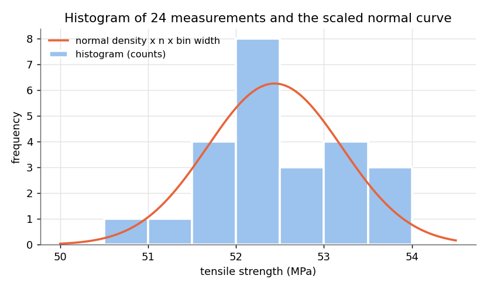
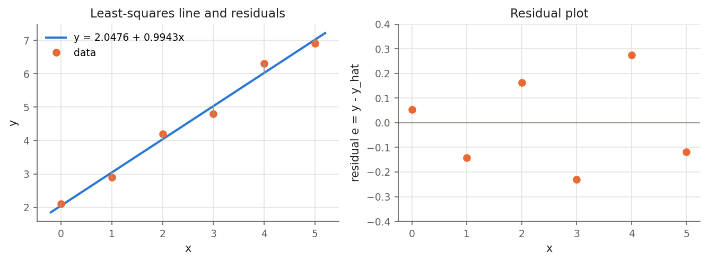
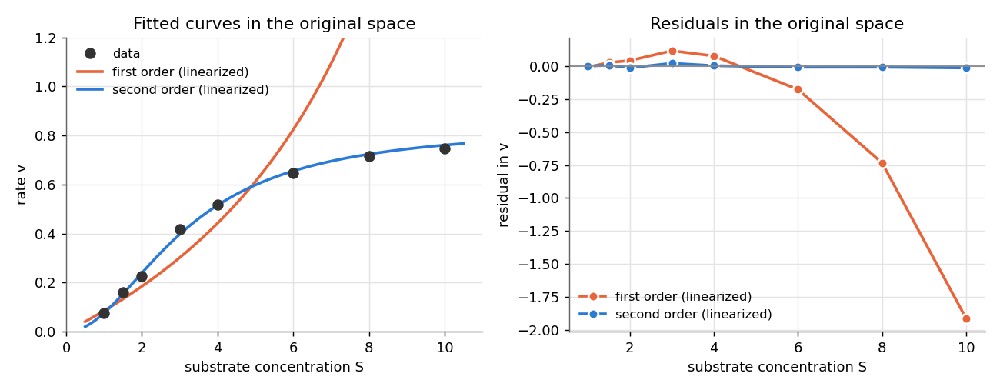

# 14장 — 선형 회귀

[레포지토리 안내](../../README.ko.md) | [English](Concepts_Lecture.md) | [한국어](Concepts_Lecture.ko.md)

> **최종 수정일:** 2026-11-27
>
> Applied Numerical Methods with Python for Engineers and Scientists, Chapra and Clough, Ch 14

> **학습 목표:**
> 1. 평균, 중위수, 표준 편차, 변동 계수, MAD 같은 기술 통계량을 계산할 수 있다
> 2. 정규 분포의 성질과 표준화를 설명할 수 있다
> 3. 최소제곱 기준으로 정규 방정식을 유도하고 단순 선형 회귀의 기울기와 절편을 계산할 수 있다
> 4. 결정 계수($`r^2`$)와 추정의 표준 오차를 사용하여 회귀 품질을 평가할 수 있다
> 5. 최소제곱법을 정규 분포 오차 아래의 최대 우도 추정으로 해석하고 회귀의 가정을 설명할 수 있다
> 6. 잔차 그림으로 모델의 적합성을 판단하고 Python으로 직선 회귀를 수행할 수 있다

---

<br>

## 목차

- [1. 개요](#1-개요)
- [2. 통계 복습](#2-통계-복습)
  - [2.1 기술 통계(Descriptive Statistics)](#21-기술-통계descriptive-statistics)
  - [2.2 표준 편차와 분산](#22-표준-편차와-분산)
  - [2.3 변동 계수(Coefficient of Variation)](#23-변동-계수coefficient-of-variation)
  - [2.4 중위 절대 편차(Median Absolute Deviation, MAD)](#24-중위-절대-편차median-absolute-deviation-mad)
  - [2.5 범위와 분산의 계산 공식](#25-범위와-분산의-계산-공식)
  - [2.6 Python의 기술 통계 함수](#26-python의-기술-통계-함수)
- [3. 정규 분포(Normal Distribution)](#3-정규-분포normal-distribution)
  - [3.1 중심극한정리(Central Limit Theorem)](#31-중심극한정리central-limit-theorem)
  - [3.2 표준 정규 분포(Standard Normal Distribution)](#32-표준-정규-분포standard-normal-distribution)
  - [3.3 대칭 성질](#33-대칭-성질)
  - [3.4 일반 정규 분포(General Normal Distribution)](#34-일반-정규-분포general-normal-distribution)
  - [3.5 표준화(Standardization)](#35-표준화standardization)
  - [3.6 정규 분포의 CDF와 PDF](#36-정규-분포의-cdf와-pdf)
  - [3.7 정규 확률 규칙과 평균의 신뢰 구간](#37-정규-확률-규칙과-평균의-신뢰-구간)
  - [3.8 히스토그램과 정규 분포의 비교](#38-히스토그램과-정규-분포의-비교)
- [4. 직선 최소제곱 회귀(Straight Line Least Square Regression)](#4-직선-최소제곱-회귀straight-line-least-square-regression)
  - [4.1 문제 설정](#41-문제-설정)
  - [4.2 대안적 오차 기준과 최소제곱법의 이유](#42-대안적-오차-기준과-최소제곱법의-이유)
  - [4.3 정규 방정식 유도](#43-정규-방정식-유도)
  - [4.4 계수 풀이](#44-계수-풀이)
  - [4.5 예제: 직선 회귀의 단계별 계산](#45-예제-직선-회귀의-단계별-계산)
  - [4.6 최소제곱법의 통계적 의미](#46-최소제곱법의-통계적-의미)
  - [4.7 정규 방정식의 행렬 형태](#47-정규-방정식의-행렬-형태)
  - [4.8 손으로 직선을 그리는 중위수 방법](#48-손으로-직선을-그리는-중위수-방법)
- [5. 적합도 정량화](#5-적합도-정량화)
  - [5.1 SST, SSE, SSR 분해](#51-sst-sse-ssr-분해)
  - [5.2 SST = SSE + SSR 증명](#52-sst--sse--ssr-증명)
  - [5.3 결정 계수(Coefficient of Determination, r²)](#53-결정-계수coefficient-of-determination-r2)
  - [5.4 추정의 표준 오차(Standard Error of the Estimate)](#54-추정의-표준-오차standard-error-of-the-estimate)
  - [5.5 예제의 적합도](#55-예제의-적합도)
  - [5.6 잔차 분석](#56-잔차-분석)
  - [5.7 계수의 표준 오차와 신뢰 구간](#57-계수의-표준-오차와-신뢰-구간)
  - [5.8 이상값과 지렛대 효과](#58-이상값과-지렛대-효과)
- [6. 비선형 관계의 선형화](#6-비선형-관계의-선형화)
  - [6.1 거듭제곱 모델](#61-거듭제곱-모델)
  - [6.2 포화 성장률 모델](#62-포화-성장률-모델)
  - [6.3 선형화의 주의점](#63-선형화의-주의점)
  - [6.4 변환이 바꾸는 오차의 구조](#64-변환이-바꾸는-오차의-구조)
  - [6.5 응용: 효소 반응 속도 모델의 비교](#65-응용-효소-반응-속도-모델의-비교)
- [7. 난수와 Monte Carlo 시뮬레이션](#7-난수와-monte-carlo-시뮬레이션)
- [8. Python 구현](#8-python-구현)
- [9. 흔한 실수](#9-흔한-실수)
- [요약](#요약)
- [점검 문제](#점검-문제)
- [참고 문헌](#참고-문헌)

<br>

---

<br>

## 1. 개요

선형 회귀(linear regression)는 **곡선 적합(curve fitting)** 의 근본적인 기법이다(교재 4부, 14~18장). 목표는 **최소제곱(Least-Squares)** 기준을 사용하여 데이터 점들을 관통하는 **최적 직선(Best-Fit Straight Line)** 을 유도하는 것이다.

이 장은 기본 통계(평균, 표준 편차, 분포)를 복습한 뒤, 최적 직선의 기울기와 절편을 계산하고, 추정의 표준 오차를 계산하여 잔차 오차를 분석한다.

<br>

---

<br>

## 2. 통계 복습

### 2.1 기술 통계(Descriptive Statistics)

**통계학(Statistics)** 은 의미 있는 정보를 추론하기 위해 데이터를 다루는 학문이다.

**표본 추출(Sampling)** 은 전체 집단에 대한 통찰을 얻기 위해 큰 모집단에서 작은 그룹을 선택하는 과정이다.

#### 표본 평균(Sample Average, Mean)

$`n`$개의 관측값 $`y_1, y_2, \ldots, y_n`$이 있을 때, **표본 평균**은 다음과 같다:

```math
\bar{y} = \frac{1}{n} \sum_{j=1}^{n} y_j
```

#### 중위수(Median)

**중위수** $`\tilde{y}`$는 데이터를 정렬했을 때 가운데 값이다. 데이터가 짝수 개이면 가운데 두 값의 평균이다.

- 홀수 개: 데이터 [3, 5, 7]의 중위수는 5이다.
- 짝수 개: 데이터 [2, 4, 6, 8]의 중위수는 (4 + 6) / 2 = 5이다.

#### 최빈값(Mode)

**최빈값**은 데이터에서 가장 자주 나타나는 값이다.

- 데이터 [2, 4, 4, 4, 5]의 최빈값은 4이다.

#### 이상값(Outlier)

**이상값**은 나머지 데이터와 현저히 다른 데이터 점이다.

- 데이터 [2, 4, 4, 4, 100]에서 100은 이상값이다.

<br>

### 2.2 표준 편차와 분산

#### 모표준편차(Population Standard Deviation)

**표준 편차**는 데이터 점들이 평균으로부터 얼마나 퍼져 있는지를 측정한다:

```math
\sigma = \sqrt{\frac{1}{n} \sum_{j=1}^{n} (y_j - \mu)^2}
```

여기서 $`\mu`$는 전체 모집단의 **참 평균(True Mean)** 이고, $`n`$은 모집단의 총 수이다.

> **[확률및통계]** 모표준편차는 분모에 $`n`$을 사용하는데, 이는 모집단의 모든 구성원이 포함되어 참 평균 $`\mu`$를 그대로 쓰므로 자유도 손실이 없기 때문이다. 표본에서 $`\mu`$ 대신 표본 평균을 쓰는 다음 식은 이 점 때문에 분모가 달라진다.

#### 표본 표준 편차(Sample Standard Deviation)

```math
s_y = \sqrt{\frac{1}{n-1} \sum_{j=1}^{n} (y_j - \bar{y})^2}
```

여기서 $`\bar{y}`$는 **표본 평균**이고 $`n`$은 표본 내 데이터 점의 총 수이다.

제곱근 내 분자에 해당하는 양을 **총 보정 제곱합(Total Corrected Sum of Squares, SST)** 이라 한다:

```math
SST = \sum_{j=1}^{n} (y_j - \bar{y})^2
```

> **[확률및통계]** 왜 $`n`$이 아니라 $`n - 1`$인가? 참 평균 $`\mu`$ 대신 표본 평균 $`\bar{y}`$를 사용하면 **변동성을 과소추정** 한다. $`\bar{y}`$는 이미 자유도 1을 사용한 확률 변수이므로, 모분산의 **비편향(Unbiased)** 추정치를 얻기 위해 $`n - 1`$로 나눈다(Bessel 보정, Bessel's Correction).

<br>

### 2.3 변동 계수(Coefficient of Variation)

**변동 계수(c.v.)** 는 표준 편차 대 평균의 비율로, 백분율로 표현된다:

```math
c.v. = \frac{s_y}{\bar{y}} \cdot 100\%
```

> **[확률및통계]** 변동 계수는 산포도를 정규화하여, **스케일이 다른 데이터셋도 비교할 수 있게** 한다. 낮은 변동 계수는 데이터가 평균 주위에 밀집되어 있음을, 높은 변동 계수는 평균에 비해 상당한 변동이 있음을 의미한다.

<br>

### 2.4 중위 절대 편차(Median Absolute Deviation, MAD)

**중위 절대 편차(MAD)** 는 값들이 중위수로부터 얼마나 벗어나는지를 측정한다:

```math
MAD = \text{median}(|y_i - \tilde{y}|)
```

**예제:**

- 데이터 [2, 4, 6, 8, 100]의 중위수는 6이다.
- 절대 편차는 |2-6| = 4, |4-6| = 2, |6-6| = 0, |8-6| = 2, |100-6| = 94이다.
- 편차를 정렬하면 [0, 2, 2, 4, 94]이므로 MAD = 2이다.

> **[확률및통계]** MAD는 **이상값에 강건(Robust)** 하다. 위 예제에서 큰 이상값 100은 94라는 편차를 만들지만, MAD는 편차의 중위수를 취하므로 이 극단값의 크기에 영향을 받지 않는다. 따라서 MAD는 이상값이 있을 때 표준 편차보다 더 신뢰할 수 있는 산포 측정치이다.

MAD는 산포의 크기를 나타내지만 표준 편차와 같은 척도는 아니다. 데이터가 정규 분포 $`\mathcal{N}(\mu, \sigma^2)`$를 따르면 중위수는 $`\mu`$이고, 절대 편차 $`|y - \mu|`$의 중위수는 $`P(|Z| \leq z) = 0.5`$를 만족하는 $`z\sigma`$이다(3절). 대칭성에서 $`P(|Z| \leq z) = 2\Phi(z) - 1`$이므로 $`\Phi(z) = 0.75`$, 즉 $`z = 0.6745`$이다. 따라서 정규 데이터의 MAD는 약 $`0.6745\sigma`$이고, 표준 편차의 강건한 추정치로 다음을 쓴다.

```math
\hat{\sigma} = \frac{MAD}{0.6745} \approx 1.4826\,MAD
```

위 예제에서는 $`\hat{\sigma} = 2/0.6745 = 2.965`$이다. 같은 데이터의 표본 표준 편차는 이상값 100 때문에 42.54로 부풀지만, 이상값을 뺀 [2, 4, 6, 8]의 표본 표준 편차는 2.582로 $`\hat{\sigma}`$와 가깝다.

<br>

### 2.5 범위와 분산의 계산 공식

가장 간단한 산포 측정치는 최댓값과 최솟값의 차인 **범위(range)** 이다. 범위는 두 점만으로 정해지므로 표본 크기와 이상값에 크게 흔들리며, 데이터가 몇 개뿐일 때 대략의 값으로만 쓴다.

분산의 분자 $`SST`$는 편차를 먼저 계산하지 않고도 구할 수 있다. $`\sum(y_i - \bar{y})^2 = \sum y_i^2 - 2\bar{y}\sum y_i + n\bar{y}^2`$이고 $`\sum y_i = n\bar{y}`$이므로 다음 계산 공식을 얻는다.

```math
s_y^2 = \frac{\sum y_i^2 - n\bar{y}^2}{n - 1}
```

데이터 [3, 5, 7, 9]에서 $`\sum y_i^2 = 164`$, $`n\bar{y}^2 = 4 \times 36 = 144`$이므로 $`s_y^2 = 20/3 = 6.667`$이고, 편차 $`-3, -1, 1, 3`$으로 계산한 $`(9 + 1 + 1 + 9)/3`$과 같다. 이 공식은 데이터를 한 번만 훑으면 되어 손 계산에는 편리하지만, 분자가 비슷한 크기의 두 큰 수의 차이므로 4장 6.5절의 뺄셈 소거를 일으킨다. 다음 코드는 같은 데이터에 큰 상수를 더해 가며 두 방법을 비교한다. 상수를 더해도 분산은 변하지 않아야 한다.

```python
import numpy as np

for shift in (0.0, 1e6, 1e7, 1e8, 1e9):
    y = np.array([3.0, 5.0, 7.0, 9.0]) + shift
    n = y.size
    two_pass = np.sum((y - y.mean())**2) / (n - 1)            # deviations first
    shortcut = (np.sum(y**2) - n * y.mean()**2) / (n - 1)     # sum of squares minus n * mean^2
    print(f"shift = {shift:8.0e}: two-pass = {two_pass:.6f}, shortcut = {shortcut:.6f}")
```

```text
shift =    0e+00: two-pass = 6.666667, shortcut = 6.666667
shift =    1e+06: two-pass = 6.666667, shortcut = 6.666667
shift =    1e+07: two-pass = 6.666667, shortcut = 6.666667
shift =    1e+08: two-pass = 6.666667, shortcut = 5.333333
shift =    1e+09: two-pass = 6.666667, shortcut = 0.000000
```

상수가 $`10^{8}`$이면 $`\sum y_i^2 \approx 4 \times 10^{16}`$인데, 이 크기의 배정밀도 수는 간격이 8이어서 분자의 참값 20이 반올림에 묻히고 결과는 5.333이 된다. $`10^{9}`$에서는 간격이 512로 커져 분산이 0으로 나온다. 편차를 먼저 계산하는 2단계 방법은 평균을 뺀 작은 수끼리 제곱하므로 영향을 받지 않는다. 따라서 프로그램에서는 계산 공식 대신 편차를 먼저 계산하며, NumPy 문서도 `np.std`를 평균을 먼저 뺀 편차의 제곱으로 계산하는 식으로 제시한다 [1].

<br>

### 2.6 Python의 기술 통계 함수

인장 강도 시험편 24개의 측정값(MPa)으로 지금까지의 통계량을 계산한다.

```python
import numpy as np
from scipy import stats

y = np.array([52.4, 53.6, 53.5, 51.9, 52.1, 51.9, 52.9, 52.3, 53.1, 50.7, 53.8, 52.3,
              53.0, 52.3, 52.1, 52.8, 53.1, 52.2, 52.3, 53.0, 51.6, 51.0, 52.8, 51.8])  # MPa
print(f"n = {y.size}, mean = {np.mean(y):.4f}, median = {np.median(y):.4f}, range = {np.ptp(y):.1f}")
print(f"std (ddof=0) = {np.std(y):.4f}, std (ddof=1) = {np.std(y, ddof=1):.4f}")
print(f"var (ddof=1) = {np.var(y, ddof=1):.4f}, c.v. = {np.std(y, ddof=1) / np.mean(y) * 100:.3f} %")
mad = stats.median_abs_deviation(y)                     # raw MAD
sig = stats.median_abs_deviation(y, scale="normal")     # MAD / 0.6745
print(f"MAD = {mad:.4f}, MAD-based sigma = {sig:.4f}")
```

```text
n = 24, mean = 52.4375, median = 52.3000, range = 3.1
std (ddof=0) = 0.7488, std (ddof=1) = 0.7649
var (ddof=1) = 0.5851, c.v. = 1.459 %
MAD = 0.5000, MAD-based sigma = 0.7413
```

`np.std`와 `np.var`는 분모로 $`N - \text{ddof}`$를 쓰며 `ddof`의 기본값이 0이다 [1]. 즉 인자 없이 호출하면 2.2절의 모표준편차가 나오고, 표본 표준 편차는 `ddof=1`을 주어야 한다. 이 데이터에서 두 값은 0.7488과 0.7649로 $`\sqrt{23/24}`$배 차이 난다. `np.ptp`는 범위 $`53.8 - 50.7 = 3.1`$을, `scipy.stats.median_abs_deviation`은 MAD를 계산하며, `scale="normal"`을 주면 결과를 약 0.67449로 나누어 2.4절의 $`\hat{\sigma}`$를 돌려준다 [2]. MAD 기반의 $`\hat{\sigma} = 0.7413`$이 표본 표준 편차 0.7649와 가까운 것은 이 데이터에 큰 이상값이 없음을 시사한다. 변동 계수 1.46%는 측정값이 평균의 1.5% 안팎으로 흩어진다는 것을 나타낸다. 이 데이터의 분포는 3.7절과 3.8절에서 정규 분포와 비교한다.

<br>

---

<br>

## 3. 정규 분포(Normal Distribution)

### 3.1 중심극한정리(Central Limit Theorem)

유한한 평균과 분산을 가지는 i.i.d.(독립이고 같은 분포를 따르는) 확률 변수를 많이 더하면, 그 합은 개별 확률 변수의 분포가 무엇이든 **근사적으로 정규 분포를 따른다**. 정확히는 표준화한 합의 분포가 표준 정규 분포로 수렴한다.

> **[확률및통계]** 중심극한정리(CLT)는 정규 분포가 널리 나타나는 근본적인 이유이다. 많은 작은 독립적 효과의 합인 측정 오차는 일반적으로 정규 분포를 따른다.

<br>

### 3.2 표준 정규 분포(Standard Normal Distribution)

**표준 정규 분포**는 중심극한정리 덕분에 매우 널리 사용된다.

**PDF (확률 밀도 함수, Probability Density Function):**

```math
\varphi(z) = \frac{1}{\sqrt{2\pi}} e^{-\frac{z^2}{2}}, \quad \text{for } -\infty < z < \infty
```

**CDF (누적 분포 함수, Cumulative Distribution Function):**

```math
\Phi(z) = \int_{-\infty}^{z} \varphi(t) \, dt, \quad \text{for } -\infty < z < \infty
```

이를 $`Z \sim \mathcal{N}(0, 1)`$로 표기하며, **평균 0, 분산 1**을 의미한다.

<br>

### 3.3 대칭 성질

**1. PDF의 대칭성:**

```math
\varphi(z) = \varphi(-z)
```

종 모양 곡선은 $`z = 0`$에 대해 대칭이다.

**2. 꼬리 면적의 대칭성:**

```math
P(Z \le -2) = P(Z \ge 2)
```

이는 다음과 동치이다:

```math
\Phi(-z) = 1 - \Phi(z)
```

**3. $`Z`$와 $`-Z`$의 대칭성:**

$`Z \sim \mathcal{N}(0, 1)`$이면, $`-Z \sim \mathcal{N}(0, 1)`$이기도 하다.

```math
P(-Z \le z) = P(Z \ge -z) = 1 - \Phi(-z) = \Phi(z)
```

<br>

### 3.4 일반 정규 분포(General Normal Distribution)

$`Z \sim \mathcal{N}(0, 1)`$이면:

```math
X = \mu + \sigma Z
```

는 **평균** $`\mu`$, **분산** $`\sigma^2`$인 정규 분포를 따르며, $`X \sim \mathcal{N}(\mu, \sigma^2)`$로 표기한다.

**평균과 분산의 증명:**

```math
E(\mu + \sigma Z) = E(\mu) + E(\sigma Z) = \mu
```

```math
Var(\mu + \sigma Z) = Var(\sigma Z) = \sigma^2 Var(Z) = \sigma^2
```

> **[확률및통계]** 기댓값의 선형성($`E[aX + b] = aE[X] + b`$)과 분산의 스케일링 성질($`Var(aX + b) = a^2 Var(X)`$)이 여기서 사용되는 핵심 성질이다. 상수를 더하면 평균은 이동하지만 분산은 변하지 않는다.

<br>

### 3.5 표준화(Standardization)

$`X \sim \mathcal{N}(\mu, \sigma^2)`$일 때, $`X`$의 **표준화**는 다음과 같다:

```math
Z = \frac{X - \mu}{\sigma} \sim \mathcal{N}(0, 1)
```

이 변환은 임의의 정규 확률 변수를 표준 정규로 변환하여, 표준 정규 분포표를 사용할 수 있게 한다.

<br>

### 3.6 정규 분포의 CDF와 PDF

$`X \sim \mathcal{N}(\mu, \sigma^2)`$라 하자.

**$`X`$의 CDF:**

```math
F(x) = P(X \le x) = P\left(\frac{X - \mu}{\sigma} \le \frac{x - \mu}{\sigma}\right) = \Phi\left(\frac{x - \mu}{\sigma}\right)
```

**$`X`$의 PDF:**

```math
f(x) = F'(x) = \varphi\left(\frac{x - \mu}{\sigma}\right) \cdot \frac{1}{\sigma} = \frac{1}{\sigma\sqrt{2\pi}} e^{-\frac{(x - \mu)^2}{2\sigma^2}}
```

> **[미적분학]** 연쇄 법칙(chain rule)에 따라 합성 함수 $`\Phi((x - \mu)/\sigma)`$를 $`x`$로 미분하면 바깥 함수의 도함수 $`\varphi`$에 안쪽 함수의 도함수 $`1/\sigma`$가 곱해지며, PDF의 $`\frac{1}{\sigma}`$ 인자는 여기서 나온다. 이 인자 덕분에 $`\sigma`$에 관계없이 PDF 아래 전체 면적이 1로 유지된다.

<br>

### 3.7 정규 확률 규칙과 평균의 신뢰 구간

3.3절의 대칭성에서 $`P(-z \leq Z \leq z) = 2\Phi(z) - 1`$이므로, 평균에서 표준 편차의 1배, 2배, 3배 안에 들어올 확률은 다음과 같다.

```math
2\Phi(1) - 1 = 0.6827, \qquad 2\Phi(2) - 1 = 0.9545, \qquad 2\Phi(3) - 1 = 0.9973
```

이를 **정규 확률 규칙**이라 하며, 정규 데이터의 약 68%, 95%, 99.7%가 $`\mu \pm \sigma`$, $`\mu \pm 2\sigma`$, $`\mu \pm 3\sigma`$ 안에 놓인다는 뜻이다. 2.6절의 데이터에서는 $`\bar{y} \pm s_y`$ 안에 24개 중 18개(75%), $`\bar{y} \pm 2s_y`$ 안에 23개(95.8%), $`\bar{y} \pm 3s_y`$ 안에 24개 모두가 들어, 표본이 작은 것을 감안하면 규칙과 잘 맞는다. 정확히 95%를 주는 배수는 $`\Phi(z) = 0.975`$인 $`z = 1.960`$이다.

같은 규칙을 표본 평균에 적용하면 평균의 불확실성을 나타낼 수 있다. 서로 독립인 $`n`$개 측정값의 평균은 분산이 $`\sigma^2/n`$이고 3.1절의 중심극한정리에 의해 근사적으로 정규 분포를 따르므로, 참 평균 $`\mu`$의 95% 신뢰 구간은 $`\bar{y} \pm 1.960\,\sigma/\sqrt{n}`$이다. $`\sigma`$를 모르면 $`s_y`$로 바꾸고 1.960 대신 자유도 $`n - 1`$인 $`t`$ 분포의 값을 쓴다(5.7절과 같은 이유). 측정값이 정규 분포를 따르면 이 $`t`$ 구간은 $`n`$이 작아도 정확하고, 그렇지 않으면 $`n`$이 클 때 근사적으로 성립한다. $`s_y/\sqrt{n}`$은 평균의 표준 오차이며 15장 1.2절에서 다시 다룬다. 2.6절의 데이터에서는 $`s_y/\sqrt{n} = 0.7649/\sqrt{24} = 0.1561`$, $`t_{0.025,23} = 2.069`$이므로 구간은 다음과 같다.

```math
52.4375 \pm 2.069 \times 0.1561 = 52.4375 \pm 0.3230 \;\Rightarrow\; [52.114,\ 52.760]
```

개별 측정값의 95%가 대략 $`\bar{y} \pm 2s_y`$, 즉 폭 3.06 MPa 안에 놓이는 것과 달리 평균의 구간은 폭이 0.65 MPa로 훨씬 좁다. 구간의 폭은 표준 오차 $`s_y/\sqrt{n}`$에 비례하므로 측정을 4배로 늘리면 대략 절반이 된다.

<br>

### 3.8 히스토그램과 정규 분포의 비교

통계량을 계산하기 전에 데이터의 분포를 그림으로 확인하는 기본 도구가 **히스토그램(histogram)** 이다. 데이터의 범위를 폭이 같은 구간(bin)으로 나누고 각 구간에 든 데이터의 개수를 막대로 그린다. 구간이 너무 적으면 모양이 뭉개지고 너무 많으면 막대마다 개수가 0이나 1이 되어 모양을 읽을 수 없으므로, 데이터 수에 맞게 구간 수를 정해야 한다. NumPy의 `np.histogram`은 개수와 구간 경계를 돌려주며, 마지막 구간을 뺀 모든 구간은 왼쪽 끝을 포함하고 오른쪽 끝을 포함하지 않는다 [3].

정규 밀도 곡선은 아래 넓이가 1이므로 개수를 세는 히스토그램과 바로 겹쳐 그릴 수 없다. 폭 $`w`$인 구간 하나에 들어갈 개수의 기댓값은 $`n\int f\,dy \approx n\,w\,f(\text{구간 중심})`$이므로, 밀도에 $`nw`$를 곱해 비교한다.

```python
import numpy as np
from scipy import stats

y = np.array([52.4, 53.6, 53.5, 51.9, 52.1, 51.9, 52.9, 52.3, 53.1, 50.7, 53.8, 52.3,
              53.0, 52.3, 52.1, 52.8, 53.1, 52.2, 52.3, 53.0, 51.6, 51.0, 52.8, 51.8])
counts, edges = np.histogram(y, bins=7, range=(50.5, 54.0))   # 7 bins of width 0.5
width = edges[1] - edges[0]
centers = (edges[:-1] + edges[1:]) / 2
expected = y.size * width * stats.norm.pdf(centers, y.mean(), y.std(ddof=1))
print(edges)
print(counts)
print(np.round(expected, 2))
```

```text
[50.5 51.  51.5 52.  52.5 53.  53.5 54. ]
[1 1 4 8 3 4 3]
[0.55 1.88 4.18 6.07 5.76 3.56 1.44]
```



*그림 1. 측정값 24개의 히스토그램과 정규 분포 곡선의 비교*

구간 [52.0, 52.5)에는 8개가 몰려 기댓값 6.07보다 많고 [52.5, 53.0)에는 3개로 기댓값 5.76보다 적지만, 표본이 24개뿐이므로 이 정도의 차이는 무작위 변동으로 볼 수 있다. 측정값 51.0, 53.0, 53.5는 구간 경계에 놓이며, 반열린 구간의 규칙에 따라 각각 경계의 오른쪽 구간에 들어간다. 데이터가 많아지고 구간을 좁히면 히스토그램은 밀도 곡선에 가까워진다. 히스토그램은 평균과 표준 편차만으로는 보이지 않는 성질, 즉 분포가 한쪽으로 치우쳤는지, 여러 무리로 나뉘는지, 동떨어진 값이 있는지를 보여 주므로, 데이터가 수십 개 이상이면 5절의 회귀에서도 잔차의 히스토그램으로 4.6절의 정규성 가정을 확인한다.

<br>

---

<br>

## 4. 직선 최소제곱 회귀(Straight Line Least Square Regression)

### 4.1 문제 설정

데이터 점 $`(x_1, y_1), (x_2, y_2), \ldots, (x_n, y_n)`$이 주어졌을 때, **선형 모델**을 구하고자 한다:

```math
\hat{y} = a_0 + a_1 x
```

여기서:
- $`a_0`$ = **y절편(y-intercept)**
- $`a_1`$ = **기울기(slope)**

각 관측값은 다음과 같이 표현할 수 있다:

```math
y_i = \hat{y}_i + e_i = a_0 + a_1 x_i + e_i
```

여기서 $`e_i = y_i - \hat{y}_i`$는 **잔차(Residual, Error)** 로, 관측값과 예측값 사이의 차이이다.

<br>

### 4.2 대안적 오차 기준과 최소제곱법의 이유

오차의 어떤 측도를 최소화하여 데이터를 관통하는 최적의 직선을 구하고자 한다. 여러 기준을 고려할 수 있다:

**기준 1 (오차의 합 최소화):**

```math
\min_{a_0, a_1} \sum e_i = \min_{a_0, a_1} \sum (y_i - a_0 - a_1 x_i)
```

문제: 양의 오차와 음의 오차가 **서로 상쇄** 되어 오도된 결과를 준다.

**기준 2 (절대 오차의 합 최소화):**

```math
\min_{a_0, a_1} \sum |e_i| = \min_{a_0, a_1} \sum |y_i - a_0 - a_1 x_i|
```

문제: 절댓값 함수는 0에서 **미분 불가능** 하고, 해가 **유일하지 않을 수 있다**.

**기준 3 (미니맥스, Minimax, 최대 오차 최소화):**

```math
\min_{a_0, a_1} \max_i |y_i - a_0 - a_1 x_i|
```

문제: **미분 불가능** 하고, 단일 최대 오차에 집중하므로 **이상값에 민감** 하다.

**기준 4 (오차 제곱합 최소화, 최소제곱법, Least Squares):**

```math
\min_{a_0, a_1} \sum e_i^2 = \min_{a_0, a_1} \sum (y_i - a_0 - a_1 x_i)^2
```

이것이 **최소제곱(Least Squares)** 접근법이며, 최소화하는 양은 **오차 제곱합(Sum of Squared Errors, SSE)** 이다. 미분 가능하고, $`x_i`$가 모두 같지 않으면 주어진 데이터에 대해 **유일한** 직선을 산출한다.

> **[확률및통계]** 최소제곱 기준이 선호되는 이유: (1) 제곱은 부호 문제를 제거하고, (2) 목적 함수가 매끄럽고 미분 가능하며, (3) 유일한 닫힌 형태의 해를 가지고, (4) 오차가 정규 분포를 따른다는 가정 하에 최대 우도 추정(Maximum Likelihood Estimate)에 해당한다.

<br>

### 4.3 정규 방정식 유도

최소화할 목적 함수는 다음과 같다:

```math
SSE = \sum_{i=1}^{n} (y_i - \hat{y}_i)^2 = \sum_{i=1}^{n} (y_i - a_0 - a_1 x_i)^2
```

최솟값을 찾기 위해 SSE를 각 미지 계수에 대해 미분하고 0으로 놓는다:

```math
\frac{\partial SSE}{\partial a_0} = -2 \sum_{i=1}^{n} (y_i - a_0 - a_1 x_i) = 0
```

```math
\frac{\partial SSE}{\partial a_1} = -2 \sum_{i=1}^{n} (y_i - a_0 - a_1 x_i) x_i = 0
```

$`a_0`$와 $`a_1`$은 상수($`i`$에 의존하지 않음)이므로 합에서 인수 분해할 수 있다:

- $`\sum a_0 = a_0 \cdot n`$
- $`\sum a_0 x_i = a_0 \sum x_i`$
- $`\sum a_1 x_i = a_1 \sum x_i`$
- $`\sum a_1 x_i^2 = a_1 \sum x_i^2`$

편도함수를 0으로 놓으면 **정규 방정식(Normal Equations)** 을 얻는다:

```math
\sum y_i = n \cdot a_0 + a_1 \sum x_i
```

```math
\sum y_i x_i = a_0 \sum x_i + a_1 \sum x_i^2
```

**행렬 형태:**

```math
\begin{bmatrix} \sum y_i \\ \sum y_i x_i \end{bmatrix} = \begin{bmatrix} n & \sum x_i \\ \sum x_i & \sum x_i^2 \end{bmatrix} \begin{bmatrix} a_0 \\ a_1 \end{bmatrix} \quad (\ast)
```

> **[선형대수학]** 이것은 $`2 \times 2`$ 선형 시스템이다. 계수 행렬은 대칭이고 양정치(Positive Definite)이므로($`x_i`$ 값이 모두 같지 않은 한), 유일한 해가 보장된다.

<br>

### 4.4 계수 풀이

#### Cramer 법칙(Cramer's Rule) 사용

계수 행렬의 행렬식:

```math
D = n \sum x_i^2 - \left(\sum x_i\right)^2
```

절편:

```math
a_0 = \frac{1}{D} \left( \sum y_i \cdot \sum x_i^2 - \sum x_i \cdot \sum y_i x_i \right)
```

기울기:

```math
a_1 = \frac{1}{D} \left( n \sum y_i x_i - \sum x_i \cdot \sum y_i \right)
```

#### 표본 평균을 사용한 대안적 형태

$`(\ast)`$의 첫 번째 행으로부터:

```math
\sum y_i = n \cdot a_0 + \left(\sum x_i\right) a_1
```

양변을 $`n`$으로 나누면:

```math
\frac{\sum y_i}{n} = a_0 + \frac{\sum x_i}{n} \cdot a_1
```

$`\bar{y} = \frac{\sum y_i}{n}`$과 $`\bar{x} = \frac{\sum x_i}{n}`$이 표본 평균이므로:

```math
\boxed{a_0 = \bar{y} - \bar{x} \cdot a_1} \quad (\ast\ast)
```

> **참고:** 이 결과는 우아한 기하학적 해석을 가진다. 회귀선은 데이터의 무게 중심인 **점 $`(\bar{x}, \bar{y})`$를 항상 통과** 한다.

### 4.5 예제: 직선 회귀의 단계별 계산

다음 6개의 데이터에 직선 $`y = a_0 + a_1x`$를 최소제곱으로 적합한다. 계산에 필요한 합을 한 표에 모으면 다음과 같다(맨 오른쪽 두 열은 적합 뒤에 계산한 값이다).

| $`i`$ | $`x_i`$ | $`y_i`$ | $`x_i^2`$ | $`x_iy_i`$ | $`\hat{y}_i`$ | $`e_i = y_i - \hat{y}_i`$ |
|-----:|-----:|-----:|-----:|-----:|-----:|-----:|
| 1 | 0 | 2.1 | 0 | 0.0 | 2.047619 | 0.052381 |
| 2 | 1 | 2.9 | 1 | 2.9 | 3.041905 | -0.141905 |
| 3 | 2 | 4.2 | 4 | 8.4 | 4.036190 | 0.163810 |
| 4 | 3 | 4.8 | 9 | 14.4 | 5.030476 | -0.230476 |
| 5 | 4 | 6.3 | 16 | 25.2 | 6.024762 | 0.275238 |
| 6 | 5 | 6.9 | 25 | 34.5 | 7.019048 | -0.119048 |
| 합 | 15 | 27.2 | 55 | 85.4 | 27.2 | 0 |

*표 1. 직선 회귀 예제의 데이터, 합, 예측값, 잔차*

4.4절의 공식에 $`n = 6`$, $`\sum x_i = 15`$, $`\sum y_i = 27.2`$, $`\sum x_i^2 = 55`$, $`\sum x_iy_i = 85.4`$를 대입한다.

```math
D = 6(55) - 15^2 = 105, \qquad a_1 = \frac{6(85.4) - 15(27.2)}{105} = \frac{512.4 - 408}{105} = \frac{104.4}{105} = 0.994286
```

```math
\bar{x} = 15/6 = 2.5, \quad \bar{y} = 27.2/6 = 4.533333, \qquad a_0 = \bar{y} - a_1\bar{x} = 4.533333 - 0.994286 \times 2.5 = 2.047619
```

따라서 회귀선은 $`y = 2.0476 + 0.9943x`$이다. 표 1의 잔차 열을 보면 $`\sum e_i = 0`$이고, 계산하면 $`\sum e_ix_i = 0`$도 성립한다. 두 등식은 정규 방정식 $`\partial SSE/\partial a_0 = -2\sum e_i = 0`$, $`\partial SSE/\partial a_1 = -2\sum e_ix_i = 0`$을 그대로 옮긴 것이므로, 손 계산의 검산에 쓸 수 있다. 또 회귀선은 $`(\bar{x}, \bar{y}) = (2.5,\ 4.5333)`$을 지난다.

### 4.6 최소제곱법의 통계적 의미

최소제곱 기준은 계산이 편해서만 쓰는 것이 아니다. 다음 가정 아래에서는 통계적으로 가장 그럴듯한 직선을 준다.

1. $`x`$의 값은 오차 없이 정확하다.
2. $`y`$의 오차 $`\varepsilon_i = y_i - (a_0 + a_1x_i)`$는 서로 독립이고 모든 $`x`$에서 분산 $`\sigma^2`$이 같다.
3. 오차는 평균 0인 정규 분포를 따른다.

이 가정 아래에서 관측값 $`y_i`$가 나올 확률 밀도는 3절의 정규 PDF로 $`\frac{1}{\sigma\sqrt{2\pi}}\exp\bigl(-\varepsilon_i^2/(2\sigma^2)\bigr)`$이고, 독립이므로 전체 데이터가 나올 확률 밀도(우도, likelihood)는 그 곱이다.

```math
L(a_0, a_1) = \prod_{i=1}^{n}\frac{1}{\sigma\sqrt{2\pi}}\exp\left(-\frac{(y_i - a_0 - a_1x_i)^2}{2\sigma^2}\right) = \left(\sigma\sqrt{2\pi}\right)^{-n}\exp\left(-\frac{SSE}{2\sigma^2}\right)
```

$`a_0`$와 $`a_1`$은 지수 안의 $`SSE`$에만 나타나므로, 우도를 최대로 하는 계수와 $`SSE`$를 최소로 하는 계수는 같다. 즉 최소제곱 추정은 정규 분포 오차 아래의 **최대 우도 추정(maximum likelihood estimation)** 이다. 반대로 오차에 큰 이상값이 자주 섞이면(정규 분포보다 꼬리가 두꺼우면) 제곱 때문에 이상값이 지나치게 큰 영향을 주므로, 4.2절의 절댓값 합 기준이나 2.4절의 MAD 같은 강건한 방법이 더 알맞다.

가정 1에서 $`x`$와 $`y`$의 역할은 대칭이 아니다. 같은 데이터에서 $`x`$를 $`y`$에 대해 회귀하면 다른 직선이 나온다. 예제에서 $`\sum y_i^2 = 140.8`$이므로 $`x = b_0 + b_1y`$의 기울기는 $`b_1 = 104.4/(6 \times 140.8 - 27.2^2) = 104.4/104.96 = 0.994665`$이고, 이를 $`y`$에 대해 정리한 직선의 기울기는 $`1/b_1 = 1.005364`$으로 $`a_1 = 0.994286`$과 다르다. 두 기울기의 곱 $`a_1b_1 = 0.98898`$은 5절의 결정 계수 $`r^2`$과 같으며, 데이터가 한 직선 위에 정확히 놓일 때($`r^2 = 1`$)에만 두 직선이 일치한다.

### 4.7 정규 방정식의 행렬 형태

데이터 $`n`$개에 대한 식 $`y_i = a_0 + a_1x_i + e_i`$를 한꺼번에 쓰면 $`\mathbf{y} = \mathbf{Z}\mathbf{a} + \mathbf{e}`$이다. 여기서 $`\mathbf{Z}`$는 첫 열이 모두 1이고 둘째 열이 $`x_i`$인 $`n \times 2`$ 행렬, $`\mathbf{a} = (a_0,\ a_1)`$이다. $`SSE = \mathbf{e}^T\mathbf{e}`$를 최소화하는 조건은 다음 행렬 방정식이 된다.

```math
\mathbf{Z}^T\mathbf{Z}\,\mathbf{a} = \mathbf{Z}^T\mathbf{y}, \qquad \mathbf{Z}^T\mathbf{Z} = \begin{bmatrix} n & \sum x_i \\ \sum x_i & \sum x_i^2 \end{bmatrix}, \quad \mathbf{Z}^T\mathbf{y} = \begin{Bmatrix} \sum y_i \\ \sum x_iy_i \end{Bmatrix}
```

성분을 보면 4.3절의 정규 방정식 $`(\ast)`$와 정확히 같다. 4.5절의 예제에서는 다음과 같다.

```math
\begin{bmatrix} 6 & 15 \\ 15 & 55 \end{bmatrix}\begin{Bmatrix} a_0 \\ a_1 \end{Bmatrix} = \begin{Bmatrix} 27.2 \\ 85.4 \end{Bmatrix}, \qquad a_0 = \frac{27.2 \times 55 - 15 \times 85.4}{105} = \frac{215}{105} = 2.047619
```

```python
import numpy as np

x = np.array([0, 1, 2, 3, 4, 5], dtype=float)
y = np.array([2.1, 2.9, 4.2, 4.8, 6.3, 6.9])
Z = np.column_stack([np.ones_like(x), x])   # columns: 1 and x
print(Z.T @ Z)
print(Z.T @ y)
print(np.linalg.solve(Z.T @ Z, Z.T @ y))
```

```text
[[ 6. 15.]
 [15. 55.]]
[27.2 85.4]
[2.04761905 0.99428571]
```

`np.column_stack`으로 $`\mathbf{Z}`$를 만들고, `Z.T @ Z`와 `Z.T @ y`가 4.5절 표 1의 합을 그대로 재현한다. 이 형태의 장점은 모델의 항이 늘어도 식이 바뀌지 않는다는 데 있다. $`\mathbf{Z}`$에 $`x_i^2`$ 열이나 다른 변수의 열을 더하기만 하면 15장의 다항 회귀와 다중 선형 회귀가 되며, 15장 5절은 이 일반 형태를 다룬다.

### 4.8 손으로 직선을 그리는 중위수 방법

교재는 계산 도구가 없는 현장에서 데이터에 직선을 대략 그리는 방법도 소개한다. 합을 계산하지 않고 중위수만 쓰는 방법으로 절차는 다음과 같다.

1. 데이터를 $`x`$의 크기 순서로 개수가 비슷한 세 묶음으로 나눈다.
2. 왼쪽 묶음과 오른쪽 묶음에서 각각 $`x`$의 중위수와 $`y`$의 중위수로 이루어진 점을 찍는다.
3. 두 점을 잇는 직선을 그린다.
4. 가운데 묶음의 중위수 점 쪽으로 직선을 그 차이의 3분의 1만큼 평행 이동한다.

4.5절의 데이터 6개를 두 개씩 세 묶음으로 나누면 왼쪽 묶음의 중위수 점은 $`(0.5,\ 2.5)`$, 오른쪽은 $`(4.5,\ 6.6)`$, 가운데는 $`(2.5,\ 4.5)`$이다. 양 끝 점을 잇는 직선의 기울기는 $`(6.6 - 2.5)/(4.5 - 0.5) = 1.025`$이고, 이 직선은 $`x = 2.5`$에서 $`2.5 + 1.025 \times 2 = 4.55`$를 지난다. 가운데 중위수 4.5와의 차이 $`-0.05`$의 3분의 1만큼 내리면 $`x = 2.5`$에서 4.5333을 지나므로 절편은 $`4.5333 - 1.025 \times 2.5 = 1.9708`$이다. 결과 $`y = 1.9708 + 1.025x`$는 최소제곱 직선 $`y = 2.0476 + 0.9943x`$와 가깝다.

이 방법은 평균 대신 중위수를 쓰므로 2.4절의 MAD처럼 이상값에 강하다. 예를 들어 오른쪽 묶음의 한 점이 잘못 기록되어 매우 커져도 두 점의 중위수만 조금 움직일 뿐이지만, 최소제곱 직선은 제곱 오차 때문에 그 점 쪽으로 크게 끌려간다. 대신 정밀도와 통계적 성질(5.7절의 신뢰 구간 같은)은 최소제곱법이 낫다.

<br>

---

<br>

## 5. 적합도 정량화

### 5.1 SST, SSE, SSR 분해

세 가지 핵심 양이 변동성의 서로 다른 측면을 측정한다:

| 양 | 전체 명칭 | 수식 | 해석 |
|----------|-----------|---------|----------------|
| **SST** | 총 제곱합(Sum of Squared Total, 총 보정 제곱합) | $`\displaystyle \sum_{i=1}^{n}(y_i - \bar{y})^2`$ | 평균으로부터 데이터 점의 총 편차 |
| **SSE** | 오차 제곱합(Sum of Squared Errors, 잔차 제곱합) | $`\displaystyle \sum_{i=1}^{n}(y_i - \hat{y}_i)^2`$ | 설명되지 않은 변동(관측값과 예측값 사이의 오차) |
| **SSR** | 회귀 제곱합(Sum of Squared Regression, 설명된 제곱합) | $`\displaystyle \sum_{i=1}^{n}(\hat{y}_i - \bar{y})^2`$ | 설명된 변동($`\hat{y}`$가 데이터를 얼마나 잘 맞추는지) |

*표 2. 변동성을 측정하는 세 제곱합 SST, SSE, SSR*

기본적인 분해:

```math
\boxed{SST = SSE + SSR}
```

```math
\text{총 변동} = \text{설명되지 않은 변동} + \text{설명된 변동}
```

> **참고:** $`SSR > SSE`$이면 $`r^2 > 0.5`$이므로(5.3절), 회귀 모델이 설명하는 변동이 설명하지 못하는 변동보다 크다. 이 비교는 적합의 정도를 나타낼 뿐이며, 모델의 통계적 유의성은 별도의 검정으로 판단한다.

<br>

### 5.2 SST = SSE + SSR 증명

**단계 1:** $`\hat{y}_i`$를 더하고 빼서 SST를 표현한다.

```math
SST = \sum (y_i - \bar{y})^2 = \sum (y_i - \hat{y}_i + \hat{y}_i - \bar{y})^2
```

**단계 2:** 제곱을 전개한다.

```math
= \sum \left[(y_i - \hat{y}_i)^2 + 2(y_i - \hat{y}_i)(\hat{y}_i - \bar{y}) + (\hat{y}_i - \bar{y})^2\right]
```

**단계 3:** 교차항이 소멸한다. 다음을 보여야 한다:

```math
\sum (y_i - \hat{y}_i)(\hat{y}_i - \bar{y}) = 0
```

**교차항이 0인 증명:**

$`e_i = y_i - \hat{y}_i`$로 놓으면:

```math
\sum e_i (\hat{y}_i - \bar{y}) = \sum e_i (a_0 + a_1 x_i - \bar{y})
```

```math
= (a_0 - \bar{y}) \sum e_i + a_1 \sum e_i x_i
```

정규 방정식으로부터 두 가지 성질이 필요하다:

**성질 1:** $`\sum e_i = 0`$

```math
\sum e_i = \sum (y_i - \hat{y}_i) = \sum (y_i - a_0 - a_1 x_i)
```

```math
= \sum y_i - a_0 n - a_1 \sum x_i = n\left(\bar{y} - a_0 - a_1 \bar{x}\right) = 0 \quad \text{(} (\ast\ast)\text{에 의해)}
```

**성질 2:** $`\sum e_i x_i = 0`$

```math
\sum e_i x_i = \sum (y_i - \hat{y}_i) x_i = \sum y_i x_i - \sum (a_0 + a_1 x_i) x_i
```

```math
= \sum y_i x_i - a_0 \sum x_i - a_1 \sum x_i^2 = 0 \quad \text{(두 번째 정규 방정식 } (\ast)\text{에 의해)}
```

따라서:

```math
(a_0 - \bar{y}) \underbrace{\sum e_i}_{= 0} + a_1 \underbrace{\sum e_i x_i}_{= 0} = 0
```

**결론:**

```math
SST = \sum (y_i - \hat{y}_i)^2 + \sum (\hat{y}_i - \bar{y})^2 = SSE + SSR
```

<br>

### 5.3 결정 계수(Coefficient of Determination, $`r^2`$)

**결정 계수**는 회귀선이 데이터를 얼마나 잘 적합하는지를 정량화한다:

```math
r^2 = \frac{SSR}{SST} = 1 - \frac{SSE}{SST}
```

| $`r^2`$ 값 | 해석 |
|-------------|----------------|
| $`r^2 = 1`$ | 완벽한 적합; 모든 점이 직선 위에 있다 ($`SSE = 0`$) |
| $`r^2 = 0`$ | 모델이 변동을 전혀 설명하지 못한다 ($`SSR = 0`$) |
| $`r^2 \approx 1`$ | 강한 선형 관계 |
| $`r^2 \approx 0`$ | 약하거나 선형 관계 없음 |

*표 3. 결정 계수 값의 해석*

> **[확률및통계]** 단순 선형 회귀에서 값 $`r = \sqrt{r^2}`$(적절한 부호 포함)는 **Pearson 상관 계수(Pearson Correlation Coefficient)** 이다. 이는 $`x`$와 $`y`$ 사이의 선형 관계의 강도와 방향을 측정한다. $`r`$의 부호는 기울기 $`a_1`$의 부호와 일치한다.

<br>

### 5.4 추정의 표준 오차(Standard Error of the Estimate)

**추정의 표준 오차**는 회귀선 주위로 데이터 점들이 퍼진 정도를 정량화한다:

```math
s_{y/x} = \sqrt{\frac{SSE}{n - 2}}
```

> **[확률및통계]** $`n`$이 아닌 $`n - 2`$로 나누는 이유는 데이터로부터 **두 개의 매개변수**($`a_0`$와 $`a_1`$)를 추정하여 자유도 2를 소모했기 때문이다. 이는 하나의 매개변수(평균)를 추정한 표본 표준 편차에서 $`n - 1`$로 나누는 것과 유사하다.

표준 오차 $`s_{y/x}`$는 잔차의 전형적인 크기를 정량화한다. 더 작은 $`s_{y/x}`$는 회귀선이 데이터에 더 밀착하여 적합됨을 나타낸다.

### 5.5 예제의 적합도

4.5절의 예제에서 $`\bar{y} = 4.533333`$이므로 세 제곱합은 다음과 같다.

```math
SST = \sum(y_i - \bar{y})^2 = 17.493333, \qquad SSE = \sum e_i^2 = 0.192762, \qquad SSR = \sum(\hat{y}_i - \bar{y})^2 = 17.300571
```

$`SSE + SSR = 17.493333 = SST`$로 5.2절의 분해가 확인된다. 결정 계수와 상관 계수는 다음과 같다.

```math
r^2 = 1 - \frac{SSE}{SST} = 1 - \frac{0.192762}{17.493333} = 0.988981, \qquad r = +\sqrt{0.988981} = 0.994475
```

$`r`$의 부호는 기울기 $`a_1`$의 부호를 따른다. 즉 $`y`$의 변동 중 98.9%가 직선으로 설명된다. 표준 편차와 추정의 표준 오차를 비교하면 다음과 같다.

```math
s_y = \sqrt{\frac{SST}{n - 1}} = \sqrt{\frac{17.493333}{5}} = 1.870472, \qquad s_{y/x} = \sqrt{\frac{SSE}{n - 2}} = \sqrt{\frac{0.192762}{4}} = 0.219523
```

회귀선 주위의 산포 $`s_{y/x}`$가 평균 주위의 산포 $`s_y`$보다 훨씬 작으므로, 직선 모델이 데이터를 평균값 하나로 설명하는 것보다 크게 낫다.

### 5.6 잔차 분석

$`r^2`$은 모델이 변동을 얼마나 설명하는지를 숫자 하나로 요약하지만, 모델의 형태가 맞는지는 알려 주지 않는다. 이를 확인하는 기본 도구가 잔차 $`e_i`$를 $`x_i`$(또는 $`\hat{y}_i`$)에 대해 그린 **잔차 그림**이다.



*그림 2. 예제의 최소제곱 직선과 잔차 그림*

그림 2의 오른쪽에서 잔차는 0을 중심으로 부호가 섞여 있고 특별한 모양이 없으므로, 직선 모델과 4.6절의 가정이 데이터와 모순되지 않는다. 잔차 그림에서 경계해야 할 모양은 다음과 같다.

| 잔차의 모양 | 뜻 | 대응 |
|:-----|:-----|:-----|
| 아래로 또는 위로 볼록한 곡선 | 모델의 형태가 틀림 | 선형화나 다항 회귀(15장) |
| $`x`$가 커질수록 벌어지는 깔때기 | 오차의 분산이 일정하지 않음(가정 2 위반) | 변수 변환, 가중 회귀 |
| 홀로 크게 벗어난 점 | 이상값 | 자료 확인, 강건한 방법 |
| 이웃한 잔차의 부호가 이어짐 | 오차가 독립이 아님 | 모델 재검토 |

*표 4. 잔차 그림의 모양과 그 뜻*

$`r^2`$이 높아도 형태가 틀린 모델일 수 있다. $`x = 0, 1, \ldots, 5`$에서 $`y = x^2`$인 데이터에 직선을 적합하면 $`y = -3.3333 + 5x`$이고 $`r^2 = 0.921`$로 꽤 높지만, 잔차는 $`3.33,\ -0.67,\ -2.67,\ -2.67,\ -0.67,\ 3.33`$으로 양 끝이 양수이고 가운데가 음수인 U자 모양을 그린다. 이런 체계적인 모양은 직선이 아니라 곡선 모델이 필요하다는 신호이다.

### 5.7 계수의 표준 오차와 신뢰 구간

4.6절의 가정 아래에서 $`y_i`$에는 무작위 오차가 들어 있으므로, 그로부터 계산한 $`a_0`$와 $`a_1`$도 데이터를 다시 측정할 때마다 달라지는 확률 변수이다. 기울기는 $`a_1 = \sum(x_i - \bar{x})(y_i - \bar{y})/S_{xx}`$($`S_{xx} = \sum(x_i - \bar{x})^2`$)로 쓸 수 있고, $`\sum(x_i - \bar{x})\bar{y} = 0`$이므로 $`a_1 = \sum w_iy_i`$, $`w_i = (x_i - \bar{x})/S_{xx}`$이다. 오차가 독립이고 분산이 $`\sigma^2`$이면 $`\mathrm{Var}(a_1) = \sigma^2\sum w_i^2 = \sigma^2/S_{xx}`$이다. 모르는 $`\sigma`$를 5.4절의 $`s_{y/x}`$로 바꾸면 두 계수의 표준 오차는 다음과 같다.

```math
s_{a_1} = \frac{s_{y/x}}{\sqrt{S_{xx}}}, \qquad s_{a_0} = s_{y/x}\sqrt{\frac{\sum x_i^2}{n\,S_{xx}}}
```

$`\sigma`$를 추정값으로 바꾸었으므로 계수의 신뢰 구간은 정규 분포 대신 자유도 $`n - 2`$의 $`t`$ 분포로 만든다. 95% 신뢰 구간은 $`a_1 \pm t_{0.025,\,n-2}\,s_{a_1}`$, $`a_0 \pm t_{0.025,\,n-2}\,s_{a_0}`$이다.

4.5절의 예제에서 $`S_{xx} = 17.5`$, $`s_{y/x} = 0.219523`$이므로 $`s_{a_1} = 0.219523/\sqrt{17.5} = 0.052476`$, $`s_{a_0} = 0.219523\sqrt{55/(6 \times 17.5)} = 0.158879`$이다. 자유도 4의 $`t_{0.025,4} = 2.776`$을 쓰면 다음과 같다.

```math
a_1 = 0.994286 \pm 2.776 \times 0.052476 = 0.994286 \pm 0.145673 \;\Rightarrow\; [0.8486,\ 1.1400]
```

```math
a_0 = 2.047619 \pm 2.776 \times 0.158879 = 2.047619 \pm 0.441048 \;\Rightarrow\; [1.6066,\ 2.4887]
```

기울기의 구간에 0이 들어 있지 않으므로 $`x`$와 $`y`$ 사이에 선형 관계가 있다는 근거가 되고, 1은 구간 안에 있으므로 데이터는 기울기가 1이라는 가설과 모순되지 않는다. 공식에서 보듯이 데이터를 늘리거나 $`x`$를 넓게 퍼뜨려 $`S_{xx}`$를 키우면 기울기의 불확실성이 줄어든다. 이 공식이 실제로 맞는지는 7절에서 Monte Carlo 시뮬레이션으로 확인한다.

### 5.8 이상값과 지렛대 효과

잔차가 제곱되어 들어가므로 최소제곱 직선은 크게 벗어난 점 하나에 쉽게 끌려가며, 그 정도는 점의 위치에 따라 다르다. 5.7절의 표현 $`a_1 = \sum w_iy_i`$, $`w_i = (x_i - \bar{x})/S_{xx}`$에서 한 점의 $`y_i`$에 오차 $`\delta`$가 더해지면 기울기가 $`w_i\delta`$만큼 바뀐다. 그 점의 예측값 $`\hat{y}_i = \bar{y} + a_1(x_i - \bar{x})`$은 $`\bar{y}`$의 변화 $`\delta/n`$과 기울기의 변화를 더한 만큼 바뀐다.

```math
\Delta a_1 = \frac{(x_i - \bar{x})\,\delta}{S_{xx}}, \qquad \Delta\hat{y}_i = h_{ii}\,\delta, \qquad h_{ii} = \frac{1}{n} + \frac{(x_i - \bar{x})^2}{S_{xx}}
```

$`h_{ii}`$를 그 점의 **지렛대(leverage)** 라 하며, $`x_i`$가 $`\bar{x}`$에서 멀수록 크다. 4.5절의 데이터에서 $`h_{ii}`$는 양 끝 $`x = 0, 5`$에서 0.5238, 가운데 $`x = 2, 3`$에서 0.1810이다. $`x = 5`$의 $`y`$를 6.9 대신 9.9로 잘못 기록하면($`\delta = 3`$) 기울기가 $`3 \times 2.5/17.5 = 0.4286`$만큼 커져 1.4229가 되지만, 같은 오차가 $`x = 2`$에 생기면 기울기는 $`3 \times (-0.5)/17.5 = -0.0857`$만큼만 바뀐다.

```python
import numpy as np

x = np.array([0, 1, 2, 3, 4, 5], dtype=float)
y = np.array([2.1, 2.9, 4.2, 4.8, 6.3, 6.9])
for i, label in ((None, "original"), (5, "y6 + 3"), (2, "y3 + 3")):
    yy = y.copy()
    if i is not None:
        yy[i] += 3.0                                   # one recording error of +3
    a1, a0 = np.polyfit(x, yy, 1)
    e = yy - (a0 + a1 * x)
    syx = np.sqrt(np.sum(e**2) / (x.size - 2))
    print(f"{label:8s} a0 = {a0:.4f}, a1 = {a1:.4f}, syx = {syx:.4f}, max |e|/syx = {np.max(np.abs(e)) / syx:.2f}")
h = 1 / x.size + (x - x.mean())**2 / np.sum((x - x.mean())**2)   # leverage of each point
print(np.round(h, 4))
```

```text
original a0 = 2.0476, a1 = 0.9943, syx = 0.2195, max |e|/syx = 1.25
y6 + 3   a0 = 1.4762, a1 = 1.4229, syx = 0.9701, max |e|/syx = 1.35
y3 + 3   a0 = 2.7619, a1 = 0.9086, syx = 1.4618, max |e|/syx = 1.79
[0.5238 0.2952 0.181  0.181  0.2952 0.5238]
```

교재는 잔차가 정규 분포를 따르는 것으로 보일 때 잔차가 추정의 표준 오차의 4~5배를 넘으면 이상값을 의심하는 기준을 제시한다. 그러나 출력에서 보듯이 지렛대가 큰 $`x = 5`$의 오차는 직선을 자기 쪽으로 끌어당기고 $`s_{y/x}`$를 0.2195에서 0.9701로 부풀려, 가장 큰 잔차도 $`s_{y/x}`$의 1.35배에 그친다. 이상값이 스스로를 가리는 것이다. 이럴 때는 그 점을 빼고 적합한 직선으로 그 점을 예측해 본다. 나머지 다섯 점의 직선은 $`y = 2.0 + 1.03x`$, $`s_{y/x} = 0.233`$이고 $`x = 5`$에서 7.15를 예측하므로, 기록된 9.9는 예측보다 2.75, 즉 $`s_{y/x}`$의 11.8배 크다. 이 값은 전체 적합의 잔차 1.3095를 $`1 - h_{ii} = 0.4762`$로 나눈 값과 같으며, 15장 5.8절의 PRESS가 쓰는 예측 잔차이다. 이상값으로 판정해도 측정 장비의 고장이나 기록 실수처럼 원인이 분명할 때만 제거하고, 제거한 사실과 이유를 기록해야 한다.

<br>

---

<br>

## 6. 비선형 관계의 선형화

교재는 직선 회귀를 비선형 관계로 넓히는 첫 방법으로 변수 변환을 통한 선형화를 소개한다. 15장 2절은 지수, 거듭제곱, 포화 성장률 모델의 변환 공식을 정리한다. 이 절에서는 두 모델을 실제 데이터에 적합하고 변환된 계수를 원래 모델의 계수로 되돌리는 과정을 단계별로 보인다.

### 6.1 거듭제곱 모델

$`y = \alpha x^{\beta}`$의 양변에 상용로그를 취하면 $`\log y = \log\alpha + \beta\log x`$이므로, $`\log x`$에 대한 $`\log y`$의 직선 회귀에서 기울기가 $`\beta`$, 절편이 $`\log\alpha`$이다. 다음 데이터에 적용한다.

| $`x`$ | 1 | 2 | 3 | 4 | 5 | 6 |
|:-----|-----:|-----:|-----:|-----:|-----:|-----:|
| $`y`$ | 0.6 | 2.3 | 5.1 | 9.2 | 13.8 | 20.5 |
| $`\log x`$ | 0 | 0.3010 | 0.4771 | 0.6021 | 0.6990 | 0.7782 |
| $`\log y`$ | -0.2218 | 0.3617 | 0.7076 | 0.9638 | 1.1399 | 1.3118 |

*표 5. 거듭제곱 모델의 데이터와 로그 변환값*

로그 변환값에 4절의 공식을 적용하면 기울기 $`1.966119`$, 절편 $`-0.225831`$이다. 이를 되돌리면 $`\beta = 1.9661`$, $`\alpha = 10^{-0.225831} = 0.594524`$이므로 모델은 $`y = 0.5945x^{1.9661}`$이다. 예측값은 $`0.595,\ 2.323,\ 5.155,\ 9.076,\ 14.074,\ 20.142`$이고, 로그 공간의 $`r^2`$은 0.99986, 원래 공간의 $`SSE`$는 0.2223이다. 데이터가 대략 $`0.6x^2`$을 따른다는 것을 계수가 잘 드러낸다.

### 6.2 포화 성장률 모델

$`y = \alpha x/(\beta + x)`$는 $`x`$가 커질수록 $`\alpha`$에 다가가는 포화 곡선이다. 양변의 역수를 취하면 $`1/y = (\beta/\alpha)(1/x) + 1/\alpha`$이므로, $`1/x`$에 대한 $`1/y`$의 직선에서 절편이 $`1/\alpha`$, 기울기가 $`\beta/\alpha`$이다. 데이터 $`x = (0.5,\ 1,\ 2,\ 4,\ 8,\ 16)`$, $`y = (1.6,\ 2.6,\ 3.7,\ 4.7,\ 5.3,\ 5.6)`$의 역수는 $`1/x = (2,\ 1,\ 0.5,\ 0.25,\ 0.125,\ 0.0625)`$, $`1/y = (0.625,\ 0.3846,\ 0.2703,\ 0.2128,\ 0.1887,\ 0.1786)`$이다.

직선 회귀의 결과는 기울기 $`0.231847`$, 절편 $`0.157834`$이다. 되돌리면 $`\alpha = 1/0.157834 = 6.335769`$, $`\beta = 0.231847 \times 6.335769 = 1.468930`$이므로 모델은 $`y = 6.3358x/(1.4689 + x)`$이다. $`\alpha`$는 $`x \to \infty`$의 포화값, $`\beta`$는 $`y`$가 포화값의 절반이 되는 $`x`$로 해석된다. 예측값은 $`1.609,\ 2.566,\ 3.653,\ 4.634,\ 5.353,\ 5.803`$이고 원래 공간의 $`SSE`$는 0.0518이다.

### 6.3 선형화의 주의점

선형화는 계산이 간단하지만, 최소화하는 양이 원래 데이터의 $`SSE`$가 아니라 변환된 값의 $`SSE`$라는 점을 기억해야 한다. 역수 변환에서는 $`y`$가 작은 점의 $`1/y`$가 크게 변하므로 $`x`$가 작은 첫 몇 점이 직선을 지배하고, 로그 변환은 상대 오차를 고르게 다룬다. 따라서 변환된 공간의 $`r^2`$을 원래 모델의 적합도로 읽으면 안 되며, 원래 공간에서 예측값과 잔차를 다시 계산해 확인한다. 원래 공간의 $`SSE`$를 직접 최소화하려면 15장 6절의 비선형 회귀를 쓰고, 선형화의 결과는 그 초기 추정값으로 쓴다. 15장 6.5절은 지수 모델에서 두 방법의 차이를 수치로 비교한다.

### 6.4 변환이 바꾸는 오차의 구조

선형화한 모델의 오차는 원래 모델의 오차와 같지 않다. 지수 모델에 측정 오차를 더한 $`y = \alpha e^{\beta x} + \varepsilon`$에 로그를 취하면 $`\ln y = \ln\alpha + \beta x + \ln\bigl(1 + \varepsilon/(\alpha e^{\beta x})\bigr)`$이 되어, 변환된 모델의 오차는 더 이상 평균이 0이고 분산이 일정한 측정 잡음이 아니다. 반대로 오차가 곱해지는 $`y = \alpha e^{\beta x}e^{\varepsilon}`$이면 $`\ln y = \ln\alpha + \beta x + \varepsilon`$이 되므로, $`\varepsilon`$이 서로 독립이고 평균 0, 분산이 일정한 정규 분포를 따르면 4.6절의 가정을 정확히 만족한다. 따라서 오차가 $`y`$의 크기에 비례하는(상대 오차가 일정한) 데이터에는 로그 변환이 알맞고, 오차의 크기가 일정한 데이터에는 15장 6절의 비선형 회귀가 알맞다.

곱해지는 오차에서도 역변환에는 함정이 있다. 로그 공간의 직선은 $`\ln y`$의 평균을 예측하므로, 이를 되돌린 $`e^{b_0 + b_1x}`$는 $`y`$의 평균이 아니라 중위수(기하 평균)를 예측한다. $`\varepsilon \sim \mathcal{N}(0, \sigma^2)`$이면 $`E[e^{\varepsilon}] = e^{\sigma^2/2}`$이므로 $`y`$의 평균은 역변환한 값보다 $`e^{\sigma^2/2}`$배 크다. 다음 코드는 $`y = 2e^{0.3x}e^{\varepsilon}`$, $`\sigma = 0.3`$인 데이터를 각 $`x`$에서 1000개씩 만들어 이를 확인한다.

```python
import numpy as np

rng = np.random.default_rng(3)
x = np.repeat(np.arange(10.0), 1000)                  # 1000 measurements at each x = 0, ..., 9
y = 2.0 * np.exp(0.3 * x) * np.exp(rng.normal(0.0, 0.3, x.size))   # multiplicative error
b1, b0 = np.polyfit(x, np.log(y), 1)                   # straight line in (x, ln y)
s2 = np.sum((np.log(y) - b0 - b1 * x)**2) / (x.size - 2)
at5 = y[x == 5.0]
print(f"alpha = {np.exp(b0):.4f}, beta = {b1:.4f}, s^2 of ln y = {s2:.4f}")
print(f"x = 5: mean of y = {at5.mean():.3f}, median of y = {np.median(at5):.3f}")
print(f"back-transformed prediction = {np.exp(b0 + 5 * b1):.3f}, times exp(s^2/2) = {np.exp(b0 + 5 * b1 + s2 / 2):.3f}")
```

```text
alpha = 2.0110, beta = 0.2988, s^2 of ln y = 0.0906
x = 5: mean of y = 9.377, median of y = 9.045
back-transformed prediction = 8.958, times exp(s^2/2) = 9.373
```

추정한 $`\alpha = 2.011`$, $`\beta = 0.2988`$은 참값 2와 0.3에 가깝다. 그러나 $`x = 5`$에서 역변환한 예측값 8.958은 측정값의 중위수 9.045에 가깝고 평균 9.377보다 4% 이상 작다. 로그 공간의 잔차 분산 $`s^2 = 0.0906`$으로 $`e^{s^2/2} = 1.046`$을 곱하면 9.373이 되어 평균과 맞는다. 선형화한 모델로 평균적인 양(예: 총량을 계산할 때의 평균값)을 예측할 때는 이 보정이 필요하다.

### 6.5 응용: 효소 반응 속도 모델의 비교

효소가 기질을 생성물로 바꾸는 반응의 속도 $`v`$는 기질 농도 $`S`$가 커지면 최대 속도 $`v_m`$에 다가간다. 기본 모델은 6.2절의 포화 성장률 모델과 같은 꼴의 Michaelis-Menten 모델 $`v = v_mS/(k_s + S)`$이고, $`k_s`$는 속도가 $`v_m`$의 절반이 되는 농도이다. 기질 분자 두 개가 협동하여 결합하는 효소에는 제곱을 쓴 2차 모델 $`v = v_mS^2/(k_s^2 + S^2)`$이 더 잘 맞는 경우가 있으며, 이 곡선은 처음 기울기가 0이고 $`S = k_s/\sqrt{3} \approx 0.58k_s`$에서 휘는 방향이 바뀌는 S자 모양이다(2계도함수가 $`k_s^2 - 3S^2`$에 비례한다). 두 모델 모두 역수를 취하면 직선이 된다.

```math
\frac{1}{v} = \frac{1}{v_m} + \frac{k_s}{v_m}\cdot\frac{1}{S}, \qquad \frac{1}{v} = \frac{1}{v_m} + \frac{k_s^2}{v_m}\cdot\frac{1}{S^2}
```

다음 데이터에 두 모델을 선형화하여 적합하고 원래 공간의 잔차로 비교한다.

```python
import numpy as np

S = np.array([1.0, 1.5, 2.0, 3.0, 4.0, 6.0, 8.0, 10.0])          # substrate concentration
v = np.array([0.076, 0.160, 0.226, 0.418, 0.518, 0.646, 0.715, 0.746])  # reaction rate
for p in (1, 2):                                   # p = 1: 1/v against 1/S, p = 2: 1/v against 1/S^2
    X, Y = 1 / S**p, 1 / v
    a1, a0 = np.polyfit(X, Y, 1)
    r2 = 1 - np.sum((Y - a0 - a1 * X)**2) / np.sum((Y - Y.mean())**2)
    vm = 1 / a0                                    # intercept 1/vm
    ks = (a1 * vm)**(1 / p)                        # slope ks^p / vm
    e = v - vm * S**p / (ks**p + S**p)             # residuals in the original space
    print(f"p = {p}: r2 (transformed) = {r2:.4f}, vm = {vm:.4f}, ks = {ks:.4f}, SSE = {np.sum(e**2):.5f}")
    print("   residuals:", np.round(e, 3))
```

```text
p = 1: r2 (transformed) = 0.9381, vm = -1.1358, ks = -14.2749, SSE = 4.24165
   residuals: [-0.01   0.027  0.041  0.116  0.076 -0.178 -0.733 -1.911]
p = 2: r2 (transformed) = 0.9988, vm = 0.8364, ks = 3.1557, SSE = 0.00104
   residuals: [-0.     0.006 -0.014  0.021  0.002 -0.009 -0.009 -0.015]
```



*그림 3. 두 Michaelis-Menten 모델의 선형화 적합과 원래 공간의 잔차*

1차 모델은 변환된 공간의 $`r^2`$이 0.938로 꽤 높지만, 절편이 음수여서 $`v_m = -1.136`$, $`k_s = -14.27`$이라는 물리적으로 불가능한 값이 나온다. 원래 공간에서는 그림 3처럼 곡선이 데이터의 포화를 따라가지 못하고, 잔차가 $`S = 1.5`$에서 $`S = 4`$까지는 양수, $`S \geq 6`$에서는 크게 음수인 체계적인 모양을 그리며 $`SSE = 4.24`$이다. 2차 모델은 $`r^2 = 0.9988`$이고 $`v_m = 0.836`$, $`k_s = 3.156`$으로 가장 큰 관측값 0.746보다 조금 큰 포화값과 데이터 범위 안의 반포화 농도를 주며, 잔차는 절댓값이 0.021 이하이고 부호가 섞여 있다($`SSE = 0.00104`$). 이 비교에서 세 가지를 알 수 있다. 첫째, 변환된 공간의 $`r^2`$만으로 모델을 받아들이면 안 된다. 둘째, 추정한 매개변수가 물리적으로 타당한지 확인해야 한다. 셋째, 잔차는 원래 공간에서 다시 계산하여 그려 본다. 이 데이터는 $`v_m = 0.85`$, $`k_s = 3.2`$인 2차 모델에 3% 정도의 상대 오차를 더해 만든 것이며, 2차 모델의 추정값이 참값에 가깝다.

---

<br>

## 7. 난수와 Monte Carlo 시뮬레이션

교재는 통계 복습에 이어 균일 분포와 정규 분포의 난수를 만드는 방법과 이를 이용한 시뮬레이션을 다룬다. **Monte Carlo 시뮬레이션(Monte Carlo simulation)** 은 무작위 입력으로 같은 실험을 많이 되풀이하여 결과의 분포를 수치로 추정하는 방법이다. 해석적으로 구하기 어려운 분포도 충분히 많이 반복하면 히스토그램, 평균, 표준 편차로 근사할 수 있다.

NumPy에서는 `np.random.default_rng`로 기본 비트 생성기(PCG64)를 쓰는 난수 생성기를 만들며, 같은 시드(seed)를 주면 같은 난수열이 다시 나와 결과를 재현할 수 있다 [4]. 생성기의 `normal(loc, scale, size)`는 정규 분포, `uniform(low, high, size)`는 균일 분포의 표본을 만든다 [4]. 3.4절의 관계 $`X = \mu + \sigma Z`$는 `normal`의 `loc`와 `scale`에 해당하고, 구간 $`[a, b]`$의 균일 난수는 $`[0, 1]`$의 균일 난수 $`U`$로 $`a + (b - a)U`$를 만든 것과 같다.

다음 코드는 5.7절의 기울기 표준 오차 공식을 시뮬레이션으로 확인한다. 참 직선 $`y = 2 + x`$에 표준 편차 0.2인 정규 오차를 더한 데이터를 4.5절과 같은 $`x`$에서 10000번 만들고, 매번 직선을 적합한다.

```python
import numpy as np

rng = np.random.default_rng(1)
x = np.array([0, 1, 2, 3, 4, 5], dtype=float)
sigma, trials, t = 0.2, 10000, 2.776      # t value for 95% with n - 2 = 4 degrees of freedom
sxx = np.sum((x - x.mean())**2)
slopes, covered = [], 0
for _ in range(trials):
    y = 2.0 + 1.0 * x + rng.normal(0.0, sigma, size=x.size)   # true line plus noise
    a1, a0 = np.polyfit(x, y, 1)
    syx = np.sqrt(np.sum((y - a0 - a1 * x)**2) / (x.size - 2))
    sa1 = syx / np.sqrt(sxx)
    slopes.append(a1)
    covered += abs(a1 - 1.0) <= t * sa1
print(f"mean slope = {np.mean(slopes):.4f}, std of slopes = {np.std(slopes):.4f}, theory = {sigma / np.sqrt(sxx):.4f}")
print(f"95% intervals that contain the true slope: {covered / trials:.3f}")
u = rng.uniform(0.0, 1.0, size=5)
print(np.round(u, 4))
```

```text
mean slope = 1.0004, std of slopes = 0.0477, theory = 0.0478
95% intervals that contain the true slope: 0.953
[0.4248 0.3935 0.4686 0.5864 0.177 ]
```

반복문의 첫 줄이 참 직선에 오차를 더해 가상의 측정 데이터를 만들고, 이어서 기울기, $`s_{y/x}`$, $`s_{a_1}`$을 계산한다. `covered`는 그 데이터로 만든 95% 신뢰 구간이 참 기울기 1을 포함한 횟수이다. 결과에서 기울기 추정값의 평균 1.0004는 참값과 거의 같아 최소제곱 기울기가 치우침 없는 추정량임을 보여 주고, 표준 편차 0.0477은 공식 $`\sigma/\sqrt{S_{xx}} = 0.2/\sqrt{17.5} = 0.0478`$과 일치한다. 또 신뢰 구간의 95.3%가 참값을 포함하여 5.7절의 $`t`$ 구간이 이름대로 작동함을 확인할 수 있다. 마지막 줄은 $`[0, 1]`$의 균일 난수 5개의 예이다.

불확실한 입력이 모델의 출력에 어떻게 퍼지는지도 같은 방법으로 구한다. 구간 $`[a, b]`$의 균일 분포는 밀도가 $`f(x) = 1/(b - a)`$로 일정하므로 평균은 $`\int_a^b x/(b - a)\,dx = (a + b)/2`$이고, $`E[X^2] = (a^2 + ab + b^2)/3`$에서 분산은 $`E[X^2] - \bigl((a + b)/2\bigr)^2 = (b - a)^2/12`$이다. 1장의 번지 점프 모델 $`v(t) = \sqrt{gm/c_d}\tanh(\sqrt{gc_d/m}\,t)`$에서 질량 $`m = 80`$ kg은 정확히 알지만 항력 계수는 0.30 kg/m의 $`\pm 10\%`$, 즉 $`[0.27,\ 0.33]`$의 어딘가에 있다고 하자. $`t = 5`$ s의 속도가 얼마나 불확실한지를 균일 분포와, 평균과 표준 편차가 같은 정규 분포로 각각 시뮬레이션한다.

```python
import numpy as np

g, m, t = 9.81, 80.0, 5.0
def velocity(cd):
    return np.sqrt(g * m / cd) * np.tanh(np.sqrt(g * cd / m) * t)

a, b = 0.27, 0.33                                  # drag coefficient known only to +/-10 %
rng = np.random.default_rng(2)
cd_u = rng.uniform(a, b, 10000)
cd_n = rng.normal((a + b) / 2, (b - a) / np.sqrt(12), 10000)   # same mean and standard deviation
print(f"uniform cd: mean = {cd_u.mean():.4f}, std = {cd_u.std(ddof=1):.4f}, theory = {(a + b) / 2:.4f}, {(b - a) / np.sqrt(12):.4f}")
print(f"v at cd = 0.30, 0.27, 0.33: {velocity(0.30):.4f}, {velocity(a):.4f}, {velocity(b):.4f}")
for name, cd in (("uniform", cd_u), ("normal", cd_n)):
    v = velocity(cd)
    print(f"{name:7s}: mean v = {v.mean():.4f}, std v = {v.std(ddof=1):.4f}, min = {v.min():.4f}, max = {v.max():.4f}")
```

```text
uniform cd: mean = 0.3000, std = 0.0175, theory = 0.3000, 0.0173
v at cd = 0.30, 0.27, 0.33: 38.0447, 38.8733, 37.2589
uniform: mean v = 38.0519, std v = 0.4699, min = 37.2589, max = 38.8732
normal : mean v = 38.0509, std v = 0.4619, min = 36.2830, max = 39.9796
```

균일 난수 10000개의 표본 평균 0.3000과 표준 편차 0.0175는 이론값 0.30과 $`0.06/\sqrt{12} = 0.0173`$에 가깝다. 항력 계수가 $`\pm 10\%`$ 변해도 속도는 37.26~38.87 m/s로, $`c_d = 0.30`$의 38.04에서 약 $`\pm 2.1\%`$만 변하므로 이 시각의 속도는 항력 계수에 둔감하다. 속도의 표준 편차 0.47 m/s는 4장 13절의 1차 근사 $`\Delta v \approx |dv/dc_d|\,\Delta c_d`$에 $`dv/dc_d \approx (37.2589 - 38.8733)/0.06 = -26.9`$와 $`\sigma_{c_d} = 0.0173`$을 넣은 0.466과 거의 같다. 두 분포는 평균과 표준 편차가 같아 속도의 평균과 표준 편차도 비슷하지만, 정규 분포는 꼬리가 무한히 뻗으므로 속도의 최솟값과 최댓값이 36.28과 39.98로 더 넓게 퍼진다. 출력의 극단값이 중요한 문제에서는 입력 분포를 어떻게 가정하느냐가 결과를 좌우한다.

---

<br>

## 8. Python 구현

다음 함수는 4절과 5절의 공식을 그대로 옮겨 계수, 결정 계수, 추정의 표준 오차를 돌려준다.

```python
import numpy as np

def linregr(x, y):
    x = np.asarray(x, dtype=float)
    y = np.asarray(y, dtype=float)
    n = len(x)
    sx, sy = x.sum(), y.sum()
    sxx, sxy = (x * x).sum(), (x * y).sum()
    a1 = (n * sxy - sx * sy) / (n * sxx - sx**2)   # slope
    a0 = sy / n - a1 * sx / n                      # intercept from the means
    e = y - (a0 + a1 * x)                          # residuals
    sst = ((y - y.mean())**2).sum()
    sse = (e**2).sum()
    r2 = 1 - sse / sst
    syx = np.sqrt(sse / (n - 2))                   # standard error of the estimate
    return a0, a1, r2, syx

x = [0, 1, 2, 3, 4, 5]
y = [2.1, 2.9, 4.2, 4.8, 6.3, 6.9]
a0, a1, r2, syx = linregr(x, y)
print(f"a0 = {a0:.6f}, a1 = {a1:.6f}, r2 = {r2:.6f}, syx = {syx:.6f}")

p = np.polyfit(x, y, 1)            # highest power first: [a1, a0]
print(p)
print(np.polyval(p, [6, 7]))       # predictions at x = 6 and 7
```

```text
a0 = 2.047619, a1 = 0.994286, r2 = 0.988981, syx = 0.219523
[0.99428571 2.04761905]
[8.01333333 9.00761905]
```

함수는 네 개의 합을 한 번씩 계산한 뒤 4.4절의 기울기 공식과 식 $`(\ast\ast)`$로 계수를 구한다. 잔차 배열 `e`로 $`SSE`$를 계산하고, $`SST`$와 함께 $`r^2`$과 $`s_{y/x}`$를 만든다. 결과는 4.5절과 5.5절의 손 계산과 같다.

NumPy의 `np.polyfit(x, y, deg)`는 차수 `deg`의 다항식을 최소제곱으로 적합하며, 계수를 **최고차항부터** 돌려준다 [5]. 따라서 직선이면 `p[0]`이 기울기, `p[1]`이 절편이다. `np.polyval`은 그 계수로 다항식의 값을 계산한다. 위의 $`x = 6, 7`$은 데이터 범위 $`[0, 5]`$ 밖이므로 이 예측값은 외삽이며, 직선 관계가 범위 밖에서도 유지된다는 보장이 없다. NumPy 문서는 새 코드에서는 수치적으로 더 안정적인 `numpy.polynomial.Polynomial.fit`을 권장한다 [5].

---

<br>

## 9. 흔한 실수

직선 회귀에서 자주 나오는 실수는 다음과 같다.

1. **`np.polyfit`의 계수 순서를 거꾸로 읽는 실수.** 결과는 최고차항부터이므로 직선의 결과 `[0.994, 2.048]`은 기울기 0.994, 절편 2.048이다.
2. **표준 오차를 $`n`$이나 $`n - 1`$로 나누는 실수.** 회귀선 주위의 산포는 계수 두 개를 추정했으므로 $`n - 2`$로 나눈다.
3. **$`r^2`$만 보고 모델을 받아들이는 실수.** 5.6절의 예처럼 $`r^2`$이 0.92여도 잔차가 체계적인 모양이면 모델의 형태가 틀린 것이다.
4. **데이터 범위 밖으로 외삽하는 실수.** 회귀선은 관측한 범위 안에서만 근거가 있다.
5. **$`x`$와 $`y`$의 역할을 바꾸어도 같은 직선이 나온다고 생각하는 실수.** 4.6절에서 본 것처럼 두 회귀선의 기울기는 $`r^2 = 1`$일 때만 일치한다.
6. **$`x`$에도 큰 측정 오차가 있는데 그대로 최소제곱을 쓰는 실수.** 가정 1이 깨지면 기울기가 체계적으로 작게 추정될 수 있으므로, 이런 경우에는 두 변수의 오차를 함께 다루는 방법이 필요하다.
7. **`np.std`와 `np.var`를 인자 없이 써서 표본 표준 편차로 보고하는 실수.** 기본값 `ddof=0`은 $`n`$으로 나누므로 표본 표준 편차에는 `ddof=1`을 준다(2.6절).
8. **분산을 계산 공식 $`(\sum y_i^2 - n\bar{y}^2)/(n - 1)`$로 프로그래밍하는 실수.** 평균이 산포보다 매우 크면 뺄셈 소거로 결과가 틀리거나 0이 된다(2.5절).
9. **잔차가 작다는 이유로 지렛대가 큰 점을 정상으로 보는 실수.** 지렛대가 큰 이상값은 직선을 끌어당겨 자기 잔차를 줄이므로, 그 점을 뺀 예측 잔차로 확인한다(5.8절).
10. **로그 공간의 회귀를 역변환한 값을 평균으로 읽는 실수.** 역변환한 값은 중위수를 예측하며, 평균은 약 $`e^{s^2/2}`$배 크다(6.4절).

---

<br>

## 요약

| 개념 | 핵심 요약 |
|------|-----------|
| 선형 모델 | 최적 직선은 $`\hat{y} = a_0 + a_1 x`$로 나타낸다. |
| SSE (목적 함수) | 최소제곱법이 최소화하는 양은 $`\displaystyle \sum_{i=1}^{n}(y_i - a_0 - a_1 x_i)^2`$이다. |
| 정규 방정식 (행렬) | 계수는 연립방정식 $`\begin{bmatrix} n & \sum x_i \\\\ \sum x_i & \sum x_i^2 \end{bmatrix} \begin{bmatrix} a_0 \\\\ a_1 \end{bmatrix} = \begin{bmatrix} \sum y_i \\\\ \sum y_i x_i \end{bmatrix}`$을 풀어 구한다. |
| 기울기 ($`a_1`$) | 변화율을 나타내는 기울기는 $`\displaystyle \frac{n\sum x_i y_i - \sum x_i \sum y_i}{n\sum x_i^2 - (\sum x_i)^2}`$이다. |
| 절편 ($`a_0`$) | $`x = 0`$일 때의 y값인 절편은 $`\bar{y} - a_1 \bar{x}`$이다. |
| SST 분해 | $`SST = SSE + SSR`$이며, 총 변동은 설명되지 않은 변동과 설명된 변동의 합이다. |
| 결정 계수 | 적합도를 0에서 1 사이의 값으로 나타내는 지표는 $`r^2 = SSR / SST = 1 - SSE / SST`$이다. |
| 표준 오차 | 잔차의 산포는 $`s_{y/x} = \sqrt{SSE / (n - 2)}`$로 측정한다. |
| 표본 표준 편차 | 평균 주위의 데이터 산포는 $`s_y = \sqrt{SST / (n - 1)}`$로 측정한다. |
| 변동 계수 | 정규화된 산포는 $`c.v. = (s_y / \bar{y}) \cdot 100\%`$로 나타낸다. |
| MAD | 강건한 산포 측정치는 $`\text{median}(\vert y_i - \tilde{y} \vert)`$이다. |
| 표준 정규 PDF | 종 모양 곡선의 밀도는 $`\varphi(z) = \frac{1}{\sqrt{2\pi}} e^{-z^2/2}`$이다. |
| 일반 정규 PDF | 평균 $`\mu`$, 분산 $`\sigma^2`$인 정규 밀도는 $`f(x) = \frac{1}{\sigma\sqrt{2\pi}} e^{-(x-\mu)^2/(2\sigma^2)}`$이다. |
| 표준화 | $`Z = (X - \mu) / \sigma`$는 정규 확률 변수를 $`\mathcal{N}(0,1)`$로 변환한다. |
| 예제의 검산 | 잔차는 $`\sum e_i = 0`$, $`\sum e_ix_i = 0`$을 만족하고 회귀선은 $`(\bar{x}, \bar{y})`$를 지나므로 손 계산의 검산에 쓴다. |
| 최대 우도 해석 | 오차가 독립이고 분산이 같은 정규 분포이면 우도가 $`\exp(-SSE/2\sigma^2)`$에 비례하므로 최소제곱 추정이 최대 우도 추정이다. |
| 잔차 분석 | 잔차가 0 주위에 무작위로 흩어져야 하며, 곡선, 깔때기, 이상값 모양은 모델이나 가정의 문제를 뜻한다. |
| `np.polyfit` | 다항식 계수를 최고차항부터 돌려주며, 직선이면 `[기울기, 절편]`이다. |
| 정규 방정식의 행렬 형태 | $`\mathbf{Z}^T\mathbf{Z}\mathbf{a} = \mathbf{Z}^T\mathbf{y}`$이며, 열을 더하면 다항 회귀와 다중 회귀로 그대로 확장된다. |
| 계수의 신뢰 구간 | $`s_{a_1} = s_{y/x}/\sqrt{S_{xx}}`$이고 95% 구간은 $`a_1 \pm t_{0.025,n-2}s_{a_1}`$이다. |
| 선형화와 역변환 | 거듭제곱 모델은 로그, 포화 성장률 모델은 역수로 직선화하고, 기울기와 절편을 원래 계수로 되돌린다. |
| Monte Carlo 시뮬레이션 | 무작위 입력으로 실험을 반복하여 추정량의 분포를 수치로 구하며, 시드를 정하면 재현할 수 있다. |
| 분산의 계산 공식 | $`s_y^2 = (\sum y_i^2 - n\bar{y}^2)/(n - 1)`$은 손 계산에 편하지만 뺄셈 소거에 약하므로 프로그램에서는 편차를 먼저 계산한다. |
| MAD 기반 표준 편차 | 정규 데이터에서 $`\hat{\sigma} = MAD/0.6745`$는 이상값에 강건한 표준 편차 추정치이다. |
| 정규 확률 규칙 | 정규 데이터의 약 68%, 95%, 99.7%가 평균에서 표준 편차의 1배, 2배, 3배 안에 있다. |
| 평균의 신뢰 구간 | 측정값이 정규 분포를 따르면 참 평균의 95% 신뢰 구간은 $`\bar{y} \pm t_{0.025,n-1}s_y/\sqrt{n}`$이다. |
| 히스토그램 | 같은 폭의 구간별 개수로 분포를 보이며, 정규 밀도와 비교하려면 밀도에 개수와 구간 폭의 곱 $`nw`$를 곱한다. |
| 지렛대 | $`h_{ii} = 1/n + (x_i - \bar{x})^2/S_{xx}`$이 큰 점의 오차는 기울기를 크게 바꾸고 자기 잔차를 줄여 스스로를 가린다. |
| 역변환의 치우침 | 로그 공간의 직선을 되돌린 값은 $`y`$의 중위수를 예측하며, 평균은 약 $`e^{s^2/2}`$배 크다. |
| 균일 분포 | $`[a, b]`$의 균일 분포는 평균이 $`(a + b)/2`$, 분산이 $`(b - a)^2/12`$이다. |

<br>

---

<br>

## 점검 문제

1. **최소제곱 직선:** 데이터 (1, 2), (2, 4), (3, 5), (4, 4), (5, 5)에 최소제곱 직선 $`\hat{y} = a_0 + a_1 x`$를 적합하여 $`a_0`$와 $`a_1`$을 구하라.

   <details>
   <summary>정답</summary>

   $`n = 5`$, $`\sum x_i = 15`$, $`\sum y_i = 20`$, $`\sum x_i^2 = 55`$, $`\sum x_i y_i = 66`$이다. $`D = 5 \cdot 55 - 15^2 = 50`$이므로 $`a_1 = (5 \cdot 66 - 15 \cdot 20) / 50 = 30 / 50 = 0.6`$이다. $`\bar{x} = 3`$, $`\bar{y} = 4`$이므로 $`a_0 = \bar{y} - a_1 \bar{x} = 4 - 0.6 \cdot 3 = 2.2`$이고, 회귀선은 $`\hat{y} = 2.2 + 0.6x`$이다.

   </details>

2. **적합도:** 1번 문제의 회귀선에 대해 SST, SSE, SSR, $`r^2`$, $`s_{y/x}`$를 구하라.

   <details>
   <summary>정답</summary>

   예측값은 2.8, 3.4, 4.0, 4.6, 5.2이고 잔차는 -0.8, 0.6, 1.0, -0.6, -0.2이다. $`SSE = 0.64 + 0.36 + 1.00 + 0.36 + 0.04 = 2.4`$이다. $`\bar{y} = 4`$이므로 $`SST = 4 + 0 + 1 + 0 + 1 = 6`$이고, $`SSR = SST - SSE = 3.6`$이다. 따라서 $`r^2 = 1 - 2.4 / 6 = 0.6`$이며, $`s_{y/x} = \sqrt{2.4 / (5 - 2)} = \sqrt{0.8} \approx 0.894`$이다.

   </details>

3. **잔차의 성질:** 최소제곱 회귀선의 잔차 합 $`\sum e_i`$가 0인 이유를 정규 방정식으로 설명하고, 이 성질이 회귀선과 점 $`(\bar{x}, \bar{y})`$의 관계와 어떻게 연결되는지 쓰라.

   <details>
   <summary>정답</summary>

   첫 번째 정규 방정식 $`\sum y_i = n a_0 + a_1 \sum x_i`$는 $`\partial SSE / \partial a_0 = -2 \sum (y_i - a_0 - a_1 x_i) = 0`$에서 나오며, 이 조건이 곧 $`\sum e_i = 0`$이다. 이 식을 $`n`$으로 나누면 $`\bar{y} = a_0 + a_1 \bar{x}`$이므로 회귀선은 항상 점 $`(\bar{x}, \bar{y})`$를 지난다. 1번 문제에서도 $`2.2 + 0.6 \cdot 3 = 4 = \bar{y}`$이다.

   </details>

4. **강건한 산포 측정:** 데이터 [1, 3, 3, 6, 50]의 평균, 중위수, MAD를 구하고, 이상값 50이 평균과 MAD에 미치는 영향을 비교하라.

   <details>
   <summary>정답</summary>

   평균은 63 / 5 = 12.6이고 중위수는 3이다. 중위수로부터의 절대 편차는 2, 0, 0, 3, 47이며, 정렬하면 [0, 0, 2, 3, 47]이므로 MAD = 2이다. 50을 10으로 바꾸면 평균은 4.6으로 크게 바뀌지만 MAD는 그대로 2이다. 평균은 이상값의 크기에 끌려가지만, MAD는 편차의 중위수만 보므로 이상값의 크기에 영향을 받지 않는다.

   </details>

5. **표준화:** $`X \sim \mathcal{N}(10, 4)`$일 때 $`P(X \le 12)`$와 $`P(X \le 8)`$을 표준 정규 CDF $`\Phi`$로 나타내고 값을 구하라. $`\Phi(1) \approx 0.8413`$이다.

   <details>
   <summary>정답</summary>

   $`\sigma = 2`$이므로 $`P(X \le 12) = \Phi((12 - 10) / 2) = \Phi(1) \approx 0.8413`$이다. 대칭 성질 $`\Phi(-z) = 1 - \Phi(z)`$에 의해 $`P(X \le 8) = \Phi(-1) = 1 - \Phi(1) \approx 0.1587`$이다.

   </details>

6. **합으로 계산하기:** $`n = 5`$, $`\sum x_i = 10`$, $`\sum y_i = 20`$, $`\sum x_i^2 = 30`$, $`\sum x_iy_i = 50`$일 때 회귀선의 기울기와 절편을 구하라.

   <details>
   <summary>정답</summary>

   $`D = 5(30) - 10^2 = 50`$, $`a_1 = (5 \times 50 - 10 \times 20)/50 = 50/50 = 1`$이다. $`\bar{x} = 2`$, $`\bar{y} = 4`$이므로 $`a_0 = 4 - 1 \times 2 = 2`$이고, 회귀선은 $`y = 2 + x`$이다.

   </details>

7. **잔차 그림의 해석:** 어떤 직선 회귀의 잔차가 $`x`$가 커질수록 0을 중심으로 점점 넓게 퍼진다. 이것이 뜻하는 바와 회귀 결과에 미치는 영향을 설명하라.

   <details>
   <summary>정답</summary>

   오차의 분산이 $`x`$에 따라 커진다는 뜻으로, 분산이 일정하다는 가정 2가 깨진 것이다. 이때 최소제곱 직선은 산포가 큰 영역의 점에 지나치게 끌리고, $`s_{y/x}`$ 하나로 모든 $`x`$의 불확실성을 나타낼 수 없다. 변수 변환(예: 로그)이나 분산에 따라 가중치를 주는 회귀를 고려한다.

   </details>

8. **기울기의 신뢰 구간:** 데이터 8개에 직선을 적합했더니 $`a_1 = 2.5`$, $`s_{y/x} = 0.6`$, $`S_{xx} = 36`$이었다. $`t_{0.025,6} = 2.447`$을 써서 기울기의 95% 신뢰 구간을 구하라.

   <details>
   <summary>정답</summary>

   $`s_{a_1} = 0.6/\sqrt{36} = 0.1`$이므로 구간은 $`2.5 \pm 2.447 \times 0.1 = 2.5 \pm 0.2447`$, 즉 $`[2.2553,\ 2.7447]`$이다.

   </details>

9. **역변환:** $`\log x`$에 대한 $`\log y`$의 직선 회귀에서 기울기 1.5, 절편 0.3을 얻었다. 거듭제곱 모델 $`y = \alpha x^{\beta}`$의 계수와 $`x = 4`$에서의 예측값을 구하라.

   <details>
   <summary>정답</summary>

   $`\beta = 1.5`$, $`\alpha = 10^{0.3} = 1.995`$이다. $`x = 4`$에서 $`y = 1.995 \times 4^{1.5} = 1.995 \times 8 = 15.96`$이다.

   </details>

10. **이상값과 지렛대:** 4.5절의 데이터($`\bar{x} = 2.5`$, $`S_{xx} = 17.5`$)에서 $`x = 0`$의 측정값이 실제보다 2만큼 크게 기록되었다. 그 점의 지렛대, 기울기의 변화, 그 점의 예측값의 변화를 구하라.

   <details>
   <summary>정답</summary>

   지렛대는 $`h = 1/6 + (0 - 2.5)^2/17.5 = 0.1667 + 0.3571 = 0.5238`$이다. 기울기의 변화는 $`(0 - 2.5) \times 2/17.5 = -0.2857`$이므로 기울기가 0.9943에서 0.7086으로 줄어든다. 그 점의 예측값은 $`h\delta = 0.5238 \times 2 = 1.0476`$만큼 커져, 절편이 2.0476에서 3.0952가 된다. 양 끝 점의 오차는 지렛대가 커서 직선을 크게 기울인다.

   </details>

---

<br>

## 참고 문헌

1. NumPy Developers, "numpy.std," *NumPy Documentation*. [Online]. Available: https://numpy.org/doc/stable/reference/generated/numpy.std.html
2. SciPy Developers, "scipy.stats.median_abs_deviation," *SciPy Documentation*. [Online]. Available: https://docs.scipy.org/doc/scipy/reference/generated/scipy.stats.median_abs_deviation.html
3. NumPy Developers, "numpy.histogram," *NumPy Documentation*. [Online]. Available: https://numpy.org/doc/stable/reference/generated/numpy.histogram.html
4. NumPy Developers, "Random Generator," *NumPy Documentation*. [Online]. Available: https://numpy.org/doc/stable/reference/random/generator.html
5. NumPy Developers, "numpy.polyfit," *NumPy Documentation*. [Online]. Available: https://numpy.org/doc/stable/reference/generated/numpy.polyfit.html
