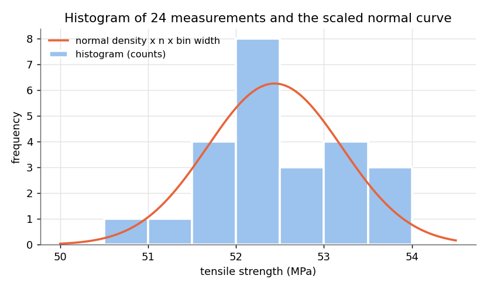
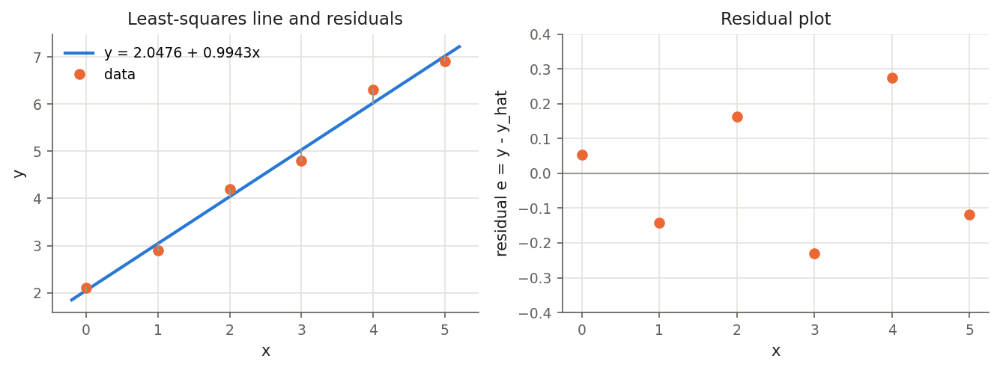
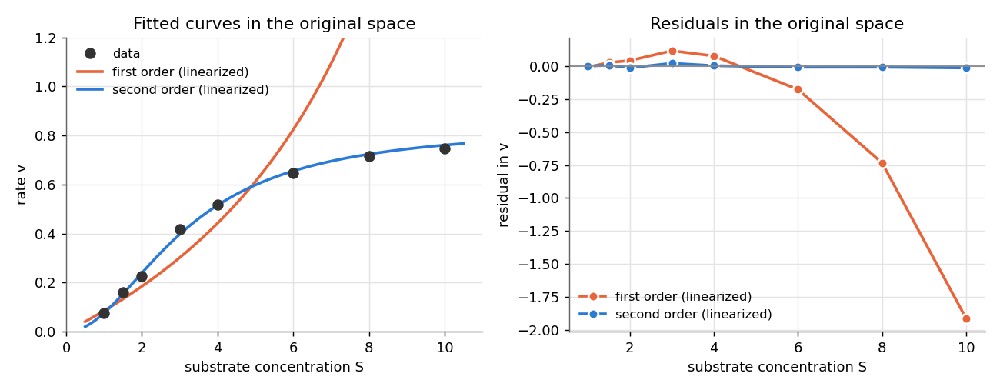

# Chapter 14 — Linear Regression

[Repository Guide](../../README.md) | [English](Concepts_Lecture.md) | [한국어](Concepts_Lecture.ko.md)

> **Last Updated:** 2026-11-19
>
> Applied Numerical Methods with Python for Engineers and Scientists, Chapra and Clough, Ch 14

> **Learning Objectives:**
> 1. Compute descriptive statistics such as the mean, median, standard deviation, coefficient of variation, and MAD
> 2. Explain the properties of the normal distribution and standardization
> 3. Derive the normal equations from the least-squares criterion and compute the slope and intercept of simple linear regression
> 4. Assess regression quality using the coefficient of determination ($`r^2`$) and the standard error of the estimate
> 5. Interpret least squares as maximum likelihood estimation under normally distributed errors and explain the assumptions of regression
> 6. Judge the adequacy of a model with residual plots and perform straight-line regression in Python

---

<br>

## Table of Contents

- [1. Overview](#1-overview)
- [2. Statistics Review](#2-statistics-review)
  - [2.1 Descriptive Statistics](#21-descriptive-statistics)
  - [2.2 Standard Deviation and Variance](#22-standard-deviation-and-variance)
  - [2.3 Coefficient of Variation](#23-coefficient-of-variation)
  - [2.4 Median Absolute Deviation (MAD)](#24-median-absolute-deviation-mad)
  - [2.5 Range and a Computational Formula for the Variance](#25-range-and-a-computational-formula-for-the-variance)
  - [2.6 Descriptive Statistics Functions in Python](#26-descriptive-statistics-functions-in-python)
- [3. Normal Distribution](#3-normal-distribution)
  - [3.1 Central Limit Theorem](#31-central-limit-theorem)
  - [3.2 Standard Normal Distribution](#32-standard-normal-distribution)
  - [3.3 Symmetry Properties](#33-symmetry-properties)
  - [3.4 General Normal Distribution](#34-general-normal-distribution)
  - [3.5 Standardization](#35-standardization)
  - [3.6 Normal CDF and PDF](#36-normal-cdf-and-pdf)
  - [3.7 The Normal Probability Rule and Confidence Intervals for the Mean](#37-the-normal-probability-rule-and-confidence-intervals-for-the-mean)
  - [3.8 Comparing a Histogram with the Normal Distribution](#38-comparing-a-histogram-with-the-normal-distribution)
- [4. Straight Line Least Square Regression](#4-straight-line-least-square-regression)
  - [4.1 Problem Setup](#41-problem-setup)
  - [4.2 Alternative Error Criteria and Why Least Squares](#42-alternative-error-criteria-and-why-least-squares)
  - [4.3 Deriving the Normal Equations](#43-deriving-the-normal-equations)
  - [4.4 Solving for Coefficients](#44-solving-for-coefficients)
  - [4.5 Example: Step-by-Step Straight-Line Regression](#45-example-step-by-step-straight-line-regression)
  - [4.6 Statistical Meaning of Least Squares](#46-statistical-meaning-of-least-squares)
  - [4.7 Matrix Form of the Normal Equations](#47-matrix-form-of-the-normal-equations)
  - [4.8 A Median Method for Sketching a Line by Hand](#48-a-median-method-for-sketching-a-line-by-hand)
- [5. Quantifying the Fit Quality](#5-quantifying-the-fit-quality)
  - [5.1 SST, SSE, and SSR Decomposition](#51-sst-sse-and-ssr-decomposition)
  - [5.2 Proof that SST = SSE + SSR](#52-proof-that-sst--sse--ssr)
  - [5.3 Coefficient of Determination (r²)](#53-coefficient-of-determination-r2)
  - [5.4 Standard Error of the Estimate](#54-standard-error-of-the-estimate)
  - [5.5 Goodness of Fit for the Example](#55-goodness-of-fit-for-the-example)
  - [5.6 Residual Analysis](#56-residual-analysis)
  - [5.7 Standard Errors and Confidence Intervals of the Coefficients](#57-standard-errors-and-confidence-intervals-of-the-coefficients)
  - [5.8 Outliers and Leverage](#58-outliers-and-leverage)
- [6. Linearization of Nonlinear Relationships](#6-linearization-of-nonlinear-relationships)
  - [6.1 Power Model](#61-power-model)
  - [6.2 Saturation-Growth-Rate Model](#62-saturation-growth-rate-model)
  - [6.3 Cautions About Linearization](#63-cautions-about-linearization)
  - [6.4 How Transformation Changes the Error Structure](#64-how-transformation-changes-the-error-structure)
  - [6.5 Application: Comparing Enzyme Kinetics Models](#65-application-comparing-enzyme-kinetics-models)
- [7. Random Numbers and Monte Carlo Simulation](#7-random-numbers-and-monte-carlo-simulation)
- [8. Python Implementation](#8-python-implementation)
- [9. Common Mistakes](#9-common-mistakes)
- [Summary](#summary)
- [Self-Check Questions](#self-check-questions)
- [References](#references)

<br>

---

<br>

## 1. Overview

Linear regression is a fundamental technique in **curve fitting** (Part 4 of the textbook, Chapters 14-18). The goal is to derive a **best-fit straight line** through a set of data points using the **least-squares** criterion.

This chapter reviews basic statistics (mean, standard deviation, distributions), then computes the slope and intercept of a best-fit straight line, and computes the standard error of the estimate to analyze the residual error.

<br>

---

<br>

## 2. Statistics Review

### 2.1 Descriptive Statistics

**Statistics** is the discipline that deals with data from which meaningful information is inferred.

**Sampling** is the process of choosing a smaller group of items from a larger population to gain insights about the entire group.

#### Sample Average (Mean)

If you have a sample of $`n`$ observations $`y_1, y_2, \ldots, y_n`$, the **sample average** is:

```math
\bar{y} = \frac{1}{n} \sum_{j=1}^{n} y_j
```

#### Median

The **median** $`\tilde{y}`$ is the middle value in a dataset when sorted in order. For an even number of data points, it is the average of the two middle values.

- Odd count: the median of the data [3, 5, 7] is 5.
- Even count: the median of the data [2, 4, 6, 8] is (4 + 6) / 2 = 5.

#### Mode

The **mode** is the value that occurs most frequently in a dataset.

- The mode of the data [2, 4, 4, 4, 5] is 4.

#### Outlier

An **outlier** is a data point that is significantly different from the rest.

- In the data [2, 4, 4, 4, 100], the value 100 is an outlier.

<br>

### 2.2 Standard Deviation and Variance

#### Population Standard Deviation

The **standard deviation** measures how much data points spread out from the mean:

```math
\sigma = \sqrt{\frac{1}{n} \sum_{j=1}^{n} (y_j - \mu)^2}
```

where $`\mu`$ is the **true mean** of the entire population, and $`n`$ is the total number of the population.

> **[Probability and Statistics]** The population standard deviation uses $`n`$ in the denominator because all members of the population are accounted for and the true mean $`\mu`$ is used as is, so no degree of freedom is lost. The sample formula below, which uses the sample mean in place of $`\mu`$, has a different denominator for this reason.

#### Sample Standard Deviation

```math
s_y = \sqrt{\frac{1}{n-1} \sum_{j=1}^{n} (y_j - \bar{y})^2}
```

where $`\bar{y}`$ is the **sample mean** and $`n`$ is the total number of data points in a sample.

The quantity inside the square root's numerator is called the **Total Corrected Sum of Squares (SST)**:

```math
SST = \sum_{j=1}^{n} (y_j - \bar{y})^2
```

> **[Probability and Statistics]** Why $`n - 1`$ instead of $`n`$? Using the sample mean $`\bar{y}`$ instead of the true mean $`\mu`$ **underestimates the variability**. Since $`\bar{y}`$ is a random variable that already used 1 degree of freedom, we divide by $`n - 1`$ (Bessel's correction) to get an **unbiased** estimate of the population variance.

<br>

### 2.3 Coefficient of Variation

The **Coefficient of Variation (c.v.)** is the ratio of the standard deviation to the mean, expressed as a percentage:

```math
c.v. = \frac{s_y}{\bar{y}} \cdot 100\%
```

> **[Probability and Statistics]** The c.v. normalizes the spread, so you can **compare datasets even if their scales are different**. A low c.v. implies data is tightly clustered around the mean; a high c.v. implies significant variability relative to the mean.

<br>

### 2.4 Median Absolute Deviation (MAD)

The **Median Absolute Deviation (MAD)** measures how far values deviate from the median:

```math
MAD = \text{median}(|y_i - \tilde{y}|)
```

**Example:**

- The median of the data [2, 4, 6, 8, 100] is 6.
- The absolute deviations are |2-6| = 4, |4-6| = 2, |6-6| = 0, |8-6| = 2, and |100-6| = 94.
- Sorting the deviations gives [0, 2, 2, 4, 94], so MAD = 2.

> **[Probability and Statistics]** MAD is **robust to outliers**. In the example above, the huge outlier 100 produces a deviation of 94, but since MAD takes the median of deviations, it is not affected by the size of this extreme value. This makes MAD a more reliable measure of spread when outliers are present, compared to standard deviation.

The MAD measures spread, but it is not on the same scale as the standard deviation. If the data follow the normal distribution $`\mathcal{N}(\mu, \sigma^2)`$, the median is $`\mu`$, and the median of the absolute deviation $`|y - \mu|`$ is the $`z\sigma`$ satisfying $`P(|Z| \leq z) = 0.5`$ (Section 3). By symmetry $`P(|Z| \leq z) = 2\Phi(z) - 1`$, so $`\Phi(z) = 0.75`$, that is, $`z = 0.6745`$. The MAD of normal data is therefore about $`0.6745\sigma`$, and the following robust estimate of the standard deviation is used.

```math
\hat{\sigma} = \frac{MAD}{0.6745} \approx 1.4826\,MAD
```

In the example above, $`\hat{\sigma} = 2/0.6745 = 2.965`$. The sample standard deviation of the same data is inflated to 42.54 by the outlier 100, whereas the sample standard deviation of [2, 4, 6, 8] without the outlier is 2.582, close to $`\hat{\sigma}`$.

<br>

### 2.5 Range and a Computational Formula for the Variance

The **range**, the largest value minus the smallest, is the most elementary measure of spread. The range is determined by only two points, so it varies greatly with sample size and outliers, and it is used only as a rough value when there are just a few data.

The numerator $`SST`$ of the variance can be obtained without first computing the deviations. Since $`\sum(y_i - \bar{y})^2 = \sum y_i^2 - 2\bar{y}\sum y_i + n\bar{y}^2`$ and $`\sum y_i = n\bar{y}`$, the following computational formula results.

```math
s_y^2 = \frac{\sum y_i^2 - n\bar{y}^2}{n - 1}
```

For the data [3, 5, 7, 9], $`\sum y_i^2 = 164`$ and $`n\bar{y}^2 = 4 \times 36 = 144`$, so $`s_y^2 = 20/3 = 6.667`$, the same as $`(9 + 1 + 1 + 9)/3`$ computed from the deviations $`-3, -1, 1, 3`$. The formula needs only one pass through the data and is convenient by hand, but its numerator is the difference of two large numbers of similar size, so it causes the subtractive cancellation of Section 6.5 of Chapter 4. The following code compares the two methods while adding a large constant to the same data. Adding a constant should not change the variance.

```python
import numpy as np

for shift in (0.0, 1e6, 1e7, 1e8, 1e9):
    y = np.array([3.0, 5.0, 7.0, 9.0]) + shift
    n = y.size
    two_pass = np.sum((y - y.mean())**2) / (n - 1)            # deviations first
    shortcut = (np.sum(y**2) - n * y.mean()**2) / (n - 1)     # sum of squares minus n * mean^2
    print(f"shift = {shift:8.0e}: two-pass = {two_pass:.6f}, shortcut = {shortcut:.6f}")
```

```text
shift =    0e+00: two-pass = 6.666667, shortcut = 6.666667
shift =    1e+06: two-pass = 6.666667, shortcut = 6.666667
shift =    1e+07: two-pass = 6.666667, shortcut = 6.666667
shift =    1e+08: two-pass = 6.666667, shortcut = 5.333333
shift =    1e+09: two-pass = 6.666667, shortcut = 0.000000
```

With the constant $`10^{8}`$, $`\sum y_i^2 \approx 4 \times 10^{16}`$, and double-precision numbers of this size are spaced 8 apart, so the true numerator 20 is buried in rounding and the result becomes 5.333. At $`10^{9}`$ the spacing grows to 512 and the variance comes out as 0. The two-pass method, which computes the deviations first, squares small numbers after subtracting the mean and is unaffected. Programs therefore compute the deviations first instead of using the computational formula, and the NumPy documentation also presents `np.std` as computed from the squared deviations from the mean, which is subtracted first [1].

<br>

### 2.6 Descriptive Statistics Functions in Python

The statistics introduced so far are computed for 24 measurements (MPa) of tensile-strength specimens.

```python
import numpy as np
from scipy import stats

y = np.array([52.4, 53.6, 53.5, 51.9, 52.1, 51.9, 52.9, 52.3, 53.1, 50.7, 53.8, 52.3,
              53.0, 52.3, 52.1, 52.8, 53.1, 52.2, 52.3, 53.0, 51.6, 51.0, 52.8, 51.8])  # MPa
print(f"n = {y.size}, mean = {np.mean(y):.4f}, median = {np.median(y):.4f}, range = {np.ptp(y):.1f}")
print(f"std (ddof=0) = {np.std(y):.4f}, std (ddof=1) = {np.std(y, ddof=1):.4f}")
print(f"var (ddof=1) = {np.var(y, ddof=1):.4f}, c.v. = {np.std(y, ddof=1) / np.mean(y) * 100:.3f} %")
mad = stats.median_abs_deviation(y)                     # raw MAD
sig = stats.median_abs_deviation(y, scale="normal")     # MAD / 0.6745
print(f"MAD = {mad:.4f}, MAD-based sigma = {sig:.4f}")
```

```text
n = 24, mean = 52.4375, median = 52.3000, range = 3.1
std (ddof=0) = 0.7488, std (ddof=1) = 0.7649
var (ddof=1) = 0.5851, c.v. = 1.459 %
MAD = 0.5000, MAD-based sigma = 0.7413
```

`np.std` and `np.var` use $`N - \text{ddof}`$ as the divisor, and the default of `ddof` is 0 [1]. Called without arguments, they therefore give the population standard deviation of Section 2.2, and the sample standard deviation requires `ddof=1`. For these data the two values are 0.7488 and 0.7649, which differ by the factor $`\sqrt{23/24}`$. `np.ptp` computes the range $`53.8 - 50.7 = 3.1`$, and `scipy.stats.median_abs_deviation` computes the MAD; with `scale="normal"` it divides the result by about 0.67449 and returns $`\hat{\sigma}`$ of Section 2.4 [2]. That the MAD-based $`\hat{\sigma} = 0.7413`$ is close to the sample standard deviation 0.7649 suggests that these data contain no large outlier. The coefficient of variation 1.46% indicates that the measurements scatter by about 1.5% around the mean. The distribution of these data is compared with the normal distribution in Sections 3.7 and 3.8.

<br>

---

<br>

## 3. Normal Distribution

### 3.1 Central Limit Theorem

If many i.i.d. (independent and identically distributed) random variables with finite mean and variance are added, the sum **approximately follows a normal distribution**, no matter what the distribution of the individual random variables is. Precisely, the distribution of the standardized sum converges to the standard normal distribution.

> **[Probability and Statistics]** The Central Limit Theorem (CLT) is the foundational reason why the normal distribution is so prevalent. Measurement errors, which are sums of many small independent effects, are typically normally distributed.

<br>

### 3.2 Standard Normal Distribution

The **standard normal distribution** is very popular due to the Central Limit Theorem.

**PDF (Probability Density Function):**

```math
\varphi(z) = \frac{1}{\sqrt{2\pi}} e^{-\frac{z^2}{2}}, \quad \text{for } -\infty < z < \infty
```

**CDF (Cumulative Distribution Function):**

```math
\Phi(z) = \int_{-\infty}^{z} \varphi(t) \, dt, \quad \text{for } -\infty < z < \infty
```

We denote this by $`Z \sim \mathcal{N}(0, 1)`$, meaning **mean 0 and variance 1**.

<br>

### 3.3 Symmetry Properties

**1. Symmetry of the PDF:**

```math
\varphi(z) = \varphi(-z)
```

The bell curve is symmetric about $`z = 0`$.

**2. Symmetry of the tail area:**

```math
P(Z \le -2) = P(Z \ge 2)
```

which is equivalent to:

```math
\Phi(-z) = 1 - \Phi(z)
```

**3. Symmetry of $`Z`$ and $`-Z`$:**

If $`Z \sim \mathcal{N}(0, 1)`$, then $`-Z \sim \mathcal{N}(0, 1)`$ as well.

```math
P(-Z \le z) = P(Z \ge -z) = 1 - \Phi(-z) = \Phi(z)
```

<br>

### 3.4 General Normal Distribution

If $`Z \sim \mathcal{N}(0, 1)`$, then:

```math
X = \mu + \sigma Z
```

has the normal distribution with **mean** $`\mu`$ **and variance** $`\sigma^2`$, denoted $`X \sim \mathcal{N}(\mu, \sigma^2)`$.

**Proof of mean and variance:**

```math
E(\mu + \sigma Z) = E(\mu) + E(\sigma Z) = \mu
```

```math
Var(\mu + \sigma Z) = Var(\sigma Z) = \sigma^2 Var(Z) = \sigma^2
```

> **[Probability and Statistics]** The linearity of expectation ($`E[aX + b] = aE[X] + b`$) and the scaling property of variance ($`Var(aX + b) = a^2 Var(X)`$) are the key properties used here. Adding a constant shifts the mean but does not change the variance.

<br>

### 3.5 Standardization

For $`X \sim \mathcal{N}(\mu, \sigma^2)`$, the **standardization** of $`X`$ is:

```math
Z = \frac{X - \mu}{\sigma} \sim \mathcal{N}(0, 1)
```

This transforms any normal random variable into a standard normal, enabling the use of standard normal tables.

<br>

### 3.6 Normal CDF and PDF

Let $`X \sim \mathcal{N}(\mu, \sigma^2)`$.

**CDF of $`X`$:**

```math
F(x) = P(X \le x) = P\left(\frac{X - \mu}{\sigma} \le \frac{x - \mu}{\sigma}\right) = \Phi\left(\frac{x - \mu}{\sigma}\right)
```

**PDF of $`X`$:**

```math
f(x) = F'(x) = \varphi\left(\frac{x - \mu}{\sigma}\right) \cdot \frac{1}{\sigma} = \frac{1}{\sigma\sqrt{2\pi}} e^{-\frac{(x - \mu)^2}{2\sigma^2}}
```

> **[Calculus]** By the chain rule, differentiating the composite function $`\Phi((x - \mu)/\sigma)`$ with respect to $`x`$ multiplies the derivative of the outer function, $`\varphi`$, by the derivative of the inner function, $`1/\sigma`$; the $`\frac{1}{\sigma}`$ factor in the PDF comes from this. This factor keeps the total area under the PDF equal to 1 regardless of $`\sigma`$.

<br>

### 3.7 The Normal Probability Rule and Confidence Intervals for the Mean

By the symmetry of Section 3.3, $`P(-z \leq Z \leq z) = 2\Phi(z) - 1`$, so the probabilities of falling within one, two, and three standard deviations of the mean are the following.

```math
2\Phi(1) - 1 = 0.6827, \qquad 2\Phi(2) - 1 = 0.9545, \qquad 2\Phi(3) - 1 = 0.9973
```

This is called the **normal probability rule**: about 68%, 95%, and 99.7% of normal data lie within $`\mu \pm \sigma`$, $`\mu \pm 2\sigma`$, and $`\mu \pm 3\sigma`$. For the data of Section 2.6, 18 of the 24 values (75%) lie within $`\bar{y} \pm s_y`$, 23 (95.8%) within $`\bar{y} \pm 2s_y`$, and all 24 within $`\bar{y} \pm 3s_y`$, which agrees well with the rule given the small sample. The multiplier that gives exactly 95% is $`z = 1.960`$, where $`\Phi(z) = 0.975`$.

Applying the same rule to the sample mean expresses the uncertainty of the mean. The mean of $`n`$ independent measurements has variance $`\sigma^2/n`$ and, by the central limit theorem of Section 3.1, is approximately normally distributed, so the 95% confidence interval for the true mean $`\mu`$ is $`\bar{y} \pm 1.960\,\sigma/\sqrt{n}`$. If $`\sigma`$ is unknown, it is replaced by $`s_y`$, and the value of the $`t`$ distribution with $`n - 1`$ degrees of freedom is used instead of 1.960 (for the same reason as in Section 5.7). If the measurements are normally distributed, this $`t`$ interval is exact even for small $`n`$; otherwise it holds approximately for large $`n`$. $`s_y/\sqrt{n}`$ is the standard error of the mean, revisited in Section 1.2 of Chapter 15. For the data of Section 2.6, $`s_y/\sqrt{n} = 0.7649/\sqrt{24} = 0.1561`$ and $`t_{0.025,23} = 2.069`$, so the interval is the following.

```math
52.4375 \pm 2.069 \times 0.1561 = 52.4375 \pm 0.3230 \;\Rightarrow\; [52.114,\ 52.760]
```

Whereas 95% of the individual measurements lie within roughly $`\bar{y} \pm 2s_y`$, a width of 3.06 MPa, the interval for the mean is much narrower, with a width of 0.65 MPa. The width of the interval is proportional to the standard error $`s_y/\sqrt{n}`$, so quadrupling the number of measurements roughly halves it.

<br>

### 3.8 Comparing a Histogram with the Normal Distribution

The basic tool for checking the distribution of data graphically before computing statistics is the **histogram**. The range of the data is divided into intervals (bins) of equal width, and the number of data in each interval is drawn as a bar. With too few bins the shape is smeared, and with too many each bar holds 0 or 1 data and the shape cannot be read, so the number of bins must suit the number of data. NumPy's `np.histogram` returns the counts and the bin edges, and every bin except the last includes its left edge and excludes its right edge [3].

The normal density curve has unit area beneath it, so it cannot be overlaid directly on a histogram of counts. The expected number of data in one bin of width $`w`$ is $`n\int f\,dy \approx n\,w\,f(\text{bin center})`$, so the density is multiplied by $`nw`$ for the comparison.

```python
import numpy as np
from scipy import stats

y = np.array([52.4, 53.6, 53.5, 51.9, 52.1, 51.9, 52.9, 52.3, 53.1, 50.7, 53.8, 52.3,
              53.0, 52.3, 52.1, 52.8, 53.1, 52.2, 52.3, 53.0, 51.6, 51.0, 52.8, 51.8])
counts, edges = np.histogram(y, bins=7, range=(50.5, 54.0))   # 7 bins of width 0.5
width = edges[1] - edges[0]
centers = (edges[:-1] + edges[1:]) / 2
expected = y.size * width * stats.norm.pdf(centers, y.mean(), y.std(ddof=1))
print(edges)
print(counts)
print(np.round(expected, 2))
```

```text
[50.5 51.  51.5 52.  52.5 53.  53.5 54. ]
[1 1 4 8 3 4 3]
[0.55 1.88 4.18 6.07 5.76 3.56 1.44]
```



*Figure 1. Histogram of 24 measurements compared with the normal curve*

The bin [52.0, 52.5) holds 8 values, more than the expected 6.07, and [52.5, 53.0) holds 3, fewer than the expected 5.76, but with only 24 samples differences of this size can be regarded as random variation. The measurements 51.0, 53.0, and 53.5 lie on bin edges, and by the half-open rule each falls into the bin to the right of its edge. With more data and narrower bins the histogram approaches the density curve. A histogram reveals properties that the mean and standard deviation alone do not, namely whether the distribution is skewed, whether it splits into several groups, and whether there are isolated values, so when there are dozens of data or more, the regression of Section 5 also checks the normality assumption of Section 4.6 with a histogram of the residuals.

<br>

---

<br>

## 4. Straight Line Least Square Regression

### 4.1 Problem Setup

Given data points $`(x_1, y_1), (x_2, y_2), \ldots, (x_n, y_n)`$, we want to find a **linear model**:

```math
\hat{y} = a_0 + a_1 x
```

where:
- $`a_0`$ = **y-intercept**
- $`a_1`$ = **slope**

Each observed value can be written as:

```math
y_i = \hat{y}_i + e_i = a_0 + a_1 x_i + e_i
```

where $`e_i = y_i - \hat{y}_i`$ is the **residual (error)**, the difference between the observed value and the predicted value.

<br>

### 4.2 Alternative Error Criteria and Why Least Squares

We want the best line through the data by minimizing some measure of error. Several criteria can be considered:

**Criterion 1 (minimize the sum of errors):**

```math
\min_{a_0, a_1} \sum e_i = \min_{a_0, a_1} \sum (y_i - a_0 - a_1 x_i)
```

Problem: Positive and negative errors **cancel each other out**, giving a misleading result.

**Criterion 2 (minimize the sum of absolute errors):**

```math
\min_{a_0, a_1} \sum |e_i| = \min_{a_0, a_1} \sum |y_i - a_0 - a_1 x_i|
```

Problems: The absolute value function is **non-differentiable** at zero, and the solution **may not be unique**.

**Criterion 3 (minimax, minimize the maximum error):**

```math
\min_{a_0, a_1} \max_i |y_i - a_0 - a_1 x_i|
```

Problems: **Non-differentiable**, and heavily **sensitive to outliers** since it emphasizes the single largest error.

**Criterion 4 (minimize the sum of squared errors, least squares):**

```math
\min_{a_0, a_1} \sum e_i^2 = \min_{a_0, a_1} \sum (y_i - a_0 - a_1 x_i)^2
```

This is the **least squares** approach, and the quantity it minimizes is the **Sum of Squared Errors (SSE)**. It is differentiable and, provided the $`x_i`$ are not all equal, yields a **unique** line for a given set of data.

> **[Probability and Statistics]** The least squares criterion is preferred because: (1) squaring removes sign issues, (2) the objective function is smooth and differentiable, (3) it has a unique closed-form solution, and (4) under the assumption of normally distributed errors, it corresponds to the maximum likelihood estimate.

<br>

### 4.3 Deriving the Normal Equations

The objective function to minimize is:

```math
SSE = \sum_{i=1}^{n} (y_i - \hat{y}_i)^2 = \sum_{i=1}^{n} (y_i - a_0 - a_1 x_i)^2
```

To find the minimum, differentiate SSE with respect to each unknown coefficient and set the derivatives to zero:

```math
\frac{\partial SSE}{\partial a_0} = -2 \sum_{i=1}^{n} (y_i - a_0 - a_1 x_i) = 0
```

```math
\frac{\partial SSE}{\partial a_1} = -2 \sum_{i=1}^{n} (y_i - a_0 - a_1 x_i) x_i = 0
```

Since $`a_0`$ and $`a_1`$ are constants (not dependent on $`i`$), we can factor them out of the sums:

- $`\sum a_0 = a_0 \cdot n`$
- $`\sum a_0 x_i = a_0 \sum x_i`$
- $`\sum a_1 x_i = a_1 \sum x_i`$
- $`\sum a_1 x_i^2 = a_1 \sum x_i^2`$

Setting the partial derivatives to zero yields the **normal equations**:

```math
\sum y_i = n \cdot a_0 + a_1 \sum x_i
```

```math
\sum y_i x_i = a_0 \sum x_i + a_1 \sum x_i^2
```

**Matrix form:**

```math
\begin{bmatrix} \sum y_i \\ \sum y_i x_i \end{bmatrix} = \begin{bmatrix} n & \sum x_i \\ \sum x_i & \sum x_i^2 \end{bmatrix} \begin{bmatrix} a_0 \\ a_1 \end{bmatrix} \quad (\ast)
```

> **[Linear Algebra]** This is a $`2 \times 2`$ linear system. The coefficient matrix is symmetric and positive definite (assuming the $`x_i`$ values are not all identical), guaranteeing a unique solution.

<br>

### 4.4 Solving for Coefficients

#### Using Cramer's Rule

The determinant of the coefficient matrix:

```math
D = n \sum x_i^2 - \left(\sum x_i\right)^2
```

The intercept:

```math
a_0 = \frac{1}{D} \left( \sum y_i \cdot \sum x_i^2 - \sum x_i \cdot \sum y_i x_i \right)
```

The slope:

```math
a_1 = \frac{1}{D} \left( n \sum y_i x_i - \sum x_i \cdot \sum y_i \right)
```

#### Alternative Form Using Sample Means

From the first row of $`(\ast)`$:

```math
\sum y_i = n \cdot a_0 + \left(\sum x_i\right) a_1
```

Dividing both sides by $`n`$:

```math
\frac{\sum y_i}{n} = a_0 + \frac{\sum x_i}{n} \cdot a_1
```

Since $`\bar{y} = \frac{\sum y_i}{n}`$ and $`\bar{x} = \frac{\sum x_i}{n}`$ are the sample means:

```math
\boxed{a_0 = \bar{y} - \bar{x} \cdot a_1} \quad (\ast\ast)
```

> **Note:** This result has an elegant geometric interpretation. The regression line **always passes through the point $`(\bar{x}, \bar{y})`$**, the centroid of the data.

### 4.5 Example: Step-by-Step Straight-Line Regression

A straight line $`y = a_0 + a_1x`$ is fitted by least squares to the following six data points. Collecting the sums needed for the computation in one table gives the following (the two rightmost columns are computed after the fit).

| $`i`$ | $`x_i`$ | $`y_i`$ | $`x_i^2`$ | $`x_iy_i`$ | $`\hat{y}_i`$ | $`e_i = y_i - \hat{y}_i`$ |
|-----:|-----:|-----:|-----:|-----:|-----:|-----:|
| 1 | 0 | 2.1 | 0 | 0.0 | 2.047619 | 0.052381 |
| 2 | 1 | 2.9 | 1 | 2.9 | 3.041905 | -0.141905 |
| 3 | 2 | 4.2 | 4 | 8.4 | 4.036190 | 0.163810 |
| 4 | 3 | 4.8 | 9 | 14.4 | 5.030476 | -0.230476 |
| 5 | 4 | 6.3 | 16 | 25.2 | 6.024762 | 0.275238 |
| 6 | 5 | 6.9 | 25 | 34.5 | 7.019048 | -0.119048 |
| Sum | 15 | 27.2 | 55 | 85.4 | 27.2 | 0 |

*Table 1. Data, sums, predicted values, and residuals of the straight-line regression example*

Substituting $`n = 6`$, $`\sum x_i = 15`$, $`\sum y_i = 27.2`$, $`\sum x_i^2 = 55`$, and $`\sum x_iy_i = 85.4`$ into the formulas of Section 4.4 gives the following.

```math
D = 6(55) - 15^2 = 105, \qquad a_1 = \frac{6(85.4) - 15(27.2)}{105} = \frac{512.4 - 408}{105} = \frac{104.4}{105} = 0.994286
```

```math
\bar{x} = 15/6 = 2.5, \quad \bar{y} = 27.2/6 = 4.533333, \qquad a_0 = \bar{y} - a_1\bar{x} = 4.533333 - 0.994286 \times 2.5 = 2.047619
```

The regression line is therefore $`y = 2.0476 + 0.9943x`$. The residual column of Table 1 shows $`\sum e_i = 0`$, and computing $`\sum e_ix_i = 0`$ confirms the second equality as well. The two equalities restate the normal equations $`\partial SSE/\partial a_0 = -2\sum e_i = 0`$ and $`\partial SSE/\partial a_1 = -2\sum e_ix_i = 0`$, so they serve as checks on a hand computation. The regression line also passes through $`(\bar{x}, \bar{y}) = (2.5,\ 4.5333)`$.

### 4.6 Statistical Meaning of Least Squares

The least-squares criterion is not used merely because it is convenient to compute. Under the following assumptions it gives the statistically most plausible line.

1. The values of $`x`$ are exact, without error.
2. The errors of $`y`$, $`\varepsilon_i = y_i - (a_0 + a_1x_i)`$, are independent and have the same variance $`\sigma^2`$ for all $`x`$.
3. The errors follow a normal distribution with mean zero.

Under these assumptions the probability density of observing $`y_i`$ is the normal PDF of Section 3, $`\frac{1}{\sigma\sqrt{2\pi}}\exp\bigl(-\varepsilon_i^2/(2\sigma^2)\bigr)`$, and by independence the probability density of the whole data set (the likelihood) is the product.

```math
L(a_0, a_1) = \prod_{i=1}^{n}\frac{1}{\sigma\sqrt{2\pi}}\exp\left(-\frac{(y_i - a_0 - a_1x_i)^2}{2\sigma^2}\right) = \left(\sigma\sqrt{2\pi}\right)^{-n}\exp\left(-\frac{SSE}{2\sigma^2}\right)
```

$`a_0`$ and $`a_1`$ appear only in the $`SSE`$ inside the exponent, so the coefficients that maximize the likelihood are the same as those that minimize $`SSE`$. That is, least-squares estimation is **maximum likelihood estimation** under normally distributed errors. Conversely, if the errors often contain large outliers (tails heavier than the normal distribution), squaring gives the outliers too much influence, and robust methods such as the absolute-sum criterion of Section 4.2 or the MAD of Section 2.4 are more appropriate.

Because of assumption 1, the roles of $`x`$ and $`y`$ are not symmetric. Regressing $`x`$ on $`y`$ with the same data gives a different line. In the example $`\sum y_i^2 = 140.8`$, so the slope of $`x = b_0 + b_1y`$ is $`b_1 = 104.4/(6 \times 140.8 - 27.2^2) = 104.4/104.96 = 0.994665`$, and the line solved for $`y`$ has slope $`1/b_1 = 1.005364`$, different from $`a_1 = 0.994286`$. The product of the two slopes, $`a_1b_1 = 0.98898`$, equals the coefficient of determination $`r^2`$ of Section 5, and the two lines coincide only when the data lie exactly on a line ($`r^2 = 1`$).

### 4.7 Matrix Form of the Normal Equations

Writing the $`n`$ equations $`y_i = a_0 + a_1x_i + e_i`$ at once gives $`\mathbf{y} = \mathbf{Z}\mathbf{a} + \mathbf{e}`$, where $`\mathbf{Z}`$ is the $`n \times 2`$ matrix whose first column is all ones and whose second column holds $`x_i`$, and $`\mathbf{a} = (a_0,\ a_1)`$. The condition that minimizes $`SSE = \mathbf{e}^T\mathbf{e}`$ becomes the following matrix equation.

```math
\mathbf{Z}^T\mathbf{Z}\,\mathbf{a} = \mathbf{Z}^T\mathbf{y}, \qquad \mathbf{Z}^T\mathbf{Z} = \begin{bmatrix} n & \sum x_i \\ \sum x_i & \sum x_i^2 \end{bmatrix}, \quad \mathbf{Z}^T\mathbf{y} = \begin{Bmatrix} \sum y_i \\ \sum x_iy_i \end{Bmatrix}
```

Its entries are exactly those of the normal equations $`(\ast)`$ of Section 4.3. For the example of Section 4.5:

```math
\begin{bmatrix} 6 & 15 \\ 15 & 55 \end{bmatrix}\begin{Bmatrix} a_0 \\ a_1 \end{Bmatrix} = \begin{Bmatrix} 27.2 \\ 85.4 \end{Bmatrix}, \qquad a_0 = \frac{27.2 \times 55 - 15 \times 85.4}{105} = \frac{215}{105} = 2.047619
```

```python
import numpy as np

x = np.array([0, 1, 2, 3, 4, 5], dtype=float)
y = np.array([2.1, 2.9, 4.2, 4.8, 6.3, 6.9])
Z = np.column_stack([np.ones_like(x), x])   # columns: 1 and x
print(Z.T @ Z)
print(Z.T @ y)
print(np.linalg.solve(Z.T @ Z, Z.T @ y))
```

```text
[[ 6. 15.]
 [15. 55.]]
[27.2 85.4]
[2.04761905 0.99428571]
```

`np.column_stack` builds $`\mathbf{Z}`$, and `Z.T @ Z` and `Z.T @ y` reproduce the sums of Table 1 in Section 4.5. The advantage of this form is that the equation does not change when the model gains terms. Merely adding a column of $`x_i^2`$ or of another variable to $`\mathbf{Z}`$ gives the polynomial and multiple linear regression of Chapter 15, and Chapter 15, Section 5 treats this general form.

### 4.8 A Median Method for Sketching a Line by Hand

The textbook also introduces a way to sketch a rough line through data in the field without computational aids. It uses only medians, without computing sums, and proceeds as follows.

1. Divide the data, in order of $`x`$, into three groups of roughly equal size.
2. In the left and right groups, mark the point formed by the median of $`x`$ and the median of $`y`$.
3. Draw the line connecting the two points.
4. Shift the line parallel toward the median point of the middle group by one third of the difference.

Dividing the six data points of Section 4.5 into three groups of two gives the median points $`(0.5,\ 2.5)`$ for the left group, $`(4.5,\ 6.6)`$ for the right, and $`(2.5,\ 4.5)`$ for the middle. The line through the two end points has slope $`(6.6 - 2.5)/(4.5 - 0.5) = 1.025`$ and passes through $`2.5 + 1.025 \times 2 = 4.55`$ at $`x = 2.5`$. Lowering it by one third of the difference $`-0.05`$ from the middle median 4.5 makes it pass through 4.5333 at $`x = 2.5`$, so the intercept is $`4.5333 - 1.025 \times 2.5 = 1.9708`$. The result $`y = 1.9708 + 1.025x`$ is close to the least-squares line $`y = 2.0476 + 0.9943x`$.

Because this method uses medians instead of means, it resists outliers like the MAD of Section 2.4. For example, if one point of the right group were recorded wrongly as a very large value, only the median of two points would move slightly, whereas the least-squares line would be pulled strongly toward that point because of the squared errors. In return, least squares is better in precision and statistical properties (such as the confidence intervals of Section 5.7).

<br>

---

<br>

## 5. Quantifying the Fit Quality

### 5.1 SST, SSE, and SSR Decomposition

Three key quantities measure different aspects of variability:

| Quantity | Full Name | Formula | Interpretation |
|----------|-----------|---------|----------------|
| **SST** | Sum of Squared Total (total corrected sum of squares) | $`\displaystyle \sum_{i=1}^{n}(y_i - \bar{y})^2`$ | Total deviation of data points from the mean |
| **SSE** | Sum of Squared Errors (residual sum of squares) | $`\displaystyle \sum_{i=1}^{n}(y_i - \hat{y}_i)^2`$ | Unexplained variability (error between observed and predicted) |
| **SSR** | Sum of Squared Regression (explained sum of squares) | $`\displaystyle \sum_{i=1}^{n}(\hat{y}_i - \bar{y})^2`$ | Explained variability (how well $`\hat{y}`$ fits the data) |

*Table 2. The three sums of squares SST, SSE, and SSR that measure variability*

The fundamental decomposition:

```math
\boxed{SST = SSE + SSR}
```

```math
\text{Total Variability} = \text{Unexplained Variability} + \text{Explained Variability}
```

> **Note:** If $`SSR > SSE`$, then $`r^2 > 0.5`$ (Section 5.3), so the regression model explains more variability than it leaves unexplained. This comparison only describes the degree of fit; the statistical significance of the model is judged by a separate test.

<br>

### 5.2 Proof that SST = SSE + SSR

**Step 1:** Express SST by adding and subtracting $`\hat{y}_i`$.

```math
SST = \sum (y_i - \bar{y})^2 = \sum (y_i - \hat{y}_i + \hat{y}_i - \bar{y})^2
```

**Step 2:** Expand the square.

```math
= \sum \left[(y_i - \hat{y}_i)^2 + 2(y_i - \hat{y}_i)(\hat{y}_i - \bar{y}) + (\hat{y}_i - \bar{y})^2\right]
```

**Step 3:** The cross term vanishes. We need to show:

```math
\sum (y_i - \hat{y}_i)(\hat{y}_i - \bar{y}) = 0
```

**Proof that the cross term is zero:**

Let $`e_i = y_i - \hat{y}_i`$. Then:

```math
\sum e_i (\hat{y}_i - \bar{y}) = \sum e_i (a_0 + a_1 x_i - \bar{y})
```

```math
= (a_0 - \bar{y}) \sum e_i + a_1 \sum e_i x_i
```

We need two properties from the normal equations:

**Property 1:** $`\sum e_i = 0`$

```math
\sum e_i = \sum (y_i - \hat{y}_i) = \sum (y_i - a_0 - a_1 x_i)
```

```math
= \sum y_i - a_0 n - a_1 \sum x_i = n\left(\bar{y} - a_0 - a_1 \bar{x}\right) = 0 \quad \text{(by } (\ast\ast)\text{)}
```

**Property 2:** $`\sum e_i x_i = 0`$

```math
\sum e_i x_i = \sum (y_i - \hat{y}_i) x_i = \sum y_i x_i - \sum (a_0 + a_1 x_i) x_i
```

```math
= \sum y_i x_i - a_0 \sum x_i - a_1 \sum x_i^2 = 0 \quad \text{(by the second normal equation } (\ast)\text{)}
```

Therefore:

```math
(a_0 - \bar{y}) \underbrace{\sum e_i}_{= 0} + a_1 \underbrace{\sum e_i x_i}_{= 0} = 0
```

**Conclusion:**

```math
SST = \sum (y_i - \hat{y}_i)^2 + \sum (\hat{y}_i - \bar{y})^2 = SSE + SSR
```

<br>

### 5.3 Coefficient of Determination ($`r^2`$)

The **coefficient of determination** quantifies how well the regression line fits the data:

```math
r^2 = \frac{SSR}{SST} = 1 - \frac{SSE}{SST}
```

| $`r^2`$ Value | Interpretation |
|-------------|----------------|
| $`r^2 = 1`$ | Perfect fit; all points lie on the line ($`SSE = 0`$) |
| $`r^2 = 0`$ | The model explains none of the variability ($`SSR = 0`$) |
| $`r^2 \approx 1`$ | Strong linear relationship |
| $`r^2 \approx 0`$ | Weak or no linear relationship |

*Table 3. Interpretation of coefficient of determination values*

> **[Probability and Statistics]** In simple linear regression, the value $`r = \sqrt{r^2}`$ (with appropriate sign) is the **Pearson correlation coefficient**. It measures the strength and direction of the linear relationship between $`x`$ and $`y`$. The sign of $`r`$ matches the sign of the slope $`a_1`$.

<br>

### 5.4 Standard Error of the Estimate

The **standard error of the estimate** quantifies the spread of data points around the regression line:

```math
s_{y/x} = \sqrt{\frac{SSE}{n - 2}}
```

> **[Probability and Statistics]** We divide by $`n - 2`$ (not $`n`$) because we have estimated **two parameters** ($`a_0`$ and $`a_1`$) from the data, consuming 2 degrees of freedom. This is analogous to dividing by $`n - 1`$ in the sample standard deviation where 1 parameter (the mean) is estimated.

The standard error $`s_{y/x}`$ quantifies the typical size of a residual. A smaller $`s_{y/x}`$ indicates a tighter fit of the regression line to the data.

### 5.5 Goodness of Fit for the Example

For the example of Section 4.5, $`\bar{y} = 4.533333`$, so the three sums of squares are the following.

```math
SST = \sum(y_i - \bar{y})^2 = 17.493333, \qquad SSE = \sum e_i^2 = 0.192762, \qquad SSR = \sum(\hat{y}_i - \bar{y})^2 = 17.300571
```

$`SSE + SSR = 17.493333 = SST`$ confirms the decomposition of Section 5.2. The coefficients of determination and correlation are the following.

```math
r^2 = 1 - \frac{SSE}{SST} = 1 - \frac{0.192762}{17.493333} = 0.988981, \qquad r = +\sqrt{0.988981} = 0.994475
```

The sign of $`r`$ follows the sign of the slope $`a_1`$. That is, 98.9% of the variation in $`y`$ is explained by the line. Comparing the standard deviation with the standard error of the estimate gives the following.

```math
s_y = \sqrt{\frac{SST}{n - 1}} = \sqrt{\frac{17.493333}{5}} = 1.870472, \qquad s_{y/x} = \sqrt{\frac{SSE}{n - 2}} = \sqrt{\frac{0.192762}{4}} = 0.219523
```

The spread around the regression line, $`s_{y/x}`$, is much smaller than the spread around the mean, $`s_y`$, so the line model is far better than describing the data by a single mean value.

### 5.6 Residual Analysis

$`r^2`$ summarizes in a single number how much variation the model explains, but it does not tell whether the form of the model is right. The basic tool for checking this is the **residual plot**, which plots the residuals $`e_i`$ against $`x_i`$ (or $`\hat{y}_i`$).



*Figure 2. Least-squares line and residual plot for the example*

On the right of Figure 2, the residuals have mixed signs around zero and no particular shape, so the line model and the assumptions of Section 4.6 do not contradict the data. The shapes to watch for in a residual plot are the following.

| Shape of the residuals | Meaning | Remedy |
|:-----|:-----|:-----|
| Curve bending up or down | Wrong model form | Linearization or polynomial regression (Chapter 15) |
| Funnel widening as $`x`$ grows | Nonconstant error variance (assumption 2 violated) | Variable transformation, weighted regression |
| A single point far off | Outlier | Check the data, robust methods |
| Runs of residuals with the same sign | Errors not independent | Revisit the model |

*Table 4. Shapes of residual plots and their meanings*

A model can have a high $`r^2`$ and still have the wrong form. Fitting a line to the data $`y = x^2`$ at $`x = 0, 1, \ldots, 5`$ gives $`y = -3.3333 + 5x`$ with a fairly high $`r^2 = 0.921`$, yet the residuals $`3.33,\ -0.67,\ -2.67,\ -2.67,\ -0.67,\ 3.33`$ trace a U shape, positive at both ends and negative in the middle. Such a systematic shape signals that a curved model, not a line, is needed.

### 5.7 Standard Errors and Confidence Intervals of the Coefficients

Under the assumptions of Section 4.6, $`y_i`$ contains random errors, so $`a_0`$ and $`a_1`$ computed from it are random variables that change each time the data are measured again. The slope can be written as $`a_1 = \sum(x_i - \bar{x})(y_i - \bar{y})/S_{xx}`$ (with $`S_{xx} = \sum(x_i - \bar{x})^2`$), and since $`\sum(x_i - \bar{x})\bar{y} = 0`$, $`a_1 = \sum w_iy_i`$ with $`w_i = (x_i - \bar{x})/S_{xx}`$. If the errors are independent with variance $`\sigma^2`$, then $`\mathrm{Var}(a_1) = \sigma^2\sum w_i^2 = \sigma^2/S_{xx}`$. Replacing the unknown $`\sigma`$ with the $`s_{y/x}`$ of Section 5.4 gives the standard errors of the two coefficients.

```math
s_{a_1} = \frac{s_{y/x}}{\sqrt{S_{xx}}}, \qquad s_{a_0} = s_{y/x}\sqrt{\frac{\sum x_i^2}{n\,S_{xx}}}
```

Because $`\sigma`$ has been replaced by an estimate, the confidence intervals of the coefficients use the $`t`$ distribution with $`n - 2`$ degrees of freedom instead of the normal distribution. The 95% confidence intervals are $`a_1 \pm t_{0.025,\,n-2}\,s_{a_1}`$ and $`a_0 \pm t_{0.025,\,n-2}\,s_{a_0}`$.

For the example of Section 4.5, $`S_{xx} = 17.5`$ and $`s_{y/x} = 0.219523`$, so $`s_{a_1} = 0.219523/\sqrt{17.5} = 0.052476`$ and $`s_{a_0} = 0.219523\sqrt{55/(6 \times 17.5)} = 0.158879`$. Using $`t_{0.025,4} = 2.776`$ for 4 degrees of freedom gives the following.

```math
a_1 = 0.994286 \pm 2.776 \times 0.052476 = 0.994286 \pm 0.145673 \;\Rightarrow\; [0.8486,\ 1.1400]
```

```math
a_0 = 2.047619 \pm 2.776 \times 0.158879 = 2.047619 \pm 0.441048 \;\Rightarrow\; [1.6066,\ 2.4887]
```

The slope interval does not contain 0, which is evidence of a linear relation between $`x`$ and $`y`$, and it does contain 1, so the data do not contradict the hypothesis that the slope is 1. As the formula shows, more data or a wider spread of $`x`$ increases $`S_{xx}`$ and reduces the uncertainty of the slope. Section 7 checks by Monte Carlo simulation that the formula indeed holds.

### 5.8 Outliers and Leverage

Because the residuals enter squared, the least-squares line is easily pulled by a single point far from the others, and how far depends on the position of the point. In the expression $`a_1 = \sum w_iy_i`$, $`w_i = (x_i - \bar{x})/S_{xx}`$ of Section 5.7, adding an error $`\delta`$ to one $`y_i`$ changes the slope by $`w_i\delta`$. The fitted value of that point, $`\hat{y}_i = \bar{y} + a_1(x_i - \bar{x})`$, changes by the change $`\delta/n`$ of $`\bar{y}`$ plus the change due to the slope.

```math
\Delta a_1 = \frac{(x_i - \bar{x})\,\delta}{S_{xx}}, \qquad \Delta\hat{y}_i = h_{ii}\,\delta, \qquad h_{ii} = \frac{1}{n} + \frac{(x_i - \bar{x})^2}{S_{xx}}
```

$`h_{ii}`$ is called the **leverage** of the point, and it grows as $`x_i`$ moves away from $`\bar{x}`$. For the data of Section 4.5, $`h_{ii}`$ is 0.5238 at the ends $`x = 0, 5`$ and 0.1810 in the middle at $`x = 2, 3`$. If the $`y`$ at $`x = 5`$ is wrongly recorded as 9.9 instead of 6.9 ($`\delta = 3`$), the slope increases by $`3 \times 2.5/17.5 = 0.4286`$ to 1.4229, but if the same error occurs at $`x = 2`$, the slope changes by only $`3 \times (-0.5)/17.5 = -0.0857`$.

```python
import numpy as np

x = np.array([0, 1, 2, 3, 4, 5], dtype=float)
y = np.array([2.1, 2.9, 4.2, 4.8, 6.3, 6.9])
for i, label in ((None, "original"), (5, "y6 + 3"), (2, "y3 + 3")):
    yy = y.copy()
    if i is not None:
        yy[i] += 3.0                                   # one recording error of +3
    a1, a0 = np.polyfit(x, yy, 1)
    e = yy - (a0 + a1 * x)
    syx = np.sqrt(np.sum(e**2) / (x.size - 2))
    print(f"{label:8s} a0 = {a0:.4f}, a1 = {a1:.4f}, syx = {syx:.4f}, max |e|/syx = {np.max(np.abs(e)) / syx:.2f}")
h = 1 / x.size + (x - x.mean())**2 / np.sum((x - x.mean())**2)   # leverage of each point
print(np.round(h, 4))
```

```text
original a0 = 2.0476, a1 = 0.9943, syx = 0.2195, max |e|/syx = 1.25
y6 + 3   a0 = 1.4762, a1 = 1.4229, syx = 0.9701, max |e|/syx = 1.35
y3 + 3   a0 = 2.7619, a1 = 0.9086, syx = 1.4618, max |e|/syx = 1.79
[0.5238 0.2952 0.181  0.181  0.2952 0.5238]
```

The textbook gives the criterion, for residuals that appear normally distributed, of suspecting an outlier when a residual exceeds 4-5 times the standard error of the estimate. As the output shows, however, the error at the high-leverage point $`x = 5`$ pulls the line toward itself and inflates $`s_{y/x}`$ from 0.2195 to 0.9701, so even the largest residual is only 1.35 times $`s_{y/x}`$. The outlier masks itself. In such a case, the point is predicted from the line fitted without it. The line through the other five points is $`y = 2.0 + 1.03x`$ with $`s_{y/x} = 0.233`$, and it predicts 7.15 at $`x = 5`$, so the recorded 9.9 exceeds the prediction by 2.75, or 11.8 times $`s_{y/x}`$. This value equals the residual 1.3095 of the full fit divided by $`1 - h_{ii} = 0.4762`$, which is the prediction residual used by PRESS in Section 5.8 of Chapter 15. Even when a point is judged an outlier, it should be removed only when the cause is clear, such as a failed instrument or a recording mistake, and the removal and its reason should be documented.

<br>

---

<br>

## 6. Linearization of Nonlinear Relationships

The textbook introduces linearization by transformation of variables as the first way to extend straight-line regression to nonlinear relationships. Chapter 15, Section 2 summarizes the transformation formulas of the exponential, power, and saturation-growth-rate models. This section fits two of the models to actual data and shows step by step how the transformed coefficients are converted back to the coefficients of the original model.

### 6.1 Power Model

Taking common logarithms of both sides of $`y = \alpha x^{\beta}`$ gives $`\log y = \log\alpha + \beta\log x`$, so in the straight-line regression of $`\log y`$ on $`\log x`$ the slope is $`\beta`$ and the intercept is $`\log\alpha`$. It is applied to the following data.

| $`x`$ | 1 | 2 | 3 | 4 | 5 | 6 |
|:-----|-----:|-----:|-----:|-----:|-----:|-----:|
| $`y`$ | 0.6 | 2.3 | 5.1 | 9.2 | 13.8 | 20.5 |
| $`\log x`$ | 0 | 0.3010 | 0.4771 | 0.6021 | 0.6990 | 0.7782 |
| $`\log y`$ | -0.2218 | 0.3617 | 0.7076 | 0.9638 | 1.1399 | 1.3118 |

*Table 5. Data and log-transformed values for the power model*

Applying the formulas of Section 4 to the log-transformed values gives slope $`1.966119`$ and intercept $`-0.225831`$. Converting back gives $`\beta = 1.9661`$ and $`\alpha = 10^{-0.225831} = 0.594524`$, so the model is $`y = 0.5945x^{1.9661}`$. The predictions are $`0.595,\ 2.323,\ 5.155,\ 9.076,\ 14.074,\ 20.142`$; the $`r^2`$ in log space is 0.99986 and the $`SSE`$ in the original space is 0.2223. The coefficients reveal well that the data roughly follow $`0.6x^2`$.

### 6.2 Saturation-Growth-Rate Model

$`y = \alpha x/(\beta + x)`$ is a saturating curve that approaches $`\alpha`$ as $`x`$ grows. Taking reciprocals of both sides gives $`1/y = (\beta/\alpha)(1/x) + 1/\alpha`$, so in the line of $`1/y`$ against $`1/x`$ the intercept is $`1/\alpha`$ and the slope is $`\beta/\alpha`$. For the data $`x = (0.5,\ 1,\ 2,\ 4,\ 8,\ 16)`$ and $`y = (1.6,\ 2.6,\ 3.7,\ 4.7,\ 5.3,\ 5.6)`$, the reciprocals are $`1/x = (2,\ 1,\ 0.5,\ 0.25,\ 0.125,\ 0.0625)`$ and $`1/y = (0.625,\ 0.3846,\ 0.2703,\ 0.2128,\ 0.1887,\ 0.1786)`$.

The straight-line regression gives slope $`0.231847`$ and intercept $`0.157834`$. Converting back gives $`\alpha = 1/0.157834 = 6.335769`$ and $`\beta = 0.231847 \times 6.335769 = 1.468930`$, so the model is $`y = 6.3358x/(1.4689 + x)`$. $`\alpha`$ is interpreted as the saturation value as $`x \to \infty`$, and $`\beta`$ as the $`x`$ at which $`y`$ reaches half the saturation value. The predictions are $`1.609,\ 2.566,\ 3.653,\ 4.634,\ 5.353,\ 5.803`$, and the $`SSE`$ in the original space is 0.0518.

### 6.3 Cautions About Linearization

Linearization is simple to compute, but it must be remembered that the quantity minimized is the $`SSE`$ of the transformed values, not of the original data. In the reciprocal transformation, $`1/y`$ changes greatly at points with small $`y`$, so the first few points with small $`x`$ dominate the line, while the log transformation treats relative errors evenly. The $`r^2`$ in the transformed space must therefore not be read as the goodness of fit of the original model; predictions and residuals should be recomputed in the original space to check. To minimize the $`SSE`$ in the original space directly, use the nonlinear regression of Chapter 15, Section 6, with the linearized result as its initial estimate. Chapter 15, Section 6.5 compares the two methods numerically for the exponential model.

### 6.4 How Transformation Changes the Error Structure

The error of a linearized model is not the error of the original model. Taking logarithms of the exponential model with an additive measurement error, $`y = \alpha e^{\beta x} + \varepsilon`$, gives $`\ln y = \ln\alpha + \beta x + \ln\bigl(1 + \varepsilon/(\alpha e^{\beta x})\bigr)`$, so the error of the transformed model is no longer measurement noise with zero mean and constant variance. Conversely, with a multiplicative error $`y = \alpha e^{\beta x}e^{\varepsilon}`$, the result $`\ln y = \ln\alpha + \beta x + \varepsilon`$ satisfies the assumptions of Section 4.6 exactly when $`\varepsilon`$ is independent and normally distributed with zero mean and constant variance. The log transformation therefore suits data whose error is proportional to the size of $`y`$ (constant relative error), and the nonlinear regression of Section 6 of Chapter 15 suits data whose error has constant size.

Even with a multiplicative error, back-transformation has a pitfall. The straight line in log space predicts the mean of $`\ln y`$, so its back-transform $`e^{b_0 + b_1x}`$ predicts not the mean of $`y`$ but its median (the geometric mean). If $`\varepsilon \sim \mathcal{N}(0, \sigma^2)`$, then $`E[e^{\varepsilon}] = e^{\sigma^2/2}`$, so the mean of $`y`$ exceeds the back-transformed value by the factor $`e^{\sigma^2/2}`$. The following code verifies this with data $`y = 2e^{0.3x}e^{\varepsilon}`$, $`\sigma = 0.3`$, generated 1000 times at each $`x`$.

```python
import numpy as np

rng = np.random.default_rng(3)
x = np.repeat(np.arange(10.0), 1000)                  # 1000 measurements at each x = 0, ..., 9
y = 2.0 * np.exp(0.3 * x) * np.exp(rng.normal(0.0, 0.3, x.size))   # multiplicative error
b1, b0 = np.polyfit(x, np.log(y), 1)                   # straight line in (x, ln y)
s2 = np.sum((np.log(y) - b0 - b1 * x)**2) / (x.size - 2)
at5 = y[x == 5.0]
print(f"alpha = {np.exp(b0):.4f}, beta = {b1:.4f}, s^2 of ln y = {s2:.4f}")
print(f"x = 5: mean of y = {at5.mean():.3f}, median of y = {np.median(at5):.3f}")
print(f"back-transformed prediction = {np.exp(b0 + 5 * b1):.3f}, times exp(s^2/2) = {np.exp(b0 + 5 * b1 + s2 / 2):.3f}")
```

```text
alpha = 2.0110, beta = 0.2988, s^2 of ln y = 0.0906
x = 5: mean of y = 9.377, median of y = 9.045
back-transformed prediction = 8.958, times exp(s^2/2) = 9.373
```

The estimates $`\alpha = 2.011`$ and $`\beta = 0.2988`$ are close to the true values 2 and 0.3. At $`x = 5`$, however, the back-transformed prediction 8.958 is close to the median of the measurements, 9.045, and is more than 4% smaller than their mean, 9.377. Multiplying by $`e^{s^2/2} = 1.046`$ with the residual variance $`s^2 = 0.0906`$ in log space gives 9.373, which matches the mean. This correction is needed when a linearized model is used to predict average quantities (for example, mean values used to compute totals).

### 6.5 Application: Comparing Enzyme Kinetics Models

The rate $`v`$ of a reaction in which an enzyme converts a substrate into a product approaches a maximum rate $`v_m`$ as the substrate concentration $`S`$ grows. The basic model is the Michaelis-Menten model $`v = v_mS/(k_s + S)`$, which has the same form as the saturation-growth-rate model of Section 6.2, and $`k_s`$ is the concentration at which the rate is half of $`v_m`$. For enzymes whose binding involves two cooperating substrate molecules, the second-order model with squares, $`v = v_mS^2/(k_s^2 + S^2)`$, sometimes fits better; this curve starts with zero slope and is S-shaped, changing its direction of curvature at $`S = k_s/\sqrt{3} \approx 0.58k_s`$ (the second derivative is proportional to $`k_s^2 - 3S^2`$). Both models become straight lines when inverted.

```math
\frac{1}{v} = \frac{1}{v_m} + \frac{k_s}{v_m}\cdot\frac{1}{S}, \qquad \frac{1}{v} = \frac{1}{v_m} + \frac{k_s^2}{v_m}\cdot\frac{1}{S^2}
```

Both models are fitted to the following data by linearization and compared through the residuals in the original space.

```python
import numpy as np

S = np.array([1.0, 1.5, 2.0, 3.0, 4.0, 6.0, 8.0, 10.0])          # substrate concentration
v = np.array([0.076, 0.160, 0.226, 0.418, 0.518, 0.646, 0.715, 0.746])  # reaction rate
for p in (1, 2):                                   # p = 1: 1/v against 1/S, p = 2: 1/v against 1/S^2
    X, Y = 1 / S**p, 1 / v
    a1, a0 = np.polyfit(X, Y, 1)
    r2 = 1 - np.sum((Y - a0 - a1 * X)**2) / np.sum((Y - Y.mean())**2)
    vm = 1 / a0                                    # intercept 1/vm
    ks = (a1 * vm)**(1 / p)                        # slope ks^p / vm
    e = v - vm * S**p / (ks**p + S**p)             # residuals in the original space
    print(f"p = {p}: r2 (transformed) = {r2:.4f}, vm = {vm:.4f}, ks = {ks:.4f}, SSE = {np.sum(e**2):.5f}")
    print("   residuals:", np.round(e, 3))
```

```text
p = 1: r2 (transformed) = 0.9381, vm = -1.1358, ks = -14.2749, SSE = 4.24165
   residuals: [-0.01   0.027  0.041  0.116  0.076 -0.178 -0.733 -1.911]
p = 2: r2 (transformed) = 0.9988, vm = 0.8364, ks = 3.1557, SSE = 0.00104
   residuals: [-0.     0.006 -0.014  0.021  0.002 -0.009 -0.009 -0.015]
```



*Figure 3. Linearized fits of two Michaelis-Menten models and residuals in the original space*

The first-order model has a fairly high $`r^2`$ of 0.938 in the transformed space, but its intercept is negative, giving the physically impossible values $`v_m = -1.136`$ and $`k_s = -14.27`$. In the original space, as in Figure 3, the curve cannot follow the saturation of the data, and the residuals form a systematic pattern, positive from $`S = 1.5`$ to $`S = 4`$ and strongly negative for $`S \geq 6`$, with $`SSE = 4.24`$. The second-order model has $`r^2 = 0.9988`$ and gives $`v_m = 0.836`$ and $`k_s = 3.156`$, a saturation value slightly above the largest observation 0.746 and a half-saturation concentration within the range of the data, and its residuals are at most 0.021 in magnitude with mixed signs ($`SSE = 0.00104`$). Three lessons follow from this comparison. First, a model should not be accepted on the $`r^2`$ of the transformed space alone. Second, the estimated parameters must be checked for physical plausibility. Third, the residuals should be recomputed and plotted in the original space. These data were generated by adding relative errors of about 3% to the second-order model with $`v_m = 0.85`$ and $`k_s = 3.2`$, and the estimates of the second-order model are close to the true values.

---

<br>

## 7. Random Numbers and Monte Carlo Simulation

Following the review of statistics, the textbook covers how to generate random numbers from the uniform and normal distributions and how to use them in simulation. **Monte Carlo simulation** is a method that repeats the same experiment many times with random inputs to estimate the distribution of the result numerically. Even a distribution that is hard to obtain analytically can be approximated by a histogram, mean, and standard deviation after enough repetitions.

In NumPy, `np.random.default_rng` creates a random number generator using the default bit generator (PCG64), and giving the same seed reproduces the same sequence of random numbers, so results can be reproduced [4]. The generator's `normal(loc, scale, size)` draws samples from a normal distribution and `uniform(low, high, size)` from a uniform distribution [4]. The relation $`X = \mu + \sigma Z`$ of Section 3.4 corresponds to `loc` and `scale` of `normal`, and a uniform random number on $`[a, b]`$ is the same as $`a + (b - a)U`$ built from a uniform random number $`U`$ on $`[0, 1]`$.

The following code checks the slope standard-error formula of Section 5.7 by simulation. It creates data 10000 times at the same $`x`$ as Section 4.5 by adding normal errors with standard deviation 0.2 to the true line $`y = 2 + x`$ and fits a line each time.

```python
import numpy as np

rng = np.random.default_rng(1)
x = np.array([0, 1, 2, 3, 4, 5], dtype=float)
sigma, trials, t = 0.2, 10000, 2.776      # t value for 95% with n - 2 = 4 degrees of freedom
sxx = np.sum((x - x.mean())**2)
slopes, covered = [], 0
for _ in range(trials):
    y = 2.0 + 1.0 * x + rng.normal(0.0, sigma, size=x.size)   # true line plus noise
    a1, a0 = np.polyfit(x, y, 1)
    syx = np.sqrt(np.sum((y - a0 - a1 * x)**2) / (x.size - 2))
    sa1 = syx / np.sqrt(sxx)
    slopes.append(a1)
    covered += abs(a1 - 1.0) <= t * sa1
print(f"mean slope = {np.mean(slopes):.4f}, std of slopes = {np.std(slopes):.4f}, theory = {sigma / np.sqrt(sxx):.4f}")
print(f"95% intervals that contain the true slope: {covered / trials:.3f}")
u = rng.uniform(0.0, 1.0, size=5)
print(np.round(u, 4))
```

```text
mean slope = 1.0004, std of slopes = 0.0477, theory = 0.0478
95% intervals that contain the true slope: 0.953
[0.4248 0.3935 0.4686 0.5864 0.177 ]
```

The first line of the loop creates hypothetical measurement data by adding errors to the true line, and the next lines compute the slope, $`s_{y/x}`$, and $`s_{a_1}`$. `covered` counts how often the 95% confidence interval built from those data contains the true slope 1. In the results, the mean of the slope estimates, 1.0004, is almost equal to the true value, showing that the least-squares slope is an unbiased estimator, and the standard deviation 0.0477 agrees with the formula $`\sigma/\sqrt{S_{xx}} = 0.2/\sqrt{17.5} = 0.0478`$. Moreover, 95.3% of the confidence intervals contain the true value, confirming that the $`t`$ interval of Section 5.7 works as its name says. The last line is an example of five uniform random numbers on $`[0, 1]`$.

The same method finds how an uncertain input spreads to the output of a model. The uniform distribution on $`[a, b]`$ has constant density $`f(x) = 1/(b - a)`$, so its mean is $`\int_a^b x/(b - a)\,dx = (a + b)/2`$, and from $`E[X^2] = (a^2 + ab + b^2)/3`$ its variance is $`E[X^2] - \bigl((a + b)/2\bigr)^2 = (b - a)^2/12`$. In the bungee jumper model of Chapter 1, $`v(t) = \sqrt{gm/c_d}\tanh(\sqrt{gc_d/m}\,t)`$, suppose that the mass $`m = 80`$ kg is known exactly but the drag coefficient lies somewhere within $`\pm 10\%`$ of 0.30 kg/m, that is, in $`[0.27,\ 0.33]`$. The uncertainty of the velocity at $`t = 5`$ s is simulated both with the uniform distribution and with a normal distribution of the same mean and standard deviation.

```python
import numpy as np

g, m, t = 9.81, 80.0, 5.0
def velocity(cd):
    return np.sqrt(g * m / cd) * np.tanh(np.sqrt(g * cd / m) * t)

a, b = 0.27, 0.33                                  # drag coefficient known only to +/-10 %
rng = np.random.default_rng(2)
cd_u = rng.uniform(a, b, 10000)
cd_n = rng.normal((a + b) / 2, (b - a) / np.sqrt(12), 10000)   # same mean and standard deviation
print(f"uniform cd: mean = {cd_u.mean():.4f}, std = {cd_u.std(ddof=1):.4f}, theory = {(a + b) / 2:.4f}, {(b - a) / np.sqrt(12):.4f}")
print(f"v at cd = 0.30, 0.27, 0.33: {velocity(0.30):.4f}, {velocity(a):.4f}, {velocity(b):.4f}")
for name, cd in (("uniform", cd_u), ("normal", cd_n)):
    v = velocity(cd)
    print(f"{name:7s}: mean v = {v.mean():.4f}, std v = {v.std(ddof=1):.4f}, min = {v.min():.4f}, max = {v.max():.4f}")
```

```text
uniform cd: mean = 0.3000, std = 0.0175, theory = 0.3000, 0.0173
v at cd = 0.30, 0.27, 0.33: 38.0447, 38.8733, 37.2589
uniform: mean v = 38.0519, std v = 0.4699, min = 37.2589, max = 38.8732
normal : mean v = 38.0509, std v = 0.4619, min = 36.2830, max = 39.9796
```

The sample mean 0.3000 and standard deviation 0.0175 of the 10000 uniform random numbers are close to the theoretical values 0.30 and $`0.06/\sqrt{12} = 0.0173`$. Even though the drag coefficient varies by $`\pm 10\%`$, the velocity varies only within 37.26-38.87 m/s, about $`\pm 2.1\%`$ around 38.04 at $`c_d = 0.30`$, so the velocity at this time is insensitive to the drag coefficient. The velocity standard deviation of 0.47 m/s nearly equals 0.466, obtained from the first-order approximation $`\Delta v \approx |dv/dc_d|\,\Delta c_d`$ of Section 13 of Chapter 4 with $`dv/dc_d \approx (37.2589 - 38.8733)/0.06 = -26.9`$ and $`\sigma_{c_d} = 0.0173`$. The two distributions have the same mean and standard deviation, so the velocity means and standard deviations are also similar, but the normal distribution has tails that extend indefinitely, so the minimum and maximum velocities spread wider, to 36.28 and 39.98. In problems where the extremes of the output matter, the assumed input distribution decides the result.

---

<br>

## 8. Python Implementation

The following function translates the formulas of Sections 4 and 5 directly and returns the coefficients, the coefficient of determination, and the standard error of the estimate.

```python
import numpy as np

def linregr(x, y):
    x = np.asarray(x, dtype=float)
    y = np.asarray(y, dtype=float)
    n = len(x)
    sx, sy = x.sum(), y.sum()
    sxx, sxy = (x * x).sum(), (x * y).sum()
    a1 = (n * sxy - sx * sy) / (n * sxx - sx**2)   # slope
    a0 = sy / n - a1 * sx / n                      # intercept from the means
    e = y - (a0 + a1 * x)                          # residuals
    sst = ((y - y.mean())**2).sum()
    sse = (e**2).sum()
    r2 = 1 - sse / sst
    syx = np.sqrt(sse / (n - 2))                   # standard error of the estimate
    return a0, a1, r2, syx

x = [0, 1, 2, 3, 4, 5]
y = [2.1, 2.9, 4.2, 4.8, 6.3, 6.9]
a0, a1, r2, syx = linregr(x, y)
print(f"a0 = {a0:.6f}, a1 = {a1:.6f}, r2 = {r2:.6f}, syx = {syx:.6f}")

p = np.polyfit(x, y, 1)            # highest power first: [a1, a0]
print(p)
print(np.polyval(p, [6, 7]))       # predictions at x = 6 and 7
```

```text
a0 = 2.047619, a1 = 0.994286, r2 = 0.988981, syx = 0.219523
[0.99428571 2.04761905]
[8.01333333 9.00761905]
```

The function computes the four sums once and obtains the coefficients from the slope formula of Section 4.4 and equation $`(\ast\ast)`$. It computes $`SSE`$ from the residual array `e` and, together with $`SST`$, forms $`r^2`$ and $`s_{y/x}`$. The results agree with the hand computations of Sections 4.5 and 5.5.

NumPy's `np.polyfit(x, y, deg)` fits a polynomial of degree `deg` by least squares and returns the coefficients **highest power first** [5]. For a line, `p[0]` is therefore the slope and `p[1]` the intercept. `np.polyval` evaluates the polynomial with those coefficients. The points $`x = 6, 7`$ above lie outside the data range $`[0, 5]`$, so these predictions are extrapolations, with no guarantee that the linear relation holds outside the range. The NumPy documentation recommends `numpy.polynomial.Polynomial.fit`, which is numerically more stable, for new code [5].

---

<br>

## 9. Common Mistakes

The following mistakes are common in straight-line regression.

1. **Reading the coefficients of `np.polyfit` in reverse order.** The result starts from the highest power, so the line result `[0.994, 2.048]` means slope 0.994 and intercept 2.048.
2. **Dividing the standard error by $`n`$ or $`n - 1`$.** The spread around the regression line is divided by $`n - 2`$ because two coefficients have been estimated.
3. **Accepting a model on the basis of $`r^2`$ alone.** As in the example of Section 5.6, even with $`r^2 = 0.92`$, a systematic pattern in the residuals means the model form is wrong.
4. **Extrapolating beyond the data range.** The regression line has support only within the observed range.
5. **Thinking that swapping the roles of $`x`$ and $`y`$ gives the same line.** As shown in Section 4.6, the slopes of the two regression lines agree only when $`r^2 = 1`$.
6. **Applying least squares as is when $`x`$ also has large measurement errors.** If assumption 1 fails, the slope can be systematically underestimated, so such cases need methods that treat the errors of both variables.
7. **Reporting `np.std` or `np.var` called without arguments as the sample standard deviation.** The default `ddof=0` divides by $`n`$, so `ddof=1` must be given for the sample standard deviation (Section 2.6).
8. **Programming the variance with the computational formula $`(\sum y_i^2 - n\bar{y}^2)/(n - 1)`$.** When the mean is much larger than the spread, subtractive cancellation makes the result wrong or even zero (Section 2.5).
9. **Accepting a high-leverage point as normal because its residual is small.** A high-leverage outlier pulls the line and shrinks its own residual, so it is checked with the prediction residual computed without that point (Section 5.8).
10. **Reading the back-transformed value of a log-space regression as the mean.** The back-transformed value predicts the median, and the mean is larger by about the factor $`e^{s^2/2}`$ (Section 6.4).

---

<br>

## Summary

| Concept | Key Summary |
|---------|-------------|
| Linear model | The best-fit straight line is written as $`\hat{y} = a_0 + a_1 x`$. |
| SSE (objective) | The quantity that least squares minimizes is $`\displaystyle \sum_{i=1}^{n}(y_i - a_0 - a_1 x_i)^2`$. |
| Normal equations (matrix) | The coefficients are found by solving the system $`\begin{bmatrix} n & \sum x_i \\\\ \sum x_i & \sum x_i^2 \end{bmatrix} \begin{bmatrix} a_0 \\\\ a_1 \end{bmatrix} = \begin{bmatrix} \sum y_i \\\\ \sum y_i x_i \end{bmatrix}`$. |
| Slope ($`a_1`$) | The slope, which gives the rate of change, is $`\displaystyle \frac{n\sum x_i y_i - \sum x_i \sum y_i}{n\sum x_i^2 - (\sum x_i)^2}`$. |
| Intercept ($`a_0`$) | The intercept, the y-value when $`x = 0`$, is $`\bar{y} - a_1 \bar{x}`$. |
| SST decomposition | $`SST = SSE + SSR`$, so the total variability is the sum of the unexplained and explained variability. |
| Coefficient of determination | The goodness of fit on a scale from 0 to 1 is $`r^2 = SSR / SST = 1 - SSE / SST`$. |
| Standard error | The spread of the residuals is measured by $`s_{y/x} = \sqrt{SSE / (n - 2)}`$. |
| Sample std. dev. | The spread of the data around the mean is measured by $`s_y = \sqrt{SST / (n - 1)}`$. |
| Coefficient of variation | The normalized spread is $`c.v. = (s_y / \bar{y}) \cdot 100\%`$. |
| MAD | A robust measure of spread is $`\text{median}(\vert y_i - \tilde{y} \vert)`$. |
| Standard normal PDF | The bell curve density is $`\varphi(z) = \frac{1}{\sqrt{2\pi}} e^{-z^2/2}`$. |
| General normal PDF | The normal density with mean $`\mu`$ and variance $`\sigma^2`$ is $`f(x) = \frac{1}{\sigma\sqrt{2\pi}} e^{-(x-\mu)^2/(2\sigma^2)}`$. |
| Standardization | $`Z = (X - \mu) / \sigma`$ transforms a normal random variable to $`\mathcal{N}(0,1)`$. |
| Checking the example | The residuals satisfy $`\sum e_i = 0`$ and $`\sum e_ix_i = 0`$, and the regression line passes through $`(\bar{x}, \bar{y})`$, which serve as checks on hand computations. |
| Maximum likelihood interpretation | With independent, equal-variance, normally distributed errors the likelihood is proportional to $`\exp(-SSE/2\sigma^2)`$, so least-squares estimation is maximum likelihood estimation. |
| Residual analysis | Residuals should scatter randomly around zero; curved, funnel, or outlier shapes indicate problems with the model or the assumptions. |
| `np.polyfit` | Returns polynomial coefficients highest power first; for a line, `[slope, intercept]`. |
| Matrix form of the normal equations | $`\mathbf{Z}^T\mathbf{Z}\mathbf{a} = \mathbf{Z}^T\mathbf{y}`$; adding columns extends it directly to polynomial and multiple regression. |
| Confidence intervals of the coefficients | $`s_{a_1} = s_{y/x}/\sqrt{S_{xx}}`$, and the 95% interval is $`a_1 \pm t_{0.025,n-2}s_{a_1}`$. |
| Linearization and back-transformation | Straighten the power model with logarithms and the saturation-growth-rate model with reciprocals, then convert the slope and intercept back to the original coefficients. |
| Monte Carlo simulation | Repeat an experiment with random inputs to obtain the distribution of an estimator numerically; fixing the seed makes it reproducible. |
| Computational formula for the variance | $`s_y^2 = (\sum y_i^2 - n\bar{y}^2)/(n - 1)`$ is convenient by hand but vulnerable to subtractive cancellation, so programs compute the deviations first. |
| MAD-based standard deviation | For normal data, $`\hat{\sigma} = MAD/0.6745`$ is a standard deviation estimate robust to outliers. |
| Normal probability rule | About 68%, 95%, and 99.7% of normal data lie within one, two, and three standard deviations of the mean. |
| Confidence interval for the mean | For normally distributed measurements, the 95% confidence interval for the true mean is $`\bar{y} \pm t_{0.025,n-1}s_y/\sqrt{n}`$. |
| Histogram | It shows the distribution by counts in bins of equal width, and comparison with the normal density requires multiplying the density by the product $`nw`$ of the count and the bin width. |
| Leverage | An error at a point with large $`h_{ii} = 1/n + (x_i - \bar{x})^2/S_{xx}`$ changes the slope greatly and shrinks its own residual, masking itself. |
| Back-transformation bias | The back-transform of a straight line in log space predicts the median of $`y`$, and the mean is larger by about the factor $`e^{s^2/2}`$. |
| Uniform distribution | The uniform distribution on $`[a, b]`$ has mean $`(a + b)/2`$ and variance $`(b - a)^2/12`$. |

<br>

---

<br>

## Self-Check Questions

1. **Least-squares line:** Fit the least-squares line $`\hat{y} = a_0 + a_1 x`$ to the data (1, 2), (2, 4), (3, 5), (4, 4), (5, 5) and find $`a_0`$ and $`a_1`$.

   <details>
   <summary>Answer</summary>

   $`n = 5`$, $`\sum x_i = 15`$, $`\sum y_i = 20`$, $`\sum x_i^2 = 55`$, and $`\sum x_i y_i = 66`$. Since $`D = 5 \cdot 55 - 15^2 = 50`$, $`a_1 = (5 \cdot 66 - 15 \cdot 20) / 50 = 30 / 50 = 0.6`$. With $`\bar{x} = 3`$ and $`\bar{y} = 4`$, $`a_0 = \bar{y} - a_1 \bar{x} = 4 - 0.6 \cdot 3 = 2.2`$, so the regression line is $`\hat{y} = 2.2 + 0.6x`$.

   </details>

2. **Goodness of fit:** For the regression line of Question 1, find SST, SSE, SSR, $`r^2`$, and $`s_{y/x}`$.

   <details>
   <summary>Answer</summary>

   The predicted values are 2.8, 3.4, 4.0, 4.6, 5.2 and the residuals are -0.8, 0.6, 1.0, -0.6, -0.2. $`SSE = 0.64 + 0.36 + 1.00 + 0.36 + 0.04 = 2.4`$. Since $`\bar{y} = 4`$, $`SST = 4 + 0 + 1 + 0 + 1 = 6`$ and $`SSR = SST - SSE = 3.6`$. Therefore $`r^2 = 1 - 2.4 / 6 = 0.6`$ and $`s_{y/x} = \sqrt{2.4 / (5 - 2)} = \sqrt{0.8} \approx 0.894`$.

   </details>

3. **Property of the residuals:** Use the normal equations to explain why the residual sum $`\sum e_i`$ of the least-squares line is 0, and state how this property relates the regression line to the point $`(\bar{x}, \bar{y})`$.

   <details>
   <summary>Answer</summary>

   The first normal equation $`\sum y_i = n a_0 + a_1 \sum x_i`$ comes from $`\partial SSE / \partial a_0 = -2 \sum (y_i - a_0 - a_1 x_i) = 0`$, and this condition is exactly $`\sum e_i = 0`$. Dividing it by $`n`$ gives $`\bar{y} = a_0 + a_1 \bar{x}`$, so the regression line always passes through the point $`(\bar{x}, \bar{y})`$. In Question 1, $`2.2 + 0.6 \cdot 3 = 4 = \bar{y}`$ as well.

   </details>

4. **Robust measure of spread:** Find the mean, median, and MAD of the data [1, 3, 3, 6, 50], and compare the effect of the outlier 50 on the mean and on the MAD.

   <details>
   <summary>Answer</summary>

   The mean is 63 / 5 = 12.6 and the median is 3. The absolute deviations from the median are 2, 0, 0, 3, 47, which sort to [0, 0, 2, 3, 47], so MAD = 2. If 50 is replaced by 10, the mean changes sharply to 4.6 but the MAD stays 2. The mean is pulled by the size of the outlier, while the MAD looks only at the median of the deviations and is not affected by the size of the outlier.

   </details>

5. **Standardization:** For $`X \sim \mathcal{N}(10, 4)`$, express $`P(X \le 12)`$ and $`P(X \le 8)`$ with the standard normal CDF $`\Phi`$ and find their values. Use $`\Phi(1) \approx 0.8413`$.

   <details>
   <summary>Answer</summary>

   Since $`\sigma = 2`$, $`P(X \le 12) = \Phi((12 - 10) / 2) = \Phi(1) \approx 0.8413`$. By the symmetry property $`\Phi(-z) = 1 - \Phi(z)`$, $`P(X \le 8) = \Phi(-1) = 1 - \Phi(1) \approx 0.1587`$.

   </details>

6. **Computing from sums:** Find the slope and intercept of the regression line when $`n = 5`$, $`\sum x_i = 10`$, $`\sum y_i = 20`$, $`\sum x_i^2 = 30`$, and $`\sum x_iy_i = 50`$.

   <details>
   <summary>Answer</summary>

   $`D = 5(30) - 10^2 = 50`$ and $`a_1 = (5 \times 50 - 10 \times 20)/50 = 50/50 = 1`$. Since $`\bar{x} = 2`$ and $`\bar{y} = 4`$, $`a_0 = 4 - 1 \times 2 = 2`$, and the regression line is $`y = 2 + x`$.

   </details>

7. **Interpreting a residual plot:** The residuals of a straight-line regression spread more and more widely around zero as $`x`$ increases. Explain what this means and how it affects the regression result.

   <details>
   <summary>Answer</summary>

   It means that the error variance grows with $`x`$, so assumption 2 of constant variance is violated. The least-squares line is then pulled too strongly toward points in the high-scatter region, and the single value $`s_{y/x}`$ cannot represent the uncertainty at every $`x`$. A variable transformation (for example, a logarithm) or a regression that weights points according to their variance should be considered.

   </details>

8. **Confidence interval of the slope:** A line fitted to 8 data points gave $`a_1 = 2.5`$, $`s_{y/x} = 0.6`$, and $`S_{xx} = 36`$. Using $`t_{0.025,6} = 2.447`$, find the 95% confidence interval of the slope.

   <details>
   <summary>Answer</summary>

   $`s_{a_1} = 0.6/\sqrt{36} = 0.1`$, so the interval is $`2.5 \pm 2.447 \times 0.1 = 2.5 \pm 0.2447`$, that is, $`[2.2553,\ 2.7447]`$.

   </details>

9. **Back-transformation:** The straight-line regression of $`\log y`$ on $`\log x`$ gave slope 1.5 and intercept 0.3. Find the coefficients of the power model $`y = \alpha x^{\beta}`$ and the prediction at $`x = 4`$.

   <details>
   <summary>Answer</summary>

   $`\beta = 1.5`$ and $`\alpha = 10^{0.3} = 1.995`$. At $`x = 4`$, $`y = 1.995 \times 4^{1.5} = 1.995 \times 8 = 15.96`$.

   </details>

10. **Outliers and leverage:** In the data of Section 4.5 ($`\bar{x} = 2.5`$, $`S_{xx} = 17.5`$), the measurement at $`x = 0`$ was recorded 2 larger than its true value. Find the leverage of that point, the change of the slope, and the change of the fitted value at that point.

   <details>
   <summary>Answer</summary>

   The leverage is $`h = 1/6 + (0 - 2.5)^2/17.5 = 0.1667 + 0.3571 = 0.5238`$. The change of the slope is $`(0 - 2.5) \times 2/17.5 = -0.2857`$, so the slope decreases from 0.9943 to 0.7086. The fitted value at that point increases by $`h\delta = 0.5238 \times 2 = 1.0476`$, so the intercept becomes 3.0952 instead of 2.0476. An error at an end point has large leverage and tilts the line strongly.

   </details>

---

<br>

## References

1. NumPy Developers, "numpy.std," *NumPy Documentation*. [Online]. Available: https://numpy.org/doc/stable/reference/generated/numpy.std.html
2. SciPy Developers, "scipy.stats.median_abs_deviation," *SciPy Documentation*. [Online]. Available: https://docs.scipy.org/doc/scipy/reference/generated/scipy.stats.median_abs_deviation.html
3. NumPy Developers, "numpy.histogram," *NumPy Documentation*. [Online]. Available: https://numpy.org/doc/stable/reference/generated/numpy.histogram.html
4. NumPy Developers, "Random Generator," *NumPy Documentation*. [Online]. Available: https://numpy.org/doc/stable/reference/random/generator.html
5. NumPy Developers, "numpy.polyfit," *NumPy Documentation*. [Online]. Available: https://numpy.org/doc/stable/reference/generated/numpy.polyfit.html
