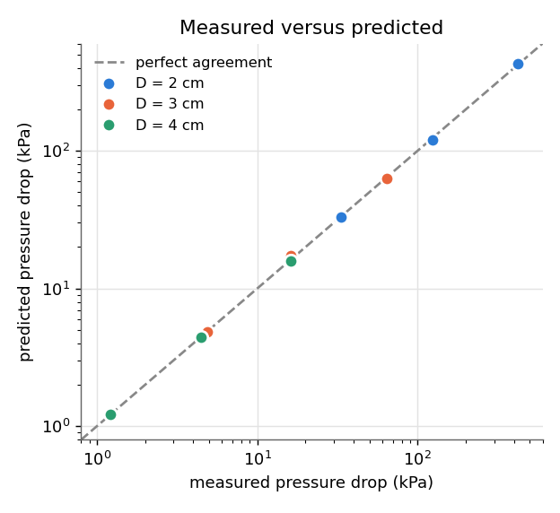
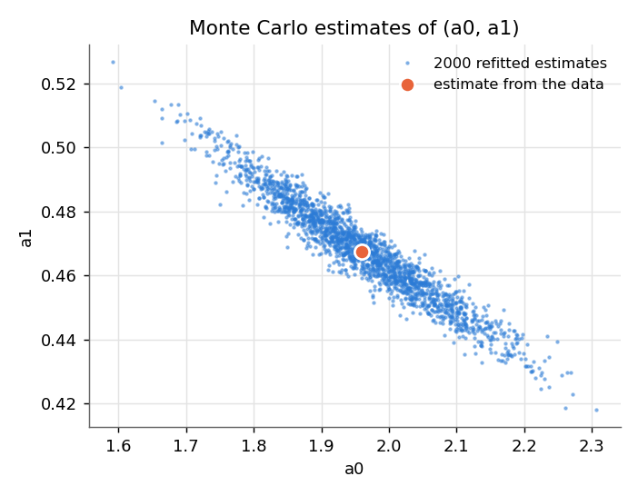

# 15장 — 비선형 회귀

[레포지토리 안내](../../README.ko.md) | [English](Concepts_Lecture.md) | [한국어](Concepts_Lecture.ko.md)

> **최종 수정일:** 2026-11-27
>
> Applied Numerical Methods with Python for Engineers and Scientists, Chapra and Clough, Ch 15

> **학습 목표:**
> 1. 지수, 거듭제곱, 포화 성장률 모델을 선형화하여 선형 회귀로 적합할 수 있다
> 2. 다항 회귀와 다중 선형 회귀의 정규 방정식을 유도하고 적용할 수 있다
> 3. 일반 선형 최소제곱 모델의 정규 방정식을 행렬로 유도하고 적합도 통계량을 계산할 수 있다
> 4. 매개변수에 대해 본질적으로 비선형인 모델을 반복 최적화로 적합할 수 있다
> 5. 정규 방정식의 조건수가 제곱되는 이유를 설명하고 QR 분해로 최소제곱 문제를 풀 수 있다
> 6. Gauss-Newton 방법을 유도하여 손으로 반복하고 SciPy의 `curve_fit`, `least_squares`로 비선형 회귀를 수행할 수 있다

---

<br>

## 목차

- [1. 복습: 표준 오차와 결정 계수](#1-복습-표준-오차와-결정-계수)
  - [1.1 표본 표준 편차(SD)](#11-표본-표준-편차sd)
  - [1.2 평균의 표준 오차(SE)](#12-평균의-표준-오차se)
  - [1.3 회귀의 표준 오차](#13-회귀의-표준-오차)
  - [1.4 결정 계수(R-제곱)](#14-결정-계수r-제곱)
- [2. 비선형 관계의 선형화(Linearization)](#2-비선형-관계의-선형화linearization)
  - [2.1 지수 모델(Exponential Model)](#21-지수-모델exponential-model)
  - [2.2 거듭제곱 모델(Power Model)](#22-거듭제곱-모델power-model)
  - [2.3 포화 성장률 모델(Saturation-Growth-Rate Model)](#23-포화-성장률-모델saturation-growth-rate-model)
- [3. 다항 회귀(Polynomial Regression)](#3-다항-회귀polynomial-regression)
  - [3.1 문제 정의](#31-문제-정의)
  - [3.2 정규 방정식 유도](#32-정규-방정식-유도)
  - [3.3 행렬 형태의 정규 방정식](#33-행렬-형태의-정규-방정식)
  - [3.4 추정의 표준 오차](#34-추정의-표준-오차)
  - [3.5 다항 회귀의 예제](#35-다항-회귀의-예제)
- [4. 다중 선형 회귀(Multiple Linear Regression)](#4-다중-선형-회귀multiple-linear-regression)
  - [4.1 문제 정의](#41-문제-정의)
  - [4.2 정규 방정식](#42-정규-방정식)
  - [4.3 추정의 표준 오차](#43-추정의-표준-오차)
  - [4.4 다변수 거듭제곱 모델로의 확장](#44-다변수-거듭제곱-모델로의-확장)
  - [4.5 다중 선형 회귀의 예제](#45-다중-선형-회귀의-예제)
  - [4.6 다변수 거듭제곱 모델의 예제](#46-다변수-거듭제곱-모델의-예제)
- [5. 일반 선형 최소제곱 회귀(General Linear Least Square Regression)](#5-일반-선형-최소제곱-회귀general-linear-least-square-regression)
  - [5.1 일반 모델 정의](#51-일반-모델-정의)
  - [5.2 행렬 정의](#52-행렬-정의)
  - [5.3 정규 방정식 유도(행렬 미적분)](#53-정규-방정식-유도행렬-미적분)
  - [5.4 해 계산](#54-해-계산)
  - [5.5 적합도 통계량](#55-적합도-통계량)
  - [5.6 매개변수 추정치의 공분산 행렬](#56-매개변수-추정치의-공분산-행렬)
  - [5.7 정규 방정식의 조건과 QR 분해](#57-정규-방정식의-조건과-qr-분해)
  - [5.8 모델 선택: 수정 결정 계수와 예측 결정 계수](#58-모델-선택-수정-결정-계수와-예측-결정-계수)
  - [5.9 임의의 기저 함수를 쓴 일반 선형 최소제곱의 예제](#59-임의의-기저-함수를-쓴-일반-선형-최소제곱의-예제)
  - [5.10 단계적 회귀와 항의 선택](#510-단계적-회귀와-항의-선택)
- [6. 비선형 회귀(Gauss-Newton)](#6-비선형-회귀gauss-newton)
  - [6.1 동기: Antoine 방정식(Antoine Equation)](#61-동기-antoine-방정식antoine-equation)
  - [6.2 scipy.optimize를 이용한 Python 구현](#62-scipyoptimize를-이용한-python-구현)
  - [6.3 Gauss-Newton 방법의 유도](#63-gauss-newton-방법의-유도)
  - [6.4 Gauss-Newton 방법의 예제](#64-gauss-newton-방법의-예제)
  - [6.5 선형화 적합과 비선형 적합의 비교](#65-선형화-적합과-비선형-적합의-비교)
  - [6.6 curve_fit과 least_squares](#66-curve_fit과-least_squares)
  - [6.7 minimize로 오차 제곱합 최소화하기](#67-minimize로-오차-제곱합-최소화하기)
  - [6.8 초기 추정값과 수렴 실패](#68-초기-추정값과-수렴-실패)
  - [6.9 매개변수의 불확실성: 선형화 근사와 Monte Carlo 시뮬레이션](#69-매개변수의-불확실성-선형화-근사와-monte-carlo-시뮬레이션)
- [7. 흔한 실수](#7-흔한-실수)
- [요약](#요약)
- [점검 문제](#점검-문제)
- [참고 문헌](#참고-문헌)

---

<br>

## 1. 복습: 표준 오차와 결정 계수

### 1.1 표본 표준 편차(SD)

**표본 표준 편차**(SD)는 개별 데이터 점이 데이터셋의 평균으로부터 얼마나 변동(퍼짐)하는지를 측정한다.

```math
s_y = \sqrt{\frac{1}{n-1} \sum_{j=1}^{n} (y_j - \bar{y})^2}
```

여기서:
- $`n`$ = 데이터 점의 수
- $`y_j`$ = 개별 관측값
- $`\bar{y}`$ = 표본 평균

**예제:** 키 = [170, 172, 168, 174, 176] cm

- 표본 평균 $`\bar{y} = 172`$ cm
- $`s_y = 3.16`$ cm

**해석:** 개별 키 측정값은 평균과 대략 3.16 cm 차이가 난다.

### 1.2 평균의 표준 오차(SE)

**표준 오차**(SE)는 표본 평균이 참 모집단 평균을 얼마나 정밀하게 추정하는지를 측정한다.

```math
SE = \frac{s_y}{\sqrt{n}}
```

**예제 (계속):**
- $`SE = \frac{3.16}{\sqrt{5}} = 1.41`$ cm

**해석:** 평균 키는 172 cm로 추정되며, 표준 오차는 $`\pm 1.41`$ cm이다.

### 1.3 회귀의 표준 오차

**회귀의 표준 오차**($`s_e`$)는 관측값이 선형 회귀선으로부터 얼마나 벗어나는지를 측정한다.

```math
s_e = \sqrt{\frac{1}{n-2} \sum_{j=1}^{n} (y_j - \hat{y}_j)^2} = \sqrt{\frac{SSE}{n-2}}
```

여기서:
- $`\hat{y}_j`$ = 회귀선에서의 예측값
- $`n - 2`$ = 자유도(두 매개변수 $`\beta_0, \beta_1`$이 추정됨)

**예제:** 키 = [170, 172, 168, 174, 176] cm, $`x = [1, 2, 3, 4, 5]`$

- $`s_e = \sqrt{\frac{SSE}{n-2}} = 2.61`$ cm

**해석:** 관측된 $`y`$ 값은 회귀선으로부터 약 2.61 cm 벗어난다.

### 1.4 결정 계수(R-제곱)

**결정 계수** $`R^2`$는 회귀 모델이 종속 변수의 변동성을 얼마나 잘 설명하는지를 측정한다.

총 제곱합은 다음과 같이 분해된다:

```math
SST = SSR + SSE
```

양변을 $`SST`$로 나누면:

```math
1 = \frac{SSR}{SST} + \frac{SSE}{SST}
```

따라서:

```math
R^2 = \frac{SSR}{SST} = 1 - \frac{SSE}{SST}
```

여기서:
- $`SST = \sum (y_i - \bar{y})^2`$: 총 제곱합(Total Sum of Squares)
- $`SSR = \sum (\hat{y}_i - \bar{y})^2`$: 회귀 제곱합(설명된 변동)
- $`SSE = \sum (y_i - \hat{y}_i)^2`$: 오차 제곱합(설명되지 않은 변동)

| $`R^2`$ 값 | 의미 |
|---|---|
| $`R^2 = 1`$ | 완벽한 적합 |
| $`R^2 = 0`$ | 적합 없음 |
| $`0 < R^2 < 1`$ | 부분적 적합 |

*표 1. 결정 계수 값에 따른 적합의 의미*

**예제 (교재 예제 14.6):** $`R^2 = 88\%`$

**해석:** 두 변수 간의 관계는 데이터 변동의 88%(약 90%)를 설명한다.

---

<br>

## 2. 비선형 관계의 선형화(Linearization)

핵심 아이디어는 **비선형 함수를 직선 형태로 변환** 하여 선형 회귀 기법을 적용할 수 있게 하는 것이다.

### 2.1 지수 모델(Exponential Model)

**원래 모델:**

```math
y = \alpha_1 e^{\beta_1 x}
```

**선형화:** 양변에 자연로그를 취한다:

```math
\ln y = \ln(\alpha_1 e^{\beta_1 x}) = \ln \alpha_1 + \ln e^{\beta_1 x} = \ln \alpha_1 + \beta_1 x
```

이로써 다음 선형 형태를 얻는다: $`\ln y = \underbrace{\ln \alpha_1}_{\text{절편}} + \underbrace{\beta_1}_{\text{기울기}} \cdot x`$

**그래프 효과:** $`x`$에 대한 $`y`$의 그래프는 지수 곡선이다. $`x`$에 대한 $`\ln y`$의 그래프는 기울기 $`\beta_1`$, 절편 $`\ln \alpha_1`$인 직선이 된다.

### 2.2 거듭제곱 모델(Power Model)

**원래 모델:**

```math
y = \alpha_2 x^{\beta_2}
```

**선형화:** 양변에 자연로그를 취한다:

```math
\ln y = \ln(\alpha_2 x^{\beta_2}) = \ln \alpha_2 + \ln x^{\beta_2} = \ln \alpha_2 + \beta_2 \ln x
```

이로써 다음 선형 형태를 얻는다: $`\ln y = \underbrace{\ln \alpha_2}_{\text{절편}} + \underbrace{\beta_2}_{\text{기울기}} \cdot \ln x`$

**그래프 효과:** $`x`$에 대한 $`y`$의 그래프는 거듭제곱 곡선이다. $`\ln x`$에 대한 $`\ln y`$의 그래프는 기울기 $`\beta_2`$, 절편 $`\ln \alpha_2`$인 직선이 된다.

### 2.3 포화 성장률 모델(Saturation-Growth-Rate Model)

**원래 모델:**

```math
y = \frac{\alpha_3 x}{\beta_3 + x}
```

**선형화:** 양변의 역수를 취한다:

```math
\frac{1}{y} = \frac{\beta_3 + x}{\alpha_3 x} = \frac{\beta_3}{\alpha_3} \cdot \frac{1}{x} + \frac{1}{\alpha_3}
```

이로써 다음 선형 형태를 얻는다: $`\frac{1}{y} = \underbrace{\frac{\beta_3}{\alpha_3}}_{\text{기울기}} \cdot \frac{1}{x} + \underbrace{\frac{1}{\alpha_3}}_{\text{절편}}`$

**그래프 효과:** $`x`$에 대한 $`y`$의 그래프는 포화 곡선이다. $`\frac{1}{x}`$에 대한 $`\frac{1}{y}`$의 그래프는 기울기 $`\frac{\beta_3}{\alpha_3}`$, 절편 $`\frac{1}{\alpha_3}`$인 직선이 된다.

| 모델 | 원래 형태 | 변환된 변수 | 기울기 | 절편 |
|---|---|---|---|---|
| 지수 모델 | $`y = \alpha_1 e^{\beta_1 x}`$ | $`x`$에 대한 $`\ln y`$ | $`\beta_1`$ | $`\ln \alpha_1`$ |
| 거듭제곱 모델 | $`y = \alpha_2 x^{\beta_2}`$ | $`\ln x`$에 대한 $`\ln y`$ | $`\beta_2`$ | $`\ln \alpha_2`$ |
| 포화 성장 모델 | $`y = \frac{\alpha_3 x}{\beta_3 + x}`$ | $`\frac{1}{x}`$에 대한 $`\frac{1}{y}`$ | $`\frac{\beta_3}{\alpha_3}`$ | $`\frac{1}{\alpha_3}`$ |

*표 2. 선형화 모델의 변환 변수, 기울기, 절편*

---

<br>

## 3. 다항 회귀(Polynomial Regression)

### 3.1 문제 정의

데이터가 곡선 형태(예: 포물선)를 보일 때, 직선만으로는 충분하지 않다. 선형 회귀의 아이디어를 **다항 회귀**로 확장한다.

다항 회귀로 추정한 매개변수의 신뢰 구간은 5.6절의 공분산 행렬로 구한다.

데이터셋 $`\{x_i, y_i\}_{i=1}^{n}`$이 주어졌을 때, 다음을 만족하는 $`\beta_0, \beta_1, \beta_2`$를 구한다:

```math
\hat{y} = \beta_0 + \beta_1 x + \beta_2 x^2
```

목적은 오차 제곱합을 최소화하는 것이다:

```math
\min_{\beta_0, \beta_1, \beta_2} SSE
```

여기서:

```math
SSE = \sum_{i=1}^{n} (y_i - \hat{y}_i)^2 = \sum_{i=1}^{n} (y_i - \beta_0 - \beta_1 x_i - \beta_2 x_i^2)^2
```

### 3.2 정규 방정식 유도

$`\beta_0, \beta_1, \beta_2`$를 결정하기 위해 편도함수를 취하고 0으로 놓는다:

```math
\frac{\partial SSE}{\partial \beta_0} = 0 \implies 2\sum (y_i - \beta_0 - \beta_1 x_i - \beta_2 x_i^2)(-1) = 0
```

```math
\frac{\partial SSE}{\partial \beta_1} = 0 \implies 2\sum (y_i - \beta_0 - \beta_1 x_i - \beta_2 x_i^2)(-x_i) = 0
```

```math
\frac{\partial SSE}{\partial \beta_2} = 0 \implies 2\sum (y_i - \beta_0 - \beta_1 x_i - \beta_2 x_i^2)(-x_i^2) = 0
```

정리하면, **정규 방정식**은 다음과 같다:

```math
\sum y_i = \beta_0 \cdot n + \beta_1 \sum x_i + \beta_2 \sum x_i^2
```

```math
\sum y_i x_i = \beta_0 \sum x_i + \beta_1 \sum x_i^2 + \beta_2 \sum x_i^3
```

```math
\sum y_i x_i^2 = \beta_0 \sum x_i^2 + \beta_1 \sum x_i^3 + \beta_2 \sum x_i^4
```

### 3.3 행렬 형태의 정규 방정식

정규 방정식은 다음과 같이 간결하게 표현할 수 있다:

```math
\begin{bmatrix} \sum y_i \\ \sum y_i x_i \\ \sum y_i x_i^2 \end{bmatrix}
=
\begin{bmatrix} n & \sum x_i & \sum x_i^2 \\ \sum x_i & \sum x_i^2 & \sum x_i^3 \\ \sum x_i^2 & \sum x_i^3 & \sum x_i^4 \end{bmatrix}
\begin{bmatrix} \beta_0 \\ \beta_1 \\ \beta_2 \end{bmatrix}
```

> **핵심:** 이것은 9장의 Gauss 소거법이나 10장의 LU 분해 같은 연립 일차 방정식의 풀이법으로 풀 수 있는 $`3 \times 3`$ 선형 시스템이다.

### 3.4 추정의 표준 오차

3개의 매개변수($`\beta_0, \beta_1, \beta_2`$)를 갖는 다항 회귀의 경우:

```math
e_i = y_i - \hat{y}_i
```

```math
SSE = \sum e_i^2
```

```math
s_e = \sqrt{\frac{SSE}{n - 3}}
```

**자유도:** 분모가 $`n - 3`$인 이유는 세 개의 매개변수($`\beta_0, \beta_1, \beta_2`$)가 $`\hat{y}`$를 구성하는 데 사용되었기 때문이다. 일반적으로 $`m`$차 다항식의 자유도는 $`n - (m+1)`$이다.

### 3.5 다항 회귀의 예제

다음 6개의 데이터에 2차 다항식 $`y = \beta_0 + \beta_1x + \beta_2x^2`$를 적합한다.

```math
x = (-2,\ -1,\ 0,\ 1,\ 2,\ 3), \qquad y = (5.2,\ 1.9,\ 1.1,\ 2.0,\ 5.1,\ 9.8)
```

정규 방정식에 필요한 합은 $`n = 6`$, $`\sum x_i = 3`$, $`\sum x_i^2 = 19`$, $`\sum x_i^3 = 27`$, $`\sum x_i^4 = 115`$, $`\sum y_i = 25.1`$, $`\sum x_iy_i = 29.3`$, $`\sum x_i^2y_i = 133.3`$이다. 3.3절의 행렬 형태에 대입하면 다음과 같다.

```math
\begin{bmatrix} 6 & 3 & 19 \\ 3 & 19 & 27 \\ 19 & 27 & 115 \end{bmatrix}\begin{Bmatrix} \beta_0 \\ \beta_1 \\ \beta_2 \end{Bmatrix} = \begin{Bmatrix} 25.1 \\ 29.3 \\ 133.3 \end{Bmatrix}
```

이 대칭 시스템을 Gauss 소거법(9장)이나 Cholesky 분해(10장)로 풀면 $`\beta_0 = 1.057143`$, $`\beta_1 = -0.035714`$, $`\beta_2 = 0.992857`$이므로 적합 곡선은 $`y = 1.0571 - 0.0357x + 0.9929x^2`$이다. 잔차는 $`(0.100,\ -0.186,\ 0.043,\ -0.014,\ 0.143,\ -0.086)`$로 작고 부호가 섞여 있다. 적합도 통계량은 다음과 같다.

```math
SSE = 0.074286, \quad SST = 52.908333, \quad R^2 = 1 - \frac{0.074286}{52.908333} = 0.998596, \quad s_e = \sqrt{\frac{0.074286}{6 - 3}} = 0.157359
```

표준 오차의 분모가 $`n - (m + 1) = 6 - 3 = 3`$인 것은 계수 세 개를 추정했기 때문이다(3.4절). 계수 행렬의 성분이 $`\sum x_i^{j+k}`$ 꼴이어서 차수가 높아지면 성분의 크기 차이가 급격히 커지는데, 이것이 5.7절에서 다룰 조건 문제의 원인이다.

다음 코드는 같은 계산을 행렬로 수행한다.

```python
import numpy as np

x = np.array([-2.0, -1.0, 0.0, 1.0, 2.0, 3.0])
y = np.array([5.2, 1.9, 1.1, 2.0, 5.1, 9.8])
X = np.column_stack([np.ones_like(x), x, x**2])     # columns 1, x, x^2
A, rhs = X.T @ X, X.T @ y                            # normal-equation matrix and right side
print(A)
print(rhs)
beta = np.linalg.solve(A, rhs)
print(np.round(beta, 6))
print(np.round(np.polyfit(x, y, 2), 6))              # highest power first
```

```text
[[  6.   3.  19.]
 [  3.  19.  27.]
 [ 19.  27. 115.]]
[ 25.1  29.3 133.3]
[ 1.057143 -0.035714  0.992857]
[ 0.992857 -0.035714  1.057143]
```

`np.column_stack`으로 열 $`1`$, $`x`$, $`x^2`$을 쌓으면 `X.T @ X`와 `X.T @ y`가 위에서 합으로 만든 계수 행렬과 우변을 그대로 재현한다. `np.polyfit(x, y, 2)`는 같은 계수를 최고차항부터, 즉 $`(\beta_2,\ \beta_1,\ \beta_0)`$의 순서로 돌려준다(14장 8절).

---

<br>

## 4. 다중 선형 회귀(Multiple Linear Regression)

다중 선형 회귀는 1차원에서 2차원(및 그 이상)으로 개념을 확장한다: **두 개 이상의 독립 변수**를 사용하여 데이터를 적합한다.

### 4.1 문제 정의

모델은 데이터에 평면(또는 초평면)을 적합한다:

```math
\hat{y} = \beta_0 + \beta_1 x_1 + \beta_2 x_2
```

목적은:

```math
SSE = \sum e_i^2 = \sum (y_i - \hat{y}_i)^2 = \sum (y_i - \beta_0 - \beta_1 x_{1i} - \beta_2 x_{2i})^2
```

### 4.2 정규 방정식

$`\min_{\beta_0, \beta_1, \beta_2} SSE`$를 만족하는 $`\beta_0, \beta_1, \beta_2`$를 구한다:

```math
\frac{\partial SSE}{\partial \beta_0} = 0 \implies 2\sum (y_i - \beta_0 - \beta_1 x_{1i} - \beta_2 x_{2i})(-1) = 0
```

```math
\frac{\partial SSE}{\partial \beta_1} = 0 \implies 2\sum (y_i - \beta_0 - \beta_1 x_{1i} - \beta_2 x_{2i})(-x_{1i}) = 0
```

```math
\frac{\partial SSE}{\partial \beta_2} = 0 \implies 2\sum (y_i - \beta_0 - \beta_1 x_{1i} - \beta_2 x_{2i})(-x_{2i}) = 0
```

행렬 형태:

```math
\begin{bmatrix} \sum y_i \\ \sum y_i x_{1i} \\ \sum y_i x_{2i} \end{bmatrix}
=
\begin{bmatrix} n & \sum x_{1i} & \sum x_{2i} \\ \sum x_{1i} & \sum x_{1i}^2 & \sum x_{1i} x_{2i} \\ \sum x_{2i} & \sum x_{1i} x_{2i} & \sum x_{2i}^2 \end{bmatrix}
\begin{bmatrix} \beta_0 \\ \beta_1 \\ \beta_2 \end{bmatrix}
```

### 4.3 추정의 표준 오차

두 개의 독립 변수(3개의 매개변수)를 갖는 다중 선형 회귀의 경우:

```math
s_e = \sqrt{\frac{SSE}{n - 3}}
```

### 4.4 다변수 거듭제곱 모델로의 확장

다중 선형 회귀는 **다변수 거듭제곱 모델**로 확장될 수 있다:

```math
y = \beta_0 x_1^{\beta_1} x_2^{\beta_2} \cdots x_m^{\beta_m} + \varepsilon
```

오차 항 $`\varepsilon`$을 무시하고 자연로그를 취하면:

```math
\ln y = \ln \beta_0 + \beta_1 \ln x_1 + \beta_2 \ln x_2 + \cdots + \beta_m \ln x_m
```

> **핵심:** 로그 변환 후, 이것은 변환된 변수 $`\ln y`$, $`\ln x_1`$, $`\ln x_2`$, ..., $`\ln x_m`$에 대한 표준 다중 선형 회귀 문제가 된다.

### 4.5 다중 선형 회귀의 예제

두 독립 변수 $`x_1`$, $`x_2`$에 대한 다음 데이터에 $`y = \beta_0 + \beta_1x_1 + \beta_2x_2`$를 적합한다.

| $`x_1`$ | 1 | 2 | 3 | 4 | 5 | 6 |
|:-----|-----:|-----:|-----:|-----:|-----:|-----:|
| $`x_2`$ | 2 | 1 | 4 | 3 | 6 | 5 |
| $`y`$ | 4.10 | 5.30 | 9.15 | 10.40 | 14.05 | 15.50 |

*표 3. 다중 선형 회귀 예제의 데이터*

필요한 합은 $`n = 6`$, $`\sum x_1 = 21`$, $`\sum x_2 = 21`$, $`\sum x_1^2 = 91`$, $`\sum x_2^2 = 91`$, $`\sum x_1x_2 = 88`$, $`\sum y = 58.5`$, $`\sum x_1y = 247`$, $`\sum x_2y = 243.1`$이다. 4.2절의 정규 방정식에 대입하면 다음과 같다.

```math
\begin{bmatrix} 6 & 21 & 21 \\ 21 & 91 & 88 \\ 21 & 88 & 91 \end{bmatrix}\begin{Bmatrix} \beta_0 \\ \beta_1 \\ \beta_2 \end{Bmatrix} = \begin{Bmatrix} 58.5 \\ 247 \\ 243.1 \end{Bmatrix}
```

이를 풀면 $`\beta_0 = 0.934375`$, $`\beta_1 = 1.909375`$, $`\beta_2 = 0.609375`$이므로 적합 평면은 $`y = 0.9344 + 1.9094x_1 + 0.6094x_2`$이다. $`\beta_1`$은 $`x_2`$를 고정했을 때 $`x_1`$이 1 늘면 $`y`$가 약 1.91 늘어난다는 뜻으로, 다른 변수의 영향을 뺀 부분 효과로 해석한다. 잔차는 $`(0.0375,\ -0.0625,\ 0.05,\ 0,\ -0.0875,\ 0.0625)`$이고 적합도는 다음과 같다.

```math
SSE = 0.019375, \quad SST = 104.06, \quad R^2 = 0.999814, \quad s_e = \sqrt{\frac{0.019375}{6 - 3}} = 0.080364
```

5.6절의 공분산 행렬 $`s_e^2(\mathbf{X}^T\mathbf{X})^{-1}`$의 대각 성분에 제곱근을 취하면 계수의 표준 오차가 $`0.0776`$, $`0.0343`$, $`0.0343`$으로 나온다. 계수에 비해 표준 오차가 매우 작으므로 두 변수 모두 $`y`$에 의미 있는 영향을 준다. 두 변수 사이의 상관이 크면(예: $`x_2`$가 거의 $`x_1`$의 배수이면) $`\mathbf{X}^T\mathbf{X}`$가 특이에 가까워져 표준 오차가 커지고 계수를 따로 해석하기 어려워진다.

### 4.6 다변수 거듭제곱 모델의 예제

4.4절의 변환을 실험 데이터에 적용한다. 관을 흐르는 물의 압력 강하 $`\Delta p`$(kPa)가 유량 $`Q`$(L/s)와 관 지름 $`D`$(cm)에 $`\Delta p = b_0Q^{b_1}D^{b_2}`$ 꼴로 의존한다고 보고, 상용로그를 취한 $`\log_{10}\Delta p = \log_{10}b_0 + b_1\log_{10}Q + b_2\log_{10}D`$를 다중 선형 회귀로 적합한다. 유량 세 가지와 지름 세 가지를 모두 조합한 9개의 측정값을 쓴다.

```python
import numpy as np

Q = np.array([1.0, 1.0, 1.0, 2.0, 2.0, 2.0, 4.0, 4.0, 4.0])          # flow rate (L/s)
D = np.array([2.0, 3.0, 4.0, 2.0, 3.0, 4.0, 2.0, 3.0, 4.0])          # pipe diameter (cm)
dp = np.array([33.49, 4.86, 1.22, 123.25, 16.27, 4.45, 418.92, 64.42, 16.23])  # pressure drop (kPa)
X = np.column_stack([np.ones_like(Q), np.log10(Q), np.log10(D)])    # columns 1, log Q, log D
z = np.log10(dp)
b, *_ = np.linalg.lstsq(X, z, rcond=None)
e = z - X @ b
n, p = X.shape
se = np.sqrt(np.sum(e**2) / (n - p))
std = se * np.sqrt(np.diag(np.linalg.inv(X.T @ X)))                  # standard errors of b
print("b =", np.round(b, 4), " std =", np.round(std, 4))
print(f"b0 = 10^b[0] = {10**b[0]:.1f}, R2 (log space) = {1 - np.sum(e**2) / np.sum((z - z.mean())**2):.5f}, se = {se:.4f}")
pred = 10**(X @ b)
print("relative error (%):", np.round((dp - pred) / pred * 100, 1))
```

```text
b = [ 2.9519  1.8512 -4.7559]  std = [0.0206 0.0207 0.0411]
b0 = 10^b[0] = 895.1, R2 (log space) = 0.99972, se = 0.0152
relative error (%): [ 1.1  0.9 -0.5  3.1 -6.4  0.6 -2.9  2.7  1.7]
```

`X`의 세 열은 $`1`$, $`\log_{10}Q`$, $`\log_{10}D`$이고 반응 변수는 $`\log_{10}\Delta p`$이다. 절편 2.9519는 $`\log_{10}b_0`$이므로 원래 모델의 계수는 $`b_0 = 10^{2.9519} = 895.1`$로 되돌려야 하며, 적합한 모델은 다음과 같다.

```math
\Delta p = 895.1\,Q^{1.851}D^{-4.756}
```



*그림 1. 다변수 거듭제곱 모델의 측정값과 예측값의 비교*

지수의 표준 오차가 0.021과 0.041로 작아, 자유도 $`9 - 3 = 6`$의 $`t_{0.025,6} = 2.447`$을 쓴 95% 신뢰 구간은 $`b_1 = 1.851 \pm 0.051`$, $`b_2 = -4.756 \pm 0.101`$이다. 압력 강하는 유량의 약 1.85제곱에 비례하고 지름의 약 4.76제곱에 반비례하므로, 지름을 2 cm에서 3 cm로 늘리면 압력 강하가 $`1.5^{-4.756} = 0.145`$배로 줄어든다. 로그 공간의 $`s_e = 0.0152`$는 원래 공간에서 약 $`10^{0.0152} - 1 = 3.6\%`$의 상대 오차에 해당하며, 마지막 줄의 상대 오차도 $`-6.4\%`$에서 $`3.1\%`$ 사이에 있다. 독립 변수가 둘 이상이면 하나의 $`x`$에 대한 곡선을 그릴 수 없으므로, 측정값과 예측값을 두 축으로 하는 그림 1의 비교 그림을 쓴다. 점이 대각선 위에 모일수록 적합이 좋고, 대각선에서 체계적으로 벗어나는 무리가 있으면 모델의 형태를 의심한다. 이 데이터는 $`\Delta p = 1000Q^{1.8}D^{-4.8}`$에 4% 정도의 상대 오차를 곱해 만든 것이다. 참값 $`-4.8`$과 $`\log_{10}1000 = 3`$은 신뢰 구간 안에 있지만, 1.8은 $`b_1`$의 구간 아래 끝 1.8006을 조금 벗어난다. 95% 신뢰 구간은 같은 실험을 되풀이하면 평균 20번에 한 번은 참값을 놓치는 구간이므로, 한 번의 실험에서 이런 결과가 나오는 것은 이상한 일이 아니다.

---

<br>

## 5. 일반 선형 최소제곱 회귀(General Linear Least Square Regression)

### 5.1 일반 모델 정의

일반 선형 최소제곱 모델은 이전의 모든 경우를 통합한다. 모델은 매개변수 $`\beta_j`$에 대해 선형이지만, 기저 함수 $`f_j`$는 임의적(예: 삼각 함수)일 수 있다:

**예제(Fourier 유형 모델):**

```math
y = \beta_0 + \beta_1 \cos(\omega x) + \beta_2 \sin(\omega x)
```

**일반 형태:**

```math
y = \beta_0 f_0(x_1, x_2, \ldots, x_p) + \beta_1 f_1(x_1, x_2, \ldots, x_p) + \cdots + \beta_m f_m(x_1, x_2, \ldots, x_p)
```

> **핵심:** 여기서 "선형"은 $`x`$가 아니라 **매개변수** $`\beta_j`$에 대해 선형이라는 의미이다. 함수 $`f_j`$는 $`x`$에 대해 비선형일 수 있다.

### 5.2 행렬 정의

$`n`$개의 데이터 점 $`\{y_i, x_{1i}, x_{2i}, \ldots, x_{pi}\}_{i=1}^{n}`$을 수집한다.

각 데이터 점 $`i = 1, 2, \ldots, n`$에 대해:

```math
y_i = \beta_0 f_0(x_{1i}, x_{2i}, \ldots, x_{pi}) + \beta_1 f_1(x_{1i}, x_{2i}, \ldots, x_{pi}) + \cdots + \beta_m f_m(x_{1i}, x_{2i}, \ldots, x_{pi})
```

행렬 형태:

```math
\underset{(n \times 1)}{\mathbf{y}}
=
\underset{(n \times (m+1))}{\mathbf{X}}
\underset{((m+1) \times 1)}{\boldsymbol{\beta}}
+ \underset{(n \times 1)}{\mathbf{e}}
```

여기서:

```math
\mathbf{y} = \begin{bmatrix} y_1 \\ y_2 \\ \vdots \\ y_n \end{bmatrix}, \quad
\mathbf{X} = \begin{bmatrix} f_{01} & f_{11} & f_{21} & \cdots & f_{m1} \\ f_{02} & f_{12} & f_{22} & \cdots & f_{m2} \\ \vdots & \vdots & \vdots & \ddots & \vdots \\ f_{0n} & f_{1n} & f_{2n} & \cdots & f_{mn} \end{bmatrix}, \quad
\boldsymbol{\beta} = \begin{bmatrix} \beta_0 \\ \beta_1 \\ \beta_2 \\ \vdots \\ \beta_m \end{bmatrix}, \quad
\mathbf{e} = \begin{bmatrix} e_1 \\ e_2 \\ \vdots \\ e_n \end{bmatrix}
```

여기서 $`f_{ji}`$는 데이터 점 $`i`$에서 평가된 기저 함수 $`f_j`$의 값이고, $`\mathbf{e}`$는 잔차(오차) 벡터이다.

**표기법:** $`\mathbf{X}`$는 $`n`$개의 행(데이터 점)과 $`m+1`$개의 열(매개변수 수, $`\beta_0`$ 포함)을 갖는다.

### 5.3 정규 방정식 유도(행렬 미적분)

행렬 형태의 오차 제곱합:

```math
SSE = \sum e_i^2 = \mathbf{e}^T \mathbf{e} = (\mathbf{y} - \hat{\mathbf{y}})^T (\mathbf{y} - \hat{\mathbf{y}})
```

최소화하기 위해 $`\boldsymbol{\beta}`$에 대한 도함수를 취하고 0으로 놓는다:

```math
\frac{\partial SSE}{\partial \boldsymbol{\beta}} = \frac{\partial}{\partial \boldsymbol{\beta}} (\mathbf{e}^T \mathbf{e})
= \frac{\partial}{\partial \boldsymbol{\beta}} (\mathbf{y} - \mathbf{X}\boldsymbol{\beta})^T (\mathbf{y} - \mathbf{X}\boldsymbol{\beta})
= (-2\mathbf{X})^T (\mathbf{y} - \mathbf{X}\boldsymbol{\beta}) = \mathbf{0}
```

> **[미적분학]** 다변수 함수의 기울기(gradient)는 각 변수에 대한 편도함수를 모은 벡터이며, 미분 가능한 함수의 극솟값에서는 모든 편도함수가 0이다. SSE는 $`\boldsymbol{\beta}`$의 이차 함수이므로 3.2절에서 성분마다 편미분한 계산을 벡터로 한꺼번에 쓰면 위의 기울기가 되고, 이를 0으로 놓은 식이 정규 방정식이다.

이로부터 **정규 방정식**을 얻는다:

```math
\mathbf{X}^T \mathbf{X} \boldsymbol{\beta} = \mathbf{X}^T \mathbf{y}
```

$`\boldsymbol{\beta}`$에 대해 풀면:

```math
\boxed{\boldsymbol{\beta} = (\mathbf{X}^T \mathbf{X})^{-1} \mathbf{X}^T \mathbf{y}}
```

> **핵심:** 이것은 이 장의 가장 중요한 결과이다. 임의의 일반 선형 모델에 적용 가능한, 오차 제곱합을 최소화하는 매개변수 벡터 $`\boldsymbol{\beta}`$에 대한 닫힌 형태의 해를 제공한다.

### 5.4 해 계산

$`\boldsymbol{\beta}`$가 계산되면:

| 양 | 수식 |
|---|---|
| 잔차 벡터 | $`\mathbf{e} = \mathbf{y} - \mathbf{X}\boldsymbol{\beta}`$ |
| 오차 제곱합 | $`SSE = \mathbf{e}^T \mathbf{e}`$ |
| 예측값 | $`\hat{\mathbf{y}} = \mathbf{X}\boldsymbol{\beta}`$ |

*표 4. 매개변수 벡터를 구한 뒤 계산하는 양*

### 5.5 적합도 통계량

```math
SST = \sum (y_i - \bar{y})^2
```

```math
SSR = \sum (\hat{y}_i - \bar{y})^2
```

```math
R^2 = \frac{SSR}{SST}
```

```math
SSE = SST - SSR
```

**추정의 표준 오차** ($`m+1`$개의 매개변수를 갖는 일반적인 경우):

```math
s_e = \sqrt{\frac{SSE}{n - (m+1)}}
```

**자유도:** 분모 $`n - (m+1)`$은 모델 적합에 사용된 $`m+1`$개의 매개변수를 고려한다.

### 5.6 매개변수 추정치의 공분산 행렬

추정된 매개변수의 공분산 행렬:

```math
\text{cov}(\hat{\boldsymbol{\beta}}) = \sigma_e^2 (\mathbf{X}^T \mathbf{X})^{-1}
```

여기서 $`\sigma_e^2`$는 $`s_e^2 = \frac{SSE}{n-(m+1)}`$로 추정된다.

**실용적 활용:** $`\text{cov}(\hat{\boldsymbol{\beta}})`$의 대각 원소는 각 개별 매개변수 추정치의 분산을 제공하며, 그 제곱근은 매개변수의 표준 오차를 제공한다. 이를 사용하여 신뢰 구간을 구성할 수 있다.

### 5.7 정규 방정식의 조건과 QR 분해

정규 방정식 $`\mathbf{X}^T\mathbf{X}\,\boldsymbol{\beta} = \mathbf{X}^T\mathbf{y}`$는 유도가 간단하지만 수치적으로는 약점이 있다. $`\mathbf{X}`$의 특이값이 $`\sigma_1 \geq \cdots \geq \sigma_n`$이면 $`\mathbf{X}^T\mathbf{X}`$의 고유값은 $`\sigma_i^2`$이므로, 11장의 2-노름 조건수는 다음과 같이 제곱된다.

```math
\kappa_2(\mathbf{X}^T\mathbf{X}) = \frac{\sigma_1^2}{\sigma_n^2} = \kappa_2(\mathbf{X})^2
```

11장의 정밀도 규칙에 따르면 조건수가 $`10^{k}`$이면 약 $`k`$자리를 잃으므로, 정규 방정식을 만드는 순간 잃는 자릿수가 두 배가 된다. 이를 피하는 표준 방법이 **QR 분해**이다. $`\mathbf{X}`$($`n \times (m+1)`$)를 정규직교 열을 가진 $`\mathbf{Q}`$와 상삼각 행렬 $`\mathbf{R}`$의 곱 $`\mathbf{X} = \mathbf{Q}\mathbf{R}`$로 나타내면 $`\mathbf{Q}^T\mathbf{Q} = I`$이므로 정규 방정식은 다음과 같이 바뀐다.

```math
\mathbf{R}^T\mathbf{Q}^T\mathbf{Q}\mathbf{R}\,\boldsymbol{\beta} = \mathbf{R}^T\mathbf{Q}^T\mathbf{y} \quad\Longrightarrow\quad \mathbf{R}\,\boldsymbol{\beta} = \mathbf{Q}^T\mathbf{y}
```

마지막 시스템은 후진 대입 한 번으로 풀리며, $`\kappa_2(\mathbf{R}) = \kappa_2(\mathbf{X})`$이므로 조건수가 제곱되지 않는다. 다음 코드는 $`x \in [0, 1]`$의 20개 점에서 계수가 모두 1인 7차 다항식으로 만든 데이터를 세 방법으로 다시 적합하여, 알고 있는 참 계수와 비교한다.

```python
import numpy as np

x = np.linspace(0, 1, 20)
X = np.vander(x, 8, increasing=True)     # columns 1, x, ..., x^7
a_true = np.ones(8)
y = X @ a_true                           # data from a known polynomial

print(f"cond(X) = {np.linalg.cond(X):.2e}, cond(X^T X) = {np.linalg.cond(X.T @ X):.2e}")

a_ne = np.linalg.solve(X.T @ X, X.T @ y)         # normal equations
Q, R = np.linalg.qr(X)                            # reduced QR: X = Q R
a_qr = np.linalg.solve(R, Q.T @ y)                # R a = Q^T y
a_ls = np.linalg.lstsq(X, y, rcond=None)[0]       # library least squares

for name, a in (("normal eq.", a_ne), ("QR", a_qr), ("lstsq", a_ls)):
    print(f"{name:10s} max coefficient error = {np.abs(a - a_true).max():.1e}")
```

```text
cond(X) = 1.05e+05, cond(X^T X) = 1.11e+10
normal eq. max coefficient error = 3.1e-07
QR         max coefficient error = 6.7e-12
lstsq      max coefficient error = 5.7e-13
```

$`\kappa(\mathbf{X}) \approx 10^{5}`$인데 $`\kappa(\mathbf{X}^T\mathbf{X}) \approx 10^{10}`$으로 정확히 제곱이 되었다. 오차가 없는 데이터인데도 정규 방정식으로 구한 계수는 약 $`3 \times 10^{-7}`$의 오차를 가져 배정밀도 16자리 중 약 10자리를 잃었고, QR 분해와 `np.linalg.lstsq`는 $`10^{-12}`$ 수준까지 정확하다. `np.linalg.lstsq`는 $`\mathbf{X}`$를 직접 받아 최소제곱해를 돌려주며, `rcond`보다 상대적으로 작은 특이값을 0으로 보아 계수를 정하고 특이값도 함께 돌려준다 [1]. 다항식의 차수가 낮고 데이터가 잘 퍼져 있으면 정규 방정식으로도 충분하지만, 차수가 높거나 열이 거의 일차종속이면 QR 분해나 `lstsq`를 쓴다.

**변수의 중심화와 표준화.** 다항 회귀의 열 $`x, x^2, x^3, \ldots`$은 모두 한 변수의 함수여서 서로 강하게 상관된다. 이를 **공선성(collinearity)** 이라 하며, 열이 거의 일차종속이면 $`\mathbf{X}`$의 조건수가 커진다. 또 $`x`$가 0에서 100까지이면 $`x^3`$은 $`10^6`$까지 커져 열의 크기 차이도 조건을 나쁘게 한다. $`x`$ 대신 평균을 빼서 중심화하고 표준 편차로 나눈 변수 $`z = (x - \bar{x})/s_x`$를 쓰면 두 문제가 함께 줄어든다.

```python
import numpy as np

x = np.linspace(0.0, 100.0, 11)                  # e.g. temperatures 0, 10, ..., 100
z = (x - x.mean()) / x.std(ddof=1)               # standardized variable
for name, v in (("x", x), ("z", z)):
    X = np.vander(v, 4, increasing=True)         # columns 1, v, v^2, v^3
    r = np.corrcoef(v, v**2)[0, 1]               # correlation between two columns
    print(f"{name}: corr(v, v^2) = {r:.4f}, cond(X^T X) = {np.linalg.cond(X.T @ X):.2e}")
```

```text
x: corr(v, v^2) = 0.9631, cond(X^T X) = 1.57e+12
z: corr(v, v^2) = 0.0000, cond(X^T X) = 3.39e+01
```

$`x`$를 그대로 쓰면 $`x`$와 $`x^2`$ 열의 상관 계수가 0.9631이고 3차 다항식의 $`\mathbf{X}^T\mathbf{X}`$의 조건수가 $`1.57 \times 10^{12}`$이어서, 11장의 규칙에 따라 배정밀도 16자리 중 약 12자리를 잃을 수 있다. 등간격 점을 표준화하면 $`z`$가 0에 대해 대칭이 되어 $`z`$와 $`z^2`$의 상관이 0이 되고, 모든 열의 크기가 1 근처로 맞춰져 조건수가 33.9로 떨어진다. $`z`$와 $`z^3`$처럼 홀수 차수끼리는 상관(0.92)이 남지만 조건수는 문제 되지 않는 수준이다. 표준화한 변수로 얻은 계수는 $`z`$에 대한 다항식의 계수이므로, 예측할 때는 새 $`x`$를 같은 $`\bar{x}`$와 $`s_x`$로 먼저 변환해야 한다. 5.8절의 코드가 $`z`$를 쓰는 이유가 이것이다.

### 5.8 모델 선택: 수정 결정 계수와 예측 결정 계수

다항식의 차수처럼 모델의 항을 늘리면 $`SSE`$는 줄어들기만 하므로 $`R^2`$은 항상 커진다. 따라서 $`R^2`$만으로는 항을 몇 개 쓸지 정할 수 없다. 교재는 모델을 고를 때 성능(performance)과 적절성(adequacy)을 함께 보라고 하며, 성능 기준으로 다음 두 가지를 소개한다.

**수정 결정 계수(adjusted $`R^2`$)** 는 $`SSE`$와 $`SST`$를 각각 자유도로 나누어 항을 늘린 대가를 반영한다($`m + 1`$은 계수의 개수).

```math
R^2_{adj} = 1 - \frac{SSE/(n - (m + 1))}{SST/(n - 1)}
```

**예측 결정 계수(predicted $`R^2`$)** 는 각 점을 하나씩 빼고 나머지로 적합한 모델이 그 점을 얼마나 잘 예측하는지로 성능을 잰다. 뺀 점의 예측 잔차의 제곱합을 PRESS라 하며, 적합을 $`n`$번 다시 할 필요 없이 햇 행렬 $`\mathbf{H} = \mathbf{X}(\mathbf{X}^T\mathbf{X})^{-1}\mathbf{X}^T`$의 대각 성분 $`h_{ii}`$로 계산할 수 있다.

```math
PRESS = \sum_{i=1}^{n}\left(\frac{e_i}{1 - h_{ii}}\right)^2, \qquad R^2_{pred} = 1 - \frac{PRESS}{SST}
```

과적합된 모델은 빠진 점을 잘 예측하지 못하므로 $`R^2_{pred}`$가 오히려 줄어든다. 다음 코드는 10개의 데이터에 1차부터 5차까지 다항식을 적합하여 세 지표를 비교한다. 5.7절의 조건 문제를 피하려고 $`x`$를 표준화한 변수 $`z = (x - \bar{x})/s_x`$를 쓴다.

```python
import numpy as np

x = np.linspace(0, 3, 10)
y = np.array([1.05, 1.32, 1.98, 2.83, 4.05, 5.62, 7.31, 9.48, 11.80, 14.65])
n = len(x)
z = (x - x.mean()) / x.std(ddof=1)             # standardized variable
sst = np.sum((y - y.mean())**2)
for m in range(1, 6):                          # polynomial degree
    X = np.vander(z, m + 1, increasing=True)   # columns 1, z, ..., z^m
    beta, *_ = np.linalg.lstsq(X, y, rcond=None)
    e = y - X @ beta
    sse = np.sum(e**2)
    H = X @ np.linalg.solve(X.T @ X, X.T)      # hat matrix
    press = np.sum((e / (1 - np.diag(H)))**2)
    r2 = 1 - sse / sst
    r2adj = 1 - (sse / (n - (m + 1))) / (sst / (n - 1))
    r2pred = 1 - press / sst
    print(f"{m}  {r2:.5f}  {r2adj:.5f}  {r2pred:.5f}")
```

```text
1  0.93931  0.93173  0.88495
2  0.99990  0.99988  0.99975
3  0.99992  0.99987  0.99957
4  0.99994  0.99989  0.99959
5  0.99995  0.99988  0.99869
```

열은 차례로 차수, $`R^2`$, $`R^2_{adj}`$, $`R^2_{pred}`$이다. $`R^2`$은 차수가 오를 때마다 조금씩 커지지만, 1차에서 2차로 갈 때를 빼면 그 증가는 다섯째 자리에서나 보인다. $`R^2_{adj}`$는 2차 이후 거의 변하지 않고, $`R^2_{pred}`$는 2차에서 가장 크며 5차에서는 0.99869로 떨어진다. 따라서 2차 모델을 고르는 것이 알맞다. 교재가 강조하듯 성능 지표로 고른 뒤에는 14장 5.6절의 잔차 그림으로 모델이 적절한지도 확인해야 한다.

### 5.9 임의의 기저 함수를 쓴 일반 선형 최소제곱의 예제

교재가 강조하듯 일반 선형 최소제곱의 "선형"은 계수에 대한 선형성이므로, $`\mathbf{X}`$의 열에는 $`x`$의 거듭제곱뿐 아니라 어떤 함수 $`z_j(x)`$든 넣을 수 있다. 상수항, 직선 추세, 지수적으로 사라지는 초기 성분을 함께 가진 모델 $`y = \beta_0 + \beta_1x + \beta_2e^{-x}`$를 다음 데이터에 적합한다.

```math
x = (0,\ 1,\ 2,\ 3,\ 4,\ 5), \qquad y = (5.050,\ 4.196,\ 4.301,\ 4.580,\ 5.077,\ 5.484)
```

$`\mathbf{X}`$의 세 열은 $`1`$, $`x_i`$, $`e^{-x_i}`$이고, 정규 방정식의 계수 행렬과 우변은 다음과 같다.

```math
\mathbf{X}^T\mathbf{X} = \begin{bmatrix} 6 & 15 & 1.5781 \\ 15 & 55 & 0.8949 \\ 1.5781 & 0.8949 & 1.1565 \end{bmatrix}, \qquad \mathbf{X}^T\mathbf{y} = \begin{Bmatrix} 28.688 \\ 74.266 \\ 7.5337 \end{Bmatrix}
```

```python
import numpy as np

x = np.array([0, 1, 2, 3, 4, 5], dtype=float)
y = np.array([5.050, 4.196, 4.301, 4.580, 5.077, 5.484])
X = np.column_stack([np.ones_like(x), x, np.exp(-x)])   # basis functions 1, x, e^(-x)
beta = np.linalg.solve(X.T @ X, X.T @ y)
e = y - X @ beta
n, p = X.shape
se2 = np.sum(e**2) / (n - p)
std = np.sqrt(np.diag(se2 * np.linalg.inv(X.T @ X)))
t = 3.182                                                 # t value for 95% with n - p = 3
for b, s in zip(beta, std):
    print(f"{b:.4f}  +/- {t * s:.4f}")
print(f"R2 = {1 - np.sum(e**2) / np.sum((y - y.mean())**2):.5f}")
```

```text
2.9780  +/- 0.2470
0.5046  +/- 0.0657
2.0602  +/- 0.3194
R2 = 0.99500
```

코드는 기저 함수의 값을 열로 쌓아 $`\mathbf{X}`$를 만든 뒤 정규 방정식을 풀고, 5.6절의 공분산 행렬에서 표준 오차를 구해 자유도 $`n - p = 3`$의 $`t_{0.025,3} = 3.182`$로 95% 신뢰 구간의 반폭을 계산한다. 결과는 $`y = 2.978 + 0.505x + 2.060e^{-x}`$이고, 세 계수의 구간 $`[2.731,\ 3.225]`$, $`[0.439,\ 0.570]`$, $`[1.741,\ 2.380]`$은 모두 0을 포함하지 않으므로 세 항이 모두 필요하다. 이 데이터는 실제로 $`3 + 0.5x + 2e^{-x}`$에 작은 오차를 더해 만든 것이며, 참값이 모두 구간 안에 있다. 기저 함수가 비선형이어도 계수에 대해 선형이면 이처럼 반복 없이 한 번에 풀린다는 점이 6절의 비선형 회귀와 다르다.

### 5.10 단계적 회귀와 항의 선택

후보 항이 여러 개일 때 어떤 항을 모델에 넣을지 체계적으로 정하는 방법이 **단계적 회귀(stepwise regression)** 이다. 전진 선택(forward selection)은 단순한 모델에서 시작해 항을 하나씩 더하고, 후진 제거(backward elimination)는 후보 항을 모두 넣은 모델에서 시작해 필요 없는 항을 하나씩 뺀다. 각 단계에서 5.8절의 $`R^2_{adj}`$, $`s_e`$, $`R^2_{pred}`$ 같은 성능 지표와 잔차 그림으로 본 적절성을 함께 보며, 항을 뺄지는 계수를 그 표준 오차로 나눈 비 $`b_j/s_{b_j}`$로 판단한다. 이 비의 절댓값이 자유도 $`n - p`$의 $`t_{0.025}`$보다 작으면 그 계수는 0과 구별되지 않는다. 다음은 세 후보 변수 $`x_1`$, $`x_2`$, $`x_3`$에 대한 12개의 데이터로 후진 제거를 하는 예이다.

```python
import numpy as np

x1 = np.array([4.8, 1.0, 4.1, 0.7, 2.6, 0.7, 3.4, 4.2, 2.1, 4.8, 4.1, 1.7])
x2 = np.array([2.9, 3.8, 4.1, 4.7, 0.7, 3.7, 0.7, 4.5, 1.1, 4.3, 1.5, 4.8])
x3 = np.array([2.6, 1.6, 1.4, 3.0, 1.7, 3.4, 0.8, 1.2, 4.3, 3.0, 1.3, 0.7])
y = np.array([8.28, -0.08, 5.12, -2.54, 7.39, -1.25, 8.48, 4.36, 5.86, 6.35, 8.75, -0.34])
n, sst = y.size, np.sum((y - y.mean())**2)

def fit(cols):
    X = np.column_stack([np.ones(n)] + cols)
    b = np.linalg.solve(X.T @ X, X.T @ y)
    e = y - X @ b
    p = X.shape[1]
    se = np.sqrt(np.sum(e**2) / (n - p))
    sb = se * np.sqrt(np.diag(np.linalg.inv(X.T @ X)))      # standard errors of the coefficients
    r2adj = 1 - (np.sum(e**2) / (n - p)) / (sst / (n - 1))
    return b, b / sb, se, r2adj

for name, cols in (("x1, x2, x3", [x1, x2, x3]), ("x1, x2", [x1, x2]), ("x1", [x1])):
    b, t, se, r2adj = fit(cols)
    print(f"{name:10s} b = {np.round(b, 3)}, b/s_b = {np.round(t, 1)}, se = {se:.3f}, R2adj = {r2adj:.4f}")
```

```text
x1, x2, x3 b = [ 3.208  1.924 -1.474  0.013], b/s_b = [  9.3  32.8 -26.5   0.2], se = 0.295, R2adj = 0.9949
x1, x2     b = [ 3.244  1.922 -1.475], b/s_b = [ 12.9  35.8 -28.1], se = 0.278, R2adj = 0.9955
x1         b = [-1.908  2.143], b/s_b = [-1.2  4.5], se = 2.491, R2adj = 0.6374
```

세 변수를 모두 넣은 모델에서 $`x_3`$의 비는 0.2로 $`t_{0.025,8} = 2.306`$보다 훨씬 작으므로 $`x_3`$는 $`y`$를 설명하는 데 기여하지 않는다. $`x_3`$를 빼면 $`s_e`$가 0.295에서 0.278로 줄고 $`R^2_{adj}`$가 0.9949에서 0.9955로 오르는데, 쓸모없는 계수 하나를 추정하느라 잃던 자유도를 되찾았기 때문이다. 남은 두 계수의 비 35.8과 $`-28.1`$은 $`t_{0.025,9} = 2.262`$보다 훨씬 크므로 둘 다 남긴다. 확인을 위해 $`x_2`$까지 빼면 $`s_e`$가 2.491로 9배 가까이 커지고 $`R^2_{adj}`$가 0.637로 떨어진다. 최종 모델은 $`y = 3.244 + 1.922x_1 - 1.475x_2`$이며, 이 데이터는 $`y = 3 + 2x_1 - 1.5x_2`$에 작은 무작위 오차를 더해 만든 것이다. 단계적 회귀는 한 번에 한 항씩만 판단하므로 변수 사이의 상관이 크면 진행 순서에 따라 다른 모델에 이를 수 있고, 성능 지표가 가장 좋은 단계와 잔차가 적절해지는 단계가 다를 수도 있다. 이때는 교재가 강조하는 **간결성(parsimony)**, 즉 현상을 적절히 나타내는 모델 가운데 가장 단순한 것을 고르라는 원칙이 최종 판단의 기준이 된다.

---

<br>

## 6. 비선형 회귀(Gauss-Newton)

### 6.1 동기: Antoine 방정식(Antoine Equation)

일부 모델은 매개변수에 대해 **본질적으로 비선형**이며 변환으로 선형화할 수 없다. 예를 들어, 증기압에 대한 **Antoine 방정식(Antoine Equation)**:

```math
\log_{10} P_v = A - \frac{B}{C + T}
```

여기서:
- $`P_v`$ = 증기압
- $`T`$ = 온도
- $`A, B, C`$ = 조정 가능한 매개변수

$`C`$가 비선형 표현(분모의 $`C + T`$) 안에 나타나므로, 이 방정식은 일반 선형 모델로 표현할 수 **없다**. 이를 적합하려면 비선형 회귀(최적화)가 필요하다.

> **참고:** **6.2절의 코드와 Gauss-Newton 방법.** 6.2절의 코드는 비선형 회귀 전용 기법 대신 범용 최적화 함수로 SSE를 직접 최소화한다. 모델을 1차 Taylor 급수로 선형화하고 선형 최소제곱을 반복하는 Gauss-Newton 방법은 6.3절에서 유도한다.

### 6.2 scipy.optimize를 이용한 Python 구현

```python
import numpy as np
from scipy.optimize import minimize
import matplotlib.pyplot as plt

# Sample vapor pressure data (e.g., for water) in mmHg at different temperatures (deg C)
T_data = np.array([40, 50, 60, 70, 80])    # Temperature in Celsius
P_data = np.array([55.3, 92.5, 149.4, 233.7, 355.1])  # Vapor pressure in mmHg

# Convert pressure to log base 10
logP_data = np.log10(P_data)

# Antoine equation model: log10(P) = A - B / (C + T)
def antoine_model(params, T):
    A, B, C = params
    return A - B / (C + T)

# Objective function: sum of squared errors between predicted and actual logP
def objective(params):
    predictions = antoine_model(params, T_data)
    return np.sum((logP_data - predictions) ** 2)

# Initial guess for A, B, C
initial_guess = [8, 1500, 200]

# Minimize the objective function
result = minimize(objective, initial_guess, method='L-BFGS-B')

# Extract optimized parameters
A_opt, B_opt, C_opt = result.x
```

**방법:** `scipy.optimize.minimize` 함수의 `method='L-BFGS-B'`는 quasi-Newton 최적화 알고리즘을 사용한다. 초기 추정값이 필요하며, 알고리즘이 $`SSE`$를 최소화하도록 매개변수를 반복적으로 개선한다.

> **주의:** **초기 추정값 민감도.** 비선형 회귀 방법은 초기 추정값에 의존한다. 부적절한 초기 추정값은 전역 최솟값이 아닌 지역 최솟값으로의 수렴을 유발할 수 있다. 위 코드에서도 매개변수의 크기 차이가 커서 L-BFGS-B는 $`B`$가 초기값 1500 근처에 머문 지점에서 수렴 판정을 내린다. 같은 초기값으로 Gauss-Newton 방법을 개선한 Levenberg-Marquardt 방법(`scipy.optimize.curve_fit`의 기본값)을 쓰면 SSE가 더 작은 $`A \approx 8.01`$, $`B \approx 1697`$, $`C \approx 230.6`$을 얻는다.

위 코드에 이어 다음을 실행하면 L-BFGS-B의 결과를 Levenberg-Marquardt 방법의 결과와 비교할 수 있다.

```python
from scipy.optimize import curve_fit

print(result.success, result.nit, result.message)
print(np.round(result.x, 4), f"SSE = {result.fun:.3e}")
popt, pcov = curve_fit(lambda T, A, B, C: A - B / (C + T), T_data, logP_data, p0=initial_guess)
print(np.round(popt, 4), f"SSE = {objective(popt):.3e}")
sd = np.sqrt(np.diag(pcov))                   # standard errors of A, B, C
print(np.round(sd, 4))
print(np.round(pcov / np.outer(sd, sd), 4))   # correlation matrix of the estimates
```

```text
True 7 CONVERGENCE: NORM OF PROJECTED GRADIENT <= PGTOL
[   7.6616 1498.8649  213.1954] SSE = 2.781e-06
[   8.0144 1697.1228  230.6012] SSE = 8.378e-09
[0.0146 8.4542 0.7201]
[[1.     0.9998 0.9992]
 [0.9998 1.     0.9998]
 [0.9992 0.9998 1.    ]]
```

L-BFGS-B는 성공(`True`)을 보고하지만, 메시지에 따르면 사영된 기울기의 크기가 허용값 이하가 되어 7번 반복 만에 멈춘 것이고 그 $`SSE = 2.78 \times 10^{-6}`$은 `curve_fit`의 $`8.38 \times 10^{-9}`$보다 약 330배 크다. 위 주의 상자의 크기 차이와 함께 원인이 되는 것이 마지막 행렬, 즉 공분산 행렬을 표준 오차로 나눈 상관 행렬이다. 세 매개변수 사이의 상관 계수가 0.9992~0.9998로 1에 매우 가까우므로, $`B`$를 키우더라도 $`A`$와 $`C`$를 함께 키우면 예측값이 거의 바뀌지 않는다. $`SSE`$의 등고선이 이 방향으로 길고 좁은 골짜기를 이루어 골짜기를 따라가는 방향의 기울기가 매우 작으므로, 기울기로 수렴을 판정하는 방법은 골짜기 바닥에 이르기 전에 멈출 수 있다. 표준 오차를 추정값으로 나눈 변동 계수(6.6절)는 $`A`$, $`B`$, $`C`$가 각각 0.18%, 0.50%, 0.31%로 작지만, 상관이 이렇게 크면 매개변수 하나만 떼어 해석하기 어렵다. 이 예에서 L-BFGS-B의 수렴 허용값을 `options={"ftol": 1e-15, "gtol": 1e-12}`로 줄이면 66번 반복 끝에 $`SSE = 8.40 \times 10^{-9}`$에 이르므로, 이런 모델에서는 허용값을 줄이고 결과를 전용 방법과 비교하거나 처음부터 Gauss-Newton 계열의 전용 방법을 쓴다.

### 6.3 Gauss-Newton 방법의 유도

매개변수 $`a_0, \ldots, a_m`$에 대해 비선형인 모델 $`f(x; \mathbf{a})`$를 데이터 $`(x_i, y_i)`$에 적합하려면 $`SSE(\mathbf{a}) = \sum_i\bigl(y_i - f(x_i; \mathbf{a})\bigr)^2`$을 최소화해야 한다. 정규 방정식처럼 한 번에 풀 수 없으므로, 현재 추정값 $`\mathbf{a}^{(k)}`$ 근처에서 모델을 1차 Taylor 급수로 선형화한다.

```math
f(x_i; \mathbf{a}^{(k)} + \Delta\mathbf{a}) \approx f(x_i; \mathbf{a}^{(k)}) + \sum_{j=0}^{m}\frac{\partial f(x_i; \mathbf{a}^{(k)})}{\partial a_j}\,\Delta a_j
```

편도함수를 모은 행렬 $`\mathbf{Z}_k`$($`(i, j)`$ 성분이 $`\partial f(x_i)/\partial a_j`$)와 현재 잔차 $`d_i = y_i - f(x_i; \mathbf{a}^{(k)})`$를 쓰면 근사 잔차는 $`\mathbf{d} - \mathbf{Z}_k\Delta\mathbf{a}`$이다. 이것은 $`\Delta\mathbf{a}`$에 대해 선형인 최소제곱 문제이므로 5.3절의 정규 방정식이 그대로 적용된다.

```math
\mathbf{Z}_k^T\mathbf{Z}_k\,\Delta\mathbf{a} = \mathbf{Z}_k^T\mathbf{d}, \qquad \mathbf{a}^{(k+1)} = \mathbf{a}^{(k)} + \Delta\mathbf{a}
```

보정량 $`\Delta\mathbf{a}`$가 충분히 작아질 때까지 반복한다. 모델이 매개변수에 대해 선형이면 $`\mathbf{Z}`$가 $`\mathbf{a}`$에 의존하지 않고 5절의 $`\mathbf{X}`$와 같아지므로 한 번의 반복으로 5절의 일반 선형 최소제곱 해에 도달한다. 즉 Gauss-Newton 방법은 일반 선형 최소제곱을 반복해서 쓰는 방법이며, 12장의 연립 비선형 방정식에 대한 Newton-Raphson법과 같은 발상이다. 해 근처에서 잔차가 작으면 빠르게 수렴하지만, 초기 추정값이 나쁘거나 $`\mathbf{Z}^T\mathbf{Z}`$가 특이에 가까우면 발산할 수 있다. Levenberg-Marquardt 방법은 정규 방정식의 대각에 $`\mu I`$를 더해 $`(\mathbf{Z}^T\mathbf{Z} + \mu I)\Delta\mathbf{a} = \mathbf{Z}^T\mathbf{d}`$를 풀며, $`\mu`$를 조절하여 Gauss-Newton 방법과 최급 하강법(7장) 사이를 오가는 방식으로 이 약점을 보완한다.

### 6.4 Gauss-Newton 방법의 예제

지수 모델 $`f(x; a_0, a_1) = a_0e^{a_1x}`$를 다음 데이터에 비선형 회귀로 적합한다.

```math
x = (0,\ 1,\ 2,\ 3,\ 4), \qquad y = (1.9,\ 3.1,\ 4.8,\ 8.3,\ 12.6)
```

편도함수는 $`\partial f/\partial a_0 = e^{a_1x}`$, $`\partial f/\partial a_1 = a_0xe^{a_1x}`$이다. 초기 추정값 $`\mathbf{a}^{(0)} = (2,\ 0.4)`$에서 $`\mathbf{Z}_0`$와 잔차는 다음과 같다.

```math
\mathbf{Z}_0 = \begin{bmatrix} 1 & 0 \\ 1.4918 & 2.9836 \\ 2.2255 & 8.9022 \\ 3.3201 & 19.9207 \\ 4.9530 & 39.6243 \end{bmatrix}, \qquad \mathbf{d} = \begin{Bmatrix} -0.1000 \\ 0.1164 \\ 0.3489 \\ 1.6598 \\ 2.6939 \end{Bmatrix}
```

정규 방정식은 다음과 같다.

```math
\begin{bmatrix} 43.7343 & 286.6625 \\ 286.6625 & 2055.0670 \end{bmatrix}\begin{Bmatrix} \Delta a_0 \\ \Delta a_1 \end{Bmatrix} = \begin{Bmatrix} 19.7039 \\ 143.2622 \end{Bmatrix}
```

이를 풀면 $`\Delta\mathbf{a} = (-0.074676,\ 0.080128)`$이므로 $`\mathbf{a}^{(1)} = (1.925324,\ 0.480128)`$이다. 같은 과정을 반복하는 코드와 결과는 다음과 같다.

```python
import numpy as np

x = np.array([0, 1, 2, 3, 4], dtype=float)
y = np.array([1.9, 3.1, 4.8, 8.3, 12.6])

def model(a, x):
    return a[0] * np.exp(a[1] * x)

def jacobian(a, x):
    # columns: partial derivatives with respect to a0 and a1
    return np.column_stack([np.exp(a[1] * x), a[0] * x * np.exp(a[1] * x)])

a = np.array([2.0, 0.4])                 # initial guess
for k in range(1, 6):
    Z = jacobian(a, x)
    d = y - model(a, x)                  # residuals at the current guess
    da = np.linalg.solve(Z.T @ Z, Z.T @ d)
    a = a + da
    sse = np.sum((y - model(a, x))**2)
    print(k, np.round(a, 6), f"{sse:.6f}", f"{np.abs(da).max():.1e}")
```

```text
1 [1.925324 0.480128] 0.373488 8.0e-02
2 [1.960323 0.467503] 0.165345 3.5e-02
3 [1.959738 0.467527] 0.165333 5.8e-04
4 [1.959741 0.467527] 0.165333 2.8e-06
5 [1.959741 0.467527] 0.165333 4.8e-08
```

| 반복 | $`a_0`$ | $`a_1`$ | $`SSE`$ | $`\max\vert\Delta a_j\vert`$ |
|-----:|-----:|-----:|-----:|-----:|
| 1 | 1.925324 | 0.480128 | 0.373488 | $`8.0 \times 10^{-2}`$ |
| 2 | 1.960323 | 0.467503 | 0.165345 | $`3.5 \times 10^{-2}`$ |
| 3 | 1.959738 | 0.467527 | 0.165333 | $`5.8 \times 10^{-4}`$ |
| 4 | 1.959741 | 0.467527 | 0.165333 | $`2.8 \times 10^{-6}`$ |

*표 5. 지수 모델에 대한 Gauss-Newton 반복*

`jacobian` 함수가 $`\mathbf{Z}_k`$의 두 열을, `model` 함수가 현재 예측값을 만들고, 반복문은 6.3절의 두 식을 그대로 수행한다. 보정량의 최대 절댓값이 $`8.0 \times 10^{-2}`$, $`3.5 \times 10^{-2}`$, $`5.8 \times 10^{-4}`$, $`2.8 \times 10^{-6}`$으로 줄어들며 네 번 만에 소수점 아래 6자리까지 수렴한다. 최종 모델은 $`y = 1.9597e^{0.4675x}`$이다.

### 6.5 선형화 적합과 비선형 적합의 비교

같은 지수 모델은 2.1절처럼 $`\ln y = \ln a_0 + a_1x`$로 선형화하여 직선 회귀로 적합할 수도 있다. 두 방법의 결과를 원래의 $`y`$ 공간에서 계산한 $`SSE`$로 비교하면 다음과 같다.

| 방법 | $`a_0`$ | $`a_1`$ | 원래 공간의 $`SSE`$ |
|:-----|-----:|-----:|-----:|
| 선형화한 직선 회귀 | 1.905333 | 0.476854 | 0.187935 |
| Gauss-Newton 비선형 회귀 | 1.959741 | 0.467527 | 0.165333 |

*표 6. 선형화 적합과 비선형 적합의 계수와 SSE*

두 결과가 다른 이유는 최소화하는 양이 다르기 때문이다. 선형화 적합은 $`\sum(\ln y_i - \ln\hat{y}_i)^2`$, 즉 상대 오차에 가까운 양을 최소화하므로 값이 작은 점의 오차를 상대적으로 크게 본다. 비선형 적합은 원래 공간의 $`\sum(y_i - \hat{y}_i)^2`$을 직접 최소화하므로 그 기준에서는 항상 더 작은 $`SSE`$를 준다. 측정 오차가 $`y`$의 크기와 무관하게 일정하면 비선형 적합이, 오차가 $`y`$에 비례하면 로그 공간의 선형화 적합이 14장 4.6절의 가정에 더 잘 맞는다. 실무에서는 선형화 적합의 결과를 비선형 회귀의 초기 추정값으로 쓰는 경우가 많다.

### 6.6 curve_fit과 least_squares

SciPy는 비선형 최소제곱 전용 함수를 제공한다. `scipy.optimize.curve_fit`은 모델 함수 `f(x, *params)`와 데이터를 받아 최적 매개변수 `popt`와 그 추정 공분산 행렬 `pcov`를 돌려준다. 경계 조건이 없으면 기본 방법은 Levenberg-Marquardt(`'lm'`)이고, 매개변수의 1-표준 편차 오차는 `np.sqrt(np.diag(pcov))`로 구한다 [2]. `scipy.optimize.least_squares`는 잔차 함수를 받아 $`\frac{1}{2}\sum f_i^2`$를 최소화하며, 기본 방법은 신뢰 영역 반사 방법(`'trf'`)이고 반환값의 `cost`는 해에서의 이 목적 함수 값이다 [3].

```python
import numpy as np
from scipy.optimize import curve_fit, least_squares

x = np.array([0, 1, 2, 3, 4], dtype=float)
y = np.array([1.9, 3.1, 4.8, 8.3, 12.6])

def f(x, a0, a1):
    return a0 * np.exp(a1 * x)

popt, pcov = curve_fit(f, x, y, p0=[2.0, 0.4])
print(np.round(popt, 6), np.round(np.sqrt(np.diag(pcov)), 6))

res = least_squares(lambda a: f(x, *a) - y, x0=[2.0, 0.4])
print(np.round(res.x, 6), round(2 * res.cost, 6))
```

```text
[1.959741 0.467527] [0.109695 0.015901]
[1.959741 0.467527] 0.165333
```

두 함수 모두 6.4절의 Gauss-Newton 결과와 같은 매개변수를 준다. `curve_fit`의 둘째 줄은 $`a_0`$와 $`a_1`$의 표준 오차가 각각 약 0.11과 0.016임을 뜻하며, 이는 5.6절의 공분산 행렬 $`s_e^2(\mathbf{X}^T\mathbf{X})^{-1}`$에서 $`\mathbf{X}`$를 해에서의 $`\mathbf{Z}`$로 바꾸어 계산한 것에 해당한다. `least_squares`의 `cost`는 $`\frac{1}{2}SSE`$이므로 두 배 하면 $`SSE = 0.165333`$이다. 이 공분산은 모델을 해 근처에서 선형으로 근사한 결과이므로, 비선형성이 강하면 불확실성을 정확히 나타내지 못할 수 있다 [2].

`curve_fit`의 표준 오차로 매개변수의 신뢰 구간도 만들 수 있다. 자유도는 $`n - 2 = 3`$이므로 $`t_{0.025,3} = 3.182`$를 곱하면 $`a_0 = 1.9597 \pm 0.3491`$, $`a_1 = 0.4675 \pm 0.0506`$이다. 교재는 비선형 회귀의 결과를 평가할 때 표준 오차를 추정값으로 나눈 **변동 계수**도 함께 본다. 이 예에서는 $`0.1097/1.9597 = 5.6\%`$, $`0.0159/0.4675 = 3.4\%`$로 두 매개변수 모두 비교적 정확하게 정해졌다. 다만 이 구간은 해 근처의 선형 근사에 기댄 것이므로 비선형성이 강하거나 데이터가 적으면 실제 불확실성과 다를 수 있다.

### 6.7 minimize로 오차 제곱합 최소화하기

6.2절처럼 범용 최적화 함수에 $`SSE`$를 목적 함수로 넘겨 비선형 회귀를 할 수도 있다. 제약이나 경계가 없으면 `scipy.optimize.minimize`의 기본 방법은 quasi-Newton 방법인 BFGS이고, 반환값의 `x`는 해, `success`는 성공 여부이다 [4]. 6.4절의 지수 모델에 적용하면 다음과 같다.

```python
import numpy as np
from scipy.optimize import minimize

x = np.array([0, 1, 2, 3, 4], dtype=float)
y = np.array([1.9, 3.1, 4.8, 8.3, 12.6])

def sse(a):
    return np.sum((y - a[0] * np.exp(a[1] * x))**2)

res = minimize(sse, x0=[2.0, 0.4])               # no bounds: BFGS
print(res.success, np.round(res.x, 6), round(res.fun, 6))
res_nm = minimize(sse, x0=[2.0, 0.4], method="Nelder-Mead")
print(res_nm.success, np.round(res_nm.x, 6), round(res_nm.fun, 6))
```

```text
True [1.959742 0.467527] 0.165333
True [1.959789 0.46752 ] 0.165333
```

두 방법 모두 Gauss-Newton 결과 $`(1.959741,\ 0.467527)`$와 같은 최솟값 $`SSE = 0.165333`$에 도달하지만, 도함수를 쓰지 않는 Nelder-Mead는 매개변수가 소수점 넷째 자리에서 조금 다르다. 범용 최적화는 목적 함수만 있으면 되어 어떤 모델에도 쓸 수 있는 대신, $`SSE`$가 잔차 제곱의 합이라는 구조를 쓰지 않으므로 Gauss-Newton 방법이나 Levenberg-Marquardt 방법보다 반복이 많고 매개변수의 표준 오차도 직접 주지 않는다. 6.2절의 Antoine 방정식처럼 매개변수의 크기 차이가 크면 수렴 판정이 너무 일찍 내려질 수 있으므로, 매개변수를 비슷한 크기로 스케일링하거나 전용 함수를 쓰는 편이 안전하다.

**적합도의 비교.** 비선형 모델도 원래 공간의 $`SSE`$로 $`R^2 = 1 - SSE/SST`$와 $`s_e = \sqrt{SSE/(n - 2)}`$를 계산하여 비교할 수 있다. 6.5절의 두 지수 모델에서 $`SST = 75.412`$이므로 선형화 적합은 $`R^2 = 0.99751`$, $`s_e = 0.2503`$, 비선형 적합은 $`R^2 = 0.99781`$, $`s_e = 0.2348`$이다. 원래 공간의 기준에서는 비선형 적합이 더 낫지만 차이는 작으며, 어느 쪽이 더 알맞은지는 측정 오차의 성질(6.5절)이 정한다.

### 6.8 초기 추정값과 수렴 실패

6.3절에서 말한 Gauss-Newton 방법의 약점은 초기 추정값이 나쁠 때 드러난다. 6.4절의 지수 모델을 해와 동떨어진 $`(a_0, a_1) = (20,\ -1)`$에서 시작하면 다음과 같다.

```python
import numpy as np
from scipy.optimize import curve_fit

x = np.array([0, 1, 2, 3, 4], dtype=float)
y = np.array([1.9, 3.1, 4.8, 8.3, 12.6])
a = np.array([20.0, -1.0])                        # poor initial guess
with np.errstate(over="ignore", invalid="ignore"):
    for k in range(1, 10):
        Z = np.column_stack([np.exp(a[1] * x), a[0] * x * np.exp(a[1] * x)])
        d = y - a[0] * np.exp(a[1] * x)
        a = a + np.linalg.solve(Z.T @ Z, Z.T @ d)
        print(k, np.round(a, 4), f"{np.sum((y - a[0] * np.exp(a[1] * x))**2):.4g}")

popt, _ = curve_fit(lambda x, a0, a1: a0 * np.exp(a1 * x), x, y, p0=[20.0, -1.0])
print(np.round(popt, 6))
```

```text
1 [ 0.7987 -0.0566] 224.7
2 [0.6124 4.082 ] 5.71e+13
3 [2.000e-04 4.082e+00] 3.817e+06
4 [2.0000e-04 3.8335e+00] 5.118e+05
5 [3.0000e-04 3.3113e+00] 3.145e+04
6 [1.6000e-03 2.1329e+00] 108.8
7 [ 0.0531 -5.7555] 263.7
8 [1.90000000e+00 1.85750841e+04] inf
9 [nan nan] nan
[1.959741 0.467527]
```

둘째 반복에서 $`a_1`$이 4.082로 튀어 $`SSE`$가 $`5.7 \times 10^{13}`$이 되고, 이후 $`a_0`$가 0 근처로 떨어졌다가 다시 크게 흔들리다 8번째 반복에서 지수 함수가 넘쳐(`inf`) 계산이 무너진다. 1차 Taylor 근사는 현재 점 근처에서만 맞으므로, 멀리서 시작하면 정규 방정식이 주는 보정량 $`\Delta\mathbf{a}`$가 지나치게 크기 때문이다. `errstate`는 이 과정의 넘침 경고를 숨기려고 쓴 것이다. 같은 초기값에서 Levenberg-Marquardt 방법을 쓰는 `curve_fit`은 $`\mu I`$ 항이 보정량을 줄여 주므로 해 $`(1.959741,\ 0.467527)`$에 도달한다. 실무에서는 선형화 적합(6.5절)으로 초기값을 정하고, $`SSE`$가 줄지 않으면 보정량을 절반씩 줄이는 등의 안전장치를 더한 방법을 쓴다.

매개변수의 범위를 물리적으로 알고 있으면 경계를 주어 반복이 그 밖으로 나가지 못하게 할 수 있다. `curve_fit`은 `bounds`가 주어지면 Levenberg-Marquardt 방법 대신 경계를 다루는 신뢰 영역 반사 방법(`'trf'`)을 기본으로 쓴다 [2].

```python
import numpy as np
from scipy.optimize import curve_fit

x = np.array([0, 1, 2, 3, 4], dtype=float)
y = np.array([1.9, 3.1, 4.8, 8.3, 12.6])
f = lambda x, a0, a1: a0 * np.exp(a1 * x)
popt, _ = curve_fit(f, x, y, p0=[20.0, 0.01], bounds=([0.0, 0.0], [50.0, 2.0]))   # 0 <= a0 <= 50, 0 <= a1 <= 2
print(np.round(popt, 6))
popt, _ = curve_fit(f, x, y, p0=[2.0, 0.4], bounds=([0.0, 0.0], [50.0, 0.4]))     # force a1 <= 0.4
print(np.round(popt, 6), round(float(np.sum((y - f(x, *popt))**2)), 6))
```

```text
[1.959741 0.467527]
[2.450536 0.4     ] 1.280086
```

첫 번째 호출은 $`0 \leq a_0 \leq 50`$, $`0 \leq a_1 \leq 2`$의 경계 안에서 동떨어진 초기값 $`(20,\ 0.01)`$로 시작해도 해 $`(1.959741,\ 0.467527)`$에 도달한다. 초기값은 경계 안에 있어야 하며, 위의 $`(20,\ -1)`$처럼 경계 밖이면 함수가 오류를 낸다. 두 번째 호출은 $`a_1 \leq 0.4`$로 경계를 잘못 좁힌 경우로, 해가 경계 $`a_1 = 0.4`$에 붙고 $`SSE`$가 1.280으로 제약 없는 최솟값 0.165333의 약 8배가 된다. 추정값이 경계에 붙어 있으면 데이터가 아니라 경계가 결과를 정한 것이므로 경계의 근거를 다시 확인해야 한다.

### 6.9 매개변수의 불확실성: 선형화 근사와 Monte Carlo 시뮬레이션

6.6절의 `pcov`는 모델을 해 근처에서 선형으로 근사한 공분산 $`s_e^2(\mathbf{Z}^T\mathbf{Z})^{-1}`$이다. 편도함수를 손으로 구하기 어려운 모델에서는 $`\mathbf{Z}`$의 각 열을 중심 차분(21장)으로 근사해 같은 계산을 한다. 또 다른 방법은 14장 7절의 Monte Carlo 시뮬레이션이다. 적합한 모델에 표준 편차 $`s_e`$인 정규 오차를 더한 가상의 데이터를 여러 번 만들어 매번 다시 적합하고, 추정값들의 흩어짐으로 불확실성을 직접 잰다. 6.4절의 지수 모델에 두 방법을 적용한다.

```python
import numpy as np
from scipy.optimize import curve_fit

x = np.array([0, 1, 2, 3, 4], dtype=float)
y = np.array([1.9, 3.1, 4.8, 8.3, 12.6])
f = lambda x, a0, a1: a0 * np.exp(a1 * x)
a, _ = curve_fit(f, x, y, p0=[2.0, 0.4])
se2 = np.sum((y - f(x, *a))**2) / (x.size - 2)

h = 1e-6                                           # finite-difference step
Z = np.column_stack([(f(x, a[0] + h, a[1]) - f(x, a[0] - h, a[1])) / (2 * h),
                     (f(x, a[0], a[1] + h) - f(x, a[0], a[1] - h)) / (2 * h)])
cov = se2 * np.linalg.inv(Z.T @ Z)                 # linearized covariance s_e^2 (Z^T Z)^(-1)
sd = np.sqrt(np.diag(cov))
print("std (linearized) =", np.round(sd, 6), " correlation =", round(cov[0, 1] / (sd[0] * sd[1]), 4))

rng = np.random.default_rng(0)
est = np.array([curve_fit(f, x, f(x, *a) + rng.normal(0, np.sqrt(se2), x.size), p0=a)[0]
                for _ in range(2000)])            # refit 2000 synthetic data sets
print("std (Monte Carlo) =", np.round(est.std(axis=0, ddof=1), 6),
      " correlation =", round(np.corrcoef(est.T)[0, 1], 4))
print("95% range of a1 (Monte Carlo):", np.round(np.percentile(est[:, 1], [2.5, 97.5]), 4))
```

```text
std (linearized) = [0.109695 0.015901]  correlation = -0.9661
std (Monte Carlo) = [0.107287 0.015616]  correlation = -0.9633
95% range of a1 (Monte Carlo): [0.4378 0.4994]
```



*그림 2. 가상 데이터 2000개로 다시 추정한 매개변수의 분포*

첫 줄의 표준 편차는 6.6절의 `curve_fit` 결과 0.109695, 0.015901과 같다. 중심 차분의 스텝 $`h = 10^{-6}`$에서는 절단 오차와 반올림 오차가 모두 작아(4장 12절) 해석적 편도함수와 차이가 나지 않는다. Monte Carlo 시뮬레이션의 표준 편차 0.1073과 0.0156도 선형화 근사와 약 2%의 차이로 일치하므로, 이 예에서는 선형화 근사가 믿을 만하다. 두 방법 모두 $`a_0`$와 $`a_1`$의 상관 계수가 약 $`-0.96`$으로 매우 크다. 그림 2처럼 추정값들은 왼쪽 위에서 오른쪽 아래로 뻗은 좁은 띠를 이루는데, $`a_0`$를 크게 추정하면 같은 데이터를 맞추려고 $`a_1`$이 작아지기 때문이다. 따라서 $`a_0 \pm 2s_{a_0}`$와 $`a_1 \pm 2s_{a_1}`$을 따로 그린 직사각형은 실제로 가능한 조합의 영역보다 훨씬 넓다. 마지막 줄의 95% 범위 $`[0.4378,\ 0.4994]`$는 오차의 표준 편차를 $`s_e`$로 고정했으므로 $`a_1 \pm 1.96s_{a_1} = [0.4364,\ 0.4987]`$과 비교할 값이며, 표준 편차의 불확실성까지 반영한 6.6절의 $`t`$ 구간 $`\pm 0.0506`$은 이보다 넓다. Monte Carlo 방법은 비선형성이 강해 선형 근사가 맞지 않거나 오차가 정규 분포를 따르지 않을 때에도 쓸 수 있다.

---

<br>

## 7. 흔한 실수

일반 선형 회귀와 비선형 회귀에서 자주 나오는 실수는 다음과 같다.

1. **매개변수에 대한 선형성과 $`x`$에 대한 선형성을 혼동하는 실수.** $`y = \beta_0 + \beta_1x + \beta_2x^2`$은 $`x`$에 대해 비선형이지만 매개변수에 대해 선형이므로 일반 선형 최소제곱으로 한 번에 푼다. 비선형 회귀가 필요한 것은 $`a_0e^{a_1x}`$처럼 매개변수가 비선형으로 들어간 모델이다.
2. **고차 다항식을 정규 방정식으로 푸는 실수.** 5.7절처럼 조건수가 제곱되어 정확도를 크게 잃는다. QR 분해나 `np.linalg.lstsq`를 쓰고 변수를 중심화한다.
3. **선형화 적합의 $`R^2`$을 원래 모델의 적합도로 읽는 실수.** 로그 공간의 $`R^2`$은 로그 값의 변동을 설명하는 비율이며, 원래 공간의 $`SSE`$나 $`R^2`$과 다르다.
4. **초기 추정값 없이 비선형 회귀를 시작하는 실수.** `curve_fit`은 `p0`를 주지 않으면 모든 초기값을 1로 둔다 [2]. 매개변수의 크기가 1과 크게 다르면 수렴하지 않거나 다른 극소로 갈 수 있으므로, 선형화 적합이나 물리적 의미로 초기값을 정한다.
5. **표준 오차의 자유도를 잘못 쓰는 실수.** 매개변수가 $`m + 1`$개이면 $`s_e = \sqrt{SSE/(n - (m + 1))}`$이다. 매개변수 수가 데이터 수에 가까우면 $`SSE`$가 작아도 모델이 과적합되었을 수 있다.
6. **로그 회귀의 절편을 그대로 원래 모델의 계수로 쓰는 실수.** 4.6절의 절편 2.9519는 $`\log_{10}b_0`$이므로 $`b_0 = 10^{2.9519} = 895.1`$로 되돌린다. 자연로그로 변환했으면 절편의 지수 함수 값이 계수이다.
7. **상관이 큰 매개변수의 표준 오차를 따로따로 해석하는 실수.** 6.2절과 6.9절처럼 상관 계수가 1에 가까우면 가능한 조합의 영역이 개별 구간의 직사각형보다 훨씬 좁으므로 공분산 행렬 전체를 본다.
8. **성능 지표 하나로 항을 고르는 실수.** 단계적 회귀에서는 계수의 비 $`b_j/s_{b_j}`$, $`R^2_{adj}`$, $`R^2_{pred}`$와 잔차의 적절성을 함께 보고, 성능이 비슷하면 더 단순한 모델을 고른다(5.10절).

---

<br>

## 요약

| 개념 | 핵심 요약 |
|---|---|
| 선형 회귀 | 모델 $`\hat{y} = \beta_0 + \beta_1 x`$는 매개변수가 2개이고 14장의 닫힌 형태로 풀며, 추정의 표준 오차는 $`s_e = \sqrt{\frac{SSE}{n-2}}`$이다. |
| 다항 회귀 | 모델 $`\hat{y} = \beta_0 + \beta_1 x + \beta_2 x^2`$는 매개변수가 3개이고 $`3 \times 3`$ 정규 방정식으로 풀며, $`s_e = \sqrt{\frac{SSE}{n-3}}`$이다. |
| 다중 선형 회귀 | 모델 $`\hat{y} = \beta_0 + \beta_1 x_1 + \beta_2 x_2`$는 매개변수가 3개이고 $`3 \times 3`$ 정규 방정식으로 풀며, $`s_e = \sqrt{\frac{SSE}{n-3}}`$이다. |
| 일반 선형 최소제곱 | 모델 $`\hat{y} = \sum \beta_j f_j(\mathbf{x})`$는 매개변수가 $`m+1`$개이고 $`\boldsymbol{\beta} = (\mathbf{X}^T\mathbf{X})^{-1}\mathbf{X}^T\mathbf{y}`$로 풀며, $`s_e = \sqrt{\frac{SSE}{n-(m+1)}}`$이다. |
| 선형화 모델 | 지수, 거듭제곱, 포화 성장 모델은 매개변수가 2개이고 변수를 변환한 뒤 선형 회귀로 풀며, $`s_e`$는 변환에 따라 다르다. |
| 비선형 회귀 | Antoine 방정식 같은 모델은 매개변수 수가 모델마다 다르고 반복 최적화(예: L-BFGS-B)로 풀며, 매개변수가 $`p`$개이면 $`s_e = \sqrt{\frac{SSE}{n-p}}`$이다. |
| 정규 방정식의 조건 | $`\kappa(\mathbf{X}^T\mathbf{X}) = \kappa(\mathbf{X})^2`$이므로 고차 다항 회귀에서는 $`\mathbf{R}\boldsymbol{\beta} = \mathbf{Q}^T\mathbf{y}`$로 푸는 QR 분해나 `lstsq`가 정확하다. |
| Gauss-Newton 방법 | 모델을 1차 Taylor 급수로 선형화하여 $`\mathbf{Z}_k^T\mathbf{Z}_k\Delta\mathbf{a} = \mathbf{Z}_k^T\mathbf{d}`$를 반복해서 푼다. |
| 선형화 대 비선형 적합 | 선형화 적합은 변환된 공간의 오차를, 비선형 적합은 원래 공간의 오차를 최소화하므로 결과가 다르다. |
| `curve_fit`, `least_squares` | `curve_fit`은 매개변수와 공분산을, `least_squares`는 잔차 함수로 $`\frac{1}{2}\sum f_i^2`$의 최솟값을 구한다. |
| 다중 회귀 계수의 해석 | 정규 방정식으로 평면을 적합하며, 각 계수는 다른 변수를 고정했을 때의 부분 효과이다. |
| 모델 선택 | $`R^2`$은 항을 늘리면 항상 커지므로 $`R^2_{adj}`$와 PRESS로 계산한 $`R^2_{pred}`$로 차수를 고르고 잔차로 적절성을 확인한다. |
| `minimize`로 회귀 | $`SSE`$를 목적 함수로 최소화하면 어떤 모델에도 쓸 수 있지만, 전용 방법보다 느리고 표준 오차를 주지 않는다. |
| 다변수 거듭제곱 모델 | $`\log y = \log b_0 + \sum b_j\log x_j`$로 다중 선형 회귀를 한 뒤 절편을 $`b_0`$로 되돌리고, 측정값과 예측값의 비교 그림으로 적합을 확인한다. |
| 단계적 회귀 | 전진 선택과 후진 제거로 항을 하나씩 더하거나 빼며, $`\vert b_j/s_{b_j}\vert < t_{0.025}`$인 항은 0과 구별되지 않으므로 뺀다. |
| 매개변수의 상관 | 상관 계수가 1에 가까우면 매개변수가 서로 보상하여 $`SSE`$의 골짜기가 길고 좁아지며, 범용 최적화가 일찍 멈출 수 있다. |
| Monte Carlo 불확실성 | 적합한 모델에 오차를 더한 가상 데이터를 반복해서 다시 적합하면 매개변수의 분포를 선형 근사 없이 구할 수 있다. |

---

<br>

## 점검 문제

1. **회귀의 표준 오차와 결정 계수:** 1.3절의 예제(키 = [170, 172, 168, 174, 176] cm, $`x = [1, 2, 3, 4, 5]`$)에서 최소제곱 직선, $`SSE`$, $`s_e`$, $`R^2`$를 구하라.

   <details>
   <summary>정답</summary>

   $`\bar{x} = 3`$, $`\bar{y} = 172`$이고 $`\sum (x_i - \bar{x})(y_i - \bar{y}) = 14`$, $`\sum (x_i - \bar{x})^2 = 10`$이므로 기울기는 $`\beta_1 = 1.4`$, 절편은 $`\beta_0 = 172 - 1.4 \cdot 3 = 167.8`$이다. 예측값은 169.2, 170.6, 172.0, 173.4, 174.8이고 잔차는 0.8, 1.4, -4.0, 0.6, 1.2이므로 $`SSE = 20.4`$이다. 따라서 $`s_e = \sqrt{20.4/3} \approx 2.61`$ cm이다. $`SST = 40`$이므로 $`R^2 = 1 - 20.4/40 = 0.49`$이며, 직선은 키 변동의 49%만 설명한다.

   </details>

2. **포화 성장률 모델의 선형화:** $`1/x`$에 대한 $`1/y`$의 선형 회귀 결과 기울기가 0.5, 절편이 0.2였다. 포화 성장률 모델 $`y = \frac{\alpha_3 x}{\beta_3 + x}`$의 $`\alpha_3`$와 $`\beta_3`$를 구하라.

   <details>
   <summary>정답</summary>

   절편이 $`1/\alpha_3 = 0.2`$이므로 $`\alpha_3 = 5`$이다. 기울기가 $`\beta_3/\alpha_3 = 0.5`$이므로 $`\beta_3 = 0.5 \cdot 5 = 2.5`$이다. 따라서 모델은 $`y = \frac{5x}{2.5 + x}`$이며, $`x`$가 커지면 $`y`$는 포화값 5에 가까워진다.

   </details>

3. **자유도:** 데이터 점 10개에 2차 다항식을 적합했더니 $`SSE = 3.5`$였다. 추정의 표준 오차를 구하고, 같은 $`SSE`$를 직선 적합에서 얻었다면 값이 어떻게 달라지는지 설명하라.

   <details>
   <summary>정답</summary>

   2차 다항식은 매개변수가 3개이므로 자유도는 $`n - 3 = 7`$이고 $`s_e = \sqrt{3.5/7} = \sqrt{0.5} \approx 0.707`$이다. 직선은 매개변수가 2개이므로 자유도가 $`n - 2 = 8`$이고 $`s_e = \sqrt{3.5/8} \approx 0.661`$이다. 매개변수가 많을수록 자유도가 줄어 같은 $`SSE`$에서도 $`s_e`$가 커진다.

   </details>

4. **매개변수에 대한 선형성:** 다음 모델을 일반 선형 최소제곱으로 직접 적합할 수 있는지, 변환 후 선형 회귀로 적합할 수 있는지, 비선형 회귀가 필요한지 판단하라. (a) $`\omega`$가 알려진 $`y = \beta_0 + \beta_1 \cos(\omega x) + \beta_2 \sin(\omega x)`$ (b) $`y = \alpha_1 e^{\beta_1 x}`$ (c) $`\log_{10} P_v = A - \frac{B}{C + T}`$

   <details>
   <summary>정답</summary>

   (a)는 기저 함수 $`1`$, $`\cos(\omega x)`$, $`\sin(\omega x)`$의 계수가 매개변수이고 매개변수에 대해 선형이므로 일반 선형 최소제곱으로 직접 적합한다. (b)는 매개변수에 대해 비선형이지만 $`\ln y = \ln \alpha_1 + \beta_1 x`$로 변환하면 선형 회귀로 적합할 수 있다. (c)는 $`C`$가 분모의 $`C + T`$ 안에 있어 $`\log_{10} P_v`$를 매개변수의 선형결합으로 쓸 수 없으므로 비선형 회귀가 필요하다.

   </details>

5. **Gauss-Newton 한 단계:** 모델 $`f(x) = a_0e^{a_1x}`$와 데이터 $`(0,\ 2)`$, $`(1,\ 4)`$에 대해 초기 추정값 $`(a_0, a_1) = (2,\ 0.5)`$에서 $`\mathbf{Z}`$와 잔차 $`\mathbf{d}`$를 구하라.

   <details>
   <summary>정답</summary>

   $`\partial f/\partial a_0 = e^{a_1x}`$, $`\partial f/\partial a_1 = a_0xe^{a_1x}`$이므로 $`x = 0`$에서 $`(1,\ 0)`$, $`x = 1`$에서 $`(e^{0.5},\ 2e^{0.5}) = (1.6487,\ 3.2974)`$이다. 예측값은 $`2`$와 $`2e^{0.5} = 3.2974`$이므로 $`\mathbf{d} = (0,\ 0.7026)`$이다. 데이터가 두 점이고 매개변수도 두 개이므로 $`\mathbf{Z}`$가 정방 정칙 행렬이어서, 정규 방정식은 $`\mathbf{Z}\Delta\mathbf{a} = \mathbf{d}`$와 같아진다.

   </details>

6. **조건수의 제곱:** 계획 행렬 $`\mathbf{X}`$의 2-노름 조건수가 $`10^{6}`$일 때, 정규 방정식과 QR 분해로 풀면 배정밀도에서 대략 몇 자리를 잃을 수 있는가?

   <details>
   <summary>정답</summary>

   정규 방정식의 계수 행렬은 조건수가 $`10^{12}`$이므로 약 12자리를 잃어 4자리 정도만 남을 수 있다. QR 분해는 $`\mathbf{R}`$의 조건수가 $`10^{6}`$이므로 약 6자리를 잃어 10자리 정도가 남는다.

   </details>

7. **수정 결정 계수:** 데이터 12개에 계수 4개인 모델을 적합하여 $`R^2 = 0.95`$를 얻었다. $`R^2_{adj}`$를 구하라.

   <details>
   <summary>정답</summary>

   $`R^2_{adj} = 1 - (1 - R^2)\frac{n - 1}{n - (m + 1)} = 1 - 0.05 \times \frac{11}{8} = 1 - 0.06875 = 0.93125`$이다.

   </details>

8. **다중 회귀 계수의 해석:** $`y = 0.9344 + 1.9094x_1 + 0.6094x_2`$에서 $`x_1 = 3`$, $`x_2 = 4`$일 때의 예측값을 구하고, $`x_2`$만 1 늘렸을 때 예측값이 얼마나 바뀌는지 답하라.

   <details>
   <summary>정답</summary>

   $`y = 0.9344 + 1.9094 \times 3 + 0.6094 \times 4 = 0.9344 + 5.7282 + 2.4376 = 9.1002`$이다. $`x_1`$을 고정하고 $`x_2`$만 1 늘리면 예측값은 계수 $`\beta_2 = 0.6094`$만큼 늘어난다.

   </details>

9. **PRESS의 의미:** 어떤 점의 잔차가 $`e_i = 0.2`$이고 햇 행렬의 대각 성분이 $`h_{ii} = 0.6`$이다. 이 점을 빼고 적합한 모델로 예측했을 때의 잔차를 구하고, $`h_{ii}`$가 1에 가까운 점이 왜 위험한지 설명하라.

   <details>
   <summary>정답</summary>

   빠진 점의 예측 잔차는 $`e_i/(1 - h_{ii}) = 0.2/0.4 = 0.5`$로 보통 잔차의 2.5배이다. $`h_{ii}`$가 1에 가까우면 그 점이 적합을 자기 쪽으로 강하게 끌어당겨 보통 잔차는 작아 보이지만, 그 점을 빼면 예측이 크게 틀린다. 이런 점은 모델에 큰 영향을 주는 지렛대 점이므로 따로 확인해야 한다.

   </details>

10. **매개변수의 상관:** 두 매개변수의 표준 오차가 $`s_{a_0} = 0.11`$, $`s_{a_1} = 0.016`$이고 공분산이 $`-0.0017`$이다. 상관 계수를 구하고, 이 값이 두 매개변수의 불확실성에 대해 뜻하는 바를 설명하라.

   <details>
   <summary>정답</summary>

   상관 계수는 $`-0.0017/(0.11 \times 0.016) = -0.0017/0.00176 = -0.966`$이다. 1에 가까운 음의 상관이므로 한 매개변수를 크게 추정하면 다른 매개변수가 작게 추정되며, 가능한 조합은 기울어진 좁은 띠에 모인다. 따라서 두 매개변수를 동시에 각자의 구간 위쪽 끝으로 잡는 조합은 일어나기 어렵고, 개별 구간만 보고하면 불확실성을 잘못 전달할 수 있다.

   </details>

---

<br>

## 참고 문헌

1. NumPy Developers, "numpy.linalg.lstsq," *NumPy Documentation*. [Online]. Available: https://numpy.org/doc/stable/reference/generated/numpy.linalg.lstsq.html
2. SciPy Developers, "scipy.optimize.curve_fit," *SciPy Documentation*. [Online]. Available: https://docs.scipy.org/doc/scipy/reference/generated/scipy.optimize.curve_fit.html
3. SciPy Developers, "scipy.optimize.least_squares," *SciPy Documentation*. [Online]. Available: https://docs.scipy.org/doc/scipy/reference/generated/scipy.optimize.least_squares.html
4. SciPy Developers, "scipy.optimize.minimize," *SciPy Documentation*. [Online]. Available: https://docs.scipy.org/doc/scipy/reference/generated/scipy.optimize.minimize.html
