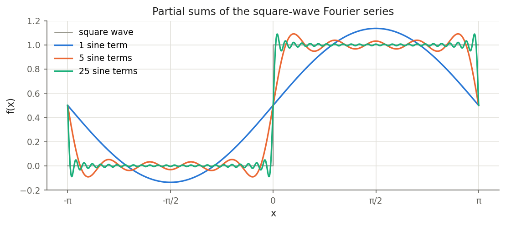
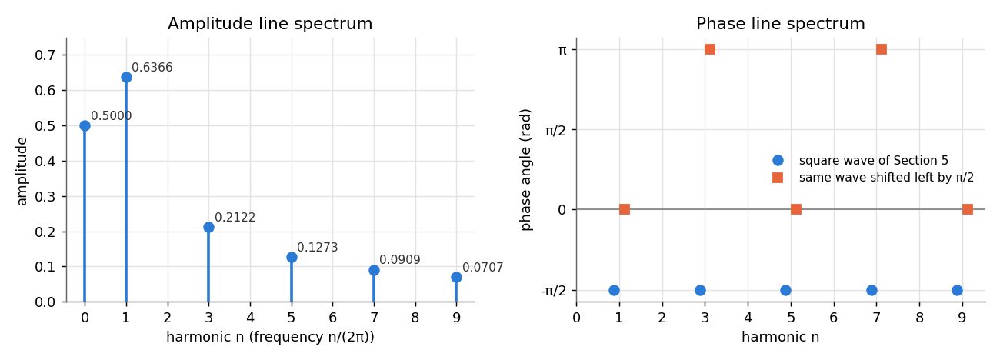
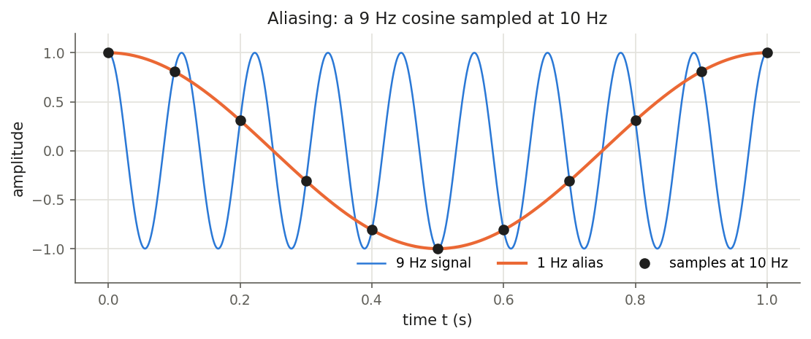
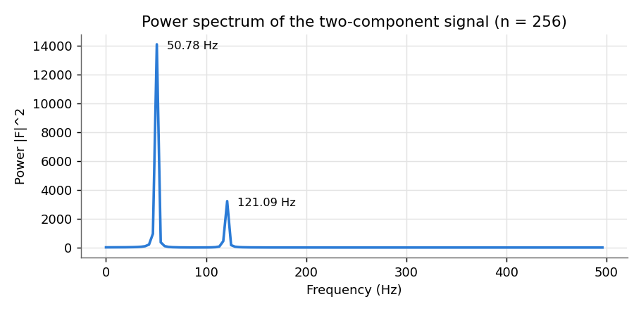

# 16장 — Fourier 해석

[레포지토리 안내](../../README.ko.md) | [English](Concepts_Lecture.md) | [한국어](Concepts_Lecture.ko.md)

> **최종 수정일:** 2026-11-27
>
> Applied Numerical Methods with Python for Engineers and Scientists, Chapra and Clough, Ch 16

> **학습 목표:**
> 1. 삼각 함수의 직교성을 이용하여 Fourier 급수의 계수를 유도하고 계산할 수 있다
> 2. 비주기 함수에 대한 Fourier 적분과 Fourier 변환의 정의와 성질을 설명할 수 있다
> 3. 최소제곱 회귀로 데이터에 정현파를 적합하고 등간격 점에서의 닫힌 형태 해를 사용할 수 있다
> 4. 신호 분석을 위해 이산 Fourier 변환(DFT)을 적용하고 Nyquist 주파수를 계산할 수 있다
> 5. 고속 Fourier 변환(FFT)의 원리를 설명하고 파워 스펙트럼을 해석할 수 있다
> 6. 앨리어싱과 FFT의 연산 횟수를 유도하고 `numpy.fft`의 출력을 진폭과 주파수로 해석할 수 있다

---

<br>

## 목차

- [1. 개요 및 목표](#1-개요-및-목표)
- [2. 우함수와 기함수(Even and Odd Functions)](#2-우함수와-기함수even-and-odd-functions)
  - [2.1 우함수(Even Functions)](#21-우함수even-functions)
  - [2.2 기함수(Odd Functions)](#22-기함수odd-functions)
  - [2.3 임의 함수의 분해](#23-임의-함수의-분해)
- [3. 주기 함수(Periodic Functions)](#3-주기-함수periodic-functions)
  - [3.1 정의](#31-정의)
  - [3.2 예제: 구형파(Square Wave)](#32-예제-구형파square-wave)
- [4. Fourier 급수(주기 2π)](#4-fourier-급수주기-2pi)
  - [4.1 Fourier의 주장](#41-fourier의-주장)
  - [4.2 Fourier 계수의 유도](#42-fourier-계수의-유도)
  - [4.3 직교성 관계(Orthogonality Relations)](#43-직교성-관계orthogonality-relations)
  - [4.4 계수 공식](#44-계수-공식)
  - [4.5 예제: 제곱 함수의 Fourier 급수](#45-예제-제곱-함수의-fourier-급수)
- [5. 구형파의 Fourier 급수](#5-구형파의-fourier-급수)
- [6. 2π 이외의 주기](#6-2pi-이외의-주기)
- [7. Fourier 적분(비주기 함수)](#7-fourier-적분비주기-함수)
- [8. Fourier 변환(Fourier Transform)](#8-fourier-변환fourier-transform)
  - [8.1 정의](#81-정의)
  - [8.2 Fourier 변환의 성질](#82-fourier-변환의-성질)
  - [8.3 예제: 직사각형 펄스의 Fourier 변환](#83-예제-직사각형-펄스의-fourier-변환)
- [9. 정현파 함수를 이용한 곡선 적합](#9-정현파-함수를-이용한-곡선-적합)
  - [9.1 정현파 함수의 매개변수](#91-정현파-함수의-매개변수)
  - [9.2 위상각(Phase Angle)](#92-위상각phase-angle)
  - [9.3 대안적 형태](#93-대안적-형태)
- [10. 정현파의 최소제곱 적합](#10-정현파의-최소제곱-적합)
  - [10.1 문제 설정](#101-문제-설정)
  - [10.2 정규 방정식](#102-정규-방정식)
  - [10.3 등간격 점에서의 간소화](#103-등간격-점에서의-간소화)
  - [10.4 닫힌 형태의 해](#104-닫힌-형태의-해)
  - [10.5 정현파 적합의 예제](#105-정현파-적합의-예제)
- [11. 연속 Fourier 급수(일반 모델)](#11-연속-fourier-급수일반-모델)
  - [11.1 일반 Fourier 급수](#111-일반-fourier-급수)
  - [11.2 Euler 공식과 복소 형태](#112-euler-공식과-복소-형태)
  - [11.3 복소 계수의 예제](#113-복소-계수의-예제)
- [12. 주파수 영역과 시간 영역](#12-주파수-영역과-시간-영역)
- [13. Fourier 적분과 Fourier 변환(재방문)](#13-fourier-적분과-fourier-변환재방문)
- [14. 이산 Fourier 변환(DFT)](#14-이산-fourier-변환dft)
- [15. Nyquist 주파수(Nyquist Frequency)](#15-nyquist-주파수nyquist-frequency)
- [16. 고속 Fourier 변환(FFT)](#16-고속-fourier-변환fft)
- [17. 파워 스펙트럼(Power Spectrum)](#17-파워-스펙트럼power-spectrum)
- [18. 흔한 실수](#18-흔한-실수)
- [요약](#요약)
- [점검 문제](#점검-문제)
- [참고 문헌](#참고-문헌)

---

<br>

## 1. 개요 및 목표

이 장의 앞부분(2~8절)은 Fourier 급수와 Fourier 적분을 다룬다.

뒷부분(9~17절)은 정현파(사인파와 코사인파)를 이해하고 최소제곱 회귀로 데이터에 정현파를 적합한 뒤, Euler 공식(Euler's Formula), 주파수 영역에서의 신호 분석, 이산 Fourier 변환(Discrete Fourier Transform), Nyquist 주파수(Nyquist Frequency), 고속 Fourier 변환(Fast Fourier Transform), 파워 스펙트럼(Power Spectrum)을 다룬다.

> **참고:** **맥락.** Fourier 해석은 수치 해석에서 가장 강력한 도구 중 하나이다. 적절한 조건을 만족하는 주기 함수(또는 비주기 함수)를 단순한 정현파 성분의 합으로 분해할 수 있게 해 준다. 신호 처리, 이미지 압축, 미분방정식 풀이 등에 응용된다.

---

<br>

## 2. 우함수와 기함수(Even and Odd Functions)

### 2.1 우함수(Even Functions)

함수 $`f(x)`$가 **우함수(Even Function)** 인 조건:

```math
f(-x) = f(x)
```

$`f(x)`$의 그래프는 $`x = 0`$(y축)에 대해 **대칭**이다.

**예:** $`\cos(x)`$, $`x^2`$, $`|x|`$

### 2.2 기함수(Odd Functions)

함수 $`f(x)`$가 **기함수(Odd Function)** 인 조건:

```math
f(-x) = -f(x)
```

$`f(x)`$의 그래프는 원점에 대해 **대칭**(점대칭)이다.

**예:** $`\sin(x)`$, $`x^3`$, $`x`$

### 2.3 임의 함수의 분해

원점에 대해 대칭인 구간에서 정의된 임의의 함수는 우함수와 기함수의 합으로 분해할 수 있다:

```math
f(x) = \frac{1}{2}f(x) + \frac{1}{2}f(x)
```

```math
= \underbrace{\frac{1}{2}\bigl[f(x) + f(-x)\bigr]}_{\text{우함수 부분}} + \underbrace{\frac{1}{2}\bigl[f(x) - f(-x)\bigr]}_{\text{기함수 부분}}
```

> **핵심:** 이 분해는 Fourier 급수를 이해하는 데 근본적이다. 코사인 항은 함수의 우함수 부분을, 사인 항은 기함수 부분을 포착한다.

---

<br>

## 3. 주기 함수(Periodic Functions)

### 3.1 정의

함수 $`f(x)`$가 주기 $`T`$를 갖는 **주기 함수(Periodic Function)** 인 조건:

```math
f(x) = f(x + T) \quad \forall x
```

항상 **가능한 가장 작은** 양의 $`T`$를 선택한다.

**예:** $`\sin(x)`$는 주기 $`T = 2\pi`$를 가지며, 다음이 성립한다:

```math
\sin(x + 2\pi) = \sin(x)\cos(2\pi) + \cos(x)\sin(2\pi) = \sin(x)
```

$`\sin(x) = \sin(x + 2\pi) = \sin(x + 4\pi) = \cdots`$이지만, 기본 주기로 $`T = 2\pi`$를 선택한다.

### 3.2 예제: 구형파(Square Wave)

주기 $`2\pi`$인 구형파를 고려한다:

```math
f(x) = \begin{cases} 0, & -\pi < x \le 0 \\ 1, & 0 < x \le \pi \end{cases}
```

이 함수는 주기 $`2\pi`$로 반복되며, Fourier 급수를 시연하는 데 사용되는 고전적인 예이다.

---

<br>

## 4. Fourier 급수(주기 $`2\pi`$)

### 4.1 Fourier의 주장

**Fourier(1768~1830)** 는 $`[-\pi, \pi]`$에서 정의된 임의의 함수가 다음 형태로 표현될 수 있다고 주장했다:

```math
f(x) = \sum_{n=0}^{\infty} (a_n \cos nx + b_n \sin nx)
```

관례적인 $`\frac{a_0}{2}`$ 표기법으로 다시 쓰면:

```math
f(x) = \frac{a_0}{2} + \sum_{n=1}^{\infty} (a_n \cos nx + b_n \sin nx)
```

> **참고:** **$`a_0/2`$를 쓰는 이유.** $`n = 0`$일 때, $`a_0 \cos(0) + b_0 \sin(0) = a_0 \cdot 1 + 0 = a_0`$이다. $`a_0`$의 공식이 $`n \ge 1`$인 $`a_n`$과 같은 형태를 갖도록 편의상 $`\frac{1}{2}`$ 인자를 도입한다.

이 식은 다음과 같은 구조를 갖는다:

```math
f(x) = \underbrace{\left(\frac{a_0}{2} + \sum_{n=1}^{\infty} a_n \cos nx \right)}_{\text{우함수 부분}} + \underbrace{\left(\sum_{n=1}^{\infty} b_n \sin nx \right)}_{\text{기함수 부분}}
```

### 4.2 Fourier 계수의 유도

**$`a_0`$ 구하기:** 양변을 $`[-\pi, \pi]`$에서 적분한다:

```math
\int_{-\pi}^{\pi} f(x)\,dx = \int_{-\pi}^{\pi} \frac{a_0}{2}\,dx + \sum_{n=1}^{\infty} a_n \underbrace{\int_{-\pi}^{\pi} \cos nx\,dx}_{= 0} + \sum_{n=1}^{\infty} b_n \underbrace{\int_{-\pi}^{\pi} \sin nx\,dx}_{= 0}
```

```math
= \frac{a_0}{2} \cdot 2\pi = a_0 \pi
```

```math
\therefore \quad a_0 = \frac{1}{\pi} \int_{-\pi}^{\pi} f(x)\,dx
```

**$`a_n`$ 구하기:** 양변에 $`\cos mx`$를 곱하고 적분한다:

```math
\int_{-\pi}^{\pi} f(x)\cos mx\,dx = \underbrace{\int_{-\pi}^{\pi} \frac{a_0}{2}\cos mx\,dx}_{= 0} + \sum_{n=1}^{\infty} a_n \int_{-\pi}^{\pi} \cos nx \cos mx\,dx + \sum_{n=1}^{\infty} b_n \underbrace{\int_{-\pi}^{\pi} \sin nx \cos mx\,dx}_{= 0}
```

**$`b_n`$ 구하기:** 양변에 $`\sin mx`$를 곱하고 적분한다:

```math
\int_{-\pi}^{\pi} f(x)\sin mx\,dx = \underbrace{\int_{-\pi}^{\pi} \frac{a_0}{2}\sin mx\,dx}_{= 0} + \sum_{n=1}^{\infty} a_n \underbrace{\int_{-\pi}^{\pi} \cos nx \sin mx\,dx}_{= 0} + \sum_{n=1}^{\infty} b_n \int_{-\pi}^{\pi} \sin nx \sin mx\,dx
```

### 4.3 직교성 관계(Orthogonality Relations)

계수 유도는 삼각 함수의 **직교성(Orthogonality)** 에 의존한다.

**곱을 합으로 바꾸는 항등식(Product-to-Sum Identities):**

```math
\cos a \cos b = \frac{1}{2}[\cos(a+b) + \cos(a-b)]
```

```math
\sin a \cos b = \frac{1}{2}[\sin(a+b) + \sin(a-b)]
```

```math
\sin a \sin b = -\frac{1}{2}[\cos(a+b) - \cos(a-b)]
```

**$`[-\pi, \pi]`$에서의 직교성 결과:**

```math
\int_{-\pi}^{\pi} \cos nx \cos mx\,dx = \begin{cases} 0 & \text{if } n \neq m \\ 2\pi & \text{if } n = m = 0 \\ \pi & \text{if } n = m \ge 1 \end{cases}
```

```math
\int_{-\pi}^{\pi} \sin nx \cos mx\,dx = 0 \quad \text{for all } n, m
```

```math
\int_{-\pi}^{\pi} \sin nx \sin mx\,dx = \begin{cases} 0 & \text{if } n \neq m \\ \pi & \text{if } n = m \ge 1 \end{cases}
```

### 4.4 계수 공식

직교성 관계를 사용하면:

```math
\boxed{a_n = \frac{1}{\pi} \int_{-\pi}^{\pi} f(x) \cos nx\,dx, \quad n = 0, 1, 2, \ldots}
```

```math
\boxed{b_n = \frac{1}{\pi} \int_{-\pi}^{\pi} f(x) \sin nx\,dx, \quad n = 1, 2, 3, \ldots}
```

### 4.5 예제: 제곱 함수의 Fourier 급수

구간 $`[-\pi, \pi]`$에서 $`f(x) = x^2`$이고 주기 $`2\pi`$로 반복되는 함수의 Fourier 급수를 구한다. $`f`$는 우함수이므로 2절에 따라 $`f(x)\sin nx`$는 기함수가 되어 $`b_n = 0`$이다. 나머지 계수는 4.4절의 공식으로 계산한다.

```math
a_0 = \frac{1}{\pi}\int_{-\pi}^{\pi} x^2\,dx = \frac{1}{\pi} \cdot \frac{2\pi^3}{3} = \frac{2\pi^2}{3}
```

$`a_n`$은 부분 적분을 두 번 한다. $`\int x^2\cos nx\,dx`$에서 $`u = x^2`$, $`dv = \cos nx\,dx`$로 두면 경계항 $`[x^2\sin nx/n]_{-\pi}^{\pi}`$이 $`\sin(\pm n\pi) = 0`$ 때문에 사라진다. 남은 $`-\frac{2}{n}\int x\sin nx\,dx`$에 다시 부분 적분을 하면 $`\int_{-\pi}^{\pi} x\sin nx\,dx = \bigl[-x\cos nx/n\bigr]_{-\pi}^{\pi} + \frac{1}{n}\int_{-\pi}^{\pi}\cos nx\,dx = -\frac{2\pi(-1)^n}{n}`$이므로 다음을 얻는다.

```math
a_n = \frac{1}{\pi}\left(-\frac{2}{n}\right)\left(-\frac{2\pi(-1)^n}{n}\right) = \frac{4(-1)^n}{n^2}
```

따라서 Fourier 급수는 다음과 같다.

```math
x^2 = \frac{\pi^2}{3} + \sum_{n=1}^{\infty}\frac{4(-1)^n}{n^2}\cos nx = \frac{\pi^2}{3} - 4\cos x + \cos 2x - \frac{4}{9}\cos 3x + \cdots, \qquad -\pi \leq x \leq \pi
```

주기적으로 확장한 $`x^2`$은 $`x = \pm\pi`$에서도 끊어지지 않으므로 급수가 모든 점에서 $`f`$로 수렴한다. $`x = \pi`$를 대입하면 $`\cos n\pi = (-1)^n`$이므로 $`\pi^2 = \pi^2/3 + 4\sum 1/n^2`$, 즉 $`\sum_{n=1}^{\infty}1/n^2 = \pi^2/6 \approx 1.644934`$라는 결과가 나온다. 계수가 $`1/n^2`$로 줄어드는 이 함수는 5절의 구형파($`1/n`$)보다 급수가 훨씬 빨리 수렴하는데, 일반적으로 함수가 매끄러울수록 Fourier 계수가 빨리 줄어든다.

---

<br>

## 5. 구형파의 Fourier 급수

구형파 $`f(x) = \begin{cases} 0, & -\pi < x \le 0 \\ 1, & 0 < x \le \pi \end{cases}`$에 대해:

**$`a_0`$ 계산:**

```math
a_0 = \frac{1}{\pi} \int_{-\pi}^{\pi} f(x)\,dx = \frac{1}{\pi} \cdot \pi = 1
```

**$`a_n`$ 계산:**

```math
a_n = \frac{1}{\pi} \int_{-\pi}^{\pi} f(x)\cos nx\,dx = \frac{1}{\pi} \int_{0}^{\pi} \cos nx\,dx = \frac{1}{\pi} \left[\frac{1}{n}\sin nx\right]_0^{\pi} = 0
```

**$`b_n`$ 계산:**

```math
b_n = \frac{1}{\pi} \int_{-\pi}^{\pi} f(x)\sin nx\,dx = \frac{1}{\pi} \int_0^{\pi} \sin nx\,dx = \frac{1}{\pi}\left[-\frac{1}{n}\cos nx\right]_0^{\pi}
```

```math
= -\frac{1}{n\pi}(\cos n\pi - 1) = \begin{cases} \frac{2}{n\pi} & \text{for odd } n \\ 0 & \text{for even } n \end{cases}
```

**결과:**

```math
f(x) = \frac{1}{2} + \sum_{\substack{n=1,3,5,\ldots}} \frac{2}{n\pi} \sin nx = \frac{1}{2} + \frac{2}{\pi} \sum_{n=1}^{\infty} \frac{\sin(2n-1)x}{2n-1}
```

$`n \to \infty`$일 때 계수 $`\frac{2}{n\pi}`$는 0으로 줄어든다. 계수가 0으로 가는 것만으로 수렴이 보장되지는 않지만, 이 급수는 구간별로 매끄러운 함수의 Fourier 급수에 관한 수렴 정리(Dirichlet 조건)에 의해 **수렴** 한다. $`f`$가 연속인 점에서는 $`f(x)`$로, 불연속점 $`x = 0, \pm\pi`$에서는 좌우 극한의 평균 $`\frac{1}{2}`$로 수렴한다.



*그림 1. 항의 개수에 따른 구형파 Fourier 급수의 부분합*

그림 1은 사인 항을 1개, 5개, 25개 더한 부분합이다. 항이 늘수록 부분합은 구형파에 가까워지지만, 불연속점 $`x = 0`$ 바로 옆에서는 함숫값 1을 넘어 솟은 부분이 사라지지 않는다. 이를 **Gibbs 현상(Gibbs phenomenon)** 이라 한다. 항의 개수를 늘리면 솟은 부분의 폭은 좁아지지만 높이는 줄지 않고, 부분합의 최댓값은 5개 항에서 1.0912, 25개 항에서 1.0896, 100개 항에서 1.0895로 도약 크기 1의 약 9%만큼 넘친 값에 머문다. 따라서 불연속점 근처에서 Fourier 급수를 잘라 쓰면 항을 아무리 많이 써도 진동이 남는다는 점에 유의해야 한다.

---

<br>

## 6. $`2\pi`$ 이외의 주기

주기 $`2\ell`$($`2\pi`$ 대신)을 갖는 함수에 대해, 다음 변수 치환을 사용한다:

```math
x' = \pi \cdot \frac{x}{\ell}
```

이것은 구간 $`[-\ell, \ell]`$을 $`[-\pi, \pi]`$로 매핑한다. Fourier 급수는 다음과 같이 된다:

```math
\boxed{f(x) = \frac{a_0}{2} + \sum_{n=1}^{\infty} a_n \cos\frac{n\pi}{\ell}x + \sum_{n=1}^{\infty} b_n \sin\frac{n\pi}{\ell}x}
```

계수는:

```math
a_n = \frac{1}{\ell} \int_{-\ell}^{\ell} f(x) \cos\frac{n\pi}{\ell}x\,dx, \quad n = 0, 1, 2, \ldots
```

```math
b_n = \frac{1}{\ell} \int_{-\ell}^{\ell} f(x) \sin\frac{n\pi}{\ell}x\,dx, \quad n = 1, 2, 3, \ldots
```

예를 들어 주기 2인 삼각파 $`f(x) = |x|`$($`-1 \leq x \leq 1`$, $`\ell = 1`$)를 전개한다. $`f`$는 우함수이므로 $`b_n = 0`$이고, $`a_0 = \int_{-1}^{1}|x|\,dx = 1`$이다. $`a_n`$은 부분 적분으로 구한다.

```math
a_n = 2\int_0^1 x\cos(n\pi x)\,dx = 2\left[\frac{x\sin(n\pi x)}{n\pi} + \frac{\cos(n\pi x)}{(n\pi)^2}\right]_0^1 = \frac{2\bigl((-1)^n - 1\bigr)}{n^2\pi^2}
```

짝수 $`n`$에서는 0이고 홀수 $`n`$에서는 $`-4/(n^2\pi^2)`$이므로 다음을 얻는다.

```math
|x| = \frac{1}{2} - \frac{4}{\pi^2}\left(\cos\pi x + \frac{\cos 3\pi x}{9} + \frac{\cos 5\pi x}{25} + \cdots\right), \qquad -1 \leq x \leq 1
```

$`x = 0`$을 넣으면 $`1 + 1/9 + 1/25 + \cdots = \pi^2/8`$이라는 결과가 나온다. 다음 코드는 부분합의 최대 오차를 잰다.

```python
import numpy as np

x = np.linspace(-1.0, 1.0, 4001)
for N in (1, 2, 5, 20):                                # number of nonzero cosine terms
    s = 0.5 * np.ones_like(x)
    for n in range(1, 2 * N, 2):                       # odd harmonics 1, 3, ..., 2N - 1
        s -= 4 / (n**2 * np.pi**2) * np.cos(n * np.pi * x)
    err = np.abs(s - np.abs(x))
    print(f"{N:2d} terms: max error = {err.max():.4f} at x = {x[np.argmax(err)]:.2f}")
```

```text
 1 terms: max error = 0.0947 at x = -1.00
 2 terms: max error = 0.0497 at x = -1.00
 5 terms: max error = 0.0202 at x = -1.00
20 terms: max error = 0.0051 at x = -1.00
```

오차가 가장 큰 곳은 꼭짓점 $`x = 0, \pm 1`$이며(출력은 그중 처음 찾은 $`x = -1`$), 항을 1개, 2개, 5개, 20개 쓰면 최대 오차가 0.0947, 0.0497, 0.0202, 0.0051로 항의 개수에 거의 반비례하여 줄어든다. 남은 항의 합 $`\frac{4}{\pi^2}\sum 1/n^2`$을 적분으로 어림하면 $`N`$개 항 뒤의 오차가 약 $`1/(\pi^2N)`$이고, $`N = 20`$에서 0.00507로 위 결과와 맞는다. 삼각파는 주기적으로 확장해도 연속이므로 5절의 구형파와 달리 Gibbs 현상이 없고, 계수도 $`1/n`$이 아니라 $`1/n^2`$로 줄어든다. 함수 자체는 연속이고 꼭짓점에서 도함수만 끊어진다는 매끄러움의 정도가 이 감소 속도를 정한다.

---

<br>

## 7. Fourier 적분(비주기 함수)

**질문:** $`f(x) = e^{-x^2}`$를 Fourier 급수로 전개할 수 있는가?

**답:** 실수 전체에서는 전개할 수 없다. $`f(x)`$는 주기 함수가 아니기 때문이다.

**해결:** $`\ell \to \infty`$로 취한다. $`\ell`$이 증가하면, 주파수 스펙트럼 $`\frac{n\pi}{\ell}`$은 점점 더 조밀해져서 **연속** 스펙트럼에 수렴한다.

| $`\ell`$ | 주파수 $`\frac{n\pi}{\ell}`$ |
|:---:|:---|
| $`\pi`$ | $`1, 2, 3, 4, \ldots`$ |
| $`2\pi`$ | $`\frac{1}{2}, 1, \frac{3}{2}, 2, \ldots`$ |
| $`10\pi`$ | $`0.1, 0.2, 0.3, 0.4, \ldots`$ |

*표 1. 반주기 $`\ell`$에 따른 주파수 $`n\pi/\ell`$의 간격*

극한에서, 이산 합은 연속 적분이 된다:

```math
f(x) = \frac{a_0}{2} + \sum_{n=1}^{\infty} \left(a_n \cos\frac{n\pi}{\ell}x + b_n \sin\frac{n\pi}{\ell}x\right)
```

```math
\Downarrow
```

```math
\boxed{f(x) = \int_0^{\infty} \bigl[a(\omega)\cos\omega x + b(\omega)\sin\omega x\bigr]\,d\omega}
```

이것이 **Fourier 적분(Fourier Integral)** 표현이다.

극한을 구체적으로 따라가면 계수 함수 $`a(\omega)`$, $`b(\omega)`$도 정해진다. 주파수 $`\omega_n = n\pi/\ell`$의 간격을 $`\Delta\omega = \pi/\ell`$이라 하면 6절의 계수는 $`a_n = \frac{\Delta\omega}{\pi}\int_{-\ell}^{\ell}f(\xi)\cos\omega_n\xi\,d\xi`$이므로, 급수의 코사인 항 하나는 $`\left[\frac{1}{\pi}\int_{-\ell}^{\ell}f(\xi)\cos\omega_n\xi\,d\xi\right]\cos\omega_nx\,\Delta\omega`$이다. 이는 Riemann 합의 한 항이어서 $`\ell \to \infty`$이면 $`\Delta\omega \to 0`$과 함께 합이 적분으로 바뀐다. 또 $`\int|f|\,dx`$가 유한하면 $`a_0/2 = \frac{1}{2\ell}\int_{-\ell}^{\ell}f\,dx`$는 0으로 간다. 사인 항도 같으므로 다음을 얻는다.

```math
a(\omega) = \frac{1}{\pi}\int_{-\infty}^{\infty}f(\xi)\cos\omega\xi\,d\xi, \qquad b(\omega) = \frac{1}{\pi}\int_{-\infty}^{\infty}f(\xi)\sin\omega\xi\,d\xi
```

예를 들어 $`f(x) = e^{-|x|}`$는 우함수이므로 $`b(\omega) = 0`$이고, $`\int_0^{\infty}e^{-x}\cos\omega x\,dx = 1/(1 + \omega^2)`$에서 $`a(\omega) = \frac{2}{\pi}\cdot\frac{1}{1 + \omega^2}`$이다. 따라서 다음 표현을 얻는다.

```math
e^{-|x|} = \frac{2}{\pi}\int_0^{\infty}\frac{\cos\omega x}{1 + \omega^2}\,d\omega
```

$`x = 0`$이면 $`\int_0^{\infty}d\omega/(1 + \omega^2) = \pi/2`$이므로 우변은 1이 되어 맞는다. 다음 코드는 다른 $`x`$에서도 우변의 적분을 수치로 계산해 확인한다.

```python
import numpy as np
from scipy.integrate import quad

for x in (0.0, 0.5, 1.0, 2.0):
    val, _ = quad(lambda w: 1 / (1 + w**2), 0, np.inf, weight="cos", wvar=x)   # integral of cos(w x)/(1 + w^2)
    print(f"x = {x}: (2/pi) * integral = {2 / np.pi * val:.6f}, exp(-|x|) = {np.exp(-abs(x)):.6f}")
```

```text
x = 0.0: (2/pi) * integral = 1.000000, exp(-|x|) = 1.000000
x = 0.5: (2/pi) * integral = 0.606531, exp(-|x|) = 0.606531
x = 1.0: (2/pi) * integral = 0.367879, exp(-|x|) = 0.367879
x = 2.0: (2/pi) * integral = 0.135335, exp(-|x|) = 0.135335
```

$`a(\omega)`$는 모든 $`\omega \geq 0`$에서 정의된 연속 함수이며 $`\omega`$가 커질수록 $`1/\omega^2`$로 줄어든다. Fourier 급수가 이산적인 주파수 $`n\pi/\ell`$에만 진폭을 주었던 것과 달리 비주기 함수는 연속적인 주파수 스펙트럼을 가진다. 8.1절의 복소 형태와 비교하면 $`\hat{f}(\omega) = \int e^{-|t|}e^{-i\omega t}\,dt = 2/(1 + \omega^2) = \pi a(\omega)`$이다.

---

<br>

## 8. Fourier 변환(Fourier Transform)

### 8.1 정의

복소 지수를 사용하여 Fourier 적분을 재표현하면:

```math
f(x) = \frac{1}{2\pi} \int_{-\infty}^{\infty} e^{i\omega x} \underbrace{\int_{-\infty}^{\infty} f(\xi) e^{-i\omega\xi}\,d\xi}_{\hat{f}(\omega)}\,d\omega = \frac{1}{2\pi} \int_{-\infty}^{\infty} \hat{f}(\omega)\,e^{i\omega x}\,d\omega
```

> **[미적분학]** Euler 공식 $`e^{i\theta} = \cos\theta + i\sin\theta`$는 지수 함수, 코사인, 사인의 Taylor 급수를 비교하여 얻는다. 이 공식으로 $`\cos\omega x`$와 $`\sin\omega x`$를 $`e^{i\omega x}`$와 $`e^{-i\omega x}`$의 결합으로 바꿀 수 있으므로, 7절의 실수 형태 Fourier 적분을 위와 같은 복소 지수 형태로 다시 쓸 수 있다(11.2절).

**Fourier 변환**과 그 **역변환**:

```math
\boxed{\hat{f}(\omega) = \mathcal{F}\{f(x)\} = \int_{-\infty}^{\infty} f(\xi)\,e^{-i\omega\xi}\,d\xi}
```

```math
\boxed{f(x) = \mathcal{F}^{-1}\{\hat{f}(\omega)\} = \frac{1}{2\pi} \int_{-\infty}^{\infty} \hat{f}(\omega)\,e^{i\omega x}\,d\omega}
```

### 8.2 Fourier 변환의 성질

**1) 선형성(Linearity):**

```math
\mathcal{F}\{\alpha f(x) + \beta g(x)\} = \alpha\,\mathcal{F}\{f\} + \beta\,\mathcal{F}\{g\}
```

```math
\mathcal{F}^{-1}\{\alpha\hat{f} + \beta\hat{g}\} = \alpha\,\mathcal{F}^{-1}\{\hat{f}\} + \beta\,\mathcal{F}^{-1}\{\hat{g}\}
```

**2) 미분 성질(Derivative Property):**

```math
\mathcal{F}\left\{\frac{d}{dx}f(x)\right\} = i\omega\,\mathcal{F}\{f\}
```

단, $`x \to \pm\infty`$일 때 $`f(x) \to 0`$이어야 한다.

*증명 (부분 적분에 의해):*

```math
\int_{-\infty}^{\infty} \frac{d}{d\xi}f(\xi)\,e^{-i\omega\xi}\,d\xi = \underbrace{\left[f(\xi)e^{-i\omega\xi}\right]_{-\infty}^{\infty}}_{= 0} - (-i\omega)\int_{-\infty}^{\infty} f(\xi)\,e^{-i\omega\xi}\,d\xi = i\omega\,\mathcal{F}\{f\}
```

**일반 $`n`$차 도함수:**

```math
\mathcal{F}\left\{\frac{d^n}{dx^n}f(x)\right\} = (i\omega)^n\,\mathcal{F}\{f\}
```

> **참고:** **중요성.** 미분 성질은 공간/시간 영역에서의 미분을 주파수 영역에서의 곱셈으로 변환한다. 이것이 Fourier 변환이 미분방정식을 풀 때 매우 유용한 이유이다.

**3) 합성곱(Convolution):**

```math
f * g := \int_{-\infty}^{\infty} f(x - \xi)\,g(\xi)\,d\xi = \mathcal{F}^{-1}\{\hat{g}(\omega)\,\hat{f}(\omega)\}
```

즉, **공간 영역에서의 합성곱**은 **주파수 영역에서의 곱셈**에 대응한다.

**4) $`x`$-이동(공간 이동, Spatial Shift):**

```math
\mathcal{F}^{-1}\{e^{-ia\omega}\,\hat{f}(\omega)\} = f(x - a)
```

주파수 영역에서 $`e^{-ia\omega}`$를 곱하면 공간 영역에서 함수를 $`a`$만큼 이동시킨다.

**5) $`\omega`$-이동(주파수 이동, Frequency Shift):**

```math
\mathcal{F}^{-1}\{\hat{f}(\omega - a)\} = e^{iax}\,f(x)
```

주파수 영역에서의 이동은 공간 영역에서 $`e^{iax}`$에 의한 변조(Modulation)에 대응한다.

### 8.3 예제: 직사각형 펄스의 Fourier 변환

$`|t| \leq a`$에서 1이고 그 밖에서 0인 직사각형 펄스의 Fourier 변환을 8.1절의 정의로 계산한다. 적분 구간이 $`[-a, a]`$로 줄어든다.

```math
\hat{f}(\omega) = \int_{-a}^{a}e^{-i\omega t}\,dt = \left[\frac{e^{-i\omega t}}{-i\omega}\right]_{-a}^{a} = \frac{e^{i\omega a} - e^{-i\omega a}}{i\omega} = \frac{2\sin(a\omega)}{\omega}
```

마지막 등호는 Euler 공식에서 $`e^{i\theta} - e^{-i\theta} = 2i\sin\theta`$를 쓴 것이다. $`\omega \to 0`$에서는 $`\sin(a\omega)/\omega \to a`$이므로 $`\hat{f}(0) = 2a`$이며, 이는 펄스의 넓이 $`\int f\,dt`$와 같다. 펄스가 우함수이므로 변환에 허수부가 없다.

$`\hat{f}(\omega)`$는 $`\omega = \pm\pi/a, \pm 2\pi/a, \ldots`$에서 0이 되고, 가운데 솟은 부분의 폭은 $`2\pi/a`$이다. 따라서 펄스의 지속 시간 $`2a`$와 주파수 영역에서 차지하는 폭을 곱하면 $`2a \times 2\pi/a = 4\pi`$로 $`a`$와 무관한 상수가 된다. $`a = 1`$이면 첫 영점이 $`\omega = \pi`$이고, $`a = 2`$로 펄스를 두 배 넓히면 첫 영점이 $`\pi/2`$로 당겨져 스펙트럼이 절반으로 좁아진다. 짧은 신호일수록 넓은 주파수 범위의 성분이 필요하다는 이 관계 때문에, 날카로운 변화를 담은 신호(펄스, 불연속)는 높은 주파수 성분을 많이 가지며 5절의 구형파 계수가 천천히 줄어드는 것도 같은 이유이다.

---

<br>

## 9. 정현파 함수를 이용한 곡선 적합

### 9.1 정현파 함수의 매개변수

주기 함수 $`f(t) = f(t + T)`$를 고려한다. 여기서 $`T`$는 상수(주기)이다.

**정현파 함수(Sinusoidal Function)** 는 사인 또는 코사인으로 기술할 수 있는 임의의 파형이다:

```math
f(t) = A_0 + C_1 \cos(\omega_0 t + \theta)
```

여기서:

| 매개변수 | 의미 |
|:---:|:---|
| $`A_0`$ | **평균값**(수직 오프셋) |
| $`C_1`$ | **진폭(Amplitude)**(진동의 높이) |
| $`\omega_0`$ | **각주파수(Angular Frequency)**(라디안/시간) |
| $`\theta`$ | **위상각(Phase Angle)**(라디안) |

*표 2. 정현파 함수의 매개변수와 의미*

주파수 양들 간의 관계:

```math
\omega_0 = 2\pi f, \qquad f = \frac{1}{T}
```

여기서 $`f`$는 사이클/시간 $`[\text{Hz}]`$ 단위의 **보통 주파수(Ordinary Frequency)** 이다.

### 9.2 위상각(Phase Angle)

위상각 $`\theta`$는 $`t = 0`$에서 코사인 함수가 새 주기를 시작하는 지점까지의 거리(라디안)를 나타낸다.

$`\theta > 0`$일 때:

- $`\cos(\omega_0 t - \theta)`$: **지연(Lagging)** 위상각 (오른쪽 이동)
- $`\cos(\omega_0 t + \theta)`$: **선행(Leading)** 위상각 (왼쪽 이동)

사인과 코사인 사이에는 다음 관계도 성립한다:

```math
\sin(t + \pi/2) = \cos(t), \qquad \cos(t - \pi/2) = \sin(t)
```

### 9.3 대안적 형태

덧셈 공식(Angle Addition Formula)을 사용하여 코사인 함수에서 $`\theta`$를 분리할 수 있다:

```math
\cos(\omega_0 t + \theta) = \cos(\omega_0 t)\cos(\theta) - \sin(\omega_0 t)\sin(\theta)
```

따라서:

```math
f(t) = A_0 + C_1\cos(\omega_0 t + \theta)
```

```math
= A_0 + C_1\cos\theta\,\cos(\omega_0 t) - C_1\sin\theta\,\sin(\omega_0 t)
```

```math
\boxed{= A_0 + A_1\cos(\omega_0 t) + B_1\sin(\omega_0 t)}
```

여기서:

```math
A_1 = C_1\cos\theta, \qquad B_1 = -C_1\sin\theta
```

이로부터 다음을 복원할 수 있다:

```math
\theta = \arctan\left(-\frac{B_1}{A_1}\right), \qquad C_1 = \sqrt{A_1^2 + B_1^2}
```

$`\arctan`$의 값은 $`(-\pi/2, \pi/2)`$에 있으므로, $`A_1 < 0`$이면 $`\theta`$에 $`\pi`$를 더한다.

---

<br>

## 10. 정현파의 최소제곱 적합

### 10.1 문제 설정

데이터 점 $`(t_i, y_i)`$가 주어졌을 때, 다음 모델을 적합한다:

```math
y = A_0 + A_1\cos(\omega_0 t) + B_1\sin(\omega_0 t) = \hat{y}(t)
```

기저 함수를 이용한 선형 회귀 문제로 해석한다($`\beta_0 = A_0`$, $`\beta_1 = A_1`$, $`\beta_2 = B_1`$):

```math
f_0 = 1, \quad f_1 = \cos(\omega_0 t), \quad f_2 = \sin(\omega_0 t)
```

```math
\hat{y}(t) = \beta_0 f_0 + \beta_1 f_1 + \beta_2 f_2
```

### 10.2 정규 방정식

오차 제곱합을 최소화한다:

```math
SSE = \sum (y_i - A_0 - A_1\cos(\omega_0 t_i) - B_1\sin(\omega_0 t_i))^2
```

편도함수를 취하고 0으로 놓으면:

```math
\frac{\partial SSE}{\partial A_0} = 0, \quad \frac{\partial SSE}{\partial A_1} = 0, \quad \frac{\partial SSE}{\partial B_1} = 0
```

이로부터 정규 방정식 시스템을 얻는다:

```math
\begin{pmatrix} \sum y_i \\ \sum y_i \cos(\omega_0 t) \\ \sum y_i \sin(\omega_0 t) \end{pmatrix} = \begin{pmatrix} n & \sum\cos(\omega_0 t) & \sum\sin(\omega_0 t) \\ \sum\cos(\omega_0 t) & \sum\cos^2(\omega_0 t) & \sum\cos(\omega_0 t)\sin(\omega_0 t) \\ \sum\sin(\omega_0 t) & \sum\sin(\omega_0 t)\cos(\omega_0 t) & \sum\sin^2(\omega_0 t) \end{pmatrix} \begin{pmatrix} A_0 \\ A_1 \\ B_1 \end{pmatrix}
```

### 10.3 등간격 점에서의 간소화

한 주기 $`T`$ 내에서 등간격으로 $`n`$개의 관측값을 수집한다: $`T = n\,\Delta t`$.

**등간격** 점의 경우($`n \ge 3`$), 다음 직교성 성질이 성립한다:

```math
\sum_{i=1}^{n} \sin(\omega_0 t_i) = 0, \qquad \sum_{i=1}^{n} \cos(\omega_0 t_i) = 0
```

```math
\sum_{i=1}^{n} \sin^2(\omega_0 t_i) = \frac{n}{2}, \qquad \sum_{i=1}^{n} \cos^2(\omega_0 t_i) = \frac{n}{2}
```

```math
\sum_{i=1}^{n} \cos(\omega_0 t_i)\sin(\omega_0 t_i) = \frac{1}{2}\sum_{i=1}^{n}[\sin(2\omega_0 t_i) - \sin 0] = 0
```

정규 방정식은 **대각** 시스템으로 간소화된다:

```math
\begin{pmatrix} \sum y_i \\ \sum y_i\cos(\omega_0 t) \\ \sum y_i\sin(\omega_0 t) \end{pmatrix} = \begin{pmatrix} n & 0 & 0 \\ 0 & \frac{n}{2} & 0 \\ 0 & 0 & \frac{n}{2} \end{pmatrix} \begin{pmatrix} A_0 \\ A_1 \\ B_1 \end{pmatrix}
```

### 10.4 닫힌 형태의 해

```math
\boxed{A_0 = \frac{1}{n}\sum y_i = \bar{y}}
```

```math
\boxed{A_1 = \frac{2}{n}\sum y_i \cos(\omega_0 t_i)}
```

```math
\boxed{B_1 = \frac{2}{n}\sum y_i \sin(\omega_0 t_i)}
```

> **핵심:** 등간격 데이터 점에서는 정규 방정식이 완전히 분리되어, Fourier 계수에 대한 단순한 닫힌 형태의 표현식을 제공한다. 이것은 큰 계산적 이점이다.

### 10.5 정현파 적합의 예제

어떤 지점에서 하루($`T = 24`$ h, $`\omega_0 = 2\pi/24 = 0.2618`$ rad/h) 동안 2시간 간격으로 측정한 기온 12개에 $`y = A_0 + A_1\cos(\omega_0t) + B_1\sin(\omega_0t)`$를 적합한다. 시각 $`t`$는 측정을 시작한 때부터 잰 시간이다.

```math
t = 0, 2, \ldots, 22, \qquad y = (23.4,\ 25.4,\ 25.8,\ 24.9,\ 22.1,\ 18.9,\ 16.3,\ 14.3,\ 14.1,\ 15.2,\ 17.6,\ 20.7)
```

표본이 한 주기에 걸쳐 등간격이므로 10.4절의 닫힌 형태를 그대로 쓸 수 있다.

```python
import numpy as np

T = 24.0
w0 = 2 * np.pi / T
t = np.arange(0, 24, 2.0)                  # 12 equally spaced times over one period (h)
y = np.array([23.4, 25.4, 25.8, 24.9, 22.1, 18.9,
              16.3, 14.3, 14.1, 15.2, 17.6, 20.7])   # temperature (deg C)
n = len(t)
A0 = y.mean()
A1 = 2 / n * np.sum(y * np.cos(w0 * t))
B1 = 2 / n * np.sum(y * np.sin(w0 * t))
C1 = np.hypot(A1, B1)
theta = np.arctan2(-B1, A1)                # A1 = C1 cos(theta), B1 = -C1 sin(theta)
print(f"A0 = {A0:.4f}, A1 = {A1:.4f}, B1 = {B1:.4f}, C1 = {C1:.4f}, theta = {theta:.4f}")
print(f"time of maximum = {-theta / w0:.2f} h")
X = np.column_stack([np.ones(n), np.cos(w0 * t), np.sin(w0 * t)])
print(np.round(np.linalg.lstsq(X, y, rcond=None)[0], 4))
```

```text
A0 = 19.8917, A1 = 3.6453, B1 = 4.7299, C1 = 5.9716, theta = -0.9142
time of maximum = 3.49 h
[19.8917  3.6453  4.7299]
```

평균 기온은 $`A_0 = 19.89`$ °C이고, 진폭 $`C_1 = \sqrt{3.6453^2 + 4.7299^2} = 5.97`$ °C이므로 하루의 기온은 대략 13.9 °C에서 25.9 °C 사이를 오간다. 위상각은 9.3절의 관계 $`A_1 = C_1\cos\theta`$, $`B_1 = -C_1\sin\theta`$에서 $`\theta = -0.9142`$ rad이다. `np.arctan2(-B1, A1)`은 두 인자의 부호로 사분면을 정하므로 9.3절에서 말한 $`\pi`$를 더하는 보정을 따로 할 필요가 없다. 최댓값은 $`\omega_0t + \theta = 0`$인 $`t = 0.9142/0.2618 = 3.49`$ h에 나타난다. 마지막 줄은 같은 모델을 일반 선형 최소제곱(15장 5절)으로 푼 결과로, 등간격 표본에서는 닫힌 형태와 정확히 같다. 표본이 등간격이 아니거나 한 주기를 채우지 않으면 닫힌 형태는 성립하지 않으므로 이 `lstsq` 방식으로 풀어야 한다.

12절의 주파수 영역 관점에서 보면 이 데이터는 주파수 0에 높이 19.89, 주파수 $`\omega_0`$(주기 24 h)에 높이 5.97인 두 개의 선으로 요약된다. 적합 뒤 남은 잔차에 다른 주기(예: 12 h)의 성분이 남아 있다면 11절의 일반 Fourier 급수처럼 고조파를 더해 적합을 넓힌다.

---

<br>

## 11. 연속 Fourier 급수(일반 모델)

### 11.1 일반 Fourier 급수

기본 주파수의 정수 배 성분을 모두 포함하는 일반 모델로 확장한다. 데이터 적합에서는 이 급수를 $`m`$번째 고조파(Harmonics)까지 잘라 $`2m + 1`$개의 계수를 사용한다:

```math
f(t) = a_0 + \sum_{k=1}^{\infty} \bigl(a_k \cos(k\omega_0 t) + b_k \sin(k\omega_0 t)\bigr)
```

여기서:

- $`\omega_0 = \frac{2\pi}{T}`$는 **기본 주파수(Fundamental Frequency)** 이다.
- $`2\omega_0, 3\omega_0, \ldots, m\omega_0, \ldots`$는 **고조파(Harmonics)**($`\omega_0`$의 정수 배)이다.

일반 모델의 계수:

```math
A_0 = \frac{1}{n}\sum y_i = \bar{y}
```

```math
A_j = \frac{2}{n}\sum y_i \cos(j\omega_0 t_i), \quad j = 1, 2, \ldots, m
```

```math
B_j = \frac{2}{n}\sum y_i \sin(j\omega_0 t_i), \quad j = 1, 2, \ldots, m
```

> **참고:** **회귀와 배치.** $`n > 2m + 1`$(데이터 점이 계수보다 많은 경우)이면 계수를 **회귀(Regression)**(최소제곱) 의미로 계산한다. $`n = 2m + 1`$(데이터 점 수가 Fourier 계수 수와 같은 경우)이면 이를 **배치(Collocation)** 라 하며, Fourier 급수가 데이터를 정확히 보간한다.

### 11.2 Euler 공식과 복소 형태

**Euler 공식(Euler's Formula):**

```math
e^{i\theta} = \cos\theta + i\sin\theta
```

이를 통해 Fourier 급수를 **복소 지수 형태**로 표현할 수 있다:

```math
f(t) = a_0 + \sum_{k=1}^{\infty}\bigl(a_k\cos(k\omega_0 t) + b_k\sin(k\omega_0 t)\bigr) = \sum_{k=-\infty}^{\infty} \tilde{C}_k\,e^{ik\omega_0 t}
```

여기서 복소 Fourier 계수는:

```math
\tilde{C}_k = \frac{1}{T}\int_{-T/2}^{T/2} f(t)\,e^{-ik\omega_0 t}\,dt
```

### 11.3 복소 계수의 예제

4.5절의 $`f(x) = x^2`$($`T = 2\pi`$, $`\omega_0 = 1`$)의 복소 계수를 11.2절의 공식으로 직접 계산한다. $`e^{-ikx} = \cos kx - i\sin kx`$이고 $`x^2\sin kx`$는 기함수이므로 허수부의 적분은 0이다.

```math
\tilde{C}_0 = \frac{1}{2\pi}\int_{-\pi}^{\pi}x^2\,dx = \frac{\pi^2}{3}, \qquad \tilde{C}_k = \frac{1}{2\pi}\int_{-\pi}^{\pi}x^2\cos kx\,dx = \frac{1}{2\pi}\cdot\frac{4\pi(-1)^k}{k^2} = \frac{2(-1)^k}{k^2}
```

이 결과는 실수 계수와 다음 관계로 이어진다. 4절의 표기 $`f = \frac{a_0}{2} + \sum(a_k\cos kx + b_k\sin kx)`$에서 $`\cos kx = (e^{ikx} + e^{-ikx})/2`$, $`\sin kx = (e^{ikx} - e^{-ikx})/(2i)`$를 대입하여 $`e^{ikx}`$의 계수를 모으면 다음과 같다.

```math
\tilde{C}_0 = \frac{a_0}{2}, \qquad \tilde{C}_k = \frac{a_k - ib_k}{2}, \qquad \tilde{C}_{-k} = \frac{a_k + ib_k}{2} = \overline{\tilde{C}_k} \quad (k \geq 1)
```

$`a_k = 4(-1)^k/k^2`$, $`b_k = 0`$을 넣으면 $`\tilde{C}_k = 2(-1)^k/k^2`$으로 직접 계산한 값과 같다. $`f`$가 실수 함수이면 음의 주파수 계수가 양의 주파수 계수의 켤레 복소수라는 성질은 14절의 DFT에서도 그대로 나타난다. $`\tilde{C}_0`$은 한 주기에 걸친 $`f`$의 평균값이며, 이 예에서는 $`\pi^2/3 \approx 3.290`$이다.

---

<br>

## 12. 주파수 영역과 시간 영역

**주파수 영역(Frequency Domain)** 은 진동하는 함수의 동작을 특성화하기 위한 대안적 관점을 제공한다.

- **시간 영역(Time Domain)**: 일반적인 표현 $`f(t)`$로, 시간에 따른 진폭을 나타낸다.
- **주파수 영역(Frequency Domain)**: Fourier 계수 $`\hat{f}(\omega)`$로, 주파수에 따른 진폭을 나타낸다.

Fourier 해석은 신호를 시간 영역에서 주파수 영역으로 변환하여, 어떤 주파수가 존재하고 그 상대적 강도가 어떠한지를 드러낸다.

같은 신호를 두 영역에서 나란히 보면 대응 관계가 분명해진다. 시간 영역의 상수는 주파수 영역에서 $`\omega = 0`$의 한 선이고, 순수한 정현파 $`C\cos(\omega_0t + \theta)`$는 $`\omega_0`$의 한 선(복소 형태로는 $`\pm\omega_0`$의 두 선)이다. 10.5절의 기온 데이터는 시간 영역에서 숫자 12개였지만 주파수 영역에서는 높이 19.89와 5.97인 두 선과 위상 하나로 요약되었다. 반대로 8.3절의 짧은 펄스처럼 시간 영역에서 좁게 모인 신호는 주파수 영역에서 넓게 퍼지고, 시간 영역에서 넓게 퍼진 정현파는 주파수 영역에서 한 점에 모인다. 무작위 잡음은 어느 한 주파수에 모이지 않고 모든 주파수에 고르게 퍼진다. 이 대응 때문에 시간 영역에서 잡음에 묻혀 보이지 않는 주기 성분도 주파수 영역에서는 두드러진 선으로 나타나며(17절), 측정 신호를 분석할 때 두 영역을 오가며 보는 것이 기본 절차가 된다.

주파수 영역의 정보는 **선 스펙트럼(line spectrum)** 으로 그린다. 각 성분을 $`C_n\cos(n\omega_0t + \theta_n)`$ 꼴로 쓰고 주파수 축 위에 진폭 $`C_n`$을 세로선으로 그린 것이 진폭 스펙트럼, 위상각 $`\theta_n`$을 그린 것이 위상 스펙트럼이다. 진폭 스펙트럼만으로는 진폭과 주파수가 같으면서 시간축 위에서 서로 어긋난 두 신호를 구별할 수 없으므로, 각 성분이 $`t = 0`$에 대해 얼마나 앞서거나 늦는지를 위상 스펙트럼으로 함께 나타낸다. 위상각은 9.2절의 규약대로 양의 최댓값이 $`t = 0`$보다 늦게 나타나면(지연) 음수, 일찍 나타나면(선행) 양수이다.

5절의 구형파 $`\frac{1}{2} + \sum_{n\ \text{홀수}}\frac{2}{n\pi}\sin nx`$에서 $`\sin nx = \cos(nx - \pi/2)`$이므로 홀수 $`n`$의 진폭은 $`2/(n\pi)`$, 즉 0.6366, 0.2122, 0.1273, ...이고 위상각은 모두 $`-\pi/2`$이다. 주파수 0의 성분은 평균 0.5이다.



*그림 2. 구형파의 진폭 스펙트럼과 위상 스펙트럼*

같은 구형파를 왼쪽으로 $`\pi/2`$만큼 옮기면 $`\sin\bigl(n(x + \pi/2)\bigr) = \cos\bigl(nx + (n - 1)\pi/2\bigr)`$이므로 $`n = 1, 5, 9, \ldots`$의 위상각은 0, $`n = 3, 7, \ldots`$의 위상각은 $`\pi`$가 된다. 그림 2의 오른쪽처럼 위상 스펙트럼은 바뀌지만 진폭 스펙트럼은 그대로이다. 시간 이동은 각 성분의 위상을 주파수에 비례하는 만큼($`n\pi/2`$) 바꿀 뿐 진폭은 바꾸지 않으며, 이는 8.2절의 $`x`$-이동 성질을 Fourier 급수에서 본 것이다. 따라서 진폭 스펙트럼은 신호가 언제 시작되었는지와 무관한 파형 고유의 특징이 된다.

---

<br>

## 13. Fourier 적분과 Fourier 변환(재방문)

$`T \to \infty`$를 취하여 주기 함수에서 비주기 함수로 넘어가면 8.1절의 Fourier 변환을 얻는다. 시간 변수로 쓰면 변환은 $`F(\omega) = \int_{-\infty}^{\infty} f(t)\,e^{-i\omega t}\,dt`$이고, 역변환인 Fourier 적분은 $`f(t) = \frac{1}{2\pi} \int_{-\infty}^{\infty} F(\omega)\,e^{i\omega t}\,d\omega`$이다.

세 가지 표현은 다루는 함수와 결과의 형태로 구별된다. Fourier 급수(11절)는 연속인 주기 함수를 이산적인 주파수 $`k\omega_0`$의 계수로 바꾸고, Fourier 변환은 연속인 비주기 함수를 연속 주파수의 함수 $`F(\omega)`$로 바꾼다. 7절의 $`e^{-|t|}`$와 그 변환 $`2/(1 + \omega^2)`$이 그 예이다. 측정 데이터는 유한한 시간 동안 일정한 간격으로 얻은 표본이므로 어느 쪽도 그대로 쓸 수 없고, 14절의 DFT가 유한 개의 이산 표본을 유한 개의 이산 주파수 계수로 바꾼다. DFT는 측정 구간을 한 주기로 보는 Fourier 급수의 이산판이며, 구간 $`[0, T)`$ 밖에서 0인 함수에 대해서는 변환의 적분을 표본의 합으로 근사한 $`F(2\pi k/T) \approx \Delta t\,\hat{f}_k`$이기도 하다. 따라서 DFT의 $`k`$번째 칸은 주파수 $`k/T`$의 성분을 나타낸다.

---

<br>

## 14. 이산 Fourier 변환(DFT)

**유한 개수**의 함수값을 수집한다. $`0`$에서 $`T`$까지의 구간을 $`n`$개의 등간격 부분 구간으로 나누며 $`\Delta t = \frac{T}{n}`$이다.

이산 표본은 $`f_j = f(t = t_j)`$이며, 여기서 $`t_j = t_0 + j\,\Delta t`$이다.

**DFT (순방향):**

```math
\hat{f}_k = \mathcal{F}\{f\}_k \approx \sum_{j=0}^{n-1} f_j\,e^{-ik\omega_0 j}, \quad k = 0, 1, 2, \ldots, n-1
```

**역DFT (Inverse DFT):**

```math
f_j = \mathcal{F}^{-1}\{\hat{f}\}_j \approx \frac{1}{n}\sum_{k=0}^{n-1} \hat{f}_k\,e^{ik\omega_0 j}, \quad j = 0, 1, 2, \ldots, n-1
```

여기서 $`\omega_0 = \frac{2\pi}{n}`$이다.

```python
import numpy as np

def dft(f):
    """Compute the Discrete Fourier Transform of a 1D array f."""
    n = len(f)
    F = np.zeros(n, dtype=complex)
    for k in range(n):
        for j in range(n):
            F[k] += f[j] * np.exp(-2j * np.pi * k * j / n)
    return F

def idft(F):
    """Compute the Inverse Discrete Fourier Transform of a 1D array F."""
    n = len(F)
    f = np.zeros(n, dtype=complex)
    for j in range(n):
        for k in range(n):
            f[j] += F[k] * np.exp(2j * np.pi * k * j / n)
    return f / n
```

> **참고:** **복잡도.** 단순 DFT의 시간 복잡도는 $`O(n^2)`$이다. 이는 $`n`$개의 출력값 각각이 $`n`$개의 입력값에 대한 합을 필요로 하기 때문이다.

**예제.** $`n = 4`$개의 표본 $`f = (1,\ 2,\ 0,\ -1)`$의 DFT를 손으로 계산한다. $`\omega_0 = 2\pi/4 = \pi/2`$이므로 $`e^{-ik\omega_0 j} = (-i)^{kj}`$이다.

```math
\hat{f}_0 = 1 + 2 + 0 - 1 = 2, \qquad \hat{f}_1 = 1 + 2(-i) + 0(-1) + (-1)(i) = 1 - 3i
```

```math
\hat{f}_2 = 1 - 2 + 0 + (-1)(-1) = 0, \qquad \hat{f}_3 = 1 + 2(i) + 0(-1) + (-1)(-i) = 1 + 3i
```

$`\hat{f}_0`$은 표본의 합이므로 평균의 $`n`$배이다. $`\hat{f}_3 = \overline{\hat{f}_1}`$인 것은 실수 신호에서 $`\hat{f}_{n-k} = \overline{\hat{f}_k}`$이 성립하기 때문이며, 11.3절에서 본 음의 주파수 계수의 켤레 관계와 같은 성질이다($`k = n - 1`$은 주파수 $`-1`$에 해당한다). 역DFT로 검산하면 $`f_1 = \frac{1}{4}\bigl(2 + (1 - 3i)(i) + 0 + (1 + 3i)(-i)\bigr) = \frac{1}{4}(2 + 3 + i + 3 - i) = 2`$로 원래 표본이 복원된다.

DFT 계수 $`\hat{f}_k`$는 주파수 $`f_k = k/T = k/(n\,\Delta t)`$의 성분이다. 실수 신호 $`A\cos(2\pi f_k t + \phi)`$($`0 < k < n/2`$)는 $`|\hat{f}_k| = nA/2`$를 만들므로, 진폭은 $`A = 2|\hat{f}_k|/n`$으로 읽는다. NumPy의 `np.fft.fft`는 위와 같은 정의 $`A_k = \sum_{m=0}^{n-1}a_me^{-2\pi imk/n}`$을 쓰고 순방향 변환에는 스케일링을 하지 않으며 역변환에서 $`1/n`$을 곱한다 [1]. 결과 배열의 0번은 주파수 0의 성분, 그다음은 양의 주파수, 뒤쪽 절반은 음의 주파수 순서이고, 각 성분의 주파수는 `np.fft.fftfreq`로 얻는다 [1].

다음은 실수 신호 $`f(t) = 3 + 2\cos(2\pi \cdot 5t) - \sin(2\pi \cdot 7.5t)`$를 $`\Delta t = 0.05`$ s 간격으로 8번 표본 추출한 예이다. 표본 추출 주파수는 20 Hz, 측정 시간은 $`T = 8 \times 0.05 = 0.4`$ s, 주파수 간격은 $`\Delta f = 1/T = 2.5`$ Hz, Nyquist 주파수는 10 Hz이다. 표본은 $`t_j = j\Delta t`$($`j = 0, \ldots, 7`$)에서 잡으며, 다음 주기의 시작인 $`t = T`$는 넣지 않는다.

```python
import numpy as np

n, dt = 8, 0.05                                   # 8 samples, sampling frequency 20 Hz
t = np.arange(n) * dt                             # 0, 0.05, ..., 0.35 (t = 0.4 is not included)
f = 3 + 2 * np.cos(2 * np.pi * 5 * t) - np.sin(2 * np.pi * 7.5 * t)
F = np.fft.fft(f)
np.set_printoptions(precision=3, suppress=True)
print(np.fft.fftfreq(n, d=dt))
print(F)
```

```text
[  0.    2.5   5.    7.5 -10.   -7.5  -5.   -2.5]
[24.+0.j  0.+0.j  8.+0.j -0.+4.j -0.+0.j -0.-4.j  8.-0.j  0.-0.j]
```

`fftfreq`의 출력에서 보듯이 칸의 순서는 $`0,\ 2.5,\ 5,\ 7.5`$ Hz 다음에 Nyquist 주파수에 해당하는 $`-10`$ Hz, 그리고 음의 주파수 $`-7.5,\ -5,\ -2.5`$ Hz이다. 각 칸은 다음과 같이 읽는다.

- $`F_0 = 24`$는 표본의 합이므로 평균은 $`24/8 = 3`$이다.
- $`F_2 = 8`$(5 Hz)은 실수부만 있으므로 코사인 성분이고, 진폭은 $`2|F_2|/n = 2 \times 8/8 = 2`$이다.
- $`F_3 = 4i`$(7.5 Hz)는 허수부만 있으므로 사인 성분이다. $`B\sin(2\pi f_kt)`$는 $`F_k = -inB/2`$를 만들므로 $`B = -2\,\mathrm{Im}(F_3)/n = -1`$이고, 신호의 $`-\sin`$ 항과 일치한다.
- $`F_6 = \overline{F_2}`$와 $`F_5 = \overline{F_3}`$은 실수 신호의 켤레 대칭으로 생긴 음의 주파수 성분이며 새로운 정보가 없다. Nyquist 칸 $`F_4`$와 성분이 없는 $`F_1`$, $`F_7`$은 0이다.

일반적으로 실수 신호의 성분 $`A\cos(2\pi f_kt) + B\sin(2\pi f_kt)`$($`0 < k < n/2`$)는 $`F_k = n(A - iB)/2`$를 만든다. 성분의 주파수가 이 예처럼 격자 $`k\Delta f`$ 위에 있으면 다른 칸으로 새는 에너지가 없다(17절).

---

<br>

## 15. Nyquist 주파수(Nyquist Frequency)

**Nyquist 주파수**는 신호에서 측정할 수 있는 최대 주파수이다. 이는 **표본 추출 주파수의 절반**과 같다:

```math
f_{\max} = \frac{1}{2} f_s = \frac{1}{2\,\Delta t}
```

**예제:** 표본 추출 주파수 $`f_s = 1000`$ Hz로 100개의 표본($`n = 100`$)을 수집하는 경우는 다음과 같다.

- 표본 추출 간격: $`\Delta t = \frac{1}{f_s} = \frac{1}{1000} = 10^{-3}`$ s
- 총 시간: $`T = n \cdot \Delta t = 100 \times 10^{-3} = 0.1`$ s
- **Nyquist 주파수:** $`f_{\max} = \frac{1}{2}f_s = 500`$ Hz
- **검출 가능한 최저 주파수:** $`f_{\min} = \frac{1}{T} = \frac{1}{n\,\Delta t} = 10`$ Hz

> **주의:** **앨리어싱(Aliasing).** 신호에 Nyquist 주파수를 초과하는 주파수가 포함되면, 해당 주파수가 더 낮은 주파수로 잘못 표현되는 현상이 발생한다. 이를 **앨리어싱(Aliasing)** 이라 한다. 이를 방지하려면 표본 추출률이 신호에 존재하는 최대 주파수의 2배보다 커야 한다(**Nyquist-Shannon 표본화 정리, Nyquist-Shannon Sampling Theorem**).

**앨리어싱의 유도.** 간격 $`\Delta t = 1/f_s`$로 $`\cos(2\pi ft)`$를 표본 추출하면 $`t_j = j\Delta t`$에서의 값은 $`\cos(2\pi fj/f_s)`$이다. 주파수를 $`f + mf_s`$($`m`$은 정수)로 바꾸어도 $`\cos(2\pi(f + mf_s)j/f_s) = \cos(2\pi fj/f_s + 2\pi mj) = \cos(2\pi fj/f_s)`$이므로 표본이 완전히 같다. 또 $`\cos`$는 우함수이므로 $`-f`$도 같은 표본을 준다. 따라서 표본만으로는 $`f`$, $`f \pm f_s`$, $`f \pm 2f_s, \ldots`$와 그 부호를 바꾼 주파수를 구별할 수 없고, 분석은 이들 중 $`[0, f_s/2]`$ 안에 들어오는 하나로 해석한다. 그 겉보기 주파수는 다음과 같다.

```math
f_{alias} = \bigl|\,f - m f_s\,\bigr|
```

여기서 $`m`$은 $`f/f_s`$에 가장 가까운 정수이다. 예를 들어 $`f_s = 10`$ Hz로 9 Hz 코사인을 표본 추출하면 $`m = 1`$이고 $`f_{alias} = |9 - 10| = 1`$ Hz이다.



*그림 3. 10 Hz로 표본 추출한 9 Hz 코사인과 그 표본을 그대로 지나는 1 Hz 코사인*

그림 3에서 검은 점의 표본은 9 Hz 신호와 1 Hz 신호 어느 쪽에서 얻은 것인지 구별할 수 없다. 한번 표본을 추출한 뒤에는 앨리어싱을 되돌릴 방법이 없으므로, 실제 장비에서는 표본 추출 전에 Nyquist 주파수보다 높은 성분을 걸러 내는 저역 통과 필터(앤티앨리어싱 필터)를 둔다.

앨리어싱은 DFT의 결과에서도 그대로 확인된다. 다음 코드는 50 Hz로 1초 동안 표본 추출한 7 Hz와 43 Hz의 사인파를 비교한다.

```python
import numpy as np

fs, n = 50.0, 50                                  # 50 Hz sampling for 1 s, frequency spacing 1 Hz
t = np.arange(n) / fs
for f0 in (7.0, 43.0):
    F = np.fft.fft(np.sin(2 * np.pi * f0 * t))
    k = np.argmax(np.abs(F[: n // 2]))            # strongest bin among nonnegative frequencies
    print(f"sin at {f0:4.1f} Hz: peak at {k} Hz, |Re F[k]| = {abs(F[k].real):.3f}, Im F[k] = {F[k].imag:.3f}")
```

```text
sin at  7.0 Hz: peak at 7 Hz, |Re F[k]| = 0.000, Im F[k] = -25.000
sin at 43.0 Hz: peak at 7 Hz, |Re F[k]| = 0.000, Im F[k] = 25.000
```

43 Hz 사인파의 에너지는 $`|43 - 50| = 7`$ Hz 칸에 나타나 실제 7 Hz 신호와 같은 칸을 차지한다. 다만 허수부의 부호가 반대이다. $`\sin(2\pi \cdot 43j/50) = \sin(2\pi j - 2\pi \cdot 7j/50) = -\sin(2\pi \cdot 7j/50)`$이므로 접혀 들어온 사인 성분은 부호가 뒤집혀 보이며, 14절의 해석대로 $`\mathrm{Im}(F_7) = +25`$는 계수가 $`-1`$인 사인을 뜻한다. 코사인은 우함수여서 이런 부호 변화가 없다. 따라서 이처럼 $`f - mf_s < 0`$이어서 주파수가 뒤집혀 접혀 들어오는 앨리어싱에서는 겉보기 주파수뿐 아니라 위상도 원래 신호와 달라진다. 57 Hz처럼 $`f - mf_s > 0`$이면 $`\sin(2\pi \cdot 57j/50) = \sin(2\pi \cdot 7j/50)`$이어서 같은 7 Hz 칸에 부호 변화 없이 나타난다.

---

<br>

## 16. 고속 Fourier 변환(FFT)

**고속 Fourier 변환(Fast Fourier Transform)** 은 다음을 활용하여 계산 비용을 $`O(n^2)`$ (DFT)에서 $`O(n \log n)`$으로 줄인다:

1. 삼각 함수의 **대칭성**
2. 복소 지수의 **주기성**

FFT의 핵심 성질:

- FFT는 입력을 **짝수 인덱스와 홀수 인덱스**로 재귀적으로 분할한다
- FFT는 DFT 공식의 **대칭성과 주기성**을 활용한다
- FFT는 반복 계산을 극적으로 **줄인다**

```python
import numpy as np

# Using NumPy's built-in FFT
t = np.linspace(0, 1, 256, endpoint=False)
signal = np.sin(2 * np.pi * 10 * t) + 0.5 * np.sin(2 * np.pi * 20 * t)

# Compute FFT
F = np.fft.fft(signal)

# Compute frequencies
freqs = np.fft.fftfreq(len(t), d=t[1] - t[0])

# Inverse FFT to recover original signal
recovered = np.fft.ifft(F)
```

> **참고:** **$`n = 2^p`$인 이유.** 기수 2(radix-2) Cooley-Tukey FFT 알고리즘은 $`n`$이 2의 거듭제곱일 때 가장 효율적으로 작동한다. 반으로의 재귀적 분할이 $`\log_2 n`$번 균등하게 수행될 수 있기 때문이다.

**분할의 유도.** FFT가 연산을 줄이는 방법을 $`n`$이 짝수인 경우로 보인다. $`W_n = e^{-2\pi i/n}`$이라 쓰면 DFT는 $`\hat{f}_k = \sum_{j=0}^{n-1}f_jW_n^{jk}`$이다. 합을 짝수 번째 표본($`j = 2m`$)과 홀수 번째 표본($`j = 2m + 1`$)으로 나누고 $`W_n^2 = W_{n/2}`$를 쓰면 다음과 같다.

```math
\hat{f}_k = \sum_{m=0}^{n/2-1}f_{2m}W_{n/2}^{mk} + W_n^k\sum_{m=0}^{n/2-1}f_{2m+1}W_{n/2}^{mk} = E_k + W_n^kO_k
```

$`E_k`$와 $`O_k`$는 각각 짝수 번째와 홀수 번째 표본으로 만든 길이 $`n/2`$의 DFT이다. 이들은 $`k`$에 대해 주기 $`n/2`$를 가지고 $`W_n^{k + n/2} = -W_n^k`$이므로, 출력의 앞쪽 절반과 뒤쪽 절반을 같은 $`E_k`$, $`O_k`$로 함께 얻는다.

```math
\hat{f}_k = E_k + W_n^kO_k, \qquad \hat{f}_{k+n/2} = E_k - W_n^kO_k, \qquad k = 0, 1, \ldots, \frac{n}{2} - 1
```

즉 길이 $`n`$인 DFT 하나가 길이 $`n/2`$인 DFT 두 개와 복소 곱셈 $`n/2`$번(그리고 덧셈과 뺄셈 $`n`$번)으로 바뀐다. $`n = 2^p`$이면 이 분할을 $`p = \log_2 n`$단계까지 되풀이할 수 있고, 곱셈 횟수 $`M(n)`$은 $`M(n) = 2M(n/2) + n/2`$, $`M(1) = 0`$을 만족하므로 $`M(n) = \frac{n}{2}\log_2 n`$이다. 직접 계산하는 DFT는 복소 곱셈이 약 $`n^2`$번 필요하다.

| $`n`$ | DFT의 곱셈 $`n^2`$ | FFT의 곱셈 $`\frac{n}{2}\log_2 n`$ | 비 |
|-----:|-----:|-----:|-----:|
| $`2^{10} = 1024`$ | 1,048,576 | 5,120 | 약 205 |
| $`2^{16} = 65536`$ | 약 $`4.3 \times 10^{9}`$ | 524,288 | 8,192 |
| $`2^{20} = 1048576`$ | 약 $`1.1 \times 10^{12}`$ | 10,485,760 | 약 104,858 |

*표 3. DFT와 FFT의 복소 곱셈 횟수 비교*

백만 개 정도의 표본에서는 FFT가 약 10만 배 빠르며, 이 차이 덕분에 실시간 신호 처리와 대규모 스펙트럼 분석이 가능해졌다. 위 분할을 그대로 재귀 함수로 옮기면 다음과 같다.

```python
import numpy as np

def fft_rec(f):
    f = np.asarray(f, dtype=complex)
    n = len(f)
    if n == 1:
        return f
    E = fft_rec(f[0::2])                          # DFT of even-indexed samples
    O = fft_rec(f[1::2])                          # DFT of odd-indexed samples
    W = np.exp(-2j * np.pi * np.arange(n // 2) / n)
    return np.concatenate([E + W * O, E - W * O])

f = np.array([1.0, 2.0, 0.0, -1.0])
print(fft_rec(f))
rng = np.random.default_rng(0)
g = rng.standard_normal(16)
print(np.allclose(fft_rec(g), np.fft.fft(g)))
```

```text
[2.+0.j 1.-3.j 0.+0.j 1.+3.j]
True
```

길이가 1이면 DFT는 표본 자신이므로 그대로 돌려준다(재귀의 끝). `f[0::2]`와 `f[1::2]`는 짝수 번째와 홀수 번째 표본이고, `W`는 $`W_n^k`$($`k = 0, \ldots, n/2 - 1`$)이며, 마지막 줄이 위의 두 식으로 앞쪽과 뒤쪽 절반을 이어 붙인다. 첫 출력은 14절의 손 계산과 같고, 길이 16인 무작위 신호에서도 `np.fft.fft`와 일치한다. 이 함수는 $`n`$이 2의 거듭제곱일 때만 동작하며, 실제 라이브러리는 다른 길이도 처리하는 더 일반적인 분할을 쓴다.

---

<br>

## 17. 파워 스펙트럼(Power Spectrum)

**파워 스펙트럼**은 신호의 전력이 서로 다른 주파수에 어떻게 분포되어 있는지를 보여 준다.

**이산의 경우** (이산 주파수 $`k\omega_0`$에서의 전력):

```math
P_k = |\tilde{C}_k|^2
```

**연속의 경우** (연속 주파수 $`\omega`$에서의 전력):

```math
P(\omega) = |\hat{F}(\omega)|^2
```

```python
import numpy as np
import matplotlib.pyplot as plt

# Generate a signal with two frequency components
n = 256
dt = 0.001
t = np.arange(n) * dt
signal = np.sin(2 * np.pi * 50 * t) + 0.5 * np.sin(2 * np.pi * 120 * t)

# Compute FFT and power spectrum
F = np.fft.fft(signal)
freqs = np.fft.fftfreq(n, d=dt)
power = np.abs(F) ** 2

# Plot only positive frequencies
pos_mask = freqs >= 0
plt.plot(freqs[pos_mask], power[pos_mask])
plt.xlabel("Frequency (Hz)")
plt.ylabel("Power |F(w)|^2")
plt.title("Power Spectrum")
plt.show()
```



*그림 4. 50 Hz와 120 Hz 성분을 가진 신호의 파워 스펙트럼*

그림 4는 위 코드가 그리는 파워 스펙트럼이다. 파워는 50.78 Hz와 121.09 Hz 근처에서 크게 솟고 두 높이의 비는 약 4.4이다. 진폭의 비가 2이므로 파워의 비는 4가 되어야 하지만, 아래의 계산처럼 $`n = 256`$에서는 두 성분이 주파수 격자에 정확히 놓이지 않아 비가 조금 달라진다. 파워는 진폭의 제곱이므로 큰 성분과 작은 성분의 차이가 진폭 스펙트럼보다 더 두드러진다.

**진폭과 주파수 해상도.** 위 코드의 신호에는 50 Hz와 120 Hz 성분이 진폭 1과 0.5로 들어 있다. 14절의 해석대로 한쪽 진폭 $`2|\hat{f}_k|/n`$을 계산하면, 주파수 간격은 $`\Delta f = 1/(n\,\Delta t)`$이므로 표본 수에 따라 결과가 달라진다.

```python
import numpy as np

dt = 0.001
for n in (256, 1000):
    t = np.arange(n) * dt
    x = np.sin(2 * np.pi * 50 * t) + 0.5 * np.sin(2 * np.pi * 120 * t)
    F = np.fft.fft(x)
    freqs = np.fft.fftfreq(n, d=dt)
    amp = 2 * np.abs(F[: n // 2]) / n              # one-sided amplitude
    top = np.argsort(amp)[-4:][::-1]
    print(n, f"df = {1 / (n * dt):.4f} Hz",
          [(round(float(freqs[k]), 2), round(float(amp[k]), 3)) for k in top])
    print("  Parseval:", np.isclose(np.sum(x**2), np.sum(np.abs(F)**2) / n))
```

```text
256 df = 3.9062 Hz [(50.78, 0.928), (121.09, 0.444), (46.88, 0.241), (117.19, 0.165)]
  Parseval: True
1000 df = 1.0000 Hz [(50.0, 1.0), (120.0, 0.5), (119.0, 0.0), (121.0, 0.0)]
  Parseval: True
```

$`n = 1000`$이면 $`\Delta f = 1`$ Hz여서 50 Hz와 120 Hz가 정확히 주파수 격자 위에 있고, 진폭 1.0과 0.5가 그대로 나오며 이웃 칸은 0이다. $`n = 256`$이면 $`\Delta f = 3.906`$ Hz이고 50 Hz가 격자점($`12.8\Delta f`$) 사이에 있어, 가장 가까운 50.78 Hz 칸의 진폭이 0.928로 작아지고 46.88 Hz 같은 이웃 칸으로 에너지가 새어 나간다. 이를 **스펙트럼 누설(spectral leakage)** 이라 한다. 측정 시간 $`T = n\Delta t`$가 신호 주기의 정수배가 아니면, DFT가 가정하는 주기적 확장의 이음매에 불연속이 생기기 때문이다. 누설을 줄이려면 측정 시간을 늘려 $`\Delta f`$를 줄이거나, 양 끝을 부드럽게 0으로 줄이는 창 함수(window)를 곱한다.

출력의 둘째 줄은 **Parseval 정리(Parseval's theorem)** 를 확인한 것이다. 기본 정규화에서는 $`\sum_j|f_j|^2 = \frac{1}{n}\sum_k|\hat{f}_k|^2`$가 성립하여, 시간 영역의 전체 에너지가 주파수 성분의 파워로 빠짐없이 나누어진다. 파워 스펙트럼 $`P_k`$의 합이 신호의 에너지와 같다는 이 성질이 각 $`P_k`$를 그 주파수가 차지하는 에너지의 몫으로 해석할 수 있는 근거이다.

**잡음 속에서 주기 찾기.** 교재는 태양 흑점 기록의 파워 스펙트럼에서 약 11년 주기를 찾아내는 사례를 다룬다. 같은 원리를 만든 데이터로 보인다. 256년 동안 해마다 기록한 값이 11년 주기의 진동(진폭 30)에 표준 편차 15인 잡음이 섞인 것이라 하자. 시간 영역에서는 잡음 때문에 주기가 잘 보이지 않지만, 파워 스펙트럼에서는 그 주파수에 에너지가 모인다.

```python
import numpy as np

rng = np.random.default_rng(7)
n = 256                                        # yearly samples
t = np.arange(n)
y = 50 + 30 * np.sin(2 * np.pi * t / 11) + rng.normal(0, 15, n)
F = np.fft.fft(y - y.mean())                   # remove the mean (zero-frequency term)
freqs = np.fft.fftfreq(n, d=1.0)               # cycles per year
P = np.abs(F[1:n // 2])**2                     # power at positive frequencies
k = np.argmax(P) + 1
print(f"peak at f = {freqs[k]:.5f} cycles/year, period = {1 / freqs[k]:.2f} years")
print(f"peak power / median power = {P.max() / np.median(P):.0f}")
```

```text
peak at f = 0.08984 cycles/year, period = 11.13 years
peak power / median power = 252
```

평균을 먼저 빼는 것은 주파수 0의 성분이 스펙트럼을 지배하지 않게 하려는 것이다. 가장 큰 파워는 $`k = 23`$ 칸, 즉 $`f = 23/256 = 0.0898`$/년에 나타나고 주기로 바꾸면 11.13년이다. 참 주기 11년과의 차이는 주파수 간격 $`\Delta f = 1/256`$/년 때문에 생기며, 11년 주기($`f = 0.0909`$)가 23번 칸과 24번 칸 사이에 있어 가까운 칸으로 읽혔기 때문이다. 이 최대 파워는 다른 칸들의 중앙값보다 약 250배 커서 잡음과 분명히 구별된다. 잡음은 에너지를 모든 주파수에 고르게 흩뜨리지만 주기 성분은 한 칸에 모으므로, 파워 스펙트럼은 시간 영역에서 보이지 않는 주기를 드러내는 도구가 된다.

**추세의 제거.** 기록에 장기적인 추세가 있으면 평균만 빼서는 부족하다. 선형 추세는 주기가 측정 시간보다 긴 성분처럼 보여 가장 낮은 주파수 칸들에 큰 파워를 만들기 때문이다. 위 데이터에 해마다 0.5씩 오르는 추세를 더하고, 평균만 뺀 경우와 최소제곱 직선(14장)을 뺀 경우를 비교한다.

```python
import numpy as np

rng = np.random.default_rng(7)
n = 256
t = np.arange(n)                                     # years
y = 50 + 0.5 * t + 30 * np.sin(2 * np.pi * t / 11) + rng.normal(0, 15, n)   # upward trend added
freqs = np.fft.fftfreq(n, d=1.0)
for name, r in (("mean removed", y - y.mean()),
                ("line removed", y - np.polyval(np.polyfit(t, y, 1), t))):
    P = np.abs(np.fft.fft(r)[1:n // 2])**2           # power at positive frequencies
    k = np.argmax(P) + 1
    print(f"{name}: peak at period {1 / freqs[k]:.2f} years, P[k=1] / P[k=23] = {P[0] / P[23 - 1]:.3g}")
```

```text
mean removed: peak at period 256.00 years, P[k=1] / P[k=23] = 2.38
line removed: peak at period 11.13 years, P[k=1] / P[k=23] = 0.00243
```

평균만 빼면 가장 큰 파워가 $`k = 1`$, 즉 주기 256년의 칸에 나타나 11년 주기를 덮어 버린다. 직선을 빼면 그 칸의 파워가 11년 주기 칸의 0.24%로 줄고 최대 파워가 다시 주기 11.13년에 나타난다. 이처럼 평균이 시간에 따라 변하지 않는 신호로 만든 뒤 스펙트럼을 계산하는 것이 기본 절차이며, 교재의 태양 흑점 사례도 직선 추세를 뺀 뒤 파워 스펙트럼을 구한다.

---

<br>

## 18. 흔한 실수

Fourier 해석에서 자주 나오는 실수는 다음과 같다.

1. **$`a_0`$의 규약을 섞는 실수.** 4절은 $`f = a_0/2 + \sum(\ldots)`$, 11절은 $`f = a_0 + \sum(\ldots)`$ 꼴을 쓴다. 상수항이 평균값과 같도록 어느 규약인지 확인하고 공식을 고른다.
2. **우함수와 기함수의 성질을 놓치는 실수.** 우함수의 $`b_n`$과 기함수의 $`a_n`$은 계산하지 않아도 0이다. 4.5절처럼 대칭성을 먼저 확인하면 적분이 절반으로 준다.
3. **DFT 결과를 그대로 진폭으로 읽는 실수.** `np.fft.fft`는 스케일링하지 않으므로 실수 신호의 진폭은 $`2|\hat{f}_k|/n`$이다(주파수 0과 Nyquist 성분은 $`|\hat{f}_k|/n`$).
4. **출력 배열의 뒤쪽 절반을 높은 양의 주파수로 읽는 실수.** 뒤쪽 절반은 음의 주파수이다. `np.fft.fftfreq`로 각 칸의 주파수를 확인한다.
5. **Nyquist 주파수를 넘는 성분이 사라진다고 생각하는 실수.** 그런 성분은 사라지지 않고 15절처럼 낮은 주파수로 접혀 들어와 실제 성분과 섞인다.
6. **주파수 해상도와 표본 추출 간격을 혼동하는 실수.** 표본 추출 간격 $`\Delta t`$는 Nyquist 주파수를, 측정 시간 $`T = n\Delta t`$는 주파수 간격 $`\Delta f = 1/T`$를 정한다. 해상도를 높이려면 더 촘촘히가 아니라 더 오래 측정해야 한다.
7. **표본 시각에 측정 구간의 끝점 $`t = T`$를 넣는 실수.** DFT는 신호가 주기 $`T`$로 반복된다고 보므로 $`t = T`$는 $`t = 0`$과 같은 점이다. 표본 시각은 `np.arange(n) * dt`나 `np.linspace(0, T, n, endpoint=False)`로 만든다(14절).
8. **추세가 있는 데이터에서 평균만 빼고 스펙트럼을 계산하는 실수.** 선형 추세가 가장 낮은 주파수 칸에 큰 파워를 만들어 실제 주기를 가릴 수 있으므로 최소제곱 직선을 먼저 뺀다(17절).
9. **DFT 칸의 실수부와 허수부를 성분의 종류와 무관하게 읽는 실수.** 격자 위의 성분 $`A\cos + B\sin`$은 $`F_k = n(A - iB)/2`$를 만들므로, 실수부는 코사인의 계수에, 허수부의 부호를 바꾼 값은 사인의 계수에 대응한다(14절).

---

<br>

## 요약

| 개념 | 핵심 요약 |
|------|-----------|
| Fourier 급수 ($`2\pi`$ 주기) | $`[-\pi,\pi]`$에서의 주기 함수는 $`f(x) = \frac{a_0}{2} + \sum_{n=1}^{\infty}(a_n\cos nx + b_n\sin nx)`$로 전개한다. |
| 계수 ($`2\pi`$ 주기) | 직교성으로부터 $`a_n = \frac{1}{\pi}\int_{-\pi}^{\pi}f(x)\cos nx\,dx`$, $`b_n = \frac{1}{\pi}\int_{-\pi}^{\pi}f(x)\sin nx\,dx`$를 얻는다. |
| 일반 주기 $`2\ell`$ | 변수 치환 $`x' = \frac{\pi x}{\ell}`$로 $`f(x) = \frac{a_0}{2} + \sum a_n\cos\frac{n\pi}{\ell}x + \sum b_n\sin\frac{n\pi}{\ell}x`$를 얻는다. |
| Fourier 적분 | 비주기 함수는 $`\ell \to \infty`$의 극한에서 $`f(x) = \int_0^{\infty}[a(\omega)\cos\omega x + b(\omega)\sin\omega x]\,d\omega`$로 나타낸다. |
| Fourier 변환 | 복소 지수 형태의 변환은 $`\hat{f}(\omega) = \int_{-\infty}^{\infty}f(\xi)e^{-i\omega\xi}\,d\xi`$이다. |
| 역 Fourier 변환 | 원래 함수는 $`f(x) = \frac{1}{2\pi}\int_{-\infty}^{\infty}\hat{f}(\omega)e^{i\omega x}\,d\omega`$로 복원한다. |
| 정현파 적합 | 모델 $`f(t) = A_0 + A_1\cos(\omega_0 t) + B_1\sin(\omega_0 t)`$의 진폭과 위상각은 $`C_1 = \sqrt{A_1^2+B_1^2}`$, $`\theta = \arctan(-B_1/A_1)`$이다($`A_1 < 0`$이면 $`\theta`$에 $`\pi`$를 더한다). |
| 이산 계수 | 등간격 데이터에서는 $`A_0 = \bar{y}`$, $`A_j = \frac{2}{n}\sum y_i\cos(j\omega_0 t_i)`$, $`B_j = \frac{2}{n}\sum y_i\sin(j\omega_0 t_i)`$이다. |
| Euler 공식 | $`e^{i\theta} = \cos\theta + i\sin\theta`$는 삼각함수와 지수함수를 연결한다. |
| 복소 Fourier 급수 | $`f(t) = \sum_{k=-\infty}^{\infty}\tilde{C}_k e^{ik\omega_0 t}`$이고 계수는 $`\tilde{C}_k = \frac{1}{T}\int_{-T/2}^{T/2}f(t)e^{-ik\omega_0 t}\,dt`$이다. |
| DFT | $`\hat{f}_k = \sum_{j=0}^{n-1}f_j e^{-ik\omega_0 j}`$이며 계산 복잡도는 $`O(n^2)`$이다. |
| FFT | DFT와 같은 결과를 $`O(n\log n)`$ 복잡도로 계산한다. |
| Nyquist 주파수 | 검출 가능한 최대 주파수는 $`f_{\max} = \frac{1}{2}f_s = \frac{1}{2\Delta t}`$이다. |
| 파워 스펙트럼 | 주파수별 전력 분포는 $`P_k = \lvert\tilde{C}_k\rvert^2`$, $`P(\omega) = \lvert\hat{F}(\omega)\rvert^2`$로 나타낸다. |
| FT 선형성 | Fourier 변환은 $`\mathcal{F}\{\alpha f + \beta g\} = \alpha\mathcal{F}\{f\} + \beta\mathcal{F}\{g\}`$를 만족하는 선형 연산자이다. |
| FT 미분 | $`\mathcal{F}\{f^{(n)}\} = (i\omega)^n\mathcal{F}\{f\}`$이므로 미분이 곱셈으로 변환된다. |
| FT 합성곱 | $`\mathcal{F}\{f*g\} = \hat{f}(\omega)\cdot\hat{g}(\omega)`$이므로 합성곱이 곱으로 변환된다. |
| FT $`x`$-이동 | 공간 이동은 $`\mathcal{F}^{-1}\{e^{-ia\omega}\hat{f}(\omega)\} = f(x-a)`$로 나타난다. |
| FT $`\omega`$-이동 | 주파수 변조는 $`\mathcal{F}^{-1}\{\hat{f}(\omega-a)\} = e^{iax}f(x)`$로 나타난다. |
| $`x^2`$의 Fourier 급수 | $`x^2 = \pi^2/3 + \sum 4(-1)^n\cos(nx)/n^2`$이며, 계수가 $`1/n^2`$로 줄어 구형파보다 빨리 수렴한다. |
| Gibbs 현상 | 불연속점 근처에서 부분합이 도약 크기의 약 9%만큼 넘치며, 항을 늘려도 높이가 줄지 않는다. |
| 복소 계수 | $`\tilde{C}_k = (a_k - ib_k)/2`$, $`\tilde{C}_{-k} = \overline{\tilde{C}_k}`$이고 $`\tilde{C}_0`$은 한 주기의 평균값이다. |
| 앨리어싱 | $`f`$와 $`f + mf_s`$는 같은 표본을 주므로 겉보기 주파수는 $`\vert f - mf_s \vert`$이다. |
| FFT의 비용 | $`\hat{f}_k = E_k + W_n^kO_k`$, $`\hat{f}_{k+n/2} = E_k - W_n^kO_k`$의 분할로 곱셈이 $`\frac{n}{2}\log_2 n`$번이 된다. |
| 누설과 Parseval 정리 | 성분이 주파수 격자 사이에 있으면 이웃 칸으로 누설되며, $`\sum\vert f_j \vert^2 = \frac{1}{n}\sum\vert\hat{f}_k\vert^2`$이다. |
| 직사각형 펄스의 변환 | $`\hat{f}(\omega) = 2\sin(a\omega)/\omega`$이며, 펄스가 짧을수록 스펙트럼이 넓어진다. |
| 정현파 적합의 예 | 등간격 표본이면 $`A_0`$, $`A_1`$, $`B_1`$을 닫힌 형태로 구하고, 진폭과 위상은 `arctan2`로 사분면까지 정한다. |
| 일반 주기의 예 | 주기 2인 삼각파 $`\vert x\vert`$는 $`\frac{1}{2} - \frac{4}{\pi^2}\sum_{n\ \text{홀수}}\cos(n\pi x)/n^2`$이고, 연속이므로 Gibbs 현상 없이 오차가 약 $`1/(\pi^2N)`$로 줄어든다. |
| Fourier 적분의 계수 | $`a(\omega) = \frac{1}{\pi}\int f(\xi)\cos\omega\xi\,d\xi`$, $`b(\omega) = \frac{1}{\pi}\int f(\xi)\sin\omega\xi\,d\xi`$이며, $`e^{-\vert x\vert}`$의 $`a(\omega)`$는 $`2/(\pi(1 + \omega^2))`$이다. |
| 선 스펙트럼 | 진폭 스펙트럼과 위상 스펙트럼으로 신호를 요약하며, 시간 이동은 진폭을 그대로 두고 위상만 주파수에 비례하여 바꾼다. |
| DFT 칸의 해석 | 격자 위의 성분 $`A\cos + B\sin`$은 $`F_k = n(A - iB)/2`$를 만들고, 칸의 주파수는 `fftfreq`의 순서(0, 양의 주파수, Nyquist, 음의 주파수)를 따른다. |
| 앨리어싱과 위상 | $`f - mf_s < 0`$으로 접혀 들어온 사인 성분은 부호가 뒤집혀 나타나므로 겉보기 주파수뿐 아니라 위상도 달라진다. |
| 추세 제거 | 선형 추세는 낮은 주파수 칸에 큰 파워를 만들므로 스펙트럼을 구하기 전에 최소제곱 직선을 뺀다. |

---

<br>

## 점검 문제

1. **우함수와 기함수 분해:** $`f(x) = e^x`$를 우함수 부분과 기함수 부분으로 분해하라.

   <details>
   <summary>정답</summary>

   우함수 부분은 $`\frac{1}{2}(e^x + e^{-x}) = \cosh x`$이고, 기함수 부분은 $`\frac{1}{2}(e^x - e^{-x}) = \sinh x`$이다. $`\cosh(-x) = \cosh x`$, $`\sinh(-x) = -\sinh x`$이며 두 부분의 합은 $`e^x`$이다.

   </details>

2. **Fourier 계수:** 구간 $`[-\pi, \pi]`$에서 $`f(x) = x`$의 Fourier 계수 $`a_n`$, $`b_n`$을 구하라.

   <details>
   <summary>정답</summary>

   $`f`$가 기함수이므로 $`f(x)\cos nx`$도 기함수이고 모든 $`n`$에 대해 $`a_n = 0`$이다. $`b_n = \frac{2}{\pi}\int_0^{\pi} x \sin nx\,dx`$이고, 부분 적분으로 $`\int_0^{\pi} x\sin nx\,dx = -\frac{\pi\cos n\pi}{n}`$이므로 $`b_n = -\frac{2\cos n\pi}{n} = \frac{2(-1)^{n+1}}{n}`$이다. 따라서 $`b_1 = 2`$, $`b_2 = -1`$, $`b_3 = \frac{2}{3}`$이고, $`x = 2\left(\sin x - \frac{\sin 2x}{2} + \frac{\sin 3x}{3} - \cdots\right)`$이다.

   </details>

3. **구형파 급수의 활용:** 5절의 구형파 급수를 $`x = \pi/2`$에서 계산하여 $`1 - \frac{1}{3} + \frac{1}{5} - \frac{1}{7} + \cdots`$의 값을 구하라.

   <details>
   <summary>정답</summary>

   $`x = \pi/2`$는 $`f`$가 연속인 점이고 $`f(\pi/2) = 1`$이다. $`\sin((2n-1)\pi/2) = (-1)^{n+1}`$이므로 $`1 = \frac{1}{2} + \frac{2}{\pi}\left(1 - \frac{1}{3} + \frac{1}{5} - \cdots\right)`$이다. 따라서 $`1 - \frac{1}{3} + \frac{1}{5} - \cdots = \frac{\pi}{4} \approx 0.7854`$이다.

   </details>

4. **정현파의 최소제곱 적합:** 주기 $`T = 1`$($`\omega_0 = 2\pi`$) 동안 등간격 시각 $`t = 0, 0.25, 0.5, 0.75`$에서 $`y = 3, 5, 1, -1`$을 얻었다. $`y = A_0 + A_1\cos(\omega_0 t) + B_1\sin(\omega_0 t)`$의 계수와 진폭 $`C_1`$, 위상각 $`\theta`$를 구하라.

   <details>
   <summary>정답</summary>

   $`\cos(\omega_0 t_i) = 1, 0, -1, 0`$이고 $`\sin(\omega_0 t_i) = 0, 1, 0, -1`$이다. $`A_0 = \bar{y} = 8/4 = 2`$, $`A_1 = \frac{2}{4}(3 - 1) = 1`$, $`B_1 = \frac{2}{4}(5 + 1) = 3`$이다. $`C_1 = \sqrt{1^2 + 3^2} = \sqrt{10} \approx 3.162`$이고, $`A_1 > 0`$이므로 $`\theta = \arctan(-3/1) \approx -1.249`$ rad이다. 이 데이터에서는 적합식이 네 점을 모두 정확히 지난다.

   </details>

5. **Nyquist 주파수와 앨리어싱:** 표본 추출 주파수 $`f_s = 100`$ Hz로 200개의 표본을 얻었다. 표본 추출 간격, 총 시간, Nyquist 주파수, 검출 가능한 최저 주파수를 구하고, 70 Hz 정현파가 어떤 주파수로 나타나는지 쓰라.

   <details>
   <summary>정답</summary>

   $`\Delta t = 1/100 = 0.01`$ s, $`T = 200 \times 0.01 = 2`$ s, $`f_{\max} = 50`$ Hz, $`f_{\min} = 1/T = 0.5`$ Hz이다. 70 Hz는 Nyquist 주파수 50 Hz를 넘으므로 앨리어싱이 일어나며, $`\lvert 70 - 100 \rvert = 30`$ Hz 성분으로 나타난다.

   </details>

6. **복소 계수:** 구간 $`[-\pi, \pi]`$에서 $`f(x) = x`$일 때 복소 계수 $`\tilde{C}_0`$과 $`\tilde{C}_k`$($`k \neq 0`$)를 구하라. 점검 문제 2의 실수 계수와의 관계도 확인하라.

   <details>
   <summary>정답</summary>

   $`\tilde{C}_0 = \frac{1}{2\pi}\int_{-\pi}^{\pi}x\,dx = 0`$이다. $`x\cos kx`$는 기함수이므로 $`\tilde{C}_k = \frac{1}{2\pi}\int_{-\pi}^{\pi}x(\cos kx - i\sin kx)\,dx = -\frac{i}{2\pi}\int_{-\pi}^{\pi}x\sin kx\,dx = -\frac{i}{2\pi}\cdot\frac{-2\pi(-1)^k}{k} = \frac{i(-1)^k}{k}`$이다. 실수 계수는 $`a_k = 0`$, $`b_k = 2(-1)^{k+1}/k`$이므로 $`(a_k - ib_k)/2 = -i(-1)^{k+1}/k = i(-1)^k/k`$로 일치한다.

   </details>

7. **FFT의 연산 횟수:** $`n = 4096`$일 때 직접 계산하는 DFT와 기수 2 FFT의 복소 곱셈 횟수를 비교하라.

   <details>
   <summary>정답</summary>

   DFT는 $`n^2 = 16{,}777{,}216`$번, FFT는 $`\frac{n}{2}\log_2 n = 2048 \times 12 = 24{,}576`$번이므로 약 683배 적다.

   </details>

8. **펄스와 스펙트럼:** $`|t| \leq 0.5`$에서 1인 직사각형 펄스의 Fourier 변환을 쓰고, $`\hat{f}(0)`$과 첫 영점의 위치를 구하라.

   <details>
   <summary>정답</summary>

   $`a = 0.5`$이므로 $`\hat{f}(\omega) = 2\sin(0.5\omega)/\omega`$이다. $`\hat{f}(0) = 2a = 1`$로 펄스의 넓이와 같고, 첫 영점은 $`\omega = \pi/a = 2\pi`$이다.

   </details>

9. **진폭과 위상:** 정현파 적합에서 $`A_1 = -3`$, $`B_1 = 4`$를 얻었다. 진폭 $`C_1`$과 위상각 $`\theta`$를 구하라($`A_1 = C_1\cos\theta`$, $`B_1 = -C_1\sin\theta`$).

   <details>
   <summary>정답</summary>

   $`C_1 = \sqrt{9 + 16} = 5`$이다. $`\cos\theta = -0.6`$, $`\sin\theta = -0.8`$이므로 $`\theta`$는 제3사분면에 있고 $`\theta = \arctan2(-4, -3) = -2.2143`$ rad이다. $`\arctan(-B_1/A_1) = \arctan(4/3) = 0.9273`$을 그대로 쓰면 사분면이 틀리므로 $`\pi`$를 빼서(또는 더해서) 보정해야 한다.

   </details>

10. **앨리어싱 계산:** 표본 추출 주파수 50 Hz로 43 Hz 정현파를 측정하면 스펙트럼의 어느 주파수에 나타나는가?

   <details>
   <summary>정답</summary>

   Nyquist 주파수는 25 Hz이고, $`43/50`$에 가장 가까운 정수는 $`m = 1`$이므로 $`f_{alias} = |43 - 50| = 7`$ Hz에 나타난다.

   </details>

---

<br>

## 참고 문헌

1. NumPy Developers, "Discrete Fourier Transform (numpy.fft)," *NumPy Documentation*. [Online]. Available: https://numpy.org/doc/stable/reference/routines.fft.html
