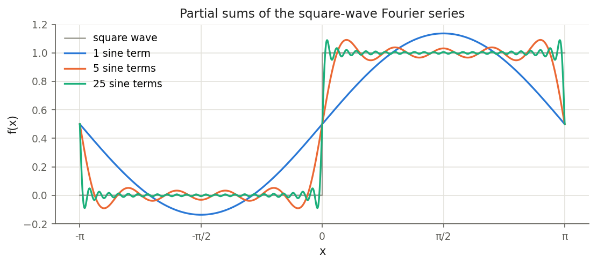
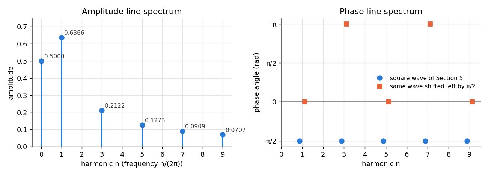
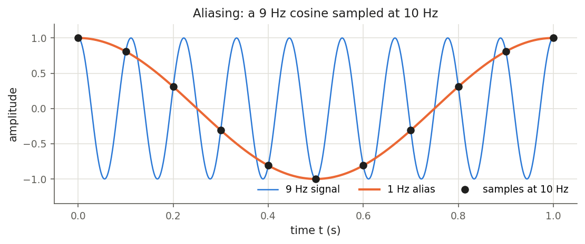
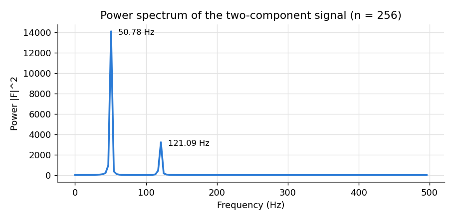

# Chapter 16 — Fourier Analysis

[Repository Guide](../../README.md) | [English](Concepts_Lecture.md) | [한국어](Concepts_Lecture.ko.md)

> **Last Updated:** 2026-11-19
>
> Applied Numerical Methods with Python for Engineers and Scientists, Chapra and Clough, Ch 16

> **Learning Objectives:**
> 1. Derive and compute Fourier series coefficients using the orthogonality of trigonometric functions
> 2. Explain the definitions and properties of the Fourier integral and the Fourier transform for non-periodic functions
> 3. Fit a sinusoid to data by least-squares regression and use the closed-form solution for equispaced points
> 4. Apply the discrete Fourier transform (DFT) for signal analysis and compute the Nyquist frequency
> 5. Explain the principle of the Fast Fourier Transform (FFT) and interpret the power spectrum
> 6. Derive aliasing and the operation count of the FFT and interpret the output of `numpy.fft` in terms of amplitudes and frequencies

---

<br>

## Table of Contents

- [1. Overview and Goals](#1-overview-and-goals)
- [2. Even and Odd Functions](#2-even-and-odd-functions)
  - [2.1 Even Functions](#21-even-functions)
  - [2.2 Odd Functions](#22-odd-functions)
  - [2.3 Decomposition of Any Function](#23-decomposition-of-any-function)
- [3. Periodic Functions](#3-periodic-functions)
  - [3.1 Definition](#31-definition)
  - [3.2 Example: Square Wave](#32-example-square-wave)
- [4. Fourier Series (Period 2π)](#4-fourier-series-period-2pi)
  - [4.1 Fourier's Claim](#41-fouriers-claim)
  - [4.2 Derivation of the Fourier Coefficients](#42-derivation-of-the-fourier-coefficients)
  - [4.3 Orthogonality Relations](#43-orthogonality-relations)
  - [4.4 Coefficient Formulas](#44-coefficient-formulas)
  - [4.5 Example: Fourier Series of the Square Function](#45-example-fourier-series-of-the-square-function)
- [5. Fourier Series of the Square Wave](#5-fourier-series-of-the-square-wave)
- [6. Period Other Than 2π](#6-period-other-than-2pi)
- [7. Fourier Integral (Non-Periodic Functions)](#7-fourier-integral-non-periodic-functions)
- [8. Fourier Transform](#8-fourier-transform)
  - [8.1 Definition](#81-definition)
  - [8.2 Properties of the Fourier Transform](#82-properties-of-the-fourier-transform)
  - [8.3 Example: Fourier Transform of a Rectangular Pulse](#83-example-fourier-transform-of-a-rectangular-pulse)
- [9. Curve Fitting with Sinusoidal Functions](#9-curve-fitting-with-sinusoidal-functions)
  - [9.1 Sinusoidal Function Parameters](#91-sinusoidal-function-parameters)
  - [9.2 Phase Angle](#92-phase-angle)
  - [9.3 Alternative Form](#93-alternative-form)
- [10. Least-Squares Fit of a Sinusoid](#10-least-squares-fit-of-a-sinusoid)
  - [10.1 Problem Setup](#101-problem-setup)
  - [10.2 Normal Equations](#102-normal-equations)
  - [10.3 Simplification with Equispaced Points](#103-simplification-with-equispaced-points)
  - [10.4 Closed-Form Solution](#104-closed-form-solution)
  - [10.5 Sinusoid Fitting Example](#105-sinusoid-fitting-example)
- [11. Continuous Fourier Series (General Model)](#11-continuous-fourier-series-general-model)
  - [11.1 General Fourier Series](#111-general-fourier-series)
  - [11.2 Euler's Formula and Complex Form](#112-eulers-formula-and-complex-form)
  - [11.3 Example of Complex Coefficients](#113-example-of-complex-coefficients)
- [12. Frequency and Time Domain](#12-frequency-and-time-domain)
- [13. Fourier Integral and Fourier Transformation (Revisited)](#13-fourier-integral-and-fourier-transformation-revisited)
- [14. Discrete Fourier Transform (DFT)](#14-discrete-fourier-transform-dft)
- [15. Nyquist Frequency](#15-nyquist-frequency)
- [16. Fast Fourier Transform (FFT)](#16-fast-fourier-transform-fft)
- [17. Power Spectrum](#17-power-spectrum)
- [18. Common Mistakes](#18-common-mistakes)
- [Summary](#summary)
- [Self-Check Questions](#self-check-questions)
- [References](#references)

---

<br>

## 1. Overview and Goals

The first part of this chapter (Sections 2-8) covers the Fourier series and the Fourier integral.

The second part (Sections 9-17) explains sinusoids (sine and cosine waves), fits a sinusoid to data by least-squares regression, and then covers Euler's formula, signal analysis in the frequency domain, the discrete Fourier transform, the Nyquist frequency, the fast Fourier transform, and the power spectrum.

> **Note:** **Context.** Fourier analysis is one of the most powerful tools in numerical methods. It allows us to decompose a periodic (or even non-periodic) function that satisfies suitable conditions into a sum of simple sinusoidal components. This has applications in signal processing, image compression, solving differential equations, and more.

---

<br>

## 2. Even and Odd Functions

### 2.1 Even Functions

A function $`f(x)`$ is **even** if:

```math
f(-x) = f(x)
```

The graph of $`f(x)`$ is **symmetric about** $`x = 0`$ (the y-axis).

**Examples:** $`\cos(x)`$, $`x^2`$, $`|x|`$

### 2.2 Odd Functions

A function $`f(x)`$ is **odd** if:

```math
f(-x) = -f(x)
```

The graph of $`f(x)`$ is **symmetric about the origin** (point symmetry).

**Examples:** $`\sin(x)`$, $`x^3`$, $`x`$

### 2.3 Decomposition of Any Function

Any function defined on an interval symmetric about the origin can be decomposed into the sum of an even function and an odd function:

```math
f(x) = \frac{1}{2}f(x) + \frac{1}{2}f(x)
```

```math
= \underbrace{\frac{1}{2}\bigl[f(x) + f(-x)\bigr]}_{\text{Even part}} + \underbrace{\frac{1}{2}\bigl[f(x) - f(-x)\bigr]}_{\text{Odd part}}
```

> **Key Point:** This decomposition is fundamental to understanding Fourier series, where cosine terms capture the even part and sine terms capture the odd part of a function.

---

<br>

## 3. Periodic Functions

### 3.1 Definition

A function $`f(x)`$ is **periodic** with period $`T`$ if:

```math
f(x) = f(x + T) \quad \forall x
```

We always choose the **smallest possible** positive $`T`$.

**Example:** $`\sin(x)`$ is periodic with period $`T = 2\pi`$, since:

```math
\sin(x + 2\pi) = \sin(x)\cos(2\pi) + \cos(x)\sin(2\pi) = \sin(x)
```

Note that $`\sin(x) = \sin(x + 2\pi) = \sin(x + 4\pi) = \cdots`$, but we choose $`T = 2\pi`$ as the fundamental period.

### 3.2 Example: Square Wave

Consider the square wave with $`2\pi`$ period:

```math
f(x) = \begin{cases} 0, & -\pi < x \le 0 \\ 1, & 0 < x \le \pi \end{cases}
```

This function repeats with period $`2\pi`$ and is a classic example used to demonstrate Fourier series.

---

<br>

## 4. Fourier Series (Period $`2\pi`$)

### 4.1 Fourier's Claim

**Fourier (1768-1830)** claimed that an arbitrary function defined over $`[-\pi, \pi]`$ could be represented in the form:

```math
f(x) = \sum_{n=0}^{\infty} (a_n \cos nx + b_n \sin nx)
```

Rewriting with the conventional $`\frac{a_0}{2}`$ notation:

```math
f(x) = \frac{a_0}{2} + \sum_{n=1}^{\infty} (a_n \cos nx + b_n \sin nx)
```

> **Note:** **Reason for $`a_0/2`$.** When $`n = 0`$, we have $`a_0 \cos(0) + b_0 \sin(0) = a_0 \cdot 1 + 0 = a_0`$. We introduce the factor $`\frac{1}{2}`$ for convenience so that the formula for $`a_0`$ has the same form as $`a_n`$ for $`n \ge 1`$.

This expression has the following structure:

```math
f(x) = \underbrace{\left(\frac{a_0}{2} + \sum_{n=1}^{\infty} a_n \cos nx \right)}_{\text{Even part}} + \underbrace{\left(\sum_{n=1}^{\infty} b_n \sin nx \right)}_{\text{Odd part}}
```

### 4.2 Derivation of the Fourier Coefficients

**Finding $`a_0`$:** Integrate both sides over $`[-\pi, \pi]`$:

```math
\int_{-\pi}^{\pi} f(x)\,dx = \int_{-\pi}^{\pi} \frac{a_0}{2}\,dx + \sum_{n=1}^{\infty} a_n \underbrace{\int_{-\pi}^{\pi} \cos nx\,dx}_{= 0} + \sum_{n=1}^{\infty} b_n \underbrace{\int_{-\pi}^{\pi} \sin nx\,dx}_{= 0}
```

```math
= \frac{a_0}{2} \cdot 2\pi = a_0 \pi
```

```math
\therefore \quad a_0 = \frac{1}{\pi} \int_{-\pi}^{\pi} f(x)\,dx
```

**Finding $`a_n`$:** Multiply both sides by $`\cos mx`$ and integrate:

```math
\int_{-\pi}^{\pi} f(x)\cos mx\,dx = \underbrace{\int_{-\pi}^{\pi} \frac{a_0}{2}\cos mx\,dx}_{= 0} + \sum_{n=1}^{\infty} a_n \int_{-\pi}^{\pi} \cos nx \cos mx\,dx + \sum_{n=1}^{\infty} b_n \underbrace{\int_{-\pi}^{\pi} \sin nx \cos mx\,dx}_{= 0}
```

**Finding $`b_n`$:** Multiply both sides by $`\sin mx`$ and integrate:

```math
\int_{-\pi}^{\pi} f(x)\sin mx\,dx = \underbrace{\int_{-\pi}^{\pi} \frac{a_0}{2}\sin mx\,dx}_{= 0} + \sum_{n=1}^{\infty} a_n \underbrace{\int_{-\pi}^{\pi} \cos nx \sin mx\,dx}_{= 0} + \sum_{n=1}^{\infty} b_n \int_{-\pi}^{\pi} \sin nx \sin mx\,dx
```

### 4.3 Orthogonality Relations

Deriving the coefficients relies on the **orthogonality** of trigonometric functions.

**Product-to-sum identities:**

```math
\cos a \cos b = \frac{1}{2}[\cos(a+b) + \cos(a-b)]
```

```math
\sin a \cos b = \frac{1}{2}[\sin(a+b) + \sin(a-b)]
```

```math
\sin a \sin b = -\frac{1}{2}[\cos(a+b) - \cos(a-b)]
```

**Orthogonality results on $`[-\pi, \pi]`$:**

```math
\int_{-\pi}^{\pi} \cos nx \cos mx\,dx = \begin{cases} 0 & \text{if } n \neq m \\ 2\pi & \text{if } n = m = 0 \\ \pi & \text{if } n = m \ge 1 \end{cases}
```

```math
\int_{-\pi}^{\pi} \sin nx \cos mx\,dx = 0 \quad \text{for all } n, m
```

```math
\int_{-\pi}^{\pi} \sin nx \sin mx\,dx = \begin{cases} 0 & \text{if } n \neq m \\ \pi & \text{if } n = m \ge 1 \end{cases}
```

### 4.4 Coefficient Formulas

Using the orthogonality relations:

```math
\boxed{a_n = \frac{1}{\pi} \int_{-\pi}^{\pi} f(x) \cos nx\,dx, \quad n = 0, 1, 2, \ldots}
```

```math
\boxed{b_n = \frac{1}{\pi} \int_{-\pi}^{\pi} f(x) \sin nx\,dx, \quad n = 1, 2, 3, \ldots}
```

### 4.5 Example: Fourier Series of the Square Function

The Fourier series is found for the function equal to $`f(x) = x^2`$ on $`[-\pi, \pi]`$ and repeated with period $`2\pi`$. Since $`f`$ is even, by Section 2 the product $`f(x)\sin nx`$ is odd, so $`b_n = 0`$. The remaining coefficients are computed with the formulas of Section 4.4.

```math
a_0 = \frac{1}{\pi}\int_{-\pi}^{\pi} x^2\,dx = \frac{1}{\pi} \cdot \frac{2\pi^3}{3} = \frac{2\pi^2}{3}
```

$`a_n`$ requires integration by parts twice. In $`\int x^2\cos nx\,dx`$, taking $`u = x^2`$ and $`dv = \cos nx\,dx`$ makes the boundary term $`[x^2\sin nx/n]_{-\pi}^{\pi}`$ vanish because $`\sin(\pm n\pi) = 0`$. Integrating the remaining $`-\frac{2}{n}\int x\sin nx\,dx`$ by parts again gives $`\int_{-\pi}^{\pi} x\sin nx\,dx = \bigl[-x\cos nx/n\bigr]_{-\pi}^{\pi} + \frac{1}{n}\int_{-\pi}^{\pi}\cos nx\,dx = -\frac{2\pi(-1)^n}{n}`$, so the following holds.

```math
a_n = \frac{1}{\pi}\left(-\frac{2}{n}\right)\left(-\frac{2\pi(-1)^n}{n}\right) = \frac{4(-1)^n}{n^2}
```

The Fourier series is therefore the following.

```math
x^2 = \frac{\pi^2}{3} + \sum_{n=1}^{\infty}\frac{4(-1)^n}{n^2}\cos nx = \frac{\pi^2}{3} - 4\cos x + \cos 2x - \frac{4}{9}\cos 3x + \cdots, \qquad -\pi \leq x \leq \pi
```

The periodic extension of $`x^2`$ has no break even at $`x = \pm\pi`$, so the series converges to $`f`$ at every point. Substituting $`x = \pi`$, where $`\cos n\pi = (-1)^n`$, gives $`\pi^2 = \pi^2/3 + 4\sum 1/n^2`$, that is, the result $`\sum_{n=1}^{\infty}1/n^2 = \pi^2/6 \approx 1.644934`$. With coefficients decaying like $`1/n^2`$, this series converges much faster than that of the square wave of Section 5 ($`1/n`$); in general, the smoother the function, the faster its Fourier coefficients decay.

---

<br>

## 5. Fourier Series of the Square Wave

For the square wave $`f(x) = \begin{cases} 0, & -\pi < x \le 0 \\ 1, & 0 < x \le \pi \end{cases}`$:

**Compute $`a_0`$:**

```math
a_0 = \frac{1}{\pi} \int_{-\pi}^{\pi} f(x)\,dx = \frac{1}{\pi} \cdot \pi = 1
```

**Compute $`a_n`$:**

```math
a_n = \frac{1}{\pi} \int_{-\pi}^{\pi} f(x)\cos nx\,dx = \frac{1}{\pi} \int_{0}^{\pi} \cos nx\,dx = \frac{1}{\pi} \left[\frac{1}{n}\sin nx\right]_0^{\pi} = 0
```

**Compute $`b_n`$:**

```math
b_n = \frac{1}{\pi} \int_{-\pi}^{\pi} f(x)\sin nx\,dx = \frac{1}{\pi} \int_0^{\pi} \sin nx\,dx = \frac{1}{\pi}\left[-\frac{1}{n}\cos nx\right]_0^{\pi}
```

```math
= -\frac{1}{n\pi}(\cos n\pi - 1) = \begin{cases} \frac{2}{n\pi} & \text{for odd } n \\ 0 & \text{for even } n \end{cases}
```

**Result:**

```math
f(x) = \frac{1}{2} + \sum_{\substack{n=1,3,5,\ldots}} \frac{2}{n\pi} \sin nx = \frac{1}{2} + \frac{2}{\pi} \sum_{n=1}^{\infty} \frac{\sin(2n-1)x}{2n-1}
```

As $`n \to \infty`$, the coefficients $`\frac{2}{n\pi}`$ decrease to 0. Coefficients tending to 0 do not by themselves guarantee convergence, but this series **converges** by the convergence theorem for Fourier series of piecewise smooth functions (the Dirichlet conditions). It converges to $`f(x)`$ where $`f`$ is continuous and to the average $`\frac{1}{2}`$ of the left and right limits at the discontinuities $`x = 0, \pm\pi`$.



*Figure 1. Partial sums of the square-wave Fourier series for different numbers of terms*

Figure 1 shows the partial sums with 1, 5, and 25 sine terms. As terms are added, the partial sums approach the square wave, but right next to the discontinuity at $`x = 0`$ a peak exceeding the function value 1 does not disappear. This is called the **Gibbs phenomenon**. Adding terms narrows the peak but does not lower it: the maximum of the partial sum is 1.0912 with 5 terms, 1.0896 with 25 terms, and 1.0895 with 100 terms, staying at an overshoot of about 9% of the jump size 1. Hence, when a truncated Fourier series is used near a discontinuity, oscillations remain no matter how many terms are used.

---

<br>

## 6. Period Other Than $`2\pi`$

For a function with period $`2\ell`$ (instead of $`2\pi`$), use the change of variable:

```math
x' = \pi \cdot \frac{x}{\ell}
```

This maps the interval $`[-\ell, \ell]`$ to $`[-\pi, \pi]`$. The Fourier series becomes:

```math
\boxed{f(x) = \frac{a_0}{2} + \sum_{n=1}^{\infty} a_n \cos\frac{n\pi}{\ell}x + \sum_{n=1}^{\infty} b_n \sin\frac{n\pi}{\ell}x}
```

with coefficients:

```math
a_n = \frac{1}{\ell} \int_{-\ell}^{\ell} f(x) \cos\frac{n\pi}{\ell}x\,dx, \quad n = 0, 1, 2, \ldots
```

```math
b_n = \frac{1}{\ell} \int_{-\ell}^{\ell} f(x) \sin\frac{n\pi}{\ell}x\,dx, \quad n = 1, 2, 3, \ldots
```

For example, consider the triangle wave of period 2, $`f(x) = |x|`$ ($`-1 \leq x \leq 1`$, $`\ell = 1`$). Since $`f`$ is even, $`b_n = 0`$, and $`a_0 = \int_{-1}^{1}|x|\,dx = 1`$. $`a_n`$ is obtained by integration by parts.

```math
a_n = 2\int_0^1 x\cos(n\pi x)\,dx = 2\left[\frac{x\sin(n\pi x)}{n\pi} + \frac{\cos(n\pi x)}{(n\pi)^2}\right]_0^1 = \frac{2\bigl((-1)^n - 1\bigr)}{n^2\pi^2}
```

It is 0 for even $`n`$ and $`-4/(n^2\pi^2)`$ for odd $`n`$, which gives the following.

```math
|x| = \frac{1}{2} - \frac{4}{\pi^2}\left(\cos\pi x + \frac{\cos 3\pi x}{9} + \frac{\cos 5\pi x}{25} + \cdots\right), \qquad -1 \leq x \leq 1
```

Substituting $`x = 0`$ yields $`1 + 1/9 + 1/25 + \cdots = \pi^2/8`$. The following code measures the maximum error of the partial sums.

```python
import numpy as np

x = np.linspace(-1.0, 1.0, 4001)
for N in (1, 2, 5, 20):                                # number of nonzero cosine terms
    s = 0.5 * np.ones_like(x)
    for n in range(1, 2 * N, 2):                       # odd harmonics 1, 3, ..., 2N - 1
        s -= 4 / (n**2 * np.pi**2) * np.cos(n * np.pi * x)
    err = np.abs(s - np.abs(x))
    print(f"{N:2d} terms: max error = {err.max():.4f} at x = {x[np.argmax(err)]:.2f}")
```

```text
 1 terms: max error = 0.0947 at x = -1.00
 2 terms: max error = 0.0497 at x = -1.00
 5 terms: max error = 0.0202 at x = -1.00
20 terms: max error = 0.0051 at x = -1.00
```

The error is largest at the corners $`x = 0, \pm 1`$ (the output shows $`x = -1`$, the first one found), and with 1, 2, 5, and 20 terms the maximum error is 0.0947, 0.0497, 0.0202, and 0.0051, decreasing nearly in inverse proportion to the number of terms. Estimating the sum of the remaining terms, $`\frac{4}{\pi^2}\sum 1/n^2`$, by an integral gives an error of about $`1/(\pi^2N)`$ after $`N`$ terms, which is 0.00507 at $`N = 20`$, in agreement with the result above. The triangle wave remains continuous when extended periodically, so unlike the square wave of Section 5 it shows no Gibbs phenomenon, and its coefficients decrease as $`1/n^2`$ rather than $`1/n`$. The degree of smoothness, a continuous function whose derivative breaks only at the corners, sets this rate of decrease.

---

<br>

## 7. Fourier Integral (Non-Periodic Functions)

**Question:** Can $`f(x) = e^{-x^2}`$ be expanded in a Fourier series?

**Answer:** Not over the whole real line, because $`f(x)`$ is not periodic.

**Solution:** Take $`\ell \to \infty`$. As $`\ell`$ increases, the frequency spectrum $`\frac{n\pi}{\ell}`$ becomes finer and finer, tending to a **continuous** spectrum.

| $`\ell`$ | Frequencies $`\frac{n\pi}{\ell}`$ |
|:---:|:---|
| $`\pi`$ | $`1, 2, 3, 4, \ldots`$ |
| $`2\pi`$ | $`\frac{1}{2}, 1, \frac{3}{2}, 2, \ldots`$ |
| $`10\pi`$ | $`0.1, 0.2, 0.3, 0.4, \ldots`$ |

*Table 1. Spacing of the frequencies $`n\pi/\ell`$ by half-period $`\ell`$ value*

In the limit, the discrete sum becomes a continuous integral:

```math
f(x) = \frac{a_0}{2} + \sum_{n=1}^{\infty} \left(a_n \cos\frac{n\pi}{\ell}x + b_n \sin\frac{n\pi}{\ell}x\right)
```

```math
\Downarrow
```

```math
\boxed{f(x) = \int_0^{\infty} \bigl[a(\omega)\cos\omega x + b(\omega)\sin\omega x\bigr]\,d\omega}
```

This is the **Fourier Integral** representation.

Following the limit concretely also determines the coefficient functions $`a(\omega)`$ and $`b(\omega)`$. With $`\Delta\omega = \pi/\ell`$ the spacing of the frequencies $`\omega_n = n\pi/\ell`$, the coefficients of Section 6 are $`a_n = \frac{\Delta\omega}{\pi}\int_{-\ell}^{\ell}f(\xi)\cos\omega_n\xi\,d\xi`$, so one cosine term of the series is $`\left[\frac{1}{\pi}\int_{-\ell}^{\ell}f(\xi)\cos\omega_n\xi\,d\xi\right]\cos\omega_nx\,\Delta\omega`$. This is one term of a Riemann sum, so as $`\ell \to \infty`$ and $`\Delta\omega \to 0`$ the sum becomes an integral. In addition, if $`\int|f|\,dx`$ is finite, $`a_0/2 = \frac{1}{2\ell}\int_{-\ell}^{\ell}f\,dx`$ tends to 0. The sine terms behave in the same way, giving the following.

```math
a(\omega) = \frac{1}{\pi}\int_{-\infty}^{\infty}f(\xi)\cos\omega\xi\,d\xi, \qquad b(\omega) = \frac{1}{\pi}\int_{-\infty}^{\infty}f(\xi)\sin\omega\xi\,d\xi
```

For example, $`f(x) = e^{-|x|}`$ is even, so $`b(\omega) = 0`$, and $`\int_0^{\infty}e^{-x}\cos\omega x\,dx = 1/(1 + \omega^2)`$ gives $`a(\omega) = \frac{2}{\pi}\cdot\frac{1}{1 + \omega^2}`$. The result is the following representation.

```math
e^{-|x|} = \frac{2}{\pi}\int_0^{\infty}\frac{\cos\omega x}{1 + \omega^2}\,d\omega
```

At $`x = 0`$, $`\int_0^{\infty}d\omega/(1 + \omega^2) = \pi/2`$, so the right side equals 1, as it should. The following code checks other values of $`x`$ by computing the integral on the right numerically.

```python
import numpy as np
from scipy.integrate import quad

for x in (0.0, 0.5, 1.0, 2.0):
    val, _ = quad(lambda w: 1 / (1 + w**2), 0, np.inf, weight="cos", wvar=x)   # integral of cos(w x)/(1 + w^2)
    print(f"x = {x}: (2/pi) * integral = {2 / np.pi * val:.6f}, exp(-|x|) = {np.exp(-abs(x)):.6f}")
```

```text
x = 0.0: (2/pi) * integral = 1.000000, exp(-|x|) = 1.000000
x = 0.5: (2/pi) * integral = 0.606531, exp(-|x|) = 0.606531
x = 1.0: (2/pi) * integral = 0.367879, exp(-|x|) = 0.367879
x = 2.0: (2/pi) * integral = 0.135335, exp(-|x|) = 0.135335
```

$`a(\omega)`$ is a continuous function defined for all $`\omega \geq 0`$ and decreases as $`1/\omega^2`$ as $`\omega`$ grows. Whereas the Fourier series assigned amplitudes only to the discrete frequencies $`n\pi/\ell`$, a nonperiodic function has a continuous frequency spectrum. Compared with the complex form of Section 8.1, $`\hat{f}(\omega) = \int e^{-|t|}e^{-i\omega t}\,dt = 2/(1 + \omega^2) = \pi a(\omega)`$.

---

<br>

## 8. Fourier Transform

### 8.1 Definition

Restating the Fourier Integral using complex exponentials:

```math
f(x) = \frac{1}{2\pi} \int_{-\infty}^{\infty} e^{i\omega x} \underbrace{\int_{-\infty}^{\infty} f(\xi) e^{-i\omega\xi}\,d\xi}_{\hat{f}(\omega)}\,d\omega = \frac{1}{2\pi} \int_{-\infty}^{\infty} \hat{f}(\omega)\,e^{i\omega x}\,d\omega
```

> **[Calculus]** Euler's formula $`e^{i\theta} = \cos\theta + i\sin\theta`$ follows from comparing the Taylor series of the exponential, cosine, and sine functions. It lets $`\cos\omega x`$ and $`\sin\omega x`$ be written as combinations of $`e^{i\omega x}`$ and $`e^{-i\omega x}`$, so the real-form Fourier integral of Section 7 can be rewritten in the complex exponential form above (Section 11.2).

The **Fourier Transform** and its **inverse**:

```math
\boxed{\hat{f}(\omega) = \mathcal{F}\{f(x)\} = \int_{-\infty}^{\infty} f(\xi)\,e^{-i\omega\xi}\,d\xi}
```

```math
\boxed{f(x) = \mathcal{F}^{-1}\{\hat{f}(\omega)\} = \frac{1}{2\pi} \int_{-\infty}^{\infty} \hat{f}(\omega)\,e^{i\omega x}\,d\omega}
```

### 8.2 Properties of the Fourier Transform

**1) Linearity:**

```math
\mathcal{F}\{\alpha f(x) + \beta g(x)\} = \alpha\,\mathcal{F}\{f\} + \beta\,\mathcal{F}\{g\}
```

```math
\mathcal{F}^{-1}\{\alpha\hat{f} + \beta\hat{g}\} = \alpha\,\mathcal{F}^{-1}\{\hat{f}\} + \beta\,\mathcal{F}^{-1}\{\hat{g}\}
```

**2) Derivative Property:**

```math
\mathcal{F}\left\{\frac{d}{dx}f(x)\right\} = i\omega\,\mathcal{F}\{f\}
```

provided $`f(x) \to 0`$ as $`x \to \pm\infty`$.

*Proof (by integration by parts):*

```math
\int_{-\infty}^{\infty} \frac{d}{d\xi}f(\xi)\,e^{-i\omega\xi}\,d\xi = \underbrace{\left[f(\xi)e^{-i\omega\xi}\right]_{-\infty}^{\infty}}_{= 0} - (-i\omega)\int_{-\infty}^{\infty} f(\xi)\,e^{-i\omega\xi}\,d\xi = i\omega\,\mathcal{F}\{f\}
```

**General $`n`$-th derivative:**

```math
\mathcal{F}\left\{\frac{d^n}{dx^n}f(x)\right\} = (i\omega)^n\,\mathcal{F}\{f\}
```

> **Note:** **Significance.** The derivative property converts differentiation in the spatial/time domain into multiplication in the frequency domain. This is why Fourier transforms are extremely useful for solving differential equations.

**3) Convolution:**

```math
f * g := \int_{-\infty}^{\infty} f(x - \xi)\,g(\xi)\,d\xi = \mathcal{F}^{-1}\{\hat{g}(\omega)\,\hat{f}(\omega)\}
```

That is, **convolution in the spatial domain** corresponds to **multiplication in the frequency domain**.

**4) $`x`$-shift (Spatial Shift):**

```math
\mathcal{F}^{-1}\{e^{-ia\omega}\,\hat{f}(\omega)\} = f(x - a)
```

Multiplying by $`e^{-ia\omega}`$ in frequency domain shifts the function by $`a`$ in the spatial domain.

**5) $`\omega`$-shift (Frequency Shift):**

```math
\mathcal{F}^{-1}\{\hat{f}(\omega - a)\} = e^{iax}\,f(x)
```

Shifting in frequency domain corresponds to modulation by $`e^{iax}`$ in the spatial domain.

### 8.3 Example: Fourier Transform of a Rectangular Pulse

The Fourier transform of the rectangular pulse equal to 1 for $`|t| \leq a`$ and 0 elsewhere is computed from the definition of Section 8.1. The interval of integration shrinks to $`[-a, a]`$.

```math
\hat{f}(\omega) = \int_{-a}^{a}e^{-i\omega t}\,dt = \left[\frac{e^{-i\omega t}}{-i\omega}\right]_{-a}^{a} = \frac{e^{i\omega a} - e^{-i\omega a}}{i\omega} = \frac{2\sin(a\omega)}{\omega}
```

The last equality uses $`e^{i\theta} - e^{-i\theta} = 2i\sin\theta`$ from Euler's formula. As $`\omega \to 0`$, $`\sin(a\omega)/\omega \to a`$, so $`\hat{f}(0) = 2a`$, which equals the area of the pulse $`\int f\,dt`$. Because the pulse is even, the transform has no imaginary part.

$`\hat{f}(\omega)`$ vanishes at $`\omega = \pm\pi/a, \pm 2\pi/a, \ldots`$, and the width of the central lobe is $`2\pi/a`$. Multiplying the duration $`2a`$ of the pulse by its width in the frequency domain therefore gives $`2a \times 2\pi/a = 4\pi`$, a constant independent of $`a`$. With $`a = 1`$ the first zero is at $`\omega = \pi`$; doubling the pulse to $`a = 2`$ pulls the first zero in to $`\pi/2`$ and halves the spectrum. Because of this relation, that shorter signals need components over a wider frequency range, signals with sharp changes (pulses, discontinuities) carry many high-frequency components, which is also why the coefficients of the square wave in Section 5 decay slowly.

---

<br>

## 9. Curve Fitting with Sinusoidal Functions

### 9.1 Sinusoidal Function Parameters

Consider a periodic function $`f(t) = f(t + T)`$, where $`T`$ is a constant (the period).

A **sinusoidal function** is any waveform that can be described as a sine or cosine:

```math
f(t) = A_0 + C_1 \cos(\omega_0 t + \theta)
```

where:

| Parameter | Meaning |
|:---:|:---|
| $`A_0`$ | **Mean value** (vertical offset) |
| $`C_1`$ | **Amplitude** (height of oscillation) |
| $`\omega_0`$ | **Angular frequency** (radians/time) |
| $`\theta`$ | **Phase angle** (radians) |

*Table 2. Parameters of a sinusoidal function and their meaning*

The relationships between frequency quantities:

```math
\omega_0 = 2\pi f, \qquad f = \frac{1}{T}
```

where $`f`$ is the **ordinary frequency** in cycles/time $`[\text{Hz}]`$.

### 9.2 Phase Angle

The phase angle $`\theta`$ represents the distance (in radians) from $`t = 0`$ to the point at which the cosine function begins a new cycle.

For $`\theta > 0`$:

- $`\cos(\omega_0 t - \theta)`$: **lagging** phase angle (shifted right)
- $`\cos(\omega_0 t + \theta)`$: **leading** phase angle (shifted left)

The following relationships between sine and cosine also hold:

```math
\sin(t + \pi/2) = \cos(t), \qquad \cos(t - \pi/2) = \sin(t)
```

### 9.3 Alternative Form

We can pull $`\theta`$ out of the cosine function using the angle addition formula:

```math
\cos(\omega_0 t + \theta) = \cos(\omega_0 t)\cos(\theta) - \sin(\omega_0 t)\sin(\theta)
```

Therefore:

```math
f(t) = A_0 + C_1\cos(\omega_0 t + \theta)
```

```math
= A_0 + C_1\cos\theta\,\cos(\omega_0 t) - C_1\sin\theta\,\sin(\omega_0 t)
```

```math
\boxed{= A_0 + A_1\cos(\omega_0 t) + B_1\sin(\omega_0 t)}
```

where:

```math
A_1 = C_1\cos\theta, \qquad B_1 = -C_1\sin\theta
```

From these we can recover:

```math
\theta = \arctan\left(-\frac{B_1}{A_1}\right), \qquad C_1 = \sqrt{A_1^2 + B_1^2}
```

Since $`\arctan`$ returns values in $`(-\pi/2, \pi/2)`$, add $`\pi`$ to $`\theta`$ when $`A_1 < 0`$.

---

<br>

## 10. Least-Squares Fit of a Sinusoid

### 10.1 Problem Setup

Given data points $`(t_i, y_i)`$, fit the model:

```math
y = A_0 + A_1\cos(\omega_0 t) + B_1\sin(\omega_0 t) = \hat{y}(t)
```

Interpret as a linear regression problem with basis functions ($`\beta_0 = A_0`$, $`\beta_1 = A_1`$, $`\beta_2 = B_1`$):

```math
f_0 = 1, \quad f_1 = \cos(\omega_0 t), \quad f_2 = \sin(\omega_0 t)
```

```math
\hat{y}(t) = \beta_0 f_0 + \beta_1 f_1 + \beta_2 f_2
```

### 10.2 Normal Equations

Minimize the sum of squared errors:

```math
SSE = \sum (y_i - A_0 - A_1\cos(\omega_0 t_i) - B_1\sin(\omega_0 t_i))^2
```

Taking partial derivatives and setting them to zero:

```math
\frac{\partial SSE}{\partial A_0} = 0, \quad \frac{\partial SSE}{\partial A_1} = 0, \quad \frac{\partial SSE}{\partial B_1} = 0
```

This yields the normal equation system:

```math
\begin{pmatrix} \sum y_i \\ \sum y_i \cos(\omega_0 t) \\ \sum y_i \sin(\omega_0 t) \end{pmatrix} = \begin{pmatrix} n & \sum\cos(\omega_0 t) & \sum\sin(\omega_0 t) \\ \sum\cos(\omega_0 t) & \sum\cos^2(\omega_0 t) & \sum\cos(\omega_0 t)\sin(\omega_0 t) \\ \sum\sin(\omega_0 t) & \sum\sin(\omega_0 t)\cos(\omega_0 t) & \sum\sin^2(\omega_0 t) \end{pmatrix} \begin{pmatrix} A_0 \\ A_1 \\ B_1 \end{pmatrix}
```

### 10.3 Simplification with Equispaced Points

Collect $`n`$ observations within a period $`T`$ at equally spaced points: $`T = n\,\Delta t`$.

For **equispaced** points ($`n \ge 3`$), the following orthogonality properties hold:

```math
\sum_{i=1}^{n} \sin(\omega_0 t_i) = 0, \qquad \sum_{i=1}^{n} \cos(\omega_0 t_i) = 0
```

```math
\sum_{i=1}^{n} \sin^2(\omega_0 t_i) = \frac{n}{2}, \qquad \sum_{i=1}^{n} \cos^2(\omega_0 t_i) = \frac{n}{2}
```

```math
\sum_{i=1}^{n} \cos(\omega_0 t_i)\sin(\omega_0 t_i) = \frac{1}{2}\sum_{i=1}^{n}[\sin(2\omega_0 t_i) - \sin 0] = 0
```

The normal equations simplify to a **diagonal** system:

```math
\begin{pmatrix} \sum y_i \\ \sum y_i\cos(\omega_0 t) \\ \sum y_i\sin(\omega_0 t) \end{pmatrix} = \begin{pmatrix} n & 0 & 0 \\ 0 & \frac{n}{2} & 0 \\ 0 & 0 & \frac{n}{2} \end{pmatrix} \begin{pmatrix} A_0 \\ A_1 \\ B_1 \end{pmatrix}
```

### 10.4 Closed-Form Solution

```math
\boxed{A_0 = \frac{1}{n}\sum y_i = \bar{y}}
```

```math
\boxed{A_1 = \frac{2}{n}\sum y_i \cos(\omega_0 t_i)}
```

```math
\boxed{B_1 = \frac{2}{n}\sum y_i \sin(\omega_0 t_i)}
```

> **Key Point:** With equispaced data points, the normal equations decouple completely, giving simple closed-form expressions for the Fourier coefficients. This is a major computational advantage.

### 10.5 Sinusoid Fitting Example

$`y = A_0 + A_1\cos(\omega_0t) + B_1\sin(\omega_0t)`$ is fitted to 12 temperatures measured at one location every 2 hours over one day ($`T = 24`$ h, $`\omega_0 = 2\pi/24 = 0.2618`$ rad/h). The time $`t`$ is measured from the start of the measurements.

```math
t = 0, 2, \ldots, 22, \qquad y = (23.4,\ 25.4,\ 25.8,\ 24.9,\ 22.1,\ 18.9,\ 16.3,\ 14.3,\ 14.1,\ 15.2,\ 17.6,\ 20.7)
```

Since the samples are equally spaced over one period, the closed form of Section 10.4 applies directly.

```python
import numpy as np

T = 24.0
w0 = 2 * np.pi / T
t = np.arange(0, 24, 2.0)                  # 12 equally spaced times over one period (h)
y = np.array([23.4, 25.4, 25.8, 24.9, 22.1, 18.9,
              16.3, 14.3, 14.1, 15.2, 17.6, 20.7])   # temperature (deg C)
n = len(t)
A0 = y.mean()
A1 = 2 / n * np.sum(y * np.cos(w0 * t))
B1 = 2 / n * np.sum(y * np.sin(w0 * t))
C1 = np.hypot(A1, B1)
theta = np.arctan2(-B1, A1)                # A1 = C1 cos(theta), B1 = -C1 sin(theta)
print(f"A0 = {A0:.4f}, A1 = {A1:.4f}, B1 = {B1:.4f}, C1 = {C1:.4f}, theta = {theta:.4f}")
print(f"time of maximum = {-theta / w0:.2f} h")
X = np.column_stack([np.ones(n), np.cos(w0 * t), np.sin(w0 * t)])
print(np.round(np.linalg.lstsq(X, y, rcond=None)[0], 4))
```

```text
A0 = 19.8917, A1 = 3.6453, B1 = 4.7299, C1 = 5.9716, theta = -0.9142
time of maximum = 3.49 h
[19.8917  3.6453  4.7299]
```

The mean temperature is $`A_0 = 19.89`$ °C and the amplitude is $`C_1 = \sqrt{3.6453^2 + 4.7299^2} = 5.97`$ °C, so the temperature over the day swings roughly between 13.9 °C and 25.9 °C. From the relations $`A_1 = C_1\cos\theta`$ and $`B_1 = -C_1\sin\theta`$ of Section 9.3, the phase angle is $`\theta = -0.9142`$ rad. `np.arctan2(-B1, A1)` fixes the quadrant from the signs of its two arguments, so the correction of adding $`\pi`$ mentioned in Section 9.3 is not needed separately. The maximum occurs where $`\omega_0t + \theta = 0`$, at $`t = 0.9142/0.2618 = 3.49`$ h. The last line solves the same model by general linear least squares (Chapter 15, Section 5), which for equally spaced samples agrees exactly with the closed form. If the samples are not equally spaced or do not fill a period, the closed form does not hold, and the model must be solved in this `lstsq` way.

From the frequency-domain viewpoint of Section 12, these data are summarized by two lines: height 19.89 at frequency 0 and height 5.97 at frequency $`\omega_0`$ (period 24 h). If the residuals after the fit still contain a component of another period (for example, 12 h), the fit is extended by adding harmonics as in the general Fourier series of Section 11.

---

<br>

## 11. Continuous Fourier Series (General Model)

### 11.1 General Fourier Series

Extend to the general model that contains all integer multiples of the fundamental frequency. For data fitting, the series is truncated at the $`m`$-th harmonic, which uses $`2m + 1`$ coefficients:

```math
f(t) = a_0 + \sum_{k=1}^{\infty} \bigl(a_k \cos(k\omega_0 t) + b_k \sin(k\omega_0 t)\bigr)
```

where:

- $`\omega_0 = \frac{2\pi}{T}`$ is the **fundamental frequency**.
- $`2\omega_0, 3\omega_0, \ldots, m\omega_0, \ldots`$ are the **harmonics** (integer multiples of $`\omega_0`$).

The coefficients for the general model:

```math
A_0 = \frac{1}{n}\sum y_i = \bar{y}
```

```math
A_j = \frac{2}{n}\sum y_i \cos(j\omega_0 t_i), \quad j = 1, 2, \ldots, m
```

```math
B_j = \frac{2}{n}\sum y_i \sin(j\omega_0 t_i), \quad j = 1, 2, \ldots, m
```

> **Note:** **Regression and collocation.** If $`n > 2m + 1`$ (more data points than coefficients), we compute the coefficients to fit data in the **regression** (least-squares) sense. If $`n = 2m + 1`$ (the number of data points equals the number of Fourier coefficients), this is called **collocation**, and the Fourier series interpolates the data exactly.

### 11.2 Euler's Formula and Complex Form

**Euler's formula:**

```math
e^{i\theta} = \cos\theta + i\sin\theta
```

This allows us to express the Fourier series in **complex exponential form**:

```math
f(t) = a_0 + \sum_{k=1}^{\infty}\bigl(a_k\cos(k\omega_0 t) + b_k\sin(k\omega_0 t)\bigr) = \sum_{k=-\infty}^{\infty} \tilde{C}_k\,e^{ik\omega_0 t}
```

where the complex Fourier coefficients are:

```math
\tilde{C}_k = \frac{1}{T}\int_{-T/2}^{T/2} f(t)\,e^{-ik\omega_0 t}\,dt
```

### 11.3 Example of Complex Coefficients

The complex coefficients of $`f(x) = x^2`$ of Section 4.5 ($`T = 2\pi`$, $`\omega_0 = 1`$) are computed directly with the formula of Section 11.2. Since $`e^{-ikx} = \cos kx - i\sin kx`$ and $`x^2\sin kx`$ is odd, the integral of the imaginary part is zero.

```math
\tilde{C}_0 = \frac{1}{2\pi}\int_{-\pi}^{\pi}x^2\,dx = \frac{\pi^2}{3}, \qquad \tilde{C}_k = \frac{1}{2\pi}\int_{-\pi}^{\pi}x^2\cos kx\,dx = \frac{1}{2\pi}\cdot\frac{4\pi(-1)^k}{k^2} = \frac{2(-1)^k}{k^2}
```

This result connects to the real coefficients through the following relation. Substituting $`\cos kx = (e^{ikx} + e^{-ikx})/2`$ and $`\sin kx = (e^{ikx} - e^{-ikx})/(2i)`$ into the form $`f = \frac{a_0}{2} + \sum(a_k\cos kx + b_k\sin kx)`$ of Section 4 and collecting the coefficients of $`e^{ikx}`$ gives the following.

```math
\tilde{C}_0 = \frac{a_0}{2}, \qquad \tilde{C}_k = \frac{a_k - ib_k}{2}, \qquad \tilde{C}_{-k} = \frac{a_k + ib_k}{2} = \overline{\tilde{C}_k} \quad (k \geq 1)
```

Substituting $`a_k = 4(-1)^k/k^2`$ and $`b_k = 0`$ gives $`\tilde{C}_k = 2(-1)^k/k^2`$, the same as the direct computation. The property that, for a real function $`f`$, the negative-frequency coefficients are the complex conjugates of the positive-frequency ones appears again in the DFT of Section 14. $`\tilde{C}_0`$ is the average of $`f`$ over one period, $`\pi^2/3 \approx 3.290`$ in this example.

---

<br>

## 12. Frequency and Time Domain

The **frequency domain** provides an alternative perspective for characterizing the behavior of oscillating functions.

- **Time domain**: the usual representation $`f(t)`$, which shows amplitude versus time.
- **Frequency domain**: the Fourier coefficients $`\hat{f}(\omega)`$, which show amplitude versus frequency.

Fourier analysis transforms a signal from the time domain to the frequency domain, revealing which frequencies are present and their relative strengths.

Viewing the same signal side by side in the two domains makes the correspondences clear. A constant in the time domain is a single line at $`\omega = 0`$ in the frequency domain, and a pure sinusoid $`C\cos(\omega_0t + \theta)`$ is a single line at $`\omega_0`$ (two lines at $`\pm\omega_0`$ in complex form). The temperature data of Section 10.5 were 12 numbers in the time domain but were summarized in the frequency domain by two lines of heights 19.89 and 5.97 and one phase. Conversely, a signal concentrated in a short time, like the short pulse of Section 8.3, spreads widely in the frequency domain, and a sinusoid spread over all time concentrates at one point in the frequency domain. Random noise concentrates at no frequency and spreads evenly over all frequencies. Because of these correspondences, a periodic component buried in noise in the time domain stands out as a distinct line in the frequency domain (Section 17), and moving back and forth between the two domains is a basic procedure in analyzing measured signals.

Frequency-domain information is drawn as a **line spectrum**. Writing each component as $`C_n\cos(n\omega_0t + \theta_n)`$, the amplitude spectrum draws the amplitudes $`C_n`$ as vertical lines on the frequency axis, and the phase spectrum draws the phase angles $`\theta_n`$. The amplitude spectrum alone cannot distinguish two signals that have the same amplitudes and frequencies but are displaced from each other along the time axis, so the phase spectrum records how far each component leads or lags relative to $`t = 0`$. Following the convention of Section 9.2, the phase angle is negative if the positive peak appears later than $`t = 0`$ (lagging) and positive if it appears earlier (leading).

For the square wave $`\frac{1}{2} + \sum_{n\ \text{odd}}\frac{2}{n\pi}\sin nx`$ of Section 5, $`\sin nx = \cos(nx - \pi/2)`$, so the amplitudes of odd $`n`$ are $`2/(n\pi)`$, that is, 0.6366, 0.2122, 0.1273, ..., and all phase angles are $`-\pi/2`$. The zero-frequency component is the mean 0.5.



*Figure 2. Amplitude and phase spectra of the square wave*

Shifting the same square wave to the left by $`\pi/2`$ gives $`\sin\bigl(n(x + \pi/2)\bigr) = \cos\bigl(nx + (n - 1)\pi/2\bigr)`$, so the phase angle is 0 for $`n = 1, 5, 9, \ldots`$ and $`\pi`$ for $`n = 3, 7, \ldots`$. As on the right of Figure 2, the phase spectrum changes but the amplitude spectrum stays the same. A time shift changes the phase of each component by an amount proportional to its frequency ($`n\pi/2`$) and leaves the amplitudes unchanged, which is the $`x`$-shift property of Section 8.2 seen in a Fourier series. The amplitude spectrum is therefore a characteristic of the waveform itself, independent of when the signal started.

---

<br>

## 13. Fourier Integral and Fourier Transformation (Revisited)

Taking $`T \to \infty`$ turns a periodic function into a nonperiodic one and gives the Fourier transform of Section 8.1. Written in the time variable, the transform is $`F(\omega) = \int_{-\infty}^{\infty} f(t)\,e^{-i\omega t}\,dt`$, and the inverse transform, the Fourier integral, is $`f(t) = \frac{1}{2\pi} \int_{-\infty}^{\infty} F(\omega)\,e^{i\omega t}\,d\omega`$.

The three representations differ in the functions they handle and the form of their results. The Fourier series (Section 11) turns a continuous periodic function into coefficients at the discrete frequencies $`k\omega_0`$, and the Fourier transform turns a continuous nonperiodic function into a function $`F(\omega)`$ of continuous frequency. $`e^{-|t|}`$ of Section 7 and its transform $`2/(1 + \omega^2)`$ are an example. Measured data are samples taken at regular intervals over a finite time, so neither can be used as is, and the DFT of Section 14 turns a finite number of discrete samples into a finite number of coefficients at discrete frequencies. The DFT is the discrete version of the Fourier series that treats the record as one period, and for a function that is zero outside $`[0, T)`$ it is also the approximation $`F(2\pi k/T) \approx \Delta t\,\hat{f}_k`$ of the transform integral by a sum over the samples. The $`k`$th bin of the DFT therefore represents the component at frequency $`k/T`$.

---

<br>

## 14. Discrete Fourier Transform (DFT)

Collect a **finite set** of function values. An interval from $`0`$ to $`T`$ can be divided into $`n`$ equispaced subintervals with $`\Delta t = \frac{T}{n}`$.

The discrete samples are $`f_j = f(t = t_j)`$, where $`t_j = t_0 + j\,\Delta t`$.

**DFT (Forward):**

```math
\hat{f}_k = \mathcal{F}\{f\}_k \approx \sum_{j=0}^{n-1} f_j\,e^{-ik\omega_0 j}, \quad k = 0, 1, 2, \ldots, n-1
```

**Inverse DFT:**

```math
f_j = \mathcal{F}^{-1}\{\hat{f}\}_j \approx \frac{1}{n}\sum_{k=0}^{n-1} \hat{f}_k\,e^{ik\omega_0 j}, \quad j = 0, 1, 2, \ldots, n-1
```

where $`\omega_0 = \frac{2\pi}{n}`$.

```python
import numpy as np

def dft(f):
    """Compute the Discrete Fourier Transform of a 1D array f."""
    n = len(f)
    F = np.zeros(n, dtype=complex)
    for k in range(n):
        for j in range(n):
            F[k] += f[j] * np.exp(-2j * np.pi * k * j / n)
    return F

def idft(F):
    """Compute the Inverse Discrete Fourier Transform of a 1D array F."""
    n = len(F)
    f = np.zeros(n, dtype=complex)
    for j in range(n):
        for k in range(n):
            f[j] += F[k] * np.exp(2j * np.pi * k * j / n)
    return f / n
```

> **Note:** **Complexity.** The naive DFT has time complexity $`O(n^2)`$ because each of the $`n`$ output values requires a sum over $`n`$ input values.

**Example.** The DFT of the $`n = 4`$ samples $`f = (1,\ 2,\ 0,\ -1)`$ is computed by hand. Since $`\omega_0 = 2\pi/4 = \pi/2`$, $`e^{-ik\omega_0 j} = (-i)^{kj}`$.

```math
\hat{f}_0 = 1 + 2 + 0 - 1 = 2, \qquad \hat{f}_1 = 1 + 2(-i) + 0(-1) + (-1)(i) = 1 - 3i
```

```math
\hat{f}_2 = 1 - 2 + 0 + (-1)(-1) = 0, \qquad \hat{f}_3 = 1 + 2(i) + 0(-1) + (-1)(-i) = 1 + 3i
```

$`\hat{f}_0`$ is the sum of the samples, $`n`$ times their mean. $`\hat{f}_3 = \overline{\hat{f}_1}`$ because $`\hat{f}_{n-k} = \overline{\hat{f}_k}`$ for a real signal, the same property as the conjugate relation of negative-frequency coefficients in Section 11.3 ($`k = n - 1`$ corresponds to frequency $`-1`$). Checking with the inverse DFT gives $`f_1 = \frac{1}{4}\bigl(2 + (1 - 3i)(i) + 0 + (1 + 3i)(-i)\bigr) = \frac{1}{4}(2 + 3 + i + 3 - i) = 2`$, recovering the original sample.

The DFT coefficient $`\hat{f}_k`$ is the component at frequency $`f_k = k/T = k/(n\,\Delta t)`$. A real signal $`A\cos(2\pi f_k t + \phi)`$ ($`0 < k < n/2`$) produces $`|\hat{f}_k| = nA/2`$, so the amplitude is read as $`A = 2|\hat{f}_k|/n`$. NumPy's `np.fft.fft` uses the same definition $`A_k = \sum_{m=0}^{n-1}a_me^{-2\pi imk/n}`$, applies no scaling to the forward transform, and multiplies the inverse transform by $`1/n`$ [1]. Element 0 of the result is the zero-frequency component, followed by the positive frequencies, and the second half holds the negative frequencies; the frequency of each element is obtained with `np.fft.fftfreq` [1].

The following example samples the real signal $`f(t) = 3 + 2\cos(2\pi \cdot 5t) - \sin(2\pi \cdot 7.5t)`$ eight times at intervals of $`\Delta t = 0.05`$ s. The sampling frequency is 20 Hz, the record length is $`T = 8 \times 0.05 = 0.4`$ s, the frequency spacing is $`\Delta f = 1/T = 2.5`$ Hz, and the Nyquist frequency is 10 Hz. The samples are taken at $`t_j = j\Delta t`$ ($`j = 0, \ldots, 7`$), and $`t = T`$, the start of the next period, is not included.

```python
import numpy as np

n, dt = 8, 0.05                                   # 8 samples, sampling frequency 20 Hz
t = np.arange(n) * dt                             # 0, 0.05, ..., 0.35 (t = 0.4 is not included)
f = 3 + 2 * np.cos(2 * np.pi * 5 * t) - np.sin(2 * np.pi * 7.5 * t)
F = np.fft.fft(f)
np.set_printoptions(precision=3, suppress=True)
print(np.fft.fftfreq(n, d=dt))
print(F)
```

```text
[  0.    2.5   5.    7.5 -10.   -7.5  -5.   -2.5]
[24.+0.j  0.+0.j  8.+0.j -0.+4.j -0.+0.j -0.-4.j  8.-0.j  0.-0.j]
```

As the output of `fftfreq` shows, the bins are ordered $`0,\ 2.5,\ 5,\ 7.5`$ Hz, then $`-10`$ Hz for the Nyquist frequency, and then the negative frequencies $`-7.5,\ -5,\ -2.5`$ Hz. Each bin is read as follows.

- $`F_0 = 24`$ is the sum of the samples, so the mean is $`24/8 = 3`$.
- $`F_2 = 8`$ (5 Hz) has only a real part, so it is a cosine component, with amplitude $`2|F_2|/n = 2 \times 8/8 = 2`$.
- $`F_3 = 4i`$ (7.5 Hz) has only an imaginary part, so it is a sine component. $`B\sin(2\pi f_kt)`$ produces $`F_k = -inB/2`$, so $`B = -2\,\mathrm{Im}(F_3)/n = -1`$, matching the $`-\sin`$ term of the signal.
- $`F_6 = \overline{F_2}`$ and $`F_5 = \overline{F_3}`$ are negative-frequency components produced by the conjugate symmetry of a real signal and carry no new information. The Nyquist bin $`F_4`$ and the bins $`F_1`$ and $`F_7`$, which have no component, are 0.

In general, a component $`A\cos(2\pi f_kt) + B\sin(2\pi f_kt)`$ ($`0 < k < n/2`$) of a real signal produces $`F_k = n(A - iB)/2`$. When the frequencies of the components lie on the grid $`k\Delta f`$, as in this example, no energy leaks into other bins (Section 17).

---

<br>

## 15. Nyquist Frequency

The **Nyquist frequency** is the highest frequency that can be measured in a signal. It equals **half the sampling frequency**:

```math
f_{\max} = \frac{1}{2} f_s = \frac{1}{2\,\Delta t}
```

**Example:** Collecting 100 samples ($`n = 100`$) at a sampling frequency of $`f_s = 1000`$ Hz gives the following.

- Sampling interval: $`\Delta t = \frac{1}{f_s} = \frac{1}{1000} = 10^{-3}`$ s
- Total time: $`T = n \cdot \Delta t = 100 \times 10^{-3} = 0.1`$ s
- **Nyquist frequency:** $`f_{\max} = \frac{1}{2}f_s = 500`$ Hz
- **Lowest detectable frequency:** $`f_{\min} = \frac{1}{T} = \frac{1}{n\,\Delta t} = 10`$ Hz

> **Caution:** **Aliasing.** If a signal contains frequencies above the Nyquist frequency, those frequencies will be incorrectly represented as lower frequencies. This phenomenon is called **aliasing**. To avoid this, the sampling rate must be greater than twice the highest frequency present in the signal (the **Nyquist-Shannon sampling theorem**).

**Deriving aliasing.** Sampling $`\cos(2\pi ft)`$ at intervals $`\Delta t = 1/f_s`$ gives the value $`\cos(2\pi fj/f_s)`$ at $`t_j = j\Delta t`$. Changing the frequency to $`f + mf_s`$ ($`m`$ an integer) gives $`\cos(2\pi(f + mf_s)j/f_s) = \cos(2\pi fj/f_s + 2\pi mj) = \cos(2\pi fj/f_s)`$, so the samples are exactly the same. Moreover, $`\cos`$ is even, so $`-f`$ also gives the same samples. Hence the samples alone cannot distinguish $`f`$, $`f \pm f_s`$, $`f \pm 2f_s, \ldots`$ and their negatives, and the analysis interprets them as the one that falls in $`[0, f_s/2]`$. That apparent frequency is the following.

```math
f_{alias} = \bigl|\,f - m f_s\,\bigr|
```

Here $`m`$ is the integer closest to $`f/f_s`$. For example, sampling a 9 Hz cosine at $`f_s = 10`$ Hz gives $`m = 1`$ and $`f_{alias} = |9 - 10| = 1`$ Hz.



*Figure 3. A 9 Hz cosine sampled at 10 Hz and the 1 Hz cosine passing through the same samples*

In Figure 3, the samples (black dots) cannot be told apart as coming from the 9 Hz signal or the 1 Hz signal. Once the samples have been taken there is no way to undo aliasing, so real instruments place a low-pass filter (anti-aliasing filter) before sampling to remove components above the Nyquist frequency.

Aliasing is also confirmed directly in the result of a DFT. The following code compares sine waves of 7 Hz and 43 Hz sampled at 50 Hz for 1 second.

```python
import numpy as np

fs, n = 50.0, 50                                  # 50 Hz sampling for 1 s, frequency spacing 1 Hz
t = np.arange(n) / fs
for f0 in (7.0, 43.0):
    F = np.fft.fft(np.sin(2 * np.pi * f0 * t))
    k = np.argmax(np.abs(F[: n // 2]))            # strongest bin among nonnegative frequencies
    print(f"sin at {f0:4.1f} Hz: peak at {k} Hz, |Re F[k]| = {abs(F[k].real):.3f}, Im F[k] = {F[k].imag:.3f}")
```

```text
sin at  7.0 Hz: peak at 7 Hz, |Re F[k]| = 0.000, Im F[k] = -25.000
sin at 43.0 Hz: peak at 7 Hz, |Re F[k]| = 0.000, Im F[k] = 25.000
```

The energy of the 43 Hz sine wave appears in the $`|43 - 50| = 7`$ Hz bin and occupies the same bin as a genuine 7 Hz signal. The sign of the imaginary part, however, is reversed. Since $`\sin(2\pi \cdot 43j/50) = \sin(2\pi j - 2\pi \cdot 7j/50) = -\sin(2\pi \cdot 7j/50)`$, the folded sine component appears with its sign flipped, and by the reading of Section 14, $`\mathrm{Im}(F_7) = +25`$ means a sine with coefficient $`-1`$. A cosine is even and shows no such sign change. In aliasing of this kind, where $`f - mf_s < 0`$ and the frequency folds back reversed, therefore, not only the apparent frequency but also the phase differs from the original signal. When $`f - mf_s > 0`$, as for 57 Hz, $`\sin(2\pi \cdot 57j/50) = \sin(2\pi \cdot 7j/50)`$, so the component appears in the same 7 Hz bin without a sign change.

---

<br>

## 16. Fast Fourier Transform (FFT)

The **Fast Fourier Transform** reduces the computational cost from $`O(n^2)`$ (DFT) to $`O(n \log n)`$ by exploiting:

1. **Symmetry** of trigonometric functions
2. **Periodicity** of complex exponentials

Key properties of the FFT:

- FFT splits the input into **even and odd indices** recursively
- FFT exploits **symmetry and periodicity** in the DFT formula
- FFT dramatically **cuts down repeated calculations**

```python
import numpy as np

# Using NumPy's built-in FFT
t = np.linspace(0, 1, 256, endpoint=False)
signal = np.sin(2 * np.pi * 10 * t) + 0.5 * np.sin(2 * np.pi * 20 * t)

# Compute FFT
F = np.fft.fft(signal)

# Compute frequencies
freqs = np.fft.fftfreq(len(t), d=t[1] - t[0])

# Inverse FFT to recover original signal
recovered = np.fft.ifft(F)
```

> **Note:** **Reason for $`n = 2^p`$.** The radix-2 Cooley-Tukey FFT algorithm works most efficiently when $`n`$ is a power of 2, as the recursive splitting into halves can be done $`\log_2 n`$ times evenly.

**Deriving the split.** How the FFT reduces the work is shown for even $`n`$. Writing $`W_n = e^{-2\pi i/n}`$, the DFT is $`\hat{f}_k = \sum_{j=0}^{n-1}f_jW_n^{jk}`$. Splitting the sum into even-indexed samples ($`j = 2m`$) and odd-indexed samples ($`j = 2m + 1`$) and using $`W_n^2 = W_{n/2}`$ gives the following.

```math
\hat{f}_k = \sum_{m=0}^{n/2-1}f_{2m}W_{n/2}^{mk} + W_n^k\sum_{m=0}^{n/2-1}f_{2m+1}W_{n/2}^{mk} = E_k + W_n^kO_k
```

$`E_k`$ and $`O_k`$ are the length-$`n/2`$ DFTs of the even-indexed and odd-indexed samples. They have period $`n/2`$ in $`k`$, and $`W_n^{k + n/2} = -W_n^k`$, so the first and second halves of the output are obtained together from the same $`E_k`$ and $`O_k`$.

```math
\hat{f}_k = E_k + W_n^kO_k, \qquad \hat{f}_{k+n/2} = E_k - W_n^kO_k, \qquad k = 0, 1, \ldots, \frac{n}{2} - 1
```

That is, one DFT of length $`n`$ turns into two DFTs of length $`n/2`$ plus $`n/2`$ complex multiplications (and $`n`$ additions and subtractions). If $`n = 2^p`$, the split can be repeated for $`p = \log_2 n`$ levels, and the number of multiplications $`M(n)`$ satisfies $`M(n) = 2M(n/2) + n/2`$, $`M(1) = 0`$, so $`M(n) = \frac{n}{2}\log_2 n`$. A directly computed DFT needs about $`n^2`$ complex multiplications.

| $`n`$ | DFT multiplications $`n^2`$ | FFT multiplications $`\frac{n}{2}\log_2 n`$ | Ratio |
|-----:|-----:|-----:|-----:|
| $`2^{10} = 1024`$ | 1,048,576 | 5,120 | about 205 |
| $`2^{16} = 65536`$ | about $`4.3 \times 10^{9}`$ | 524,288 | 8,192 |
| $`2^{20} = 1048576`$ | about $`1.1 \times 10^{12}`$ | 10,485,760 | about 104,858 |

*Table 3. Complex multiplications of the DFT and the FFT*

For about a million samples the FFT is about 100,000 times faster, and this difference is what made real-time signal processing and large-scale spectral analysis possible. Translating the split directly into a recursive function gives the following.

```python
import numpy as np

def fft_rec(f):
    f = np.asarray(f, dtype=complex)
    n = len(f)
    if n == 1:
        return f
    E = fft_rec(f[0::2])                          # DFT of even-indexed samples
    O = fft_rec(f[1::2])                          # DFT of odd-indexed samples
    W = np.exp(-2j * np.pi * np.arange(n // 2) / n)
    return np.concatenate([E + W * O, E - W * O])

f = np.array([1.0, 2.0, 0.0, -1.0])
print(fft_rec(f))
rng = np.random.default_rng(0)
g = rng.standard_normal(16)
print(np.allclose(fft_rec(g), np.fft.fft(g)))
```

```text
[2.+0.j 1.-3.j 0.+0.j 1.+3.j]
True
```

For length 1 the DFT is the sample itself, so it is returned as is (the end of the recursion). `f[0::2]` and `f[1::2]` are the even-indexed and odd-indexed samples, `W` holds $`W_n^k`$ ($`k = 0, \ldots, n/2 - 1`$), and the last line joins the first and second halves with the two formulas above. The first output agrees with the hand computation of Section 14, and for a random signal of length 16 the result matches `np.fft.fft`. This function works only when $`n`$ is a power of two; practical libraries use more general splits that also handle other lengths.

---

<br>

## 17. Power Spectrum

The **power spectrum** shows how the power of a signal is distributed across different frequencies.

**Discrete case** (power at discrete frequency $`k\omega_0`$):

```math
P_k = |\tilde{C}_k|^2
```

**Continuous case** (power at continuous frequency $`\omega`$):

```math
P(\omega) = |\hat{F}(\omega)|^2
```

```python
import numpy as np
import matplotlib.pyplot as plt

# Generate a signal with two frequency components
n = 256
dt = 0.001
t = np.arange(n) * dt
signal = np.sin(2 * np.pi * 50 * t) + 0.5 * np.sin(2 * np.pi * 120 * t)

# Compute FFT and power spectrum
F = np.fft.fft(signal)
freqs = np.fft.fftfreq(n, d=dt)
power = np.abs(F) ** 2

# Plot only positive frequencies
pos_mask = freqs >= 0
plt.plot(freqs[pos_mask], power[pos_mask])
plt.xlabel("Frequency (Hz)")
plt.ylabel("Power |F(w)|^2")
plt.title("Power Spectrum")
plt.show()
```



*Figure 4. Power spectrum of a signal with 50 Hz and 120 Hz components*

Figure 4 is the power spectrum plotted by the code above. The power rises sharply near 50.78 Hz and 121.09 Hz, and the ratio of the two heights is about 4.4. Since the amplitude ratio is 2, the power ratio should be 4, but as the computation below shows, at $`n = 256`$ the two components do not lie exactly on the frequency grid, so the ratio differs slightly. Power is the square of amplitude, so the difference between large and small components stands out more than in the amplitude spectrum.

**Amplitude and frequency resolution.** The signal in the code above contains 50 Hz and 120 Hz components with amplitudes 1 and 0.5. Computing the one-sided amplitude $`2|\hat{f}_k|/n`$ as interpreted in Section 14, the result depends on the number of samples, because the frequency spacing is $`\Delta f = 1/(n\,\Delta t)`$.

```python
import numpy as np

dt = 0.001
for n in (256, 1000):
    t = np.arange(n) * dt
    x = np.sin(2 * np.pi * 50 * t) + 0.5 * np.sin(2 * np.pi * 120 * t)
    F = np.fft.fft(x)
    freqs = np.fft.fftfreq(n, d=dt)
    amp = 2 * np.abs(F[: n // 2]) / n              # one-sided amplitude
    top = np.argsort(amp)[-4:][::-1]
    print(n, f"df = {1 / (n * dt):.4f} Hz",
          [(round(float(freqs[k]), 2), round(float(amp[k]), 3)) for k in top])
    print("  Parseval:", np.isclose(np.sum(x**2), np.sum(np.abs(F)**2) / n))
```

```text
256 df = 3.9062 Hz [(50.78, 0.928), (121.09, 0.444), (46.88, 0.241), (117.19, 0.165)]
  Parseval: True
1000 df = 1.0000 Hz [(50.0, 1.0), (120.0, 0.5), (119.0, 0.0), (121.0, 0.0)]
  Parseval: True
```

With $`n = 1000`$, $`\Delta f = 1`$ Hz, so 50 Hz and 120 Hz lie exactly on the frequency grid, the amplitudes 1.0 and 0.5 come out exactly, and the neighboring bins are zero. With $`n = 256`$, $`\Delta f = 3.906`$ Hz and 50 Hz lies between grid points ($`12.8\Delta f`$), so the amplitude in the nearest bin, 50.78 Hz, drops to 0.928 and energy leaks into neighboring bins such as 46.88 Hz. This is called **spectral leakage**. It occurs because, when the measurement time $`T = n\Delta t`$ is not an integer multiple of the signal period, the periodic extension assumed by the DFT has a discontinuity at its seams. Leakage is reduced by measuring longer to shrink $`\Delta f`$ or by multiplying by a window function that tapers both ends smoothly to zero.

The second line of the output checks **Parseval's theorem**. With the default normalization, $`\sum_j|f_j|^2 = \frac{1}{n}\sum_k|\hat{f}_k|^2`$ holds, so the total energy in the time domain is divided completely among the powers of the frequency components. This property, that the powers $`P_k`$ sum to the energy of the signal, is the basis for interpreting each $`P_k`$ as the share of energy at that frequency.

**Finding a period in noise.** The textbook treats the case of finding a cycle of about 11 years in the power spectrum of sunspot records. The same principle is shown here with constructed data. Suppose that values recorded yearly for 256 years consist of an 11-year oscillation (amplitude 30) mixed with noise of standard deviation 15. In the time domain the noise hides the period, but in the power spectrum the energy concentrates at that frequency.

```python
import numpy as np

rng = np.random.default_rng(7)
n = 256                                        # yearly samples
t = np.arange(n)
y = 50 + 30 * np.sin(2 * np.pi * t / 11) + rng.normal(0, 15, n)
F = np.fft.fft(y - y.mean())                   # remove the mean (zero-frequency term)
freqs = np.fft.fftfreq(n, d=1.0)               # cycles per year
P = np.abs(F[1:n // 2])**2                     # power at positive frequencies
k = np.argmax(P) + 1
print(f"peak at f = {freqs[k]:.5f} cycles/year, period = {1 / freqs[k]:.2f} years")
print(f"peak power / median power = {P.max() / np.median(P):.0f}")
```

```text
peak at f = 0.08984 cycles/year, period = 11.13 years
peak power / median power = 252
```

The mean is removed first so that the zero-frequency component does not dominate the spectrum. The largest power appears in bin $`k = 23`$, that is, at $`f = 23/256 = 0.0898`$ cycles per year, which converts to a period of 11.13 years. The difference from the true period of 11 years comes from the frequency spacing $`\Delta f = 1/256`$ cycles per year: the 11-year cycle ($`f = 0.0909`$) lies between bins 23 and 24 and was read in a nearby bin. The maximum power is about 250 times the median of the other bins, so it is clearly distinguished from the noise. Noise spreads its energy evenly over all frequencies while a periodic component concentrates it in one bin, which makes the power spectrum a tool for revealing periods invisible in the time domain.

**Removing a trend.** If a record has a long-term trend, removing the mean is not enough, because a linear trend looks like a component with a period longer than the record and produces large power in the lowest frequency bins. A trend rising by 0.5 per year is added to the data above, and removing only the mean is compared with removing the least-squares line (Chapter 14).

```python
import numpy as np

rng = np.random.default_rng(7)
n = 256
t = np.arange(n)                                     # years
y = 50 + 0.5 * t + 30 * np.sin(2 * np.pi * t / 11) + rng.normal(0, 15, n)   # upward trend added
freqs = np.fft.fftfreq(n, d=1.0)
for name, r in (("mean removed", y - y.mean()),
                ("line removed", y - np.polyval(np.polyfit(t, y, 1), t))):
    P = np.abs(np.fft.fft(r)[1:n // 2])**2           # power at positive frequencies
    k = np.argmax(P) + 1
    print(f"{name}: peak at period {1 / freqs[k]:.2f} years, P[k=1] / P[k=23] = {P[0] / P[23 - 1]:.3g}")
```

```text
mean removed: peak at period 256.00 years, P[k=1] / P[k=23] = 2.38
line removed: peak at period 11.13 years, P[k=1] / P[k=23] = 0.00243
```

With only the mean removed, the largest power appears at $`k = 1`$, the bin of a 256-year period, and buries the 11-year period. With the line removed, the power in that bin drops to 0.24% of the 11-year bin, and the maximum power again appears at the period 11.13 years. Computing the spectrum after making the mean of the signal constant in time is thus the basic procedure, and the sunspot case study of the textbook also computes the power spectrum after removing a straight-line trend.

---

<br>

## 18. Common Mistakes

The following mistakes are common in Fourier analysis.

1. **Mixing conventions for $`a_0`$.** Section 4 uses the form $`f = a_0/2 + \sum(\ldots)`$ and Section 11 the form $`f = a_0 + \sum(\ldots)`$. Check which convention is in use, so that the constant term equals the mean, before choosing a formula.
2. **Overlooking the properties of even and odd functions.** The $`b_n`$ of an even function and the $`a_n`$ of an odd function are zero without computation. Checking symmetry first, as in Section 4.5, halves the integration.
3. **Reading the DFT result directly as an amplitude.** `np.fft.fft` applies no scaling, so the amplitude of a real signal is $`2|\hat{f}_k|/n`$ (and $`|\hat{f}_k|/n`$ for the zero-frequency and Nyquist components).
4. **Reading the second half of the output array as high positive frequencies.** The second half holds the negative frequencies. Check the frequency of each element with `np.fft.fftfreq`.
5. **Thinking that components above the Nyquist frequency disappear.** Such components do not disappear but fold into lower frequencies as in Section 15 and mix with genuine components.
6. **Confusing frequency resolution with the sampling interval.** The sampling interval $`\Delta t`$ sets the Nyquist frequency, and the measurement time $`T = n\Delta t`$ sets the frequency spacing $`\Delta f = 1/T`$. Higher resolution requires measuring longer, not more densely.
7. **Including the end point $`t = T`$ of the record among the sample times.** The DFT treats the signal as repeating with period $`T`$, so $`t = T`$ is the same point as $`t = 0`$. The sample times are generated with `np.arange(n) * dt` or `np.linspace(0, T, n, endpoint=False)` (Section 14).
8. **Computing the spectrum of trending data after removing only the mean.** A linear trend produces large power in the lowest frequency bins and can hide the true period, so the least-squares line is removed first (Section 17).
9. **Reading the real and imaginary parts of a DFT bin without regard to the kind of component.** A component $`A\cos + B\sin`$ on the grid produces $`F_k = n(A - iB)/2`$, so the real part corresponds to the cosine coefficient and the negated imaginary part to the sine coefficient (Section 14).

---

<br>

## Summary

| Concept | Key Summary |
|---------|-------------|
| Fourier series ($`2\pi`$ period) | A periodic function on $`[-\pi,\pi]`$ is expanded as $`f(x) = \frac{a_0}{2} + \sum_{n=1}^{\infty}(a_n\cos nx + b_n\sin nx)`$. |
| Coefficients ($`2\pi`$ period) | Orthogonality gives $`a_n = \frac{1}{\pi}\int_{-\pi}^{\pi}f(x)\cos nx\,dx`$ and $`b_n = \frac{1}{\pi}\int_{-\pi}^{\pi}f(x)\sin nx\,dx`$. |
| General period $`2\ell`$ | The change of variable $`x' = \frac{\pi x}{\ell}`$ gives $`f(x) = \frac{a_0}{2} + \sum a_n\cos\frac{n\pi}{\ell}x + \sum b_n\sin\frac{n\pi}{\ell}x`$. |
| Fourier integral | A non-periodic function is represented in the limit $`\ell \to \infty`$ as $`f(x) = \int_0^{\infty}[a(\omega)\cos\omega x + b(\omega)\sin\omega x]\,d\omega`$. |
| Fourier transform | The transform in complex exponential form is $`\hat{f}(\omega) = \int_{-\infty}^{\infty}f(\xi)e^{-i\omega\xi}\,d\xi`$. |
| Inverse FT | The original function is recovered by $`f(x) = \frac{1}{2\pi}\int_{-\infty}^{\infty}\hat{f}(\omega)e^{i\omega x}\,d\omega`$. |
| Sinusoidal fit | The amplitude and phase angle of the model $`f(t) = A_0 + A_1\cos(\omega_0 t) + B_1\sin(\omega_0 t)`$ are $`C_1 = \sqrt{A_1^2+B_1^2}`$ and $`\theta = \arctan(-B_1/A_1)`$ (add $`\pi`$ to $`\theta`$ when $`A_1 < 0`$). |
| Discrete coefficients | For equispaced data, $`A_0 = \bar{y}`$, $`A_j = \frac{2}{n}\sum y_i\cos(j\omega_0 t_i)`$, and $`B_j = \frac{2}{n}\sum y_i\sin(j\omega_0 t_i)`$. |
| Euler's formula | $`e^{i\theta} = \cos\theta + i\sin\theta`$ connects trigonometric and exponential functions. |
| Complex Fourier series | $`f(t) = \sum_{k=-\infty}^{\infty}\tilde{C}_k e^{ik\omega_0 t}`$ with coefficients $`\tilde{C}_k = \frac{1}{T}\int_{-T/2}^{T/2}f(t)e^{-ik\omega_0 t}\,dt`$. |
| DFT | $`\hat{f}_k = \sum_{j=0}^{n-1}f_j e^{-ik\omega_0 j}`$, with $`O(n^2)`$ computational complexity. |
| FFT | It computes the same result as the DFT with $`O(n\log n)`$ complexity. |
| Nyquist frequency | The maximum detectable frequency is $`f_{\max} = \frac{1}{2}f_s = \frac{1}{2\Delta t}`$. |
| Power spectrum | The power distribution over frequencies is $`P_k = \lvert\tilde{C}_k\rvert^2`$ and $`P(\omega) = \lvert\hat{F}(\omega)\rvert^2`$. |
| FT linearity | The Fourier transform is a linear operator satisfying $`\mathcal{F}\{\alpha f + \beta g\} = \alpha\mathcal{F}\{f\} + \beta\mathcal{F}\{g\}`$. |
| FT derivative | Since $`\mathcal{F}\{f^{(n)}\} = (i\omega)^n\mathcal{F}\{f\}`$, differentiation becomes multiplication. |
| FT convolution | Since $`\mathcal{F}\{f*g\} = \hat{f}(\omega)\cdot\hat{g}(\omega)`$, convolution becomes a product. |
| FT $`x`$-shift | A spatial shift appears as $`\mathcal{F}^{-1}\{e^{-ia\omega}\hat{f}(\omega)\} = f(x-a)`$. |
| FT $`\omega`$-shift | Frequency modulation appears as $`\mathcal{F}^{-1}\{\hat{f}(\omega-a)\} = e^{iax}f(x)`$. |
| Fourier series of $`x^2`$ | $`x^2 = \pi^2/3 + \sum 4(-1)^n\cos(nx)/n^2`$; the coefficients decay like $`1/n^2`$, so it converges faster than the square wave. |
| Gibbs phenomenon | Near a discontinuity the partial sums overshoot by about 9% of the jump, and adding terms does not lower the peak. |
| Complex coefficients | $`\tilde{C}_k = (a_k - ib_k)/2`$, $`\tilde{C}_{-k} = \overline{\tilde{C}_k}`$, and $`\tilde{C}_0`$ is the average over one period. |
| Aliasing | $`f`$ and $`f + mf_s`$ give the same samples, so the apparent frequency is $`\vert f - mf_s \vert`$. |
| Cost of the FFT | The split $`\hat{f}_k = E_k + W_n^kO_k`$, $`\hat{f}_{k+n/2} = E_k - W_n^kO_k`$ reduces the multiplications to $`\frac{n}{2}\log_2 n`$. |
| Leakage and Parseval's theorem | A component between grid frequencies leaks into neighboring bins, and $`\sum\vert f_j \vert^2 = \frac{1}{n}\sum\vert\hat{f}_k\vert^2`$. |
| Transform of a rectangular pulse | $`\hat{f}(\omega) = 2\sin(a\omega)/\omega`$; the shorter the pulse, the wider the spectrum. |
| Sinusoid fitting example | For equally spaced samples, $`A_0`$, $`A_1`$, $`B_1`$ follow from the closed form, and the amplitude and phase, including the quadrant, follow from `arctan2`. |
| Example with a general period | The triangle wave $`\vert x\vert`$ of period 2 is $`\frac{1}{2} - \frac{4}{\pi^2}\sum_{n\ \text{odd}}\cos(n\pi x)/n^2`$, and being continuous it converges without the Gibbs phenomenon, with error about $`1/(\pi^2N)`$. |
| Coefficients of the Fourier integral | $`a(\omega) = \frac{1}{\pi}\int f(\xi)\cos\omega\xi\,d\xi`$ and $`b(\omega) = \frac{1}{\pi}\int f(\xi)\sin\omega\xi\,d\xi`$, and the $`a(\omega)`$ of $`e^{-\vert x\vert}`$ is $`2/(\pi(1 + \omega^2))`$. |
| Line spectra | Amplitude and phase spectra summarize a signal, and a time shift leaves the amplitudes unchanged and changes only the phases in proportion to frequency. |
| Reading DFT bins | A component $`A\cos + B\sin`$ on the grid produces $`F_k = n(A - iB)/2`$, and the bin frequencies follow the order of `fftfreq` (0, positive frequencies, Nyquist, negative frequencies). |
| Aliasing and phase | A sine component folded with $`f - mf_s < 0`$ appears with its sign flipped, so not only the apparent frequency but also the phase changes. |
| Removing a trend | A linear trend produces large power in the low-frequency bins, so the least-squares line is removed before computing the spectrum. |

---

<br>

## Self-Check Questions

1. **Even and odd decomposition:** Decompose $`f(x) = e^x`$ into its even part and odd part.

   <details>
   <summary>Answer</summary>

   The even part is $`\frac{1}{2}(e^x + e^{-x}) = \cosh x`$, and the odd part is $`\frac{1}{2}(e^x - e^{-x}) = \sinh x`$. Here $`\cosh(-x) = \cosh x`$ and $`\sinh(-x) = -\sinh x`$, and the two parts add up to $`e^x`$.

   </details>

2. **Fourier coefficients:** Find the Fourier coefficients $`a_n`$ and $`b_n`$ of $`f(x) = x`$ on the interval $`[-\pi, \pi]`$.

   <details>
   <summary>Answer</summary>

   Since $`f`$ is odd, $`f(x)\cos nx`$ is also odd, so $`a_n = 0`$ for every $`n`$. $`b_n = \frac{2}{\pi}\int_0^{\pi} x \sin nx\,dx`$, and integration by parts gives $`\int_0^{\pi} x\sin nx\,dx = -\frac{\pi\cos n\pi}{n}`$, so $`b_n = -\frac{2\cos n\pi}{n} = \frac{2(-1)^{n+1}}{n}`$. Thus $`b_1 = 2`$, $`b_2 = -1`$, $`b_3 = \frac{2}{3}`$, and $`x = 2\left(\sin x - \frac{\sin 2x}{2} + \frac{\sin 3x}{3} - \cdots\right)`$.

   </details>

3. **Using the square wave series:** Evaluate the square wave series of Section 5 at $`x = \pi/2`$ to find the value of $`1 - \frac{1}{3} + \frac{1}{5} - \frac{1}{7} + \cdots`$.

   <details>
   <summary>Answer</summary>

   $`x = \pi/2`$ is a point where $`f`$ is continuous, and $`f(\pi/2) = 1`$. Since $`\sin((2n-1)\pi/2) = (-1)^{n+1}`$, $`1 = \frac{1}{2} + \frac{2}{\pi}\left(1 - \frac{1}{3} + \frac{1}{5} - \cdots\right)`$. Therefore $`1 - \frac{1}{3} + \frac{1}{5} - \cdots = \frac{\pi}{4} \approx 0.7854`$.

   </details>

4. **Least-squares fit of a sinusoid:** Over one period $`T = 1`$ ($`\omega_0 = 2\pi`$), the values $`y = 3, 5, 1, -1`$ were measured at the equispaced times $`t = 0, 0.25, 0.5, 0.75`$. Find the coefficients of $`y = A_0 + A_1\cos(\omega_0 t) + B_1\sin(\omega_0 t)`$, the amplitude $`C_1`$, and the phase angle $`\theta`$.

   <details>
   <summary>Answer</summary>

   $`\cos(\omega_0 t_i) = 1, 0, -1, 0`$ and $`\sin(\omega_0 t_i) = 0, 1, 0, -1`$. $`A_0 = \bar{y} = 8/4 = 2`$, $`A_1 = \frac{2}{4}(3 - 1) = 1`$, and $`B_1 = \frac{2}{4}(5 + 1) = 3`$. $`C_1 = \sqrt{1^2 + 3^2} = \sqrt{10} \approx 3.162`$, and since $`A_1 > 0`$, $`\theta = \arctan(-3/1) \approx -1.249`$ rad. For these data, the fitted curve passes through all four points exactly.

   </details>

5. **Nyquist frequency and aliasing:** 200 samples were taken at a sampling frequency of $`f_s = 100`$ Hz. Find the sampling interval, the total time, the Nyquist frequency, and the lowest detectable frequency, and state the frequency at which a 70 Hz sinusoid appears.

   <details>
   <summary>Answer</summary>

   $`\Delta t = 1/100 = 0.01`$ s, $`T = 200 \times 0.01 = 2`$ s, $`f_{\max} = 50`$ Hz, and $`f_{\min} = 1/T = 0.5`$ Hz. Since 70 Hz exceeds the Nyquist frequency of 50 Hz, aliasing occurs and it appears as a component at $`\lvert 70 - 100 \rvert = 30`$ Hz.

   </details>

6. **Complex coefficients:** For $`f(x) = x`$ on $`[-\pi, \pi]`$, find the complex coefficients $`\tilde{C}_0`$ and $`\tilde{C}_k`$ ($`k \neq 0`$). Also check the relation to the real coefficients of Self-Check Question 2.

   <details>
   <summary>Answer</summary>

   $`\tilde{C}_0 = \frac{1}{2\pi}\int_{-\pi}^{\pi}x\,dx = 0`$. Since $`x\cos kx`$ is odd, $`\tilde{C}_k = \frac{1}{2\pi}\int_{-\pi}^{\pi}x(\cos kx - i\sin kx)\,dx = -\frac{i}{2\pi}\int_{-\pi}^{\pi}x\sin kx\,dx = -\frac{i}{2\pi}\cdot\frac{-2\pi(-1)^k}{k} = \frac{i(-1)^k}{k}`$. The real coefficients are $`a_k = 0`$ and $`b_k = 2(-1)^{k+1}/k`$, so $`(a_k - ib_k)/2 = -i(-1)^{k+1}/k = i(-1)^k/k`$, in agreement.

   </details>

7. **Operation count of the FFT:** For $`n = 4096`$, compare the numbers of complex multiplications of a directly computed DFT and a radix-2 FFT.

   <details>
   <summary>Answer</summary>

   The DFT needs $`n^2 = 16{,}777{,}216`$ and the FFT $`\frac{n}{2}\log_2 n = 2048 \times 12 = 24{,}576`$, about 683 times fewer.

   </details>

8. **Pulse and spectrum:** Write the Fourier transform of the rectangular pulse equal to 1 for $`|t| \leq 0.5`$, and find $`\hat{f}(0)`$ and the location of the first zero.

   <details>
   <summary>Answer</summary>

   With $`a = 0.5`$, $`\hat{f}(\omega) = 2\sin(0.5\omega)/\omega`$. $`\hat{f}(0) = 2a = 1`$, equal to the area of the pulse, and the first zero is at $`\omega = \pi/a = 2\pi`$.

   </details>

9. **Amplitude and phase:** A sinusoid fit gave $`A_1 = -3`$ and $`B_1 = 4`$. Find the amplitude $`C_1`$ and the phase angle $`\theta`$ ($`A_1 = C_1\cos\theta`$, $`B_1 = -C_1\sin\theta`$).

   <details>
   <summary>Answer</summary>

   $`C_1 = \sqrt{9 + 16} = 5`$. Since $`\cos\theta = -0.6`$ and $`\sin\theta = -0.8`$, $`\theta`$ lies in the third quadrant and $`\theta = \arctan2(-4, -3) = -2.2143`$ rad. Using $`\arctan(-B_1/A_1) = \arctan(4/3) = 0.9273`$ as is gives the wrong quadrant, so it must be corrected by subtracting (or adding) $`\pi`$.

   </details>

10. **Computing an alias:** At which frequency in the spectrum does a 43 Hz sinusoid appear when measured with a sampling frequency of 50 Hz?

   <details>
   <summary>Answer</summary>

   The Nyquist frequency is 25 Hz, and the integer closest to $`43/50`$ is $`m = 1`$, so it appears at $`f_{alias} = |43 - 50| = 7`$ Hz.

   </details>

---

<br>

## References

1. NumPy Developers, "Discrete Fourier Transform (numpy.fft)," *NumPy Documentation*. [Online]. Available: https://numpy.org/doc/stable/reference/routines.fft.html
