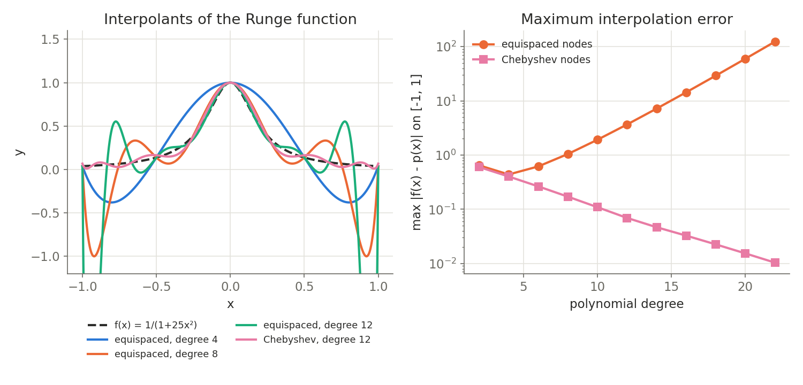
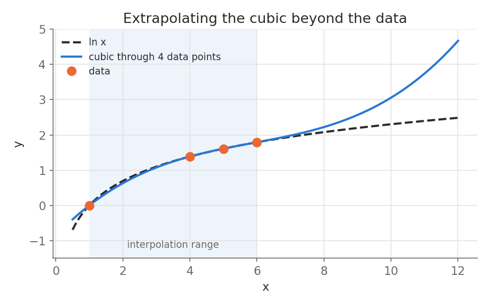

# 17장 — 다항식 보간

[레포지토리 안내](../../README.ko.md) | [English](Concepts_Lecture.md) | [한국어](Concepts_Lecture.ko.md)

> **최종 수정일:** 2026-11-27
>
> Applied Numerical Methods with Python for Engineers and Scientists, Chapra and Clough, Ch 17

> **학습 목표:**
> 1. Vandermonde 행렬로 보간 다항식의 계수를 구하고 표준화로 조건수를 개선할 수 있다
> 2. 분할 차분 표를 이용하여 Newton 보간 다항식을 구성하고 평가할 수 있다
> 3. Lagrange 기저 함수로 보간 다항식을 구성하고 Newton 형태와 비교할 수 있다
> 4. 역보간으로 주어진 함수값에 대응하는 $`x`$를 추정할 수 있다
> 5. 외삽의 위험과 Runge 현상을 설명할 수 있다
> 6. 보간 오차 공식으로 오차를 추정하고, Chebyshev 노드가 Runge 현상을 줄이는 원리를 설명할 수 있다

---

<br>

## 목차

- [1. 다항식 보간(Polynomial Interpolation)](#1-다항식-보간polynomial-interpolation)
  - [1.1 보간의 개념](#11-보간의-개념)
  - [1.2 다항식 형태와 미지수](#12-다항식-형태와-미지수)
  - [1.3 계수 결정](#13-계수-결정)
  - [1.4 Vandermonde 행렬(Vandermonde Matrix)](#14-vandermonde-행렬vandermonde-matrix)
  - [1.5 표준화(Standardization)](#15-표준화standardization)
  - [1.6 보간 다항식의 존재와 유일성](#16-보간-다항식의-존재와-유일성)
  - [1.7 예제 17.1의 계산과 Horner 방법](#17-예제-171의-계산과-horner-방법)
- [2. Newton 보간 다항식(Newton Interpolating Polynomial)](#2-newton-보간-다항식newton-interpolating-polynomial)
  - [2.1 선형 보간(1차)](#21-선형-보간1차)
  - [2.2 이차 보간(2차)](#22-이차-보간2차)
  - [2.3 유한 분할 차분(Finite Divided Differences)](#23-유한-분할-차분finite-divided-differences)
  - [2.4 유한 분할 차분의 재귀적 성질](#24-유한-분할-차분의-재귀적-성질)
  - [2.5 Newton 보간 다항식의 일반 형태](#25-newton-보간-다항식의-일반-형태)
  - [2.6 예제 17.4: ln 2 추정](#26-예제-174-ln-2-추정)
  - [2.7 분할 차분 표의 구현과 계산 비용](#27-분할-차분-표의-구현과-계산-비용)
  - [2.8 보간 오차와 오차 추정](#28-보간-오차와-오차-추정)
- [3. Lagrange 보간 다항식(Lagrange Interpolating Polynomial)](#3-lagrange-보간-다항식lagrange-interpolating-polynomial)
  - [3.1 선형 Lagrange 보간(1차)](#31-선형-lagrange-보간1차)
  - [3.2 기저 함수 N1(x)과 N2(x)](#32-기저-함수-n1x과-n2x)
  - [3.3 2차 Lagrange 보간 다항식](#33-2차-lagrange-보간-다항식)
  - [3.4 일반 (n-1)차 Lagrange 다항식](#34-일반-n-1차-lagrange-다항식)
  - [3.5 Lagrange 형태와 Newton 형태의 비교](#35-lagrange-형태와-newton-형태의-비교)
  - [3.6 NumPy와 SciPy의 다항식 보간](#36-numpy와-scipy의-다항식-보간)
- [4. 역보간(Inverse Interpolation)](#4-역보간inverse-interpolation)
  - [4.1 개념](#41-개념)
  - [4.2 예제](#42-예제)
  - [4.3 역보간의 두 가지 방법](#43-역보간의-두-가지-방법)
- [5. 외삽과 진동(Extrapolation and Oscillations)](#5-외삽과-진동extrapolation-and-oscillations)
  - [5.1 외삽(Extrapolation)](#51-외삽extrapolation)
  - [5.2 진동(Runge 현상, Runge Phenomenon)](#52-진동runge-현상-runge-phenomenon)
  - [5.3 Runge 현상의 원인과 Chebyshev 노드](#53-runge-현상의-원인과-chebyshev-노드)
  - [5.4 외삽 오차의 크기](#54-외삽-오차의-크기)
- [요약](#요약)
- [점검 문제](#점검-문제)
- [참고 문헌](#참고-문헌)

---

<br>

## 1. 다항식 보간(Polynomial Interpolation)

### 1.1 보간의 개념

보간(Interpolation)은 이산 데이터 점들이 주어졌을 때 중간 지점에서 함수의 값을 추정하는 기법이다. 핵심 질문은 **알려진 두 데이터 점 사이의 값**을 어떻게 채우는가이다.

이 질문에 대한 답은 **다항식 보간**이다. 핵심 아이디어는 알려진 데이터 점을 통과하는 다항식을 구성한 다음, 원하는 중간 위치에서 그 다항식을 평가하는 것이다.

보간은 14장과 15장의 회귀(regression)와 목적이 다르다. 회귀는 측정 오차가 섞인 데이터의 전반적인 경향을 나타내는 곡선을 구하므로, 곡선이 데이터 점을 지나지 않아도 되고 오차 제곱합을 최소화하는 기준으로 곡선을 정한다. 보간은 데이터 점이 정확하다고 보고 곡선이 모든 점을 그대로 지나도록 요구한다. 따라서 보간은 물성표, 수학 함수표, 정밀한 계산 결과처럼 오차가 작은 데이터 사이의 값을 채울 때 쓰고, 잡음이 큰 측정값에는 회귀를 쓴다. 잡음이 있는 데이터를 고차 보간 다항식으로 지나가게 하면 다항식이 잡음까지 따라가며 크게 흔들린다.

> **용어 정의:** **보간 다항식(interpolating polynomial)** 은 서로 다른 $`x_1, \ldots, x_n`$에서 주어진 값 $`f(x_1), \ldots, f(x_n)`$을 모두 정확히 지나는, 차수가 $`n-1`$ 이하인 다항식 $`p`$이다. 즉 모든 $`i`$에 대해 $`p(x_i) = f(x_i)`$이며, 이 조건을 보간 조건(interpolation condition)이라 한다. 데이터의 $`x`$ 좌표 $`x_i`$는 노드(node)라고 부른다.

사용하는 데이터 점의 수에 따라 세 가지 일반적인 유형의 다항식 보간이 있다:

| 유형 | 필요한 데이터 점 | 다항식 차수 |
|------|---------------------|-----------------|
| 선형 보간 | 2 | 1차 |
| 이차 보간 | 3 | 2차 |
| 삼차 보간 | 4 | 3차 |

*표 1. 데이터 점의 수에 따른 다항식 보간의 유형*

**동기 부여 예제:** 온도 $`T`$ [C]와 공기의 밀도 $`\rho`$ [kg/m$`^3`$] 표가 주어졌다고 하자.

| $`T`$ [C] | $`\rho`$ [kg/m$`^3`$] |
|---------|-------------------|
| $`-40`$   | $`1.52`$            |
| $`0`$     | $`1.29`$            |
| $`20`$    | $`1.20`$            |
| $`50`$    | $`1.09`$            |
| $`\vdots`$ | $`\vdots`$         |
| $`500`$   | $`0.46`$            |

*표 2. 온도에 따른 공기의 밀도*

$`T = 30`$ C에서의 밀도는 얼마인가? 보간이 이 질문에 답한다.

### 1.2 다항식 형태와 미지수

$`n`$차 다항식의 일반 형태:

```math
f(x) = a_0 + a_1 x + a_2 x^2 + \cdots + a_n x^n
```

이 다항식은 **$`n + 1`$개의 미지수**(계수 $`a_0, a_1, \ldots, a_n`$)를 가지므로, 이를 유일하게 결정하려면 **$`n + 1`$개의 데이터 점**이 필요하다.

> **핵심:** $`n`$차 보간 다항식을 유일하게 결정하려면 $`x`$ 값이 서로 다른 $`n + 1`$개의 데이터 점이 필요하다.

### 1.3 계수 결정

**예제 17.1:** 세 개의 데이터 점을 통과하는 2차 다항식을 구하고자 한다:

```math
f(x) = p_0 x^2 + p_1 x + p_2 \qquad (\ast)
```

주어진 데이터:
- $`f(300) = 0.616`$
- $`f(400) = 0.525`$
- $`f(500) = 0.457`$

각 데이터 점을 $`(\ast)`$에 대입하면:

```math
0.616 = p_0 (300)^2 + p_1 (300) + p_2
```

```math
0.525 = p_0 (400)^2 + p_1 (400) + p_2
```

```math
0.457 = p_0 (500)^2 + p_1 (500) + p_2
```

이것은 3개의 미지수($`p_0, p_1, p_2`$)에 대한 3개의 방정식으로 이루어진 연립방정식이다.

### 1.4 Vandermonde 행렬(Vandermonde Matrix)

1.3절의 연립방정식은 **벡터/행렬 형태**로 다시 쓸 수 있다:

```math
\begin{pmatrix} 0.616 \\ 0.525 \\ 0.457 \end{pmatrix} = \begin{pmatrix} 300^2 & 300 & 1 \\ 400^2 & 400 & 1 \\ 500^2 & 500 & 1 \end{pmatrix} \begin{pmatrix} p_0 \\ p_1 \\ p_2 \end{pmatrix}
```

일반적으로, $`x_1, x_2, x_3`$에서의 데이터로 2차 다항식을 구하면:

```math
\begin{pmatrix} f(x_1) \\ f(x_2) \\ f(x_3) \end{pmatrix} = \underbrace{\begin{pmatrix} x_1^2 & x_1 & 1 \\ x_2^2 & x_2 & 1 \\ x_3^2 & x_3 & 1 \end{pmatrix}}_{V \text{ (Vandermonde 행렬)}} \begin{pmatrix} p_0 \\ p_1 \\ p_2 \end{pmatrix}
```

계수 행렬 $`V`$는 **Vandermonde 행렬(Vandermonde Matrix)** 로 알려져 있다. $`V \mathbf{p} = \mathbf{f}`$를 풀어 다항식 계수를 구한다.

> **[선형대수학]** 정사각 행렬을 계수로 하는 연립방정식은 행렬식이 0이 아닐 때 유일한 해를 갖는다. Vandermonde 행렬의 행렬식은 서로 다른 두 점의 차 $`(x_j - x_i)`$들의 곱이므로 $`x`$ 값이 모두 다르면 0이 아니며, 이것이 1.2절에서 $`x`$ 값이 서로 다른 $`n + 1`$개의 점이 $`n`$차 보간 다항식을 유일하게 결정하는 이유이다.

> **주의:** Vandermonde 행렬은 $`x`$ 값이 클 때 종종 **악조건(ill-conditioned)** 이다. 위 예제의 경우 $`\text{cond}(V) \approx 5.9 \times 10^6`$(2-노름 기준)으로, 수치적 불안정성을 유발한다.

### 1.5 표준화(Standardization)

조건수를 개선하기 위해, **새로운 표준화 변수**를 정의한다:

```math
z := \frac{x - 400}{100}
```

이것은 원래의 $`x`$ 값 $`\{300, 400, 500\}`$을 $`\{-1, 0, 1\}`$로 매핑하여, 새로운 Vandermonde 행렬을 생성한다:

```math
V' = \begin{pmatrix} 1 & -1 & 1 \\ 0 & 0 & 1 \\ 1 & 1 & 1 \end{pmatrix}
```

이제 $`\text{cond}(V') \approx 3.23`$으로, $`10^6`$ 수준보다 극적으로 개선된다.

> **핵심:** **표준화**는 Vandermonde 행렬의 조건수를 개선하여 계산을 안정화한다.

### 1.6 보간 다항식의 존재와 유일성

1.2절은 $`n`$차 다항식의 미지수가 $`n + 1`$개이므로 데이터 점도 $`n + 1`$개가 필요하다고 했다. 미지수와 방정식의 개수가 같다는 사실만으로는 해가 있다는 보장이 없으므로, 이 절에서는 보간 문제가 언제나 하나의 답을 가진다는 정리를 정확한 조건과 함께 적는다. 3절 이후와 기호를 맞추어 데이터 점의 수를 $`n`$, 다항식의 차수를 $`n - 1`$로 쓴다.

> **핵심:** 서로 다른 $`n`$개의 노드 $`x_1, \ldots, x_n`$과 임의의 값 $`y_1, \ldots, y_n`$이 주어지면, $`p(x_i) = y_i`$ $`(i = 1, \ldots, n)`$를 만족하는 차수 $`n - 1`$ 이하의 다항식 $`p`$가 정확히 하나 존재한다.

**존재.** 3.4절의 Lagrange 다항식 $`\sum_i L_i(x)\,y_i`$는 차수가 $`n - 1`$ 이하이고 $`L_i(x_j)`$가 $`i = j`$일 때만 1이므로 모든 보간 조건을 만족한다. 따라서 조건을 만족하는 다항식이 적어도 하나 있다.

**유일성.** 두 다항식 $`p`$와 $`q`$가 모두 보간 조건을 만족한다고 가정한다. 차 $`d = p - q`$는 차수가 $`n - 1`$ 이하이고, 모든 노드에서 $`d(x_i) = y_i - y_i = 0`$이므로 서로 다른 근을 $`n`$개 가진다. 0이 아닌 차수 $`n - 1`$ 이하의 다항식은 근을 많아야 $`n - 1`$개 가지므로 $`d`$는 영다항식이고 $`p = q`$이다.

이 정리에서 세 가지 결론이 나온다.

1. Vandermonde 행렬을 푸는 방법, Newton 형태, Lagrange 형태는 같은 데이터에 대해 **같은 다항식**을 준다. 세 방법은 다항식을 어떤 기저 함수의 결합으로 쓰는지만 다르다.
2. 보간 다항식의 차수는 $`n - 1`$보다 낮을 수 있다. 예를 들어 한 직선 위에 있는 세 점의 2차 보간 다항식은 $`x^2`$의 계수가 0인 직선이다.
3. 노드가 서로 다르다는 조건은 필수이다. 같은 $`x`$에 다른 값이 두 개 주어지면 그런 다항식은 없고, Vandermonde 행렬의 두 행이 같아져 행렬식이 0이 된다.

| 형태 | 기저 함수 | 계수를 구하는 연립방정식의 행렬 | 계수를 구하는 비용 |
|:-----|:-----|:-----|:-----|
| 거듭제곱 (Vandermonde) | $`1, x, x^2, \ldots, x^{n-1}`$ | 꽉 찬 Vandermonde 행렬 | Gauss 소거법으로 $`O(n^3)`$ |
| Newton | $`1, (x - x_1), (x - x_1)(x - x_2), \ldots`$ | 하삼각 행렬 | 분할 차분 표로 $`O(n^2)`$ |
| Lagrange | $`L_1(x), \ldots, L_n(x)`$ | 단위 행렬 | 계수가 곧 $`f(x_i)`$이므로 계산 없음 |

*표 3. 보간 다항식의 세 가지 표현*

Newton 기저에서 연립방정식이 하삼각이 되는 이유는 $`k`$번째 기저 함수 $`(x - x_1)\cdots(x - x_{k-1})`$이 $`x_1, \ldots, x_{k-1}`$에서 0이기 때문이다. 따라서 첫 번째 방정식이 $`b_1`$만, 두 번째 방정식이 $`b_1, b_2`$만 포함하며, 이 전진 대입을 체계적으로 정리한 것이 2절의 분할 차분 표이다. Lagrange 기저는 노드에서 Kronecker 델타 성질을 가지므로 행렬이 단위 행렬이 되어 계수 계산이 필요 없는 대신, 한 점에서 다항식을 평가하는 비용이 커진다(3.5절).

### 1.7 예제 17.1의 계산과 Horner 방법

1.4절의 연립방정식을 NumPy로 풀면 다음과 같다. `np.vander(x, 3)`은 열이 $`x^2, x, 1`$인 Vandermonde 행렬을 만든다.

```python
import numpy as np

x = np.array([300.0, 400.0, 500.0])
f = np.array([0.616, 0.525, 0.457])

V = np.vander(x, 3)                 # columns x^2, x, 1
p = np.linalg.solve(V, f)           # p0, p1, p2
print("p =", p)
print("cond(V)  = %.3e" % np.linalg.cond(V))

z = (x - 400.0) / 100.0             # standardized variable
Vz = np.vander(z, 3)
q = np.linalg.solve(Vz, f)
print("q =", q)
print("cond(Vz) = %.4f" % np.linalg.cond(Vz))

print("f(350) from p: %.6f" % np.polyval(p, 350.0))
print("f(350) from q: %.6f" % np.polyval(q, (350.0 - 400.0) / 100.0))
```

```text
p = [ 1.150e-06 -1.715e-03  1.027e+00]
cond(V)  = 5.893e+06
q = [ 0.0115 -0.0795  0.525 ]
cond(Vz) = 3.2255
f(350) from p: 0.567625
f(350) from q: 0.567625
```

- `np.linalg.solve(V, f)`는 $`V\mathbf{p} = \mathbf{f}`$를 LU 분해(10장)로 푼다. 결과는 $`p_0 = 1.15 \times 10^{-6}`$, $`p_1 = -1.715 \times 10^{-3}`$, $`p_2 = 1.027`$이다.
- `z = (x - 400.0) / 100.0`은 1.5절의 표준화이다. 표준화한 변수로 쓴 다항식 $`q_0 z^2 + q_1 z + q_2`$는 원래 다항식과 같은 함수이고 계수만 다르다.
- 두 표현의 $`f(350)`$이 모두 0.567625로 같은 것은 1.6절의 유일성 정리 때문이다. 3점 문제에서는 조건수 $`5.9 \times 10^6`$도 배정밀도의 상대 정밀도 약 $`2.2 \times 10^{-16}`$에 비하면 견딜 만하다.

차수가 올라가면 상황이 달라진다. 구간 $`[300, 500]`$의 등간격 노드로 Vandermonde 행렬을 만들면 2-노름 조건수는 노드 3개에서 $`5.9 \times 10^6`$, 5개에서 $`1.1 \times 10^{14}`$, 8개에서 $`1.1 \times 10^{25}`$로 커지고, 같은 노드를 표준화하면 약 3.2, 24, 540에 머문다. 조건수가 $`10^{16}`$을 넘으면 11장의 오차 한계에 따라 계수의 유효 숫자가 하나도 남지 않을 수 있으므로, 원래 변수로 쓴 Vandermonde 방법은 차수가 조금만 높아도 쓸 수 없다.

계수를 구한 뒤 다항식을 평가할 때는 **Horner 방법(Horner's method)** 을 쓴다. 거듭제곱을 따로 계산하지 않고 괄호를 안쪽부터 묶어 나간다.

```math
p_0 x^2 + p_1 x + p_2 = (p_0 x + p_1)\,x + p_2
```

일반적으로 차수 $`m`$인 다항식 $`a_m x^m + \cdots + a_1 x + a_0`$는 $`s \leftarrow a_m`$에서 시작하여 $`k = m - 1, \ldots, 0`$에 대해 $`s \leftarrow s\,x + a_k`$를 반복하면 평가된다. 곱셈 $`m`$번과 덧셈 $`m`$번이면 충분하며, 거듭제곱을 하나씩 계산하는 방법보다 연산이 적고 반올림 오차도 덜 쌓인다. `np.polyval`이 이 방법을 사용한다[1]. 2.6절의 `newton_eval` 함수도 Newton 기저에 대해 같은 방식으로 괄호를 묶는다.

---

<br>

## 2. Newton 보간 다항식(Newton Interpolating Polynomial)

Newton의 접근법은 보간 다항식을 **점진적으로** 구축하며, 한 번에 하나의 항을 추가한다. 각 새 항은 더 높은 차수의 보정(곡률)을 도입한다.

### 2.1 선형 보간(1차)

두 데이터 점 $`(x_1, f(x_1))`$과 $`(x_2, f(x_2))`$가 주어졌을 때, **Newton 선형 보간 공식**은:

```math
\hat{f}(x) = f(x_1) + \frac{f(x_2) - f(x_1)}{x_2 - x_1}(x - x_1)
```

이것은 두 점을 통과하는 직선(할선의 기울기를 사용한 점-기울기 형태)이다.

> **참고:** 일반적으로 선형 보간의 **정확도**는 구간 $`|x_2 - x_1|`$이 감소하고 $`x`$가 데이터 점에 가까울수록 증가한다.

1.1절의 질문에 선형 보간으로 답할 수 있다. $`T = 30`$ C를 둘러싼 두 점 $`(20, 1.20)`$과 $`(50, 1.09)`$를 쓰면 다음과 같다.

```math
\hat{\rho}(30) = 1.20 + \frac{1.09 - 1.20}{50 - 20}(30 - 20) = 1.20 + (-0.003667)(10) = 1.1633 \ \text{kg/m}^3
```

기울기 $`-0.003667`$ kg/(m$`^3`$ C)는 이 구간에서 온도가 1 C 오를 때 밀도가 줄어드는 양이다. 선형 보간은 두 점 사이의 함수를 직선으로 가정하므로, 실제 함수가 그 구간에서 아래로 볼록하면 직선이 함수보다 위에 놓여 추정값이 참값보다 크고, 위로 볼록하면 작다. 이 곡률의 영향을 반영하는 것이 2.2절의 이차 항이다.

### 2.2 이차 보간(2차)

세 데이터 점 $`f(x_1), f(x_2), f(x_3)`$이 주어졌을 때, 이차 보간 공식을 구성한다:

```math
\hat{f}(x) = b_1 + b_2(x - x_1) + b_3(x - x_1)(x - x_2)
```

**계수 결정:**

**단계 1:** $`\hat{f}(x_1) = f(x_1)`$로 놓으면:

```math
f(x_1) = b_1 \quad \Longrightarrow \quad b_1 = f(x_1)
```

**단계 2:** $`\hat{f}(x_2) = f(x_2)`$로 놓으면:

```math
f(x_2) = f(x_1) + b_2(x_2 - x_1)
```

```math
\therefore \quad b_2 = \frac{f(x_2) - f(x_1)}{x_2 - x_1} =: f[x_2, x_1]
```

이것이 **1차 유한 분할 차분**(기울기)이다.

**단계 3:** $`\hat{f}(x_3) = f(x_3)`$으로 놓고 $`b_3`$에 대해 풀면:

```math
f(x_3) = f(x_1) + \frac{f(x_2) - f(x_1)}{x_2 - x_1}(x_3 - x_1) + b_3(x_3 - x_1)(x_3 - x_2)
```

대수적 조작 후:

```math
b_3 = \frac{\dfrac{f(x_3) - f(x_2)}{x_3 - x_2} - \dfrac{f(x_2) - f(x_1)}{x_2 - x_1}}{x_3 - x_1} = \frac{f[x_3, x_2] - f[x_2, x_1]}{x_3 - x_1} =: f[x_3, x_2, x_1]
```

이것이 **2차 유한 분할 차분**이다.

### 2.3 유한 분할 차분(Finite Divided Differences)

유한 분할 차분은 재귀적으로 정의된다:

**0차** (함수값):

```math
f[x_i] = f(x_i)
```

**1차** (기울기):

```math
f[x_i, x_j] = \frac{f(x_i) - f(x_j)}{x_i - x_j}
```

**2차** (곡률):

```math
f[x_i, x_j, x_k] = \frac{f[x_i, x_j] - f[x_j, x_k]}{x_i - x_k}
```

**$`n`$차** (일반):

```math
f[x_n, x_{n-1}, \ldots, x_1] = \frac{f[x_n, x_{n-1}, \ldots, x_2] - f[x_{n-1}, x_{n-2}, \ldots, x_1]}{x_n - x_1}
```

### 2.4 유한 분할 차분의 재귀적 성질

분할 차분은 **삼각 표**로 정리할 수 있다:

| $`x_i`$ | $`f(x_i)`$ | 1차 분할 차분 | 2차 분할 차분 | 3차 분할 차분 |
|--------|-----------|-------------------|--------------------|---------------------|
| $`x_1`$ | $`f(x_1) = b_1`$ | | | |
| | | $`f[x_2, x_1] = b_2`$ | | |
| $`x_2`$ | $`f(x_2)`$ | | $`f[x_3, x_2, x_1] = b_3`$ | |
| | | $`f[x_3, x_2]`$ | | $`f[x_4, x_3, x_2, x_1] = b_4`$ |
| $`x_3`$ | $`f(x_3)`$ | | $`f[x_4, x_3, x_2]`$ | |
| | | $`f[x_4, x_3]`$ | | |
| $`x_4`$ | $`f(x_4)`$ | | | |

*표 4. 분할 차분의 삼각 표*

표의 **위쪽 대각선**이 Newton 다항식의 계수 $`b_1, b_2, b_3, b_4, \ldots`$를 제공한다.

### 2.5 Newton 보간 다항식의 일반 형태

$`n`$개의 데이터 점에 대해, **(n-1)차** Newton 보간 다항식은:

```math
\hat{f}_{n-1}(x) = f(x_1) + f[x_2, x_1](x - x_1) + f[x_3, x_2, x_1](x - x_1)(x - x_2) + \cdots
```

```math
+ f[x_n, x_{n-1}, \ldots, x_1](x - x_1)(x - x_2) \cdots (x - x_{n-1})
```

간결한 표기법:

```math
\hat{f}_{n-1}(x) = \sum_{k=1}^{n} b_k \prod_{j=1}^{k-1}(x - x_j)
```

여기서

- $`b_1 = f(x_1)`$
- $`b_2 = f[x_2, x_1]`$
- $`b_3 = f[x_3, x_2, x_1]`$
- $`b_k = f[x_k, x_{k-1}, \ldots, x_1]`$

> **참고:** **장점.** Newton 형태는 **점진적(Incremental)** 이다. 새 데이터 점을 추가할 때 분할 차분 표에 대각선 한 줄을 더 계산하여 새 계수 하나를 얻고 항 하나를 추가하면 된다. 이전에 계산된 계수는 변경되지 않는다.

### 2.6 예제 17.4: ln 2 추정

**문제:** 3차 Newton 보간 다항식을 사용하여 $`\ln 2`$를 추정하라.

**데이터 점** ($`f(x) = \ln(x)`$ 사용):

| $`i`$ | $`x_i`$ | $`f(x_i) = \ln(x_i)`$ |
|-----|--------|----------------------|
| 1   | 1      | 0                    |
| 2   | 4      | 1.386294             |
| 3   | 6      | 1.791759             |
| 4   | 5      | 1.609438             |

*표 5. 예제 17.4의 데이터 점*

**단계 1:** 분할 차분 표를 작성한다.

| | $`f(x_i)`$ | 1차 | 2차 | 3차 |
|---|----------|-----|-----|-----|
| $`x_1 = 1`$ | $`0 = b_1`$ | | | |
| | | $`f[x_2, x_1]`$ | | |
| $`x_2 = 4`$ | $`1.386294`$ | | $`f[x_3, x_2, x_1]`$ | |
| | | $`f[x_3, x_2]`$ | | $`f[x_4, x_3, x_2, x_1] = b_4`$ |
| $`x_3 = 6`$ | $`1.791759`$ | | $`f[x_4, x_3, x_2]`$ | |
| | | $`f[x_4, x_3]`$ | | |
| $`x_4 = 5`$ | $`1.609438`$ | | | |

*표 6. 예제 17.4의 분할 차분 표*

**단계 2:** 각 분할 차분을 계산한다.

```math
f[x_2, x_1] = \frac{1.386294 - 0}{4 - 1} = 0.462098 = b_2
```

```math
f[x_3, x_2] = \frac{1.791759 - 1.386294}{6 - 4} = 0.202733
```

```math
f[x_4, x_3] = \frac{1.609438 - 1.791759}{5 - 6} = 0.182321
```

```math
f[x_3, x_2, x_1] = \frac{0.202733 - 0.462098}{6 - 1} = -0.051873 = b_3
```

```math
f[x_4, x_3, x_2] = \frac{0.182321 - 0.202733}{5 - 4} = -0.020412
```

```math
f[x_4, x_3, x_2, x_1] = \frac{-0.020412 - (-0.051873)}{5 - 1} = 0.007865 = b_4
```

**단계 3:** 3차 다항식을 구성한다.

```math
\hat{f}_3(x) = 0 + 0.462098(x - 1) + (-0.051873)(x - 1)(x - 4) + 0.007865(x - 1)(x - 4)(x - 6)
```

**단계 4:** $`x = 2`$에서 평가한다.

```math
\hat{f}_3(2) = 0.462098(1) + (-0.051873)(1)(-2) + 0.007865(1)(-2)(-4)
```

```math
= 0.462098 + 0.103746 + 0.062920 = 0.628764
```

정확한 값은 $`\ln 2 = 0.693147`$이므로, 데이터 점의 간격으로 인해 추정에 약 9.3%의 참 상대 오차가 있다.

```python
import numpy as np

# Data points
x = np.array([1, 4, 6, 5])
f = np.array([0, 1.386294, 1.791759, 1.609438])

# Divided differences
def divided_diff(x, f):
    n = len(x)
    table = np.zeros((n, n))
    table[:, 0] = f
    for j in range(1, n):
        for i in range(n - j):
            table[i][j] = (table[i+1][j-1] - table[i][j-1]) / (x[i+j] - x[i])
    return table[0]  # top row = coefficients b1, b2, b3, ...

# Newton evaluation
def newton_eval(coeffs, x_data, x_eval):
    n = len(coeffs)
    result = coeffs[-1]
    for k in range(n - 2, -1, -1):
        result = result * (x_eval - x_data[k]) + coeffs[k]
    return result

coeffs = divided_diff(x, f)
print(f"Coefficients: {coeffs}")
print(f"f(2) = {newton_eval(coeffs, x, 2):.6f}")
print(f"Exact ln(2) = {np.log(2):.6f}")
```

```text
Coefficients: [ 0.         0.462098  -0.0518731  0.0078654]
f(2) = 0.628767
Exact ln(2) = 0.693147
```

출력의 0.628767이 손계산의 0.628764와 마지막 자리에서 다른 것은 손계산에서 각 분할 차분을 소수 여섯째 자리로 반올림했기 때문이다.

### 2.7 분할 차분 표의 구현과 계산 비용

2.6절의 분할 차분을 표 하나에 채우면 다음과 같다. 코드의 `table`과 같은 배치로, $`i`$행 $`j`$열에 $`x_i`$부터 시작하는 $`j`$차 분할 차분을 둔다.

| $`i`$ | $`x_i`$ | $`f(x_i)`$ | 1차 | 2차 | 3차 |
|:---:|:---:|:-----|:-----|:-----|:-----|
| 1 | 1 | 0 | 0.462098 | -0.051873 | 0.007865 |
| 2 | 4 | 1.386294 | 0.202733 | -0.020412 | |
| 3 | 6 | 1.791759 | 0.182321 | | |
| 4 | 5 | 1.609438 | | | |

*표 7. 예제 17.4의 분할 차분 표 (값을 채운 형태)*

첫 행 $`0, 0.462098, -0.051873, 0.007865`$가 Newton 계수 $`b_1, b_2, b_3, b_4`$이다. 표를 만드는 절차와 평가 절차를 의사코드로 쓰면 다음과 같다.

```text
procedure DividedDifferences(x[1..n], f[1..n])
    for i = 1 to n
        T[i, 1] = f[i]
    for j = 2 to n                         # column: order j - 1
        for i = 1 to n - j + 1             # rows that still have entries
            T[i, j] = (T[i+1, j-1] - T[i, j-1]) / (x[i+j-1] - x[i])
    return T[1, 1..n]                      # b1, ..., bn

procedure NewtonEval(b[1..n], x[1..n], t)
    p = b[n]
    for k = n - 1 down to 1
        p = p * (t - x[k]) + b[k]
    return p
```

2.6절의 Python 코드는 이 의사코드를 0부터 시작하는 인덱스로 옮긴 것이다.

- `table[:, 0] = f`는 0차 분할 차분, 즉 함수값으로 첫 열을 채운다.
- 바깥 반복의 `j`는 열 번호이자 분할 차분의 차수이다. 차수가 하나 오를 때마다 계산할 칸이 하나씩 줄어들므로 안쪽 반복은 `range(n - j)`이다.
- 분모 `x[i+j] - x[i]`는 그 분할 차분에 들어가는 $`j + 1`$개의 점 가운데 양 끝 점의 차이다. 이웃한 두 점의 차가 아니라는 점에 주의해야 한다.
- 마지막의 `return`은 표의 첫 행, 곧 Newton 계수를 돌려준다.
- `newton_eval`은 $`b_n`$에서 시작하여 $`p \leftarrow p\,(t - x_k) + b_k`$를 반복한다. 이것은 Newton 형태를 $`b_1 + (t - x_1)\bigl(b_2 + (t - x_2)(b_3 + \cdots)\bigr)`$처럼 묶은 Horner 방법(1.7절)이다.

계산 비용은 다음과 같다. $`j`$열에는 $`n - j + 1`$개의 칸이 있고 칸마다 뺄셈 두 번과 나눗셈 한 번이 필요하므로, 표 전체는 나눗셈 $`n(n-1)/2`$번과 뺄셈 $`n(n-1)`$번, 곧 $`O(n^2)`$이다. 표를 한 번 만든 뒤에는 점 하나를 평가할 때마다 곱셈 $`n - 1`$번이면 된다. Vandermonde 방법의 $`O(n^3)`$보다 계수를 구하는 비용이 작고, 원래 변수의 거듭제곱을 쓰지 않으므로 1.7절의 악조건 문제도 피한다.

분할 차분 표를 다룰 때 흔한 실수는 다음과 같다.

- 분모에 이웃한 두 노드의 차를 쓰는 실수. 2차 분할 차분 $`f[x_3, x_2, x_1]`$의 분모는 $`x_3 - x_2`$가 아니라 $`x_3 - x_1`$이다.
- 노드를 크기순으로 정렬해야 한다고 생각하는 실수. 예제 17.4처럼 순서가 섞여 있어도 되며, 순서를 바꾸면 표의 중간값과 계수는 달라지지만 최종 다항식은 1.6절에 따라 같다.
- 새 점을 표의 중간에 끼워 넣는 실수. 기존 계수를 그대로 쓰려면 새 점은 표의 맨 아래에 붙여야 하며, 그러면 대각선 한 줄만 새로 계산하면 된다.

### 2.8 보간 오차와 오차 추정

보간 다항식은 노드에서만 $`f`$와 정확히 같고, 노드 사이에서는 오차가 있다. 이 오차를 노드와 $`f`$의 성질로 나타내는 공식을 유도한다.

$`n`$개의 노드로 만든 보간 다항식을 $`\hat{f}_{n-1}`$이라 하고, 노드가 아닌 한 점 $`x`$를 고정한다. $`x`$를 $`(n+1)`$번째 노드로 추가하면 2.5절의 Newton 형태에 항 하나가 붙은 다항식을 얻는다.

```math
\hat{f}_n(t) = \hat{f}_{n-1}(t) + f[x, x_n, \ldots, x_1]\,(t - x_1)(t - x_2)\cdots(t - x_n)
```

$`\hat{f}_n`$은 점 $`x`$도 지나므로 $`t = x`$를 대입하면 좌변은 $`f(x)`$이다. 따라서 오차 $`R_{n-1}(x) = f(x) - \hat{f}_{n-1}(x)`$는 정확히 다음과 같다.

```math
R_{n-1}(x) = f[x, x_n, \ldots, x_1]\,\prod_{i=1}^{n}(x - x_i)
```

분할 차분과 도함수는 다음 관계로 이어진다. $`f`$가 노드와 $`x`$를 모두 포함하는 구간에서 $`n`$번 연속 미분 가능하면, 그 구간 안의 어떤 $`\xi`$에 대해 $`f[x, x_n, \ldots, x_1] = f^{(n)}(\xi)/n!`$이다. $`n = 1`$이면 이것은 평균값 정리 $`f[x, x_1] = f'(\xi)`$이고, 일반적인 경우는 Rolle의 정리를 거듭 적용하여 증명한다. 이를 대입하면 보간 오차 공식이 나온다.

```math
R_{n-1}(x) = \frac{f^{(n)}(\xi)}{n!}\,\prod_{i=1}^{n}(x - x_i)
```

오차는 세 요인의 곱이다. $`f^{(n)}(\xi)`$는 함수가 얼마나 매끄러운지를, $`1/n!`$은 차수를 높일 때 얻는 이득을, **노드 다항식** $`\omega(x) = \prod_{i}(x - x_i)`$는 노드의 배치와 평가 위치의 영향을 나타낸다. $`\omega(x)`$는 노드에서 0이고 노드 사이에서 작으며, 노드 범위 밖으로 나가면 $`|x|^n`$처럼 빠르게 커진다. 5절의 외삽과 진동은 모두 이 인자로 설명된다.

선형 보간($`n = 2`$)에 적용하면, $`x_1 \le x \le x_2`$에서 $`|(x - x_1)(x - x_2)|`$는 중점에서 최대 $`h^2/4`$ $`(h = x_2 - x_1)`$이므로 다음 한계를 얻는다.

```math
|R_1(x)| \le \frac{h^2}{8}\,\max_{x_1 \le t \le x_2} |f''(t)|
```

간격을 절반으로 줄이면 오차 한계가 4분의 1로 줄며, 이것이 2.1절의 참고 상자에서 말한 정확도와 간격의 관계를 정량적으로 나타낸다.

공식의 $`\xi`$는 알 수 없고 $`f`$ 자체를 모르는 경우도 많다. 그래서 실제로는 데이터 점 하나를 더 써서 오차를 추정한다. 추가 점 $`x_{n+1}`$이 있으면 $`f[x, x_n, \ldots, x_1] \approx f[x_{n+1}, x_n, \ldots, x_1]`$로 놓아

```math
R_{n-1}(x) \approx f[x_{n+1}, x_n, \ldots, x_1]\,\prod_{i=1}^{n}(x - x_i)
```

를 쓴다. 우변은 Newton 형태에 다음 점을 추가할 때 붙는 항 그 자체이다. 즉 Newton 형태에서는 다음 항의 크기가 현재 차수의 오차 추정값이 되며, 이 추정은 $`n`$계 도함수가 노드 구간에서 크게 변하지 않을 때 잘 맞는다.

```python
import numpy as np

x = np.array([1.0, 4.0, 6.0, 5.0])
f = np.array([0.0, 1.386294, 1.791759, 1.609438])
b = np.array([0.0, 0.462098, -0.051873, 0.007865])   # top row of the table
t, exact = 2.0, np.log(2.0)

w = 1.0                      # running product (t - x1)...(t - xk)
p = b[0]
for k in range(1, 4):
    term = b[k] * w * (t - x[k - 1])   # next Newton term
    w *= t - x[k - 1]
    print(f"order {k - 1}: p = {p:.6f}, estimated error = {term:.6f}, "
          f"true error = {exact - p:.6f}")
    p += term
print(f"order 3: p = {p:.6f}, true error = {exact - p:.6f}")
```

```text
order 0: p = 0.000000, estimated error = 0.462098, true error = 0.693147
order 1: p = 0.462098, estimated error = 0.103746, true error = 0.231049
order 2: p = 0.565844, estimated error = 0.062920, true error = 0.127303
order 3: p = 0.628764, true error = 0.064383
```

- `w`는 지금까지 곱한 $`(t - x_1)\cdots(t - x_{k-1})`$이고, `term`은 여기에 $`(t - x_k)`$와 $`b_{k+1}`$을 곱한 다음 Newton 항이다.
- 각 줄은 현재 차수의 추정값, 다음 항으로 계산한 오차 추정값, 참 오차를 나란히 보여 준다.

추정값은 참 오차의 부호와 자릿수를 맞히지만 크기는 절반 정도로 작게 나온다. $`\ln x`$의 도함수 $`f''(x) = -1/x^2`$, $`f'''(x) = 2/x^3`$이 노드 구간 $`[1, 6]`$에서 수십 배 변하기 때문이다. 2차 보간의 오차에 공식을 적용하면 $`R_2(2) = \frac{2/\xi^3}{3!}(2 - 1)(2 - 4)(2 - 6) = \frac{8}{3\xi^3}`$이고, $`\xi \in [1, 6]`$이므로 오차는 0.0123과 2.667 사이에 있어야 한다. 참 오차 0.127303은 이 범위 안에 있으며, $`\xi \approx 2.76`$에 해당한다.

> **핵심:** 보간 오차는 $`f^{(n)}(\xi)/n!`$과 노드 다항식 $`\prod (x - x_i)`$의 곱이다. Newton 형태에서는 다음 항의 크기가 현재 차수의 오차 추정값이 된다.

오차 공식은 노드를 고르는 기준도 준다. 한 점 $`x`$에서 값을 추정할 때는 $`|\omega(x)|`$가 작도록 $`x`$에 가까운 노드부터 쓰고, 가능하면 $`x`$가 노드들의 가운데에 오게 한다. 또 차수를 하나씩 올리며 오차 추정값을 관찰하여, 추정값이 더 이상 줄지 않는 차수에서 멈추는 것이 안전하다. 차수를 계속 올리면 5.2절의 진동이 나타날 수 있기 때문이다.

---

<br>

## 3. Lagrange 보간 다항식(Lagrange Interpolating Polynomial)

Lagrange 방법은 연립방정식을 풀거나 분할 차분 표를 만들 필요 없이 보간 다항식의 **대안적** 형태를 제공한다. 대신, **기저 함수(Basis Functions)**(또는 **형상 함수, Shape Functions**)를 사용하여 다항식을 직접 구성한다.

### 3.1 선형 Lagrange 보간(1차)

두 데이터 점 $`(x_1, f(x_1))`$과 $`(x_2, f(x_2))`$가 주어졌을 때, 이를 통과하는 직선은:

```math
y - f(x_1) = \frac{f(x_2) - f(x_1)}{x_2 - x_1}(x - x_1)
```

정리하면:

```math
y = \frac{x_2 - x}{x_2 - x_1} f(x_1) + \frac{x - x_1}{x_2 - x_1} f(x_2)
```

**기저 함수(형상 함수)** 를 정의한다:

```math
N_1(x) = \frac{x_2 - x}{x_2 - x_1}, \qquad N_2(x) = \frac{x - x_1}{x_2 - x_1}
```

그러면 **선형 Lagrange 보간 다항식**은:

```math
\hat{f}_1(x) = N_1(x) \, f(x_1) + N_2(x) \, f(x_2)
```

### 3.2 기저 함수 N1(x)과 N2(x)

기저 함수는 데이터 점에서 다음 값을 갖는다(Kronecker 델타 성질):

- $`N_1(x_1) = 1, \quad N_1(x_2) = 0`$
- $`N_2(x_1) = 0, \quad N_2(x_2) = 1`$

- $`x = x_1`$일 때 보간은 $`f(x_1)`$을 정확히 준다($`N_1`$에 의해 100% 가중).
- $`x = x_2`$일 때 보간은 $`f(x_2)`$를 정확히 준다($`N_2`$에 의해 100% 가중).
- 모든 $`x`$에서 $`N_1(x) + N_2(x) = 1`$이며, 이를 **단위 분할(Partition of Unity)** 성질이라 한다.
- $`x_1`$과 $`x_2`$ 사이에서는 두 가중치가 0과 1 사이에 있으므로, 결과는 $`f(x_1)`$과 $`f(x_2)`$의 **가중 평균**이다.

> **참고:** **기하학적 해석.** $`N_1(x)`$과 $`N_2(x)`$는 두 점의 중점에서 교차하는 선형 함수이다. 보간값 $`y = N_1(x) f(x_1) + N_2(x) f(x_2)`$는 데이터 점에서의 함수값의 가중 결합이다.

### 3.3 2차 Lagrange 보간 다항식

세 데이터 점 $`(x_1, f(x_1)), (x_2, f(x_2)), (x_3, f(x_3))`$에 대해, 세 개의 Lagrange 기저 함수를 정의한다:

```math
L_1(x) = \frac{(x - x_2)(x - x_3)}{(x_1 - x_2)(x_1 - x_3)}
```

```math
L_2(x) = \frac{(x - x_1)(x - x_3)}{(x_2 - x_1)(x_2 - x_3)}
```

```math
L_3(x) = \frac{(x - x_1)(x - x_2)}{(x_3 - x_1)(x_3 - x_2)}
```

2차 Lagrange 보간 다항식은:

```math
\hat{f}_2(x) = L_1(x) \, f(x_1) + L_2(x) \, f(x_2) + L_3(x) \, f(x_3) = \sum_{i=1}^{3} L_i(x) \, f(x_i)
```

각 $`L_i(x)`$는 다음을 만족한다:

```math
L_i(x_j) = \begin{cases} 1 & \text{if } i = j \\ 0 & \text{if } i \neq j \end{cases}
```

> **참고:** 2차 다항식에는 3개의 데이터 점이 필요하다.

### 3.4 일반 (n-1)차 Lagrange 다항식

$`n`$개의 데이터 점 $`x_1, x_2, \ldots, x_n`$에 대해, **(n-1)차 Lagrange 보간 다항식**은:

```math
\hat{f}_{n-1}(x) = \sum_{i=1}^{n} L_i(x) \, f(x_i)
```

여기서 Lagrange 기저 함수는:

```math
L_i(x) = \prod_{\substack{j=1 \\ j \neq i}}^{n} \frac{x - x_j}{x_i - x_j}
```

여기서:
- $`n`$은 **데이터 점의 수**이다.
- $`\prod`$는 $`j = i`$를 제외한 모든 $`j`$에 대한 **곱**이다.

```python
import numpy as np

def lagrange_interp(x_data, f_data, x_eval):
    """Lagrange interpolation at a single point x_eval."""
    n = len(x_data)
    result = 0.0
    for i in range(n):
        # Compute L_i(x_eval)
        Li = 1.0
        for j in range(n):
            if j != i:
                Li *= (x_eval - x_data[j]) / (x_data[i] - x_data[j])
        result += Li * f_data[i]
    return result

# Example: Estimate ln(2) using the same 4 data points
x_data = np.array([1, 4, 6, 5], dtype=float)
f_data = np.log(x_data)

estimate = lagrange_interp(x_data, f_data, 2.0)
print(f"Lagrange f(2) = {estimate:.6f}")
print(f"Exact ln(2) = {np.log(2):.6f}")
```

> **참고:** **Newton과 Lagrange.** 두 방법은 **동일한** 보간 다항식을 생성하며, 대수적으로 동치이다. Newton 형태는 새 데이터 점을 **점진적으로 추가** 할 때 더 효율적이다. Lagrange 형태는 개념적으로 더 단순하고 구현이 더 직관적이다.

### 3.5 Lagrange 형태와 Newton 형태의 비교

예제 17.4의 네 점으로 3차 Lagrange 다항식을 만들어 $`x = 2`$에서 평가하면, 기저 함수의 값은 다음과 같다.

| $`i`$ | $`x_i`$ | $`L_i(2)`$ | $`f(x_i)`$ | $`L_i(2)\,f(x_i)`$ |
|:---:|:---:|:-----|:-----|:-----|
| 1 | 1 | 0.4 | 0 | 0 |
| 2 | 4 | 2.0 | 1.386294 | 2.772588 |
| 3 | 6 | 0.6 | 1.791759 | 1.075055 |
| 4 | 5 | -2.0 | 1.609438 | -3.218876 |

*표 8. 3차 Lagrange 보간의 기저 함수 값*

예를 들어 $`L_2(2) = \frac{(2-1)(2-6)(2-5)}{(4-1)(4-6)(4-5)} = \frac{12}{6} = 2.0`$이다. 네 값의 합은 $`0.4 + 2.0 + 0.6 - 2.0 = 1`$로 단위 분할 성질을 만족하고, 마지막 열의 합 $`0.628767`$은 Newton 형태의 결과와 같다.

$`L_i(2)`$에는 1보다 크거나 음수인 값이 있어, 3.2절의 선형 경우와 달리 결과가 함수값의 가중 평균이 아니다. 이것은 데이터 오차의 증폭과 관련된다. 각 $`f(x_i)`$에 크기 $`\delta`$ 이하의 오차가 있으면 보간값의 오차는 최대 $`\sum_i |L_i(2)|\,\delta = 5.0\,\delta`$이다. $`\sum_i |L_i(x)|`$가 클수록 데이터의 작은 오차가 보간값에 크게 전달되며, 등간격 노드의 고차 보간에서는 이 합이 구간의 양 끝에서 매우 커진다.

| 항목 | Newton 형태 | Lagrange 형태 |
|:-----|:-----|:-----|
| 계수 준비 | 분할 차분 표, $`O(n^2)`$ | 필요 없음 (계수가 곧 $`f(x_i)`$) |
| 한 점의 평가 | Horner 방법으로 $`O(n)`$ | $`L_i`$마다 곱 $`n - 1`$번, $`O(n^2)`$ |
| 점 하나 추가 | 대각선 한 줄, $`O(n)`$ | 모든 $`L_i`$를 다시 계산 |
| 오차 추정 | 다음 항이 곧 추정값 (2.8절) | 따로 계산해야 함 |
| 같은 노드에 다른 $`f`$ 값 | 표를 다시 계산 | $`L_i(x)`$를 그대로 재사용 |

*표 9. Newton 형태와 Lagrange 형태의 비교*

Newton 형태는 차수를 바꿔 가며 오차를 살피는 계산에, Lagrange 형태는 수식 유도와 같은 노드에서 여러 데이터 묶음을 다루는 계산에 적합하다. 19장의 Newton-Cotes 적분 공식은 Lagrange 형태를 적분하여 얻는다.

> **참고:** **무게 중심 형태.** Lagrange 형태를 $`p(x) = \dfrac{\sum_i \frac{w_i}{x - x_i} f(x_i)}{\sum_i \frac{w_i}{x - x_i}}`$, $`w_i = 1 \big/ \prod_{k \ne i}(x_i - x_k)`$로 바꿔 쓴 것을 무게 중심(barycentric) 형태라 한다. 가중치 $`w_i`$를 $`O(n^2)`$에 한 번 계산하면 한 점의 평가가 $`O(n)`$이 되고, 부동 소수점 연산으로 생기는 여러 문제를 피할 수 있어 SciPy는 다항식 보간에 이 형태를 쓰는 `BarycentricInterpolator`를 제공한다[2].

### 3.6 NumPy와 SciPy의 다항식 보간

라이브러리 함수로 같은 문제를 풀면 다음과 같다.

```python
import numpy as np
from scipy.interpolate import BarycentricInterpolator, lagrange

x = np.array([1.0, 4.0, 6.0, 5.0])
f = np.log(x)

P = BarycentricInterpolator(x, f)          # barycentric Lagrange form
print("barycentric p(2) = %.6f" % P(2.0))

poly = lagrange(x, f)                      # numpy.poly1d in power form
print("lagrange    p(2) = %.6f" % poly(2.0))
print("power-form coefficients:", poly.coeffs)

c = np.polyfit(x, f, 3)                    # 4 points, degree 3: exact fit
print("polyfit     p(2) = %.6f" % np.polyval(c, 2.0))
```

```text
barycentric p(2) = 0.628769
lagrange    p(2) = 0.628769
power-form coefficients: [ 0.00786553 -0.13839393  0.98889167 -0.85836327]
polyfit     p(2) = 0.628769
```

- 이 코드는 $`f(x_i)`$를 반올림하지 않은 `np.log(x)`로 계산하므로 결과가 0.628769로 2.6절의 0.628767과 마지막 자리가 다르다.
- `BarycentricInterpolator(x, f)`는 3.5절의 무게 중심 형태로 다항식을 만들고, 호출하면 그 점의 값을 돌려준다.
- `lagrange(x, f)`는 거듭제곱 형태의 계수를 가진 `numpy.poly1d` 객체를 돌려준다. 첫 계수 0.00786553은 3차 항의 계수이며 Newton 계수 $`b_4 = 0.007865`$와 일치한다. Newton 형태를 전개하면 최고차항의 계수는 마지막 분할 차분뿐이기 때문이다.
- `np.polyfit(x, f, 3)`은 15장의 최소제곱 다항식 회귀 함수이지만, 점의 개수가 차수보다 하나 많으면 잔차가 0인 해, 곧 보간 다항식을 준다.

세 결과가 같은 것은 1.6절의 유일성 때문이다. 다만 `lagrange`는 거듭제곱 형태로 계수를 계산하므로, SciPy 문서는 이 구현이 수치적으로 불안정하며 점을 최적으로 골라도 약 20개를 넘게 쓸 수 없다고 경고한다[3]. 점이 많을 때는 `BarycentricInterpolator`를 쓰는 편이 안전하다.

---

<br>

## 4. 역보간(Inverse Interpolation)

### 4.1 개념

표준 보간에서는 $`x`$가 주어지고 $`f(x)`$를 추정한다. **역보간(Inverse Interpolation)** 에서는 목표값 $`y`$가 주어지고 $`f(x) = y`$인 $`x`$를 찾고자 한다.

데이터 점 $`(x_0, f(x_0)), (x_1, f(x_1)), (x_2, f(x_2)), \ldots`$이 주어졌을 때, $`f(x) = y`$인 $`x`$를 구하고자 한다.

**핵심 아이디어:** 명시적인 역함수 $`f^{-1}(y)`$가 필요하지 않다. 대신 $`x`$와 $`f(x)`$의 **역할을 교체** 한다. 즉 $`f(x_i)`$를 독립 변수로, $`x_i`$를 종속 변수로 취급한 다음 표준 보간을 적용한다. 이를 위해서는 데이터 범위에서 $`f`$가 단조(일대일)여야 한다.

```math
x(y) = \sum_{i=0}^{n} x_i \, L_i(y)
```

여기서 $`L_i(y)`$는 $`f(x_i)`$ 값을 독립 변수의 데이터(보통 $`x_i`$가 놓이는 자리)로 사용하여 구성한 Lagrange 기저 함수이다.

### 4.2 예제

세 데이터 점이 주어졌다:

```math
(x_0, f(x_0)) = (2, 1), \quad
(x_1, f(x_1)) = (4, 2), \quad
(x_2, f(x_2)) = (8, 3)
```

**목표:** $`f(x) = 5`$인 $`x`$를 구하라.

**단계 1:** 쌍을 뒤집는다.

```math
(f(x_0), x_0) = (1, 2), \quad (f(x_1), x_1) = (2, 4), \quad (f(x_2), x_2) = (3, 8)
```

**단계 2:** $`y`$ 값을 독립 변수로 하여 Lagrange 보간을 적용한다.

```math
x(y) = \sum_{i=0}^{2} x_i \, L_i(y)
```

**단계 3:** $`y = 5`$에서 평가한다.

```math
x(5) = \sum_{i=0}^{2} x_i \, L_i(5)
```

각 기저 함수를 $`y = 5`$에서 계산하면 다음과 같다.

```math
L_0(5) = \frac{(5-2)(5-3)}{(1-2)(1-3)} = \frac{(3)(2)}{(-1)(-2)} = 3
```

```math
L_1(5) = \frac{(5-1)(5-3)}{(2-1)(2-3)} = \frac{(4)(2)}{(1)(-1)} = -8
```

```math
L_2(5) = \frac{(5-1)(5-2)}{(3-1)(3-2)} = \frac{(4)(3)}{(2)(1)} = 6
```

```math
x(5) = 2 \cdot 3 + 4 \cdot (-8) + 8 \cdot 6 = 6 - 32 + 48 = 22
```

```python
import numpy as np

# Inverse interpolation example
y_data = np.array([1, 2, 3], dtype=float)   # f(x) values as independent variable
x_data = np.array([2, 4, 8], dtype=float)   # x values as dependent variable

def lagrange_interp(ind, dep, target):
    n = len(ind)
    result = 0.0
    for i in range(n):
        Li = 1.0
        for j in range(n):
            if j != i:
                Li *= (target - ind[j]) / (ind[i] - ind[j])
        result += Li * dep[i]
    return result

x_at_y5 = lagrange_interp(y_data, x_data, 5.0)
print(f"x such that f(x)=5: {x_at_y5:.2f}")
```

> **주의:** $`y = 5`$는 데이터의 $`y`$ 범위 $`[1, 3]`$ 밖이므로 이 계산은 역방향 외삽에 해당한다(5.1절). 예를 들어 데이터가 $`f(x) = \log_2 x`$에서 나왔다면 참값은 $`x = 32`$로, 추정값 22와 크게 다르다.

### 4.3 역보간의 두 가지 방법

역보간에는 두 가지 방법이 있다.

- **방법 A (역할 교환).** 4.1절처럼 $`x`$와 $`f(x)`$를 바꾸어 $`x`$를 $`y`$의 다항식으로 보간한다. 근 찾기가 필요 없지만, $`x(y)`$가 다항식으로 잘 근사되는지는 원래 문제와 별개의 문제이다.
- **방법 B (순방향 보간 후 근 찾기).** 원래 방향으로 $`\hat{f}(x)`$를 만든 뒤 방정식 $`\hat{f}(x) - y = 0`$을 5장과 6장의 근 찾기 방법으로 푼다. 다항식의 근은 여러 개일 수 있으므로 데이터 구간 안의 근을 고른다.

$`f(x) = 1/x`$에서 얻은 세 점 $`(2, 0.5)`$, $`(3, 0.333333)`$, $`(4, 0.25)`$로 $`f(x) = 0.3`$인 $`x`$를 구해 두 방법을 비교한다. 참값은 $`1/0.3 = 3.333333`$이다.

방법 A에서는 $`y`$ 값 $`0.5, 0.333333, 0.25`$를 노드로 쓰고 $`y = 0.3`$에서 기저 함수를 계산한다.

```math
L_0(0.3) = -0.04, \qquad L_1(0.3) = 0.72, \qquad L_2(0.3) = 0.32
```

```math
x(0.3) = 2(-0.04) + 3(0.72) + 4(0.32) = 3.36
```

방법 B에서는 세 점을 지나는 2차 다항식 $`\hat{f}(x) = 0.041667x^2 - 0.375x + 1.083333`$을 만들고 $`0.041667x^2 - 0.375x + 0.783333 = 0`$을 푼다. 근은 $`3.295841`$과 $`5.704159`$이며, 데이터 구간 $`[2, 4]`$ 안의 $`3.295841`$을 답으로 고른다.

```python
import numpy as np

x = np.array([2.0, 3.0, 4.0])
y = 1.0 / x                          # data from f(x) = 1/x
target = 0.3

# Method A: swap the roles of x and y, then interpolate x(y)
def lagrange(ind, dep, t):
    total = 0.0
    for i in range(len(ind)):
        Li = 1.0
        for j in range(len(ind)):
            if j != i:
                Li *= (t - ind[j]) / (ind[i] - ind[j])
        total += Li * dep[i]
    return total

xa = lagrange(y, x, target)

# Method B: fit p(x) through the data, then solve p(x) - target = 0
p = np.polyfit(x, y, 2)              # exact fit: 3 points, degree 2
roots = np.roots(p - np.array([0.0, 0.0, target]))
xb = [r.real for r in roots if abs(r.imag) < 1e-12 and x[0] <= r.real <= x[-1]][0]

print("p(x) coefficients:", p)
print("all roots:", roots)
print(f"method A: x = {xa:.6f}")
print(f"method B: x = {xb:.6f}")
print(f"true    : x = {1 / target:.6f}")
```

```text
p(x) coefficients: [ 0.04166667 -0.375       1.08333333]
all roots: [5.70415946 3.29584054]
method A: x = 3.360000
method B: x = 3.295841
true    : x = 3.333333
```

- `lagrange(y, x, target)`는 독립 변수 자리에 `y`를, 종속 변수 자리에 `x`를 넣어 방법 A를 수행한다.
- `p - np.array([0.0, 0.0, target])`는 상수항에서 목표값을 빼서 $`\hat{f}(x) - 0.3`$의 계수를 만들고, `np.roots`는 그 다항식의 모든 근을 돌려준다.
- 마지막 목록 내포는 허수부가 0이고 데이터 구간 안에 있는 근만 남긴다.

이 예에서 상대 오차는 방법 A가 0.80%, 방법 B가 1.12%로 비슷하다. 어느 방법이 더 정확한지는 데이터에 따라 다르며, 일반적인 우열은 없다. 방법 B는 원래 함수의 모양을 그대로 근사하고 단조성이 없어도 쓸 수 있는 대신 근 찾기와 근의 선택이 필요하고, 방법 A는 계산이 간단한 대신 데이터 구간에서 $`f`$가 단조여야 한다.

> **주의:** $`f`$가 데이터 구간에서 단조가 아니면 방법 A는 성립하지 않는다. 예를 들어 $`(-1, 1)`$, $`(0, 0)`$, $`(1, 1)`$에서는 $`y`$ 값 1이 두 번 나와 기저 함수의 분모 $`y_i - y_j`$가 0이 된다. 같은 데이터에 방법 B를 쓰면 $`\hat{f}(x) = x^2`$이므로 $`\hat{f}(x) = 0.5`$의 근이 $`\pm 0.7071`$ 두 개이고, 둘 다 데이터 구간 안에 있어 문제의 맥락으로 하나를 골라야 한다.

---

<br>

## 5. 외삽과 진동(Extrapolation and Oscillations)

### 5.1 외삽(Extrapolation)

**외삽(Extrapolation)** 은 알려진 데이터 점 범위 $`[x_1, x_n]`$ **밖**에 있는 $`f(x)`$의 값을 추정하는 것이다.

- **보간(Interpolation):** $`x \in [x_1, x_n]`$ (알려진 점들 사이)
- **외삽(Extrapolation):** $`x < x_1`$ 또는 $`x > x_n`$ (알려진 점들 밖)

> **주의:** 다항식 보간을 이용한 외삽은 일반적으로 **신뢰할 수 없다**. 데이터 범위 밖에서는 다항식의 동작을 제약할 데이터가 없으므로, 다항식이 급격히 발산할 수 있다. 오차가 극적으로 증가할 수 있다.

### 5.2 진동(Runge 현상, Runge Phenomenon)

보간에 **고차 다항식**을 사용하면 특히 데이터 구간의 가장자리 근처에서 **가짜 진동**이 발생할 수 있다. 이를 **Runge 현상(Runge's Phenomenon)** 이라 한다.

**예제 17.7 (Runge 함수):**

```math
f(x) = \frac{1}{1 + 25x^2}, \qquad x \in [-1, 1]
```

이 함수를 등간격 점을 사용하여 고차 다항식(예: 4차 이상)으로 보간하면, 모든 데이터 점을 정확히 통과함에도 불구하고 경계 $`x = \pm 1`$ 근처에서 다항식이 큰 진동을 보인다.

> **주의:** **Runge 현상.** 등간격 노드에서 다항식 차수가 증가하면, 보간 오차가 끝점 근처에서 감소하지 않고 오히려 **증가** 할 수 있다. 이것은 등간격 노드를 사용한 고차 다항식 보간의 근본적인 한계이다.

**진동에 대한 해결책:**
1. 단일 고차 다항식 대신 **저차** 구간별 다항식(스플라인, 18장)을 사용한다.
2. 경계 근처에 밀집되는 **비등간격** 노드(예: Chebyshev 노드, Chebyshev Nodes)를 사용한다.
3. 다항식 차수를 합리적으로 낮게 유지하고 더 많은 구간을 사용한다.

```python
import numpy as np
import matplotlib.pyplot as plt

# Runge function demonstration
f_runge = lambda x: 1 / (1 + 25 * x**2)

x_fine = np.linspace(-1, 1, 500)
y_true = f_runge(x_fine)

for n in [5, 9, 13]:
    x_nodes = np.linspace(-1, 1, n)
    y_nodes = f_runge(x_nodes)
    # Lagrange interpolation
    y_interp = np.zeros_like(x_fine)
    for i in range(n):
        Li = np.ones_like(x_fine)
        for j in range(n):
            if j != i:
                Li *= (x_fine - x_nodes[j]) / (x_nodes[i] - x_nodes[j])
        y_interp += Li * y_nodes[i]
    plt.plot(x_fine, y_interp, label=f"Order {n-1}")

plt.plot(x_fine, y_true, 'k--', linewidth=2, label="True f(x)")
plt.ylim(-0.5, 1.5)
plt.legend()
plt.title("Runge Phenomenon")
plt.xlabel("x")
plt.ylabel("f(x)")
plt.grid(True)
plt.show()
```

### 5.3 Runge 현상의 원인과 Chebyshev 노드

2.8절의 오차 공식 $`R_{n-1}(x) = \frac{f^{(n)}(\xi)}{n!}\,\omega(x)`$로 Runge 현상을 설명할 수 있다.

첫째 요인은 도함수이다. Runge 함수 $`1/(1 + 25x^2)`$는 실수축에서는 매끄럽지만 복소 평면의 $`x = \pm i/5`$에 극을 가지며, 이 때문에 $`n`$계 도함수의 크기가 대략 $`n!\,5^n`$ 정도로 커진다. 따라서 $`f^{(n)}(\xi)/n!`$이 차수를 높여도 줄지 않는다.

둘째 요인은 노드 다항식이다. 등간격 노드의 $`|\omega(x)|`$는 구간의 가운데보다 양 끝에서 훨씬 크다. $`[-1, 1]`$의 등간격 노드 9개에서 $`|\omega(0.05)| = 4.1 \times 10^{-4}`$이지만 $`|\omega(0.95)| = 1.7 \times 10^{-2}`$로 약 42배이다. 줄지 않는 도함수 인자에 양 끝에서 큰 $`\omega(x)`$가 곱해지므로, 차수를 높일수록 끝점 근처의 오차가 커진다.

둘째 요인은 노드를 옮겨서 줄일 수 있다.

> **용어 정의:** **Chebyshev 노드(Chebyshev nodes)** 는 구간 $`[-1, 1]`$에서 $`x_k = \cos\left(\frac{(2k - 1)\pi}{2n}\right)`$ $`(k = 1, \ldots, n)`$로 주어지는 $`n`$개의 점이다. 반원 위에 같은 각도 간격으로 놓은 점을 $`x`$축에 내린 위치이므로 구간의 양 끝에 밀집한다.

$`n`$개의 노드를 어떻게 고르든 $`\max_{[-1,1]} |\omega(x)| \ge 2^{1-n}`$이고, Chebyshev 노드는 이 최솟값 $`2^{1-n}`$을 정확히 달성한다. 일반 구간 $`[a, b]`$에서는 $`x = \frac{a + b}{2} + \frac{b - a}{2}\,t`$로 $`t`$의 Chebyshev 노드를 옮기며, 이때 $`\max |\omega(x)| = 2^{1-n}\left(\frac{b - a}{2}\right)^n`$이다.

```python
import numpy as np

f = lambda x: 1.0 / (1.0 + 25.0 * x**2)
xf = np.linspace(-1.0, 1.0, 2001)          # dense grid for the error

def interp(xn, xe):
    """Lagrange interpolant through (xn, f(xn)) evaluated at xe."""
    y = np.zeros_like(xe)
    for i in range(len(xn)):
        Li = np.ones_like(xe)
        for j in range(len(xn)):
            if j != i:
                Li *= (xe - xn[j]) / (xn[i] - xn[j])
        y += Li * f(xn[i])
    return y

print(" n  degree   equispaced   Chebyshev")
for n in [5, 9, 13, 17, 21]:
    xe = np.linspace(-1.0, 1.0, n)
    k = np.arange(1, n + 1)
    xc = np.cos((2 * k - 1) * np.pi / (2 * n))   # Chebyshev nodes
    err_e = np.max(np.abs(interp(xe, xf) - f(xf)))
    err_c = np.max(np.abs(interp(xc, xf) - f(xf)))
    print(f"{n:2d}  {n - 1:6d}   {err_e:10.4f}   {err_c:9.4f}")
```

```text
 n  degree   equispaced   Chebyshev
 5       4       0.4384      0.4020
 9       8       1.0452      0.1708
13      12       3.6633      0.0692
17      16      14.3939      0.0326
21      20      59.8223      0.0153
```

- `interp`는 3.4절의 Lagrange 공식을 배열 `xe` 전체에 한 번에 적용한다. `Li`가 배열이므로 기저 함수 값이 모든 평가점에서 동시에 계산된다.
- `xf`의 2,001개 점에서 참값과의 차의 최댓값을 최대 오차로 쓴다.
- `xc`는 위 정의의 Chebyshev 노드이다.

등간격 노드의 최대 오차는 차수 20에서 약 60까지 커지지만, Chebyshev 노드의 최대 오차는 차수를 높일수록 꾸준히 줄어든다(그림 1).



*그림 1. Runge 함수의 등간격 노드 보간과 Chebyshev 노드 보간, 차수에 따른 최대 오차*

Chebyshev 노드는 함수값을 원하는 위치에서 계산할 수 있을 때만 쓸 수 있다. 측정값이나 표처럼 노드가 이미 정해진 데이터에는 쓸 수 없으며, 그때는 18장의 스플라인처럼 저차 다항식을 구간별로 이어 붙이는 방법을 쓴다.

### 5.4 외삽 오차의 크기

예제 17.4의 3차 다항식을 데이터 구간 $`[1, 6]`$ 밖에서 평가하면 오차가 빠르게 커진다.

| $`x`$ | $`\hat{f}_3(x)`$ | $`\ln x`$ | 참 오차 |
|:-----|:-----|:-----|:-----|
| 2 | 0.628767 | 0.693147 | 0.064380 |
| 5.5 | 1.702752 | 1.704748 | 0.001996 |
| 7 | 1.980449 | 1.945910 | -0.034539 |
| 8 | 2.222702 | 2.079442 | -0.143260 |
| 10 | 3.056661 | 2.302585 | -0.754076 |
| 12 | 4.671176 | 2.484907 | -2.186270 |

*표 10. 예제 17.4의 3차 다항식으로 계산한 보간값과 외삽값*

구간 안의 $`x = 5.5`$에서는 오차가 0.002 정도이지만, 구간 끝에서 4만큼 벗어난 $`x = 10`$에서는 0.75로 커진다. 노드 다항식 $`\omega(x) = (x - 1)(x - 4)(x - 5)(x - 6)`$의 크기가 $`x = 5.5`$에서 $`|\omega| = 1.7`$이지만 $`x = 10`$에서 $`|\omega| = 1080`$이기 때문이다. 또 다항식은 $`x`$가 커질수록 $`x^3`$처럼 증가하지만 $`\ln x`$는 매우 느리게 증가하므로, 둘의 차이는 구간 밖에서 계속 벌어진다(그림 2).



*그림 2. 3차 보간 다항식의 외삽과 참 함수 ln x의 비교*

외삽이 필요하면 차수를 낮추고, 평가점에 가장 가까운 노드를 쓰며, 함수의 물리적 성질(단조성, 점근 거동)과 결과가 맞는지 확인해야 한다.

---

<br>

## 요약

| 개념 | 핵심 요약 |
|------|-----------|
| 다항식 보간 | $`n`$차 다항식 $`f(x) = a_0 + a_1 x + \cdots + a_n x^n`$은 $`n+1`$개의 데이터 점으로 결정된다. |
| Vandermonde 행렬 | $`V \mathbf{p} = \mathbf{f}`$를 풀어 계수를 구하지만, 이 행렬은 악조건인 경우가 많다. |
| 표준화 | $`z = \frac{x - \bar{x}}{\Delta x}`$로 변수를 바꾸면 차수는 그대로이고 $`\text{cond}(V)`$가 개선된다. |
| Newton 선형 | 2개의 점을 쓰는 1차 보간은 $`\hat{f}(x) = f(x_1) + f[x_2,x_1](x - x_1)`$이다. |
| Newton 이차 | 3개의 점을 쓰는 2차 보간은 Newton 선형식에 $`f[x_3,x_2,x_1](x-x_1)(x-x_2)`$를 더한 것이다. |
| Newton 일반 | $`n`$개의 점을 쓰는 $`(n-1)`$차 보간은 $`\hat{f}_{n-1}(x) = \sum b_k \prod_{j=1}^{k-1}(x - x_j)`$이다. |
| 분할 차분 | $`f[x_i,x_j] = \frac{f(x_i)-f(x_j)}{x_i - x_j}`$에서 시작하여 재귀적으로 표를 구축한다. |
| Lagrange 선형 | 2개의 점을 쓰는 1차 보간은 $`\hat{f}_1 = N_1(x)f(x_1) + N_2(x)f(x_2)`$이다. |
| Lagrange 일반 | $`n`$개의 점을 쓰는 $`(n-1)`$차 보간은 $`\hat{f}_{n-1}(x) = \sum L_i(x) f(x_i)`$이다. |
| Lagrange 기저 | $`L_i(x) = \prod_{j \neq i} \frac{x - x_j}{x_i - x_j}`$는 Kronecker 델타 성질을 갖는다. |
| 역보간 | $`x`$와 $`f(x)`$의 역할을 교체한 후 보간하며, 필요한 점 수와 차수는 순방향 보간과 같다. |
| 외삽 | $`[x_1, x_n]`$ 밖에서의 평가는 신뢰할 수 없다. |
| 진동(Runge) | $`f(x) = \frac{1}{1+25x^2}`$를 등간격 노드의 고차 다항식으로 보간하면 가장자리에서 진동하며 오차가 커진다. |
| 보간 다항식의 유일성 | 서로 다른 $`n`$개의 노드를 지나는 차수 $`n-1`$ 이하의 다항식은 하나뿐이므로, Vandermonde, Newton, Lagrange 방법은 같은 다항식을 다른 기저로 나타낸다. |
| Horner 방법 | 다항식을 $`(\cdots(a_m x + a_{m-1})x + \cdots)x + a_0`$로 묶어 곱셈 $`m`$번으로 평가한다. |
| 분할 차분 표의 비용 | 표를 만드는 데 $`O(n^2)`$, 한 점의 평가에 $`O(n)`$이 든다. |
| 보간 오차 | $`R_{n-1}(x) = \frac{f^{(n)}(\xi)}{n!}\prod_{i=1}^{n}(x - x_i)`$이며, 선형 보간에서는 $`\lvert R_1 \rvert \le \frac{h^2}{8}\max \lvert f'' \rvert`$이다. |
| 오차 추정 | Newton 형태에서 점 하나를 추가할 때 붙는 다음 항이 현재 차수의 오차 추정값이다. |
| 역보간의 두 방법 | 역할을 교환하여 $`x(y)`$를 보간하거나, $`\hat{f}(x) - y = 0`$을 근 찾기로 푼다. |
| Chebyshev 노드 | $`x_k = \cos\frac{(2k-1)\pi}{2n}`$는 $`\max\lvert\omega(x)\rvert`$를 최소화하여 Runge 현상을 막는다. |

---

<br>

## 점검 문제

1. **2차 Newton 보간:** 데이터 (1, 0), (4, 1.386294), (6, 1.791759)로 2차 Newton 보간 다항식을 만들어 $`\ln 2`$를 추정하고 참 상대 오차를 구하라.

   <details>
   <summary>정답</summary>

   예제 17.4의 분할 차분에서 $`b_1 = 0`$, $`b_2 = 0.462098`$, $`b_3 = -0.051873`$이다. $`\hat{f}_2(2) = 0 + 0.462098(2 - 1) + (-0.051873)(2 - 1)(2 - 4) = 0.462098 + 0.103746 = 0.565844`$이다. 참 상대 오차는 $`(0.693147 - 0.565844) / 0.693147 \approx 18.4\%`$로, 점 $`x = 5`$를 더한 3차 다항식(예제 17.4)의 오차 9.3%보다 크다.

   </details>

2. **Lagrange 형태와의 비교:** 1번과 같은 세 점으로 2차 Lagrange 기저 함수 $`L_1(2)`$, $`L_2(2)`$, $`L_3(2)`$를 계산하여 $`\ln 2`$를 추정하고, 세 값의 합을 확인하라.

   <details>
   <summary>정답</summary>

   $`L_1(2) = \frac{(2-4)(2-6)}{(1-4)(1-6)} = \frac{8}{15} \approx 0.5333`$, $`L_2(2) = \frac{(2-1)(2-6)}{(4-1)(4-6)} = \frac{2}{3} \approx 0.6667`$, $`L_3(2) = \frac{(2-1)(2-4)}{(6-1)(6-4)} = -0.2`$이다. 따라서 $`\hat{f}_2(2) = 0.5333 \cdot 0 + 0.6667 \cdot 1.386294 - 0.2 \cdot 1.791759 = 0.924196 - 0.358352 = 0.565844`$로 1번과 같다. 같은 세 점을 지나는 2차 보간 다항식은 유일하기 때문이다. 세 기저 함수 값의 합은 $`\frac{8}{15} + \frac{2}{3} - 0.2 = 1`$이다.

   </details>

3. **역보간:** $`f(x) = x^2`$에서 얻은 데이터 (1, 1), (2, 4), (3, 9)로 2차 역보간을 하여 $`f(x) = 5`$인 $`x`$를 추정하고 참값 $`\sqrt{5}`$와 비교하라.

   <details>
   <summary>정답</summary>

   쌍을 뒤집으면 $`(1, 1), (4, 2), (9, 3)`$이다. $`L_0(5) = \frac{(5-4)(5-9)}{(1-4)(1-9)} = -\frac{1}{6}`$, $`L_1(5) = \frac{(5-1)(5-9)}{(4-1)(4-9)} = \frac{16}{15}`$, $`L_2(5) = \frac{(5-1)(5-4)}{(9-1)(9-4)} = \frac{1}{10}`$이므로 $`x(5) = 1 \cdot \left(-\frac{1}{6}\right) + 2 \cdot \frac{16}{15} + 3 \cdot \frac{1}{10} \approx 2.2667`$이다. 참값 $`\sqrt{5} \approx 2.2361`$과의 상대 오차는 약 1.4%이다. 목표값 5가 데이터의 $`y`$ 범위 $`[1, 9]`$ 안에 있고 이 범위에서 $`f`$가 단조이므로, 4.2절의 예제와 달리 외삽이 아니다.

   </details>

4. **Runge 현상:** Runge 함수를 $`[-1, 1]`$의 등간격 노드 5개, 9개, 13개로 보간할 때 최대 오차는 어떻게 변하는가? 대책 두 가지를 쓰라.

   <details>
   <summary>정답</summary>

   5.2절의 코드로 계산하면 최대 오차는 4차에서 약 0.44, 8차에서 약 1.05, 12차에서 약 3.66으로 차수를 높일수록 커지며, 큰 오차는 끝점 $`x = \pm 1`$ 근처에서 나타난다. 대책은 스플라인 같은 저차 구간별 다항식을 쓰는 것과 경계 근처에 밀집한 Chebyshev 노드를 쓰는 것이다. 같은 개수의 Chebyshev 노드를 쓰면 최대 오차는 약 0.40, 0.17, 0.069로 줄어든다.

   </details>

5. **선형 보간의 오차 한계:** $`f(x) = \ln x`$를 $`x = 1`$과 $`x = 4`$로 선형 보간할 때 $`x = 2`$에서의 오차를 2.8절의 공식으로 나타내고, 가능한 범위를 구하여 실제 오차와 비교하라.

   <details>
   <summary>정답</summary>

   $`f''(x) = -1/x^2`$이므로 $`R_1(2) = \frac{f''(\xi)}{2!}(2 - 1)(2 - 4) = \frac{-1/\xi^2}{2}(-2) = \frac{1}{\xi^2}`$이다. $`\xi \in [1, 4]`$이므로 오차는 $`1/16 = 0.0625`$와 1 사이에 있다. 선형 보간값은 $`0.462098`$이고 실제 오차는 $`0.693147 - 0.462098 = 0.231049`$로 이 범위 안에 있다. 오차가 양수인 것은 $`\ln x`$가 위로 볼록하여 직선이 함수 아래에 놓이기 때문이다.

   </details>

6. **다음 항을 이용한 오차 추정:** 예제 17.4의 표에서 1차 보간 $`\hat{f}_1(2)`$의 오차를 다음 Newton 항으로 추정하고, 참 오차와 다른 이유를 설명하라.

   <details>
   <summary>정답</summary>

   추정값은 $`b_3(2 - x_1)(2 - x_2) = -0.051873 \times 1 \times (-2) = 0.103746`$이고 참 오차는 $`0.231049`$이다. 추정은 $`f[x, x_2, x_1] \approx f[x_3, x_2, x_1]`$을 가정하는데, $`f''(x) = -1/x^2`$이 $`x = 1`$ 근처와 $`x = 6`$ 근처에서 36배 다르므로 두 분할 차분이 크게 다르다. 부호와 자릿수는 맞지만 크기는 절반 정도로 작게 추정된다.

   </details>

7. **Chebyshev 노드의 변환:** 구간 $`[0, 4]`$에서 노드 3개를 Chebyshev 노드로 고르고, 그때 $`\max |\omega(x)|`$를 구하라.

   <details>
   <summary>정답</summary>

   $`[-1, 1]`$의 노드는 $`\cos(\pi/6) = 0.866025`$, $`\cos(\pi/2) = 0`$, $`\cos(5\pi/6) = -0.866025`$이다. $`x = 2 + 2t`$로 옮기면 $`3.732051`$, $`2`$, $`0.267949`$이다. $`\omega(x) = 2^3 \prod (t - t_k)`$이므로 $`\max |\omega(x)| = 8 \times 2^{1-3} = 2`$이다.

   </details>

8. **역보간 방법의 선택:** 데이터 $`(1, 2)`$, $`(2, 5)`$, $`(3, 10)`$에서 $`f(x) = 7`$인 $`x`$를 방법 A와 방법 B로 각각 구하라. 데이터는 $`f(x) = x^2 + 1`$에서 얻었다.

   <details>
   <summary>정답</summary>

   방법 A: $`y`$ 노드 $`2, 5, 10`$과 $`y = 7`$에서 $`L_0 = \frac{(7-5)(7-10)}{(2-5)(2-10)} = -0.25`$, $`L_1 = \frac{(7-2)(7-10)}{(5-2)(5-10)} = 1`$, $`L_2 = \frac{(7-2)(7-5)}{(10-2)(10-5)} = 0.25`$이므로 $`x = 1(-0.25) + 2(1) + 3(0.25) = 2.5`$이다. 방법 B: 세 점을 지나는 2차 다항식은 $`x^2 + 1`$ 자체이므로 $`x^2 + 1 = 7`$에서 $`x = \sqrt{6} = 2.449490`$이고, 음의 근 $`-\sqrt{6}`$은 데이터 구간 $`[1, 3]`$ 밖이므로 버린다. 참값은 $`\sqrt{6}`$이므로 이 경우 방법 B가 정확하다. 순방향 함수가 2차 다항식이라 방법 B의 보간에 오차가 없지만, $`x(y) = \sqrt{y - 1}`$은 다항식이 아니므로 방법 A에는 오차가 남는다.

   </details>

---

<br>

## 참고 문헌

1. NumPy Developers, "numpy.polyval," *NumPy Documentation*. [Online]. Available: https://numpy.org/doc/stable/reference/generated/numpy.polyval.html
2. SciPy Developers, "scipy.interpolate.BarycentricInterpolator," *SciPy Documentation*. [Online]. Available: https://docs.scipy.org/doc/scipy/reference/generated/scipy.interpolate.BarycentricInterpolator.html
3. SciPy Developers, "scipy.interpolate.lagrange," *SciPy Documentation*. [Online]. Available: https://docs.scipy.org/doc/scipy/reference/generated/scipy.interpolate.lagrange.html

