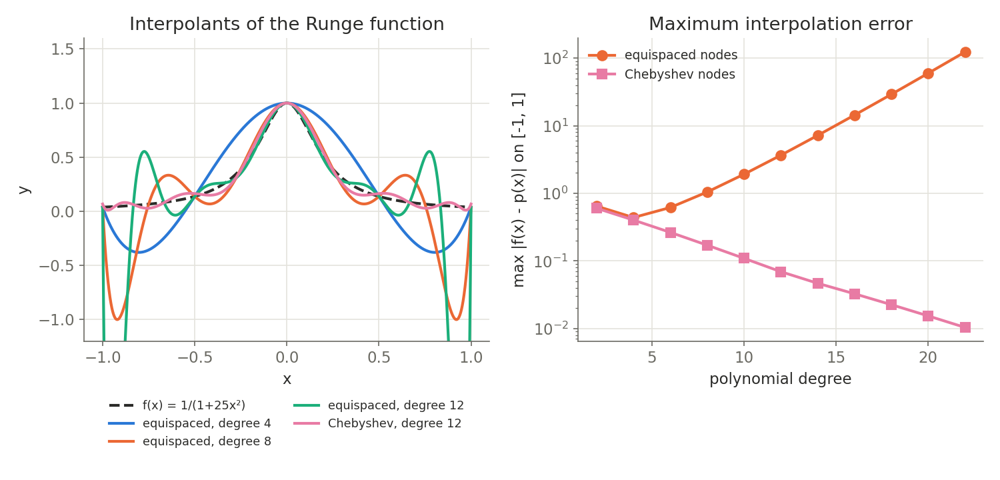
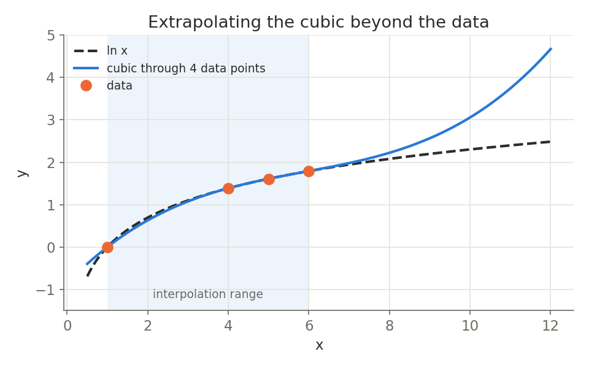

# Chapter 17 — Polynomial Interpolation

[Repository Guide](../../README.md) | [English](Concepts_Lecture.md) | [한국어](Concepts_Lecture.ko.md)

> **Last Updated:** 2026-11-19
>
> Applied Numerical Methods with Python for Engineers and Scientists, Chapra and Clough, Ch 17

> **Learning Objectives:**
> 1. Find the coefficients of an interpolating polynomial with the Vandermonde matrix and improve its condition number by standardization
> 2. Construct and evaluate Newton's interpolating polynomial with a divided difference table
> 3. Construct the interpolating polynomial with Lagrange basis functions and compare it with Newton's form
> 4. Estimate the $`x`$ that corresponds to a given function value by inverse interpolation
> 5. Explain the risk of extrapolation and Runge's phenomenon
> 6. Estimate the interpolation error with the error formula and explain how Chebyshev nodes reduce Runge's phenomenon

---

<br>

## Table of Contents

- [1. Polynomial Interpolation](#1-polynomial-interpolation)
  - [1.1 The Concept of Interpolation](#11-the-concept-of-interpolation)
  - [1.2 Polynomial Form and Unknowns](#12-polynomial-form-and-unknowns)
  - [1.3 Determining Coefficients](#13-determining-coefficients)
  - [1.4 Vandermonde Matrix](#14-vandermonde-matrix)
  - [1.5 Standardization](#15-standardization)
  - [1.6 Existence and Uniqueness of the Interpolating Polynomial](#16-existence-and-uniqueness-of-the-interpolating-polynomial)
  - [1.7 Computing Example 17.1 and Horner's Method](#17-computing-example-171-and-horners-method)
- [2. Newton Interpolating Polynomial](#2-newton-interpolating-polynomial)
  - [2.1 Linear Interpolation (1st Order)](#21-linear-interpolation-1st-order)
  - [2.2 Quadratic Interpolation (2nd Order)](#22-quadratic-interpolation-2nd-order)
  - [2.3 Finite Divided Differences](#23-finite-divided-differences)
  - [2.4 Recursive Nature of Finite Divided Differences](#24-recursive-nature-of-finite-divided-differences)
  - [2.5 General Form of Newton's Interpolating Polynomial](#25-general-form-of-newtons-interpolating-polynomial)
  - [2.6 Example 17.4: Estimating ln 2](#26-example-174-estimating-ln-2)
  - [2.7 Implementing the Divided Difference Table and Its Cost](#27-implementing-the-divided-difference-table-and-its-cost)
  - [2.8 Interpolation Error and Its Estimation](#28-interpolation-error-and-its-estimation)
- [3. Lagrange Interpolating Polynomial](#3-lagrange-interpolating-polynomial)
  - [3.1 Linear Lagrange Interpolation (1st Order)](#31-linear-lagrange-interpolation-1st-order)
  - [3.2 Basis Functions N1(x) and N2(x)](#32-basis-functions-n1x-and-n2x)
  - [3.3 2nd-Order Lagrange Interpolating Polynomial](#33-2nd-order-lagrange-interpolating-polynomial)
  - [3.4 General (n-1)th-Order Lagrange Polynomial](#34-general-n-1th-order-lagrange-polynomial)
  - [3.5 Comparing the Lagrange and Newton Forms](#35-comparing-the-lagrange-and-newton-forms)
  - [3.6 Polynomial Interpolation in NumPy and SciPy](#36-polynomial-interpolation-in-numpy-and-scipy)
- [4. Inverse Interpolation](#4-inverse-interpolation)
  - [4.1 Concept](#41-concept)
  - [4.2 Example](#42-example)
  - [4.3 Two Methods of Inverse Interpolation](#43-two-methods-of-inverse-interpolation)
- [5. Extrapolation and Oscillations](#5-extrapolation-and-oscillations)
  - [5.1 Extrapolation](#51-extrapolation)
  - [5.2 Oscillations (Runge Phenomenon)](#52-oscillations-runge-phenomenon)
  - [5.3 Causes of Runge's Phenomenon and Chebyshev Nodes](#53-causes-of-runges-phenomenon-and-chebyshev-nodes)
  - [5.4 Magnitude of Extrapolation Error](#54-magnitude-of-extrapolation-error)
- [Summary](#summary)
- [Self-Check Questions](#self-check-questions)
- [References](#references)

---

<br>

## 1. Polynomial Interpolation

### 1.1 The Concept of Interpolation

Interpolation is the technique of estimating the value of a function at an intermediate point, given a set of discrete data points. The core question is how to fill in **the values between two known data points**.

The answer to this question is **polynomial interpolation**. The idea is to pass a polynomial through the known data points and then evaluate the polynomial at the desired intermediate location.

Interpolation has a different purpose from the regression of Chapters 14 and 15. Regression finds a curve that represents the overall trend of data contaminated by measurement error, so the curve need not pass through the data points and is chosen by minimizing the sum of squared errors. Interpolation treats the data points as exact and requires the curve to pass through every one of them. Interpolation is therefore used to fill in values between data with small errors, such as property tables, tables of mathematical functions, and precise computational results, while regression is used for noisy measurements. Forcing a high-order interpolating polynomial through noisy data makes the polynomial follow the noise and swing widely.

> **Definition:** An **interpolating polynomial** is a polynomial $`p`$ of degree at most $`n-1`$ that passes exactly through the given values $`f(x_1), \ldots, f(x_n)`$ at distinct points $`x_1, \ldots, x_n`$. That is, $`p(x_i) = f(x_i)`$ for every $`i`$, and this requirement is called the interpolation condition. The $`x`$ coordinates $`x_i`$ of the data are called nodes.

There are three common types of polynomial interpolation, depending on how many data points are used:

| Type | Data Points Required | Polynomial Order |
|------|---------------------|-----------------|
| Linear interpolation | 2 | 1st order |
| Quadratic interpolation | 3 | 2nd order |
| Cubic interpolation | 4 | 3rd order |

*Table 1. Types of polynomial interpolation by the number of data points*

**Motivating Example:** Suppose you are given a table of temperature $`T`$ [C] and density $`\rho`$ [kg/m$`^3`$] of air.

| $`T`$ [C] | $`\rho`$ [kg/m$`^3`$] |
|---------|-------------------|
| $`-40`$   | $`1.52`$            |
| $`0`$     | $`1.29`$            |
| $`20`$    | $`1.20`$            |
| $`50`$    | $`1.09`$            |
| $`\vdots`$ | $`\vdots`$         |
| $`500`$   | $`0.46`$            |

*Table 2. Density of air by temperature*

What is the density at $`T = 30`$ C? Interpolation answers this question.

### 1.2 Polynomial Form and Unknowns

An $`n`$-th order polynomial has the general form:

```math
f(x) = a_0 + a_1 x + a_2 x^2 + \cdots + a_n x^n
```

This polynomial has **$`n + 1`$ unknowns** (the coefficients $`a_0, a_1, \ldots, a_n`$), so we need **$`n + 1`$ data points** to uniquely determine them.

> **Key Point:** To uniquely determine an $`n`$-th order interpolating polynomial, we need $`n + 1`$ data points with distinct $`x`$-values.

### 1.3 Determining Coefficients

**Example 17.1:** Suppose we want a 2nd-order polynomial through three data points:

```math
f(x) = p_0 x^2 + p_1 x + p_2 \qquad (\ast)
```

Given the data:
- $`f(300) = 0.616`$
- $`f(400) = 0.525`$
- $`f(500) = 0.457`$

Substitute each data point into $`(\ast)`$:

```math
0.616 = p_0 (300)^2 + p_1 (300) + p_2
```

```math
0.525 = p_0 (400)^2 + p_1 (400) + p_2
```

```math
0.457 = p_0 (500)^2 + p_1 (500) + p_2
```

This is a system of 3 equations with 3 unknowns ($`p_0, p_1, p_2`$).

### 1.4 Vandermonde Matrix

The system from Section 1.3 can be rewritten in **vector/matrix form**:

```math
\begin{pmatrix} 0.616 \\ 0.525 \\ 0.457 \end{pmatrix} = \begin{pmatrix} 300^2 & 300 & 1 \\ 400^2 & 400 & 1 \\ 500^2 & 500 & 1 \end{pmatrix} \begin{pmatrix} p_0 \\ p_1 \\ p_2 \end{pmatrix}
```

In general, for a 2nd-order polynomial with data at $`x_1, x_2, x_3`$:

```math
\begin{pmatrix} f(x_1) \\ f(x_2) \\ f(x_3) \end{pmatrix} = \underbrace{\begin{pmatrix} x_1^2 & x_1 & 1 \\ x_2^2 & x_2 & 1 \\ x_3^2 & x_3 & 1 \end{pmatrix}}_{V \text{ (Vandermonde matrix)}} \begin{pmatrix} p_0 \\ p_1 \\ p_2 \end{pmatrix}
```

The coefficient matrix $`V`$ is known as the **Vandermonde matrix**. Solve $`V \mathbf{p} = \mathbf{f}`$ to find the polynomial coefficients.

> **[Linear Algebra]** A linear system with a square coefficient matrix has a unique solution when the determinant of the matrix is nonzero. The determinant of the Vandermonde matrix is the product of the differences $`(x_j - x_i)`$ between distinct points, so it is nonzero when all $`x`$-values are distinct; this is why $`n + 1`$ data points with distinct $`x`$-values determine the interpolating polynomial of degree $`n`$ uniquely, as stated in Section 1.2.

> **Caution:** The Vandermonde matrix is often **ill-conditioned** when the $`x`$-values are large. For the example above, $`\text{cond}(V) \approx 5.9 \times 10^6`$ (in the 2-norm), which causes numerical instability.

### 1.5 Standardization

To improve conditioning, define a **new standardized variable**:

```math
z := \frac{x - 400}{100}
```

This maps the original $`x`$-values $`\{300, 400, 500\}`$ to $`\{-1, 0, 1\}`$, producing a new Vandermonde matrix:

```math
V' = \begin{pmatrix} 1 & -1 & 1 \\ 0 & 0 & 1 \\ 1 & 1 & 1 \end{pmatrix}
```

Now $`\text{cond}(V') \approx 3.23`$, which is dramatically better than the $`10^6`$ level.

> **Key Point:** **Standardization** improves the conditioning of the Vandermonde matrix and stabilizes the computation.

### 1.6 Existence and Uniqueness of the Interpolating Polynomial

Section 1.2 noted that an $`n`$-th order polynomial has $`n + 1`$ unknowns, so $`n + 1`$ data points are needed. Equal numbers of unknowns and equations alone do not guarantee a solution, so this section states, with its exact conditions, the theorem that the interpolation problem always has exactly one answer. To match the notation from Section 3 onward, the number of data points is written $`n`$ and the degree of the polynomial $`n - 1`$.

> **Key Point:** Given $`n`$ distinct nodes $`x_1, \ldots, x_n`$ and arbitrary values $`y_1, \ldots, y_n`$, there exists exactly one polynomial $`p`$ of degree at most $`n - 1`$ with $`p(x_i) = y_i`$ $`(i = 1, \ldots, n)`$.

**Existence.** The Lagrange polynomial $`\sum_i L_i(x)\,y_i`$ of Section 3.4 has degree at most $`n - 1`$, and $`L_i(x_j)`$ equals 1 only when $`i = j`$, so it satisfies every interpolation condition. At least one polynomial satisfying the conditions therefore exists.

**Uniqueness.** Suppose two polynomials $`p`$ and $`q`$ both satisfy the interpolation conditions. Their difference $`d = p - q`$ has degree at most $`n - 1`$, and $`d(x_i) = y_i - y_i = 0`$ at every node, so it has $`n`$ distinct roots. A nonzero polynomial of degree at most $`n - 1`$ has at most $`n - 1`$ roots, so $`d`$ is the zero polynomial and $`p = q`$.

Three conclusions follow from this theorem.

1. Solving the Vandermonde system, the Newton form, and the Lagrange form give **the same polynomial** for the same data. The three methods differ only in which basis functions they combine to write the polynomial.
2. The degree of the interpolating polynomial can be lower than $`n - 1`$. For example, the second-order interpolating polynomial of three collinear points is a straight line whose $`x^2`$ coefficient is 0.
3. The condition that the nodes be distinct is essential. If two different values are given at the same $`x`$, no such polynomial exists, and two rows of the Vandermonde matrix become equal so that its determinant is 0.

| Form | Basis functions | Matrix of the system for the coefficients | Cost of the coefficients |
|:-----|:-----|:-----|:-----|
| Power (Vandermonde) | $`1, x, x^2, \ldots, x^{n-1}`$ | Full Vandermonde matrix | $`O(n^3)`$ by Gauss elimination |
| Newton | $`1, (x - x_1), (x - x_1)(x - x_2), \ldots`$ | Lower triangular matrix | $`O(n^2)`$ by the divided difference table |
| Lagrange | $`L_1(x), \ldots, L_n(x)`$ | Identity matrix | None, since the coefficients are the $`f(x_i)`$ |

*Table 3. Three representations of the interpolating polynomial*

The system for the Newton basis is lower triangular because the $`k`$-th basis function $`(x - x_1)\cdots(x - x_{k-1})`$ vanishes at $`x_1, \ldots, x_{k-1}`$. The first equation therefore involves only $`b_1`$, the second only $`b_1, b_2`$, and the divided difference table of Section 2 organizes this forward substitution systematically. The Lagrange basis has the Kronecker delta property at the nodes, so the matrix is the identity and no coefficient computation is needed, but evaluating the polynomial at a point costs more (Section 3.5).

### 1.7 Computing Example 17.1 and Horner's Method

Solving the system of Section 1.4 with NumPy gives the following. `np.vander(x, 3)` builds the Vandermonde matrix whose columns are $`x^2, x, 1`$.

```python
import numpy as np

x = np.array([300.0, 400.0, 500.0])
f = np.array([0.616, 0.525, 0.457])

V = np.vander(x, 3)                 # columns x^2, x, 1
p = np.linalg.solve(V, f)           # p0, p1, p2
print("p =", p)
print("cond(V)  = %.3e" % np.linalg.cond(V))

z = (x - 400.0) / 100.0             # standardized variable
Vz = np.vander(z, 3)
q = np.linalg.solve(Vz, f)
print("q =", q)
print("cond(Vz) = %.4f" % np.linalg.cond(Vz))

print("f(350) from p: %.6f" % np.polyval(p, 350.0))
print("f(350) from q: %.6f" % np.polyval(q, (350.0 - 400.0) / 100.0))
```

```text
p = [ 1.150e-06 -1.715e-03  1.027e+00]
cond(V)  = 5.893e+06
q = [ 0.0115 -0.0795  0.525 ]
cond(Vz) = 3.2255
f(350) from p: 0.567625
f(350) from q: 0.567625
```

- `np.linalg.solve(V, f)` solves $`V\mathbf{p} = \mathbf{f}`$ by LU factorization (Chapter 10). The result is $`p_0 = 1.15 \times 10^{-6}`$, $`p_1 = -1.715 \times 10^{-3}`$, $`p_2 = 1.027`$.
- `z = (x - 400.0) / 100.0` is the standardization of Section 1.5. The polynomial $`q_0 z^2 + q_1 z + q_2`$ written in the standardized variable is the same function as the original polynomial; only the coefficients differ.
- Both representations give $`f(350) = 0.567625`$ because of the uniqueness theorem of Section 1.6. For a three-point problem, even the condition number $`5.9 \times 10^6`$ is tolerable compared with the relative precision of double precision, about $`2.2 \times 10^{-16}`$.

The situation changes as the degree rises. For equally spaced nodes on $`[300, 500]`$, the 2-norm condition number of the Vandermonde matrix grows from $`5.9 \times 10^6`$ with 3 nodes to $`1.1 \times 10^{14}`$ with 5 and $`1.1 \times 10^{25}`$ with 8, while the same nodes after standardization stay at about 3.2, 24, and 540. Once the condition number exceeds $`10^{16}`$, the error bound of Chapter 11 allows the coefficients to lose every significant digit, so the Vandermonde method in the original variable becomes unusable even at modest degrees.

After the coefficients are found, the polynomial is evaluated with **Horner's method**. Instead of computing each power separately, the parentheses are nested from the inside out.

```math
p_0 x^2 + p_1 x + p_2 = (p_0 x + p_1)\,x + p_2
```

In general, a polynomial of degree $`m`$, $`a_m x^m + \cdots + a_1 x + a_0`$, is evaluated by starting from $`s \leftarrow a_m`$ and repeating $`s \leftarrow s\,x + a_k`$ for $`k = m - 1, \ldots, 0`$. It needs only $`m`$ multiplications and $`m`$ additions, fewer operations than computing the powers one by one, and it accumulates less roundoff error. `np.polyval` uses this method [1]. The `newton_eval` function of Section 2.6 nests the parentheses in the same way for the Newton basis.

---

<br>

## 2. Newton Interpolating Polynomial

Newton's approach builds the interpolating polynomial **incrementally**, adding one term at a time. Each new term introduces a higher-order correction (curvature).

### 2.1 Linear Interpolation (1st Order)

Given two data points $`(x_1, f(x_1))`$ and $`(x_2, f(x_2))`$, the **Newton linear interpolation formula** is:

```math
\hat{f}(x) = f(x_1) + \frac{f(x_2) - f(x_1)}{x_2 - x_1}(x - x_1)
```

This is a straight line through the two points (point-slope form using the slope of the secant line).

> **Note:** In general, the **accuracy** of linear interpolation increases as the interval $`|x_2 - x_1|`$ decreases and as $`x`$ is closer to the data points.

Linear interpolation answers the question of Section 1.1. Using the two points $`(20, 1.20)`$ and $`(50, 1.09)`$ that surround $`T = 30`$ C gives the following.

```math
\hat{\rho}(30) = 1.20 + \frac{1.09 - 1.20}{50 - 20}(30 - 20) = 1.20 + (-0.003667)(10) = 1.1633 \ \text{kg/m}^3
```

The slope $`-0.003667`$ kg/(m$`^3`$ C) is the decrease in density per 1 C rise in temperature over this interval. Linear interpolation assumes that the function is a straight line between the two points, so if the true function is convex on that interval, the line lies above the function and the estimate exceeds the true value; if the function is concave, the estimate falls short. The quadratic term of Section 2.2 accounts for this effect of curvature.

### 2.2 Quadratic Interpolation (2nd Order)

Given three data points $`f(x_1), f(x_2), f(x_3)`$, construct a quadratic interpolation formula:

```math
\hat{f}(x) = b_1 + b_2(x - x_1) + b_3(x - x_1)(x - x_2)
```

**Determining the coefficients:**

**Step 1:** Set $`\hat{f}(x_1) = f(x_1)`$:

```math
f(x_1) = b_1 \quad \Longrightarrow \quad b_1 = f(x_1)
```

**Step 2:** Set $`\hat{f}(x_2) = f(x_2)`$:

```math
f(x_2) = f(x_1) + b_2(x_2 - x_1)
```

```math
\therefore \quad b_2 = \frac{f(x_2) - f(x_1)}{x_2 - x_1} =: f[x_2, x_1]
```

This is the **first-order finite divided difference** (the slope).

**Step 3:** Set $`\hat{f}(x_3) = f(x_3)`$ and solve for $`b_3`$:

```math
f(x_3) = f(x_1) + \frac{f(x_2) - f(x_1)}{x_2 - x_1}(x_3 - x_1) + b_3(x_3 - x_1)(x_3 - x_2)
```

After algebraic manipulation:

```math
b_3 = \frac{\dfrac{f(x_3) - f(x_2)}{x_3 - x_2} - \dfrac{f(x_2) - f(x_1)}{x_2 - x_1}}{x_3 - x_1} = \frac{f[x_3, x_2] - f[x_2, x_1]}{x_3 - x_1} =: f[x_3, x_2, x_1]
```

This is the **second-order finite divided difference**.

### 2.3 Finite Divided Differences

Finite divided differences are defined recursively:

**Zeroth-order** (function values):

```math
f[x_i] = f(x_i)
```

**First-order** (slopes):

```math
f[x_i, x_j] = \frac{f(x_i) - f(x_j)}{x_i - x_j}
```

**Second-order** (curvature):

```math
f[x_i, x_j, x_k] = \frac{f[x_i, x_j] - f[x_j, x_k]}{x_i - x_k}
```

**$`n`$-th order** (general):

```math
f[x_n, x_{n-1}, \ldots, x_1] = \frac{f[x_n, x_{n-1}, \ldots, x_2] - f[x_{n-1}, x_{n-2}, \ldots, x_1]}{x_n - x_1}
```

### 2.4 Recursive Nature of Finite Divided Differences

The divided differences can be organized in a **triangular table**:

| $`x_i`$ | $`f(x_i)`$ | 1st Divided Diff. | 2nd Divided Diff. | 3rd Divided Diff. |
|--------|-----------|-------------------|--------------------|---------------------|
| $`x_1`$ | $`f(x_1) = b_1`$ | | | |
| | | $`f[x_2, x_1] = b_2`$ | | |
| $`x_2`$ | $`f(x_2)`$ | | $`f[x_3, x_2, x_1] = b_3`$ | |
| | | $`f[x_3, x_2]`$ | | $`f[x_4, x_3, x_2, x_1] = b_4`$ |
| $`x_3`$ | $`f(x_3)`$ | | $`f[x_4, x_3, x_2]`$ | |
| | | $`f[x_4, x_3]`$ | | |
| $`x_4`$ | $`f(x_4)`$ | | | |

*Table 4. Triangular table of divided differences*

The **top diagonal** of the table gives the coefficients $`b_1, b_2, b_3, b_4, \ldots`$ of the Newton polynomial.

### 2.5 General Form of Newton's Interpolating Polynomial

For $`n`$ data points, the **(n-1)th-order** Newton interpolating polynomial is:

```math
\hat{f}_{n-1}(x) = f(x_1) + f[x_2, x_1](x - x_1) + f[x_3, x_2, x_1](x - x_1)(x - x_2) + \cdots
```

```math
+ f[x_n, x_{n-1}, \ldots, x_1](x - x_1)(x - x_2) \cdots (x - x_{n-1})
```

In compact notation:

```math
\hat{f}_{n-1}(x) = \sum_{k=1}^{n} b_k \prod_{j=1}^{k-1}(x - x_j)
```

where

- $`b_1 = f(x_1)`$
- $`b_2 = f[x_2, x_1]`$
- $`b_3 = f[x_3, x_2, x_1]`$
- $`b_k = f[x_k, x_{k-1}, \ldots, x_1]`$

> **Note:** **Advantage.** Newton's form is **incremental**. Adding a new data point only requires computing one more diagonal of the divided difference table to get one new coefficient and appending one more term. The previously computed coefficients remain unchanged.

### 2.6 Example 17.4: Estimating ln 2

**Problem:** Estimate $`\ln 2`$ using a 3rd-order Newton interpolating polynomial.

**Data points** (using $`f(x) = \ln(x)`$):

| $`i`$ | $`x_i`$ | $`f(x_i) = \ln(x_i)`$ |
|-----|--------|----------------------|
| 1   | 1      | 0                    |
| 2   | 4      | 1.386294             |
| 3   | 6      | 1.791759             |
| 4   | 5      | 1.609438             |

*Table 5. Data points of Example 17.4*

**Step 1:** Build the divided difference table.

| | $`f(x_i)`$ | 1st | 2nd | 3rd |
|---|----------|-----|-----|-----|
| $`x_1 = 1`$ | $`0 = b_1`$ | | | |
| | | $`f[x_2, x_1]`$ | | |
| $`x_2 = 4`$ | $`1.386294`$ | | $`f[x_3, x_2, x_1]`$ | |
| | | $`f[x_3, x_2]`$ | | $`f[x_4, x_3, x_2, x_1] = b_4`$ |
| $`x_3 = 6`$ | $`1.791759`$ | | $`f[x_4, x_3, x_2]`$ | |
| | | $`f[x_4, x_3]`$ | | |
| $`x_4 = 5`$ | $`1.609438`$ | | | |

*Table 6. Divided difference table of Example 17.4*

**Step 2:** Compute each divided difference.

```math
f[x_2, x_1] = \frac{1.386294 - 0}{4 - 1} = 0.462098 = b_2
```

```math
f[x_3, x_2] = \frac{1.791759 - 1.386294}{6 - 4} = 0.202733
```

```math
f[x_4, x_3] = \frac{1.609438 - 1.791759}{5 - 6} = 0.182321
```

```math
f[x_3, x_2, x_1] = \frac{0.202733 - 0.462098}{6 - 1} = -0.051873 = b_3
```

```math
f[x_4, x_3, x_2] = \frac{0.182321 - 0.202733}{5 - 4} = -0.020412
```

```math
f[x_4, x_3, x_2, x_1] = \frac{-0.020412 - (-0.051873)}{5 - 1} = 0.007865 = b_4
```

**Step 3:** Construct the 3rd-order polynomial.

```math
\hat{f}_3(x) = 0 + 0.462098(x - 1) + (-0.051873)(x - 1)(x - 4) + 0.007865(x - 1)(x - 4)(x - 6)
```

**Step 4:** Evaluate at $`x = 2`$.

```math
\hat{f}_3(2) = 0.462098(1) + (-0.051873)(1)(-2) + 0.007865(1)(-2)(-4)
```

```math
= 0.462098 + 0.103746 + 0.062920 = 0.628764
```

The exact value is $`\ln 2 = 0.693147`$, so the estimate has a true relative error of about 9.3% due to the spacing of data points.

```python
import numpy as np

# Data points
x = np.array([1, 4, 6, 5])
f = np.array([0, 1.386294, 1.791759, 1.609438])

# Divided differences
def divided_diff(x, f):
    n = len(x)
    table = np.zeros((n, n))
    table[:, 0] = f
    for j in range(1, n):
        for i in range(n - j):
            table[i][j] = (table[i+1][j-1] - table[i][j-1]) / (x[i+j] - x[i])
    return table[0]  # top row = coefficients b1, b2, b3, ...

# Newton evaluation
def newton_eval(coeffs, x_data, x_eval):
    n = len(coeffs)
    result = coeffs[-1]
    for k in range(n - 2, -1, -1):
        result = result * (x_eval - x_data[k]) + coeffs[k]
    return result

coeffs = divided_diff(x, f)
print(f"Coefficients: {coeffs}")
print(f"f(2) = {newton_eval(coeffs, x, 2):.6f}")
print(f"Exact ln(2) = {np.log(2):.6f}")
```

```text
Coefficients: [ 0.         0.462098  -0.0518731  0.0078654]
f(2) = 0.628767
Exact ln(2) = 0.693147
```

The printed 0.628767 differs from the hand result 0.628764 in the last digit because the hand calculation rounded each divided difference to six decimal places.

### 2.7 Implementing the Divided Difference Table and Its Cost

Filling the divided differences of Section 2.6 into one table gives the following. It uses the same layout as `table` in the code: row $`i`$, column $`j`$ holds the $`j`$-th order divided difference starting at $`x_i`$.

| $`i`$ | $`x_i`$ | $`f(x_i)`$ | 1st | 2nd | 3rd |
|:---:|:---:|:-----|:-----|:-----|:-----|
| 1 | 1 | 0 | 0.462098 | -0.051873 | 0.007865 |
| 2 | 4 | 1.386294 | 0.202733 | -0.020412 | |
| 3 | 6 | 1.791759 | 0.182321 | | |
| 4 | 5 | 1.609438 | | | |

*Table 7. Divided difference table of Example 17.4 (filled with values)*

The first row $`0, 0.462098, -0.051873, 0.007865`$ gives the Newton coefficients $`b_1, b_2, b_3, b_4`$. The procedures for building the table and for evaluating the polynomial are as follows in pseudocode.

```text
procedure DividedDifferences(x[1..n], f[1..n])
    for i = 1 to n
        T[i, 1] = f[i]
    for j = 2 to n                         # column: order j - 1
        for i = 1 to n - j + 1             # rows that still have entries
            T[i, j] = (T[i+1, j-1] - T[i, j-1]) / (x[i+j-1] - x[i])
    return T[1, 1..n]                      # b1, ..., bn

procedure NewtonEval(b[1..n], x[1..n], t)
    p = b[n]
    for k = n - 1 down to 1
        p = p * (t - x[k]) + b[k]
    return p
```

The Python code of Section 2.6 is this pseudocode translated to zero-based indices.

- `table[:, 0] = f` fills the first column with the zeroth-order divided differences, that is, the function values.
- The outer loop variable `j` is both the column index and the order of the divided difference. Each increase in order leaves one fewer entry to compute, so the inner loop runs over `range(n - j)`.
- The denominator `x[i+j] - x[i]` is the difference between the two end points of the $`j + 1`$ points that enter the divided difference. Note that it is not the difference between two neighboring points.
- The final `return` gives the first row of the table, that is, the Newton coefficients.
- `newton_eval` starts from $`b_n`$ and repeats $`p \leftarrow p\,(t - x_k) + b_k`$. This is Horner's method (Section 1.7) applied to the Newton form nested as $`b_1 + (t - x_1)\bigl(b_2 + (t - x_2)(b_3 + \cdots)\bigr)`$.

The cost is as follows. Column $`j`$ has $`n - j + 1`$ entries, each needing two subtractions and one division, so the whole table takes $`n(n-1)/2`$ divisions and $`n(n-1)`$ subtractions, that is, $`O(n^2)`$. Once the table is built, each evaluation point needs only $`n - 1`$ multiplications. The coefficients cost less than the $`O(n^3)`$ of the Vandermonde method, and since no powers of the original variable are used, the ill-conditioning of Section 1.7 is also avoided.

Common mistakes with the divided difference table are the following.

- Using the difference of two neighboring nodes in the denominator. The denominator of the second-order divided difference $`f[x_3, x_2, x_1]`$ is $`x_3 - x_1`$, not $`x_3 - x_2`$.
- Believing that the nodes must be sorted. They may be in mixed order as in Example 17.4; changing the order changes the intermediate entries and the coefficients, but by Section 1.6 the final polynomial is the same.
- Inserting a new point in the middle of the table. To keep the existing coefficients, the new point must be appended at the bottom of the table, after which only one new diagonal has to be computed.

### 2.8 Interpolation Error and Its Estimation

The interpolating polynomial equals $`f`$ exactly only at the nodes and has an error between them. This section derives a formula that expresses this error in terms of the nodes and the properties of $`f`$.

Let $`\hat{f}_{n-1}`$ be the interpolating polynomial built on $`n`$ nodes, and fix a point $`x`$ that is not a node. Adding $`x`$ as the $`(n+1)`$-th node gives the Newton form of Section 2.5 with one more term.

```math
\hat{f}_n(t) = \hat{f}_{n-1}(t) + f[x, x_n, \ldots, x_1]\,(t - x_1)(t - x_2)\cdots(t - x_n)
```

Since $`\hat{f}_n`$ also passes through the point $`x`$, substituting $`t = x`$ makes the left side $`f(x)`$. The error $`R_{n-1}(x) = f(x) - \hat{f}_{n-1}(x)`$ is therefore exactly the following.

```math
R_{n-1}(x) = f[x, x_n, \ldots, x_1]\,\prod_{i=1}^{n}(x - x_i)
```

Divided differences and derivatives are linked by the following relation. If $`f`$ is $`n`$ times continuously differentiable on an interval containing all the nodes and $`x`$, then $`f[x, x_n, \ldots, x_1] = f^{(n)}(\xi)/n!`$ for some $`\xi`$ in that interval. For $`n = 1`$ this is the mean value theorem $`f[x, x_1] = f'(\xi)`$, and the general case is proved by applying Rolle's theorem repeatedly. Substituting it gives the interpolation error formula.

```math
R_{n-1}(x) = \frac{f^{(n)}(\xi)}{n!}\,\prod_{i=1}^{n}(x - x_i)
```

The error is a product of three factors. $`f^{(n)}(\xi)`$ measures how smooth the function is, $`1/n!`$ is the gain from raising the degree, and the **node polynomial** $`\omega(x) = \prod_{i}(x - x_i)`$ captures the effect of the node layout and of the evaluation point. $`\omega(x)`$ is zero at the nodes and small between them, and it grows rapidly, like $`|x|^n`$, outside the range of the nodes. Both the extrapolation and the oscillations of Section 5 are explained by this factor.

Applied to linear interpolation ($`n = 2`$), $`|(x - x_1)(x - x_2)|`$ on $`x_1 \le x \le x_2`$ reaches its maximum $`h^2/4`$ $`(h = x_2 - x_1)`$ at the midpoint, which gives the following bound.

```math
|R_1(x)| \le \frac{h^2}{8}\,\max_{x_1 \le t \le x_2} |f''(t)|
```

Halving the spacing reduces the error bound to one quarter, which quantifies the relation between accuracy and spacing stated in the Note of Section 2.1.

The $`\xi`$ in the formula is unknown, and often $`f`$ itself is unknown. In practice the error is therefore estimated with one more data point. If an additional point $`x_{n+1}`$ is available, one sets $`f[x, x_n, \ldots, x_1] \approx f[x_{n+1}, x_n, \ldots, x_1]`$ and uses

```math
R_{n-1}(x) \approx f[x_{n+1}, x_n, \ldots, x_1]\,\prod_{i=1}^{n}(x - x_i)
```

The right side is exactly the term added to the Newton form when the next point is included. In the Newton form, the size of the next term is thus the error estimate for the current order, and the estimate is good when the $`n`$-th derivative does not change much over the nodes.

```python
import numpy as np

x = np.array([1.0, 4.0, 6.0, 5.0])
f = np.array([0.0, 1.386294, 1.791759, 1.609438])
b = np.array([0.0, 0.462098, -0.051873, 0.007865])   # top row of the table
t, exact = 2.0, np.log(2.0)

w = 1.0                      # running product (t - x1)...(t - xk)
p = b[0]
for k in range(1, 4):
    term = b[k] * w * (t - x[k - 1])   # next Newton term
    w *= t - x[k - 1]
    print(f"order {k - 1}: p = {p:.6f}, estimated error = {term:.6f}, "
          f"true error = {exact - p:.6f}")
    p += term
print(f"order 3: p = {p:.6f}, true error = {exact - p:.6f}")
```

```text
order 0: p = 0.000000, estimated error = 0.462098, true error = 0.693147
order 1: p = 0.462098, estimated error = 0.103746, true error = 0.231049
order 2: p = 0.565844, estimated error = 0.062920, true error = 0.127303
order 3: p = 0.628764, true error = 0.064383
```

- `w` is the product $`(t - x_1)\cdots(t - x_{k-1})`$ accumulated so far, and `term` multiplies it by $`(t - x_k)`$ and $`b_{k+1}`$ to form the next Newton term.
- Each line shows the current estimate, the error estimate from the next term, and the true error side by side.

The estimates get the sign and the order of magnitude of the true error right but come out about half as large. The derivatives of $`\ln x`$, $`f''(x) = -1/x^2`$ and $`f'''(x) = 2/x^3`$, change by factors of tens over the node interval $`[1, 6]`$. Applying the formula to the second-order error gives $`R_2(2) = \frac{2/\xi^3}{3!}(2 - 1)(2 - 4)(2 - 6) = \frac{8}{3\xi^3}`$, and since $`\xi \in [1, 6]`$ the error must lie between 0.0123 and 2.667. The true error 0.127303 lies in this range and corresponds to $`\xi \approx 2.76`$.

> **Key Point:** The interpolation error is the product of $`f^{(n)}(\xi)/n!`$ and the node polynomial $`\prod (x - x_i)`$. In the Newton form, the size of the next term is the error estimate for the current order.

The error formula also gives a rule for choosing nodes. To estimate the value at a point $`x`$, use the nodes closest to $`x`$ first so that $`|\omega(x)|`$ is small, and if possible place $`x`$ in the middle of the nodes. It is also safe to raise the order one step at a time while watching the error estimate and to stop at the order where the estimate no longer decreases, because raising the order further can bring in the oscillations of Section 5.2.

---

<br>

## 3. Lagrange Interpolating Polynomial

Lagrange's method provides an **alternative** formulation of the interpolating polynomial that does not require solving a system of equations or building a divided difference table. Instead, it directly constructs the polynomial using **basis functions** (also called **shape functions**).

### 3.1 Linear Lagrange Interpolation (1st Order)

Given two data points $`(x_1, f(x_1))`$ and $`(x_2, f(x_2))`$, the straight line through them is:

```math
y - f(x_1) = \frac{f(x_2) - f(x_1)}{x_2 - x_1}(x - x_1)
```

Rearranging:

```math
y = \frac{x_2 - x}{x_2 - x_1} f(x_1) + \frac{x - x_1}{x_2 - x_1} f(x_2)
```

Define the **basis functions** (shape functions):

```math
N_1(x) = \frac{x_2 - x}{x_2 - x_1}, \qquad N_2(x) = \frac{x - x_1}{x_2 - x_1}
```

Then the **linear Lagrange interpolating polynomial** is:

```math
\hat{f}_1(x) = N_1(x) \, f(x_1) + N_2(x) \, f(x_2)
```

### 3.2 Basis Functions N1(x) and N2(x)

The basis functions take the following values at the data points (the Kronecker delta property):

- $`N_1(x_1) = 1, \quad N_1(x_2) = 0`$
- $`N_2(x_1) = 0, \quad N_2(x_2) = 1`$

- At $`x = x_1`$, the interpolation gives $`f(x_1)`$ exactly (weighted 100% by $`N_1`$).
- At $`x = x_2`$, the interpolation gives $`f(x_2)`$ exactly (weighted 100% by $`N_2`$).
- For every $`x`$, $`N_1(x) + N_2(x) = 1`$, which is called the **partition of unity** property.
- Between $`x_1`$ and $`x_2`$, both weights lie between 0 and 1, so the result is a **weighted average** of $`f(x_1)`$ and $`f(x_2)`$.

> **Note:** **Geometric interpretation.** $`N_1(x)`$ and $`N_2(x)`$ are linear functions that cross at the midpoint of the two points. The interpolated value $`y = N_1(x) f(x_1) + N_2(x) f(x_2)`$ is the weighted combination of function values at the data points.

### 3.3 2nd-Order Lagrange Interpolating Polynomial

For three data points $`(x_1, f(x_1)), (x_2, f(x_2)), (x_3, f(x_3))`$, define three Lagrange basis functions:

```math
L_1(x) = \frac{(x - x_2)(x - x_3)}{(x_1 - x_2)(x_1 - x_3)}
```

```math
L_2(x) = \frac{(x - x_1)(x - x_3)}{(x_2 - x_1)(x_2 - x_3)}
```

```math
L_3(x) = \frac{(x - x_1)(x - x_2)}{(x_3 - x_1)(x_3 - x_2)}
```

The 2nd-order Lagrange interpolating polynomial is:

```math
\hat{f}_2(x) = L_1(x) \, f(x_1) + L_2(x) \, f(x_2) + L_3(x) \, f(x_3) = \sum_{i=1}^{3} L_i(x) \, f(x_i)
```

Each $`L_i(x)`$ satisfies:

```math
L_i(x_j) = \begin{cases} 1 & \text{if } i = j \\ 0 & \text{if } i \neq j \end{cases}
```

> **Note:** 3 data points are needed for a 2nd-order polynomial.

### 3.4 General (n-1)th-Order Lagrange Polynomial

For $`n`$ data points $`x_1, x_2, \ldots, x_n`$, the **(n-1)th-order Lagrange interpolating polynomial** is:

```math
\hat{f}_{n-1}(x) = \sum_{i=1}^{n} L_i(x) \, f(x_i)
```

where the Lagrange basis functions are:

```math
L_i(x) = \prod_{\substack{j=1 \\ j \neq i}}^{n} \frac{x - x_j}{x_i - x_j}
```

Here:
- $`n`$ is the **number of data points**.
- $`\prod`$ denotes the **product** over all $`j`$ except $`j = i`$.

```python
import numpy as np

def lagrange_interp(x_data, f_data, x_eval):
    """Lagrange interpolation at a single point x_eval."""
    n = len(x_data)
    result = 0.0
    for i in range(n):
        # Compute L_i(x_eval)
        Li = 1.0
        for j in range(n):
            if j != i:
                Li *= (x_eval - x_data[j]) / (x_data[i] - x_data[j])
        result += Li * f_data[i]
    return result

# Example: Estimate ln(2) using the same 4 data points
x_data = np.array([1, 4, 6, 5], dtype=float)
f_data = np.log(x_data)

estimate = lagrange_interp(x_data, f_data, 2.0)
print(f"Lagrange f(2) = {estimate:.6f}")
print(f"Exact ln(2) = {np.log(2):.6f}")
```

> **Note:** **Newton and Lagrange.** Both methods produce the **same** interpolating polynomial, and they are algebraically equivalent. Newton's form is more efficient for **incrementally adding** new data points. Lagrange's form is conceptually simpler and more straightforward to implement.

### 3.5 Comparing the Lagrange and Newton Forms

Building the cubic Lagrange polynomial from the four points of Example 17.4 and evaluating it at $`x = 2`$ gives the following basis function values.

| $`i`$ | $`x_i`$ | $`L_i(2)`$ | $`f(x_i)`$ | $`L_i(2)\,f(x_i)`$ |
|:---:|:---:|:-----|:-----|:-----|
| 1 | 1 | 0.4 | 0 | 0 |
| 2 | 4 | 2.0 | 1.386294 | 2.772588 |
| 3 | 6 | 0.6 | 1.791759 | 1.075055 |
| 4 | 5 | -2.0 | 1.609438 | -3.218876 |

*Table 8. Basis function values of cubic Lagrange interpolation*

For example, $`L_2(2) = \frac{(2-1)(2-6)(2-5)}{(4-1)(4-6)(4-5)} = \frac{12}{6} = 2.0`$. The four values sum to $`0.4 + 2.0 + 0.6 - 2.0 = 1`$, satisfying the partition of unity, and the sum of the last column, $`0.628767`$, agrees with the Newton result.

Some of the $`L_i(2)`$ exceed 1 or are negative, so unlike the linear case of Section 3.2 the result is not a weighted average of the function values. This is related to the amplification of data errors. If each $`f(x_i)`$ has an error of size at most $`\delta`$, the error of the interpolated value is at most $`\sum_i |L_i(2)|\,\delta = 5.0\,\delta`$. The larger $`\sum_i |L_i(x)|`$ is, the more a small error in the data is transmitted to the interpolated value, and for high-order interpolation on equally spaced nodes this sum becomes very large near both ends of the interval.

| Item | Newton form | Lagrange form |
|:-----|:-----|:-----|
| Preparing coefficients | Divided difference table, $`O(n^2)`$ | Not needed (the coefficients are the $`f(x_i)`$) |
| Evaluating at one point | $`O(n)`$ with Horner's method | $`n - 1`$ products per $`L_i`$, $`O(n^2)`$ |
| Adding one point | One diagonal, $`O(n)`$ | Recompute every $`L_i`$ |
| Error estimate | The next term is the estimate (Section 2.8) | Must be computed separately |
| Different $`f`$ values on the same nodes | Recompute the table | Reuse the $`L_i(x)`$ as they are |

*Table 9. Comparison of the Newton and Lagrange forms*

The Newton form suits computations that examine the error while changing the order, and the Lagrange form suits derivations and computations that handle several data sets on the same nodes. The Newton-Cotes integration formulas of Chapter 19 are obtained by integrating the Lagrange form.

> **Note:** **Barycentric form.** Rewriting the Lagrange form as $`p(x) = \dfrac{\sum_i \frac{w_i}{x - x_i} f(x_i)}{\sum_i \frac{w_i}{x - x_i}}`$ with $`w_i = 1 \big/ \prod_{k \ne i}(x_i - x_k)`$ gives the barycentric form. Once the weights $`w_i`$ are computed in $`O(n^2)`$, evaluation at a point costs $`O(n)`$, and many problems caused by floating-point arithmetic are avoided, so SciPy provides `BarycentricInterpolator`, which uses this form for polynomial interpolation [2].

### 3.6 Polynomial Interpolation in NumPy and SciPy

Solving the same problem with library functions gives the following.

```python
import numpy as np
from scipy.interpolate import BarycentricInterpolator, lagrange

x = np.array([1.0, 4.0, 6.0, 5.0])
f = np.log(x)

P = BarycentricInterpolator(x, f)          # barycentric Lagrange form
print("barycentric p(2) = %.6f" % P(2.0))

poly = lagrange(x, f)                      # numpy.poly1d in power form
print("lagrange    p(2) = %.6f" % poly(2.0))
print("power-form coefficients:", poly.coeffs)

c = np.polyfit(x, f, 3)                    # 4 points, degree 3: exact fit
print("polyfit     p(2) = %.6f" % np.polyval(c, 2.0))
```

```text
barycentric p(2) = 0.628769
lagrange    p(2) = 0.628769
power-form coefficients: [ 0.00786553 -0.13839393  0.98889167 -0.85836327]
polyfit     p(2) = 0.628769
```

- This code computes $`f(x_i)`$ with unrounded `np.log(x)`, so the result 0.628769 differs from the 0.628767 of Section 2.6 in the last digit.
- `BarycentricInterpolator(x, f)` builds the polynomial in the barycentric form of Section 3.5, and calling it returns the value at a point.
- `lagrange(x, f)` returns a `numpy.poly1d` object with coefficients in power form. The first coefficient, 0.00786553, is the coefficient of the cubic term and agrees with the Newton coefficient $`b_4 = 0.007865`$.
- `np.polyfit(x, f, 3)` is the least-squares polynomial regression function of Chapter 15, but when the number of points exceeds the degree by one it returns the solution with zero residual, that is, the interpolating polynomial.

The three results agree because of the uniqueness of Section 1.6. However, `lagrange` computes the coefficients in power form, and the SciPy documentation warns that this implementation is numerically unstable and cannot be used with more than about 20 points even when they are chosen optimally [3]. With many points, `BarycentricInterpolator` is the safer choice.

---

<br>

## 4. Inverse Interpolation

### 4.1 Concept

In standard interpolation, we are given $`x`$ and estimate $`f(x)`$. In **inverse interpolation**, we are given a target value $`y`$ and want to find $`x`$ such that $`f(x) = y`$.

Given data points $`(x_0, f(x_0)), (x_1, f(x_1)), (x_2, f(x_2)), \ldots`$, we want to find $`x`$ such that $`f(x) = y`$.

**Key idea:** No explicit inverse function $`f^{-1}(y)`$ is needed. Instead, **reverse the roles** of $`x`$ and $`f(x)`$. That is, treat $`f(x_i)`$ as the independent variable and $`x_i`$ as the dependent variable, then apply standard interpolation. This requires $`f`$ to be monotonic (one-to-one) over the data range.

```math
x(y) = \sum_{i=0}^{n} x_i \, L_i(y)
```

where $`L_i(y)`$ are Lagrange basis functions constructed using the $`f(x_i)`$ values as the independent-variable data (the place where $`x_i`$ usually goes).

### 4.2 Example

Given three data points:

```math
(x_0, f(x_0)) = (2, 1), \quad
(x_1, f(x_1)) = (4, 2), \quad
(x_2, f(x_2)) = (8, 3)
```

**Goal:** Find $`x`$ such that $`f(x) = 5`$.

**Step 1:** Reverse the pairs.

```math
(f(x_0), x_0) = (1, 2), \quad (f(x_1), x_1) = (2, 4), \quad (f(x_2), x_2) = (3, 8)
```

**Step 2:** Apply Lagrange interpolation with $`y`$-values as the independent variable.

```math
x(y) = \sum_{i=0}^{2} x_i \, L_i(y)
```

**Step 3:** Evaluate at $`y = 5`$.

```math
x(5) = \sum_{i=0}^{2} x_i \, L_i(5)
```

Each basis function at $`y = 5`$ is computed as follows.

```math
L_0(5) = \frac{(5-2)(5-3)}{(1-2)(1-3)} = \frac{(3)(2)}{(-1)(-2)} = 3
```

```math
L_1(5) = \frac{(5-1)(5-3)}{(2-1)(2-3)} = \frac{(4)(2)}{(1)(-1)} = -8
```

```math
L_2(5) = \frac{(5-1)(5-2)}{(3-1)(3-2)} = \frac{(4)(3)}{(2)(1)} = 6
```

```math
x(5) = 2 \cdot 3 + 4 \cdot (-8) + 8 \cdot 6 = 6 - 32 + 48 = 22
```

```python
import numpy as np

# Inverse interpolation example
y_data = np.array([1, 2, 3], dtype=float)   # f(x) values as independent variable
x_data = np.array([2, 4, 8], dtype=float)   # x values as dependent variable

def lagrange_interp(ind, dep, target):
    n = len(ind)
    result = 0.0
    for i in range(n):
        Li = 1.0
        for j in range(n):
            if j != i:
                Li *= (target - ind[j]) / (ind[i] - ind[j])
        result += Li * dep[i]
    return result

x_at_y5 = lagrange_interp(y_data, x_data, 5.0)
print(f"x such that f(x)=5: {x_at_y5:.2f}")
```

> **Caution:** $`y = 5`$ lies outside the $`y`$-range $`[1, 3]`$ of the data, so this computation is an inverse extrapolation (Section 5.1). For example, if the data came from $`f(x) = \log_2 x`$, the true value would be $`x = 32`$, far from the estimate 22.

### 4.3 Two Methods of Inverse Interpolation

There are two methods of inverse interpolation.

- **Method A (swapping roles).** As in Section 4.1, swap $`x`$ and $`f(x)`$ and interpolate $`x`$ as a polynomial in $`y`$. No root finding is needed, but whether $`x(y)`$ is well approximated by a polynomial is a separate question from the original problem.
- **Method B (forward interpolation, then root finding).** Build $`\hat{f}(x)`$ in the original direction and solve $`\hat{f}(x) - y = 0`$ with the root-finding methods of Chapters 5 and 6. A polynomial can have several roots, so the root inside the data interval is chosen.

The two methods are compared on three points from $`f(x) = 1/x`$, $`(2, 0.5)`$, $`(3, 0.333333)`$, $`(4, 0.25)`$, to find the $`x`$ with $`f(x) = 0.3`$. The true value is $`1/0.3 = 3.333333`$.

Method A uses the $`y`$ values $`0.5, 0.333333, 0.25`$ as nodes and evaluates the basis functions at $`y = 0.3`$.

```math
L_0(0.3) = -0.04, \qquad L_1(0.3) = 0.72, \qquad L_2(0.3) = 0.32
```

```math
x(0.3) = 2(-0.04) + 3(0.72) + 4(0.32) = 3.36
```

Method B builds the quadratic through the three points, $`\hat{f}(x) = 0.041667x^2 - 0.375x + 1.083333`$, and solves $`0.041667x^2 - 0.375x + 0.783333 = 0`$. The roots are $`3.295841`$ and $`5.704159`$, and $`3.295841`$, which lies inside the data interval $`[2, 4]`$, is chosen as the answer.

```python
import numpy as np

x = np.array([2.0, 3.0, 4.0])
y = 1.0 / x                          # data from f(x) = 1/x
target = 0.3

# Method A: swap the roles of x and y, then interpolate x(y)
def lagrange(ind, dep, t):
    total = 0.0
    for i in range(len(ind)):
        Li = 1.0
        for j in range(len(ind)):
            if j != i:
                Li *= (t - ind[j]) / (ind[i] - ind[j])
        total += Li * dep[i]
    return total

xa = lagrange(y, x, target)

# Method B: fit p(x) through the data, then solve p(x) - target = 0
p = np.polyfit(x, y, 2)              # exact fit: 3 points, degree 2
roots = np.roots(p - np.array([0.0, 0.0, target]))
xb = [r.real for r in roots if abs(r.imag) < 1e-12 and x[0] <= r.real <= x[-1]][0]

print("p(x) coefficients:", p)
print("all roots:", roots)
print(f"method A: x = {xa:.6f}")
print(f"method B: x = {xb:.6f}")
print(f"true    : x = {1 / target:.6f}")
```

```text
p(x) coefficients: [ 0.04166667 -0.375       1.08333333]
all roots: [5.70415946 3.29584054]
method A: x = 3.360000
method B: x = 3.295841
true    : x = 3.333333
```

- `lagrange(y, x, target)` performs method A by putting `y` in the place of the independent variable and `x` in the place of the dependent variable.
- `p - np.array([0.0, 0.0, target])` subtracts the target from the constant term to form the coefficients of $`\hat{f}(x) - 0.3`$, and `np.roots` returns all roots of that polynomial.
- The final list comprehension keeps only the roots with zero imaginary part that lie inside the data interval.

In this example the relative errors are similar: 0.80% for method A and 1.12% for method B. Which method is more accurate depends on the data, and neither is better in general. Method B approximates the shape of the original function directly and works without monotonicity but needs root finding and a choice among roots, while method A is simpler to compute but requires $`f`$ to be monotonic over the data interval.

> **Caution:** Method A fails when $`f`$ is not monotonic over the data interval. For example, with $`(-1, 1)`$, $`(0, 0)`$, $`(1, 1)`$ the $`y`$ value 1 appears twice, and the denominator $`y_i - y_j`$ of a basis function becomes 0. Applying method B to the same data gives $`\hat{f}(x) = x^2`$, so $`\hat{f}(x) = 0.5`$ has the two roots $`\pm 0.7071`$, both inside the data interval, and one must be chosen from the context of the problem.

---

<br>

## 5. Extrapolation and Oscillations

### 5.1 Extrapolation

**Extrapolation** means estimating a value of $`f(x)`$ that lies **outside** the range of known data points $`[x_1, x_n]`$.

- **Interpolation:** $`x \in [x_1, x_n]`$ (between known points)
- **Extrapolation:** $`x < x_1`$ or $`x > x_n`$ (outside known points)

> **Caution:** Extrapolation using polynomial interpolation is generally **unreliable**. The polynomial may diverge rapidly outside the data range because there is no data to constrain its behavior in those regions. The error can grow dramatically.

### 5.2 Oscillations (Runge Phenomenon)

Using a **high-order polynomial** for interpolation can introduce **spurious oscillations**, especially near the edges of the data interval. This is known as **Runge's phenomenon**.

**Example 17.7 (Runge function):**

```math
f(x) = \frac{1}{1 + 25x^2}, \qquad x \in [-1, 1]
```

When this function is interpolated with a high-order polynomial (e.g., 4th order or higher) using equally spaced points, the polynomial develops large oscillations near the boundaries $`x = \pm 1`$, even though it passes exactly through all the data points.

> **Caution:** **Runge's phenomenon.** As the polynomial order increases with equally spaced nodes, the interpolation error can actually **increase** near the endpoints, rather than decrease. This is a fundamental limitation of high-order polynomial interpolation on equally spaced nodes.

**Remedies for oscillation:**
1. Use **lower-order** piecewise polynomials (splines, Chapter 18) instead of a single high-order polynomial.
2. Use **non-equally spaced** nodes (e.g., Chebyshev nodes) that cluster near the boundaries.
3. Keep the polynomial order reasonably low and use more intervals.

```python
import numpy as np
import matplotlib.pyplot as plt

# Runge function demonstration
f_runge = lambda x: 1 / (1 + 25 * x**2)

x_fine = np.linspace(-1, 1, 500)
y_true = f_runge(x_fine)

for n in [5, 9, 13]:
    x_nodes = np.linspace(-1, 1, n)
    y_nodes = f_runge(x_nodes)
    # Lagrange interpolation
    y_interp = np.zeros_like(x_fine)
    for i in range(n):
        Li = np.ones_like(x_fine)
        for j in range(n):
            if j != i:
                Li *= (x_fine - x_nodes[j]) / (x_nodes[i] - x_nodes[j])
        y_interp += Li * y_nodes[i]
    plt.plot(x_fine, y_interp, label=f"Order {n-1}")

plt.plot(x_fine, y_true, 'k--', linewidth=2, label="True f(x)")
plt.ylim(-0.5, 1.5)
plt.legend()
plt.title("Runge Phenomenon")
plt.xlabel("x")
plt.ylabel("f(x)")
plt.grid(True)
plt.show()
```

### 5.3 Causes of Runge's Phenomenon and Chebyshev Nodes

The error formula of Section 2.8, $`R_{n-1}(x) = \frac{f^{(n)}(\xi)}{n!}\,\omega(x)`$, explains Runge's phenomenon.

The first factor is the derivative. The Runge function $`1/(1 + 25x^2)`$ is smooth on the real axis but has poles at $`x = \pm i/5`$ in the complex plane, which makes its $`n`$-th derivative grow roughly like $`n!\,5^n`$. As a result, $`f^{(n)}(\xi)/n!`$ does not decrease as the degree rises.

The second factor is the node polynomial. For equally spaced nodes, $`|\omega(x)|`$ is much larger near both ends of the interval than in the middle. With 9 equally spaced nodes on $`[-1, 1]`$, $`|\omega(0.05)| = 4.1 \times 10^{-4}`$ while $`|\omega(0.95)| = 1.7 \times 10^{-2}`$, about 42 times larger. A derivative factor that does not decrease is multiplied by an $`\omega(x)`$ that is large near the ends, so the error near the end points grows as the degree rises.

The second factor can be reduced by moving the nodes.

> **Definition:** **Chebyshev nodes** are the $`n`$ points $`x_k = \cos\left(\frac{(2k - 1)\pi}{2n}\right)`$ $`(k = 1, \ldots, n)`$ on the interval $`[-1, 1]`$. They are the projections onto the $`x`$ axis of points placed at equal angles on a semicircle, so they cluster near both ends of the interval.

However the $`n`$ nodes are chosen, $`\max_{[-1,1]} |\omega(x)| \ge 2^{1-n}`$, and the Chebyshev nodes attain this minimum $`2^{1-n}`$ exactly. On a general interval $`[a, b]`$, the Chebyshev nodes in $`t`$ are mapped by $`x = \frac{a + b}{2} + \frac{b - a}{2}\,t`$, and then $`\max |\omega(x)| = 2^{1-n}\left(\frac{b - a}{2}\right)^n`$.

```python
import numpy as np

f = lambda x: 1.0 / (1.0 + 25.0 * x**2)
xf = np.linspace(-1.0, 1.0, 2001)          # dense grid for the error

def interp(xn, xe):
    """Lagrange interpolant through (xn, f(xn)) evaluated at xe."""
    y = np.zeros_like(xe)
    for i in range(len(xn)):
        Li = np.ones_like(xe)
        for j in range(len(xn)):
            if j != i:
                Li *= (xe - xn[j]) / (xn[i] - xn[j])
        y += Li * f(xn[i])
    return y

print(" n  degree   equispaced   Chebyshev")
for n in [5, 9, 13, 17, 21]:
    xe = np.linspace(-1.0, 1.0, n)
    k = np.arange(1, n + 1)
    xc = np.cos((2 * k - 1) * np.pi / (2 * n))   # Chebyshev nodes
    err_e = np.max(np.abs(interp(xe, xf) - f(xf)))
    err_c = np.max(np.abs(interp(xc, xf) - f(xf)))
    print(f"{n:2d}  {n - 1:6d}   {err_e:10.4f}   {err_c:9.4f}")
```

```text
 n  degree   equispaced   Chebyshev
 5       4       0.4384      0.4020
 9       8       1.0452      0.1708
13      12       3.6633      0.0692
17      16      14.3939      0.0326
21      20      59.8223      0.0153
```

- `interp` applies the Lagrange formula of Section 3.4 to the whole array `xe` at once. Because `Li` is an array, the basis function values are computed at all evaluation points simultaneously.
- The largest difference from the true value over the 2,001 points of `xf` serves as the maximum error.
- `xc` holds the Chebyshev nodes of the definition above.

The maximum error with equally spaced nodes grows to about 60 at degree 20, whereas the maximum error with Chebyshev nodes decreases steadily as the degree rises (Figure 1).



*Figure 1. Interpolation of the Runge function on equally spaced and Chebyshev nodes, and the maximum error by degree*

Chebyshev nodes can be used only when the function can be evaluated at chosen locations. They cannot be used for data whose nodes are already fixed, such as measurements or tables, and in that case low-order polynomials are joined piece by piece, as in the splines of Chapter 18.

### 5.4 Magnitude of Extrapolation Error

Evaluating the cubic of Example 17.4 outside the data interval $`[1, 6]`$ makes the error grow quickly.

| $`x`$ | $`\hat{f}_3(x)`$ | $`\ln x`$ | True error |
|:-----|:-----|:-----|:-----|
| 2 | 0.628767 | 0.693147 | 0.064380 |
| 5.5 | 1.702752 | 1.704748 | 0.001996 |
| 7 | 1.980449 | 1.945910 | -0.034539 |
| 8 | 2.222702 | 2.079442 | -0.143260 |
| 10 | 3.056661 | 2.302585 | -0.754076 |
| 12 | 4.671176 | 2.484907 | -2.186270 |

*Table 10. Interpolated and extrapolated values from the cubic of Example 17.4*

Inside the interval, at $`x = 5.5`$, the error is about 0.002, but at $`x = 10`$, 4 beyond the end of the interval, it grows to 0.75. The node polynomial $`\omega(x) = (x - 1)(x - 4)(x - 5)(x - 6)`$ has size $`|\omega| = 1.7`$ at $`x = 5.5`$ but $`|\omega| = 1080`$ at $`x = 10`$. Moreover, the polynomial grows like $`x^3`$ as $`x`$ increases while $`\ln x`$ grows very slowly, so the gap between them keeps widening outside the interval (Figure 2).



*Figure 2. Extrapolation of the cubic interpolating polynomial compared with the true function ln x*

When extrapolation is necessary, lower the degree, use the nodes closest to the evaluation point, and check that the result agrees with the physical properties of the function (monotonicity, asymptotic behavior).

---

<br>

## Summary

| Concept | Key Summary |
|---------|-------------|
| Polynomial interpolation | An $`n`$-th order polynomial $`f(x) = a_0 + a_1 x + \cdots + a_n x^n`$ is determined by $`n+1`$ data points. |
| Vandermonde matrix | Solving $`V \mathbf{p} = \mathbf{f}`$ gives the coefficients, but this matrix is often ill-conditioned. |
| Standardization | Changing the variable to $`z = \frac{x - \bar{x}}{\Delta x}`$ keeps the order the same and improves $`\text{cond}(V)`$. |
| Newton linear | First-order interpolation with 2 points is $`\hat{f}(x) = f(x_1) + f[x_2,x_1](x - x_1)`$. |
| Newton quadratic | Second-order interpolation with 3 points adds $`f[x_3,x_2,x_1](x-x_1)(x-x_2)`$ to the Newton linear formula. |
| Newton general | $`(n-1)`$-th order interpolation with $`n`$ points is $`\hat{f}_{n-1}(x) = \sum b_k \prod_{j=1}^{k-1}(x - x_j)`$. |
| Divided differences | The table is built recursively, starting from $`f[x_i,x_j] = \frac{f(x_i)-f(x_j)}{x_i - x_j}`$. |
| Lagrange linear | First-order interpolation with 2 points is $`\hat{f}_1 = N_1(x)f(x_1) + N_2(x)f(x_2)`$. |
| Lagrange general | $`(n-1)`$-th order interpolation with $`n`$ points is $`\hat{f}_{n-1}(x) = \sum L_i(x) f(x_i)`$. |
| Lagrange basis | $`L_i(x) = \prod_{j \neq i} \frac{x - x_j}{x_i - x_j}`$ has the Kronecker delta property. |
| Inverse interpolation | The roles of $`x`$ and $`f(x)`$ are swapped before interpolating, and the number of points and the order are the same as for forward interpolation. |
| Extrapolation | Evaluation outside $`[x_1, x_n]`$ is unreliable. |
| Oscillations (Runge) | Interpolating $`f(x) = \frac{1}{1+25x^2}`$ with a high-order polynomial on equally spaced nodes oscillates and the error grows at the edges. |
| Uniqueness of the interpolating polynomial | Only one polynomial of degree at most $`n-1`$ passes through $`n`$ distinct nodes, so the Vandermonde, Newton, and Lagrange methods express the same polynomial in different bases. |
| Horner's method | A polynomial is nested as $`(\cdots(a_m x + a_{m-1})x + \cdots)x + a_0`$ and evaluated with $`m`$ multiplications. |
| Cost of the divided difference table | Building the table costs $`O(n^2)`$, and each evaluation costs $`O(n)`$. |
| Interpolation error | $`R_{n-1}(x) = \frac{f^{(n)}(\xi)}{n!}\prod_{i=1}^{n}(x - x_i)`$, and for linear interpolation $`\lvert R_1 \rvert \le \frac{h^2}{8}\max \lvert f'' \rvert`$. |
| Error estimate | In the Newton form, the next term added with one more point is the error estimate for the current order. |
| Two methods of inverse interpolation | Either swap the roles and interpolate $`x(y)`$, or solve $`\hat{f}(x) - y = 0`$ by root finding. |
| Chebyshev nodes | $`x_k = \cos\frac{(2k-1)\pi}{2n}`$ minimize $`\max\lvert\omega(x)\rvert`$ and prevent Runge's phenomenon. |

---

<br>

## Self-Check Questions

1. **Second-order Newton interpolation:** Build the second-order Newton interpolating polynomial from the data (1, 0), (4, 1.386294), (6, 1.791759), estimate $`\ln 2`$, and find the true relative error.

   <details>
   <summary>Answer</summary>

   From the divided differences of Example 17.4, $`b_1 = 0`$, $`b_2 = 0.462098`$, and $`b_3 = -0.051873`$. $`\hat{f}_2(2) = 0 + 0.462098(2 - 1) + (-0.051873)(2 - 1)(2 - 4) = 0.462098 + 0.103746 = 0.565844`$. The true relative error is $`(0.693147 - 0.565844) / 0.693147 \approx 18.4\%`$, larger than the 9.3% error of the third-order polynomial that adds the point $`x = 5`$ (Example 17.4).

   </details>

2. **Comparison with the Lagrange form:** Using the same three points as Question 1, compute the second-order Lagrange basis functions $`L_1(2)`$, $`L_2(2)`$, $`L_3(2)`$, estimate $`\ln 2`$, and check the sum of the three values.

   <details>
   <summary>Answer</summary>

   $`L_1(2) = \frac{(2-4)(2-6)}{(1-4)(1-6)} = \frac{8}{15} \approx 0.5333`$, $`L_2(2) = \frac{(2-1)(2-6)}{(4-1)(4-6)} = \frac{2}{3} \approx 0.6667`$, and $`L_3(2) = \frac{(2-1)(2-4)}{(6-1)(6-4)} = -0.2`$. Therefore $`\hat{f}_2(2) = 0.5333 \cdot 0 + 0.6667 \cdot 1.386294 - 0.2 \cdot 1.791759 = 0.924196 - 0.358352 = 0.565844`$, the same as in Question 1, because the second-order interpolating polynomial through the same three points is unique. The three basis function values sum to $`\frac{8}{15} + \frac{2}{3} - 0.2 = 1`$.

   </details>

3. **Inverse interpolation:** Using the data (1, 1), (2, 4), (3, 9) from $`f(x) = x^2`$, estimate the $`x`$ with $`f(x) = 5`$ by second-order inverse interpolation and compare it with the true value $`\sqrt{5}`$.

   <details>
   <summary>Answer</summary>

   Reversing the pairs gives $`(1, 1), (4, 2), (9, 3)`$. $`L_0(5) = \frac{(5-4)(5-9)}{(1-4)(1-9)} = -\frac{1}{6}`$, $`L_1(5) = \frac{(5-1)(5-9)}{(4-1)(4-9)} = \frac{16}{15}`$, and $`L_2(5) = \frac{(5-1)(5-4)}{(9-1)(9-4)} = \frac{1}{10}`$, so $`x(5) = 1 \cdot \left(-\frac{1}{6}\right) + 2 \cdot \frac{16}{15} + 3 \cdot \frac{1}{10} \approx 2.2667`$. The relative error against the true value $`\sqrt{5} \approx 2.2361`$ is about 1.4%. Since the target value 5 lies inside the $`y`$-range $`[1, 9]`$ of the data and $`f`$ is monotonic there, this is not an extrapolation, unlike the example in Section 4.2.

   </details>

4. **Runge's phenomenon:** How does the maximum error change when the Runge function is interpolated on 5, 9, and 13 equally spaced nodes in $`[-1, 1]`$? Give two remedies.

   <details>
   <summary>Answer</summary>

   Computing with the code in Section 5.2, the maximum error is about 0.44 for order 4, about 1.05 for order 8, and about 3.66 for order 12, so it grows as the order increases, and the large errors appear near the endpoints $`x = \pm 1`$. The remedies are to use low-order piecewise polynomials such as splines and to use Chebyshev nodes that cluster near the boundaries. With the same number of Chebyshev nodes, the maximum error drops to about 0.40, 0.17, and 0.069.

   </details>

5. **Error bound of linear interpolation:** When $`f(x) = \ln x`$ is interpolated linearly from $`x = 1`$ and $`x = 4`$, write the error at $`x = 2`$ with the formula of Section 2.8, find its possible range, and compare it with the actual error.

   <details>
   <summary>Answer</summary>

   Since $`f''(x) = -1/x^2`$, $`R_1(2) = \frac{f''(\xi)}{2!}(2 - 1)(2 - 4) = \frac{-1/\xi^2}{2}(-2) = \frac{1}{\xi^2}`$. With $`\xi \in [1, 4]`$, the error lies between $`1/16 = 0.0625`$ and 1. The linear interpolant gives $`0.462098`$, and the actual error $`0.693147 - 0.462098 = 0.231049`$ lies in this range. The error is positive because $`\ln x`$ is concave, so the line lies below the function.

   </details>

6. **Error estimate from the next term:** Using the table of Example 17.4, estimate the error of the first-order interpolant $`\hat{f}_1(2)`$ with the next Newton term, and explain why it differs from the true error.

   <details>
   <summary>Answer</summary>

   The estimate is $`b_3(2 - x_1)(2 - x_2) = -0.051873 \times 1 \times (-2) = 0.103746`$, and the true error is $`0.231049`$. The estimate assumes $`f[x, x_2, x_1] \approx f[x_3, x_2, x_1]`$, but $`f''(x) = -1/x^2`$ differs by a factor of 36 between $`x = 1`$ and $`x = 6`$, so the two divided differences differ considerably. The sign and order of magnitude are right, but the size is underestimated by about half.

   </details>

7. **Mapping Chebyshev nodes:** Choose three Chebyshev nodes on the interval $`[0, 4]`$, and find $`\max |\omega(x)|`$ for them.

   <details>
   <summary>Answer</summary>

   The nodes on $`[-1, 1]`$ are $`\cos(\pi/6) = 0.866025`$, $`\cos(\pi/2) = 0`$, and $`\cos(5\pi/6) = -0.866025`$. Mapping them with $`x = 2 + 2t`$ gives $`3.732051`$, $`2`$, and $`0.267949`$. Since $`\omega(x) = 2^3 \prod (t - t_k)`$, $`\max |\omega(x)| = 8 \times 2^{1-3} = 2`$.

   </details>

8. **Choosing an inverse interpolation method:** From the data $`(1, 2)`$, $`(2, 5)`$, $`(3, 10)`$, find the $`x`$ with $`f(x) = 7`$ by method A and by method B. The data come from $`f(x) = x^2 + 1`$.

   <details>
   <summary>Answer</summary>

   Method A: with $`y`$ nodes $`2, 5, 10`$ and $`y = 7`$, $`L_0 = \frac{(7-5)(7-10)}{(2-5)(2-10)} = -0.25`$, $`L_1 = \frac{(7-2)(7-10)}{(5-2)(5-10)} = 1`$, $`L_2 = \frac{(7-2)(7-5)}{(10-2)(10-5)} = 0.25`$, so $`x = 1(-0.25) + 2(1) + 3(0.25) = 2.5`$. Method B: the quadratic through the three points is $`x^2 + 1`$ itself, so $`x^2 + 1 = 7`$ gives $`x = \sqrt{6} = 2.449490`$, and the negative root $`-\sqrt{6}`$ lies outside the data interval $`[1, 3]`$ and is discarded. The true value is $`\sqrt{6}`$, so method B is exact here. The forward function is a quadratic, so method B interpolates it without error, but $`x(y) = \sqrt{y - 1}`$ is not a polynomial, so method A retains an error.

   </details>

---

<br>

## References

1. NumPy Developers, "numpy.polyval," *NumPy Documentation*. [Online]. Available: https://numpy.org/doc/stable/reference/generated/numpy.polyval.html
2. SciPy Developers, "scipy.interpolate.BarycentricInterpolator," *SciPy Documentation*. [Online]. Available: https://docs.scipy.org/doc/scipy/reference/generated/scipy.interpolate.BarycentricInterpolator.html
3. SciPy Developers, "scipy.interpolate.lagrange," *SciPy Documentation*. [Online]. Available: https://docs.scipy.org/doc/scipy/reference/generated/scipy.interpolate.lagrange.html

