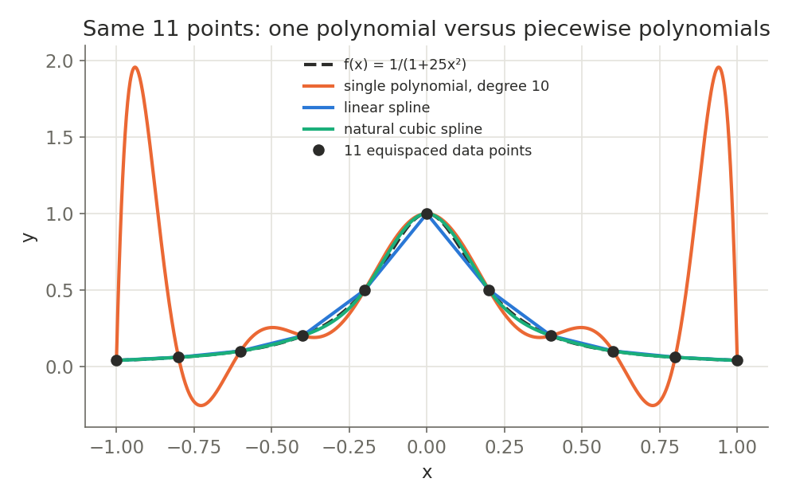
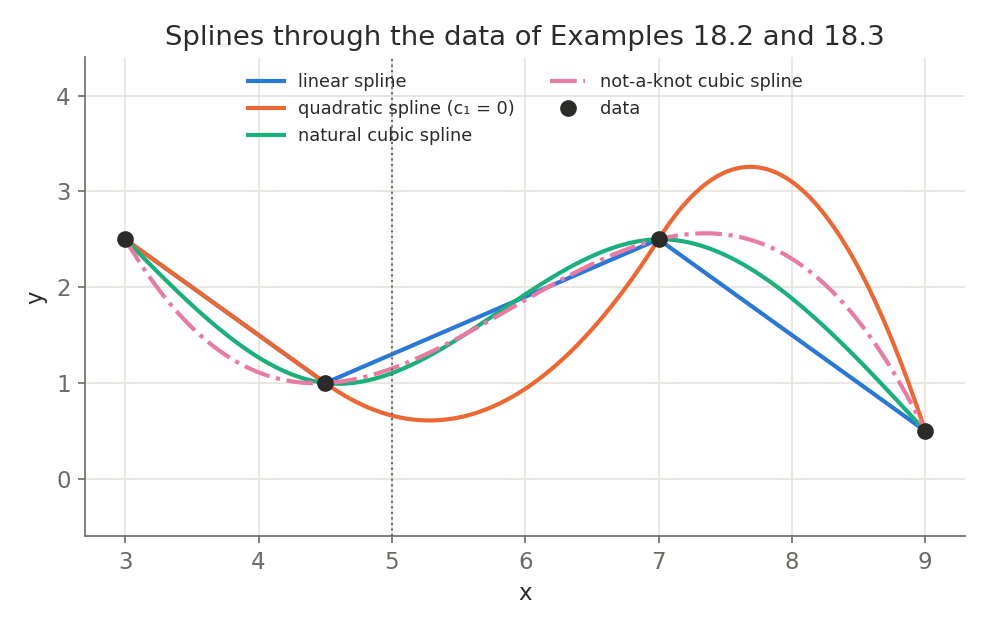
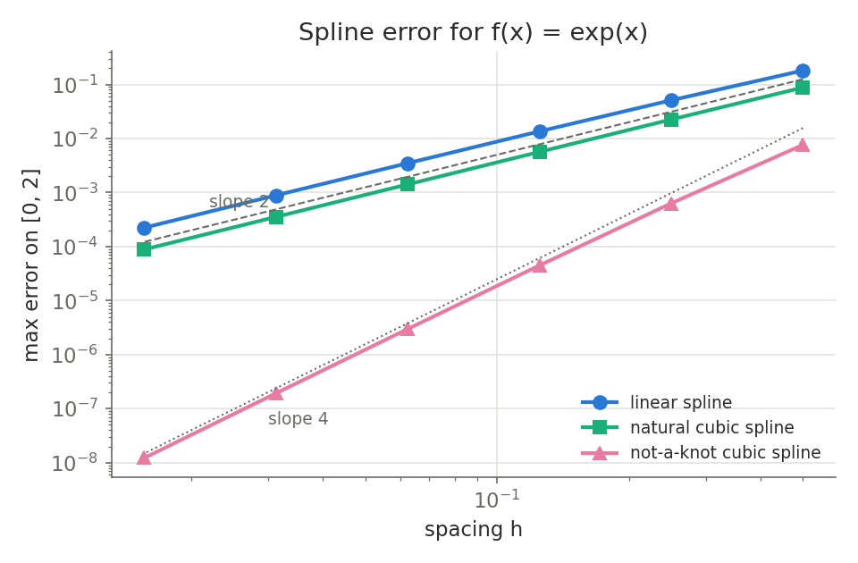
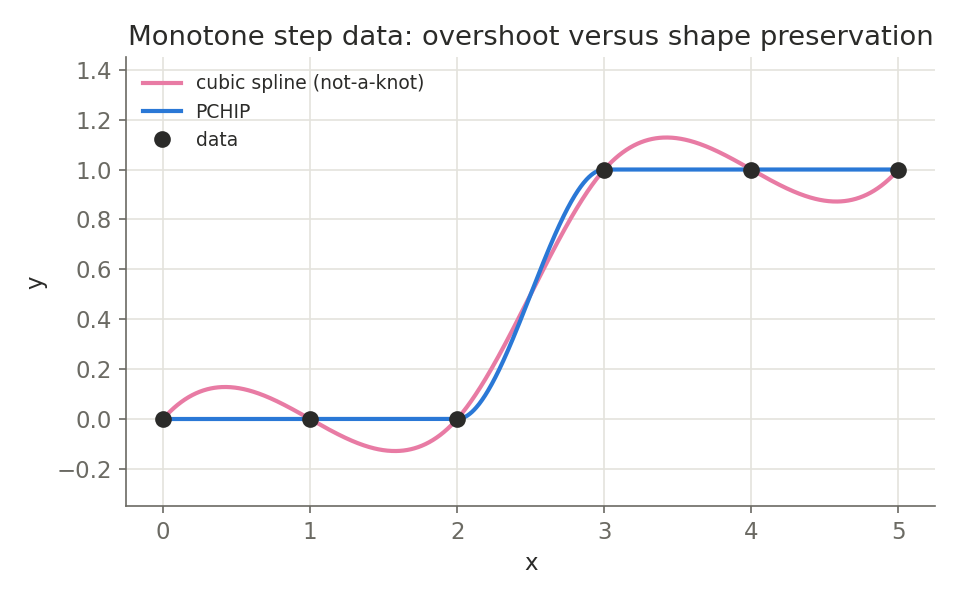
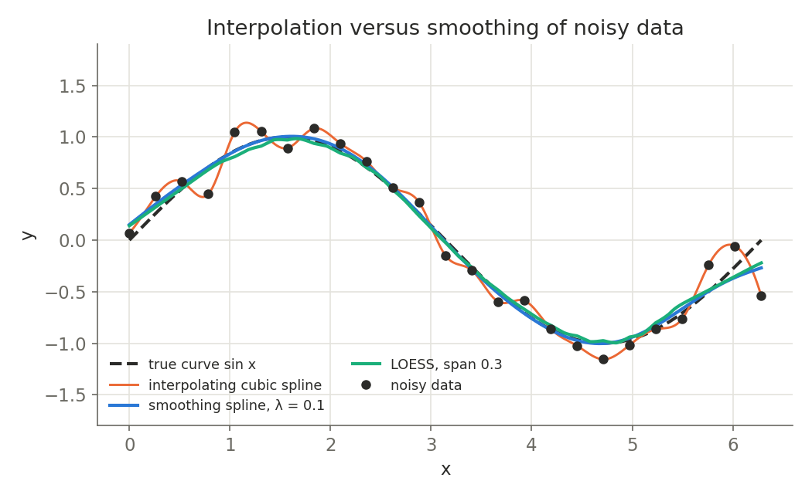

# 18장 — 스플라인과 구간별 보간

[레포지토리 안내](../../README.ko.md) | [English](Concepts_Lecture.md) | [한국어](Concepts_Lecture.ko.md)

> **최종 수정일:** 2026-11-19
>
> Applied Numerical Methods with Python for Engineers and Scientists, Chapra and Clough, Ch 18

> **학습 목표:**
> 1. 삼차 스플라인 보간을 구성할 수 있다
> 2. 자연, 고정, not-a-knot 끝 조건을 비교할 수 있다
> 3. 매끄러운 데이터 보간에 스플라인을 적용할 수 있다
> 4. 선형, 이차, 삼차 스플라인의 연속성 조건과 필요한 방정식 수를 설명할 수 있다
> 5. 쌍선형 보간으로 2차원 격자의 값을 보간할 수 있다
> 6. 삼차 스플라인의 삼중대각 시스템과 끝 조건의 방정식을 유도하고 토마스 알고리즘과 SciPy로 계산할 수 있다

---

<br>

## 목차

- [1. 소개 및 동기](#1-소개-및-동기)
- [2. 연속성 조건](#2-연속성-조건)
- [3. 선형 스플라인(Linear Spline)](#3-선형-스플라인linear-spline)
  - [3.1 설정](#31-설정)
  - [3.2 공식](#32-공식)
  - [3.3 성질](#33-성질)
  - [3.4 선형 스플라인의 계산과 오차](#34-선형-스플라인의-계산과-오차)
- [4. 이차 스플라인(Quadratic Spline)](#4-이차-스플라인quadratic-spline)
  - [4.1 일반 형태](#41-일반-형태)
  - [4.2 조건 유도](#42-조건-유도)
  - [4.3 예제 18.2: 이차 스플라인](#43-예제-182-이차-스플라인)
  - [4.4 예제 18.2의 수치 계산과 이차 스플라인의 한계](#44-예제-182의-수치-계산과-이차-스플라인의-한계)
- [5. 삼차 스플라인(Cubic Spline)](#5-삼차-스플라인cubic-spline)
  - [5.1 일반 형태](#51-일반-형태)
  - [5.2 조건 유도 (i~iv)](#52-조건-유도-iiv)
  - [5.3 미지수 소거: cᵢ에 대한 삼중대각 시스템](#53-미지수-소거-c_i에-대한-삼중대각-시스템)
  - [5.4 끝 조건(End Conditions, 교재 18.4.2절)](#54-끝-조건end-conditions-교재-1842절)
  - [5.5 예제 18.3: 삼차 스플라인](#55-예제-183-삼차-스플라인)
  - [5.6 삼중대각 방정식의 대수적 유도](#56-삼중대각-방정식의-대수적-유도)
  - [5.7 고정 끝 조건과 not-a-knot 끝 조건의 방정식](#57-고정-끝-조건과-not-a-knot-끝-조건의-방정식)
  - [5.8 토마스 알고리즘을 이용한 구현](#58-토마스-알고리즘을-이용한-구현)
  - [5.9 SciPy의 CubicSpline과 스플라인의 오차](#59-scipy의-cubicspline과-스플라인의-오차)
  - [5.10 형상 보존 구간별 삼차 에르미트 보간](#510-형상-보존-구간별-삼차-에르미트-보간)
  - [5.11 잡음이 있는 데이터의 평활화: 평활 스플라인과 LOESS](#511-잡음이-있는-데이터의-평활화-평활-스플라인과-loess)
- [6. 쌍선형 보간(Bilinear Interpolation)](#6-쌍선형-보간bilinear-interpolation)
  - [6.1 설정](#61-설정)
  - [6.2 공식](#62-공식)
  - [6.3 쌍선형 보간의 계산 예와 성질](#63-쌍선형-보간의-계산-예와-성질)
- [7. 스플라인 유형 비교](#7-스플라인-유형-비교)
- [개념 적용](#개념-적용)
- [요약](#요약)
- [점검 문제](#점검-문제)
- [참고 문헌](#참고-문헌)

---

<br>

## 1. 소개 및 동기

**스플라인(Spline)** 은 원래 물리적 제도 도구로, 몇 개의 제어점에 고정된 길고 유연한 자의 장력이 해당 점들을 통과하는 매끄러운 곡선을 만든다.

수치 해석에서 스플라인은 데이터 점 사이에서 격렬하게 진동할 수 있는 단일 고차 다항식(룽게 현상) 대신, **저차 다항식**을 **구간별(Piecewise)** 방식으로 적합하여 진동을 최소화한다.

> **핵심:** 단순한 선형 스플라인(데이터 점을 직선 구간으로 연결)은 특히 함수가 한 곳에서 급하게 변할 때 단일 고차 다항식보다 **더 나은 근사**를 제공할 수 있다(교재의 그림 18.1).

근본적인 절충:

| 접근법 | 장점 | 단점 |
|---|---|---|
| 단일 고차 다항식 | 전역적으로 매끄러움 | 진동(룽게 현상) |
| 구간별 저차 스플라인 | 진동 없음, 국소적 제어 | 매듭(Knot)에서의 매끄러움을 강제해야 함 |

*표 1. 단일 고차 다항식과 구간별 저차 스플라인의 비교*

17장의 룽게 함수를 등간격 점 11개로 보간하면 이 절충이 분명히 드러난다. 10차 다항식 하나로 모든 점을 지나게 하면 양 끝에서 2에 가까운 값까지 치솟지만, 같은 점을 선형 스플라인이나 삼차 스플라인으로 이으면 함수를 거의 그대로 따라간다(그림 1). 스플라인은 차수를 높이는 대신 구간을 나누어 정확도를 얻는다.



*그림 1. 같은 11개의 점을 지나는 10차 다항식, 선형 스플라인, 자연 삼차 스플라인*

> **용어 정의:** **k차 스플라인(spline of degree k)** 은 매듭 $`x_1 < x_2 < \cdots < x_n`$으로 나뉜 각 구간에서 차수가 $`k`$ 이하인 다항식이고, 전체 구간에서 $`k - 1`$계 도함수까지 연속인 함수이다. 보간 스플라인은 여기에 모든 매듭에서 $`S(x_i) = f_i`$라는 보간 조건을 더한 것이다.

---

<br>

## 2. 연속성 조건

두 구간별 다항식 구간이 한 점(**매듭, Knot**이라 함)에서 만날 때, 연결이 얼마나 매끄러운지를 지정해야 한다. 이것은 **$`C^k`$ 연속성**으로 기술된다.

- **$`C^0`$ 연속성:** 곡선의 위치(함수값)가 매듭에서 연속이다.

```math
f_1 = f_2
```

- **$`C^1`$ 연속성:** 위치 **및** 1계도함수가 매듭에서 연속이다.

```math
f_1 = f_2, \quad f_1' = f_2'
```

- **$`C^2`$ 연속성:** 위치, 1계도함수, **및** 2계도함수가 매듭에서 연속이다.

```math
f_1 = f_2, \quad f_1' = f_2', \quad f_1'' = f_2''
```

- **$`C^n`$ 연속성:** 0차, 1차, 2차, ..., $`n`$차 도함수가 모두 매듭에서 연속이다.

> **참고:** **시각적 해석.**
> - $`C^0`$: 곡선이 연결되어 있지만 뾰족한 모서리(꺾임)가 있을 수 있다.
> - $`C^1`$: 곡선이 연결되어 있고 접선 방향이 일치하여 눈에 보이는 모서리가 없지만, 곡률이 갑자기 변할 수 있다.
> - $`C^2`$: 곡선이 연결되어 있고, 접선 방향이 일치하며, 곡률도 연속이어서 시각적으로 매우 매끄럽다.

정의에 따라 선형 스플라인($`k = 1`$)은 $`C^0`$, 이차 스플라인($`k = 2`$)은 $`C^1`$, 삼차 스플라인($`k = 3`$)은 $`C^2`$ 연속성을 요구한다. 연속성을 한 단계 더 요구하면 $`k`$차 다항식 두 개가 매듭에서 $`k`$계 도함수까지 같아져, 남은 최고차 계수까지 같아지므로 두 구간이 사실상 하나의 다항식이 된다. 따라서 $`k`$차 스플라인이 가질 수 있는 가장 높은 연속성은 $`C^{k-1}`$이다. 곡선의 휘어짐을 나타내는 곡률은 2계 도함수에 비례하므로(기울기가 작을 때), 눈으로 보기에 매끄러운 곡선을 원하면 2계 도함수까지 연속인 삼차 스플라인이 필요하다.

---

<br>

## 3. 선형 스플라인(Linear Spline)

**필요 조건:** $`C^0`$ 연속성

### 3.1 설정

$`n`$개의 데이터 점을 고려한다: $`(x_1, f_1), (x_2, f_2), \dots, (x_n, f_n)`$.

- $`n - 1`$개의 구간이 있다.
- 각 구간 $`i`$는 자체 스플라인 함수 $`S_i(x)`$를 가진다.

```text
       S_1          S_2                  S_{n-1}
x_1 -------- x_2 -------- x_3   . . .   x_{n-1} -------- x_n
```

*그림 2. n개의 데이터 점과 n-1개의 구간별 스플라인 함수*

### 3.2 공식

$`i`$번째 구간 $`[x_i,\; x_{i+1}]`$에서:

```math
S_i(x) = f_i + \frac{f_{i+1} - f_i}{x_{i+1} - x_i}(x - x_i)
```

이것은 단순히 연속된 데이터 점 사이의 **선형 보간**이다.

### 3.3 성질

- 자동으로 $`C^0`$ 연속성을 만족한다(구간들이 끝점을 공유하므로).
- 매듭에서 **매끄럽지 않다**. 두 구간이 만나는 곳에서 1계도함수가 일반적으로 불연속이다.

> **참고:** **한계.** 매듭에서 매끄럽지 않다는 한계 때문에, 매끄러움을 보장하는 더 높은 차수의 다항식 스플라인(이차, 삼차)을 사용한다.

### 3.4 선형 스플라인의 계산과 오차

선형 스플라인으로 한 점 $`x`$의 값을 구하려면 먼저 $`x_i \le x \le x_{i+1}`$인 구간 $`i`$를 찾고 3.2절의 공식을 적용한다. 매듭이 정렬되어 있으므로 구간은 이분 탐색으로 $`O(\log n)`$에 찾을 수 있으며, `np.searchsorted`가 이 일을 한다. 예제 18.3의 데이터 $`x = (3, 4.5, 7, 9)`$, $`f = (2.5, 1, 2.5, 0.5)`$에서 $`x = 5`$는 둘째 구간에 있으므로

```math
S_2(5) = 1 + \frac{2.5 - 1}{7 - 4.5}(5 - 4.5) = 1 + 0.6 \times 0.5 = 1.3
```

이다. NumPy의 `np.interp(5.0, x, f)`는 같은 계산을 하며 1.3을 돌려준다.

각 구간의 선형 스플라인은 두 점을 지나는 1차 보간 다항식이므로 17장의 보간 오차 공식이 구간마다 성립한다. $`f`$가 2번 연속 미분 가능하면 구간 $`i`$ 안에서

```math
|f(x) - S_i(x)| \le \frac{h_i^2}{8}\,\max_{x_i \le t \le x_{i+1}} |f''(t)|
```

이다. 전체 구간에서는 $`h = \max_i h_i`$로 놓아 $`\max |f - S| \le \frac{h^2}{8}\max|f''|`$를 얻는다. 매듭 간격을 절반으로 줄이면 오차 한계가 4분의 1로 줄며, 이를 오차가 $`O(h^2)`$이라고 한다. 차수를 높이지 않고 점을 늘리기만 하면 오차가 0으로 수렴하므로, 17장의 룽게 현상 같은 발산이 생기지 않는다.

> **주의:** `np.interp`는 매듭이 증가하는 순서라고 가정하며, 범위 밖의 $`x`$에는 외삽하지 않고 양 끝의 값을 그대로 돌려준다. 정렬되지 않은 데이터를 넣거나 범위 밖에서 쓰면 오류 없이 잘못된 값을 얻으므로 주의해야 한다.

---

<br>

## 4. 이차 스플라인(Quadratic Spline)

**필요 조건:** $`C^1`$ 연속성

### 4.1 일반 형태

각 구간 $`i`$에서 2차 다항식을 사용한다:

```math
S_i(x) = a_i + b_i(x - x_i) + c_i(x - x_i)^2
```

각 구간에 **3개의 미지수**($`a_i`$, $`b_i`$, $`c_i`$)가 있다.

$`n`$개의 데이터 점과 $`n-1`$개의 구간이 있으므로, 총 미지수는 $`3(n-1)`$이다.

### 4.2 조건 유도

모든 미지수를 결정하려면 $`3(n-1)`$개의 방정식이 필요하다.

---

**조건 (i): 왼쪽 끝점에서의 함수값**

```math
S_i(x_i) = a_i = f_i, \quad \text{for } i = 1, 2, \dots, n-1
```

이것은 $`n - 1`$개의 방정식을 제공하며, 즉시 $`a_i = f_i`$를 결정한다.

---

**조건 (ii): 내부 매듭 $`x_{i+1}`$에서의 $`C^0`$ 연속성**

```math
S_i(x_{i+1}) = S_{i+1}(x_{i+1}) = f_{i+1}
```

다항식 형태를 대입하고 $`h_i := x_{i+1} - x_i`$로 놓으면:

```math
f_i + b_i h_i + c_i h_i^2 = f_{i+1}, \quad \text{for } i = 1, 2, \dots, n-1
```

이것은 $`n - 1`$개의 방정식을 제공한다.

---

**조건 (iii): $`(n-2)`$개의 내부 매듭에서의 $`C^1`$ 연속성**

각 구간의 도함수는:

```math
S_i'(x) = b_i + 2c_i(x - x_i)
```

각 내부 매듭 $`x_{i+1}`$에서 인접 구간의 도함수를 같게 놓으면:

```math
S_i'(x_{i+1}) = S_{i+1}'(x_{i+1})
```

```math
b_i + 2c_i h_i = b_{i+1}, \quad \text{for } i = 1, 2, \dots, n-2
```

이것은 $`n - 2`$개의 방정식을 제공한다.

---

**방정식 수:**

| 출처 | 수 |
|---|---|
| (i) 왼쪽 끝점 값 | $`n - 1`$ |
| (ii) $`C^0`$ 연속성 | $`n - 1`$ |
| (iii) $`C^1`$ 연속성 | $`n - 2`$ |
| **합계** | $`3(n-1) - 1`$ |

*표 2. 이차 스플라인의 조건별 방정식 수*

방정식이 **1개 부족**하다. 따라서 추가 조건이 필요하다.

---

**조건 (iv): 추가 조건**

$`c_1 = 0`$을 선택한다. 이는 첫 번째 구간이 **선형 근사**가 됨을 의미한다:

```math
S_1(x) = f_1 + b_1(x - x_1)
```

이것으로 시스템이 닫히고 모든 계수를 순차적으로 계산할 수 있다.

### 4.3 예제 18.2: 이차 스플라인

**주어진 조건:** 4개의 데이터 점 $`(x_1, f_1),\, (x_2, f_2),\, (x_3, f_3),\, (x_4, f_4)`$

- 3개의 구간
- $`3 \times 3 = 9`$개의 미지수 (단, $`a_i = f_i`$로 6개로 축소)

**세 스플라인 함수 ($`a_i = f_i`$ 적용 후):**

```math
S_1(x) = f_1 + b_1(x - x_1) + c_1(x - x_1)^2
```

```math
S_2(x) = f_2 + b_2(x - x_2) + c_2(x - x_2)^2
```

```math
S_3(x) = f_3 + b_3(x - x_3) + c_3(x - x_3)^2
```

**$`C^0`$ 연속성 (조건 ii)으로부터:**

```math
f_2 - f_1 = b_1 h_1 + c_1 h_1^2
```

```math
f_3 - f_2 = b_2 h_2 + c_2 h_2^2
```

```math
f_4 - f_3 = b_3 h_3 + c_3 h_3^2
```

**$`C^1`$ 연속성 (조건 iii)으로부터:**

```math
b_1 + 2c_1 h_1 - b_2 = 0
```

```math
b_2 + 2c_2 h_2 - b_3 = 0
```

**추가 조건 (조건 iv)으로부터:**

```math
c_1 = 0
```

이것은 6개의 미지수($`b_1, c_1, b_2, c_2, b_3, c_3`$)에 대한 **6개의 방정식**을 제공한다.

**행렬 / 벡터 형태:**

```math
\begin{pmatrix} f_2 - f_1 \\ f_3 - f_2 \\ f_4 - f_3 \\ 0 \\ 0 \\ 0 \end{pmatrix} = \begin{pmatrix} h_1 & h_1^2 & 0 & 0 & 0 & 0 \\ 0 & 0 & h_2 & h_2^2 & 0 & 0 \\ 0 & 0 & 0 & 0 & h_3 & h_3^2 \\ 1 & 2h_1 & -1 & 0 & 0 & 0 \\ 0 & 0 & 1 & 2h_2 & -1 & 0 \\ 0 & 1 & 0 & 0 & 0 & 0 \end{pmatrix} \begin{pmatrix} b_1 \\ c_1 \\ b_2 \\ c_2 \\ b_3 \\ c_3 \end{pmatrix}
```

> **참고:** 이것은 표준적인 기법(가우스 소거법, LU 분해 등)을 사용하여 풀 수 있는 선형 시스템 $`\mathbf{A}\mathbf{x} = \mathbf{b}`$이다.

### 4.4 예제 18.2의 수치 계산과 이차 스플라인의 한계

예제 18.3과 같은 데이터 $`x = (3, 4.5, 7, 9)`$, $`f = (2.5, 1, 2.5, 0.5)`$로 이차 스플라인을 계산한다. 간격은 $`h_1 = 1.5`$, $`h_2 = 2.5`$, $`h_3 = 2`$이다. 4.3절의 6개 방정식은 $`c_1 = 0`$에서 출발하여 왼쪽부터 차례로 풀 수 있다.

1. $`c_1 = 0`$이므로 첫 $`C^0`$ 조건에서 $`b_1 = (f_2 - f_1)/h_1 = (1 - 2.5)/1.5 = -1`$이다.
2. $`x_2`$의 $`C^1`$ 조건에서 $`b_2 = b_1 + 2c_1h_1 = -1`$이다.
3. 둘째 $`C^0`$ 조건 $`f_3 - f_2 = b_2h_2 + c_2h_2^2`$에서 $`1.5 = -2.5 + 6.25c_2`$이므로 $`c_2 = 0.64`$이다.
4. $`x_3`$의 $`C^1`$ 조건에서 $`b_3 = b_2 + 2c_2h_2 = -1 + 3.2 = 2.2`$이다.
5. 셋째 $`C^0`$ 조건 $`f_4 - f_3 = b_3h_3 + c_3h_3^2`$에서 $`-2 = 4.4 + 4c_3`$이므로 $`c_3 = -1.6`$이다.

$`x = 5`$는 둘째 구간에 있으므로 $`S_2(5) = 1 + (-1)(0.5) + 0.64(0.5)^2 = 0.66`$이다.

```python
import numpy as np

x = np.array([3.0, 4.5, 7.0, 9.0])
f = np.array([2.5, 1.0, 2.5, 0.5])
h = np.diff(x)                       # h1, h2, h3

# Quadratic spline: c1 = 0, then march left to right
b = np.zeros(3); c = np.zeros(3)
b[0] = (f[1] - f[0]) / h[0]          # C0 on interval 1 with c1 = 0
for i in range(1, 3):
    b[i] = b[i-1] + 2.0 * c[i-1] * h[i-1]                # C1 at x_{i+1}
    c[i] = (f[i+1] - f[i] - b[i] * h[i]) / h[i]**2       # C0 on interval i+1
for i in range(3):
    print(f"S_{i+1}: a = {f[i]:.2f}, b = {b[i]:.4f}, c = {c[i]:.4f}")

t = 5.0                              # lies in interval 2, [4.5, 7]
print("quadratic S(5) = %.4f" % (f[1] + b[1]*(t - x[1]) + c[1]*(t - x[1])**2))
print("linear    S(5) = %.4f" % np.interp(t, x, f))
```

```text
S_1: a = 2.50, b = -1.0000, c = 0.0000
S_2: a = 1.00, b = -1.0000, c = 0.6400
S_3: a = 2.50, b = 2.2000, c = -1.6000
quadratic S(5) = 0.6600
linear    S(5) = 1.3000
```

- `b[0]`의 계산은 위 1단계이다. $`c_1 = 0`$이 정해져 있으므로 첫 구간의 기울기는 두 점의 기울기와 같다.
- 반복문의 첫 줄은 $`C^1`$ 조건으로 다음 구간의 기울기를, 둘째 줄은 $`C^0`$ 조건으로 다음 구간의 $`c_i`$를 구한다. 6개의 방정식을 행렬로 풀지 않고 왼쪽에서 오른쪽으로 대입만 하여 푸는 것은 $`c_1 = 0`$으로 시작점이 정해지기 때문이다.

계산 결과는 이차 스플라인의 약점을 보여 준다. 첫 구간은 $`c_1 = 0`$ 때문에 직선이 되고, 그 기울기 $`-1`$이 $`C^1`$ 조건을 따라 오른쪽으로 전달되면서 셋째 구간에서는 데이터 범위를 크게 벗어나는 봉우리(최댓값 약 3.26)가 생긴다(그림 3). 추가 조건을 왼쪽 끝 하나에만 두었으므로 결과가 좌우 대칭이 아니고, 데이터를 거꾸로 넣으면 다른 곡선이 나온다. 이차 스플라인은 이런 이유로 실무에서 잘 쓰이지 않으며, 양 끝에 하나씩 조건을 두는 삼차 스플라인이 표준이다.



*그림 3. 예제 18.2와 18.3의 데이터를 지나는 선형, 이차, 자연 삼차, not-a-knot 삼차 스플라인*

---

<br>

## 5. 삼차 스플라인(Cubic Spline)

**필요 조건:** $`C^2`$ 연속성

### 5.1 일반 형태

각 구간 $`i`$에서 3차 다항식을 사용한다:

```math
S_i(x) = a_i + b_i(x - x_i) + c_i(x - x_i)^2 + d_i(x - x_i)^3
```

각 구간에 **4개의 미지수**($`a_i`$, $`b_i`$, $`c_i`$, $`d_i`$)가 있다.

$`n`$개의 데이터 점과 $`n-1`$개의 구간이 있으므로, 총 미지수는 $`4(n-1)`$이다.

삼차 스플라인의 핵심 성질:

- 삼차 곡선은 **컴퓨터 그래픽스에서 널리 사용**된다.
- 구간별 삼차 다항식은 **$`C^2`$ 연속성**을 허용한다.
- 계산 비용과 매끄러움 사이의 좋은 **절충**이다.

### 5.2 조건 유도 (i~iv)

$`h_i := x_{i+1} - x_i`$로 놓는다.

---

**조건 (i): 왼쪽 끝점에서의 함수값**

```math
S_i(x_i) = a_i = f_i, \quad \text{for } i = 1, 2, \dots, n-1
```

$`n - 1`$개의 방정식을 제공하며, 즉시 $`a_i = f_i`$를 얻는다.

---

**조건 (ii): 매듭에서의 $`C^0`$ 연속성**

```math
S_i(x_{i+1}) = f_{i+1}
```

```math
f_i + b_i h_i + c_i h_i^2 + d_i h_i^3 = f_{i+1}, \quad \text{for } i = 1, 2, \dots, n-1 \quad \cdots (**)
```

$`n - 1`$개의 방정식을 제공한다.

---

**조건 (iii): 내부 매듭에서의 $`C^1`$ 연속성**

```math
S_i'(x) = b_i + 2c_i(x - x_i) + 3d_i(x - x_i)^2
```

$`x_{i+1}`$에서:

```math
S_i'(x_{i+1}) = b_i + 2c_i h_i + 3d_i h_i^2 = S_{i+1}'(x_{i+1}) = b_{i+1}
```

```math
\therefore \quad b_i + 2c_i h_i + 3d_i h_i^2 = b_{i+1}, \quad \text{for } i = 1, 2, \dots, n-2 \quad \cdots (*)
```

$`n - 2`$개의 방정식을 제공한다.

---

**조건 (iv): 내부 매듭에서의 $`C^2`$ 연속성**

```math
S_i''(x) = 2c_i + 6d_i(x - x_i)
```

$`x_{i+1}`$에서:

```math
S_i''(x_{i+1}) = 2c_i + 6d_i h_i = S_{i+1}''(x_{i+1}) = 2c_{i+1}
```

```math
\therefore \quad c_{i+1} = c_i + 3d_i h_i \quad \cdots (***)
```

```math
\Longrightarrow \quad d_i = \frac{c_{i+1} - c_i}{3 h_i}
```

$`n - 2`$개의 방정식을 제공한다.

---

**현재까지의 방정식 수:**

| 출처 | 수 |
|---|---|
| (i) $`a_i = f_i`$ | $`n - 1`$ |
| (ii) $`C^0`$ 연속성 | $`n - 1`$ |
| (iii) $`C^1`$ 연속성 | $`n - 2`$ |
| (iv) $`C^2`$ 연속성 | $`n - 2`$ |
| **합계** | $`4n - 6`$ |

*표 3. 삼차 스플라인의 조건별 방정식 수*

미지수: $`4(n-1) = 4n - 4`$.

**2개의 방정식이 더** 필요하다 (끝 조건).

### 5.3 미지수 소거: $`c_i`$에 대한 삼중대각 시스템

핵심 전략은 모든 미지수를 $`c_i`$만으로 표현한 다음, 삼중대각 시스템을 푸는 것이다.

**단계 1: $`d_i`$를 $`c_i`$로 표현.**

조건 (iv)로부터:

```math
d_i = \frac{c_{i+1} - c_i}{3h_i}
```

**단계 2: $`b_i`$를 $`c_i`$로 표현.**

$`d_i`$를 $`C^0`$ 연속성 방정식 $`(**)`$에 대입:

```math
f_{i+1} = f_i + b_i h_i + c_i h_i^2 + \frac{c_{i+1} - c_i}{3} h_i^2
```

```math
= f_i + b_i h_i + \frac{h_i^2}{3}(c_{i+1} + 2c_i)
```

$`b_i`$에 대해 풀면:

```math
b_i = \frac{f_{i+1} - f_i}{h_i} - \frac{h_i}{3}(2c_i + c_{i+1})
```

**단계 3: 삼중대각 방정식 유도.**

$`C^1`$ 연속성 조건 $`(*)`$에서 $`d_i`$를 대입하면:

```math
b_{i+1} = b_i + h_i(c_i + c_{i+1})
```

$`b_i`$ 공식의 인덱스를 1 줄이면:

```math
b_{i-1} = \frac{f_i - f_{i-1}}{h_{i-1}} - \frac{h_{i-1}}{3}(2c_{i-1} + c_i)
```

그리고 마찬가지로:

```math
b_i = b_{i-1} + h_{i-1}(c_{i-1} + c_i)
```

대수적 조작($`b_i`$와 $`b_{i-1}`$의 표현을 대입하고 정리) 후, 결과는:

```math
3\frac{f_{i+1} - f_i}{h_i} - 3\frac{f_i - f_{i-1}}{h_{i-1}} = h_{i-1}\,c_{i-1} + 2(h_{i-1} + h_i)\,c_i + h_i\,c_{i+1}
```

$`i = 2, 3, \dots, n-1`$에 대해. $`i = n - 1`$인 식에는 5.4절에서 추가 변수로 도입하는 $`c_n`$이 나타난다.

> **참고:** 좌변은 **분할 차분**을 포함한다:
> ```math
> 3\,f[x_{i+1}, x_i] - 3\,f[x_i, x_{i-1}]
> ```
> 여기서 $`f[x_{i+1}, x_i] = \dfrac{f_{i+1} - f_i}{h_i}`$.

이것은 미지수 $`c_1, c_2, \dots, c_n`$($`n`$개)에 대한 $`n - 2`$개의 방정식을 제공한다. 2개의 끝 조건과 합치면 $`n`$개의 미지수에 대한 $`n`$개의 방정식을 얻는다.

**행렬 형태 (자연 끝 조건 $`c_1 = 0`$, $`c_n = 0`$인 경우):**

```math
\begin{pmatrix} 0 \\ 3(f[x_3,x_2] - f[x_2,x_1]) \\ 3(f[x_4,x_3] - f[x_3,x_2]) \\ \vdots \\ 3(f[x_n,x_{n-1}] - f[x_{n-1},x_{n-2}]) \\ 0 \end{pmatrix} = \begin{pmatrix} 1 & & & & \\ h_1 & 2(h_1+h_2) & h_2 & & \\ & h_2 & 2(h_2+h_3) & h_3 & \\ & & \ddots & \ddots & \ddots \\ & & & h_{n-2} & 2(h_{n-2}+h_{n-1}) & h_{n-1} \\ & & & & & 1 \end{pmatrix} \begin{pmatrix} c_1 \\ c_2 \\ c_3 \\ \vdots \\ c_{n-1} \\ c_n \end{pmatrix}
```

> **핵심:** 계수 행렬은 **삼중대각(Tridiagonal)** 이고 **대각 우위(Diagonally Dominant)** 이므로, **토마스 알고리즘(Thomas Algorithm)** 을 사용하여 $`O(n)`$ 연산으로 매우 효율적으로 풀 수 있다.

**$`c_i`$를 풀고 나면, 다른 계수를 복원:**

```math
d_i = \frac{c_{i+1} - c_i}{3h_i}, \quad i = 1, 2, \dots, n-1
```

```math
b_i = \frac{f_{i+1} - f_i}{h_i} - \frac{h_i}{3}(2c_i + c_{i+1}), \quad i = 1, 2, \dots, n-1
```

계산 절차를 정리하면 다음과 같다.


*그림 4. 삼차 스플라인 계수의 계산 절차*

### 5.4 끝 조건(End Conditions, 교재 18.4.2절)

삼중대각 시스템은 $`c_n`$을 포함하여 $`n`$개의 미지수($`c_1, \dots, c_n`$)를 갖지만 내부 방정식은 $`n - 2`$개뿐이므로, **2개의 추가 경계(끝) 조건**이 필요하다:

| 끝 조건 | 설명 | 방정식 |
|---|---|---|
| **자연(Natural)** | 양 끝점에서 2계도함수가 0 | $`c_1 = 0, \quad c_n = 0`$ |
| **고정(Clamped)** | 끝점에서의 1계도함수 $`f_1'`$과 $`f_n'`$이 지정됨 | 삼중대각 시스템의 첫 번째와 마지막 행을 수정 |
| **Not-a-knot** | 두 번째와 마지막에서 두 번째 매듭에서 **3계도함수**의 연속성 | $`S_1 = S_2`$ (같은 삼차식)이고 $`S_{n-2} = S_{n-1}`$ (같은 삼차식) |

*표 4. 삼차 스플라인의 끝 조건*

> **참고:** **자연 스플라인**이 가장 일반적인 기본 선택이다. $`S_1''(x_1) = 0`$으로 설정하면 $`c_1 = 0`$을 얻고, $`S_{n-1}''(x_n) = 0`$으로 설정하면 ($`(***)`$를 통해) $`c_n = 0`$을 얻는다.
>
> 행렬 시스템의 크기를 $`n \times n`$으로 균일하게 만들기 위해, 마지막 구간이 $`S_{n-1}`$임에도 $`c_n`$을 추가 변수로 **도입하는 것이 편리**하다.

**자연 끝 조건의 유도:**

왼쪽 끝에서:

```math
S_1''(x_1) = 2c_1 + 6d_1(x_1 - x_1) = 2c_1 = 0 \implies c_1 = 0
```

오른쪽 끝에서:

```math
S_{n-1}''(x_n) = 2c_{n-1} + 6d_{n-1}h_{n-1} = 0
```

$`c_{i+1} = c_i + 3d_i h_i`$ (조건 $`(***)`$)를 사용하면, 이것은 $`c_n = 0`$을 의미한다.

### 5.5 예제 18.3: 삼차 스플라인

**주어진 조건:** 4개의 데이터 점 $`(x_1, f_1),\, (x_2, f_2),\, (x_3, f_3),\, (x_4, f_4)`$

- 3개의 구간
- $`3 \times 4 = 12`$개의 미지수

**세 스플라인 함수 ($`a_i = f_i`$ 이후):**

```math
S_1(x) = f_1 + b_1(x - x_1) + c_1(x - x_1)^2 + d_1(x - x_1)^3
```

```math
S_2(x) = f_2 + b_2(x - x_2) + c_2(x - x_2)^2 + d_2(x - x_2)^3
```

```math
S_3(x) = f_3 + b_3(x - x_3) + c_3(x - x_3)^2 + d_3(x - x_3)^3
```

**도함수:**

```math
S_i'(x) = b_i + 2c_i(x - x_i) + 3d_i(x - x_i)^2
```

```math
S_i''(x) = 2c_i + 6d_i(x - x_i)
```

**삼중대각 시스템 (자연 끝 조건, $`c_1 = 0`$, $`c_4 = 0`$):**

```math
\begin{pmatrix} 0 \\ 3(f[x_3, x_2] - f[x_2, x_1]) \\ 3(f[x_4, x_3] - f[x_3, x_2]) \\ 0 \end{pmatrix} = \begin{pmatrix} 1 & 0 & 0 & 0 \\ h_1 & 2(h_1 + h_2) & h_2 & 0 \\ 0 & h_2 & 2(h_2 + h_3) & h_3 \\ 0 & 0 & 0 & 1 \end{pmatrix} \begin{pmatrix} c_1 \\ c_2 \\ c_3 \\ c_4 \end{pmatrix}
```

**$`c_1, c_2, c_3, c_4`$를 풀고 나면, 복원:**

```math
b_i = \frac{f_{i+1} - f_i}{h_i} - \frac{h_i}{3}(2c_i + c_{i+1}), \quad i = 1, 2, 3
```

```math
d_i = \frac{c_{i+1} - c_i}{3h_i}, \quad i = 1, 2, 3
```

다음 Python 코드는 자연 끝 조건으로 삼차 스플라인 계수를 구하고, 예제 18.3의 데이터 $`x = (3, 4.5, 7, 9)`$, $`f = (2.5, 1, 2.5, 0.5)`$에 적용한다.

```python
import numpy as np

def cubic_spline_natural(x, f):
    """
    Compute natural cubic spline coefficients.

    Parameters
    ----------
    x : array-like, shape (n,)
        Knot positions (sorted).
    f : array-like, shape (n,)
        Function values at knots.

    Returns
    -------
    a, b, c, d : arrays, each of shape (n-1,)
        Coefficients for S_i(t) = a_i + b_i*(t-x_i)
                                    + c_i*(t-x_i)^2
                                    + d_i*(t-x_i)^3
    """
    n = len(x)
    h = np.diff(x)                     # h[i] = x[i+1] - x[i]

    # --- Build the tridiagonal system for c ---
    # Size: n x n  (with c[0] = 0, c[n-1] = 0 as natural BCs)
    A = np.zeros((n, n))
    rhs = np.zeros(n)

    # Natural end conditions
    A[0, 0] = 1.0
    A[n-1, n-1] = 1.0

    # Interior equations  (i = 1, 2, ..., n-2)
    for i in range(1, n - 1):
        A[i, i-1] = h[i-1]
        A[i, i]   = 2.0 * (h[i-1] + h[i])
        A[i, i+1] = h[i]
        rhs[i] = 3.0 * ((f[i+1] - f[i]) / h[i]
                       - (f[i] - f[i-1]) / h[i-1])

    c = np.linalg.solve(A, rhs)

    # --- Recover b and d ---
    a = f[:-1].copy()
    b = np.zeros(n - 1)
    d = np.zeros(n - 1)

    for i in range(n - 1):
        d[i] = (c[i+1] - c[i]) / (3.0 * h[i])
        b[i] = (f[i+1] - f[i]) / h[i] \
             - h[i] * (2.0 * c[i] + c[i+1]) / 3.0

    c = c[:-1]   # only need c[0] ... c[n-2]

    return a, b, c, d


def evaluate_spline(x_knots, a, b, c, d, x_eval):
    """Evaluate the cubic spline at points x_eval."""
    results = np.zeros_like(x_eval, dtype=float)
    for j, xv in enumerate(x_eval):
        # Find the correct interval
        i = np.searchsorted(x_knots, xv, side='right') - 1
        i = np.clip(i, 0, len(a) - 1)
        dx = xv - x_knots[i]
        results[j] = a[i] + b[i]*dx + c[i]*dx**2 + d[i]*dx**3
    return results


# --- Example usage ---
if __name__ == "__main__":
    # Example 18.3: 4 data points
    x = np.array([3.0, 4.5, 7.0, 9.0])
    f = np.array([2.5, 1.0, 2.5, 0.5])

    a, b, c, d = cubic_spline_natural(x, f)

    print("Spline coefficients:")
    for i in range(len(a)):
        print(f"  S_{i+1}(x): a={a[i]:.6f}, b={b[i]:.6f}, "
              f"c={c[i]:.6f}, d={d[i]:.6f}")

    # Evaluate
    x_test = np.array([5.0])
    y_test = evaluate_spline(x, a, b, c, d, x_test)
    print(f"\nS(5.0) = {y_test[0]:.6f}")
```

실행 결과는 다음과 같다.

```text
Spline coefficients:
  S_1(x): a=2.500000, b=-1.419772, c=0.000000, d=0.186565
  S_2(x): a=1.000000, b=-0.160456, c=0.839544, d=-0.214144
  S_3(x): a=2.500000, b=0.022053, c=-0.766540, d=0.127757

S(5.0) = 1.102890
```

자연 끝 조건에 따라 $`c_1 = 0`$이고, 삼중대각 시스템을 풀면 $`c_2 \approx 0.839544`$, $`c_3 \approx -0.766540`$이다. $`x = 5`$는 둘째 구간 $`[4.5, 7]`$에 속하므로 $`S(5) = S_2(5) \approx 1.102890`$이다.

### 5.6 삼중대각 방정식의 대수적 유도

5.3절에서 "대수적 조작"으로 줄인 과정을 단계별로 적는다. 먼저 쓸 두 관계식은 다음과 같다.

조건 (ii)에 $`d_i`$를 대입하여 얻은 $`b_i`$의 식(5.3절 단계 2)을 (A)라 한다.

```math
b_i = f[x_{i+1}, x_i] - \frac{h_i}{3}(2c_i + c_{i+1}) \qquad \text{(A)}
```

조건 (iii) $`b_{i+1} = b_i + 2c_ih_i + 3d_ih_i^2`$에 $`3d_ih_i^2 = (c_{i+1} - c_i)h_i`$를 대입하면 다음 식 (B)를 얻는다.

```math
b_{i+1} = b_i + 2c_ih_i + (c_{i+1} - c_i)h_i = b_i + h_i(c_i + c_{i+1}) \qquad \text{(B)}
```

(B)의 인덱스를 하나 줄이면 $`b_i = b_{i-1} + h_{i-1}(c_{i-1} + c_i)`$이다. 이 식의 $`b_i`$와 $`b_{i-1}`$에 각각 (A)를 대입한다.

```math
f[x_{i+1}, x_i] - \frac{h_i}{3}(2c_i + c_{i+1}) = f[x_i, x_{i-1}] - \frac{h_{i-1}}{3}(2c_{i-1} + c_i) + h_{i-1}(c_{i-1} + c_i)
```

우변의 $`c`$ 항을 정리하면 $`c_{i-1}`$의 계수는 $`-\frac{2h_{i-1}}{3} + h_{i-1} = \frac{h_{i-1}}{3}`$, $`c_i`$의 계수는 $`-\frac{h_{i-1}}{3} + h_{i-1} = \frac{2h_{i-1}}{3}`$이다. 분할 차분을 좌변으로, $`c`$ 항을 우변으로 모으면

```math
f[x_{i+1}, x_i] - f[x_i, x_{i-1}] = \frac{h_{i-1}}{3}c_{i-1} + \frac{2(h_{i-1} + h_i)}{3}c_i + \frac{h_i}{3}c_{i+1}
```

이고, 양변에 3을 곱하면 5.3절의 삼중대각 방정식이 된다.

```math
3f[x_{i+1}, x_i] - 3f[x_i, x_{i-1}] = h_{i-1}c_{i-1} + 2(h_{i-1} + h_i)c_i + h_ic_{i+1}, \quad i = 2, \ldots, n - 1
```

각 방정식은 이웃한 세 개의 $`c`$만 포함하므로 행렬이 삼중대각이 된다. 또 대각 원소 $`2(h_{i-1} + h_i)`$는 같은 행의 비대각 원소의 합 $`h_{i-1} + h_i`$의 두 배이므로 행렬은 엄격한 대각 우위이다. 엄격한 대각 우위 행렬은 정칙이므로 자연 끝 조건의 시스템은 언제나 유일한 해를 가지며, 피봇팅 없는 가우스 소거법(토마스 알고리즘)도 안정적으로 동작한다.

예제 18.3에 적용하면 $`h = (1.5, 2.5, 2)`$, $`f[x_2, x_1] = -1`$, $`f[x_3, x_2] = 0.6`$, $`f[x_4, x_3] = -1`$이므로 내부 방정식은

```math
1.5c_1 + 8c_2 + 2.5c_3 = 4.8, \qquad 2.5c_2 + 9c_3 + 2c_4 = -4.8
```

이고, 자연 끝 조건 $`c_1 = c_4 = 0`$을 넣어 풀면 $`c_2 = 0.839544`$, $`c_3 = -0.766540`$이다.

### 5.7 고정 끝 조건과 not-a-knot 끝 조건의 방정식

표 4의 고정 조건과 not-a-knot 조건을 삼중대각 시스템의 첫 행과 마지막 행으로 바꾸는 과정을 유도한다. 5.4절과 같이 $`c_n`$을 추가 변수로 둔다.

**고정 끝 조건.** 양 끝의 기울기 $`f'_1`$, $`f'_n`$이 주어진다. 왼쪽 끝에서 $`S_1'(x_1) = b_1 = f'_1`$이고, (A)에 $`i = 1`$을 넣으면

```math
f[x_2, x_1] - \frac{h_1}{3}(2c_1 + c_2) = f'_1 \quad \Longrightarrow \quad 2h_1c_1 + h_1c_2 = 3\left(f[x_2, x_1] - f'_1\right)
```

이다. 오른쪽 끝에서는 $`S_{n-1}'(x_n) = b_{n-1} + 2c_{n-1}h_{n-1} + 3d_{n-1}h_{n-1}^2`$이고, (B)에 따라 이 값은 $`b_{n-1} + h_{n-1}(c_{n-1} + c_n)`$이다. 여기에 (A)를 대입하여 $`f'_n`$과 같게 놓으면

```math
h_{n-1}c_{n-1} + 2h_{n-1}c_n = 3\left(f'_n - f[x_n, x_{n-1}]\right)
```

이다. 두 행 모두 대각 원소가 비대각 원소의 두 배이므로 삼중대각 구조와 대각 우위가 유지된다.

**not-a-knot 끝 조건.** 첫 두 구간이 같은 삼차식이 되려면 $`x_2`$에서 3계 도함수 $`6d_i`$도 연속이어야 하므로 $`d_1 = d_2`$이다. $`d_i = (c_{i+1} - c_i)/(3h_i)`$를 대입하면

```math
\frac{c_2 - c_1}{h_1} = \frac{c_3 - c_2}{h_2} \quad \Longrightarrow \quad h_2c_1 - (h_1 + h_2)c_2 + h_1c_3 = 0
```

이다. 오른쪽 끝도 같은 방법으로 $`d_{n-2} = d_{n-1}`$에서 $`h_{n-1}c_{n-2} - (h_{n-2} + h_{n-1})c_{n-1} + h_{n-2}c_n = 0`$을 얻는다. 이 행들은 0이 아닌 원소가 세 개여서 첫 행과 마지막 행이 삼중대각 모양을 벗어나지만, 둘째 행과 결합하여 한 원소를 소거하면 삼중대각 형태로 되돌릴 수 있다.

예제 18.3의 데이터에 세 가지 끝 조건을 적용한 결과는 다음과 같다. 고정 조건은 양 끝 기울기를 0으로 둔 경우이다.

| 끝 조건 | 첫 행 | 마지막 행 | $`(c_1, c_2, c_3, c_4)`$ | $`S(5)`$ |
|:-----|:-----|:-----|:-----|:-----|
| 자연 | $`c_1 = 0`$ | $`c_4 = 0`$ | $`(0, 0.839544, -0.766540, 0)`$ | 1.102890 |
| 고정 ($`f'_1 = f'_4 = 0`$) | $`3c_1 + 1.5c_2 = -3`$ | $`2c_3 + 4c_4 = 3`$ | $`(-1.639130, 1.278261, -1.186957, 1.343478)`$ | 1.007826 |
| not-a-knot | $`2.5c_1 - 4c_2 + 1.5c_3 = 0`$ | $`2c_2 - 4.5c_3 + 2.5c_4 = 0`$ | $`(1.092593, 0.525926, -0.418519, -1.174074)`$ | 1.151852 |

*표 5. 예제 18.3의 데이터에 세 가지 끝 조건을 적용한 결과*

같은 데이터라도 끝 조건에 따라 내부의 값 $`S(5)`$가 약 0.15만큼 달라진다. 점이 4개뿐이어서 끝 조건의 영향이 가운데까지 미치기 때문이며, 점이 많으면 끝 조건의 영향은 양 끝 근처로 한정된다. 점이 4개일 때 not-a-knot 조건은 세 구간이 모두 같은 삼차식이 되게 하므로, 결과는 네 점을 지나는 17장의 3차 보간 다항식과 같다. 실제로 세 구간의 $`d_i`$가 모두 $`-0.125926`$으로 같다.

> **참고:** **자연 스플라인의 최소 곡률 성질.** 같은 점을 지나고 2계 도함수가 연속인 모든 함수 $`g`$ 가운데, 자연 삼차 스플라인은 $`\int_{x_1}^{x_n} [g''(x)]^2\,dx`$를 최소로 만든다. 이 적분은 휘어진 얇은 자의 굽힘 에너지에 비례하는 양이어서, 제도용 스플라인이 고정점 사이에서 취하는 모양을 수학적으로 나타낸다. 다만 이 성질이 정확도를 보장하지는 않으며, 실제 함수의 끝 2계 도함수가 0이 아니면 자연 조건은 양 끝 근처에서 오차를 키운다(5.9절).

### 5.8 토마스 알고리즘을 이용한 구현

5.5절의 코드는 `np.linalg.solve`로 $`n \times n`$ 시스템을 풀어 $`O(n^3)`$의 연산을 쓴다. 행렬이 삼중대각이므로 9장의 토마스 알고리즘을 쓰면 $`O(n)`$에 풀 수 있다. 부대각, 주대각, 초대각을 각각 $`e_k`$, $`f_k`$, $`g_k`$, 우변을 $`r_k`$라 하면 알고리즘은 다음과 같다.

```text
procedure Thomas(e[1..n], f[1..n], g[1..n], r[1..n])
    for k = 2 to n                       # forward elimination
        factor = e[k] / f[k-1]
        f[k] = f[k] - factor * g[k-1]
        r[k] = r[k] - factor * r[k-1]
    x[n] = r[n] / f[n]                   # back substitution
    for k = n - 1 down to 1
        x[k] = (r[k] - g[k] * x[k+1]) / f[k]
    return x
```

```python
import numpy as np

def thomas(e, f, g, r):
    """Solve a tridiagonal system: e = sub, f = main, g = super diagonal."""
    n = len(f)
    f = f.astype(float).copy(); r = r.astype(float).copy()
    for k in range(1, n):                # forward elimination
        factor = e[k] / f[k-1]
        f[k] -= factor * g[k-1]
        r[k] -= factor * r[k-1]
    x = np.zeros(n)
    x[-1] = r[-1] / f[-1]                # back substitution
    for k in range(n - 2, -1, -1):
        x[k] = (r[k] - g[k] * x[k+1]) / f[k]
    return x

def natural_spline(x, y):
    n = len(x); h = np.diff(x)
    e = np.zeros(n); f = np.ones(n); g = np.zeros(n); r = np.zeros(n)
    for i in range(1, n - 1):            # interior rows; rows 0 and n-1 give c = 0
        e[i], f[i], g[i] = h[i-1], 2.0 * (h[i-1] + h[i]), h[i]
        r[i] = 3.0 * ((y[i+1] - y[i]) / h[i] - (y[i] - y[i-1]) / h[i-1])
    c = thomas(e, f, g, r)
    d = (c[1:] - c[:-1]) / (3.0 * h)
    b = (y[1:] - y[:-1]) / h - h * (2.0 * c[:-1] + c[1:]) / 3.0
    return b, c[:-1], d

x = np.array([3.0, 4.5, 7.0, 9.0])
y = np.array([2.5, 1.0, 2.5, 0.5])
b, c, d = natural_spline(x, y)
print("b =", np.round(b, 6)); print("c =", np.round(c, 6)); print("d =", np.round(d, 6))
```

```text
b = [-1.419772 -0.160456  0.022053]
c = [ 0.        0.839544 -0.76654 ]
d = [ 0.186565 -0.214144  0.127757]
```

- `thomas`는 세 대각선을 길이 $`n`$의 배열로 받는다. `e[0]`과 `g[n-1]`은 행렬 밖의 자리라 쓰이지 않는다.
- 전진 소거 반복은 $`k`$행에서 $`k-1`$행의 배수를 빼 부대각 원소를 없애고, 주대각과 우변만 갱신한다. 행마다 곱셈과 나눗셈이 상수 번이므로 전체가 $`O(n)`$이다.
- `natural_spline`은 첫 행과 마지막 행을 주대각 1, 우변 0으로 두어 $`c_1 = c_n = 0`$을 나타내고, 내부 행에는 5.6절의 계수를 넣는다.
- `d`와 `b`는 5.3절의 복원 공식을 배열 연산으로 한 번에 계산한다. 결과는 5.5절의 출력과 같다.

5.6절에서 보인 대각 우위 때문에 전진 소거 중에 `f[k]`가 0이 되거나 매우 작아지는 일이 없어, 피봇팅 없이도 안정적이다. 매듭이 10만 개일 때 `np.linalg.solve`는 $`10^{15}`$ 수준의 연산과 $`10^{10}`$개 원소의 메모리가 필요하지만 토마스 알고리즘은 수십만 번의 연산과 배열 네 개면 충분하다.

### 5.9 SciPy의 CubicSpline과 스플라인의 오차

SciPy의 `scipy.interpolate.CubicSpline`은 삼차 보간 스플라인을 계산한다. `bc_type` 인수로 끝 조건을 고르며, 기본값은 `'not-a-knot'`이다. `'natural'`은 양 끝의 2계 도함수를 0으로, `'clamped'`는 양 끝의 1계 도함수를 0으로 둔다. 0이 아닌 기울기를 지정하려면 `bc_type=((1, 값), (1, 값))`처럼 도함수의 차수와 값을 쌍으로 준다. 매듭은 엄격하게 증가해야 한다[1].

```python
import numpy as np
from scipy.interpolate import CubicSpline

x = np.array([3.0, 4.5, 7.0, 9.0])
y = np.array([2.5, 1.0, 2.5, 0.5])

for bc in ["natural", "clamped", "not-a-knot"]:
    cs = CubicSpline(x, y, bc_type=bc)
    print(f"{bc:10s}: S(5) = {cs(5.0):.6f}, S'(3) = {cs(3.0, 1):+.6f}, "
          f"S''(3) = {cs(3.0, 2):+.6f}")

cs = CubicSpline(x, y, bc_type="natural")
print("coefficients of S_2 (d, c, b, a):", np.round(cs.c[:, 1], 6))

p = np.polyfit(x, y, 3)                     # cubic through all 4 points
print("interpolating cubic at 5: %.6f" % np.polyval(p, 5.0))
```

```text
natural   : S(5) = 1.102890, S'(3) = -1.419772, S''(3) = -0.000000
clamped   : S(5) = 1.007826, S'(3) = +0.000000, S''(3) = -3.278261
not-a-knot: S(5) = 1.151852, S'(3) = -2.355556, S''(3) = +2.185185
coefficients of S_2 (d, c, b, a): [-0.214144  0.839544 -0.160456  1.      ]
interpolating cubic at 5: 1.151852
```

- `cs(3.0, 1)`처럼 둘째 인수를 주면 그 차수의 도함수를 계산한다. 자연 조건에서는 $`S''(3) = 0`$이고(출력의 `-0.000000`은 반올림 오차 수준의 작은 음수), 고정 조건에서는 $`S'(3) = 0`$이어서 각 끝 조건이 지켜졌음을 확인할 수 있다.
- `cs.c`는 모양이 `(4, n-1)`인 계수 배열이고, `c[k, i]`는 구간 $`i`$에서 $`(x - x_i)^{3-k}`$의 계수이다[1]. 따라서 한 열은 5.1절 표기의 $`(d_i, c_i, b_i, a_i)`$ 순서이며, 둘째 열이 5.5절의 $`S_2`$ 계수와 같다.
- not-a-knot 결과가 `np.polyfit`의 3차 보간 다항식과 같은 것은 5.7절에서 설명한 대로 점이 4개이기 때문이다.

스플라인의 오차는 매듭 간격 $`h`$를 줄일 때 얼마나 빨리 줄어드는지로 비교한다. $`f(x) = e^x`$를 $`[0, 2]`$의 등간격 매듭으로 보간하여 최대 오차를 재면 다음과 같다.

```python
import numpy as np
from scipy.interpolate import CubicSpline

f = np.exp                                   # test function on [0, 2]
xf = np.linspace(0.0, 2.0, 4001)
print("  n        h       linear      natural   not-a-knot")
prev = None
for n in [5, 9, 17, 33, 65]:
    x = np.linspace(0.0, 2.0, n)
    e_lin = np.max(np.abs(np.interp(xf, x, f(x)) - f(xf)))
    e_nat = np.max(np.abs(CubicSpline(x, f(x), bc_type="natural")(xf) - f(xf)))
    e_nak = np.max(np.abs(CubicSpline(x, f(x))(xf) - f(xf)))
    print(f"{n:3d}  {2/(n-1):7.4f}  {e_lin:.3e}  {e_nat:.3e}  {e_nak:.3e}")
    if prev:
        print("     ratio  %8.2f   %8.2f   %8.2f" % (prev[0]/e_lin, prev[1]/e_nat, prev[2]/e_nak))
    prev = (e_lin, e_nat, e_nak)
```

```text
  n        h       linear      natural   not-a-knot
  5   0.5000  1.811e-01  8.786e-02  7.628e-03
  9   0.2500  5.103e-02  2.250e-02  6.313e-04
     ratio      3.55       3.91      12.08
 17   0.1250  1.356e-02  5.657e-03  4.484e-05
     ratio      3.76       3.98      14.08
 33   0.0625  3.497e-03  1.416e-03  2.988e-06
     ratio      3.88       3.99      15.01
 65   0.0312  8.880e-04  3.542e-04  1.928e-07
     ratio      3.94       4.00      15.49
```

`ratio` 줄은 $`h`$를 절반으로 줄였을 때 오차가 몇 분의 1로 줄었는지를 나타낸다. 선형 스플라인은 약 4배씩 줄어 3.4절의 $`O(h^2)`$과 맞고, not-a-knot 스플라인은 16배에 가까워져 $`O(h^4)`$으로 수렴한다. 자연 스플라인은 삼차식을 쓰는데도 4배씩만 줄어든다. $`e^x`$의 2계 도함수는 양 끝에서 0이 아닌데 자연 조건이 이를 0으로 강제하므로, 양 끝 근처에 $`O(h^2)`$의 오차가 남기 때문이다(그림 5).



*그림 5. 매듭 간격에 따른 선형, 자연 삼차, not-a-knot 삼차 스플라인의 최대 오차*

> **핵심:** $`f`$가 충분히 매끄러우면 선형 스플라인의 오차는 $`O(h^2)`$, 끝 조건이 맞는 삼차 스플라인(고정 조건에 정확한 기울기를 주거나 not-a-knot 조건을 쓴 경우)의 오차는 $`O(h^4)`$이다. 자연 조건은 실제 함수의 끝 2계 도함수가 0일 때만 $`O(h^4)`$을 유지한다.

스플라인을 쓸 때 흔한 실수는 다음과 같다.

- 데이터를 정렬하지 않고 넣는 실수. `CubicSpline`은 매듭이 엄격하게 증가하지 않으면 오류를 낸다.
- 끝의 기울기를 모르면서 `'clamped'`를 쓰는 실수. SciPy의 `'clamped'`는 기울기를 0으로 두므로, 실제 기울기가 0이 아니면 끝 근처에 오차가 생긴다. 끝의 정보가 없으면 기본값인 not-a-knot가 무난하다.
- 데이터 범위 밖에서 스플라인을 평가하는 실수. `CubicSpline`은 기본적으로 양 끝 구간의 삼차식을 연장하여 외삽하며[1], 17장에서 본 다항식 외삽의 위험이 그대로 적용된다.
### 5.10 형상 보존 구간별 삼차 에르미트 보간

삼차 스플라인은 $`C^2`$ 연속성을 얻는 대신, 데이터가 급하게 변하는 곳에서 데이터 범위를 넘는 진동(오버슈트)을 만들 수 있다. 계단 모양의 단조 데이터 $`x = (0, 1, 2, 3, 4, 5)`$, $`y = (0, 0, 0, 1, 1, 1)`$를 not-a-knot 삼차 스플라인으로 보간하면 최솟값이 $`-0.1283`$, 최댓값이 $`1.1283`$이 되어, 농도나 확률처럼 범위를 벗어나면 안 되는 양에는 쓸 수 없다(그림 6).

이런 데이터에는 **구간별 삼차 에르미트 보간(piecewise cubic Hermite interpolation)** 을 쓴다. 각 구간 $`[x_k, x_{k+1}]`$에서 양 끝의 값 $`f_k, f_{k+1}`$과 기울기 $`m_k, m_{k+1}`$ 네 개로 삼차식을 정한다. $`t = (x - x_k)/h_k`$로 놓으면

```math
p(x) = h_{00}(t)\,f_k + h_{10}(t)\,h_k m_k + h_{01}(t)\,f_{k+1} + h_{11}(t)\,h_k m_{k+1}
```

```math
h_{00} = 2t^3 - 3t^2 + 1, \quad h_{10} = t^3 - 2t^2 + t, \quad h_{01} = -2t^3 + 3t^2, \quad h_{11} = t^3 - t^2
```

이다. 네 기저 함수는 $`t = 0`$과 $`t = 1`$에서 값과 도함수가 각각 한 곳에서만 1이 되도록 만들어져 있어, $`p`$가 양 끝의 값과 기울기를 정확히 맞춘다. 이웃 구간이 같은 $`m_k`$를 공유하므로 1계 도함수는 연속($`C^1`$)이지만, 2계 도함수는 매듭에서 끊길 수 있다.

기울기 $`m_k`$를 어떻게 정하느냐가 방법을 가른다. **PCHIP**은 이웃한 두 구간의 기울기 $`d_{k-1}`$, $`d_k`$(분할 차분)로 $`m_k`$를 다음과 같이 정한다. $`d_{k-1}`$과 $`d_k`$의 부호가 다르거나 어느 하나가 0이면 $`m_k = 0`$으로 두어 그 점이 극값이 되게 하고, 그렇지 않으면 가중 조화 평균

```math
\frac{w_1 + w_2}{m_k} = \frac{w_1}{d_{k-1}} + \frac{w_2}{d_k}, \qquad w_1 = 2h_k + h_{k-1}, \quad w_2 = h_k + 2h_{k-1}
```

을 쓴다[2]. 조화 평균은 두 기울기 가운데 작은 쪽에 가깝게 나오므로 곡선이 데이터 사이에서 지나치게 솟지 않는다. 예를 들어 $`(0, 0)`$, $`(1, 1)`$, $`(2, 3)`$에서 $`d_0 = 1`$, $`d_1 = 2`$, $`h_0 = h_1 = 1`$이면 $`w_1 = w_2 = 3`$이고 $`6/m_1 = 3/1 + 3/2 = 4.5`$이므로 $`m_1 = 1.3333`$이다. 산술 평균 1.5보다 작은 기울기이다.

```python
import numpy as np
from scipy.interpolate import CubicSpline, PchipInterpolator

x = np.array([0.0, 1.0, 2.0, 3.0, 4.0, 5.0])
y = np.array([0.0, 0.0, 0.0, 1.0, 1.0, 1.0])     # step-like, monotone data
xf = np.linspace(0.0, 5.0, 5001)

cs = CubicSpline(x, y)                  # not-a-knot cubic spline
pc = PchipInterpolator(x, y)            # shape-preserving Hermite cubic
print("cubic spline: min %.4f, max %.4f" % (cs(xf).min(), cs(xf).max()))
print("PCHIP       : min %.4f, max %.4f" % (pc(xf).min(), pc(xf).max()))
print("PCHIP slopes at the knots:", pc.derivative()(x))
print("value at x = 2.5: spline %.4f, PCHIP %.4f" % (cs(2.5), pc(2.5)))
```

```text
cubic spline: min -0.1283, max 1.1283
PCHIP       : min 0.0000, max 1.0000
PCHIP slopes at the knots: [0. 0. 0. 0. 0. 0.]
value at x = 2.5: spline 0.5000, PCHIP 0.5000
```

- 계단 데이터에서는 모든 점에서 이웃 기울기 가운데 하나가 0이므로 PCHIP의 기울기가 모두 0이다. 그래서 평평한 구간은 평평하게 남고, 오르는 구간 $`[2, 3]`$만 S자 곡선이 된다.
- $`x = 2.5`$에서 PCHIP의 값은 $`h_{01}(0.5) = -2(0.125) + 3(0.25) = 0.5`$로 계산된다.
- `pc.derivative()`는 도함수를 나타내는 새 보간 객체를 돌려준다.



*그림 6. 단조 계단 데이터에 대한 삼차 스플라인의 오버슈트와 PCHIP의 형상 보존*

PCHIP은 데이터가 단조이면 보간 결과도 단조이고 데이터 범위를 넘지 않는다[2]. 대신 $`C^1`$이어서 곡률이 매듭에서 끊기고, 매끄러운 함수에 대한 정확도는 삼차 스플라인보다 낮다. 매끄러운 함수의 표본에는 삼차 스플라인을, 단조성이나 범위가 중요한 측정값에는 PCHIP을 쓰는 것이 일반적인 기준이다.

### 5.11 잡음이 있는 데이터의 평활화: 평활 스플라인과 LOESS

지금까지의 스플라인은 모든 데이터 점을 정확히 지났다. 측정값에 잡음이 섞여 있으면 이 보간 조건이 오히려 해가 되어, 스플라인이 잡음을 따라 흔들린다. 이때는 보간 조건을 완화하여 데이터의 경향만 따라가는 매끄러운 곡선을 구하는데, 이를 평활화(smoothing)라 한다. 14장의 회귀가 하나의 함수 꼴 전체를 적합하는 데 비해, 평활화는 함수 꼴을 정하지 않고 국소적인 모양을 따라간다는 점이 다르다.

> **용어 정의:** **평활 스플라인(smoothing spline)** 은 데이터와의 오차 제곱합 $`\sum_i [y_i - s(x_i)]^2`$와 곡률의 크기 $`\lambda\int [s''(x)]^2\,dx`$의 합을 최소로 만드는 함수 $`s`$이다. 해는 데이터 점을 매듭으로 하는 자연 삼차 스플라인이며, $`\lambda \ge 0`$은 데이터 충실도와 매끄러움의 균형을 정하는 매개변수이다.

$`\lambda = 0`$이면 오차 제곱합만 남아 보간 스플라인이 되고, $`\lambda \to \infty`$이면 곡률이 0이어야 하므로 최소제곱 직선(14장)이 된다. 그 사이의 $`\lambda`$에서는 곡선이 점에서 조금 벗어나는 대가로 매끄러워진다. 5.7절의 참고 상자에서 본 대로 $`\int [s'']^2\,dx`$는 휘어진 자의 굽힘 에너지에 해당하므로, 평활 스플라인은 데이터 점에 용수철로 묶인 자가 굽힘과 용수철의 늘어남 사이에서 균형을 잡은 모양으로 해석할 수 있다. SciPy의 `make_smoothing_spline`은 이 문제를 풀며, `lam`을 주지 않으면 일반화 교차 검증(GCV) 기준으로 $`\lambda`$를 자동으로 고른다[3].

또 하나의 대표적인 방법인 **LOESS**(locally estimated scatterplot smoothing)는 평가점 $`x_0`$마다 가까운 데이터만으로 가중 최소제곱 회귀를 한다. 데이터 전체 중 비율 $`\alpha`$(스팬)만큼의 가장 가까운 점을 고르고, 거리가 멀수록 작아지는 가중치 $`w_i = \left(1 - (d_i/d_{\max})^3\right)^3`$(삼세제곱 가중치)로 직선이나 2차식을 적합한 뒤, 그 적합식의 $`x_0`$에서의 값을 평활값으로 쓴다. 스팬이 클수록 매끄럽고, 작을수록 데이터를 가깝게 따라간다.

```python
import numpy as np
from scipy.interpolate import CubicSpline, make_smoothing_spline

rng = np.random.default_rng(1)
x = np.linspace(0.0, 2 * np.pi, 25)
y = np.sin(x) + rng.normal(0.0, 0.2, x.size)          # noisy samples of sin x
xf = np.linspace(0.0, 2 * np.pi, 1001)
rms = lambda s: np.sqrt(np.mean((s - np.sin(xf))**2))   # error against the true curve

print(f"interpolating cubic spline : rms error = {rms(CubicSpline(x, y)(xf)):.4f}")
for lam in [1e-3, 1e-1, 10.0]:
    s = make_smoothing_spline(x, y, lam=lam)
    print(f"smoothing spline lam = {lam:6g}: rms error = {rms(s(xf)):.4f}")
s = make_smoothing_spline(x, y)                         # lam chosen by GCV
print(f"smoothing spline (GCV)     : rms error = {rms(s(xf)):.4f}")

def loess(x, y, x0, frac=0.3):
    """Local linear regression with tricube weights (one evaluation point x0)."""
    k = int(np.ceil(frac * x.size))                     # points in the neighborhood
    d = np.abs(x - x0)
    dmax = np.sort(d)[k - 1]
    w = np.clip(1 - (d / dmax)**3, 0, None)**3          # tricube weights
    A = np.vstack([np.ones_like(x), x - x0]).T
    W = np.diag(w)
    beta = np.linalg.solve(A.T @ W @ A, A.T @ W @ y)    # weighted least squares
    return beta[0]                                      # fitted value at x0

ys = np.array([loess(x, y, x0) for x0 in xf])
print(f"LOESS (frac = 0.3)         : rms error = {rms(ys):.4f}")
```

```text
interpolating cubic spline : rms error = 0.1282
smoothing spline lam =  0.001: rms error = 0.1041
smoothing spline lam =    0.1: rms error = 0.0523
smoothing spline lam =     10: rms error = 0.3763
smoothing spline (GCV)     : rms error = 0.1069
LOESS (frac = 0.3)         : rms error = 0.0510
```

- 데이터는 $`\sin x`$에 표준 편차 0.2의 잡음을 더한 25개의 점이며, `rms`는 참 곡선 $`\sin x`$와의 제곱 평균 제곱근 오차이다.
- `loess`는 평가점마다 가장 가까운 $`\lceil 0.3 \times 25 \rceil = 8`$개의 점으로 국소 직선을 적합한다. `A`의 둘째 열을 $`x - x_0`$로 두었으므로 절편 `beta[0]`이 곧 $`x_0`$에서의 적합값이다. 이웃 밖의 점은 가중치가 0이다.

보간 스플라인의 오차 0.128은 잡음을 그대로 따라가기 때문에 생긴다. 평활 스플라인은 $`\lambda = 0.1`$에서 오차가 0.052로 가장 작고, $`\lambda = 10`$은 지나치게 매끄러워 곡선의 봉우리를 깎아 오차가 0.376으로 커진다. GCV가 고른 값은 이 데이터에서 다소 덜 매끄러운 쪽이어서 오차가 0.107이다. GCV는 참 곡선을 모르는 상태에서 데이터만으로 $`\lambda`$를 정하므로 언제나 최선을 보장하지는 않으며, 결과 곡선을 눈으로 확인하는 것이 좋다. 같은 데이터에서 스팬 0.3의 LOESS는 0.051로 가장 좋은 평활 스플라인과 비슷하다(그림 7).



*그림 7. 잡음이 있는 데이터의 보간 스플라인, 평활 스플라인, LOESS*

> **주의:** 평활화는 잡음과 함께 실제 신호의 급한 변화도 깎아 낸다. 평활 매개변수($`\lambda`$나 스팬)를 크게 하면 잡음은 줄지만 봉우리의 높이나 꺾인 점의 위치가 달라지므로, 평활한 곡선으로 극값이나 도함수를 구할 때는(21장) 매개변수를 바꾸어 결과가 크게 달라지지 않는지 확인해야 한다.

---

<br>

## 6. 쌍선형 보간(Bilinear Interpolation)

쌍선형 보간은 구간별 보간을 **2차원**으로 확장한다. 직사각형의 네 꼭짓점에서의 함수값이 주어지면, 임의의 내부 점 $`(x_i, y_i)`$에서의 값을 보간할 수 있다.

### 6.1 설정

꼭짓점이 $`(x_1, y_1)`$, $`(x_2, y_1)`$, $`(x_1, y_2)`$, $`(x_2, y_2)`$인 직사각형 셀을 고려한다. 각 꼭짓점에서의 함수값 $`f(x_1, y_1)`$, $`f(x_2, y_1)`$, $`f(x_1, y_2)`$, $`f(x_2, y_2)`$가 알려져 있다.

### 6.2 공식

```math
f(x_i, y_i) = N_1(x_i, y_i)\,f(x_1, y_1) + N_2(x_i, y_i)\,f(x_2, y_1) + N_3(x_i, y_i)\,f(x_1, y_2) + N_4(x_i, y_i)\,f(x_2, y_2)
```

여기서 **쌍선형 기저 함수**는:

```math
N_1(x, y) = \frac{x - x_2}{x_1 - x_2} \cdot \frac{y - y_2}{y_1 - y_2}
```

```math
N_2(x, y) = \frac{x - x_1}{x_2 - x_1} \cdot \frac{y - y_2}{y_1 - y_2}
```

```math
N_3(x, y) = \frac{x - x_2}{x_1 - x_2} \cdot \frac{y - y_1}{y_2 - y_1}
```

```math
N_4(x, y) = \frac{x - x_1}{x_2 - x_1} \cdot \frac{y - y_1}{y_2 - y_1}
```

> **참고:** **해석.** 각 $`N_k`$는 두 개의 1차원 선형 보간 가중치의 곱이다. $`N_k`$는 해당 꼭짓점에서 1이고 다른 모든 꼭짓점에서 0이다.

```python
def bilinear_interpolation(x1, x2, y1, y2, f11, f21, f12, f22, xi, yi):
    """
    Bilinear interpolation on a rectangular cell.

    f11 = f(x1, y1), f21 = f(x2, y1)
    f12 = f(x1, y2), f22 = f(x2, y2)
    """
    N1 = ((x2 - xi) / (x2 - x1)) * ((y2 - yi) / (y2 - y1))   # corner (x1,y1)
    N2 = ((xi - x1) / (x2 - x1)) * ((y2 - yi) / (y2 - y1))   # corner (x2,y1)
    N3 = ((x2 - xi) / (x2 - x1)) * ((yi - y1) / (y2 - y1))   # corner (x1,y2)
    N4 = ((xi - x1) / (x2 - x1)) * ((yi - y1) / (y2 - y1))   # corner (x2,y2)

    return N1 * f11 + N2 * f21 + N3 * f12 + N4 * f22
```

### 6.3 쌍선형 보간의 계산 예와 성질

직사각형 셀 $`x_1 = 1`$, $`x_2 = 3`$, $`y_1 = 2`$, $`y_2 = 5`$에서 꼭짓점 값이 $`f(1, 2) = 20`$, $`f(3, 2) = 30`$, $`f(1, 5) = 26`$, $`f(3, 5) = 44`$일 때 $`(2.2, 3.5)`$의 값을 구한다. $`x`$ 방향 가중치는 $`(3 - 2.2)/2 = 0.4`$와 $`(2.2 - 1)/2 = 0.6`$, $`y`$ 방향 가중치는 $`(5 - 3.5)/3 = 0.5`$와 $`(3.5 - 2)/3 = 0.5`$이므로

```math
N_1 = 0.4 \times 0.5 = 0.2, \quad N_2 = 0.6 \times 0.5 = 0.3, \quad N_3 = 0.4 \times 0.5 = 0.2, \quad N_4 = 0.6 \times 0.5 = 0.3
```

```math
f(2.2, 3.5) \approx 0.2(20) + 0.3(30) + 0.2(26) + 0.3(44) = 4 + 9 + 5.2 + 13.2 = 31.4
```

이다. 6.2절의 함수와 SciPy의 `RegularGridInterpolator`로 확인하면 같은 값을 얻는다.

```python
import numpy as np
from scipy.interpolate import RegularGridInterpolator

def bilinear_interpolation(x1, x2, y1, y2, f11, f21, f12, f22, xi, yi):
    N1 = ((x2 - xi) / (x2 - x1)) * ((y2 - yi) / (y2 - y1))   # corner (x1,y1)
    N2 = ((xi - x1) / (x2 - x1)) * ((y2 - yi) / (y2 - y1))   # corner (x2,y1)
    N3 = ((x2 - xi) / (x2 - x1)) * ((yi - y1) / (y2 - y1))   # corner (x1,y2)
    N4 = ((xi - x1) / (x2 - x1)) * ((yi - y1) / (y2 - y1))   # corner (x2,y2)
    print(f"N1..N4 = {N1:.4f}, {N2:.4f}, {N3:.4f}, {N4:.4f}")
    return N1 * f11 + N2 * f21 + N3 * f12 + N4 * f22

v = bilinear_interpolation(1.0, 3.0, 2.0, 5.0, 20.0, 30.0, 26.0, 44.0, 2.2, 3.5)
print("bilinear value = %.4f" % v)

xg = np.array([1.0, 3.0]); yg = np.array([2.0, 5.0])
F = np.array([[20.0, 26.0],              # F[i, j] = f(xg[i], yg[j])
              [30.0, 44.0]])
rgi = RegularGridInterpolator((xg, yg), F, method="linear")
print("RegularGridInterpolator = %.4f" % rgi([[2.2, 3.5]])[0])
```

```text
N1..N4 = 0.2000, 0.3000, 0.2000, 0.3000
bilinear value = 31.4000
RegularGridInterpolator = 31.4000
```

- `bilinear_interpolation`은 6.2절의 함수에 가중치를 출력하는 줄을 더한 것이다. 네 가중치의 합은 1이다.
- `RegularGridInterpolator`의 값 배열 `F`는 첫 인덱스가 $`x`$, 둘째 인덱스가 $`y`$에 대응하도록 놓아야 한다. 행과 열을 바꾸어 넣는 것이 이 함수를 쓸 때 가장 흔한 실수이다.

쌍선형 보간은 이름과 달리 선형 함수가 아니다. 네 기저 함수를 전개하면 보간 함수는 $`a + bx + cy + dxy`$ 꼴이 되어 $`xy`$ 항을 포함한다. $`y`$를 고정한 직선 위에서는 $`x`$의 일차식이고 $`x`$를 고정하면 $`y`$의 일차식이지만, 대각선 방향으로 움직이면 이차식이 된다. 위 예에서 $`d = (f_{22} - f_{21} - f_{12} + f_{11})/((x_2 - x_1)(y_2 - y_1)) = 8/6`$이 0이 아니므로 결과 곡면은 평면이 아니라 쌍곡 포물면의 일부이다. 셀 경계에서는 이웃 셀과 값이 이어지지만($`C^0`$) 기울기는 일반적으로 끊긴다. 격자가 여러 셀이면 점이 속한 셀을 찾아 그 셀의 네 꼭짓점으로 계산한다.

---

<br>

## 7. 스플라인 유형 비교

| 스플라인 유형 | 다항식 차수 | 연속성 | 구간당 미지수 | 필요한 추가 조건 | 핵심 방정식 |
|---|---|---|---|---|---|
| **선형** | 1 | $`C^0`$ | 2 ($`a_i, b_i`$) | 없음 | $`S_i(x) = f_i + \frac{f_{i+1}-f_i}{h_i}(x-x_i)`$ |
| **이차** | 2 | $`C^1`$ | 3 ($`a_i, b_i, c_i`$) | 1 ($`c_1=0`$ 설정) | $`S_i(x) = a_i + b_i(x-x_i) + c_i(x-x_i)^2`$ |
| **삼차** | 3 | $`C^2`$ | 4 ($`a_i, b_i, c_i, d_i`$) | 2 (끝 조건) | $`S_i(x) = a_i + b_i(x-x_i) + c_i(x-x_i)^2 + d_i(x-x_i)^3`$ |

*표 6. 스플라인 유형별 차수, 연속성, 미지수, 핵심 방정식*

| 성질 | 선형 | 이차 | 삼차 |
|---|---|---|---|
| 매듭에서의 매끄러움 | 매끄럽지 않음 | 1계도함수 연속 | 1계 및 2계도함수 연속 |
| 풀어야 할 시스템 | 없음 (직접 공식) | 선형 시스템 | 삼중대각 시스템 |
| 계산 비용 | $`O(n)`$ | $`O(n)`$ | $`O(n)`$ (토마스 알고리즘 사용) |
| 대표적 응용 | 단순 보간 | 중간 수준의 매끄러움 | 컴퓨터 그래픽스, 공학 |

*표 7. 스플라인 유형별 성질 비교*

방법을 고르는 기준은 다음과 같다. 데이터가 적고 단조성이나 범위를 벗어나지 않는 것이 중요하면 선형 스플라인이 안전하다. 매끄러운 곡선과 도함수가 필요하면 삼차 스플라인을 쓰고, 끝의 기울기를 알면 고정 조건을, 모르면 not-a-knot 조건을 고른다. 이차 스플라인은 4.4절의 비대칭과 진동 때문에 거의 쓰지 않는다.

---

<br>

## 개념 적용

**T/F 점검:**

| 문장 | 판단과 근거 |
|:-----|:-----|
| 자연 삼차 스플라인은 같은 점을 지나는 $`C^2`$ 보간 함수 가운데 참 함수에 가장 가깝다. | **F.** 자연 스플라인이 최소로 만드는 것은 $`\int (g'')^2 dx`$이며, 참 함수와의 오차가 아니다. 끝 2계 도함수가 0이 아닌 함수에서는 오히려 끝 근처의 오차가 크다(5.9절). |
| $`f`$가 2번 연속 미분 가능하면 매듭 간격을 절반으로 줄일 때 선형 스플라인의 오차 한계는 4분의 1이 된다. | **T.** 오차 한계 $`\frac{h^2}{8}\max\lvert f'' \rvert`$가 $`h^2`$에 비례하기 때문이다(3.4절). |
| 이차 스플라인에서 $`c_1 = 0`$을 두면 마지막 구간이 직선이 된다. | **F.** $`c_1`$은 첫 구간의 이차 계수이므로 첫 구간이 직선이 된다(4.2절). |
| SciPy의 `CubicSpline`에서 `bc_type='clamped'`는 끝 기울기를 데이터로부터 추정한다. | **F.** `'clamped'`는 양 끝의 1계 도함수를 0으로 둔다. 다른 기울기는 `((1, 값), (1, 값))`으로 지정해야 한다(5.9절). |
| PCHIP 보간은 2계 도함수가 연속이다. | **F.** PCHIP은 1계 도함수만 연속이며 2계 도함수는 매듭에서 끊길 수 있다(5.10절). |
| 점이 4개일 때 not-a-knot 삼차 스플라인은 네 점을 지나는 3차 보간 다항식과 같다. | **T.** 세 구간이 모두 같은 삼차식이 되고, 보간 다항식은 유일하기 때문이다(5.7절). |

---

<br>

## 요약

| 개념 | 핵심 요약 |
|------|------------|
| 스플라인 | 데이터 점 사이를 저차 다항식으로 구간별 적합하여 단일 고차 다항식의 진동(룽게 현상)을 피한다. |
| $`C^k`$ 연속성 | 매듭에서 0차부터 $`k`$차 도함수까지가 연속이라는 조건이며, $`k`$가 클수록 연결이 매끄럽다. |
| 선형 스플라인 | 연속한 데이터 점을 직선으로 이어 $`C^0`$ 연속성만 만족하므로 매듭에서 꺾일 수 있다. |
| 이차 스플라인 | 구간마다 계수 $`a_i, b_i, c_i`$를 두고 $`C^1`$ 연속성을 만족하며, 방정식이 하나 부족하여 $`c_1 = 0`$을 추가한다. |
| 삼차 스플라인 | 구간마다 계수 4개를 두고 $`C^2`$ 연속성을 만족하며, 다른 계수를 $`c_i`$로 소거하면 삼중대각 시스템이 된다. |
| 끝 조건 | 삼차 스플라인에 필요한 2개의 추가 조건이며, 자연, 고정, not-a-knot 조건이 대표적이다. |
| 토마스 알고리즘 | 삼중대각이고 대각 우위인 계수 행렬의 시스템을 $`O(n)`$ 연산으로 푼다. |
| 쌍선형 보간 | 직사각형 네 꼭짓점의 값을 두 방향 선형 보간 가중치의 곱 $`N_k`$로 결합하여 내부 점의 값을 구한다. |
| $`k`$차 스플라인 | 구간마다 차수 $`k`$ 이하의 다항식이고 전체에서 $`C^{k-1}`$인 함수이며, 연속성을 더 요구하면 이웃 구간이 같은 다항식이 된다. |
| 선형 스플라인의 오차 | 구간마다 $`\lvert f - S \rvert \le \frac{h_i^2}{8}\max\lvert f'' \rvert`$이므로 오차는 $`O(h^2)`$이다. |
| 이차 스플라인의 한계 | $`c_1 = 0`$ 하나로 시작점을 정하므로 첫 구간이 직선이 되고 결과가 좌우 비대칭이며 진동이 전달된다. |
| 고정 끝 조건의 행 | $`2h_1c_1 + h_1c_2 = 3(f[x_2,x_1] - f'_1)`$, $`h_{n-1}c_{n-1} + 2h_{n-1}c_n = 3(f'_n - f[x_n,x_{n-1}])`$이다. |
| not-a-knot의 행 | $`d_1 = d_2`$에서 $`h_2c_1 - (h_1+h_2)c_2 + h_1c_3 = 0`$을 얻고, 오른쪽 끝도 같은 방법으로 얻는다. |
| CubicSpline | SciPy의 삼차 스플라인이며 기본 끝 조건은 not-a-knot이고, `'clamped'`는 끝 기울기를 0으로 둔다. |
| 삼차 스플라인의 오차 | 끝 조건이 맞으면 $`O(h^4)`$이고, 자연 조건은 끝 2계 도함수가 0이 아닌 함수에서 $`O(h^2)`$로 떨어진다. |
| 평활 스플라인 | $`\sum (y_i - s(x_i))^2 + \lambda\int (s'')^2 dx`$를 최소로 하는 자연 삼차 스플라인이며, $`\lambda = 0`$이면 보간, $`\lambda \to \infty`$이면 최소제곱 직선이 된다. |
| LOESS | 평가점마다 가장 가까운 점들로 삼세제곱 가중치의 국소 회귀를 하여 평활값을 얻으며, 스팬이 클수록 매끄럽다. |

---

<br>

## 점검 문제

1. **이차 스플라인의 방정식 수:** 데이터 점이 5개일 때 이차 스플라인의 미지수 수와 조건 (i), (ii), (iii)이 주는 방정식 수를 구하고, 부족한 방정식을 어떻게 채우는지 쓰라.

   <details>
   <summary>정답</summary>

   구간이 4개이므로 미지수는 $`3 \times 4 = 12`$개이다. 조건 (i)이 4개, 조건 (ii)가 4개, 조건 (iii)이 내부 매듭 3개에서 3개를 주어 방정식은 모두 11개이다. 하나가 부족하므로 조건 (iv)로 $`c_1 = 0`$을 두어 첫 번째 구간을 직선으로 만든다.

   </details>

2. **선형 스플라인:** 데이터 (3, 2.5), (4.5, 1), (7, 2.5), (9, 0.5)로 만든 선형 스플라인의 $`x = 5`$에서의 값을 구하라.

   <details>
   <summary>정답</summary>

   $`x = 5`$는 구간 $`[4.5, 7]`$에 있으므로 $`S_2(5) = 1 + \frac{2.5 - 1}{7 - 4.5}(5 - 4.5) = 1 + 0.6 \times 0.5 = 1.3`$이다.

   </details>

3. **자연 삼차 스플라인:** 2번과 같은 데이터로 자연 삼차 스플라인을 만들 때 $`c_2`$, $`c_3`$와 $`S(5)`$를 구하라.

   <details>
   <summary>정답</summary>

   $`h_1 = 1.5`$, $`h_2 = 2.5`$, $`h_3 = 2`$이고 $`c_1 = c_4 = 0`$이다. 내부 방정식은 $`8c_2 + 2.5c_3 = 3(0.6 - (-1)) = 4.8`$과 $`2.5c_2 + 9c_3 = 3(-1 - 0.6) = -4.8`$이다. 이를 풀면 $`c_2 \approx 0.839544`$, $`c_3 \approx -0.766540`$이다. 복원 공식으로 $`b_2 \approx -0.160456`$, $`d_2 \approx -0.214144`$를 얻으므로 $`S(5) = 1 + b_2(0.5) + c_2(0.5)^2 + d_2(0.5)^3 \approx 1.102890`$이다.

   </details>

4. **끝 조건:** not-a-knot 끝 조건이 뜻하는 바와, 자연 끝 조건에서 $`c_n`$을 추가 변수로 두는 이유를 쓰라.

   <details>
   <summary>정답</summary>

   Not-a-knot 조건은 두 번째 매듭과 마지막에서 두 번째 매듭에서 3계도함수까지 연속이게 한다. 그러면 첫 두 구간과 마지막 두 구간이 각각 같은 삼차식이 되어, 그 두 점은 실제로 매듭 역할을 하지 않는다. $`c_n`$은 마지막 구간 $`S_{n-1}`$의 계수가 아니지만, 이를 추가하면 $`c_1 = 0`$과 $`c_n = 0`$을 포함한 $`n \times n`$ 시스템으로 균일하게 쓸 수 있다.

   </details>

5. **쌍선형 보간:** $`x_1 = 0`$, $`x_2 = 1`$, $`y_1 = 0`$, $`y_2 = 1`$이고 $`f(0, 0) = 1`$, $`f(1, 0) = 2`$, $`f(0, 1) = 3`$, $`f(1, 1) = 4`$일 때 $`(0.25, 0.75)`$에서의 보간값을 구하라.

   <details>
   <summary>정답</summary>

   $`N_1 = 0.75 \times 0.25 = 0.1875`$, $`N_2 = 0.25 \times 0.25 = 0.0625`$, $`N_3 = 0.75 \times 0.75 = 0.5625`$, $`N_4 = 0.25 \times 0.75 = 0.1875`$이다. 따라서 보간값은 $`0.1875(1) + 0.0625(2) + 0.5625(3) + 0.1875(4) = 2.75`$이다. 네 꼭짓점의 값이 $`f = 1 + x + 2y`$와 일치하므로 이 값은 정확한 값과 같다.

   </details>

6. **고정 끝 조건의 행:** 2번과 같은 데이터에서 양 끝 기울기가 $`f'_1 = f'_4 = 0`$일 때 고정 끝 조건이 주는 첫 행과 마지막 행을 구하라.

   <details>
   <summary>정답</summary>

   $`h_1 = 1.5`$, $`f[x_2, x_1] = -1`$이므로 첫 행은 $`2(1.5)c_1 + 1.5c_2 = 3(-1 - 0)`$, 곧 $`3c_1 + 1.5c_2 = -3`$이다. $`h_3 = 2`$, $`f[x_4, x_3] = -1`$이므로 마지막 행은 $`2c_3 + 2(2)c_4 = 3(0 - (-1))`$, 곧 $`2c_3 + 4c_4 = 3`$이다. 내부 두 행과 함께 풀면 $`c = (-1.639130, 1.278261, -1.186957, 1.343478)`$이고 $`S(5) = 1.007826`$이다.

   </details>

7. **not-a-knot와 보간 다항식:** 점이 4개일 때 not-a-knot 삼차 스플라인이 4개의 점을 지나는 3차 보간 다항식과 같아지는 이유를 설명하라.

   <details>
   <summary>정답</summary>

   점이 4개이면 구간은 3개이고, not-a-knot 조건은 $`S_1 = S_2`$와 $`S_2 = S_3`$을 요구하므로 세 구간이 모두 하나의 삼차식이 된다. 그 삼차식은 네 점을 모두 지나므로, 17장의 유일성 정리에 따라 3차 보간 다항식과 같다. 예제 18.3의 데이터에서 두 결과의 $`S(5)`$가 모두 1.151852이다.

   </details>

8. **자연 스플라인의 수렴 차수:** $`f(x) = e^x`$를 보간할 때 자연 삼차 스플라인의 오차가 $`h`$를 절반으로 줄일 때마다 약 4분의 1로만 줄어드는 이유를 쓰고, 오차를 $`O(h^4)`$로 되돌리는 끝 조건을 두 가지 들라.

   <details>
   <summary>정답</summary>

   자연 조건은 양 끝에서 $`S'' = 0`$을 강제하지만 $`e^x`$의 2계 도함수는 끝에서 $`e^0 = 1`$, $`e^2 \approx 7.39`$로 0이 아니다. 이 불일치가 끝 근처에 $`O(h^2)`$의 오차를 만들어 전체 수렴 차수를 2로 떨어뜨린다. 정확한 끝 기울기 $`f'(0) = 1`$, $`f'(2) = e^2`$를 준 고정 조건이나 not-a-knot 조건을 쓰면 $`O(h^4)`$으로 수렴한다. 끝 2계 도함수 $`f''(0) = 1`$, $`f''(2) = e^2`$를 직접 지정하는 방법도 있다.

   </details>

---

<br>

## 참고 문헌

1. SciPy Developers, "scipy.interpolate.CubicSpline," *SciPy Documentation*. [Online]. Available: https://docs.scipy.org/doc/scipy/reference/generated/scipy.interpolate.CubicSpline.html
2. SciPy Developers, "scipy.interpolate.PchipInterpolator," *SciPy Documentation*. [Online]. Available: https://docs.scipy.org/doc/scipy/reference/generated/scipy.interpolate.PchipInterpolator.html
3. SciPy Developers, "scipy.interpolate.make_smoothing_spline," *SciPy Documentation*. [Online]. Available: https://docs.scipy.org/doc/scipy/reference/generated/scipy.interpolate.make_smoothing_spline.html

