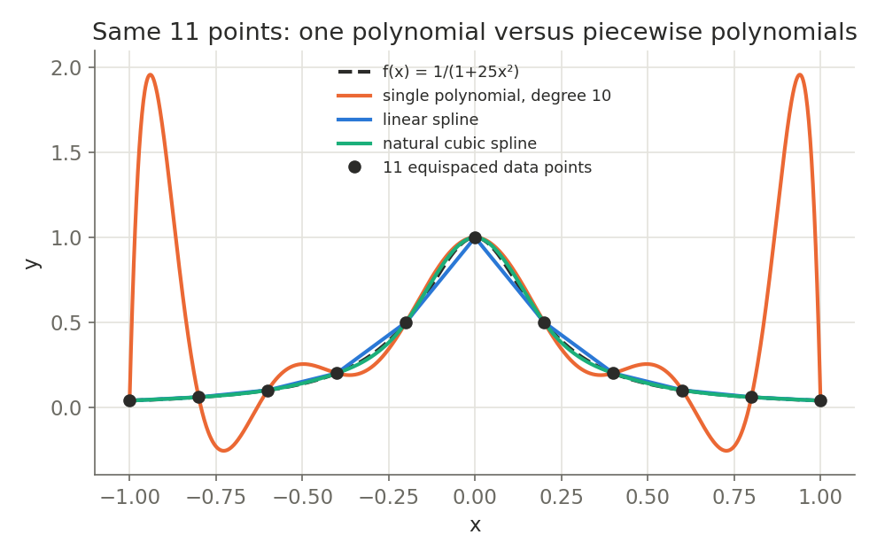
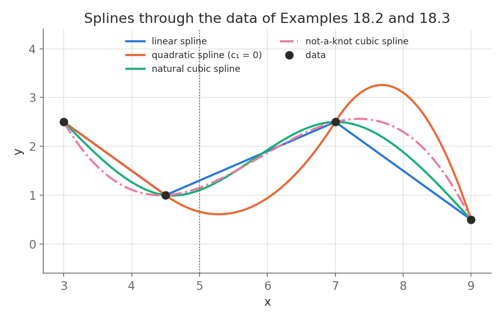
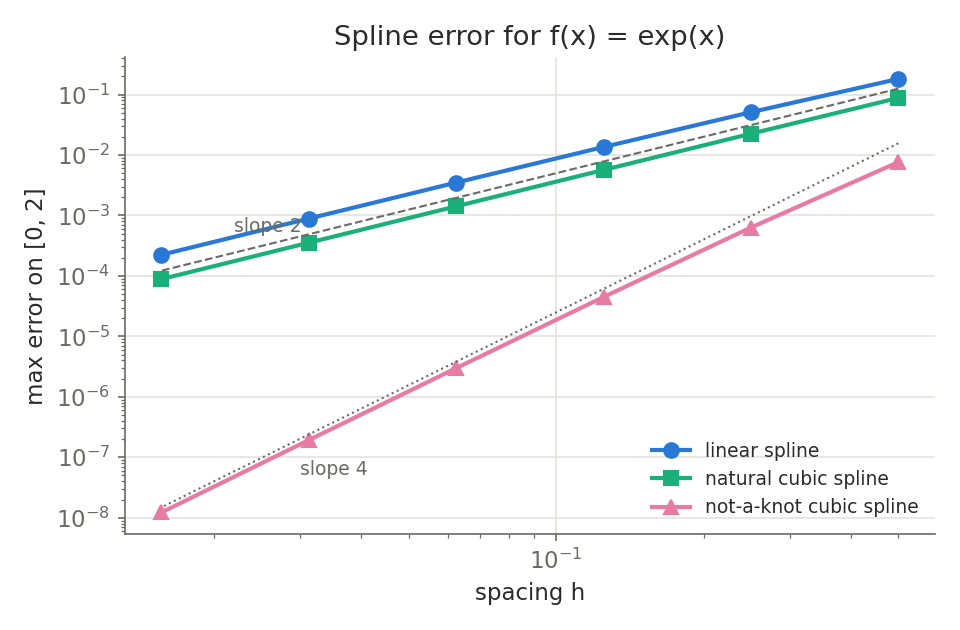
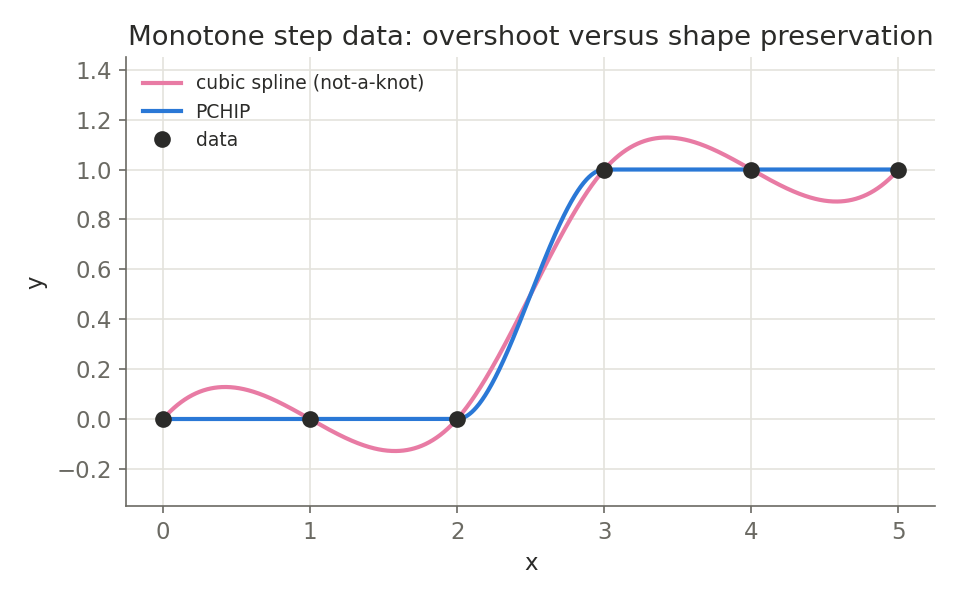
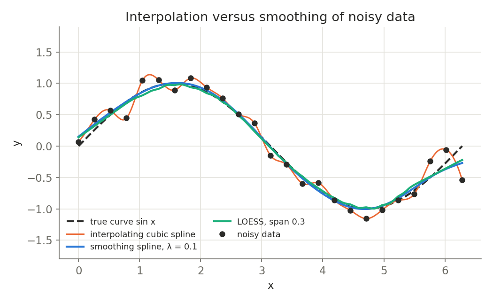

# Chapter 18 — Splines and Piecewise Interpolation

[Repository Guide](../../README.md) | [English](Concepts_Lecture.md) | [한국어](Concepts_Lecture.ko.md)

> **Last Updated:** 2026-11-19
>
> Applied Numerical Methods with Python for Engineers and Scientists, Chapra and Clough, Ch 18

> **Learning Objectives:**
> 1. Construct cubic spline interpolants
> 2. Compare natural, clamped, and not-a-knot end conditions
> 3. Apply splines for smooth data interpolation
> 4. Explain the continuity conditions and equation counts of linear, quadratic, and cubic splines
> 5. Interpolate values on a two-dimensional grid with bilinear interpolation
> 6. Derive the tridiagonal system of the cubic spline and the equations of its end conditions, and compute the spline with the Thomas algorithm and SciPy

---

<br>

## Table of Contents

- [1. Introduction and Motivation](#1-introduction-and-motivation)
- [2. Continuity Conditions](#2-continuity-conditions)
- [3. Linear Spline](#3-linear-spline)
  - [3.1 Setup](#31-setup)
  - [3.2 Formula](#32-formula)
  - [3.3 Properties](#33-properties)
  - [3.4 Computing the Linear Spline and Its Error](#34-computing-the-linear-spline-and-its-error)
- [4. Quadratic Spline](#4-quadratic-spline)
  - [4.1 General Form](#41-general-form)
  - [4.2 Deriving the Conditions](#42-deriving-the-conditions)
  - [4.3 Example 18.2: Quadratic Spline](#43-example-182-quadratic-spline)
  - [4.4 Numerical Solution of Example 18.2 and the Limits of Quadratic Splines](#44-numerical-solution-of-example-182-and-the-limits-of-quadratic-splines)
- [5. Cubic Spline](#5-cubic-spline)
  - [5.1 General Form](#51-general-form)
  - [5.2 Deriving the Conditions (i-iv)](#52-deriving-the-conditions-i-iv)
  - [5.3 Eliminating Unknowns: The Tridiagonal System for cᵢ](#53-eliminating-unknowns-the-tridiagonal-system-for-c_i)
  - [5.4 End Conditions (Textbook Section 18.4.2)](#54-end-conditions-textbook-section-1842)
  - [5.5 Example 18.3: Cubic Spline](#55-example-183-cubic-spline)
  - [5.6 Algebraic Derivation of the Tridiagonal Equations](#56-algebraic-derivation-of-the-tridiagonal-equations)
  - [5.7 Equations of the Clamped and Not-a-Knot End Conditions](#57-equations-of-the-clamped-and-not-a-knot-end-conditions)
  - [5.8 Implementation with the Thomas Algorithm](#58-implementation-with-the-thomas-algorithm)
  - [5.9 SciPy's CubicSpline and the Error of Splines](#59-scipys-cubicspline-and-the-error-of-splines)
  - [5.10 Shape-Preserving Piecewise Cubic Hermite Interpolation](#510-shape-preserving-piecewise-cubic-hermite-interpolation)
  - [5.11 Smoothing Noisy Data: Smoothing Splines and LOESS](#511-smoothing-noisy-data-smoothing-splines-and-loess)
- [6. Bilinear Interpolation](#6-bilinear-interpolation)
  - [6.1 Setup](#61-setup)
  - [6.2 Formula](#62-formula)
  - [6.3 A Worked Example and Properties of Bilinear Interpolation](#63-a-worked-example-and-properties-of-bilinear-interpolation)
- [7. Comparison of Spline Types](#7-comparison-of-spline-types)
- [Concept Applications](#concept-applications)
- [Summary](#summary)
- [Self-Check Questions](#self-check-questions)
- [References](#references)

---

<br>

## 1. Introduction and Motivation

A **spline** is originally a physical drafting tool: a long flexible strip fixed at a few control points whose tension creates a smooth curve passing through those points.

In numerical analysis, splines minimize oscillations by fitting **low-order polynomials** to data in a **piecewise** manner, rather than using a single high-order polynomial that can oscillate wildly between data points (Runge's phenomenon).

> **Key Point:** A simple linear spline (connecting data points with straight line segments) can provide a **better approximation** than a single high-order polynomial, especially when the function changes abruptly at one place (Figure 18.1 of the textbook).

The fundamental trade-off:

| Approach | Pros | Cons |
|---|---|---|
| Single high-order polynomial | Globally smooth | Oscillation (Runge's phenomenon) |
| Piecewise low-order splines | No oscillation, local control | Smoothness at knots must be enforced |

*Table 1. Single high-order polynomial versus piecewise low-order splines*

Interpolating the Runge function of Chapter 17 at 11 equally spaced points makes this trade-off clear. A single polynomial of degree 10 through all the points shoots up to values near 2 at both ends, while the linear spline and the cubic spline through the same points follow the function almost exactly (Figure 1). Splines gain accuracy by dividing the interval rather than by raising the degree.



*Figure 1. A degree-10 polynomial, a linear spline, and a natural cubic spline through the same 11 points*

> **Definition:** A **spline of degree k** is a function that is a polynomial of degree at most $`k`$ on each interval between the knots $`x_1 < x_2 < \cdots < x_n`$ and whose derivatives up to order $`k - 1`$ are continuous over the whole interval. An interpolating spline additionally satisfies the interpolation condition $`S(x_i) = f_i`$ at every knot.

---

<br>

## 2. Continuity Conditions

When two piecewise polynomial segments meet at a point (called a **knot**), we must specify how smooth the connection should be. This is described by **$`C^k`$ continuity**.

- **$`C^0`$ continuity:** The positions (function values) of the curves are continuous at the knot.

```math
f_1 = f_2
```

- **$`C^1`$ continuity:** The positions **and** 1st derivatives are continuous at the knot.

```math
f_1 = f_2, \quad f_1' = f_2'
```

- **$`C^2`$ continuity:** The positions, 1st derivatives, **and** 2nd derivatives are continuous at the knot.

```math
f_1 = f_2, \quad f_1' = f_2', \quad f_1'' = f_2''
```

- **$`C^n`$ continuity:** The 0th, 1st, 2nd, ..., $`n`$-th derivatives are all continuous at the knot.

> **Note:** **Visual interpretation.**
> - $`C^0`$: The curve is connected but may have sharp corners (kinks).
> - $`C^1`$: The curve is connected and tangent directions match, so there are no visible corners, but curvature may change abruptly.
> - $`C^2`$: The curve is connected, tangent directions match, and curvature is also continuous, so the curve looks very smooth.

By the definition, a linear spline ($`k = 1`$) requires $`C^0`$ continuity, a quadratic spline ($`k = 2`$) $`C^1`$, and a cubic spline ($`k = 3`$) $`C^2`$. Requiring one more level of continuity would make two polynomials of degree $`k`$ agree up to the $`k`$-th derivative at the knot, which forces even the remaining leading coefficients to agree, so the two pieces would in effect be a single polynomial. The highest continuity a spline of degree $`k`$ can have is therefore $`C^{k-1}`$. Curvature, which measures how a curve bends, is proportional to the second derivative (when the slope is small), so a curve that looks smooth to the eye needs a cubic spline, whose second derivative is continuous.

---

<br>

## 3. Linear Spline

**Requires:** $`C^0`$ Continuity

### 3.1 Setup

Consider $`n`$ data points: $`(x_1, f_1), (x_2, f_2), \dots, (x_n, f_n)`$.

- There are $`n - 1`$ intervals.
- Each interval $`i`$ has its own spline function $`S_i(x)`$.

```text
       S_1          S_2                  S_{n-1}
x_1 -------- x_2 -------- x_3   . . .   x_{n-1} -------- x_n
```

*Figure 2. n data points and the spline functions of the n-1 intervals*

### 3.2 Formula

For the $`i`$-th interval $`[x_i,\; x_{i+1}]`$:

```math
S_i(x) = f_i + \frac{f_{i+1} - f_i}{x_{i+1} - x_i}(x - x_i)
```

This is simply **linear interpolation** between consecutive data points.

### 3.3 Properties

- Satisfies $`C^0`$ continuity automatically (the segments share endpoints).
- **Not smooth at knots**: the first derivative is generally discontinuous where two segments meet.

> **Note:** **Limitation.** The lack of smoothness at knots motivates the use of higher-order polynomial splines (quadratic and cubic) to ensure smoothness.

### 3.4 Computing the Linear Spline and Its Error

To evaluate the linear spline at a point $`x`$, first find the interval $`i`$ with $`x_i \le x \le x_{i+1}`$ and then apply the formula of Section 3.2. Since the knots are sorted, the interval can be found by binary search in $`O(\log n)`$, which is what `np.searchsorted` does. For the data of Example 18.3, $`x = (3, 4.5, 7, 9)`$ and $`f = (2.5, 1, 2.5, 0.5)`$, the point $`x = 5`$ lies in the second interval, so

```math
S_2(5) = 1 + \frac{2.5 - 1}{7 - 4.5}(5 - 4.5) = 1 + 0.6 \times 0.5 = 1.3
```

NumPy's `np.interp(5.0, x, f)` performs the same computation and returns 1.3.

On each interval the linear spline is the first-order interpolating polynomial through two points, so the interpolation error formula of Chapter 17 holds interval by interval. If $`f`$ is twice continuously differentiable, then on interval $`i`$

```math
|f(x) - S_i(x)| \le \frac{h_i^2}{8}\,\max_{x_i \le t \le x_{i+1}} |f''(t)|
```

Over the whole interval, setting $`h = \max_i h_i`$ gives $`\max |f - S| \le \frac{h^2}{8}\max|f''|`$. Halving the knot spacing reduces the error bound to one quarter, and the error is said to be $`O(h^2)`$. Merely adding points without raising the degree drives the error to zero, so no divergence like Runge's phenomenon of Chapter 17 occurs.

> **Caution:** `np.interp` assumes that the knots are in increasing order, and for $`x`$ outside the range it does not extrapolate but returns the end values. Unsorted data or evaluation outside the range give wrong values without any error message, so care is needed.

---

<br>

## 4. Quadratic Spline

**Requires:** $`C^1`$ Continuity

### 4.1 General Form

Each interval $`i`$ uses a second-degree polynomial:

```math
S_i(x) = a_i + b_i(x - x_i) + c_i(x - x_i)^2
```

Each segment has **3 unknowns** ($`a_i`$, $`b_i`$, $`c_i`$).

With $`n`$ data points and $`n-1`$ intervals, the total number of unknowns is $`3(n-1)`$.

### 4.2 Deriving the Conditions

We need $`3(n-1)`$ equations to determine all unknowns.

---

**Condition (i): Function values at left endpoints**

```math
S_i(x_i) = a_i = f_i, \quad \text{for } i = 1, 2, \dots, n-1
```

This gives $`n - 1`$ equations and immediately determines $`a_i = f_i`$.

---

**Condition (ii): $`C^0`$ continuity at interior knots $`x_{i+1}`$**

```math
S_i(x_{i+1}) = S_{i+1}(x_{i+1}) = f_{i+1}
```

Substituting the polynomial form and letting $`h_i := x_{i+1} - x_i`$:

```math
f_i + b_i h_i + c_i h_i^2 = f_{i+1}, \quad \text{for } i = 1, 2, \dots, n-1
```

This gives $`n - 1`$ equations.

---

**Condition (iii): $`C^1`$ continuity at $`(n-2)`$ interior knots**

The derivative of each segment is:

```math
S_i'(x) = b_i + 2c_i(x - x_i)
```

At each interior knot $`x_{i+1}`$, equating the derivatives of adjacent segments:

```math
S_i'(x_{i+1}) = S_{i+1}'(x_{i+1})
```

```math
b_i + 2c_i h_i = b_{i+1}, \quad \text{for } i = 1, 2, \dots, n-2
```

This gives $`n - 2`$ equations.

---

**Equation count:**

| Source | Count |
|---|---|
| (i) Left endpoint values | $`n - 1`$ |
| (ii) $`C^0`$ continuity | $`n - 1`$ |
| (iii) $`C^1`$ continuity | $`n - 2`$ |
| **Total** | $`3(n-1) - 1`$ |

*Table 2. Number of equations from each condition of the quadratic spline*

We are **one equation short**. Therefore, an additional condition is needed.

---

**Condition (iv): Extra condition**

Choose $`c_1 = 0`$, which means the first segment becomes a **linear approximation**:

```math
S_1(x) = f_1 + b_1(x - x_1)
```

This closes the system and allows sequential computation of all coefficients.

### 4.3 Example 18.2: Quadratic Spline

**Given:** 4 data points $`(x_1, f_1),\, (x_2, f_2),\, (x_3, f_3),\, (x_4, f_4)`$

- 3 intervals
- $`3 \times 3 = 9`$ unknowns (but $`a_i = f_i`$ reduces it to 6)

**Three spline functions (after applying $`a_i = f_i`$):**

```math
S_1(x) = f_1 + b_1(x - x_1) + c_1(x - x_1)^2
```

```math
S_2(x) = f_2 + b_2(x - x_2) + c_2(x - x_2)^2
```

```math
S_3(x) = f_3 + b_3(x - x_3) + c_3(x - x_3)^2
```

**From $`C^0`$ continuity (condition ii):**

```math
f_2 - f_1 = b_1 h_1 + c_1 h_1^2
```

```math
f_3 - f_2 = b_2 h_2 + c_2 h_2^2
```

```math
f_4 - f_3 = b_3 h_3 + c_3 h_3^2
```

**From $`C^1`$ continuity (condition iii):**

```math
b_1 + 2c_1 h_1 - b_2 = 0
```

```math
b_2 + 2c_2 h_2 - b_3 = 0
```

**From extra condition (iv):**

```math
c_1 = 0
```

This gives **6 equations in 6 unknowns** ($`b_1, c_1, b_2, c_2, b_3, c_3`$).

**Matrix / vector form:**

```math
\begin{pmatrix} f_2 - f_1 \\ f_3 - f_2 \\ f_4 - f_3 \\ 0 \\ 0 \\ 0 \end{pmatrix} = \begin{pmatrix} h_1 & h_1^2 & 0 & 0 & 0 & 0 \\ 0 & 0 & h_2 & h_2^2 & 0 & 0 \\ 0 & 0 & 0 & 0 & h_3 & h_3^2 \\ 1 & 2h_1 & -1 & 0 & 0 & 0 \\ 0 & 0 & 1 & 2h_2 & -1 & 0 \\ 0 & 1 & 0 & 0 & 0 & 0 \end{pmatrix} \begin{pmatrix} b_1 \\ c_1 \\ b_2 \\ c_2 \\ b_3 \\ c_3 \end{pmatrix}
```

> **Note:** This is a linear system $`\mathbf{A}\mathbf{x} = \mathbf{b}`$ that can be solved using any standard technique (Gaussian elimination, LU decomposition, etc.).

### 4.4 Numerical Solution of Example 18.2 and the Limits of Quadratic Splines

The quadratic spline is computed for the same data as Example 18.3, $`x = (3, 4.5, 7, 9)`$ and $`f = (2.5, 1, 2.5, 0.5)`$. The spacings are $`h_1 = 1.5`$, $`h_2 = 2.5`$, $`h_3 = 2`$. Starting from $`c_1 = 0`$, the six equations of Section 4.3 can be solved one after another from the left.

1. Since $`c_1 = 0`$, the first $`C^0`$ condition gives $`b_1 = (f_2 - f_1)/h_1 = (1 - 2.5)/1.5 = -1`$.
2. The $`C^1`$ condition at $`x_2`$ gives $`b_2 = b_1 + 2c_1h_1 = -1`$.
3. The second $`C^0`$ condition $`f_3 - f_2 = b_2h_2 + c_2h_2^2`$ reads $`1.5 = -2.5 + 6.25c_2`$, so $`c_2 = 0.64`$.
4. The $`C^1`$ condition at $`x_3`$ gives $`b_3 = b_2 + 2c_2h_2 = -1 + 3.2 = 2.2`$.
5. The third $`C^0`$ condition $`f_4 - f_3 = b_3h_3 + c_3h_3^2`$ reads $`-2 = 4.4 + 4c_3`$, so $`c_3 = -1.6`$.

The point $`x = 5`$ lies in the second interval, so $`S_2(5) = 1 + (-1)(0.5) + 0.64(0.5)^2 = 0.66`$.

```python
import numpy as np

x = np.array([3.0, 4.5, 7.0, 9.0])
f = np.array([2.5, 1.0, 2.5, 0.5])
h = np.diff(x)                       # h1, h2, h3

# Quadratic spline: c1 = 0, then march left to right
b = np.zeros(3); c = np.zeros(3)
b[0] = (f[1] - f[0]) / h[0]          # C0 on interval 1 with c1 = 0
for i in range(1, 3):
    b[i] = b[i-1] + 2.0 * c[i-1] * h[i-1]                # C1 at x_{i+1}
    c[i] = (f[i+1] - f[i] - b[i] * h[i]) / h[i]**2       # C0 on interval i+1
for i in range(3):
    print(f"S_{i+1}: a = {f[i]:.2f}, b = {b[i]:.4f}, c = {c[i]:.4f}")

t = 5.0                              # lies in interval 2, [4.5, 7]
print("quadratic S(5) = %.4f" % (f[1] + b[1]*(t - x[1]) + c[1]*(t - x[1])**2))
print("linear    S(5) = %.4f" % np.interp(t, x, f))
```

```text
S_1: a = 2.50, b = -1.0000, c = 0.0000
S_2: a = 1.00, b = -1.0000, c = 0.6400
S_3: a = 2.50, b = 2.2000, c = -1.6000
quadratic S(5) = 0.6600
linear    S(5) = 1.3000
```

- The computation of `b[0]` is step 1 above. Because $`c_1 = 0`$ is fixed, the slope of the first interval equals the slope between the two points.
- In the loop, the first line uses the $`C^1`$ condition to find the slope of the next interval, and the second line uses the $`C^0`$ condition to find the next $`c_i`$. The six equations can be solved by substitution from left to right, without a matrix solve, because $`c_1 = 0`$ fixes the starting point.

The result shows the weakness of the quadratic spline. The first interval is a straight line because of $`c_1 = 0`$, and its slope $`-1`$ is carried to the right by the $`C^1`$ conditions, producing in the third interval a peak far outside the data range (maximum about 3.26) (Figure 3). Because the extra condition is placed only at the left end, the result is not left-right symmetric, and reversing the data gives a different curve. For these reasons quadratic splines are rarely used in practice, and the cubic spline, with one condition at each end, is the standard.



*Figure 3. Linear, quadratic, natural cubic, and not-a-knot cubic splines through the data of Examples 18.2 and 18.3*

---

<br>

## 5. Cubic Spline

**Requires:** $`C^2`$ Continuity

### 5.1 General Form

Each interval $`i`$ uses a third-degree polynomial:

```math
S_i(x) = a_i + b_i(x - x_i) + c_i(x - x_i)^2 + d_i(x - x_i)^3
```

Each segment has **4 unknowns** ($`a_i`$, $`b_i`$, $`c_i`$, $`d_i`$).

With $`n`$ data points and $`n-1`$ intervals, the total number of unknowns is $`4(n-1)`$.

Key properties of cubic splines:

- Cubic curves are **popular in computer graphics**.
- Piecewise cubic polynomials allow for **$`C^2`$ continuity**.
- They offer a good **trade-off** between computational cost and smoothness.

### 5.2 Deriving the Conditions (i-iv)

Let $`h_i := x_{i+1} - x_i`$.

---

**Condition (i): Function values at left endpoints**

```math
S_i(x_i) = a_i = f_i, \quad \text{for } i = 1, 2, \dots, n-1
```

This gives $`n - 1`$ equations and immediately $`a_i = f_i`$.

---

**Condition (ii): $`C^0`$ continuity at knots**

```math
S_i(x_{i+1}) = f_{i+1}
```

```math
f_i + b_i h_i + c_i h_i^2 + d_i h_i^3 = f_{i+1}, \quad \text{for } i = 1, 2, \dots, n-1 \quad \cdots (**)
```

This gives $`n - 1`$ equations.

---

**Condition (iii): $`C^1`$ continuity at interior knots**

```math
S_i'(x) = b_i + 2c_i(x - x_i) + 3d_i(x - x_i)^2
```

At $`x_{i+1}`$:

```math
S_i'(x_{i+1}) = b_i + 2c_i h_i + 3d_i h_i^2 = S_{i+1}'(x_{i+1}) = b_{i+1}
```

```math
\therefore \quad b_i + 2c_i h_i + 3d_i h_i^2 = b_{i+1}, \quad \text{for } i = 1, 2, \dots, n-2 \quad \cdots (*)
```

This gives $`n - 2`$ equations.

---

**Condition (iv): $`C^2`$ continuity at interior knots**

```math
S_i''(x) = 2c_i + 6d_i(x - x_i)
```

At $`x_{i+1}`$:

```math
S_i''(x_{i+1}) = 2c_i + 6d_i h_i = S_{i+1}''(x_{i+1}) = 2c_{i+1}
```

```math
\therefore \quad c_{i+1} = c_i + 3d_i h_i \quad \cdots (***)
```

```math
\Longrightarrow \quad d_i = \frac{c_{i+1} - c_i}{3 h_i}
```

This gives $`n - 2`$ equations.

---

**Equation count so far:**

| Source | Count |
|---|---|
| (i) $`a_i = f_i`$ | $`n - 1`$ |
| (ii) $`C^0`$ continuity | $`n - 1`$ |
| (iii) $`C^1`$ continuity | $`n - 2`$ |
| (iv) $`C^2`$ continuity | $`n - 2`$ |
| **Total** | $`4n - 6`$ |

*Table 3. Number of equations from each condition of the cubic spline*

Unknowns: $`4(n-1) = 4n - 4`$.

We need **2 more equations** (the end conditions).

### 5.3 Eliminating Unknowns: The Tridiagonal System for $`c_i`$

The key strategy is to express all unknowns in terms of $`c_i`$ alone, then solve a tridiagonal system.

**Step 1: Express $`d_i`$ in terms of $`c_i`$.**

From condition (iv):

```math
d_i = \frac{c_{i+1} - c_i}{3h_i}
```

**Step 2: Express $`b_i`$ in terms of $`c_i`$.**

Substitute $`d_i`$ into the $`C^0`$ continuity equation $`(**)`$:

```math
f_{i+1} = f_i + b_i h_i + c_i h_i^2 + \frac{c_{i+1} - c_i}{3} h_i^2
```

```math
= f_i + b_i h_i + \frac{h_i^2}{3}(c_{i+1} + 2c_i)
```

Solving for $`b_i`$:

```math
b_i = \frac{f_{i+1} - f_i}{h_i} - \frac{h_i}{3}(2c_i + c_{i+1})
```

**Step 3: Derive the tridiagonal equation.**

From the $`C^1`$ continuity condition $`(*)`$, substitute $`d_i`$ to get:

```math
b_{i+1} = b_i + h_i(c_i + c_{i+1})
```

Now, reduce the index of the $`b_i`$ formula by 1:

```math
b_{i-1} = \frac{f_i - f_{i-1}}{h_{i-1}} - \frac{h_{i-1}}{3}(2c_{i-1} + c_i)
```

and similarly:

```math
b_i = b_{i-1} + h_{i-1}(c_{i-1} + c_i)
```

After algebraic manipulation (substituting the expressions for $`b_i`$ and $`b_{i-1}`$ and simplifying), the result is:

```math
3\frac{f_{i+1} - f_i}{h_i} - 3\frac{f_i - f_{i-1}}{h_{i-1}} = h_{i-1}\,c_{i-1} + 2(h_{i-1} + h_i)\,c_i + h_i\,c_{i+1}
```

for $`i = 2, 3, \dots, n-1`$. The equation for $`i = n - 1`$ contains $`c_n`$, which Section 5.4 introduces as an additional variable.

> **Note:** The left-hand side involves **divided differences**:
> ```math
> 3\,f[x_{i+1}, x_i] - 3\,f[x_i, x_{i-1}]
> ```
> where $`f[x_{i+1}, x_i] = \dfrac{f_{i+1} - f_i}{h_i}`$.

This gives $`n - 2`$ equations for the unknowns $`c_1, c_2, \dots, c_n`$ (which are $`n`$ unknowns). Together with the 2 end conditions, we get $`n`$ equations in $`n`$ unknowns.

**Matrix form (with natural end conditions $`c_1 = 0`$, $`c_n = 0`$):**

```math
\begin{pmatrix} 0 \\ 3(f[x_3,x_2] - f[x_2,x_1]) \\ 3(f[x_4,x_3] - f[x_3,x_2]) \\ \vdots \\ 3(f[x_n,x_{n-1}] - f[x_{n-1},x_{n-2}]) \\ 0 \end{pmatrix} = \begin{pmatrix} 1 & & & & \\ h_1 & 2(h_1+h_2) & h_2 & & \\ & h_2 & 2(h_2+h_3) & h_3 & \\ & & \ddots & \ddots & \ddots \\ & & & h_{n-2} & 2(h_{n-2}+h_{n-1}) & h_{n-1} \\ & & & & & 1 \end{pmatrix} \begin{pmatrix} c_1 \\ c_2 \\ c_3 \\ \vdots \\ c_{n-1} \\ c_n \end{pmatrix}
```

> **Key Point:** The coefficient matrix is **tridiagonal** and **diagonally dominant**, so it can be solved very efficiently using the **Thomas algorithm** in $`O(n)`$ operations.

**After solving for $`c_i`$, recover the other coefficients:**

```math
d_i = \frac{c_{i+1} - c_i}{3h_i}, \quad i = 1, 2, \dots, n-1
```

```math
b_i = \frac{f_{i+1} - f_i}{h_i} - \frac{h_i}{3}(2c_i + c_{i+1}), \quad i = 1, 2, \dots, n-1
```

The computation can be summarized as follows.


*Figure 4. Procedure for computing the cubic spline coefficients*

### 5.4 End Conditions (Textbook Section 18.4.2)

Since the tridiagonal system has $`n`$ unknowns ($`c_1, \dots, c_n`$, including $`c_n`$) but only $`n - 2`$ interior equations, **2 additional boundary (end) conditions** are required:

| End Condition | Description | Equations |
|---|---|---|
| **Natural** | Second derivatives are zero at both endpoints | $`c_1 = 0, \quad c_n = 0`$ |
| **Clamped** | First derivatives $`f_1'`$ and $`f_n'`$ are specified at the endpoints | Modifies the first and last rows of the tridiagonal system |
| **Not-a-knot** | Continuity of the **3rd derivative** at the second and second-to-last knots | $`S_1 = S_2`$ (same cubic) and $`S_{n-2} = S_{n-1}`$ (same cubic) |

*Table 4. End conditions of the cubic spline*

> **Note:** The **natural spline** is the most common default choice. Setting $`S_1''(x_1) = 0`$ yields $`c_1 = 0`$, and setting $`S_{n-1}''(x_n) = 0`$ yields (via $`(***)`$) $`c_n = 0`$.
>
> It is **convenient to introduce** $`c_n`$ as an additional variable (even though the last segment is $`S_{n-1}`$) to make the matrix system uniform in size $`n \times n`$.

**Derivation for natural end conditions:**

At the left end:

```math
S_1''(x_1) = 2c_1 + 6d_1(x_1 - x_1) = 2c_1 = 0 \implies c_1 = 0
```

At the right end:

```math
S_{n-1}''(x_n) = 2c_{n-1} + 6d_{n-1}h_{n-1} = 0
```

Using $`c_{i+1} = c_i + 3d_i h_i`$ (condition $`(***)`$), this implies $`c_n = 0`$.

### 5.5 Example 18.3: Cubic Spline

**Given:** 4 data points $`(x_1, f_1),\, (x_2, f_2),\, (x_3, f_3),\, (x_4, f_4)`$

- 3 intervals
- $`3 \times 4 = 12`$ unknowns total

**Three spline functions (after $`a_i = f_i`$):**

```math
S_1(x) = f_1 + b_1(x - x_1) + c_1(x - x_1)^2 + d_1(x - x_1)^3
```

```math
S_2(x) = f_2 + b_2(x - x_2) + c_2(x - x_2)^2 + d_2(x - x_2)^3
```

```math
S_3(x) = f_3 + b_3(x - x_3) + c_3(x - x_3)^2 + d_3(x - x_3)^3
```

**Derivatives:**

```math
S_i'(x) = b_i + 2c_i(x - x_i) + 3d_i(x - x_i)^2
```

```math
S_i''(x) = 2c_i + 6d_i(x - x_i)
```

**Tridiagonal system (with natural end conditions, $`c_1 = 0`$, $`c_4 = 0`$):**

```math
\begin{pmatrix} 0 \\ 3(f[x_3, x_2] - f[x_2, x_1]) \\ 3(f[x_4, x_3] - f[x_3, x_2]) \\ 0 \end{pmatrix} = \begin{pmatrix} 1 & 0 & 0 & 0 \\ h_1 & 2(h_1 + h_2) & h_2 & 0 \\ 0 & h_2 & 2(h_2 + h_3) & h_3 \\ 0 & 0 & 0 & 1 \end{pmatrix} \begin{pmatrix} c_1 \\ c_2 \\ c_3 \\ c_4 \end{pmatrix}
```

**After solving for $`c_1, c_2, c_3, c_4`$, recover:**

```math
b_i = \frac{f_{i+1} - f_i}{h_i} - \frac{h_i}{3}(2c_i + c_{i+1}), \quad i = 1, 2, 3
```

```math
d_i = \frac{c_{i+1} - c_i}{3h_i}, \quad i = 1, 2, 3
```

The following Python code computes the natural cubic spline coefficients and applies them to the data of Example 18.3, $`x = (3, 4.5, 7, 9)`$ and $`f = (2.5, 1, 2.5, 0.5)`$.

```python
import numpy as np

def cubic_spline_natural(x, f):
    """
    Compute natural cubic spline coefficients.

    Parameters
    ----------
    x : array-like, shape (n,)
        Knot positions (sorted).
    f : array-like, shape (n,)
        Function values at knots.

    Returns
    -------
    a, b, c, d : arrays, each of shape (n-1,)
        Coefficients for S_i(t) = a_i + b_i*(t-x_i)
                                    + c_i*(t-x_i)^2
                                    + d_i*(t-x_i)^3
    """
    n = len(x)
    h = np.diff(x)                     # h[i] = x[i+1] - x[i]

    # --- Build the tridiagonal system for c ---
    # Size: n x n  (with c[0] = 0, c[n-1] = 0 as natural BCs)
    A = np.zeros((n, n))
    rhs = np.zeros(n)

    # Natural end conditions
    A[0, 0] = 1.0
    A[n-1, n-1] = 1.0

    # Interior equations  (i = 1, 2, ..., n-2)
    for i in range(1, n - 1):
        A[i, i-1] = h[i-1]
        A[i, i]   = 2.0 * (h[i-1] + h[i])
        A[i, i+1] = h[i]
        rhs[i] = 3.0 * ((f[i+1] - f[i]) / h[i]
                       - (f[i] - f[i-1]) / h[i-1])

    c = np.linalg.solve(A, rhs)

    # --- Recover b and d ---
    a = f[:-1].copy()
    b = np.zeros(n - 1)
    d = np.zeros(n - 1)

    for i in range(n - 1):
        d[i] = (c[i+1] - c[i]) / (3.0 * h[i])
        b[i] = (f[i+1] - f[i]) / h[i] \
             - h[i] * (2.0 * c[i] + c[i+1]) / 3.0

    c = c[:-1]   # only need c[0] ... c[n-2]

    return a, b, c, d


def evaluate_spline(x_knots, a, b, c, d, x_eval):
    """Evaluate the cubic spline at points x_eval."""
    results = np.zeros_like(x_eval, dtype=float)
    for j, xv in enumerate(x_eval):
        # Find the correct interval
        i = np.searchsorted(x_knots, xv, side='right') - 1
        i = np.clip(i, 0, len(a) - 1)
        dx = xv - x_knots[i]
        results[j] = a[i] + b[i]*dx + c[i]*dx**2 + d[i]*dx**3
    return results


# --- Example usage ---
if __name__ == "__main__":
    # Example 18.3: 4 data points
    x = np.array([3.0, 4.5, 7.0, 9.0])
    f = np.array([2.5, 1.0, 2.5, 0.5])

    a, b, c, d = cubic_spline_natural(x, f)

    print("Spline coefficients:")
    for i in range(len(a)):
        print(f"  S_{i+1}(x): a={a[i]:.6f}, b={b[i]:.6f}, "
              f"c={c[i]:.6f}, d={d[i]:.6f}")

    # Evaluate
    x_test = np.array([5.0])
    y_test = evaluate_spline(x, a, b, c, d, x_test)
    print(f"\nS(5.0) = {y_test[0]:.6f}")
```

The output is as follows.

```text
Spline coefficients:
  S_1(x): a=2.500000, b=-1.419772, c=0.000000, d=0.186565
  S_2(x): a=1.000000, b=-0.160456, c=0.839544, d=-0.214144
  S_3(x): a=2.500000, b=0.022053, c=-0.766540, d=0.127757

S(5.0) = 1.102890
```

The natural end condition gives $`c_1 = 0`$, and solving the tridiagonal system gives $`c_2 \approx 0.839544`$ and $`c_3 \approx -0.766540`$. Since $`x = 5`$ lies in the second interval $`[4.5, 7]`$, $`S(5) = S_2(5) \approx 1.102890`$.

### 5.6 Algebraic Derivation of the Tridiagonal Equations

This section writes out step by step the process that Section 5.3 condensed into "algebraic manipulation". The two relations used are as follows.

The expression for $`b_i`$ obtained by substituting $`d_i`$ into condition (ii) (step 2 of Section 5.3) is called (A).

```math
b_i = f[x_{i+1}, x_i] - \frac{h_i}{3}(2c_i + c_{i+1}) \qquad \text{(A)}
```

Substituting $`3d_ih_i^2 = (c_{i+1} - c_i)h_i`$ into condition (iii), $`b_{i+1} = b_i + 2c_ih_i + 3d_ih_i^2`$, gives the following relation (B).

```math
b_{i+1} = b_i + 2c_ih_i + (c_{i+1} - c_i)h_i = b_i + h_i(c_i + c_{i+1}) \qquad \text{(B)}
```

Lowering the index of (B) by one gives $`b_i = b_{i-1} + h_{i-1}(c_{i-1} + c_i)`$. Substitute (A) for both $`b_i`$ and $`b_{i-1}`$ in this relation.

```math
f[x_{i+1}, x_i] - \frac{h_i}{3}(2c_i + c_{i+1}) = f[x_i, x_{i-1}] - \frac{h_{i-1}}{3}(2c_{i-1} + c_i) + h_{i-1}(c_{i-1} + c_i)
```

Collecting the $`c`$ terms on the right, the coefficient of $`c_{i-1}`$ is $`-\frac{2h_{i-1}}{3} + h_{i-1} = \frac{h_{i-1}}{3}`$ and that of $`c_i`$ is $`-\frac{h_{i-1}}{3} + h_{i-1} = \frac{2h_{i-1}}{3}`$. Moving the divided differences to the left and the $`c`$ terms to the right gives

```math
f[x_{i+1}, x_i] - f[x_i, x_{i-1}] = \frac{h_{i-1}}{3}c_{i-1} + \frac{2(h_{i-1} + h_i)}{3}c_i + \frac{h_i}{3}c_{i+1}
```

and multiplying both sides by 3 gives the tridiagonal equation of Section 5.3.

```math
3f[x_{i+1}, x_i] - 3f[x_i, x_{i-1}] = h_{i-1}c_{i-1} + 2(h_{i-1} + h_i)c_i + h_ic_{i+1}, \quad i = 2, \ldots, n - 1
```

Each equation involves only three neighboring values of $`c`$, so the matrix is tridiagonal. The diagonal entry $`2(h_{i-1} + h_i)`$ is twice the sum of the off-diagonal entries in the same row, $`h_{i-1} + h_i`$, so the matrix is strictly diagonally dominant. A strictly diagonally dominant matrix is nonsingular, so the system with natural end conditions always has a unique solution, and Gauss elimination without pivoting (the Thomas algorithm) works stably.

For Example 18.3, $`h = (1.5, 2.5, 2)`$, $`f[x_2, x_1] = -1`$, $`f[x_3, x_2] = 0.6`$, and $`f[x_4, x_3] = -1`$, so the interior equations are

```math
1.5c_1 + 8c_2 + 2.5c_3 = 4.8, \qquad 2.5c_2 + 9c_3 + 2c_4 = -4.8
```

and solving them with the natural end conditions $`c_1 = c_4 = 0`$ gives $`c_2 = 0.839544`$ and $`c_3 = -0.766540`$.

### 5.7 Equations of the Clamped and Not-a-Knot End Conditions

This section derives how the clamped and not-a-knot conditions of Table 4 become the first and last rows of the tridiagonal system. As in Section 5.4, $`c_n`$ is introduced as an extra variable.

**Clamped end condition.** The end slopes $`f'_1`$ and $`f'_n`$ are given. At the left end $`S_1'(x_1) = b_1 = f'_1`$, and putting $`i = 1`$ in (A) gives

```math
f[x_2, x_1] - \frac{h_1}{3}(2c_1 + c_2) = f'_1 \quad \Longrightarrow \quad 2h_1c_1 + h_1c_2 = 3\left(f[x_2, x_1] - f'_1\right)
```

At the right end $`S_{n-1}'(x_n) = b_{n-1} + 2c_{n-1}h_{n-1} + 3d_{n-1}h_{n-1}^2`$, which by (B) equals $`b_{n-1} + h_{n-1}(c_{n-1} + c_n)`$. Substituting (A) and setting the result equal to $`f'_n`$ gives

```math
h_{n-1}c_{n-1} + 2h_{n-1}c_n = 3\left(f'_n - f[x_n, x_{n-1}]\right)
```

In both rows the diagonal entry is twice the off-diagonal entry, so the tridiagonal structure and the diagonal dominance are preserved.

**Not-a-knot end condition.** For the first two intervals to be the same cubic, the third derivative $`6d_i`$ must also be continuous at $`x_2`$, so $`d_1 = d_2`$. Substituting $`d_i = (c_{i+1} - c_i)/(3h_i)`$ gives

```math
\frac{c_2 - c_1}{h_1} = \frac{c_3 - c_2}{h_2} \quad \Longrightarrow \quad h_2c_1 - (h_1 + h_2)c_2 + h_1c_3 = 0
```

The right end is treated the same way: $`d_{n-2} = d_{n-1}`$ gives $`h_{n-1}c_{n-2} - (h_{n-2} + h_{n-1})c_{n-1} + h_{n-2}c_n = 0`$. These rows have three nonzero entries, so the first and last rows break the tridiagonal pattern, but combining each with the neighboring row to eliminate one entry restores the tridiagonal form.

Applying the three end conditions to the data of Example 18.3 gives the following. The clamped case uses zero slopes at both ends.

| End condition | First row | Last row | $`(c_1, c_2, c_3, c_4)`$ | $`S(5)`$ |
|:-----|:-----|:-----|:-----|:-----|
| Natural | $`c_1 = 0`$ | $`c_4 = 0`$ | $`(0, 0.839544, -0.766540, 0)`$ | 1.102890 |
| Clamped ($`f'_1 = f'_4 = 0`$) | $`3c_1 + 1.5c_2 = -3`$ | $`2c_3 + 4c_4 = 3`$ | $`(-1.639130, 1.278261, -1.186957, 1.343478)`$ | 1.007826 |
| Not-a-knot | $`2.5c_1 - 4c_2 + 1.5c_3 = 0`$ | $`2c_2 - 4.5c_3 + 2.5c_4 = 0`$ | $`(1.092593, 0.525926, -0.418519, -1.174074)`$ | 1.151852 |

*Table 5. Results of the three end conditions applied to the data of Example 18.3*

Even for the same data, the interior value $`S(5)`$ changes by about 0.15 depending on the end condition. With only four points the influence of the end conditions reaches the middle; with many points it is confined to the neighborhoods of the ends. With four points the not-a-knot condition makes all three intervals the same cubic, so the result equals the cubic interpolating polynomial of Chapter 17 through the four points. Indeed, all three intervals have the same $`d_i = -0.125926`$.

> **Note:** **Minimum curvature property of the natural spline.** Among all functions $`g`$ with continuous second derivatives that pass through the same points, the natural cubic spline minimizes $`\int_{x_1}^{x_n} [g''(x)]^2\,dx`$. This integral is proportional to the bending energy of a thin bent strip, so it describes mathematically the shape that a drafting spline takes between its fixed points. The property does not guarantee accuracy, however; if the true function has nonzero second derivatives at the ends, the natural condition increases the error near the ends (Section 5.9).

### 5.8 Implementation with the Thomas Algorithm

The code of Section 5.5 solves the $`n \times n`$ system with `np.linalg.solve`, which costs $`O(n^3)`$ operations. Because the matrix is tridiagonal, the Thomas algorithm of Chapter 9 solves it in $`O(n)`$. With the subdiagonal, main diagonal, and superdiagonal written $`e_k`$, $`f_k`$, $`g_k`$ and the right-hand side $`r_k`$, the algorithm is as follows.

```text
procedure Thomas(e[1..n], f[1..n], g[1..n], r[1..n])
    for k = 2 to n                       # forward elimination
        factor = e[k] / f[k-1]
        f[k] = f[k] - factor * g[k-1]
        r[k] = r[k] - factor * r[k-1]
    x[n] = r[n] / f[n]                   # back substitution
    for k = n - 1 down to 1
        x[k] = (r[k] - g[k] * x[k+1]) / f[k]
    return x
```

```python
import numpy as np

def thomas(e, f, g, r):
    """Solve a tridiagonal system: e = sub, f = main, g = super diagonal."""
    n = len(f)
    f = f.astype(float).copy(); r = r.astype(float).copy()
    for k in range(1, n):                # forward elimination
        factor = e[k] / f[k-1]
        f[k] -= factor * g[k-1]
        r[k] -= factor * r[k-1]
    x = np.zeros(n)
    x[-1] = r[-1] / f[-1]                # back substitution
    for k in range(n - 2, -1, -1):
        x[k] = (r[k] - g[k] * x[k+1]) / f[k]
    return x

def natural_spline(x, y):
    n = len(x); h = np.diff(x)
    e = np.zeros(n); f = np.ones(n); g = np.zeros(n); r = np.zeros(n)
    for i in range(1, n - 1):            # interior rows; rows 0 and n-1 give c = 0
        e[i], f[i], g[i] = h[i-1], 2.0 * (h[i-1] + h[i]), h[i]
        r[i] = 3.0 * ((y[i+1] - y[i]) / h[i] - (y[i] - y[i-1]) / h[i-1])
    c = thomas(e, f, g, r)
    d = (c[1:] - c[:-1]) / (3.0 * h)
    b = (y[1:] - y[:-1]) / h - h * (2.0 * c[:-1] + c[1:]) / 3.0
    return b, c[:-1], d

x = np.array([3.0, 4.5, 7.0, 9.0])
y = np.array([2.5, 1.0, 2.5, 0.5])
b, c, d = natural_spline(x, y)
print("b =", np.round(b, 6)); print("c =", np.round(c, 6)); print("d =", np.round(d, 6))
```

```text
b = [-1.419772 -0.160456  0.022053]
c = [ 0.        0.839544 -0.76654 ]
d = [ 0.186565 -0.214144  0.127757]
```

- `thomas` takes the three diagonals as arrays of length $`n`$. `e[0]` and `g[n-1]` lie outside the matrix and are not used.
- The forward elimination loop subtracts a multiple of row $`k-1`$ from row $`k`$ to remove the subdiagonal entry, updating only the main diagonal and the right-hand side. Each row needs a constant number of multiplications and divisions, so the whole process is $`O(n)`$.
- `natural_spline` expresses $`c_1 = c_n = 0`$ by setting the main diagonal to 1 and the right-hand side to 0 in the first and last rows, and fills the interior rows with the coefficients of Section 5.6.
- `d` and `b` compute the recovery formulas of Section 5.3 at once with array operations. The result matches the output of Section 5.5.

Because of the diagonal dominance shown in Section 5.6, `f[k]` never becomes zero or very small during forward elimination, so the algorithm is stable without pivoting. With 100,000 knots, `np.linalg.solve` would need operations on the order of $`10^{15}`$ and memory for $`10^{10}`$ entries, whereas the Thomas algorithm needs several hundred thousand operations and four arrays.

### 5.9 SciPy's CubicSpline and the Error of Splines

SciPy's `scipy.interpolate.CubicSpline` computes cubic interpolating splines. The `bc_type` argument selects the end condition, and the default is `'not-a-knot'`. `'natural'` sets the second derivatives at both ends to zero, and `'clamped'` sets the first derivatives at both ends to zero. To specify nonzero slopes, give pairs of derivative order and value, as in `bc_type=((1, value), (1, value))`. The knots must be strictly increasing [1].

```python
import numpy as np
from scipy.interpolate import CubicSpline

x = np.array([3.0, 4.5, 7.0, 9.0])
y = np.array([2.5, 1.0, 2.5, 0.5])

for bc in ["natural", "clamped", "not-a-knot"]:
    cs = CubicSpline(x, y, bc_type=bc)
    print(f"{bc:10s}: S(5) = {cs(5.0):.6f}, S'(3) = {cs(3.0, 1):+.6f}, "
          f"S''(3) = {cs(3.0, 2):+.6f}")

cs = CubicSpline(x, y, bc_type="natural")
print("coefficients of S_2 (d, c, b, a):", np.round(cs.c[:, 1], 6))

p = np.polyfit(x, y, 3)                     # cubic through all 4 points
print("interpolating cubic at 5: %.6f" % np.polyval(p, 5.0))
```

```text
natural   : S(5) = 1.102890, S'(3) = -1.419772, S''(3) = -0.000000
clamped   : S(5) = 1.007826, S'(3) = +0.000000, S''(3) = -3.278261
not-a-knot: S(5) = 1.151852, S'(3) = -2.355556, S''(3) = +2.185185
coefficients of S_2 (d, c, b, a): [-0.214144  0.839544 -0.160456  1.      ]
interpolating cubic at 5: 1.151852
```

- Giving a second argument, as in `cs(3.0, 1)`, evaluates the derivative of that order. Under the natural condition $`S''(3) = 0`$ (the printed `-0.000000` is a tiny negative number at the level of roundoff), and under the clamped condition $`S'(3) = 0`$, confirming that each end condition holds.
- `cs.c` is a coefficient array of shape `(4, n-1)`, and `c[k, i]` is the coefficient of $`(x - x_i)^{3-k}`$ on interval $`i`$ [1]. A column is therefore in the order $`(d_i, c_i, b_i, a_i)`$ of the notation of Section 5.1, and the second column matches the $`S_2`$ coefficients of Section 5.5.
- The not-a-knot result equals the cubic interpolating polynomial from `np.polyfit` because there are four points, as explained in Section 5.7.

The error of splines is compared by how fast it decreases as the knot spacing $`h`$ shrinks. Interpolating $`f(x) = e^x`$ on equally spaced knots in $`[0, 2]`$ and measuring the maximum error gives the following.

```python
import numpy as np
from scipy.interpolate import CubicSpline

f = np.exp                                   # test function on [0, 2]
xf = np.linspace(0.0, 2.0, 4001)
print("  n        h       linear      natural   not-a-knot")
prev = None
for n in [5, 9, 17, 33, 65]:
    x = np.linspace(0.0, 2.0, n)
    e_lin = np.max(np.abs(np.interp(xf, x, f(x)) - f(xf)))
    e_nat = np.max(np.abs(CubicSpline(x, f(x), bc_type="natural")(xf) - f(xf)))
    e_nak = np.max(np.abs(CubicSpline(x, f(x))(xf) - f(xf)))
    print(f"{n:3d}  {2/(n-1):7.4f}  {e_lin:.3e}  {e_nat:.3e}  {e_nak:.3e}")
    if prev:
        print("     ratio  %8.2f   %8.2f   %8.2f" % (prev[0]/e_lin, prev[1]/e_nat, prev[2]/e_nak))
    prev = (e_lin, e_nat, e_nak)
```

```text
  n        h       linear      natural   not-a-knot
  5   0.5000  1.811e-01  8.786e-02  7.628e-03
  9   0.2500  5.103e-02  2.250e-02  6.313e-04
     ratio      3.55       3.91      12.08
 17   0.1250  1.356e-02  5.657e-03  4.484e-05
     ratio      3.76       3.98      14.08
 33   0.0625  3.497e-03  1.416e-03  2.988e-06
     ratio      3.88       3.99      15.01
 65   0.0312  8.880e-04  3.542e-04  1.928e-07
     ratio      3.94       4.00      15.49
```

The `ratio` lines show by what factor the error decreased when $`h`$ was halved. The linear spline improves by about 4 each time, matching the $`O(h^2)`$ of Section 3.4, and the not-a-knot spline approaches 16, converging as $`O(h^4)`$. The natural spline improves by only 4 even though it uses cubics. The second derivative of $`e^x`$ is nonzero at both ends, but the natural condition forces it to zero, leaving an $`O(h^2)`$ error near the ends (Figure 5).



*Figure 5. Maximum error of the linear, natural cubic, and not-a-knot cubic splines versus knot spacing*

> **Key Point:** If $`f`$ is sufficiently smooth, the error of the linear spline is $`O(h^2)`$ and the error of a cubic spline with correct end conditions (the clamped condition with exact slopes, or the not-a-knot condition) is $`O(h^4)`$. The natural condition keeps $`O(h^4)`$ only when the true function has zero second derivatives at the ends.

Common mistakes with splines are the following.

- Passing unsorted data. `CubicSpline` raises an error unless the knots are strictly increasing.
- Using `'clamped'` without knowing the end slopes. SciPy's `'clamped'` sets the slopes to zero, so if the true slopes are nonzero, errors appear near the ends. Without information about the ends, the default not-a-knot is a reasonable choice.
- Evaluating the spline outside the data range. By default `CubicSpline` extrapolates by extending the cubics of the end intervals [1], and the risks of polynomial extrapolation seen in Chapter 17 apply as they are.
### 5.10 Shape-Preserving Piecewise Cubic Hermite Interpolation

The cubic spline gains $`C^2`$ continuity at a price: where the data change abruptly, it can produce oscillations beyond the data range (overshoot). Interpolating the monotone step-like data $`x = (0, 1, 2, 3, 4, 5)`$, $`y = (0, 0, 0, 1, 1, 1)`$ with the not-a-knot cubic spline gives a minimum of $`-0.1283`$ and a maximum of $`1.1283`$, which is unacceptable for quantities that must stay in range, such as concentrations or probabilities (Figure 6).

For such data, **piecewise cubic Hermite interpolation** is used. On each interval $`[x_k, x_{k+1}]`$ the cubic is determined by four quantities: the end values $`f_k, f_{k+1}`$ and the end slopes $`m_k, m_{k+1}`$. With $`t = (x - x_k)/h_k`$,

```math
p(x) = h_{00}(t)\,f_k + h_{10}(t)\,h_k m_k + h_{01}(t)\,f_{k+1} + h_{11}(t)\,h_k m_{k+1}
```

```math
h_{00} = 2t^3 - 3t^2 + 1, \quad h_{10} = t^3 - 2t^2 + t, \quad h_{01} = -2t^3 + 3t^2, \quad h_{11} = t^3 - t^2
```

The four basis functions are built so that, at $`t = 0`$ and $`t = 1`$, each one has value or derivative equal to 1 in exactly one place, so $`p`$ matches the end values and slopes exactly. Neighboring intervals share the same $`m_k`$, so the first derivative is continuous ($`C^1`$), but the second derivative may jump at the knots.

How the slopes $`m_k`$ are chosen distinguishes the methods. **PCHIP** sets $`m_k`$ from the slopes $`d_{k-1}`$ and $`d_k`$ (divided differences) of the two neighboring intervals as follows. If $`d_{k-1}`$ and $`d_k`$ have different signs or either is zero, it sets $`m_k = 0`$ so that the point becomes an extremum; otherwise it uses the weighted harmonic mean [2]

```math
\frac{w_1 + w_2}{m_k} = \frac{w_1}{d_{k-1}} + \frac{w_2}{d_k}, \qquad w_1 = 2h_k + h_{k-1}, \quad w_2 = h_k + 2h_{k-1}
```

The harmonic mean lies close to the smaller of the two slopes, so the curve does not rise too far between the data. For example, with $`(0, 0)`$, $`(1, 1)`$, $`(2, 3)`$, $`d_0 = 1`$, $`d_1 = 2`$, and $`h_0 = h_1 = 1`$, we have $`w_1 = w_2 = 3`$ and $`6/m_1 = 3/1 + 3/2 = 4.5`$, so $`m_1 = 1.3333`$, a smaller slope than the arithmetic mean 1.5.

```python
import numpy as np
from scipy.interpolate import CubicSpline, PchipInterpolator

x = np.array([0.0, 1.0, 2.0, 3.0, 4.0, 5.0])
y = np.array([0.0, 0.0, 0.0, 1.0, 1.0, 1.0])     # step-like, monotone data
xf = np.linspace(0.0, 5.0, 5001)

cs = CubicSpline(x, y)                  # not-a-knot cubic spline
pc = PchipInterpolator(x, y)            # shape-preserving Hermite cubic
print("cubic spline: min %.4f, max %.4f" % (cs(xf).min(), cs(xf).max()))
print("PCHIP       : min %.4f, max %.4f" % (pc(xf).min(), pc(xf).max()))
print("PCHIP slopes at the knots:", pc.derivative()(x))
print("value at x = 2.5: spline %.4f, PCHIP %.4f" % (cs(2.5), pc(2.5)))
```

```text
cubic spline: min -0.1283, max 1.1283
PCHIP       : min 0.0000, max 1.0000
PCHIP slopes at the knots: [0. 0. 0. 0. 0. 0.]
value at x = 2.5: spline 0.5000, PCHIP 0.5000
```

- For step data, one of the neighboring slopes is zero at every point, so all PCHIP slopes are zero. The flat intervals therefore stay flat, and only the rising interval $`[2, 3]`$ becomes an S-shaped curve.
- At $`x = 2.5`$ the PCHIP value is $`h_{01}(0.5) = -2(0.125) + 3(0.25) = 0.5`$.
- `pc.derivative()` returns a new interpolator that represents the derivative.



*Figure 6. Overshoot of the cubic spline and shape preservation of PCHIP on monotone step data*

If the data are monotone, the PCHIP interpolant is also monotone and does not overshoot the data range [2]. It is only $`C^1`$, however, so curvature jumps at the knots, and its accuracy for smooth functions is lower than that of the cubic spline. The usual guideline is to use the cubic spline for samples of smooth functions and PCHIP for measurements where monotonicity or range matters.

### 5.11 Smoothing Noisy Data: Smoothing Splines and LOESS

The splines so far pass exactly through every data point. When the measurements contain noise, this interpolation condition becomes a liability, and the spline wiggles along with the noise. In that case the interpolation condition is relaxed to obtain a smooth curve that follows only the trend of the data, which is called smoothing. Whereas the regression of Chapter 14 fits one functional form to the whole data set, smoothing follows the local shape without prescribing a functional form.

> **Definition:** A **smoothing spline** is the function $`s`$ that minimizes the sum of the squared error with respect to the data, $`\sum_i [y_i - s(x_i)]^2`$, and the size of the curvature, $`\lambda\int [s''(x)]^2\,dx`$. The solution is a natural cubic spline with the data points as knots, and $`\lambda \ge 0`$ is a parameter that sets the balance between fidelity to the data and smoothness.

With $`\lambda = 0`$ only the sum of squared errors remains and the result is the interpolating spline; as $`\lambda \to \infty`$ the curvature must vanish and the result is the least-squares straight line (Chapter 14). For intermediate $`\lambda`$, the curve becomes smoother at the cost of deviating slightly from the points. As seen in the Note of Section 5.7, $`\int [s'']^2\,dx`$ corresponds to the bending energy of a bent strip, so a smoothing spline can be interpreted as a strip tied to the data points by springs, balancing bending against the stretching of the springs. SciPy's `make_smoothing_spline` solves this problem, and if `lam` is not given, it chooses $`\lambda`$ automatically by the generalized cross validation (GCV) criterion [3].

Another common method, **LOESS** (locally estimated scatterplot smoothing), performs a weighted least-squares regression at each evaluation point $`x_0`$ using only nearby data. It selects the fraction $`\alpha`$ (the span) of the data closest to $`x_0`$, fits a line or a quadratic with weights that decrease with distance, $`w_i = \left(1 - (d_i/d_{\max})^3\right)^3`$ (tricube weights), and uses the value of that fit at $`x_0`$ as the smoothed value. A larger span gives a smoother result, and a smaller span follows the data more closely.

```python
import numpy as np
from scipy.interpolate import CubicSpline, make_smoothing_spline

rng = np.random.default_rng(1)
x = np.linspace(0.0, 2 * np.pi, 25)
y = np.sin(x) + rng.normal(0.0, 0.2, x.size)          # noisy samples of sin x
xf = np.linspace(0.0, 2 * np.pi, 1001)
rms = lambda s: np.sqrt(np.mean((s - np.sin(xf))**2))   # error against the true curve

print(f"interpolating cubic spline : rms error = {rms(CubicSpline(x, y)(xf)):.4f}")
for lam in [1e-3, 1e-1, 10.0]:
    s = make_smoothing_spline(x, y, lam=lam)
    print(f"smoothing spline lam = {lam:6g}: rms error = {rms(s(xf)):.4f}")
s = make_smoothing_spline(x, y)                         # lam chosen by GCV
print(f"smoothing spline (GCV)     : rms error = {rms(s(xf)):.4f}")

def loess(x, y, x0, frac=0.3):
    """Local linear regression with tricube weights (one evaluation point x0)."""
    k = int(np.ceil(frac * x.size))                     # points in the neighborhood
    d = np.abs(x - x0)
    dmax = np.sort(d)[k - 1]
    w = np.clip(1 - (d / dmax)**3, 0, None)**3          # tricube weights
    A = np.vstack([np.ones_like(x), x - x0]).T
    W = np.diag(w)
    beta = np.linalg.solve(A.T @ W @ A, A.T @ W @ y)    # weighted least squares
    return beta[0]                                      # fitted value at x0

ys = np.array([loess(x, y, x0) for x0 in xf])
print(f"LOESS (frac = 0.3)         : rms error = {rms(ys):.4f}")
```

```text
interpolating cubic spline : rms error = 0.1282
smoothing spline lam =  0.001: rms error = 0.1041
smoothing spline lam =    0.1: rms error = 0.0523
smoothing spline lam =     10: rms error = 0.3763
smoothing spline (GCV)     : rms error = 0.1069
LOESS (frac = 0.3)         : rms error = 0.0510
```

- The data are 25 points of $`\sin x`$ with added noise of standard deviation 0.2, and `rms` is the root-mean-square error against the true curve $`\sin x`$.
- `loess` fits a local line at each evaluation point using the $`\lceil 0.3 \times 25 \rceil = 8`$ nearest points. Because the second column of `A` is $`x - x_0`$, the intercept `beta[0]` is the fitted value at $`x_0`$. Points outside the neighborhood get weight 0.

The error 0.128 of the interpolating spline arises because it follows the noise exactly. The smoothing spline has its smallest error, 0.052, at $`\lambda = 0.1`$, while $`\lambda = 10`$ is too smooth, shaving off the peaks of the curve and raising the error to 0.376. The value chosen by GCV is on the less smooth side for these data, giving an error of 0.107. GCV chooses $`\lambda`$ from the data alone, without knowing the true curve, so it does not always guarantee the best result, and the resulting curve should be inspected visually. On the same data, LOESS with span 0.3 gives 0.051, comparable to the best smoothing spline (Figure 7).



*Figure 7. Interpolating spline, smoothing spline, and LOESS for noisy data*

> **Caution:** Smoothing removes rapid changes of the true signal along with the noise. Increasing the smoothing parameter ($`\lambda`$ or the span) reduces noise but changes the heights of peaks and the locations of kinks, so when extrema or derivatives (Chapter 21) are computed from a smoothed curve, one should check that the results do not change much as the parameter is varied.

---

<br>

## 6. Bilinear Interpolation

Bilinear interpolation extends piecewise interpolation to **two dimensions**. Given function values at the four corners of a rectangle, we can interpolate the value at any interior point $`(x_i, y_i)`$.

### 6.1 Setup

Consider a rectangular cell with corners at $`(x_1, y_1)`$, $`(x_2, y_1)`$, $`(x_1, y_2)`$, $`(x_2, y_2)`$ with known function values $`f(x_1, y_1)`$, $`f(x_2, y_1)`$, $`f(x_1, y_2)`$, $`f(x_2, y_2)`$.

### 6.2 Formula

```math
f(x_i, y_i) = N_1(x_i, y_i)\,f(x_1, y_1) + N_2(x_i, y_i)\,f(x_2, y_1) + N_3(x_i, y_i)\,f(x_1, y_2) + N_4(x_i, y_i)\,f(x_2, y_2)
```

where the **bilinear basis functions** are:

```math
N_1(x, y) = \frac{x - x_2}{x_1 - x_2} \cdot \frac{y - y_2}{y_1 - y_2}
```

```math
N_2(x, y) = \frac{x - x_1}{x_2 - x_1} \cdot \frac{y - y_2}{y_1 - y_2}
```

```math
N_3(x, y) = \frac{x - x_2}{x_1 - x_2} \cdot \frac{y - y_1}{y_2 - y_1}
```

```math
N_4(x, y) = \frac{x - x_1}{x_2 - x_1} \cdot \frac{y - y_1}{y_2 - y_1}
```

> **Note:** **Interpretation.** Each $`N_k`$ is a product of two 1D linear interpolation weights. $`N_k`$ equals 1 at its associated corner and 0 at all other corners.

```python
def bilinear_interpolation(x1, x2, y1, y2, f11, f21, f12, f22, xi, yi):
    """
    Bilinear interpolation on a rectangular cell.

    f11 = f(x1, y1), f21 = f(x2, y1)
    f12 = f(x1, y2), f22 = f(x2, y2)
    """
    N1 = ((x2 - xi) / (x2 - x1)) * ((y2 - yi) / (y2 - y1))   # corner (x1,y1)
    N2 = ((xi - x1) / (x2 - x1)) * ((y2 - yi) / (y2 - y1))   # corner (x2,y1)
    N3 = ((x2 - xi) / (x2 - x1)) * ((yi - y1) / (y2 - y1))   # corner (x1,y2)
    N4 = ((xi - x1) / (x2 - x1)) * ((yi - y1) / (y2 - y1))   # corner (x2,y2)

    return N1 * f11 + N2 * f21 + N3 * f12 + N4 * f22
```

### 6.3 A Worked Example and Properties of Bilinear Interpolation

For the rectangular cell $`x_1 = 1`$, $`x_2 = 3`$, $`y_1 = 2`$, $`y_2 = 5`$ with corner values $`f(1, 2) = 20`$, $`f(3, 2) = 30`$, $`f(1, 5) = 26`$, $`f(3, 5) = 44`$, find the value at $`(2.2, 3.5)`$. The weights in the $`x`$ direction are $`(3 - 2.2)/2 = 0.4`$ and $`(2.2 - 1)/2 = 0.6`$, and those in the $`y`$ direction are $`(5 - 3.5)/3 = 0.5`$ and $`(3.5 - 2)/3 = 0.5`$, so

```math
N_1 = 0.4 \times 0.5 = 0.2, \quad N_2 = 0.6 \times 0.5 = 0.3, \quad N_3 = 0.4 \times 0.5 = 0.2, \quad N_4 = 0.6 \times 0.5 = 0.3
```

```math
f(2.2, 3.5) \approx 0.2(20) + 0.3(30) + 0.2(26) + 0.3(44) = 4 + 9 + 5.2 + 13.2 = 31.4
```

The function of Section 6.2 and SciPy's `RegularGridInterpolator` give the same value.

```python
import numpy as np
from scipy.interpolate import RegularGridInterpolator

def bilinear_interpolation(x1, x2, y1, y2, f11, f21, f12, f22, xi, yi):
    N1 = ((x2 - xi) / (x2 - x1)) * ((y2 - yi) / (y2 - y1))   # corner (x1,y1)
    N2 = ((xi - x1) / (x2 - x1)) * ((y2 - yi) / (y2 - y1))   # corner (x2,y1)
    N3 = ((x2 - xi) / (x2 - x1)) * ((yi - y1) / (y2 - y1))   # corner (x1,y2)
    N4 = ((xi - x1) / (x2 - x1)) * ((yi - y1) / (y2 - y1))   # corner (x2,y2)
    print(f"N1..N4 = {N1:.4f}, {N2:.4f}, {N3:.4f}, {N4:.4f}")
    return N1 * f11 + N2 * f21 + N3 * f12 + N4 * f22

v = bilinear_interpolation(1.0, 3.0, 2.0, 5.0, 20.0, 30.0, 26.0, 44.0, 2.2, 3.5)
print("bilinear value = %.4f" % v)

xg = np.array([1.0, 3.0]); yg = np.array([2.0, 5.0])
F = np.array([[20.0, 26.0],              # F[i, j] = f(xg[i], yg[j])
              [30.0, 44.0]])
rgi = RegularGridInterpolator((xg, yg), F, method="linear")
print("RegularGridInterpolator = %.4f" % rgi([[2.2, 3.5]])[0])
```

```text
N1..N4 = 0.2000, 0.3000, 0.2000, 0.3000
bilinear value = 31.4000
RegularGridInterpolator = 31.4000
```

- `bilinear_interpolation` is the function of Section 6.2 with an added line that prints the weights. The four weights sum to 1.
- The value array `F` of `RegularGridInterpolator` must be arranged so that the first index corresponds to $`x`$ and the second to $`y`$. Swapping rows and columns is the most common mistake with this function.

Despite its name, bilinear interpolation is not a linear function. Expanding the four basis functions shows that the interpolant has the form $`a + bx + cy + dxy`$ and contains an $`xy`$ term. On a line with $`y`$ fixed it is linear in $`x`$, and with $`x`$ fixed it is linear in $`y`$, but along a diagonal it is quadratic. In the example, $`d = (f_{22} - f_{21} - f_{12} + f_{11})/((x_2 - x_1)(y_2 - y_1)) = 8/6`$ is nonzero, so the resulting surface is not a plane but part of a hyperbolic paraboloid. Values match those of neighboring cells across cell boundaries ($`C^0`$), but slopes generally do not. On a grid of many cells, the cell containing the point is found first and its four corners are used.

---

<br>

## 7. Comparison of Spline Types

| Spline Type | Polynomial Order | Continuity | Unknowns per Segment | Extra Conditions Needed | Key Equation |
|---|---|---|---|---|---|
| **Linear** | 1 | $`C^0`$ | 2 ($`a_i, b_i`$) | None | $`S_i(x) = f_i + \frac{f_{i+1}-f_i}{h_i}(x-x_i)`$ |
| **Quadratic** | 2 | $`C^1`$ | 3 ($`a_i, b_i, c_i`$) | 1 (set $`c_1=0`$) | $`S_i(x) = a_i + b_i(x-x_i) + c_i(x-x_i)^2`$ |
| **Cubic** | 3 | $`C^2`$ | 4 ($`a_i, b_i, c_i, d_i`$) | 2 (end conditions) | $`S_i(x) = a_i + b_i(x-x_i) + c_i(x-x_i)^2 + d_i(x-x_i)^3`$ |

*Table 6. Order, continuity, unknowns, and key equation of each spline type*

| Property | Linear | Quadratic | Cubic |
|---|---|---|---|
| Smoothness at knots | Not smooth | 1st deriv. continuous | 1st & 2nd deriv. continuous |
| System to solve | None (direct formula) | Linear system | Tridiagonal system |
| Computational cost | $`O(n)`$ | $`O(n)`$ | $`O(n)`$ via Thomas algorithm |
| Typical application | Simple interpolation | Moderate smoothness | Computer graphics, engineering |

*Table 7. Properties of each spline type*

The criteria for choosing a method are as follows. With few data points, where staying monotone and within the data range matters, the linear spline is safe. When a smooth curve and derivatives are needed, use a cubic spline, choosing the clamped condition if the end slopes are known and the not-a-knot condition otherwise. The quadratic spline is rarely used because of the asymmetry and oscillation shown in Section 4.4.

---

<br>

## Concept Applications

**True/False Check:**

| Statement | Judgment and Reason |
|:-----|:-----|
| Among the $`C^2`$ interpolants through the same points, the natural cubic spline is closest to the true function. | **F.** What the natural spline minimizes is $`\int (g'')^2 dx`$, not the error from the true function. For functions with nonzero end second derivatives, its error near the ends is actually larger (Section 5.9). |
| If $`f`$ is twice continuously differentiable, halving the knot spacing reduces the error bound of the linear spline to one quarter. | **T.** The error bound $`\frac{h^2}{8}\max\lvert f'' \rvert`$ is proportional to $`h^2`$ (Section 3.4). |
| Setting $`c_1 = 0`$ in a quadratic spline makes the last interval a straight line. | **F.** $`c_1`$ is the quadratic coefficient of the first interval, so the first interval becomes a straight line (Section 4.2). |
| In SciPy's `CubicSpline`, `bc_type='clamped'` estimates the end slopes from the data. | **F.** `'clamped'` sets the first derivatives at both ends to zero. Other slopes must be given as `((1, value), (1, value))` (Section 5.9). |
| PCHIP interpolation has a continuous second derivative. | **F.** PCHIP has only a continuous first derivative, and the second derivative may jump at the knots (Section 5.10). |
| With four points, the not-a-knot cubic spline equals the cubic interpolating polynomial through the four points. | **T.** All three intervals become the same cubic, and the interpolating polynomial is unique (Section 5.7). |

---

<br>

## Summary

| Concept | Key Summary |
|---------|-------------|
| Spline | It fits low-order polynomials piecewise between data points to avoid the oscillation (Runge's phenomenon) of a single high-order polynomial. |
| $`C^k`$ continuity | It requires the derivatives of orders 0 through $`k`$ to be continuous at a knot, and a larger $`k`$ gives a smoother connection. |
| Linear spline | It joins consecutive data points with straight lines and satisfies only $`C^0`$ continuity, so it can have corners at knots. |
| Quadratic spline | It has coefficients $`a_i, b_i, c_i`$ per interval and satisfies $`C^1`$ continuity, and the missing equation is supplied by $`c_1 = 0`$. |
| Cubic spline | It has four coefficients per interval and satisfies $`C^2`$ continuity, and eliminating the other coefficients in favor of $`c_i`$ yields a tridiagonal system. |
| End conditions | They are the two extra conditions a cubic spline needs, and the natural, clamped, and not-a-knot conditions are the typical choices. |
| Thomas algorithm | It solves a system with a tridiagonal, diagonally dominant coefficient matrix in $`O(n)`$ operations. |
| Bilinear interpolation | It combines the values at the four corners of a rectangle with weights $`N_k`$, each a product of two 1D linear interpolation weights, to obtain the value at an interior point. |
| Spline of degree k | A function that is a polynomial of degree at most $`k`$ on each interval and $`C^{k-1}`$ overall; requiring more continuity makes neighboring pieces the same polynomial. |
| Error of the linear spline | On each interval $`\lvert f - S \rvert \le \frac{h_i^2}{8}\max\lvert f'' \rvert`$, so the error is $`O(h^2)`$. |
| Limits of the quadratic spline | The single starting condition $`c_1 = 0`$ makes the first interval a straight line, makes the result asymmetric, and propagates oscillations. |
| Rows of the clamped condition | $`2h_1c_1 + h_1c_2 = 3(f[x_2,x_1] - f'_1)`$ and $`h_{n-1}c_{n-1} + 2h_{n-1}c_n = 3(f'_n - f[x_n,x_{n-1}])`$. |
| Rows of the not-a-knot condition | $`d_1 = d_2`$ gives $`h_2c_1 - (h_1+h_2)c_2 + h_1c_3 = 0`$, and the right end is obtained the same way. |
| CubicSpline | SciPy's cubic spline; the default end condition is not-a-knot, and `'clamped'` sets the end slopes to zero. |
| Error of the cubic spline | With correct end conditions it is $`O(h^4)`$; the natural condition drops to $`O(h^2)`$ for functions whose end second derivatives are nonzero. |
| Smoothing spline | The natural cubic spline that minimizes $`\sum (y_i - s(x_i))^2 + \lambda\int (s'')^2 dx`$; $`\lambda = 0`$ gives interpolation and $`\lambda \to \infty`$ the least-squares line. |
| LOESS | A smoothed value is obtained at each evaluation point by a local regression with tricube weights on the nearest points; a larger span gives a smoother result. |

---

<br>

## Self-Check Questions

1. **Equation count of a quadratic spline:** For 5 data points, find the number of unknowns of a quadratic spline and the number of equations given by conditions (i), (ii), and (iii), and state how the missing equation is supplied.

   <details>
   <summary>Answer</summary>

   There are 4 intervals, so there are $`3 \times 4 = 12`$ unknowns. Condition (i) gives 4 equations, condition (ii) gives 4, and condition (iii) gives 3 at the 3 interior knots, for 11 equations in total. One equation is missing, so condition (iv) sets $`c_1 = 0`$, which makes the first interval a straight line.

   </details>

2. **Linear spline:** Find the value at $`x = 5`$ of the linear spline built from the data (3, 2.5), (4.5, 1), (7, 2.5), (9, 0.5).

   <details>
   <summary>Answer</summary>

   Since $`x = 5`$ lies in the interval $`[4.5, 7]`$, $`S_2(5) = 1 + \frac{2.5 - 1}{7 - 4.5}(5 - 4.5) = 1 + 0.6 \times 0.5 = 1.3`$.

   </details>

3. **Natural cubic spline:** For a natural cubic spline through the same data as in Question 2, find $`c_2`$, $`c_3`$, and $`S(5)`$.

   <details>
   <summary>Answer</summary>

   Here $`h_1 = 1.5`$, $`h_2 = 2.5`$, $`h_3 = 2`$, and $`c_1 = c_4 = 0`$. The interior equations are $`8c_2 + 2.5c_3 = 3(0.6 - (-1)) = 4.8`$ and $`2.5c_2 + 9c_3 = 3(-1 - 0.6) = -4.8`$. Solving them gives $`c_2 \approx 0.839544`$ and $`c_3 \approx -0.766540`$. The recovery formulas give $`b_2 \approx -0.160456`$ and $`d_2 \approx -0.214144`$, so $`S(5) = 1 + b_2(0.5) + c_2(0.5)^2 + d_2(0.5)^3 \approx 1.102890`$.

   </details>

4. **End conditions:** State what the not-a-knot end condition means and why $`c_n`$ is introduced as an extra variable with the natural end condition.

   <details>
   <summary>Answer</summary>

   The not-a-knot condition makes the third derivative continuous at the second knot and at the second-to-last knot. The first two intervals and the last two intervals then each use the same cubic, so those two points no longer act as knots. Although $`c_n`$ is not a coefficient of the last segment $`S_{n-1}`$, introducing it lets the system be written uniformly as an $`n \times n`$ system that includes $`c_1 = 0`$ and $`c_n = 0`$.

   </details>

5. **Bilinear interpolation:** With $`x_1 = 0`$, $`x_2 = 1`$, $`y_1 = 0`$, $`y_2 = 1`$ and $`f(0, 0) = 1`$, $`f(1, 0) = 2`$, $`f(0, 1) = 3`$, $`f(1, 1) = 4`$, find the interpolated value at $`(0.25, 0.75)`$.

   <details>
   <summary>Answer</summary>

   $`N_1 = 0.75 \times 0.25 = 0.1875`$, $`N_2 = 0.25 \times 0.25 = 0.0625`$, $`N_3 = 0.75 \times 0.75 = 0.5625`$, and $`N_4 = 0.25 \times 0.75 = 0.1875`$. The interpolated value is therefore $`0.1875(1) + 0.0625(2) + 0.5625(3) + 0.1875(4) = 2.75`$. The four corner values agree with $`f = 1 + x + 2y`$, so this value equals the exact value.

   </details>

6. **Rows of the clamped condition:** For the same data as Question 2, with end slopes $`f'_1 = f'_4 = 0`$, find the first and last rows given by the clamped end condition.

   <details>
   <summary>Answer</summary>

   With $`h_1 = 1.5`$ and $`f[x_2, x_1] = -1`$, the first row is $`2(1.5)c_1 + 1.5c_2 = 3(-1 - 0)`$, that is, $`3c_1 + 1.5c_2 = -3`$. With $`h_3 = 2`$ and $`f[x_4, x_3] = -1`$, the last row is $`2c_3 + 2(2)c_4 = 3(0 - (-1))`$, that is, $`2c_3 + 4c_4 = 3`$. Solving these with the two interior rows gives $`c = (-1.639130, 1.278261, -1.186957, 1.343478)`$ and $`S(5) = 1.007826`$.

   </details>

7. **Not-a-knot and the interpolating polynomial:** Explain why, with four points, the not-a-knot cubic spline equals the cubic interpolating polynomial through the four points.

   <details>
   <summary>Answer</summary>

   Four points give three intervals, and the not-a-knot condition requires $`S_1 = S_2`$ and $`S_2 = S_3`$, so all three intervals become a single cubic. That cubic passes through all four points, so by the uniqueness theorem of Chapter 17 it equals the cubic interpolating polynomial. For the data of Example 18.3 both give $`S(5) = 1.151852`$.

   </details>

8. **Convergence order of the natural spline:** Explain why, when interpolating $`f(x) = e^x`$, the error of the natural cubic spline decreases by only about one quarter each time $`h`$ is halved, and name two end conditions that restore $`O(h^4)`$ error.

   <details>
   <summary>Answer</summary>

   The natural condition forces $`S'' = 0`$ at both ends, but the second derivative of $`e^x`$ is $`e^0 = 1`$ and $`e^2 \approx 7.39`$ there, not zero. This mismatch creates an $`O(h^2)`$ error near the ends and lowers the overall order of convergence to 2. The clamped condition with the exact end slopes $`f'(0) = 1`$ and $`f'(2) = e^2`$, or the not-a-knot condition, converges as $`O(h^4)`$. Specifying the end second derivatives $`f''(0) = 1`$ and $`f''(2) = e^2`$ directly also works.

   </details>

---

<br>

## References

1. SciPy Developers, "scipy.interpolate.CubicSpline," *SciPy Documentation*. [Online]. Available: https://docs.scipy.org/doc/scipy/reference/generated/scipy.interpolate.CubicSpline.html
2. SciPy Developers, "scipy.interpolate.PchipInterpolator," *SciPy Documentation*. [Online]. Available: https://docs.scipy.org/doc/scipy/reference/generated/scipy.interpolate.PchipInterpolator.html
3. SciPy Developers, "scipy.interpolate.make_smoothing_spline," *SciPy Documentation*. [Online]. Available: https://docs.scipy.org/doc/scipy/reference/generated/scipy.interpolate.make_smoothing_spline.html

