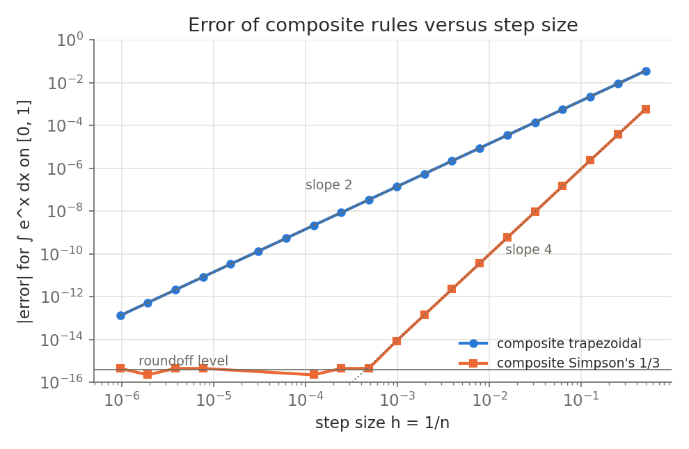
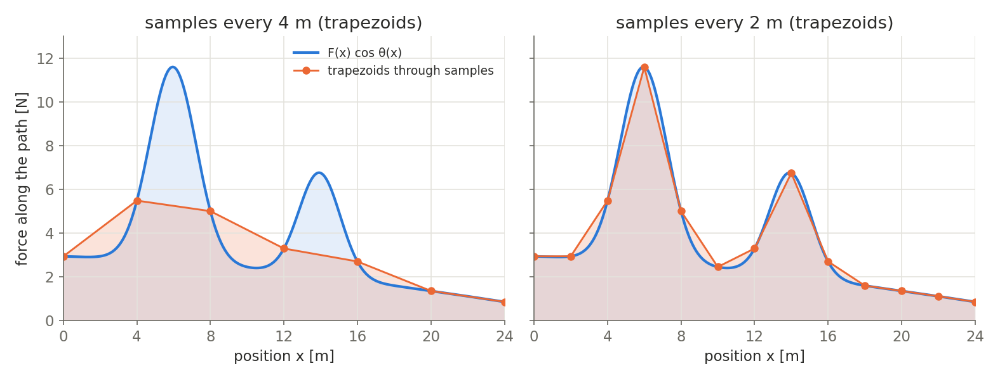

# 19장 — 수치 적분 공식

[레포지토리 안내](../../README.ko.md) | [English](Concepts_Lecture.md) | [한국어](Concepts_Lecture.ko.md)

> **최종 수정일:** 2026-11-19
>
> Applied Numerical Methods with Python for Engineers and Scientists, Chapra and Clough, Ch 19

> **학습 목표:**
> 1. 사다리꼴 법칙과 심프슨 법칙을 적용할 수 있다
> 2. 수치 적분의 오차 추정을 유도할 수 있다
> 3. 구간 수에 맞게 심프슨의 1/3 법칙과 3/8 법칙을 결합할 수 있다
> 4. 복합 사다리꼴 법칙과 복합 심프슨 법칙을 Python으로 구현할 수 있다
> 5. 미정 계수법으로 적분 공식의 가중치와 오차 상수를 유도할 수 있다
> 6. 복합 공식의 수렴 차수를 수치 실험으로 확인하고 비등간격 데이터를 적분할 수 있다

---

<br>

## 목차

- [1. 수치 적분 개요](#1-수치-적분-개요)
  - [1.1 동기: 수치 적분이 필요한 이유](#11-동기-수치-적분이-필요한-이유)
  - [1.2 기본 아이디어: 다항식 근사](#12-기본-아이디어-다항식-근사)
  - [1.3 라그랑주 다항식 복습](#13-라그랑주-다항식-복습)
  - [1.4 구적법과 뉴턴-코츠 공식](#14-구적법과-뉴턴-코츠-공식)
  - [1.5 정확도 차수와 미정 계수법](#15-정확도-차수와-미정-계수법)
  - [1.6 적분의 쓰임: 연속 함수의 평균과 총량](#16-적분의-쓰임-연속-함수의-평균과-총량)
- [2. 사다리꼴 법칙(Trapezoidal Rule) (n = 1)](#2-사다리꼴-법칙trapezoidal-rule-n--1)
  - [2.1 선형 보간으로부터의 유도](#21-선형-보간으로부터의-유도)
  - [2.2 최종 공식](#22-최종-공식)
  - [2.3 절단 오차(Truncation Error)](#23-절단-오차truncation-error)
  - [2.4 오차 공식의 유도와 계산 예](#24-오차-공식의-유도와-계산-예)
- [3. 심프슨의 1/3 법칙(Simpson's 1/3 Rule) (n = 2)](#3-심프슨의-13-법칙simpsons-13-rule-n--2)
  - [3.1 이차 보간으로부터의 유도](#31-이차-보간으로부터의-유도)
  - [3.2 변수 치환을 통한 기저 적분 계산](#32-변수-치환을-통한-기저-적분-계산)
  - [3.3 최종 공식](#33-최종-공식)
  - [3.4 절단 오차(Truncation Error)](#34-절단-오차truncation-error)
  - [3.5 오차가 4계 도함수에 의존하는 이유와 계산 예](#35-오차가-4계-도함수에-의존하는-이유와-계산-예)
- [4. 심프슨의 3/8 법칙(Simpson's 3/8 Rule) (n = 3)](#4-심프슨의-38-법칙simpsons-38-rule-n--3)
  - [4.1 삼차 보간으로부터의 유도](#41-삼차-보간으로부터의-유도)
  - [4.2 최종 공식](#42-최종-공식)
  - [4.3 절단 오차(Truncation Error)](#43-절단-오차truncation-error)
  - [4.4 가중치의 유도와 계산 예](#44-가중치의-유도와-계산-예)
- [5. 복합 사다리꼴 법칙(Composite Trapezoidal Rule)](#5-복합-사다리꼴-법칙composite-trapezoidal-rule)
  - [5.1 아이디어: 구간 분할](#51-아이디어-구간-분할)
  - [5.2 유도](#52-유도)
  - [5.3 최종 공식](#53-최종-공식)
  - [5.4 오차 분석](#54-오차-분석)
  - [5.5 수렴 차수의 수치 확인](#55-수렴-차수의-수치-확인)
- [6. 복합 심프슨의 1/3 법칙(Composite Simpson's 1/3 Rule)](#6-복합-심프슨의-13-법칙composite-simpsons-13-rule)
  - [6.1 유도](#61-유도)
  - [6.2 최종 공식](#62-최종-공식)
  - [6.3 오차 분석](#63-오차-분석)
  - [6.4 웨이퍼 합격 확률의 계산](#64-웨이퍼-합격-확률의-계산)
- [7. 복합 심프슨의 3/8 법칙(Composite Simpson's 3/8 Rule)](#7-복합-심프슨의-38-법칙composite-simpsons-38-rule)
  - [7.1 오차 분석](#71-오차-분석)
  - [7.2 복합 3/8 법칙의 공식과 계산 예](#72-복합-38-법칙의-공식과-계산-예)
- [8. 법칙의 결합: 실용적 응용](#8-법칙의-결합-실용적-응용)
- [9. Python 구현](#9-python-구현)
  - [9.1 사다리꼴 법칙 (단일 적용)](#91-사다리꼴-법칙-단일-적용)
  - [9.2 복합 사다리꼴 법칙](#92-복합-사다리꼴-법칙)
  - [9.3 심프슨의 1/3 법칙 (단일 적용)](#93-심프슨의-13-법칙-단일-적용)
  - [9.4 복합 심프슨의 1/3 법칙](#94-복합-심프슨의-13-법칙)
  - [9.5 심프슨의 3/8 법칙 (단일 적용)](#95-심프슨의-38-법칙-단일-적용)
  - [9.6 전체 예제: 모든 방법 비교](#96-전체-예제-모든-방법-비교)
  - [9.7 비등간격 데이터의 적분](#97-비등간격-데이터의-적분)
  - [9.8 SciPy의 표본 적분 함수](#98-scipy의-표본-적분-함수)
  - [9.9 이중 적분](#99-이중-적분)
- [10. 뉴턴-코츠 공식 비교](#10-뉴턴-코츠-공식-비교)
- [11. 사례 연구: 변하는 힘이 한 일](#11-사례-연구-변하는-힘이-한-일)
- [12. 흔한 실수](#12-흔한-실수)
- [개념 적용](#개념-적용)
- [요약](#요약)
- [점검 문제](#점검-문제)
- [참고 문헌](#참고-문헌)

---

<br>

## 1. 수치 적분 개요

### 1.1 동기: 수치 적분이 필요한 이유

수치 적분은 구간 위에서 함수의 정적분을 근사하는 문제를 다룬다:

```math
I = \int_a^b f(x)\,dx \approx I_n
```

많은 실제 적분은 **해석적으로 계산할 수 없다**. 대표적인 동기 부여 예제는 반도체 웨이퍼 제조업체와 관련된 것이다.

**예제: 웨이퍼 품질 관리**

한 제조업체가 2인치 직경의 웨이퍼를 생산한다. 실제 직경은 평균 $`\mu = 2`$ 인치, 표준 편차 $`\sigma = 0.01`$ 인치의 정규 분포를 따른다. 규격은 직경이 1.985에서 2.02 인치 사이일 것을 요구한다. 웨이퍼가 합격할 확률은 얼마인가?

정규 확률밀도함수는 다음과 같다:

```math
p(x) = \frac{1}{\sigma\sqrt{2\pi}} \exp\!\left(\frac{-(x - \mu)^2}{2\sigma^2}\right)
```

합격 웨이퍼의 확률은:

```math
P(1.985 \leq x \leq 2.02) = \int_{1.985}^{2.02} p(x)\,dx = \frac{1}{\sigma\sqrt{2\pi}} \int_{1.985}^{2.02} \exp\!\left(\frac{-(x - \mu)^2}{2\sigma^2}\right) dx
```

이 적분은 **닫힌 형태의 역도함수가 존재하지 않으므로**, 수치 적분 방법이 필요하다.

> **[미적분학]** 미적분학의 기본 정리에 따르면 연속 함수 $`f`$의 역도함수 $`F`$($`F' = f`$)를 알 때 정적분은 $`\int_a^b f(x)\,dx = F(b) - F(a)`$로 계산된다. 정규 확률밀도함수처럼 역도함수를 초등 함수로 나타낼 수 없는 피적분함수에는 이 방법을 쓸 수 없으므로, 정적분을 곡선 아래 넓이로 보고 근사하는 수치 적분이 필요하다.

### 1.2 기본 아이디어: 다항식 근사

1.1절의 피적분함수 $`p(x)`$를 예로 들면, 전략은 **피적분함수를 적분하기 쉬운 다항식으로 대체**하는 것이다:

```math
p(x) \approx p_n(x) = a_0 + a_1 x + \cdots + a_n x^n
```

라그랑주 보간(Lagrange Interpolation)을 이용하면, 이 다항식은 다음과 같이 쓸 수 있다:

```math
p_n(x) = \sum_{j=0}^{n} p_n(x_j)\,\ell_j(x)
```

여기서 $`\ell_j(x)`$는 라그랑주 기저 다항식이고, $`x_0, x_1, \ldots, x_n`$은 보간 절점이다.

### 1.3 라그랑주 다항식 복습

두 점 $`x_1, x_2`$를 사용하는 1차(first-order)의 경우, 라그랑주 기저 함수는 다음과 같다:

```math
N_1(x) = \frac{x - x_2}{x_1 - x_2}, \qquad N_2(x) = \frac{x_1 - x}{x_1 - x_2}
```

일반적으로 $`n`$차 라그랑주 기저 다항식은:

```math
\ell_j(x) = \prod_{\substack{i=0 \\ j \neq i}}^{n} \frac{x - x_i}{x_j - x_i}, \qquad j = 0, 1, \ldots, n
```

### 1.4 구적법과 뉴턴-코츠 공식

$`p(x) = p_n(x) + e_n(x)`$이고 $`e_n(x)`$가 보간 오차라면:

```math
\int_a^b p(x)\,dx = \int_a^b p_n(x)\,dx + \int_a^b e_n(x)\,dx
```

다항식 부분을 전개하면:

```math
\int_a^b p_n(x)\,dx = \int_a^b \sum_{j=0}^{n} p_n(x_j)\,\ell_j(x)\,dx = \sum_{j=0}^{n} p_n(x_j) \underbrace{\int_a^b \ell_j(x)\,dx}_{\text{하나의 수 (가중치)}}
```

> **핵심:** $`\int_a^b \ell_j(x)\,dx`$는 $`p_n(x)`$에 **의존하지 않는다**. 이 값은 절점의 위치와 구간 $`[a,b]`$에 의해서만 결정되는 고정된 수치적 가중치이다. 이것이 이 공식들을 **구적법(Quadrature Formulas)** 이라고 부르는 이유이다.

일반적인 피적분함수 $`f(x)`$에 대해 $`I = \int_a^b f(x)\,dx`$를 $`I_n = \int_a^b f_n(x)\,dx`$로 근사하는 접근법(여기서 $`f_n(x)`$는 $`n`$차 다항식)이 **뉴턴-코츠 공식(Newton-Cotes Formulas)** 의 기초이다. $`n`$의 선택에 따라 구체적인 법칙이 결정된다:

| $`n`$ | 법칙 이름 | 다항식 차수 |
|-----|-----------|------------|
| 1 | 사다리꼴 법칙(Trapezoidal Rule) | 선형(Linear) |
| 2 | 심프슨의 1/3 법칙(Simpson's 1/3 Rule) | 이차(Quadratic) |
| 3 | 심프슨의 3/8 법칙(Simpson's 3/8 Rule) | 삼차(Cubic) |

*표 1. 다항식 차수에 따른 뉴턴-코츠 법칙*

### 1.5 정확도 차수와 미정 계수법

적분 공식 $`\int_a^b f(x)\,dx \approx \sum_j w_j f(x_j)`$의 품질은 어떤 다항식까지 정확히 적분하는지로 나타낸다.

> **용어 정의:** **정확도 차수(degree of precision)** 는 적분 공식이 차수 $`m`$ 이하의 모든 다항식을 정확히 적분하지만 $`x^{m+1}`$은 정확히 적분하지 못할 때의 $`m`$이다. 적분과 적분 공식이 모두 선형이므로 $`1, x, \ldots, x^m`$의 $`m + 1`$개 단항식만 확인하면 된다.

이 정의를 거꾸로 쓰면 가중치를 구할 수 있다. 노드를 먼저 정하고, 가중치를 미지수로 둔 뒤 단항식 $`1, x, x^2, \ldots`$에 대해 공식이 정확하도록 방정식을 세우는 방법을 **미정 계수법(method of undetermined coefficients)** 이라 한다. 라그랑주 기저 함수를 적분하는 3장의 방법과 같은 결과를 주지만 계산이 더 간단하다.

구간 $`[-h, h]`$에 노드 $`-h, 0, h`$를 두고 $`\int_{-h}^{h} f(x)\,dx \approx w_0 f(-h) + w_1 f(0) + w_2 f(h)`$로 놓는다. 세 단항식에 대해 정확하도록 요구하면 다음 방정식을 얻는다.

```math
f = 1: \quad w_0 + w_1 + w_2 = 2h
```

```math
f = x: \quad -w_0 h + w_2 h = 0
```

```math
f = x^2: \quad w_0 h^2 + w_2 h^2 = \frac{2h^3}{3}
```

둘째 식에서 $`w_0 = w_2`$, 셋째 식에서 $`w_0 = w_2 = h/3`$, 첫째 식에서 $`w_1 = 4h/3`$이다. 이것이 심프슨의 1/3 법칙 $`\frac{h}{3}(f_0 + 4f_1 + f_2)`$이다. $`f = x^3`$을 넣으면 좌변과 우변이 모두 0이므로 공식은 3차식까지 정확하고, $`f = x^4`$를 넣으면 정확한 값은 $`\frac{2h^5}{5}`$이지만 공식은 $`\frac{h}{3}(h^4 + h^4) = \frac{2h^5}{3}`$을 주므로 정확도 차수는 3이다.

같은 방법으로 오차 상수도 얻는다. 정확도 차수가 $`m`$이고 오차가 $`E = C\,f^{(m+1)}(\xi)`$ 꼴인 공식(뉴턴-코츠 공식은 이 꼴을 가진다)에 $`f = x^{m+1}`$을 넣으면 $`f^{(m+1)} = (m+1)!`$이 상수이므로 $`C = E(x^{m+1})/(m+1)!`$이다.

- 심프슨의 1/3 법칙: $`E(x^4) = \frac{2h^5}{5} - \frac{2h^5}{3} = -\frac{4h^5}{15}`$이므로 $`C = -\frac{4h^5}{15 \cdot 24} = -\frac{h^5}{90}`$이다. 3.4절의 오차 공식과 같다.
- 사다리꼴 법칙: 구간 $`[0, h]`$에서 $`E(x^2) = \frac{h^3}{3} - \frac{h}{2}(0 + h^2) = -\frac{h^3}{6}`$이므로 $`C = -\frac{h^3}{12}`$이다. 2.3절의 오차 공식과 같다.

```python
import numpy as np

def weights(nodes, a, b):
    """Weights that integrate 1, x, ..., x^(m-1) exactly on [a, b]."""
    m = len(nodes)
    A = np.vander(nodes, m, increasing=True).T          # row k: nodes**k
    rhs = np.array([(b**(k + 1) - a**(k + 1)) / (k + 1) for k in range(m)])
    return np.linalg.solve(A, rhs)

print("trapezoid  [0, 1]:", weights(np.array([0.0, 1.0]), 0.0, 1.0))
print("Simpson    [-1, 1]:", weights(np.array([-1.0, 0.0, 1.0]), -1.0, 1.0))
print("3/8 rule   [0, 3]:", weights(np.array([0.0, 1.0, 2.0, 3.0]), 0.0, 3.0))

w = weights(np.array([-1.0, 0.0, 1.0]), -1.0, 1.0)
for k in range(6):                                       # test monomials
    rule = w @ np.array([-1.0, 0.0, 1.0])**k
    exact = (1 - (-1)**(k + 1)) / (k + 1)
    print(f"x^{k}: rule = {rule:.6f}, exact = {exact:.6f}")
```

```text
trapezoid  [0, 1]: [0.5 0.5]
Simpson    [-1, 1]: [0.33333333 1.33333333 0.33333333]
3/8 rule   [0, 3]: [0.375 1.125 1.125 0.375]
x^0: rule = 2.000000, exact = 2.000000
x^1: rule = 0.000000, exact = 0.000000
x^2: rule = 0.666667, exact = 0.666667
x^3: rule = 0.000000, exact = 0.000000
x^4: rule = 0.666667, exact = 0.400000
x^5: rule = 0.000000, exact = 0.000000
```

- `np.vander(nodes, m, increasing=True).T`는 $`k`$행이 노드의 $`k`$제곱인 행렬을 만든다. 이 행렬에 가중치 벡터를 곱한 것이 각 단항식에 대한 공식의 값이다.
- `rhs`의 $`k`$번째 원소는 $`\int_a^b x^k\,dx = \frac{b^{k+1} - a^{k+1}}{k+1}`$이다.
- 가중치는 $`h = 1`$일 때의 값이며, 결과는 차례로 사다리꼴 법칙의 $`\frac{h}{2}`$, 심프슨 법칙의 $`\frac{h}{3}, \frac{4h}{3}`$, 3/8 법칙의 $`\frac{3h}{8}, \frac{9h}{8}`$이다.
- 마지막 반복문은 심프슨 법칙이 $`x^3`$까지 정확하고 $`x^4`$에서 처음 틀린다는 것, 곧 정확도 차수가 3임을 보여 준다.

### 1.6 적분의 쓰임: 연속 함수의 평균과 총량

정적분은 곡선 아래의 넓이이면서 구간 위의 값을 모두 더한 합이다. 적분 기호 $`\int`$가 합(sum)의 머리글자 S를 늘인 모양인 것도 이 때문이다. 적분을 합으로 보면 두 가지 쓰임이 나온다.

첫째는 연속 함수의 평균이다. 측정값 $`y_1, \ldots, y_n`$의 평균은 $`\frac{1}{n}\sum_i y_i`$이다. 구간 $`[a, b]`$에서 연속적으로 변하는 $`f(x)`$는 값이 무수히 많으므로, 합을 적분으로, 개수를 구간의 길이로 바꾼 다음 식이 그 평균이다.

```math
\bar{f} = \frac{1}{b - a}\int_a^b f(x)\,dx
```

물체의 무게 중심은 위치를 밀도로 가중한 평균이고, 교류 전류의 실효값(20장 6절)은 전류를 제곱한 값의 평균의 제곱근이다. 둘째는 총량이다. 반응기 안의 농도 $`c`$가 위치마다 다르면 전체 질량은 작은 부피 $`\Delta V_i`$마다의 $`c_i\,\Delta V_i`$를 더한 값이고, 부피를 한없이 잘게 나눈 극한이 부피 적분 $`\iiint_V c\,dV`$이다. 어떤 면을 지나가는 열의 총량도 같은 방식으로 그 면 위에서 열유속을 적분한 면적 적분이다.

표본으로 평균을 계산할 때는 산술 평균과 적분 평균을 구별해야 한다. 속도 $`v(t) = 10(1 - e^{-0.3t})`$ [m/s]의 0초에서 6초까지의 시간 평균은 $`\frac{1}{6}\int_0^6 v\,dt = 5.3628`$ m/s이다. 1초 간격의 표본 7개 $`0, 2.5918, 4.5119, 5.9343, 6.9881, 7.7687, 8.3470`$의 산술 평균은 5.1631 m/s로 약 3.7% 작다. 각 표본이 대표하는 시간 폭은 내부에서 1초이지만 양 끝에서는 0.5초인데, 산술 평균은 모든 표본에 같은 가중치를 주기 때문이다. 양 끝의 가중치를 절반으로 줄인 가중 평균은 5.3280 m/s로 참값에 훨씬 가깝다. 이 값은 5절의 복합 사다리꼴 법칙으로 구한 적분을 구간의 길이 6으로 나눈 것과 같으며, 5.3절에서 복합 사다리꼴 법칙을 너비와 평균 높이의 곱으로 해석한 것과 같은 계산이다.

---

<br>

## 2. 사다리꼴 법칙(Trapezoidal Rule) (n = 1)

### 2.1 선형 보간으로부터의 유도

피적분함수 $`f(x)`$를 양 끝점 $`(a, f(a))`$와 $`(b, f(b))`$를 지나는 1차 다항식 $`p_1(x)`$로 근사한다:

```math
p_1(x) = f(a)\,N_1(x) + f(b)\,N_2(x) = f(a)\!\left(\frac{x - b}{a - b}\right) + f(b)\!\left(\frac{x - a}{b - a}\right)
```

정리하면:

```math
p_1(x) = \frac{f(b) - f(a)}{b - a}\,x + \frac{b\,f(a) - a\,f(b)}{b - a}
```

이제 적분한다:

```math
\int_a^b f(x)\,dx \approx \int_a^b p_1(x)\,dx = \frac{f(b) - f(a)}{b - a} \int_a^b x\,dx + \frac{b\,f(a) - a\,f(b)}{b - a} \int_a^b 1\,dx
```

기본 적분을 계산하면:

```math
\int_a^b x\,dx = \frac{1}{2}(b^2 - a^2), \qquad \int_a^b 1\,dx = b - a
```

대수적 정리를 거치면:

```math
= \frac{f(b) - f(a)}{2}(a + b) + b\,f(a) - a\,f(b)
```

```math
= \frac{1}{2}\bigl[b\,f(b) - a\,f(b) + b\,f(a) - a\,f(a)\bigr]
```

```math
= \frac{1}{2}(b - a)\,f(b) + \frac{1}{2}(b - a)\,f(a)
```

### 2.2 최종 공식

```math
\boxed{I \approx I_1 = \frac{b - a}{2}\bigl[f(a) + f(b)\bigr] = (b - a) \cdot \frac{f(a) + f(b)}{2}}
```

> **참고:** **기하학적 해석.** 사다리꼴 법칙은 양 끝점의 함수값으로 형성되는 **사다리꼴**의 넓이를 계산한다. $`(b - a)`$는 **너비**이고, $`\frac{f(a) + f(b)}{2}`$는 **평균 높이**이다.

### 2.3 절단 오차(Truncation Error)

사다리꼴 법칙의 오차는 다음과 같다:

```math
\boxed{E_1 = I - I_1 = -\frac{1}{12}\,f''(\xi)\,(b - a)^3, \qquad a \leq \xi \leq b}
```

**중요한 결과:** $`f(x) = mx + n`$ (선형 함수)이면 $`f''(x) = 0`$이므로 $`E_1 = 0`$이다. **사다리꼴 법칙은 선형 함수**(1차 이하의 다항식)에 대해 정확하다.

> **참고:** **오차의 의미.** 오차는 $`(b-a)^3`$에 비례하며 2계도함수 $`f''`$에 의존한다. 이는 (1) 더 좁은 구간이 더 작은 오차를 주고, (2) 곡률이 작은 함수가 이 법칙으로 잘 근사됨을 알려 준다.

### 2.4 오차 공식의 유도와 계산 예

2.3절의 오차 공식은 17장의 보간 오차에서 유도된다. 1차 보간 다항식의 오차는 $`f(x) - p_1(x) = \frac{f''(\xi(x))}{2}(x - a)(x - b)`$이므로, $`f`$가 $`[a, b]`$에서 2번 연속 미분 가능하면

```math
E_1 = \int_a^b \bigl[f(x) - p_1(x)\bigr]\,dx = \int_a^b \frac{f''(\xi(x))}{2}\,(x - a)(x - b)\,dx
```

이다. $`[a, b]`$에서 $`(x - a)(x - b) \le 0`$으로 부호가 바뀌지 않으므로, 적분의 가중 평균값 정리에 따라 $`f''(\xi(x))`$를 구간 안의 한 값 $`f''(\eta)`$로 꺼낼 수 있다.

```math
E_1 = \frac{f''(\eta)}{2}\int_a^b (x - a)(x - b)\,dx = \frac{f''(\eta)}{2}\left(-\frac{(b - a)^3}{6}\right) = -\frac{(b - a)^3}{12}\,f''(\eta)
```

오차의 부호는 $`f''`$의 부호와 반대이다. $`f'' > 0`$(아래로 볼록)이면 사다리꼴의 윗변이 곡선보다 위에 있어 근삿값이 참값보다 크고 $`E_1 < 0`$이다.

$`\int_0^1 e^x\,dx`$에 적용하면, 9.6절의 결과 1.8591409142의 오차는 $`1.7182818285 - 1.8591409142 = -0.1408590857`$이다. $`f''(x) = e^x`$는 $`[0, 1]`$에서 1과 $`e`$ 사이에 있으므로 공식은 오차가 $`-e/12 = -0.2265`$와 $`-1/12 = -0.0833`$ 사이에 있음을 보장하며, 실제 오차는 이 범위 안에 있다.

---

<br>

## 3. 심프슨의 1/3 법칙(Simpson's 1/3 Rule) (n = 2)

### 3.1 이차 보간으로부터의 유도

$`f(x)`$를 등간격의 세 점 $`x_1 = a`$, $`x_2 = \frac{a+b}{2}`$, $`x_3 = b`$을 지나는 2차 다항식 $`p_2(x)`$로 근사한다. 스텝 크기는 $`h = \frac{b - a}{2}`$이다.

다음과 같이 정의한다:

```math
f_1 = f(a), \qquad f_2 = f\!\left(\frac{a+b}{2}\right), \qquad f_3 = f(b)
```

보간 다항식은:

```math
p_2(x) = f_1\,\ell_1(x) + f_2\,\ell_2(x) + f_3\,\ell_3(x)
```

여기서 라그랑주 기저 다항식은 다음과 같다:

```math
\ell_1(x) = \frac{(x - x_2)(x - x_3)}{(x_1 - x_2)(x_1 - x_3)}, \quad \ell_2(x) = \frac{(x - x_1)(x - x_3)}{(x_2 - x_1)(x_2 - x_3)}, \quad \ell_3(x) = \frac{(x - x_1)(x - x_2)}{(x_3 - x_1)(x_3 - x_2)}
```

따라서 적분은 다음이 된다:

```math
\int_a^b p_2(x)\,dx = f_1 \int_a^b \ell_1(x)\,dx + f_2 \int_a^b \ell_2(x)\,dx + f_3 \int_a^b \ell_3(x)\,dx
```

### 3.2 변수 치환을 통한 기저 적분 계산

$`\int_a^b \ell_j(x)\,dx`$를 계산하기 위해 다음 변수 치환을 적용한다:

```math
x = x(\zeta) = \frac{b - a}{2}\,\zeta + \frac{b + a}{2}, \qquad dx = \frac{b - a}{2}\,d\zeta
```

이는 $`[a, b] \to [-1, 1]`$로 사상하고, 세 절점 $`x_1 = a,\; x_2 = \frac{a+b}{2},\; x_3 = b`$는 각각 $`\zeta = -1, 0, 1`$로 사상된다.

**$`\zeta`$-공간에서의 기저 함수:**

```math
\ell_1(\zeta) = \frac{(\zeta - 0)(\zeta - 1)}{(-1 - 0)(-1 - 1)} = \frac{\zeta(\zeta - 1)}{2}
```

```math
\ell_2(\zeta) = \frac{(\zeta - (-1))(\zeta - 1)}{(0 - (-1))(0 - 1)} = (1 - \zeta)(1 + \zeta) = 1 - \zeta^2
```

```math
\ell_3(\zeta) = \frac{(\zeta - (-1))(\zeta - 0)}{(1 - (-1))(1 - 0)} = \frac{\zeta(1 + \zeta)}{2}
```

**적분 계산:**

$`\ell_1`$의 경우:

```math
\int_a^b \ell_1(x)\,dx = \int_{-1}^{1} \frac{\zeta(\zeta - 1)}{2} \cdot \frac{b - a}{2}\,d\zeta = \frac{b - a}{4} \int_{-1}^{1} (\zeta^2 - \zeta)\,d\zeta
```

$`\zeta`$는 $`[-1, 1]`$ 위의 **기함수(odd function)** 이므로 그 적분은 0이 된다:

```math
= \frac{b - a}{4} \cdot \frac{2}{3} = \frac{b - a}{6}
```

대칭성에 의해 $`\int_a^b \ell_3(x)\,dx = \frac{b - a}{6}`$도 마찬가지이다.

$`\ell_2`$의 경우:

```math
\int_a^b \ell_2(x)\,dx = \int_{-1}^{1} (1 - \zeta^2) \cdot \frac{b - a}{2}\,d\zeta = \frac{b - a}{2}\left(\zeta - \frac{\zeta^3}{3}\right)\Bigg|_{-1}^{1} = \frac{b - a}{2} \cdot \frac{4}{3} = \frac{4(b - a)}{6}
```

### 3.3 최종 공식

가중치를 결합하면:

```math
\int_a^b f(x)\,dx \approx \frac{b - a}{6}\bigl(f_1 + 4f_2 + f_3\bigr)
```

$`h = \frac{b - a}{2}`$로 놓으면:

```math
\boxed{I \approx I_2 = \frac{h}{3}(f_1 + 4f_2 + f_3) = \frac{b - a}{6}\bigl[f(a) + 4f\!\left(\tfrac{a+b}{2}\right) + f(b)\bigr]}
```

> **참고:** **이름과 가중치.** "1/3 법칙"이라는 이름은 공식의 $`\frac{h}{3}`$ 인수에서 유래한다. 중간점이 끝점보다 **4배**의 가중치를 받는 것은 3.2절에서 구한 대로 $`\int_a^b \ell_2(x)\,dx = \frac{4(b - a)}{6}`$가 $`\int_a^b \ell_1(x)\,dx = \frac{b - a}{6}`$의 4배이기 때문이다.

### 3.4 절단 오차(Truncation Error)

심프슨의 1/3 법칙의 오차는:

```math
E_2 = I - I_2 = -\frac{1}{90}\,h^5\,f^{(4)}(\xi), \qquad a \leq \xi \leq b
```

$`h = \frac{b - a}{2}`$이므로:

```math
\boxed{E_2 = -\frac{(b - a)^5}{2880}\,f^{(4)}(\xi)}
```

**핵심 통찰:** 심프슨의 1/3 법칙은 **2차** 다항식을 사용하지만, 오차는 **4계도함수** $`f^{(4)}`$에 의존한다. 이는 심프슨의 1/3 법칙이 **3차 이하의 다항식에 대해 정확**함을 의미한다(삼차함수의 경우 $`f^{(4)} = 0`$이므로).

> **참고:** **추가 정확도의 원인.** 이러한 추가 정확도는 적분 절점이 중점에 대해 대칭이기 때문에 홀수 거듭제곱 오차항이 상쇄되어 발생한다.

### 3.5 오차가 4계 도함수에 의존하는 이유와 계산 예

2.4절의 유도를 심프슨 법칙에 그대로 적용하면 막힌다. 2차 보간의 오차에 들어 있는 $`(x - a)(x - m)(x - b)`$ ($`m`$은 중점)는 $`[a, b]`$에서 부호가 바뀌므로 가중 평균값 정리를 쓸 수 없다. 대신 이 함수는 중점에 대해 기함수이므로 그 적분이 0이며, 이것이 2차 다항식으로 근사했는데도 3차 항까지 정확히 적분되는 이유이다. 오차의 주된 부분은 그다음 항에서 나오므로 오차가 $`f^{(4)}`$에 의존하며, 상수는 1.5절의 단항식 방법으로 구한 $`-\frac{h^5}{90}`$이다.

$`\int_0^1 e^x\,dx`$에 단일 적용하면 9.6절의 결과 1.7188611519의 오차는 $`-0.000579`$이다. $`f^{(4)}(x) = e^x \in [1, e]`$이므로 3.4절의 공식은 오차가 $`-e/2880 = -0.000944`$와 $`-1/2880 = -0.000347`$ 사이에 있음을 보장하고, 실제 오차는 이 범위 안에 있다. 함수를 두 번 평가하는 사다리꼴 법칙의 오차 $`-0.140859`$보다 약 240배 작다(심프슨 법칙은 세 번 평가한다).

> **주의:** 심프슨 법칙의 오차 공식은 $`f`$가 4번 연속 미분 가능할 때 성립한다. 피적분함수나 그 도함수가 구간 안에서 불연속이거나 끝점에서 발산하면(예: $`\sqrt{x}`$를 $`[0, 1]`$에서 적분), 오차가 $`h^4`$에 비례하지 않고 훨씬 느리게 줄어든다.

---

<br>

## 4. 심프슨의 3/8 법칙(Simpson's 3/8 Rule) (n = 3)

### 4.1 삼차 보간으로부터의 유도

$`f(x)`$를 스텝 크기 $`h = \frac{b - a}{3}`$인 등간격 네 점을 지나는 3차 다항식 $`p_3(x)`$로 근사한다:

```math
x_0 = a, \quad x_1 = a + h, \quad x_2 = a + 2h, \quad x_3 = b
```

$`f_i = f(x_i)`$로 쓰면 보간 다항식은:

```math
p_3(x) = f_0\,\ell_0(x) + f_1\,\ell_1(x) + f_2\,\ell_2(x) + f_3\,\ell_3(x)
```

적분하면:

```math
\int_a^b p_3(x)\,dx = f_0 \int_a^b \ell_0(x)\,dx + f_1 \int_a^b \ell_1(x)\,dx + f_2 \int_a^b \ell_2(x)\,dx + f_3 \int_a^b \ell_3(x)\,dx
```

### 4.2 최종 공식

```math
\boxed{I \approx I_3 = \frac{3h}{8}(f_0 + 3f_1 + 3f_2 + f_3), \qquad h = \frac{b - a}{3}}
```

> **참고:** **이름과 가중치.** "3/8 법칙"이라는 이름은 $`h`$에 곱해지는 계수 $`\frac{3}{8}`$에서 유래한다. 가중치는 $`1 : 3 : 3 : 1`$ 패턴을 따르며, 대칭적인 삼차 보간을 반영한다.

### 4.3 절단 오차(Truncation Error)

```math
E_3 = I - I_3 = -\frac{3}{80}\,h^5\,f^{(4)}(\xi), \qquad a \leq \xi \leq b
```

$`h = \frac{b - a}{3}`$이므로:

```math
\boxed{E_3 = -\frac{(b - a)^5}{6480}\,f^{(4)}(\xi)}
```

심프슨의 1/3 법칙과 마찬가지로, 3/8 법칙도 오차가 $`f^{(4)}`$에 의존하므로 **3차 이하의 다항식에 대해 정확**하다.

> **참고:** **단일 적용 오차 비교.** 같은 구간에 한 번 적용할 때의 오차를 비교하면 $`|E_3| = \frac{(b-a)^5}{6480}|f^{(4)}(\xi)|`$이고 $`|E_2| = \frac{(b-a)^5}{2880}|f^{(4)}(\xi)|`$이다. 3/8 법칙은 단일 적용당 **더 정확**하지만($`6480 > 2880`$), 함수 평가가 한 번 더 필요하다.

### 4.4 가중치의 유도와 계산 예

4.1절의 기저 함수 적분은 1.5절의 미정 계수법으로 간단히 계산할 수 있다. $`t = (x - a)/h`$로 놓으면 노드는 $`t = 0, 1, 2, 3`$이고, 대칭성에 따라 가중치를 $`w_0 = w_3 = Ah`$, $`w_1 = w_2 = Bh`$로 둘 수 있다. 상수와 $`t^2`$에 대해 정확하도록 요구하면

```math
\int_0^3 1\,dt = 3: \quad 2A + 2B = 3, \qquad \int_0^3 t^2\,dt = 9: \quad A(0^2 + 3^2) + B(1^2 + 2^2) = 9A + 5B = 9
```

이므로 $`A = \frac{3}{8}`$, $`B = \frac{9}{8}`$이고, 4.2절의 공식 $`\frac{3h}{8}(f_0 + 3f_1 + 3f_2 + f_3)`$이 나온다. 홀수 차수의 항은 중심 $`t = 1.5`$에 대한 대칭 때문에 자동으로 맞는다. 오차 상수는 $`f = t^4`$로 확인한다. 정확한 값은 $`\frac{3^5}{5} = 48.6`$이고 공식은 $`\frac{3}{8}(0 + 3 + 3 \cdot 16 + 81) = 49.5`$를 주므로 $`E = -0.9h^5`$이고, $`C = -0.9h^5/4! = -\frac{3}{80}h^5`$로 4.3절과 같다.

$`\int_0^1 e^x\,dx`$에 단일 적용한 9.6절의 결과 1.7185401534의 오차는 $`-0.000258`$로, 4.3절의 공식이 보장하는 범위 $`[-e/6480, -1/6480] = [-0.000419, -0.000154]`$ 안에 있다. 같은 구간에 단일 적용한 심프슨의 1/3 법칙의 오차 $`-0.000579`$보다 작지만, 함수 평가가 4번 필요하다.

---

<br>

## 5. 복합 사다리꼴 법칙(Composite Trapezoidal Rule)

### 5.1 아이디어: 구간 분할

**사다리꼴 법칙의 오차를 줄이는 방법**

구간 $`[a, b]`$를 $`n`$개의 소구간(세그먼트)으로 나누고, 각 세그먼트에 사다리꼴 법칙을 적용한다. 소구간이 작을수록 각 구간에서의 선형 근사가 더 정확해진다.

$`n`$개의 세그먼트인 경우:

```math
h = \frac{b - a}{n}, \qquad x_i = a + ih \;\;(i = 0, 1, \ldots, n)
```

여기서 $`x_0 = a`$이고 $`x_n = b`$이며, $`f_i = f(x_i)`$이다.

### 5.2 유도

적분을 $`n`$개의 부분 적분으로 나누고 각각에 사다리꼴 법칙을 적용한다:

```math
I = \int_a^b f(x)\,dx = \int_{x_0}^{x_1} f(x)\,dx + \int_{x_1}^{x_2} f(x)\,dx + \cdots + \int_{x_{n-1}}^{x_n} f(x)\,dx
```

```math
\approx (x_1 - x_0)\frac{f_0 + f_1}{2} + (x_2 - x_1)\frac{f_1 + f_2}{2} + \cdots + (x_n - x_{n-1})\frac{f_{n-1} + f_n}{2}
```

모든 소구간의 너비가 $`h`$로 동일하므로:

```math
= \frac{h}{2}\bigl(f_0 + f_1 + f_1 + f_2 + f_2 + \cdots + f_{n-1} + f_{n-1} + f_n\bigr)
```

항을 정리하면(내부 점들은 두 번 나타남):

```math
= \frac{h}{2}\left(f_0 + 2f_1 + 2f_2 + \cdots + 2f_{n-1} + f_n\right)
```

### 5.3 최종 공식

```math
\boxed{I \approx \frac{h}{2}\left(f_0 + 2\sum_{i=1}^{n-1} f_i + f_n\right) = (b - a)\,\frac{f_0 + 2\displaystyle\sum_{i=1}^{n-1} f_i + f_n}{2n}}
```

이것이 **복합 사다리꼴 법칙(Composite Trapezoidal Rule)** 이다. 동일한 해석이 적용된다: **너비** $`\times`$ **평균 높이**, 여기서 평균 높이는 끝점은 한 번, 내부 점은 두 번 세는 가중 평균이다.

$`\int_0^1 e^x\,dx`$를 $`n = 4`$($`h = 0.25`$)로 계산하는 과정을 표로 정리하면 다음과 같다.

| $`i`$ | $`x_i`$ | $`f_i = e^{x_i}`$ | 가중치 | 가중치 $`\times f_i`$ |
|:---:|:-----|:-----|:---:|:-----|
| 0 | 0 | 1.000000 | 1 | 1.000000 |
| 1 | 0.25 | 1.284025 | 2 | 2.568051 |
| 2 | 0.5 | 1.648721 | 2 | 3.297443 |
| 3 | 0.75 | 2.117000 | 2 | 4.234000 |
| 4 | 1 | 2.718282 | 1 | 2.718282 |

*표 2. 복합 사다리꼴 법칙($`n = 4`$)의 계산 과정*

마지막 열의 합은 13.817775이므로 $`I \approx \frac{0.25}{2} \times 13.817775 = 1.727222`$이고, 오차는 $`1.718282 - 1.727222 = -0.008940`$이다. 같은 다섯 점에 6.2절의 가중치 $`1, 4, 2, 4, 1`$을 쓰면 합이 20.619826이 되어 복합 심프슨 1/3 법칙의 값 $`\frac{0.25}{3} \times 20.619826 = 1.718319`$를 얻고, 오차는 $`-3.7 \times 10^{-5}`$로 약 240분의 1이다.

### 5.4 오차 분석

각 소구간 $`[x_{i-1}, x_i]`$에서의 국소 오차는:

```math
-\frac{1}{12}\,f''(\xi_i)\,h^3, \qquad x_{i-1} \leq \xi_i \leq x_i
```

$`n`$개의 국소 오차를 모두 합하면:

```math
E_{1t} = -\frac{1}{12}\,h^3 \sum_{i=1}^{n} f''(\xi_i) = -\frac{1}{12}\,h^3 \cdot n \cdot \frac{\displaystyle\sum_{i=1}^{n} f''(\xi_i)}{n}
```

$`f''(\xi_i)`$ 값들의 평균은 $`\overline{f''}`$로 근사하고, $`n = \frac{b - a}{h}`$이므로:

```math
\boxed{E_{1a} \approx -\frac{(b - a)^3}{12\,n^2}\,\overline{f''} = -\frac{(b - a)}{12}\,\overline{f''}\,h^2}
```

오차는 **$`h^2`$에 비례**한다. 따라서:

> **핵심:** **$`n`$을 두 배로 늘리면 절단 오차는 1/4로 줄어든다**($`h^2 \to (h/2)^2 = h^2/4`$이므로).

### 5.5 수렴 차수의 수치 확인

오차가 $`h^2`$에 비례한다는 결론은 $`n`$을 두 배씩 늘리며 오차의 비를 재어 확인할 수 있다.

```python
import numpy as np

def trap(f, a, b, n):
    x = np.linspace(a, b, n + 1); y = f(x)
    return (b - a) / n * (y[0] / 2 + y[1:-1].sum() + y[-1] / 2)

def simp(f, a, b, n):                        # n must be even
    x = np.linspace(a, b, n + 1); y = f(x)
    return (b - a) / (3 * n) * (y[0] + 4 * y[1:-1:2].sum() + 2 * y[2:-1:2].sum() + y[-1])

exact = np.e - 1.0
print("   n     trap error   ratio    Simpson error   ratio")
pt = ps = None
for n in [2, 4, 8, 16, 32, 64]:
    et = exact - trap(np.exp, 0.0, 1.0, n)
    es = exact - simp(np.exp, 0.0, 1.0, n)
    rt = f"{pt / et:6.2f}" if pt else "      "
    rs = f"{ps / es:6.2f}" if ps else "      "
    print(f"{n:4d}   {et:11.3e}  {rt}   {es:13.3e}  {rs}")
    pt, ps = et, es
```

```text
   n     trap error   ratio    Simpson error   ratio
   2    -3.565e-02              -5.793e-04        
   4    -8.940e-03    3.99      -3.701e-05   15.65
   8    -2.237e-03    4.00      -2.326e-06   15.91
  16    -5.593e-04    4.00      -1.456e-07   15.98
  32    -1.398e-04    4.00      -9.103e-09   15.99
  64    -3.496e-05    4.00      -5.690e-10   16.00
```

- `trap`과 `simp`는 9.2절과 9.4절의 함수를 NumPy 배열 연산으로 바꾼 것이다. `y[1:-1:2]`는 홀수 인덱스, `y[2:-1:2]`는 짝수 인덱스의 내부 점이다.
- `ratio` 열은 직전 $`n`$의 오차를 현재 오차로 나눈 값이다. 사다리꼴 법칙은 4, 심프슨 법칙은 16으로 수렴하여 각각 $`O(h^2)`$과 $`O(h^4)`$을 확인해 준다.

$`h`$를 더 줄이면 반올림 오차가 나타난다(그림 1). 심프슨 법칙의 오차는 $`n \approx 2000`$($`h \approx 5 \times 10^{-4}`$)에서 배정밀도의 반올림 수준 $`10^{-16}`$에 닿고, 그보다 $`n`$을 늘려도 더 이상 줄지 않는다. 사다리꼴 법칙은 같은 정확도를 얻으려면 훨씬 많은 점이 필요하여, $`n = 2^{20} \approx 10^6`$에서도 오차가 $`10^{-13}`$ 정도이다. 높은 차수의 공식은 같은 정확도를 훨씬 적은 함수 평가로 얻는다.



*그림 1. 스텝 크기에 따른 복합 사다리꼴 법칙과 복합 심프슨 1/3 법칙의 오차*

오차가 $`h^2`$에 비례한다는 사실은 오차를 추정하는 데도 쓸 수 있다. $`I_h`$와 $`I_{h/2}`$를 계산했다면 $`I - I_h \approx 4(I - I_{h/2})`$이므로 $`I - I_{h/2} \approx (I_{h/2} - I_h)/3`$이다. 위 표의 $`n = 8`$과 $`n = 16`$에서 사다리꼴 법칙의 근삿값은 1.720519와 1.718841이므로, 추정값 $`(1.718841 - 1.720519)/3 = -5.59 \times 10^{-4}`$는 $`n = 16`$의 실제 오차와 같다. 이 추정값을 더해 정확도를 높이는 방법이 20장의 리처드슨 외삽과 롬버그 적분이다.

---

<br>

## 6. 복합 심프슨의 1/3 법칙(Composite Simpson's 1/3 Rule)

### 6.1 유도

$`[a, b]`$를 $`n`$개의 소구간으로 나눈다(**$`n`$은 짝수여야 한다**). $`h = \frac{b - a}{n}`$. 연속하는 한 쌍의 소구간에 심프슨의 1/3 법칙을 적용한다:

```math
I = \int_{x_0}^{x_2} f(x)\,dx + \int_{x_2}^{x_4} f(x)\,dx + \cdots + \int_{x_{n-2}}^{x_n} f(x)\,dx
```

```math
\approx \frac{h}{3}(f_0 + 4f_1 + f_2) + \frac{h}{3}(f_2 + 4f_3 + f_4) + \frac{h}{3}(f_4 + 4f_5 + f_6) + \cdots + \frac{h}{3}(f_{n-2} + 4f_{n-1} + f_n)
```

항을 정리하면:

```math
= \frac{h}{3}\,f_0 + \frac{4h}{3}(f_1 + f_3 + f_5 + \cdots + f_{n-1}) + \frac{2h}{3}(f_2 + f_4 + f_6 + \cdots + f_{n-2}) + \frac{h}{3}\,f_n
```

### 6.2 최종 공식

```math
\boxed{I \approx \frac{h}{3}\left(f_0 + 4\!\!\sum_{\substack{i=1,3,5,\ldots}}^{n-1}\!\! f_i + 2\!\!\sum_{\substack{i=2,4,6,\ldots}}^{n-2}\!\! f_i + f_n\right)}
```

동치인 형태:

```math
= (b - a)\,\frac{f_0 + 4\displaystyle\sum_{\substack{i\,\text{odd}}} f_i + 2\displaystyle\sum_{\substack{i\,\text{even}}} f_i + f_n}{3n}
```

> **참고:** **가중치 패턴.** 가중치의 패턴은 $`1, 4, 2, 4, 2, 4, \ldots, 2, 4, 1`$이다. 홀수 인덱스 내부 점은 가중치 4, 짝수 인덱스 내부 점은 가중치 2, 끝점은 가중치 1을 받는다. 이는 $`n`$이 **짝수**일 것을 요구한다.

짝수 인덱스 내부 점의 가중치가 2인 것은 그 점이 이웃한 두 구간 쌍의 공통 끝점이어서 가중치 1이 두 번 더해지기 때문이다.

```text
          x_0  x_1  x_2  x_3  x_4  x_5  x_6
[x_0,x_2]  1    4    1
[x_2,x_4]            1    4    1
[x_4,x_6]                      1    4    1
          ---  ---  ---  ---  ---  ---  ---
           1    4    2    4    2    4    1
```

*그림 2. n = 6일 때 구간 쌍별 심프슨 가중치(h/3 단위)와 그 합*

### 6.3 오차 분석

각 소구간 쌍에 대한 국소 오차는:

```math
-\frac{h^5}{90}\,f^{(4)}(\xi_k), \qquad x_{2k-2} \leq \xi_k \leq x_{2k}
```

모든 $`n/2`$번의 적용에 걸쳐 합산하면:

```math
E_{2t} = -\frac{h^5}{90} \sum_{k=1}^{n/2} f^{(4)}(\xi_k) = -\frac{h^5}{90} \cdot \frac{n}{2} \cdot \overline{f^{(4)}}
```

$`h = \frac{b-a}{n}`$이므로:

```math
\boxed{E_{2a} \approx -\frac{(b - a)^5}{180\,n^4}\,\overline{f^{(4)}} = -\frac{(b - a)}{180}\,\overline{f^{(4)}}\,h^4}
```

오차는 **$`h^4`$에 비례**한다. 따라서:

> **핵심:** **$`n`$을 두 배로 늘리면 절단 오차는 1/16로 줄어든다**($`h^4 \to (h/2)^4 = h^4/16`$이므로).

### 6.4 웨이퍼 합격 확률의 계산

1.1절의 웨이퍼 문제를 복합 심프슨의 1/3 법칙으로 계산한다. 비교용 참값은 정규 분포의 누적 확률을 오차 함수 $`\mathrm{erf}`$로 나타낸 $`P = \frac{1}{2}\left[\mathrm{erf}\left(\frac{2.02 - \mu}{\sigma\sqrt{2}}\right) - \mathrm{erf}\left(\frac{1.985 - \mu}{\sigma\sqrt{2}}\right)\right]`$이다. $`\mathrm{erf}`$도 초등 함수가 아니므로 라이브러리는 이 값을 별도의 수치 방법으로 계산한다.

```python
import math
import numpy as np

mu, sigma = 2.0, 0.01
p = lambda x: np.exp(-(x - mu)**2 / (2 * sigma**2)) / (sigma * math.sqrt(2 * math.pi))
exact = 0.5 * (math.erf((2.02 - mu) / (sigma * math.sqrt(2)))
               - math.erf((1.985 - mu) / (sigma * math.sqrt(2))))

def simp(f, a, b, n):                        # n must be even
    x = np.linspace(a, b, n + 1); y = f(x)
    return (b - a) / (3 * n) * (y[0] + 4 * y[1:-1:2].sum() + 2 * y[2:-1:2].sum() + y[-1])

print(f"exact probability = {exact:.8f}")
for n in [2, 4, 8, 16, 32, 64]:
    I = simp(p, 1.985, 2.02, n)
    print(f"n = {n:2d}: Simpson = {I:.8f}, error = {exact - I:+.2e}")
```

```text
exact probability = 0.91044267
n =  2: Simpson = 1.00927227, error = -9.88e-02
n =  4: Simpson = 0.90912362, error = +1.32e-03
n =  8: Simpson = 0.91044239, error = +2.80e-07
n = 16: Simpson = 0.91044304, error = -3.71e-07
n = 32: Simpson = 0.91044270, error = -2.83e-08
n = 64: Simpson = 0.91044267, error = -1.85e-09
```

웨이퍼의 합격 확률은 약 91.04%이다. 결과에서 세 가지를 읽을 수 있다.

1. $`n = 2`$의 결과 1.009는 확률이 1을 넘는 불가능한 값이다. 적분 구간의 폭 0.035가 표준 편차 0.01의 3.5배인데 점 3개로 종 모양의 곡선을 근사했기 때문이다. 결과가 물리적으로 가능한 범위에 있는지 확인하는 것은 수치 적분의 기본 점검이다.
2. $`n = 8`$과 $`n = 16`$에서 오차의 부호가 바뀌고 크기가 거의 줄지 않는다. 6.3절의 오차 공식에 들어 있는 $`\overline{f^{(4)}}`$는 구간에 걸친 4계 도함수의 평균인데, 정규 밀도 함수의 4계 도함수는 이 구간 안에서 부호가 두 번 바뀌어 평균이 작아지므로, 차수에 따른 오차의 규칙이 분명히 드러나려면 $`h`$가 충분히 작아야 한다.
3. $`n = 32`$에서 $`n = 64`$로 갈 때 오차의 비는 $`2.83 \times 10^{-8} / 1.85 \times 10^{-9} \approx 15.3`$으로 16에 가까워진다. $`h`$가 작아지면 $`O(h^4)`$의 규칙이 회복된다.

---

<br>

## 7. 복합 심프슨의 3/8 법칙(Composite Simpson's 3/8 Rule)

심프슨의 3/8 법칙을 3개의 소구간 그룹에 반복 적용한다(**$`n`$은 3의 배수여야 한다**). 유도는 복합 1/3 법칙과 동일한 패턴을 따른다.

### 7.1 오차 분석

3개의 소구간 그룹 각각에 대한 국소 오차는:

```math
-\frac{3}{80}\,h^5\,f^{(4)}(\xi_k)
```

모든 $`n/3`$번의 적용에 걸쳐 합산하면:

```math
E_{3t} = -\frac{3}{80}\,h^5 \sum_{k=1}^{n/3} f^{(4)}(\xi_k) \approx -\frac{1}{80}\,h^5 \cdot n \cdot \overline{f^{(4)}}
```

```math
\boxed{E_{3a} \approx -\frac{(b - a)}{80}\,\overline{f^{(4)}}\,h^4}
```

복합 1/3 법칙과 마찬가지로 오차는 $`h^4`$에 비례하지만, 상수가 더 크다.

> **참고:** **복합 3/8 법칙의 오차 상수.** 3/8 법칙이 **단일 적용**에서는 1/3 법칙보다 더 정확하지만, 복합 형태에서는 3/8 법칙이 $`h^4`$ 단위당 더 큰 오차 상수를 가진다($`\frac{1}{80}`$ 대 $`\frac{1}{180}`$). 이는 3/8 법칙이 적용당 더 많은 소구간을 사용하기 때문이다.

### 7.2 복합 3/8 법칙의 공식과 계산 예

$`n`$이 3의 배수일 때 세 소구간마다 3/8 법칙을 적용하고 더하면, 두 묶음의 경계에 놓인 점($`x_3, x_6, \ldots`$)은 가중치 1을 두 번 받는다. 따라서 복합 공식의 가중치는 $`1, 3, 3, 2, 3, 3, 2, \ldots, 3, 3, 1`$이다.

```math
I \approx \frac{3h}{8}\left(f_0 + 3\sum_{i \not\equiv 0 \ (\mathrm{mod}\ 3)} f_i + 2\sum_{\substack{i \equiv 0 \ (\mathrm{mod}\ 3) \\ 0 < i < n}} f_i + f_n\right), \qquad h = \frac{b - a}{n}
```

$`\int_0^1 e^x\,dx`$를 $`n = 6`$으로 계산하면 복합 3/8 법칙은 1.718298(오차 $`-1.65 \times 10^{-5}`$), 복합 1/3 법칙은 1.718289(오차 $`-7.34 \times 10^{-6}`$)를 준다. 오차의 비 $`2.24`$는 7.1절의 오차 상수의 비 $`\frac{1/80}{1/180} = 2.25`$와 맞는다. 같은 점을 쓸 수 있으면 복합 1/3 법칙이 더 정확하므로, 3/8 법칙은 8절처럼 소구간의 개수를 맞출 때 쓴다.

---

<br>

## 8. 법칙의 결합: 실용적 응용

실제로 세그먼트 수 $`n`$이 **짝수가 아니고**(복합 심프슨의 1/3에 필요) **3의 배수도 아닌**(복합 심프슨의 3/8에 필요) 경우, 두 법칙을 **결합**할 수 있다:

- 소구간의 일부에는 심프슨의 **1/3 법칙**을 적용한다(세그먼트를 2개씩 사용).
- 나머지 소구간에는 심프슨의 **3/8 법칙**을 적용한다(세그먼트를 3개씩 사용).

예를 들어 세그먼트가 5개이면 처음 2개 세그먼트에 1/3 법칙을, 나머지 3개 세그먼트에 3/8 법칙을 사용한다(또는 그 반대). 이 방법으로 $`\int_0^1 e^x\,dx`$를 $`n = 5`$로 계산하면 1.718310을 얻으며, 참값 1.718282와의 오차는 약 $`-2.9 \times 10^{-5}`$이다.

위 계산을 코드로 확인하면 다음과 같다.

```python
import math

f, h = math.exp, 0.2                   # 5 segments on [0, 1]
x = [i * h for i in range(6)]
s13 = h / 3 * (f(x[0]) + 4 * f(x[1]) + f(x[2]))                       # segments 1-2
s38 = 3 * h / 8 * (f(x[2]) + 3 * f(x[3]) + 3 * f(x[4]) + f(x[5]))    # segments 3-5
print(f"1/3 part = {s13:.6f}, 3/8 part = {s38:.6f}")
print(f"total    = {s13 + s38:.6f}, error = {math.e - 1 - (s13 + s38):+.2e}")
```

```text
1/3 part = 0.491829, 3/8 part = 1.226481
total    = 1.718310, error = -2.86e-05
```

두 부분은 점 $`x_2 = 0.4`$를 공유하며, 이 점의 함수값은 두 공식에 한 번씩 들어간다. 두 법칙의 오차가 모두 $`O(h^4)`$이므로 결합한 공식도 $`O(h^4)`$ 정확도를 가진다.

---

<br>

## 9. Python 구현

### 9.1 사다리꼴 법칙 (단일 적용)

```python
def trapezoidal(f, a, b):
    """Single-application trapezoidal rule."""
    return (b - a) / 2 * (f(a) + f(b))
```

### 9.2 복합 사다리꼴 법칙

```python
def composite_trapezoidal(f, a, b, n):
    """Composite trapezoidal rule with n subintervals."""
    h = (b - a) / n
    x = [a + i * h for i in range(n + 1)]
    result = f(x[0]) + f(x[n])
    for i in range(1, n):
        result += 2 * f(x[i])
    return h / 2 * result
```

### 9.3 심프슨의 1/3 법칙 (단일 적용)

```python
def simpson_13(f, a, b):
    """Single-application Simpson's 1/3 rule."""
    h = (b - a) / 2
    return h / 3 * (f(a) + 4 * f(a + h) + f(b))
```

### 9.4 복합 심프슨의 1/3 법칙

```python
def composite_simpson_13(f, a, b, n):
    """Composite Simpson's 1/3 rule with n subintervals (n must be even)."""
    if n % 2 != 0:
        raise ValueError("n must be even for Simpson's 1/3 rule")
    h = (b - a) / n
    x = [a + i * h for i in range(n + 1)]
    result = f(x[0]) + f(x[n])
    for i in range(1, n, 2):      # odd indices: weight 4
        result += 4 * f(x[i])
    for i in range(2, n - 1, 2):  # even indices: weight 2
        result += 2 * f(x[i])
    return h / 3 * result
```

### 9.5 심프슨의 3/8 법칙 (단일 적용)

```python
def simpson_38(f, a, b):
    """Single-application Simpson's 3/8 rule."""
    h = (b - a) / 3
    return 3 * h / 8 * (f(a) + 3 * f(a + h) + 3 * f(a + 2 * h) + f(b))
```

### 9.6 전체 예제: 모든 방법 비교

```python
import math
# uses the functions of Sections 9.1-9.5

def f(x):
    """Example: integrate e^x from 0 to 1 (exact answer = e - 1)."""
    return math.exp(x)

a, b = 0, 1
exact = math.e - 1

print(f"Exact value: {exact:.10f}")
print(f"Trapezoidal (n=1):       {trapezoidal(f, a, b):.10f}")
print(f"Simpson's 1/3 (n=2):     {simpson_13(f, a, b):.10f}")
print(f"Simpson's 3/8 (n=3):     {simpson_38(f, a, b):.10f}")
print(f"Composite Trap (n=10):   {composite_trapezoidal(f, a, b, 10):.10f}")
print(f"Composite S-1/3 (n=10):  {composite_simpson_13(f, a, b, 10):.10f}")
```

실행 결과는 다음과 같다.

```text
Exact value: 1.7182818285
Trapezoidal (n=1):       1.8591409142
Simpson's 1/3 (n=2):     1.7188611519
Simpson's 3/8 (n=3):     1.7185401534
Composite Trap (n=10):   1.7197134914
Composite S-1/3 (n=10):  1.7182827819
```

복합 심프슨의 1/3 법칙($`n = 10`$)의 오차는 약 $`-9.5 \times 10^{-7}`$로, 같은 $`n`$의 복합 사다리꼴 법칙의 오차 약 $`-1.4 \times 10^{-3}`$보다 훨씬 작다.

### 9.7 비등간격 데이터의 적분

실험 데이터는 측정 시각이 등간격이 아닌 경우가 많다. 사다리꼴 법칙은 소구간마다 따로 적용할 수 있으므로 간격이 달라도 그대로 쓸 수 있다.

```math
I \approx \sum_{i=1}^{n} h_i\,\frac{f_{i-1} + f_i}{2}, \qquad h_i = x_i - x_{i-1}
```

심프슨 법칙은 이웃한 두 소구간의 폭이 같아야 하므로, 폭이 같은 두 소구간이 이어지는 곳에는 1/3 법칙을, 세 소구간이 이어지는 곳에는 3/8 법칙을, 나머지에는 사다리꼴 법칙을 적용한다. 속도 $`v(t) = 10(1 - e^{-0.3t})`$ [m/s]를 등간격이 아닌 시각에서 측정한 데이터로 0초부터 6초까지의 이동 거리를 구한다.

```python
import numpy as np

t = np.array([0.0, 1.0, 1.5, 2.0, 3.0, 4.5, 6.0])      # unequal sample times [s]
v = 10.0 * (1.0 - np.exp(-0.3 * t))                     # velocity samples [m/s]
exact = 10.0 * (6.0 - (1.0 - np.exp(-1.8)) / 0.3)

# Trapezoidal rule segment by segment (works for any spacing)
h = np.diff(t)
trap = np.sum(h * (v[:-1] + v[1:]) / 2.0)

# Use Simpson's 1/3 rule where two adjacent segments are equal
def simpson_pair(i):                     # segments [t_i, t_i+1] and [t_i+1, t_i+2]
    return (h[i] / 3.0) * (v[i] + 4.0 * v[i+1] + v[i+2])
mixed = (h[0] * (v[0] + v[1]) / 2.0      # [0, 1]     trapezoid
         + simpson_pair(1)               # [1, 2]     Simpson 1/3, h = 0.5
         + h[3] * (v[3] + v[4]) / 2.0    # [2, 3]     trapezoid
         + simpson_pair(4))              # [3, 6]     Simpson 1/3, h = 1.5

print("v =", np.round(v, 4))
print(f"exact distance     = {exact:.4f} m")
print(f"trapezoid (manual) = {trap:.4f} m, error = {exact - trap:+.4f}")
print(f"np.trapezoid       = {np.trapezoid(v, t):.4f} m")
print(f"trapezoid+Simpson  = {mixed:.4f} m, error = {exact - mixed:+.4f}")
```

```text
v = [0.     2.5918 3.6237 4.5119 5.9343 7.4076 8.347 ]
exact distance     = 32.1766 m
trapezoid (manual) = 31.9292 m, error = +0.2475
np.trapezoid       = 31.9292 m
trapezoid+Simpson  = 32.0746 m, error = +0.1020
```

- `np.diff(t)`는 소구간의 폭 $`h_i`$를 배열로 만들고, `h * (v[:-1] + v[1:]) / 2.0`은 소구간마다 사다리꼴의 넓이를 계산한다.
- 폭은 $`(1, 0.5, 0.5, 1, 1.5, 1.5)`$이다. 폭 0.5인 두 소구간과 폭 1.5인 두 소구간에는 1/3 법칙을, 폭이 이웃과 다른 $`[0, 1]`$과 $`[2, 3]`$에는 사다리꼴 법칙을 썼다.
- `np.trapezoid(v, t)`는 NumPy의 사다리꼴 적분 함수로, 손으로 쓴 계산과 같은 결과를 준다.

사다리꼴 법칙만 쓴 오차 0.2475 m가 심프슨 법칙을 섞으면 0.1020 m로 줄어든다. 남은 오차는 대부분 사다리꼴 법칙을 쓴 두 소구간에서 나온다. 함수의 곡률이 클수록 오차가 커지므로, 측정을 계획할 수 있다면 곡률이 큰 곳에 점을 더 촘촘히 두는 것이 좋다. 18장의 스플라인으로 데이터를 보간한 뒤 그 스플라인을 정확히 적분하는 방법도 있다.

실험 데이터에서는 끝 시각까지의 적분값 하나가 아니라 각 측정 시각까지의 누적 적분이 필요할 때가 많다. 위의 예에서 각 시각까지 이동한 거리는 소구간별 사다리꼴 넓이를 차례로 더하여 얻으며, SciPy의 `cumulative_trapezoid`가 이 계산을 한다.

```python
import numpy as np
from scipy.integrate import cumulative_trapezoid, dblquad

t = np.array([0.0, 1.0, 1.5, 2.0, 3.0, 4.5, 6.0])
v = 10.0 * (1.0 - np.exp(-0.3 * t))
dist = cumulative_trapezoid(v, t, initial=0.0)          # distance at every sample time
print("distance:", np.round(dist, 4))

I, err = dblquad(lambda y, x: np.exp(x + y), 0.0, 1.0, 0.0, 2.0)   # y inner, x outer
print(f"dblquad: {I:.10f}, exact: {(np.e - 1) * (np.e**2 - 1):.10f}, error estimate: {err:.1e}")
```

```text
distance: [ 0.      1.2959  2.8498  4.8837 10.1068 20.1132 31.9292]
dblquad: 10.9781989958, exact: 10.9781989958, error estimate: 1.9e-13
```

- `initial=0.0`은 첫 시각의 누적값 0을 결과 앞에 붙여 결과의 길이를 데이터와 같게 한다. 마지막 값 31.9292는 위의 사다리꼴 적분 전체와 같다.
- 둘째 계산은 9.9절의 이중 적분을 SciPy의 `dblquad`로 푼 것이다. `dblquad`는 피적분함수의 첫째 인수를 안쪽 적분 변수 $`y`$, 둘째 인수를 바깥쪽 변수 $`x`$로 받으며, 안쪽 적분의 한계는 상수나 $`x`$의 함수로 줄 수 있다[1]. 인수의 순서를 $`f(x, y)`$로 착각하는 것이 흔한 실수이다.

### 9.8 SciPy의 표본 적분 함수

`scipy.integrate`의 `trapezoid`와 `simpson`은 표본 배열을 받아 적분한다. 함수를 받아 적응적으로 적분하는 `quad`는 20장에서 다룬다.

```python
import numpy as np
from scipy.integrate import simpson, trapezoid

x = np.linspace(0.0, 1.0, 11)          # 11 samples = 10 equal segments
y = np.exp(x)
exact = np.e - 1.0

print(f"trapezoid(y, x=x) = {trapezoid(y, x=x):.10f}, error = {exact - trapezoid(y, x=x):+.2e}")
print(f"simpson(y, x=x)   = {simpson(y, x=x):.10f}, error = {exact - simpson(y, x=x):+.2e}")
```

```text
trapezoid(y, x=x) = 1.7197134914, error = -1.43e-03
simpson(y, x=x)   = 1.7182827819, error = -9.53e-07
```

표본이 11개(소구간 10개)이므로 두 결과는 9.6절의 복합 사다리꼴 법칙과 복합 심프슨 1/3 법칙($`n = 10`$)과 같다. 표본 수가 짝수, 곧 소구간 수가 홀수이면 복합 1/3 법칙을 그대로 적용할 수 없으므로, 8절처럼 일부 소구간을 다른 공식으로 처리해야 한다.
### 9.9 이중 적분

직사각형 영역 $`[a, b] \times [c, d]`$의 이중 적분 $`\iint f(x, y)\,dA = \int_a^b \left[\int_c^d f(x, y)\,dy\right] dx`$는 1차원 공식을 두 번 적용하여 계산한다. 먼저 각 $`x_i`$에서 안쪽 적분 $`g(x_i) = \int_c^d f(x_i, y)\,dy`$를 $`y`$ 방향의 공식으로 근사하고, 그 값들을 $`x`$ 방향의 공식으로 다시 적분한다. 두 방향의 가중치를 $`w^x_i`$, $`w^y_j`$라 하면 결과는 격자점 값의 가중합 $`\sum_i \sum_j w^x_i w^y_j f(x_i, y_j)`$이다.

```python
import numpy as np

f = lambda x, y: np.exp(x + y)                 # integrand on [0, 1] x [0, 2]
exact = (np.e - 1.0) * (np.e**2 - 1.0)

def weights_trap(n):
    w = np.ones(n + 1); w[1:-1] = 2.0
    return w / 2.0                              # times h

def weights_simp(n):                            # n even
    w = np.ones(n + 1); w[1:-1:2] = 4.0; w[2:-1:2] = 2.0
    return w / 3.0                              # times h

def double(rule, nx, ny):
    x = np.linspace(0.0, 1.0, nx + 1); y = np.linspace(0.0, 2.0, ny + 1)
    hx, hy = 1.0 / nx, 2.0 / ny
    F = f(x[:, None], y[None, :])               # F[i, j] = f(x_i, y_j)
    wx, wy = rule(nx) * hx, rule(ny) * hy
    return wx @ F @ wy                          # sum_i sum_j wx_i wy_j F_ij

print(f"exact = {exact:.6f}")
for n in [2, 4, 8]:
    T = double(weights_trap, n, n); S = double(weights_simp, n, n)
    print(f"n = {n}: trapezoid = {T:.6f} (error {exact - T:+.2e}), "
          f"Simpson = {S:.6f} (error {exact - S:+.2e})")
```

```text
exact = 10.978199
n = 2: trapezoid = 12.124592 (error -1.15e+00), Simpson = 11.036340 (error -5.81e-02)
n = 4: trapezoid = 11.264268 (error -2.86e-01), Simpson = 10.982137 (error -3.94e-03)
n = 8: trapezoid = 11.049683 (error -7.15e-02), Simpson = 10.978450 (error -2.51e-04)
```

- `weights_trap`과 `weights_simp`는 복합 공식의 가중치 $`(1, 2, \ldots, 2, 1)/2`$와 $`(1, 4, 2, \ldots, 4, 1)/3`$을 배열로 만든다. 여기에 스텝 크기를 곱하면 실제 가중치가 된다.
- `f(x[:, None], y[None, :])`는 NumPy의 브로드캐스팅으로 모든 격자점의 함수값을 담은 행렬 $`F_{ij} = f(x_i, y_j)`$를 만든다.
- `wx @ F @ wy`는 $`\sum_i \sum_j w^x_i F_{ij} w^y_j`$이다. 안쪽 곱 `F @ wy`가 각 $`x_i`$에서의 $`y`$ 방향 적분 $`g(x_i)`$이고, 바깥 곱이 $`x`$ 방향 적분이다.

1차원과 같이 $`n`$을 두 배로 늘릴 때 오차가 사다리꼴 법칙은 약 4분의 1, 심프슨 법칙은 약 16분의 1로 줄어든다. 다만 격자점의 수가 $`(n+1)^2`$이므로, 같은 $`n`$에서 함수 평가 횟수는 1차원보다 훨씬 많다. 차원이 $`d`$이면 격자점이 $`(n+1)^d`$개로 늘어나 고차원 적분에는 이 방법을 쓰기 어렵고, 몬테카를로 적분 같은 다른 방법을 쓴다.

---

<br>

## 10. 뉴턴-코츠 공식 비교

| 법칙 | 공식 | 점 수 | 오차 (단일) | 오차 (복합) | 정확한 대상 |
|------|------|--------|------------|------------|------------|
| **사다리꼴(Trapezoidal)** | $`(b-a)\,\dfrac{f(a)+f(b)}{2}`$ | 2 | $`O\bigl((b-a)^3\bigr)`$ | $`O(h^2)`$ | 차수 $`\leq 1`$ |
| **심프슨의 1/3(Simpson's 1/3)** | $`\dfrac{h}{3}(f_0 + 4f_1 + f_2)`$ | 3 | $`O\bigl((b-a)^5\bigr)`$ | $`O(h^4)`$ | 차수 $`\leq 3`$ |
| **심프슨의 3/8(Simpson's 3/8)** | $`\dfrac{3h}{8}(f_0 + 3f_1 + 3f_2 + f_3)`$ | 4 | $`O\bigl((b-a)^5\bigr)`$ | $`O(h^4)`$ | 차수 $`\leq 3`$ |

*표 3. 뉴턴-코츠 공식의 공식, 점 수, 오차, 정확한 차수*

닫힌 뉴턴-코츠 공식은 $`n = 4`$ 이상으로 확장할 수 있다. $`n = 4`$인 공식(Boole의 법칙)은

```math
I \approx \frac{2h}{45}(7f_0 + 32f_1 + 12f_2 + 32f_3 + 7f_4), \qquad E = -\frac{8}{945}h^7 f^{(6)}(\xi)
```

이며 5차 이하의 다항식에 대해 정확하다. $`\int_0^1 e^x\,dx`$에 단일 적용하면($`h = 0.25`$) 1.7182827이고 오차는 $`-8.6 \times 10^{-7}`$이다. 그러나 차수를 계속 올리는 것은 좋은 방법이 아니다. $`n = 8`$(점 9개)인 공식에서 처음으로 음수 가중치가 나타나고 그보다 큰 $`n`$에서도 대부분 음수 가중치가 생기는데, 음수 가중치는 큰 양수 항과 음수 항의 상쇄를 일으켜 반올림 오차를 키운다. 또 17장의 룽게 현상처럼 등간격 고차 보간 자체가 수렴하지 않을 수 있다. 실무에서는 저차 공식을 복합으로 쓰거나 20장의 롬버그 적분과 가우스 구적법을 쓴다.

끝점을 노드로 쓰지 않는 공식을 **열린 뉴턴-코츠 공식(open Newton-Cotes formula)** 이라 한다. 가장 단순한 중점 법칙 $`I \approx (b - a)\,f\!\left(\frac{a+b}{2}\right)`$의 오차는 $`E = +\frac{(b - a)^3}{24}f''(\xi)`$로, 사다리꼴 법칙과 부호가 반대이고 크기는 절반 정도이다. $`\int_0^1 e^x\,dx`$에서 중점 법칙은 1.648721(오차 $`+0.069561`$)을 주어, 사다리꼴 법칙의 오차 $`-0.140859`$와 부호가 반대이고 크기가 약 절반이다. 구간을 세 등분하여 안쪽 두 점만 쓰는 공식 $`I \approx \frac{b - a}{2}\bigl(f(x_1) + f(x_2)\bigr)`$는 1.5절의 방법으로 $`f = x^2`$을 넣어 보면 오차가 $`E = +\frac{(b - a)^3}{36}f''(\xi)`$이며, 같은 적분에서 1.671673(오차 $`+0.046609`$)을 준다. 열린 공식은 끝점에서 피적분함수가 발산하거나 정의되지 않을 때도 쓸 수 있고, 23장의 다단계 방법도 이 공식을 이용한다.

1.5절의 미정 계수법을 더 많은 노드에 적용하면 닫힌 공식과 열린 공식의 가중치와 오차 항을 한꺼번에 얻는다. 아래 코드는 구간 $`[0, n]`$($`h = 1`$)에서 닫힌 공식에는 노드 $`0, 1, \ldots, n`$을, 열린 공식에는 양 끝을 뺀 노드 $`1, \ldots, n - 1`$을 쓴다.

```python
import math
import numpy as np
from fractions import Fraction

def rule(nodes, n):
    """Weights (in units of h) on [0, n], degree of precision, error constant."""
    m = len(nodes)
    A = np.vander(nodes, m, increasing=True).T.astype(float)
    w = np.linalg.solve(A, [n**(k + 1) / (k + 1) for k in range(m)])
    for k in range(m, m + 3):                    # first monomial integrated wrongly
        E = n**(k + 1) / (k + 1) - w @ np.array(nodes, float)**k
        if abs(E) > 1e-9:
            return w, k - 1, E / math.factorial(k)

frac = lambda v: str(Fraction(v).limit_denominator(20000))
for kind, ns in [("closed", range(1, 6)), ("open", range(2, 7))]:
    for n in ns:
        nodes = list(range(n + 1)) if kind == "closed" else list(range(1, n))
        w, deg, C = rule(nodes, n)
        print(f"{kind:6s} n={n}: w/h = {' '.join(frac(x) for x in w):46s} "
              f"degree {deg}, E = {frac(C)} h^{deg + 2} f^({deg + 1})")
```

```text
closed n=1: w/h = 1/2 1/2                                        degree 1, E = -1/12 h^3 f^(2)
closed n=2: w/h = 1/3 4/3 1/3                                    degree 3, E = -1/90 h^5 f^(4)
closed n=3: w/h = 3/8 9/8 9/8 3/8                                degree 3, E = -3/80 h^5 f^(4)
closed n=4: w/h = 14/45 64/45 8/15 64/45 14/45                   degree 5, E = -8/945 h^7 f^(6)
closed n=5: w/h = 95/288 125/96 125/144 125/144 125/96 95/288    degree 5, E = -275/12096 h^7 f^(6)
open   n=2: w/h = 2                                              degree 1, E = 1/3 h^3 f^(2)
open   n=3: w/h = 3/2 3/2                                        degree 1, E = 3/4 h^3 f^(2)
open   n=4: w/h = 8/3 -4/3 8/3                                   degree 3, E = 14/45 h^5 f^(4)
open   n=5: w/h = 55/24 5/24 5/24 55/24                          degree 3, E = 95/144 h^5 f^(4)
open   n=6: w/h = 33/10 -21/5 39/5 -21/5 33/10                   degree 5, E = 41/140 h^7 f^(6)
```

- `rule`은 1.5절의 `weights`와 같은 연립방정식을 푼 뒤, 공식이 처음으로 틀리는 단항식 $`x^{m+1}`$을 찾아 정확도 차수 $`m`$과 1.5절의 오차 상수 $`C = E(x^{m+1})/(m+1)!`$을 계산한다.
- `Fraction(v).limit_denominator(20000)`은 부동 소수점 결과를 분모가 20000 이하인 가장 가까운 분수로 바꾸어 정확한 계수를 보여 준다.

결과에서 세 가지 규칙을 읽을 수 있다. 첫째, 닫힌 공식과 열린 공식 모두 점 수가 홀수인 공식과 점이 하나 더 많은 다음 공식의 정확도 차수가 같다. 심프슨의 1/3 법칙과 3/8 법칙은 3차, Boole의 법칙과 $`n = 5`$인 공식은 5차이다. 3.5절의 대칭성 때문에 홀수 개의 점은 차수를 하나 더 얻으므로, 점을 하나 더 써도 차수가 오르지 않는 짝수 점 공식보다 짝수 구간에 홀수 점을 쓰는 공식이 주로 쓰인다. 둘째, 점 수가 같으면 열린 공식과 닫힌 공식의 정확도 차수가 같지만, 같은 구간에서 비교한 오차 상수는 2점과 3점에서는 열린 공식이 작고(2점 열린 공식은 앞 문단의 $`\frac{(b-a)^3}{36}`$, 사다리꼴 법칙은 $`\frac{(b-a)^3}{12}`$), 4점과 5점에서는 닫힌 공식이 작다. 따라서 열린 공식이 같은 점 수의 닫힌 공식보다 언제나 정확하다고도, 언제나 부정확하다고도 할 수 없다. 셋째, 열린 공식은 $`n = 4`$에서 이미 음수 가중치 $`-\frac{4}{3}`$가 나타나 닫힌 공식($`n = 8`$부터)보다 훨씬 빨리 반올림 오차에 민감해진다. 또 구간을 반으로 나누면 새 중점이 이전 중점과 겹치지 않아 이전 함숫값을 다시 쓸 수 없으므로, 20장의 롬버그 적분처럼 점을 재사용하는 방법에는 닫힌 공식이 맞다.

열린 공식이 필요한 대표적인 경우는 끝점에서 피적분함수가 정의되지 않는 **이상 적분(improper integral)** 이다. $`\int_0^1 x^{-1/2}\,dx = 2`$는 $`x = 0`$에서 함숫값이 무한대여서 닫힌 공식을 쓸 수 없지만, 소구간의 중점만 쓰는 복합 중점 법칙은 계산할 수 있다.

```python
import numpy as np

f = lambda x: 1.0 / np.sqrt(x)               # f(0) is undefined; exact integral on [0, 1] is 2
prev = None
for n in [4, 16, 64, 256, 1024]:
    h = 1.0 / n
    xm = (np.arange(n) + 0.5) * h            # midpoints only: x = 0 is never used
    M = h * f(xm).sum()
    err = 2.0 - M
    r = f"{prev / err:5.2f}" if prev else "     "
    print(f"n = {n:5d}: midpoint = {M:.6f}, error = {err:.4e}, ratio {r}")
    prev = err
```

```text
n =     4: midpoint = 1.698844, error = 3.0116e-01, ratio      
n =    16: midpoint = 1.848857, error = 1.5114e-01, ratio  1.99
n =    64: midpoint = 1.924393, error = 7.5607e-02, ratio  2.00
n =   256: midpoint = 1.962194, error = 3.7806e-02, ratio  2.00
n =  1024: midpoint = 1.981097, error = 1.8903e-02, ratio  2.00
```

$`n`$을 4배로 늘릴 때마다 오차가 절반으로 줄므로 오차는 $`h^{1/2}`$에 비례한다. 2.3절의 오차 공식은 $`f''`$가 구간에서 유계일 때만 성립하는데, $`x^{-1/2}`$는 함수 자신과 모든 도함수가 $`x = 0`$에서 발산하기 때문이다. 오차의 대부분은 특이점에 닿은 첫 소구간 $`[0, h]`$에서 생긴다. 이 소구간의 적분은 $`2\sqrt{h}`$이지만 중점 법칙의 값은 $`h\,(h/2)^{-1/2} = \sqrt{2}\sqrt{h}`$이므로, 이 소구간 하나의 오차가 $`(2 - \sqrt{2})\sqrt{h} \approx 0.59\sqrt{h}`$이다. $`n = 4`$($`\sqrt{h} = 0.5`$)이면 0.29로, 전체 오차 0.30의 대부분을 차지한다. 같은 논리로 피적분함수가 끝점 근처에서 $`x^{-\alpha}`$($`0 < \alpha < 1`$)처럼 발산하면 오차는 $`h^{1-\alpha}`$에 비례한다. 열린 공식은 이런 적분을 계산할 수 있게 할 뿐이며, 정확도가 필요하면 20장 5절의 적응적 구적법처럼 특이점 근처에 점을 몰아 주거나 변수 치환으로 특이점을 없앤다. 예를 들어 $`x = u^2`$으로 치환하면 $`\int_0^1 x^{-1/2}\,dx = \int_0^1 2\,du`$가 되어 어떤 공식으로도 정확히 계산된다.

---

<br>

## 11. 사례 연구: 변하는 힘이 한 일

일정한 힘 $`F`$가 물체를 거리 $`d`$만큼 움직이면 한 일은 $`W = Fd`$이다. 힘의 크기가 위치에 따라 변하고 힘과 이동 방향 사이의 각 $`\theta`$도 변하면, 이동 방향의 힘 성분 $`F\cos\theta`$를 위치에 대해 적분해야 한다.

```math
W = \int_{x_0}^{x_n} F(x)\cos\theta(x)\,dx
```

실험에서는 $`F`$와 $`\theta`$를 몇 개의 위치에서만 측정하므로 이 적분은 수치적으로 계산할 수밖에 없다. 물체가 24 m를 움직이는 동안 4 m 간격으로 힘과 각을 측정하여 표 4를 얻었다고 하자.

| 위치 $`x`$ [m] | 0 | 4 | 8 | 12 | 16 | 20 | 24 |
|:-----|:-----|:-----|:-----|:-----|:-----|:-----|:-----|
| 힘 $`F`$ [N] | 3.000 | 5.910 | 5.910 | 4.467 | 4.467 | 3.000 | 3.000 |
| 각 $`\theta`$ [rad] | 0.200 | 0.380 | 0.560 | 0.740 | 0.920 | 1.100 | 1.280 |
| $`F\cos\theta`$ [N] | 2.9403 | 5.4880 | 5.0069 | 3.2991 | 2.7064 | 1.3608 | 0.8601 |

*표 4. 위치에 따라 측정한 힘과 각*

이 데이터는 실제로는 봉우리가 두 개 있는 힘(그림 3의 파란 곡선)에서 얻은 것이며, 측정 간격보다 훨씬 촘촘한 값으로 구한 참값은 92.40 J이다. 표본 간격을 바꾸어 가며 복합 사다리꼴 법칙과 복합 심프슨 1/3 법칙으로 계산한다.

```python
import numpy as np
from scipy.integrate import quad

F = lambda x: 3.0 + 10.0 * np.exp(-((x - 6.0) / 1.8)**2) + 7.0 * np.exp(-((x - 14.0) / 1.6)**2)  # [N]
theta = lambda x: 0.2 + 0.045 * x                    # angle between force and motion [rad]
g = lambda x: F(x) * np.cos(theta(x))                # force component along the path [N]
W_ref = quad(g, 0.0, 24.0, limit=200)[0]             # reference work [J]
print(f"reference work = {W_ref:.2f} J")

def simpson(y, h):                                   # composite 1/3 rule, odd number of samples
    return h / 3 * (y[0] + 4 * y[1:-1:2].sum() + 2 * y[2:-1:2].sum() + y[-1])

print(" dx [m]  samples   trapezoid [J]  error     Simpson [J]  error")
for dx in [12.0, 4.0, 2.0, 1.0]:
    xs = np.arange(0.0, 24.0 + dx / 2, dx); ys = g(xs)
    T = np.trapezoid(ys, xs); S = simpson(ys, dx)
    print(f"{dx:6.2f}  {xs.size:5d}    {T:10.2f}  {100 * (W_ref - T) / W_ref:+7.2f}%  "
          f"{S:10.2f}  {100 * (W_ref - S) / W_ref:+7.2f}%")
```

```text
reference work = 92.40 J
 dx [m]  samples   trapezoid [J]  error     Simpson [J]  error
 12.00      3         62.39   +32.48%       67.99   +26.42%
  4.00      7         79.05   +14.45%       79.76   +13.68%
  2.00     13         92.44    -0.04%       96.90    -4.87%
  1.00     25         92.39    +0.01%       92.38    +0.02%
```

- `F`와 `theta`는 데이터를 만든 연속 함수이고, `W_ref`는 20장 5.3절의 `quad`로 이 함수를 정밀하게 적분한 참값이다. 실제 실험에서는 이 함수를 모르므로, 측정한 간격에 해당하는 행만 얻을 수 있다.
- `np.trapezoid(ys, xs)`는 9.7절의 사다리꼴 적분이고, `simpson`은 6.2절의 복합 1/3 법칙이다. 네 간격 모두 표본 수가 홀수이므로 소구간 수가 짝수여서 1/3 법칙을 그대로 쓸 수 있다.



*그림 3. 4 m와 2 m 간격의 표본으로 만든 사다리꼴과 실제 피적분함수*

결과는 차수가 높은 공식이 언제나 더 정확하리라는 예상과 다르다. 4 m 간격의 표본 7개로는 사다리꼴 법칙과 심프슨 법칙이 79.05 J과 79.76 J로 서로 1% 이내에서 일치하지만, 둘 다 참값보다 약 14% 작다. 그림 3의 왼쪽처럼 힘의 두 봉우리($`x = 6`$ m와 14 m 근처)가 측정점 사이에 있어 어떤 공식도 그 넓이를 볼 수 없기 때문이다. 공식의 오차 이론은 표본 사이에서 함수가 낮은 차수의 다항식처럼 매끄럽다는 가정 위에 있으며, 데이터가 함수의 변화를 담지 못하면 차수를 높여도 도움이 되지 않는다. 같은 표본을 쓰는 두 공식의 결과가 일치한다는 사실도 정확도의 증거가 되지 못한다.

간격을 2 m로 줄이면 봉우리의 꼭대기가 표본에 들어온다. 이때 사다리꼴 법칙의 오차는 $`-0.04\%`$로 매우 작지만 심프슨 법칙의 오차는 $`-4.87\%`$로 오히려 커진다. 봉우리의 폭(약 2 m)이 아직 간격과 비슷하여, 심프슨 법칙이 봉우리 꼭대기의 표본에 가중치 4를 주고 그 점을 지나는 포물선으로 넓이를 과대평가하기 때문이다. 사다리꼴 법칙의 작은 오차도 봉우리에서의 과소평가와 골에서의 과대평가가 우연히 상쇄된 결과이다(그림 3의 오른쪽). 간격을 1 m로 더 줄여야 두 공식이 서로, 그리고 참값과 0.02% 안에서 일치한다. 따라서 데이터의 적분이 믿을 만한지는 공식을 바꾸어서가 아니라 표본 간격을 줄여 결과가 수렴하는지로 판단해야 하며, 측정을 계획할 수 있다면 함수가 급하게 변하는 곳에 표본을 더 둔다.

---

<br>

## 12. 흔한 실수

수치 적분 공식을 쓸 때 자주 나오는 실수는 다음과 같다.

1. **구간 수와 점 수를 혼동하는 실수.** $`n`$개의 소구간에는 $`n + 1`$개의 점이 있다. `np.linspace(a, b, n)`은 점 $`n`$개, 곧 소구간 $`n - 1`$개를 만든다. 복합 심프슨 1/3 법칙에는 소구간 수가 짝수, 곧 점 수가 홀수여야 한다.
2. **스텝 크기 $`h`$의 정의를 섞는 실수.** 단일 적용 심프슨의 1/3 법칙에서 $`h`$는 $`\frac{b-a}{2}`$, 3/8 법칙에서는 $`\frac{b-a}{3}`$, 복합 공식에서는 $`\frac{b-a}{n}`$이다. 단일 적용 1/3 법칙의 $`\frac{h}{3}`$에 $`b - a`$를 넣으면 결과가 2배가 된다.
3. **표본의 위치를 주지 않고 값만 넘기는 실수.** NumPy의 `np.trapezoid(y)`는 `x`를 주지 않으면 표본 간격을 `dx = 1.0`으로 가정한다[2]. 간격이 1이 아니거나 등간격이 아니면 `np.trapezoid(y, x)`처럼 위치를 함께 넘겨야 한다.
4. **평균 도함수로 계산한 오차 추정을 보장된 한계로 읽는 실수.** 5.4절과 6.3절의 $`E_a`$는 $`\overline{f''}`$나 $`\overline{f^{(4)}}`$를 쓴 추정이다. 오차의 한계가 필요하면 2.4절처럼 구간에서 도함수의 최솟값과 최댓값으로 범위를 정한다.
5. **단위를 맞추지 않고 데이터를 적분하는 실수.** 분당 유량을 초 단위의 시각으로 적분하면 결과가 60배 커진다. 적분값의 단위는 피적분함수의 단위와 독립 변수의 단위를 곱한 것이다.

---

<br>

## 개념 적용

**T/F 점검:**

| 문장 | 판단과 근거 |
|:-----|:-----|
| 심프슨의 1/3 법칙은 2차 다항식으로 근사하므로 3차 다항식의 적분에는 오차가 있다. | **F.** 노드가 중점에 대해 대칭이어서 3차 항의 오차가 상쇄되므로 정확도 차수는 3이다(3.5절). |
| 구간 전체에서 $`f'' > 0`$이면 단일 적용 사다리꼴 법칙의 근삿값은 참값보다 크다. | **T.** $`E_1 = -\frac{(b-a)^3}{12}f''(\eta) < 0`$이므로 $`I < I_1`$이다(2.4절). |
| 복합 심프슨 1/3 법칙에서 $`n`$을 두 배로 하면 오차는 언제나 정확히 16분의 1이 된다. | **F.** 16분의 1은 $`h`$가 충분히 작고 $`f`$가 매끄러울 때의 근사적인 비이며, 웨이퍼 예제처럼 $`h`$가 크면 규칙에서 벗어난다(6.4절). |
| 닫힌 뉴턴-코츠 공식의 차수를 높이면 정확도가 계속 좋아진다. | **F.** $`n = 8`$부터 음수 가중치가 나타나 반올림 오차가 커지고, 등간격 고차 보간이 수렴하지 않을 수도 있다(10절). |
| 사다리꼴 법칙은 간격이 서로 다른 데이터에도 그대로 적용할 수 있다. | **T.** 소구간마다 폭 $`h_i`$를 따로 써서 넓이를 더하면 된다(9.7절). |
| 중점 법칙의 오차는 사다리꼴 법칙의 오차와 부호가 같다. | **F.** 중점 법칙의 오차는 $`+\frac{(b-a)^3}{24}f''`$로 사다리꼴 법칙과 부호가 반대이다(10절). |
| 등간격 표본의 산술 평균은 연속 함수의 평균값과 같다. | **F.** 양 끝 표본이 대표하는 폭은 내부의 절반이므로, 끝의 가중치를 절반으로 줄인 사다리꼴 가중 평균이 적분 평균에 가깝다(1.6절). |
| 표본 간격이 고정된 데이터에서는 차수가 높은 공식을 쓸수록 적분이 정확해진다. | **F.** 표본이 함수의 변화를 담지 못하면 어떤 공식도 정확하지 않으며, 2 m 간격의 예에서는 심프슨 법칙이 사다리꼴 법칙보다 부정확했다(11절). |
| 열린 뉴턴-코츠 공식은 끝점에서 정의되지 않는 피적분함수에도 쓸 수 있다. | **T.** 끝점을 노드로 쓰지 않기 때문이다. 다만 $`x^{-1/2}`$의 예에서는 오차가 $`h^{1/2}`$에 비례하여 매우 느리게 줄었다(10절). |

---

<br>

## 요약

| 개념 | 핵심 요약 |
|------|------------|
| 뉴턴-코츠 공식 | 피적분함수를 등간격 절점의 보간 다항식으로 대체하고 그 다항식을 정확히 적분하며, 가중치는 기저 다항식의 적분으로 정해진다. |
| 사다리꼴 법칙 | 1차 다항식을 사용하며, 단일 적용 오차는 $`-\frac{1}{12}f''(\xi)(b-a)^3`$이고 1차 이하의 다항식에 대해 정확하다. |
| 심프슨의 1/3 법칙 | 2차 다항식을 사용하지만 대칭성 때문에 3차 이하의 다항식에 대해 정확하며, 단일 적용 오차는 $`-\frac{(b-a)^5}{2880}f^{(4)}(\xi)`$이다. |
| 심프슨의 3/8 법칙 | 3차 다항식을 사용하고 3차 이하의 다항식에 대해 정확하며, 단일 적용에서는 1/3 법칙보다 약간 더 정확하다. |
| 복합 사다리꼴 법칙 | 구간을 $`n`$개로 나누어 적용하며, 오차가 $`O(h^2)`$이므로 $`n`$을 두 배로 하면 오차가 약 1/4로 줄어든다. |
| 복합 심프슨 법칙 | 1/3 법칙은 $`n`$이 짝수, 3/8 법칙은 $`n`$이 3의 배수여야 하며, 오차가 $`O(h^4)`$이므로 $`n`$을 두 배로 하면 오차가 약 1/16로 줄어든다. |
| 법칙의 결합 | $`n`$이 한 법칙의 조건에 맞지 않으면 1/3 법칙과 3/8 법칙을 구간별로 결합하여 적용한다. |
| 정확도 차수 | 공식이 차수 $`m`$ 이하의 모든 다항식을 정확히 적분할 때의 최대 $`m`$이며, 사다리꼴 법칙은 1, 두 심프슨 법칙은 3이다. |
| 미정 계수법 | 단항식 $`1, x, x^2, \ldots`$에 대해 정확하도록 가중치를 정하며, $`x^{m+1}`$을 넣어 오차 상수 $`C = E(x^{m+1})/(m+1)!`$도 얻는다. |
| 오차 공식의 유도 | 사다리꼴 법칙은 $`(x-a)(x-b)`$의 부호가 일정하여 가중 평균값 정리로 $`-\frac{(b-a)^3}{12}f''(\eta)`$를 얻는다. |
| 수렴 차수의 확인 | $`n`$을 두 배로 할 때 오차의 비가 사다리꼴 법칙은 4, 심프슨 법칙은 16으로 수렴하며, $`h`$가 매우 작으면 반올림 오차가 한계를 정한다. |
| 비등간격 데이터 | 사다리꼴 법칙은 소구간마다 적용할 수 있고, 심프슨 법칙은 폭이 같은 소구간이 이어지는 곳에만 적용한다. |
| 고차 공식과 열린 공식 | 고차 닫힌 공식은 $`n = 8`$부터 음수 가중치가 생겨 불안정하고, 중점 법칙 같은 열린 공식은 끝점을 쓰지 않는다. |
| 함수의 평균과 총량 | 연속 함수의 평균은 $`\frac{1}{b-a}\int_a^b f\,dx`$이고 농도의 부피 적분은 총질량이며, 표본으로 평균을 구할 때는 양 끝의 가중치를 절반으로 둔다. |
| 닫힌 공식과 열린 공식의 차수 | 점 수가 홀수인 공식은 점이 하나 더 많은 공식과 차수가 같고, 점 수가 같으면 열린 공식과 닫힌 공식의 차수가 같으며, 열린 공식은 $`n = 4`$부터 음수 가중치가 있다. |
| 이상 적분 | 끝점에서 정의되지 않는 피적분함수에는 열린 공식을 쓸 수 있지만, 피적분함수가 $`x^{-\alpha}`$처럼 발산하면 오차가 $`h^{1-\alpha}`$에 비례하여 느리게 줄므로 변수 치환이나 적응적 방법을 함께 쓴다. |
| 표본 간격과 정확도 | 표본이 함수의 변화를 담지 못하면 공식의 차수를 높여도 정확해지지 않으며, 간격을 줄여 결과가 수렴하는지로 정확도를 판단한다. |

---

<br>

## 점검 문제

1. **단일 적용 비교:** $`\int_0^1 e^x\,dx`$(참값 $`e - 1 \approx 1.718282`$)를 단일 적용 사다리꼴 법칙과 심프슨의 1/3 법칙으로 근사하고, 각 오차 $`E = I - I_n`$을 구하라.

   <details>
   <summary>정답</summary>

   사다리꼴 법칙은 $`\frac{1 - 0}{2}(e^0 + e^1) = \frac{1 + 2.718282}{2} = 1.859141`$이고 오차는 약 $`-0.140859`$이다. 심프슨의 1/3 법칙은 $`h = 0.5`$이므로 $`\frac{0.5}{3}(1 + 4e^{0.5} + e) = \frac{1 + 6.594885 + 2.718282}{6} = 1.718861`$이고 오차는 약 $`-0.000579`$이다.

   </details>

2. **복합 사다리꼴 법칙의 오차 추정:** 같은 적분을 $`n = 10`$인 복합 사다리꼴 법칙으로 계산한 값은 1.719713이다. $`\overline{f''}`$를 $`[0, 1]`$에서 $`f''(x) = e^x`$의 평균값 $`e - 1`$로 두고 근사 오차 $`E_a`$를 추정하여 실제 오차와 비교하라. 또 $`n = 20`$이면 오차가 어떻게 되는지 예측하라.

   <details>
   <summary>정답</summary>

   $`E_a \approx -\frac{(1 - 0)^3}{12 \times 10^2} \times 1.718282 = -0.001432`$이다. 실제 오차도 $`1.718282 - 1.719713 = -0.001432`$로 거의 같다. 오차가 $`h^2`$에 비례하므로 $`n = 20`$이면 오차는 약 1/4인 $`-0.000358`$이 된다. 실제로 계산하면 1.718640이고 오차는 $`-0.000358`$이다.

   </details>

3. **심프슨 법칙의 정확도:** 심프슨의 1/3 법칙으로 $`\int_0^2 x^3\,dx`$를 계산하고, 결과가 참값과 같은 이유를 설명하라.

   <details>
   <summary>정답</summary>

   $`h = 1`$이고 $`f(0) = 0`$, $`f(1) = 1`$, $`f(2) = 8`$이므로 $`\frac{1}{3}(0 + 4 \times 1 + 8) = 4`$이다. 참값 $`\frac{x^4}{4}\Big|_0^2 = 4`$와 같다. 오차가 $`f^{(4)}`$에 비례하는데 삼차식은 $`f^{(4)} = 0`$이므로 오차가 0이다.

   </details>

4. **법칙의 결합:** 등간격 소구간이 7개일 때 심프슨 법칙만으로 적분하는 방법을 쓰라.

   <details>
   <summary>정답</summary>

   7은 짝수도 3의 배수도 아니므로 한 법칙만으로는 적용할 수 없다. 처음 4개 소구간에 복합 1/3 법칙(구간 쌍 2개)을, 나머지 3개 소구간에 3/8 법칙을 적용한다. 순서를 바꾸어 처음 3개에 3/8 법칙을 적용해도 된다. 두 법칙 모두 오차가 $`O(h^4)`$이므로 결합한 결과도 $`O(h^4)`$ 정확도를 유지한다.

   </details>

5. **오차 차수와 n:** 복합 심프슨의 1/3 법칙에서 $`n`$을 10에서 20으로 늘리면 오차는 대략 몇 분의 1로 줄어드는가? $`\int_0^1 e^x\,dx`$에서 $`n = 10`$일 때 오차가 약 $`-9.5 \times 10^{-7}`$이면 $`n = 20`$일 때의 오차를 예측하라.

   <details>
   <summary>정답</summary>

   오차가 $`h^4`$에 비례하므로 약 1/16로 줄어든다. 예측값은 $`-9.5 \times 10^{-7} / 16 \approx -6.0 \times 10^{-8}`$이며, 실제 오차 $`-5.96 \times 10^{-8}`$과 잘 맞는다.

   </details>

6. **미정 계수법:** 노드 $`0`$과 $`h`$를 쓰는 $`\int_0^h f(x)\,dx \approx w_0 f(0) + w_1 f(h)`$의 가중치를 미정 계수법으로 구하고, 정확도 차수와 오차 상수 $`C`$를 구하라.

   <details>
   <summary>정답</summary>

   $`f = 1`$에서 $`w_0 + w_1 = h`$, $`f = x`$에서 $`w_1 h = \frac{h^2}{2}`$이므로 $`w_1 = w_0 = \frac{h}{2}`$로 사다리꼴 법칙이다. $`f = x^2`$이면 정확한 값은 $`\frac{h^3}{3}`$, 공식은 $`\frac{h^3}{2}`$이므로 정확도 차수는 1이다. $`E(x^2) = -\frac{h^3}{6}`$이므로 $`C = -\frac{h^3}{6}/2! = -\frac{h^3}{12}`$이고, 오차는 $`-\frac{h^3}{12}f''(\xi)`$이다.

   </details>

7. **비등간격 데이터:** 점 $`(0, 1)`$, $`(0.5, 2)`$, $`(1, 2.5)`$, $`(3, 1)`$의 적분을 사다리꼴 법칙으로만 구한 값과, 앞의 두 소구간에 심프슨의 1/3 법칙을 쓴 값을 각각 구하라.

   <details>
   <summary>정답</summary>

   폭은 $`(0.5, 0.5, 2)`$이다. 사다리꼴 법칙만 쓰면 $`0.5 \cdot \frac{1 + 2}{2} + 0.5 \cdot \frac{2 + 2.5}{2} + 2 \cdot \frac{2.5 + 1}{2} = 0.75 + 1.125 + 3.5 = 5.375`$이다. 앞의 두 소구간은 폭이 같으므로 심프슨의 1/3 법칙으로 $`\frac{0.5}{3}(1 + 4 \cdot 2 + 2.5) = 1.916667`$을 얻고, 마지막 소구간의 사다리꼴 3.5를 더하면 5.416667이다.

   </details>

8. **반올림 오차와 n:** 복합 심프슨의 1/3 법칙으로 $`\int_0^1 e^x\,dx`$를 계산할 때 $`n`$을 $`10^6`$까지 늘려도 오차가 $`10^{-16}`$ 아래로 내려가지 않는 이유를 쓰라.

   <details>
   <summary>정답</summary>

   절단 오차는 $`\frac{b - a}{180}\overline{f^{(4)}}h^4`$로 줄어들어 $`n \approx 2000`$에서 이미 $`10^{-16}`$ 수준이 된다. 그 뒤에는 각 함수값과 합산에 들어가는 배정밀도의 상대 반올림 오차(약 $`10^{-16}`$)가 남는다. $`n`$을 늘리면 더해야 할 항이 많아지므로 반올림 오차는 줄지 않고, 경우에 따라 오히려 커진다(그림 1).

   </details>

9. **표본 평균과 시간 평균:** 어느 날 0시, 2시, 4시, 6시에 잰 기온이 12, 16, 20, 18 °C였다. 표본의 산술 평균과, 사다리꼴 법칙으로 구한 0시에서 6시까지의 시간 평균을 각각 구하고, 어느 값이 시간 평균의 추정으로 맞는지 설명하라.

   <details>
   <summary>정답</summary>

   산술 평균은 $`(12 + 16 + 20 + 18)/4 = 16.5`$ °C이다. 사다리꼴 법칙($`h = 2`$)의 적분은 $`\frac{2}{2}(12 + 2 \times 16 + 2 \times 20 + 18) = 102`$ °C × h이므로 시간 평균은 $`102/6 = 17.0`$ °C이다. 시간 평균은 적분을 구간의 길이로 나눈 값이고, 내부 표본은 2시간을, 양 끝 표본은 1시간만을 대표하므로 끝의 가중치를 절반으로 둔 17.0 °C가 맞는 추정이다(1.6절).

   </details>

10. **데이터 적분의 확인:** 11절의 4 m 간격 표본 7개로 사다리꼴 법칙과 심프슨 법칙이 79.05 J과 79.76 J을 주었다. 두 값의 일치만으로 일이 약 79 J이라고 결론 내릴 수 없는 이유와, 결과를 확인하는 방법을 쓰라.

   <details>
   <summary>정답</summary>

   두 공식은 같은 표본을 쓰고 표본 사이에서 함수가 매끄럽다고 똑같이 가정하므로, 표본이 봉우리를 놓치면 함께 틀릴 수 있다. 확인하려면 표본 간격을 줄여(예: 2 m, 1 m) 결과가 수렴하는지 보거나, 함수가 급하게 변하는 곳에 표본을 더한다. 이 예에서 간격 1 m의 결과 92.39 J은 7개 표본으로 얻은 두 값보다 15% 이상 크다.

   </details>

---

<br>

## 참고 문헌

1. SciPy Developers, "scipy.integrate.dblquad," *SciPy Documentation*. [Online]. Available: https://docs.scipy.org/doc/scipy/reference/generated/scipy.integrate.dblquad.html
2. NumPy Developers, "numpy.trapezoid," *NumPy Documentation*. [Online]. Available: https://numpy.org/doc/stable/reference/generated/numpy.trapezoid.html

