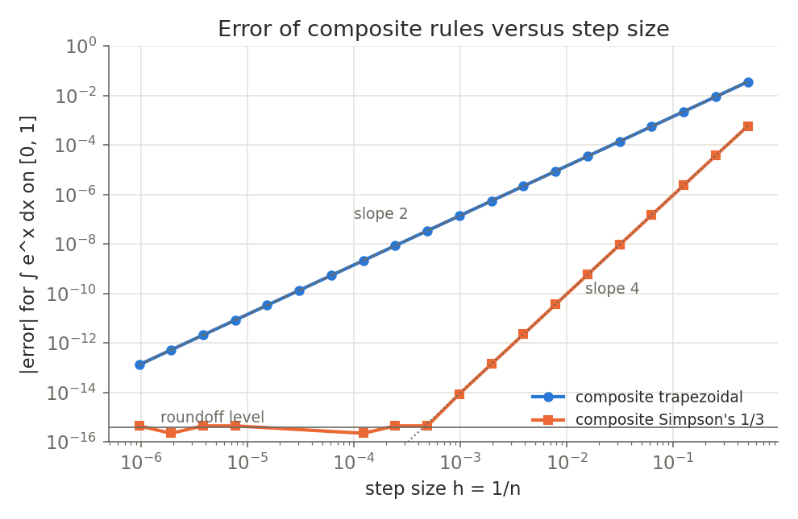
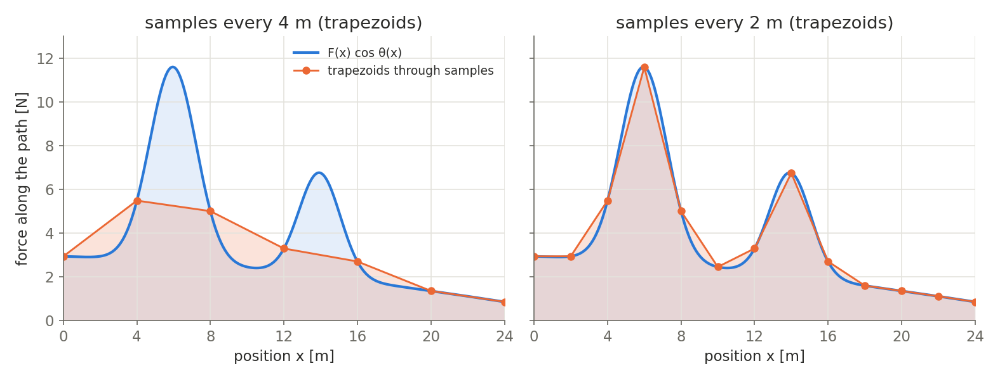

# Chapter 19 — Numerical Integration Formulas

[Repository Guide](../../README.md) | [English](Concepts_Lecture.md) | [한국어](Concepts_Lecture.ko.md)

> **Last Updated:** 2026-11-19
>
> Applied Numerical Methods with Python for Engineers and Scientists, Chapra and Clough, Ch 19

> **Learning Objectives:**
> 1. Apply the trapezoidal rule and Simpson's rules
> 2. Derive error estimates for numerical integration
> 3. Combine Simpson's 1/3 and 3/8 rules to match the number of segments
> 4. Implement the composite trapezoidal and Simpson's rules in Python
> 5. Derive the weights and error constants of integration formulas by the method of undetermined coefficients
> 6. Confirm the order of convergence of composite rules numerically and integrate unequally spaced data

---

<br>

## Table of Contents

- [1. Introduction to Numerical Integration](#1-introduction-to-numerical-integration)
  - [1.1 Motivation: The Need for Numerical Integration](#11-motivation-the-need-for-numerical-integration)
  - [1.2 The General Idea: Polynomial Approximation](#12-the-general-idea-polynomial-approximation)
  - [1.3 Lagrange Polynomial Review](#13-lagrange-polynomial-review)
  - [1.4 Quadrature Formulas and Newton-Cotes](#14-quadrature-formulas-and-newton-cotes)
  - [1.5 Degree of Precision and the Method of Undetermined Coefficients](#15-degree-of-precision-and-the-method-of-undetermined-coefficients)
  - [1.6 Uses of Integration: Means and Totals of Continuous Functions](#16-uses-of-integration-means-and-totals-of-continuous-functions)
- [2. Trapezoidal Rule (n = 1)](#2-trapezoidal-rule-n--1)
  - [2.1 Derivation from Linear Interpolation](#21-derivation-from-linear-interpolation)
  - [2.2 Final Formula](#22-final-formula)
  - [2.3 Truncation Error](#23-truncation-error)
  - [2.4 Derivation of the Error Formula and a Worked Example](#24-derivation-of-the-error-formula-and-a-worked-example)
- [3. Simpson's 1/3 Rule (n = 2)](#3-simpsons-13-rule-n--2)
  - [3.1 Derivation from Quadratic Interpolation](#31-derivation-from-quadratic-interpolation)
  - [3.2 Computing the Basis Integrals via Change of Variable](#32-computing-the-basis-integrals-via-change-of-variable)
  - [3.3 Final Formula](#33-final-formula)
  - [3.4 Truncation Error](#34-truncation-error)
  - [3.5 Why the Error Depends on the Fourth Derivative, with a Worked Example](#35-why-the-error-depends-on-the-fourth-derivative-with-a-worked-example)
- [4. Simpson's 3/8 Rule (n = 3)](#4-simpsons-38-rule-n--3)
  - [4.1 Derivation from Cubic Interpolation](#41-derivation-from-cubic-interpolation)
  - [4.2 Final Formula](#42-final-formula)
  - [4.3 Truncation Error](#43-truncation-error)
  - [4.4 Derivation of the Weights and a Worked Example](#44-derivation-of-the-weights-and-a-worked-example)
- [5. Composite Trapezoidal Rule](#5-composite-trapezoidal-rule)
  - [5.1 Idea: Subdivide the Interval](#51-idea-subdivide-the-interval)
  - [5.2 Derivation](#52-derivation)
  - [5.3 Final Formula](#53-final-formula)
  - [5.4 Error Analysis](#54-error-analysis)
  - [5.5 Numerical Confirmation of the Order of Convergence](#55-numerical-confirmation-of-the-order-of-convergence)
- [6. Composite Simpson's 1/3 Rule](#6-composite-simpsons-13-rule)
  - [6.1 Derivation](#61-derivation)
  - [6.2 Final Formula](#62-final-formula)
  - [6.3 Error Analysis](#63-error-analysis)
  - [6.4 Computing the Wafer Acceptance Probability](#64-computing-the-wafer-acceptance-probability)
- [7. Composite Simpson's 3/8 Rule](#7-composite-simpsons-38-rule)
  - [7.1 Error Analysis](#71-error-analysis)
  - [7.2 Formula of the Composite 3/8 Rule and a Worked Example](#72-formula-of-the-composite-38-rule-and-a-worked-example)
- [8. Combining Rules: Practical Application](#8-combining-rules-practical-application)
- [9. Python Implementations](#9-python-implementations)
  - [9.1 Trapezoidal Rule (Single Application)](#91-trapezoidal-rule-single-application)
  - [9.2 Composite Trapezoidal Rule](#92-composite-trapezoidal-rule)
  - [9.3 Simpson's 1/3 Rule (Single Application)](#93-simpsons-13-rule-single-application)
  - [9.4 Composite Simpson's 1/3 Rule](#94-composite-simpsons-13-rule)
  - [9.5 Simpson's 3/8 Rule (Single Application)](#95-simpsons-38-rule-single-application)
  - [9.6 Complete Example: Comparing All Methods](#96-complete-example-comparing-all-methods)
  - [9.7 Integrating Unequally Spaced Data](#97-integrating-unequally-spaced-data)
  - [9.8 SciPy Functions for Integrating Samples](#98-scipy-functions-for-integrating-samples)
  - [9.9 Double Integrals](#99-double-integrals)
- [10. Comparison of Newton-Cotes Formulas](#10-comparison-of-newton-cotes-formulas)
- [11. Case Study: Work Done by a Variable Force](#11-case-study-work-done-by-a-variable-force)
- [12. Common Mistakes](#12-common-mistakes)
- [Concept Applications](#concept-applications)
- [Summary](#summary)
- [Self-Check Questions](#self-check-questions)
- [References](#references)

---

<br>

## 1. Introduction to Numerical Integration

### 1.1 Motivation: The Need for Numerical Integration

Numerical integration deals with the problem of approximating the definite integral of a function over an interval:

```math
I = \int_a^b f(x)\,dx \approx I_n
```

Many real-world integrals **cannot be evaluated analytically**. A classic motivating example involves a semiconductor wafer manufacturer.

**Example: Wafer Quality Control**

A manufacturer produces 2-inch diameter wafers. The actual diameter is normally distributed with mean $`\mu = 2`$ inches and standard deviation $`\sigma = 0.01`$ inches. Specifications require the diameter to be between 1.985 and 2.02 inches. What is the probability that a wafer is acceptable?

The normal probability density function is:

```math
p(x) = \frac{1}{\sigma\sqrt{2\pi}} \exp\!\left(\frac{-(x - \mu)^2}{2\sigma^2}\right)
```

The probability of an acceptable wafer is:

```math
P(1.985 \leq x \leq 2.02) = \int_{1.985}^{2.02} p(x)\,dx = \frac{1}{\sigma\sqrt{2\pi}} \int_{1.985}^{2.02} \exp\!\left(\frac{-(x - \mu)^2}{2\sigma^2}\right) dx
```

This integral has **no closed-form antiderivative**, so we need numerical integration methods.

> **[Calculus]** By the fundamental theorem of calculus, if an antiderivative $`F`$ of a continuous function $`f`$ ($`F' = f`$) is known, the definite integral is computed as $`\int_a^b f(x)\,dx = F(b) - F(a)`$. This method cannot be used for an integrand such as the normal probability density, whose antiderivative cannot be written in terms of elementary functions, so numerical integration, which approximates the definite integral as the area under the curve, is needed.

### 1.2 The General Idea: Polynomial Approximation

Taking the integrand $`p(x)`$ of Section 1.1 as an example, the strategy is to **replace the integrand with a polynomial** that is easy to integrate:

```math
p(x) \approx p_n(x) = a_0 + a_1 x + \cdots + a_n x^n
```

Using Lagrange interpolation, this polynomial can be written as:

```math
p_n(x) = \sum_{j=0}^{n} p_n(x_j)\,\ell_j(x)
```

where $`\ell_j(x)`$ are the Lagrange basis polynomials and $`x_0, x_1, \ldots, x_n`$ are the interpolation nodes.

### 1.3 Lagrange Polynomial Review

For the first-order case with two points $`x_1, x_2`$, the Lagrange basis functions are:

```math
N_1(x) = \frac{x - x_2}{x_1 - x_2}, \qquad N_2(x) = \frac{x_1 - x}{x_1 - x_2}
```

In general, the $`n`$-th order Lagrange basis polynomial is:

```math
\ell_j(x) = \prod_{\substack{i=0 \\ j \neq i}}^{n} \frac{x - x_i}{x_j - x_i}, \qquad j = 0, 1, \ldots, n
```

### 1.4 Quadrature Formulas and Newton-Cotes

If $`p(x) = p_n(x) + e_n(x)`$ where $`e_n(x)`$ is the interpolation error, then:

```math
\int_a^b p(x)\,dx = \int_a^b p_n(x)\,dx + \int_a^b e_n(x)\,dx
```

The polynomial part can be expanded:

```math
\int_a^b p_n(x)\,dx = \int_a^b \sum_{j=0}^{n} p_n(x_j)\,\ell_j(x)\,dx = \sum_{j=0}^{n} p_n(x_j) \underbrace{\int_a^b \ell_j(x)\,dx}_{\text{a number (weight)}}
```

> **Key Point:** $`\int_a^b \ell_j(x)\,dx`$ does **not** depend on $`p_n(x)`$. It is a fixed numerical weight determined only by the node positions and the interval $`[a,b]`$. This is why these are called **quadrature formulas**.

For a general integrand $`f(x)`$, the approach of approximating $`I = \int_a^b f(x)\,dx`$ by $`I_n = \int_a^b f_n(x)\,dx`$ where $`f_n(x)`$ is an $`n`$-th order polynomial is the foundation of **Newton-Cotes formulas**. The choice of $`n`$ determines the specific rule:

| $`n`$ | Rule Name | Polynomial Order |
|-----|-----------|-----------------|
| 1 | Trapezoidal Rule | Linear |
| 2 | Simpson's 1/3 Rule | Quadratic |
| 3 | Simpson's 3/8 Rule | Cubic |

*Table 1. Newton-Cotes rules by polynomial order*

### 1.5 Degree of Precision and the Method of Undetermined Coefficients

The quality of an integration formula $`\int_a^b f(x)\,dx \approx \sum_j w_j f(x_j)`$ is described by the polynomials it integrates exactly.

> **Definition:** The **degree of precision** of an integration formula is the number $`m`$ such that the formula integrates every polynomial of degree at most $`m`$ exactly but does not integrate $`x^{m+1}`$ exactly. Since both the integral and the formula are linear, only the $`m + 1`$ monomials $`1, x, \ldots, x^m`$ need to be checked.

Reading this definition in reverse gives the weights. Fixing the nodes first, treating the weights as unknowns, and setting up equations that make the formula exact for the monomials $`1, x, x^2, \ldots`$ is called the **method of undetermined coefficients**. It gives the same result as integrating the Lagrange basis functions as in Section 3, but the computation is simpler.

On the interval $`[-h, h]`$ with nodes $`-h, 0, h`$, set $`\int_{-h}^{h} f(x)\,dx \approx w_0 f(-h) + w_1 f(0) + w_2 f(h)`$. Requiring exactness for three monomials gives the following equations.

```math
f = 1: \quad w_0 + w_1 + w_2 = 2h
```

```math
f = x: \quad -w_0 h + w_2 h = 0
```

```math
f = x^2: \quad w_0 h^2 + w_2 h^2 = \frac{2h^3}{3}
```

The second equation gives $`w_0 = w_2`$, the third $`w_0 = w_2 = h/3`$, and the first $`w_1 = 4h/3`$. This is Simpson's 1/3 rule $`\frac{h}{3}(f_0 + 4f_1 + f_2)`$. Substituting $`f = x^3`$ makes both sides 0, so the formula is exact up to cubics; substituting $`f = x^4`$, the exact value is $`\frac{2h^5}{5}`$ but the formula gives $`\frac{h}{3}(h^4 + h^4) = \frac{2h^5}{3}`$, so the degree of precision is 3.

The same method gives the error constant. For a formula with degree of precision $`m`$ and error of the form $`E = C\,f^{(m+1)}(\xi)`$ (Newton-Cotes formulas have this form), substituting $`f = x^{m+1}`$ makes $`f^{(m+1)} = (m+1)!`$ a constant, so $`C = E(x^{m+1})/(m+1)!`$.

- Simpson's 1/3 rule: $`E(x^4) = \frac{2h^5}{5} - \frac{2h^5}{3} = -\frac{4h^5}{15}`$, so $`C = -\frac{4h^5}{15 \cdot 24} = -\frac{h^5}{90}`$, the same as the error formula of Section 3.4.
- Trapezoidal rule: on $`[0, h]`$, $`E(x^2) = \frac{h^3}{3} - \frac{h}{2}(0 + h^2) = -\frac{h^3}{6}`$, so $`C = -\frac{h^3}{12}`$, the same as the error formula of Section 2.3.

```python
import numpy as np

def weights(nodes, a, b):
    """Weights that integrate 1, x, ..., x^(m-1) exactly on [a, b]."""
    m = len(nodes)
    A = np.vander(nodes, m, increasing=True).T          # row k: nodes**k
    rhs = np.array([(b**(k + 1) - a**(k + 1)) / (k + 1) for k in range(m)])
    return np.linalg.solve(A, rhs)

print("trapezoid  [0, 1]:", weights(np.array([0.0, 1.0]), 0.0, 1.0))
print("Simpson    [-1, 1]:", weights(np.array([-1.0, 0.0, 1.0]), -1.0, 1.0))
print("3/8 rule   [0, 3]:", weights(np.array([0.0, 1.0, 2.0, 3.0]), 0.0, 3.0))

w = weights(np.array([-1.0, 0.0, 1.0]), -1.0, 1.0)
for k in range(6):                                       # test monomials
    rule = w @ np.array([-1.0, 0.0, 1.0])**k
    exact = (1 - (-1)**(k + 1)) / (k + 1)
    print(f"x^{k}: rule = {rule:.6f}, exact = {exact:.6f}")
```

```text
trapezoid  [0, 1]: [0.5 0.5]
Simpson    [-1, 1]: [0.33333333 1.33333333 0.33333333]
3/8 rule   [0, 3]: [0.375 1.125 1.125 0.375]
x^0: rule = 2.000000, exact = 2.000000
x^1: rule = 0.000000, exact = 0.000000
x^2: rule = 0.666667, exact = 0.666667
x^3: rule = 0.000000, exact = 0.000000
x^4: rule = 0.666667, exact = 0.400000
x^5: rule = 0.000000, exact = 0.000000
```

- `np.vander(nodes, m, increasing=True).T` builds the matrix whose row $`k`$ holds the $`k`$-th powers of the nodes. Multiplying it by the weight vector gives the value of the formula for each monomial.
- The $`k`$-th entry of `rhs` is $`\int_a^b x^k\,dx = \frac{b^{k+1} - a^{k+1}}{k+1}`$.
- The weights are the values for $`h = 1`$; the results are, in order, $`\frac{h}{2}`$ for the trapezoidal rule, $`\frac{h}{3}, \frac{4h}{3}`$ for Simpson's rule, and $`\frac{3h}{8}, \frac{9h}{8}`$ for the 3/8 rule.
- The final loop shows that Simpson's rule is exact up to $`x^3`$ and first fails at $`x^4`$, so its degree of precision is 3.

### 1.6 Uses of Integration: Means and Totals of Continuous Functions

A definite integral is the area under a curve and also the sum of all values over the interval. For this reason the integral sign $`\int`$ is an elongated S, the first letter of the word sum. Viewing the integral as a sum leads to two common uses.

The first is the mean of a continuous function. The mean of measurements $`y_1, \ldots, y_n`$ is $`\frac{1}{n}\sum_i y_i`$. A function $`f(x)`$ that varies continuously on $`[a, b]`$ takes infinitely many values, so replacing the sum with an integral and the count with the length of the interval gives its mean.

```math
\bar{f} = \frac{1}{b - a}\int_a^b f(x)\,dx
```

The center of gravity of an object is the mean of position weighted by density, and the root-mean-square value of an alternating current (Chapter 20, Section 6) is the square root of the mean of the squared current. The second use is a total amount. If the concentration $`c`$ in a reactor varies with position, the total mass is the sum of $`c_i\,\Delta V_i`$ over small volumes $`\Delta V_i`$, and the limit of ever finer volumes is the volume integral $`\iiint_V c\,dV`$. In the same way, the total heat passing through a surface is a surface integral of the heat flux over that surface.

When a mean is computed from samples, the arithmetic mean must be distinguished from the integral mean. The time average of the velocity $`v(t) = 10(1 - e^{-0.3t})`$ [m/s] from 0 to 6 seconds is $`\frac{1}{6}\int_0^6 v\,dt = 5.3628`$ m/s. The arithmetic mean of the seven samples taken every second, $`0, 2.5918, 4.5119, 5.9343, 6.9881, 7.7687, 8.3470`$, is 5.1631 m/s, about 3.7% smaller. Each sample represents a time span of 1 second in the interior but only 0.5 second at the two ends, whereas the arithmetic mean gives every sample the same weight. The weighted mean that halves the weights of the two end samples is 5.3280 m/s, much closer to the true value. This value equals the integral from the composite trapezoidal rule of Section 5 divided by the interval length 6, and it is the same computation as the interpretation of the composite trapezoidal rule as width times average height in Section 5.3.

---

<br>

## 2. Trapezoidal Rule (n = 1)

### 2.1 Derivation from Linear Interpolation

Approximate the integrand $`f(x)`$ by the first-order polynomial $`p_1(x)`$ that passes through the endpoints $`(a, f(a))`$ and $`(b, f(b))`$:

```math
p_1(x) = f(a)\,N_1(x) + f(b)\,N_2(x) = f(a)\!\left(\frac{x - b}{a - b}\right) + f(b)\!\left(\frac{x - a}{b - a}\right)
```

Simplifying:

```math
p_1(x) = \frac{f(b) - f(a)}{b - a}\,x + \frac{b\,f(a) - a\,f(b)}{b - a}
```

Now integrate:

```math
\int_a^b f(x)\,dx \approx \int_a^b p_1(x)\,dx = \frac{f(b) - f(a)}{b - a} \int_a^b x\,dx + \frac{b\,f(a) - a\,f(b)}{b - a} \int_a^b 1\,dx
```

Evaluating the elementary integrals:

```math
\int_a^b x\,dx = \frac{1}{2}(b^2 - a^2), \qquad \int_a^b 1\,dx = b - a
```

After algebraic simplification:

```math
= \frac{f(b) - f(a)}{2}(a + b) + b\,f(a) - a\,f(b)
```

```math
= \frac{1}{2}\bigl[b\,f(b) - a\,f(b) + b\,f(a) - a\,f(a)\bigr]
```

```math
= \frac{1}{2}(b - a)\,f(b) + \frac{1}{2}(b - a)\,f(a)
```

### 2.2 Final Formula

```math
\boxed{I \approx I_1 = \frac{b - a}{2}\bigl[f(a) + f(b)\bigr] = (b - a) \cdot \frac{f(a) + f(b)}{2}}
```

> **Note:** **Geometric interpretation.** The trapezoidal rule computes the area of a **trapezoid** formed by the function values at the endpoints. The factor $`(b - a)`$ is the **width** and $`\frac{f(a) + f(b)}{2}`$ is the **average height**.

### 2.3 Truncation Error

The error of the trapezoidal rule is:

```math
\boxed{E_1 = I - I_1 = -\frac{1}{12}\,f''(\xi)\,(b - a)^3, \qquad a \leq \xi \leq b}
```

**Important consequence:** If $`f(x) = mx + n`$ (a linear function), then $`f''(x) = 0`$, so $`E_1 = 0`$. The **trapezoidal rule is exact for linear functions** (polynomials of degree $`\leq 1`$).

> **Note:** **Meaning of the error.** The error is proportional to $`(b-a)^3`$ and depends on the second derivative $`f''`$. This tells us that (1) narrower intervals give smaller errors and (2) functions with small curvature are well approximated by this rule.

### 2.4 Derivation of the Error Formula and a Worked Example

The error formula of Section 2.3 follows from the interpolation error of Chapter 17. The error of the first-order interpolating polynomial is $`f(x) - p_1(x) = \frac{f''(\xi(x))}{2}(x - a)(x - b)`$, so if $`f`$ is twice continuously differentiable on $`[a, b]`$,

```math
E_1 = \int_a^b \bigl[f(x) - p_1(x)\bigr]\,dx = \int_a^b \frac{f''(\xi(x))}{2}\,(x - a)(x - b)\,dx
```

On $`[a, b]`$, $`(x - a)(x - b) \le 0`$ does not change sign, so by the weighted mean value theorem for integrals, $`f''(\xi(x))`$ can be taken out as a single value $`f''(\eta)`$ from the interval.

```math
E_1 = \frac{f''(\eta)}{2}\int_a^b (x - a)(x - b)\,dx = \frac{f''(\eta)}{2}\left(-\frac{(b - a)^3}{6}\right) = -\frac{(b - a)^3}{12}\,f''(\eta)
```

The sign of the error is opposite to that of $`f''`$. If $`f'' > 0`$ (convex), the top of the trapezoid lies above the curve, so the approximation exceeds the true value and $`E_1 < 0`$.

For $`\int_0^1 e^x\,dx`$, the result 1.8591409142 of Section 9.6 has error $`1.7182818285 - 1.8591409142 = -0.1408590857`$. Since $`f''(x) = e^x`$ lies between 1 and $`e`$ on $`[0, 1]`$, the formula guarantees an error between $`-e/12 = -0.2265`$ and $`-1/12 = -0.0833`$, and the actual error lies in this range.

---

<br>

## 3. Simpson's 1/3 Rule (n = 2)

### 3.1 Derivation from Quadratic Interpolation

Approximate $`f(x)`$ by the second-order polynomial $`p_2(x)`$ passing through three equally spaced points: $`x_1 = a`$, $`x_2 = \frac{a+b}{2}`$, $`x_3 = b`$, with step size $`h = \frac{b - a}{2}`$.

Define:

```math
f_1 = f(a), \qquad f_2 = f\!\left(\frac{a+b}{2}\right), \qquad f_3 = f(b)
```

The interpolating polynomial is:

```math
p_2(x) = f_1\,\ell_1(x) + f_2\,\ell_2(x) + f_3\,\ell_3(x)
```

where the Lagrange basis polynomials are:

```math
\ell_1(x) = \frac{(x - x_2)(x - x_3)}{(x_1 - x_2)(x_1 - x_3)}, \quad \ell_2(x) = \frac{(x - x_1)(x - x_3)}{(x_2 - x_1)(x_2 - x_3)}, \quad \ell_3(x) = \frac{(x - x_1)(x - x_2)}{(x_3 - x_1)(x_3 - x_2)}
```

So the integral becomes:

```math
\int_a^b p_2(x)\,dx = f_1 \int_a^b \ell_1(x)\,dx + f_2 \int_a^b \ell_2(x)\,dx + f_3 \int_a^b \ell_3(x)\,dx
```

### 3.2 Computing the Basis Integrals via Change of Variable

To evaluate $`\int_a^b \ell_j(x)\,dx`$, apply the change of variable:

```math
x = x(\zeta) = \frac{b - a}{2}\,\zeta + \frac{b + a}{2}, \qquad dx = \frac{b - a}{2}\,d\zeta
```

This maps $`[a, b] \to [-1, 1]`$, and the three nodes $`x_1 = a,\; x_2 = \frac{a+b}{2},\; x_3 = b`$ map to $`\zeta = -1, 0, 1`$ respectively.

**Basis functions in $`\zeta`$-space:**

```math
\ell_1(\zeta) = \frac{(\zeta - 0)(\zeta - 1)}{(-1 - 0)(-1 - 1)} = \frac{\zeta(\zeta - 1)}{2}
```

```math
\ell_2(\zeta) = \frac{(\zeta - (-1))(\zeta - 1)}{(0 - (-1))(0 - 1)} = (1 - \zeta)(1 + \zeta) = 1 - \zeta^2
```

```math
\ell_3(\zeta) = \frac{(\zeta - (-1))(\zeta - 0)}{(1 - (-1))(1 - 0)} = \frac{\zeta(1 + \zeta)}{2}
```

**Computing the integrals:**

For $`\ell_1`$:

```math
\int_a^b \ell_1(x)\,dx = \int_{-1}^{1} \frac{\zeta(\zeta - 1)}{2} \cdot \frac{b - a}{2}\,d\zeta = \frac{b - a}{4} \int_{-1}^{1} (\zeta^2 - \zeta)\,d\zeta
```

Since $`\zeta`$ is an **odd function** on $`[-1, 1]`$, its integral vanishes:

```math
= \frac{b - a}{4} \cdot \frac{2}{3} = \frac{b - a}{6}
```

By symmetry, $`\int_a^b \ell_3(x)\,dx = \frac{b - a}{6}`$ as well.

For $`\ell_2`$:

```math
\int_a^b \ell_2(x)\,dx = \int_{-1}^{1} (1 - \zeta^2) \cdot \frac{b - a}{2}\,d\zeta = \frac{b - a}{2}\left(\zeta - \frac{\zeta^3}{3}\right)\Bigg|_{-1}^{1} = \frac{b - a}{2} \cdot \frac{4}{3} = \frac{4(b - a)}{6}
```

### 3.3 Final Formula

Combining the weights:

```math
\int_a^b f(x)\,dx \approx \frac{b - a}{6}\bigl(f_1 + 4f_2 + f_3\bigr)
```

With $`h = \frac{b - a}{2}`$:

```math
\boxed{I \approx I_2 = \frac{h}{3}(f_1 + 4f_2 + f_3) = \frac{b - a}{6}\bigl[f(a) + 4f\!\left(\tfrac{a+b}{2}\right) + f(b)\bigr]}
```

> **Note:** **Name and weights.** The name "1/3 rule" comes from the factor $`\frac{h}{3}`$ in the formula. The middle point receives **four times** the weight of the endpoints because, as computed in Section 3.2, $`\int_a^b \ell_2(x)\,dx = \frac{4(b - a)}{6}`$ is four times $`\int_a^b \ell_1(x)\,dx = \frac{b - a}{6}`$.

### 3.4 Truncation Error

The error for Simpson's 1/3 rule is:

```math
E_2 = I - I_2 = -\frac{1}{90}\,h^5\,f^{(4)}(\xi), \qquad a \leq \xi \leq b
```

Since $`h = \frac{b - a}{2}`$:

```math
\boxed{E_2 = -\frac{(b - a)^5}{2880}\,f^{(4)}(\xi)}
```

**Key insight:** Although Simpson's 1/3 rule uses a **second-order** polynomial, the error depends on the **fourth derivative** $`f^{(4)}`$. This means Simpson's 1/3 rule is **exact for polynomials up to degree 3** (since $`f^{(4)} = 0`$ for cubics).

> **Note:** **Source of the extra accuracy.** This extra order of accuracy occurs because the odd-power error terms cancel out due to the symmetry of the integration nodes around the midpoint.

### 3.5 Why the Error Depends on the Fourth Derivative, with a Worked Example

Applying the derivation of Section 2.4 directly to Simpson's rule fails. The factor $`(x - a)(x - m)(x - b)`$ ($`m`$ the midpoint) in the error of quadratic interpolation changes sign on $`[a, b]`$, so the weighted mean value theorem cannot be used. Instead, this function is odd about the midpoint, so its integral is 0, which is why the cubic term is integrated exactly even though the approximation is quadratic. The main part of the error comes from the next term, so the error depends on $`f^{(4)}`$, and the constant is the $`-\frac{h^5}{90}`$ found by the monomial method of Section 1.5.

A single application to $`\int_0^1 e^x\,dx`$ gives the result 1.7188611519 of Section 9.6, with error $`-0.000579`$. Since $`f^{(4)}(x) = e^x \in [1, e]`$, the formula of Section 3.4 guarantees an error between $`-e/2880 = -0.000944`$ and $`-1/2880 = -0.000347`$, and the actual error lies in this range. It is about 240 times smaller than the error $`-0.140859`$ of the trapezoidal rule, which evaluates the function twice (Simpson's rule evaluates it three times).

> **Caution:** The error formula of Simpson's rule holds when $`f`$ is four times continuously differentiable. If the integrand or its derivatives are discontinuous inside the interval or blow up at an end point (for example, integrating $`\sqrt{x}`$ on $`[0, 1]`$), the error does not scale like $`h^4`$ and decreases much more slowly.

---

<br>

## 4. Simpson's 3/8 Rule (n = 3)

### 4.1 Derivation from Cubic Interpolation

Approximate $`f(x)`$ by a third-order polynomial $`p_3(x)`$ through four equally spaced points with step size $`h = \frac{b - a}{3}`$:

```math
x_0 = a, \quad x_1 = a + h, \quad x_2 = a + 2h, \quad x_3 = b
```

Writing $`f_i = f(x_i)`$, the interpolating polynomial is:

```math
p_3(x) = f_0\,\ell_0(x) + f_1\,\ell_1(x) + f_2\,\ell_2(x) + f_3\,\ell_3(x)
```

Integrating:

```math
\int_a^b p_3(x)\,dx = f_0 \int_a^b \ell_0(x)\,dx + f_1 \int_a^b \ell_1(x)\,dx + f_2 \int_a^b \ell_2(x)\,dx + f_3 \int_a^b \ell_3(x)\,dx
```

### 4.2 Final Formula

```math
\boxed{I \approx I_3 = \frac{3h}{8}(f_0 + 3f_1 + 3f_2 + f_3), \qquad h = \frac{b - a}{3}}
```

> **Note:** **Name and weights.** The name "3/8 rule" comes from the coefficient $`\frac{3}{8}`$ multiplied by $`h`$. The weights follow the pattern $`1 : 3 : 3 : 1`$, reflecting the symmetric cubic interpolation.

### 4.3 Truncation Error

```math
E_3 = I - I_3 = -\frac{3}{80}\,h^5\,f^{(4)}(\xi), \qquad a \leq \xi \leq b
```

Since $`h = \frac{b - a}{3}`$:

```math
\boxed{E_3 = -\frac{(b - a)^5}{6480}\,f^{(4)}(\xi)}
```

Like Simpson's 1/3 rule, the 3/8 rule is also **exact for polynomials up to degree 3**, since the error depends on $`f^{(4)}`$.

> **Note:** **Single-application error comparison.** For one application over the same interval, $`|E_3| = \frac{(b-a)^5}{6480}|f^{(4)}(\xi)|`$ and $`|E_2| = \frac{(b-a)^5}{2880}|f^{(4)}(\xi)|`$. The 3/8 rule is **more accurate** per single application ($`6480 > 2880`$), but requires one additional function evaluation.

### 4.4 Derivation of the Weights and a Worked Example

The basis function integrals of Section 4.1 are easily computed by the method of undetermined coefficients of Section 1.5. With $`t = (x - a)/h`$ the nodes are $`t = 0, 1, 2, 3`$, and by symmetry the weights can be written $`w_0 = w_3 = Ah`$ and $`w_1 = w_2 = Bh`$. Requiring exactness for the constant and for $`t^2`$ gives

```math
\int_0^3 1\,dt = 3: \quad 2A + 2B = 3, \qquad \int_0^3 t^2\,dt = 9: \quad A(0^2 + 3^2) + B(1^2 + 2^2) = 9A + 5B = 9
```

so $`A = \frac{3}{8}`$ and $`B = \frac{9}{8}`$, which yields the formula $`\frac{3h}{8}(f_0 + 3f_1 + 3f_2 + f_3)`$ of Section 4.2. The odd-order terms are matched automatically by symmetry about the center $`t = 1.5`$. The error constant is checked with $`f = t^4`$. The exact value is $`\frac{3^5}{5} = 48.6`$ and the formula gives $`\frac{3}{8}(0 + 3 + 3 \cdot 16 + 81) = 49.5`$, so $`E = -0.9h^5`$ and $`C = -0.9h^5/4! = -\frac{3}{80}h^5`$, as in Section 4.3.

A single application to $`\int_0^1 e^x\,dx`$ gives the result 1.7185401534 of Section 9.6, with error $`-0.000258`$, inside the range $`[-e/6480, -1/6480] = [-0.000419, -0.000154]`$ guaranteed by the formula of Section 4.3. It is smaller than the error $`-0.000579`$ of a single application of Simpson's 1/3 rule on the same interval, but it needs four function evaluations.

---

<br>

## 5. Composite Trapezoidal Rule

### 5.1 Idea: Subdivide the Interval

**Reducing the error of the trapezoidal rule**

Divide the interval $`[a, b]`$ into $`n`$ subintervals (segments) and apply the trapezoidal rule to each segment. Smaller subintervals mean the linear approximation is more accurate on each piece.

With $`n`$ segments:

```math
h = \frac{b - a}{n}, \qquad x_i = a + ih \;\;(i = 0, 1, \ldots, n)
```

where $`x_0 = a`$ and $`x_n = b`$, and $`f_i = f(x_i)`$.

### 5.2 Derivation

Split the integral into $`n`$ subintegrals and apply the trapezoidal rule to each:

```math
I = \int_a^b f(x)\,dx = \int_{x_0}^{x_1} f(x)\,dx + \int_{x_1}^{x_2} f(x)\,dx + \cdots + \int_{x_{n-1}}^{x_n} f(x)\,dx
```

```math
\approx (x_1 - x_0)\frac{f_0 + f_1}{2} + (x_2 - x_1)\frac{f_1 + f_2}{2} + \cdots + (x_n - x_{n-1})\frac{f_{n-1} + f_n}{2}
```

Since all subintervals have equal width $`h`$:

```math
= \frac{h}{2}\bigl(f_0 + f_1 + f_1 + f_2 + f_2 + \cdots + f_{n-1} + f_{n-1} + f_n\bigr)
```

Collecting terms (interior points appear twice):

```math
= \frac{h}{2}\left(f_0 + 2f_1 + 2f_2 + \cdots + 2f_{n-1} + f_n\right)
```

### 5.3 Final Formula

```math
\boxed{I \approx \frac{h}{2}\left(f_0 + 2\sum_{i=1}^{n-1} f_i + f_n\right) = (b - a)\,\frac{f_0 + 2\displaystyle\sum_{i=1}^{n-1} f_i + f_n}{2n}}
```

This is the **Composite Trapezoidal Rule**. It has the same interpretation: **width** $`\times`$ **average height**, where the average height uses a weighted average with endpoints counted once and interior points counted twice.

The computation of $`\int_0^1 e^x\,dx`$ with $`n = 4`$ ($`h = 0.25`$) is summarized in the following table.

| $`i`$ | $`x_i`$ | $`f_i = e^{x_i}`$ | Weight | Weight $`\times f_i`$ |
|:---:|:-----|:-----|:---:|:-----|
| 0 | 0 | 1.000000 | 1 | 1.000000 |
| 1 | 0.25 | 1.284025 | 2 | 2.568051 |
| 2 | 0.5 | 1.648721 | 2 | 3.297443 |
| 3 | 0.75 | 2.117000 | 2 | 4.234000 |
| 4 | 1 | 2.718282 | 1 | 2.718282 |

*Table 2. Steps of the composite trapezoidal rule ($`n = 4`$)*

The last column sums to 13.817775, so $`I \approx \frac{0.25}{2} \times 13.817775 = 1.727222`$, with error $`1.718282 - 1.727222 = -0.008940`$. Using the weights $`1, 4, 2, 4, 1`$ of Section 6.2 on the same five points makes the sum 20.619826, which gives the composite Simpson's 1/3 value $`\frac{0.25}{3} \times 20.619826 = 1.718319`$ with error $`-3.7 \times 10^{-5}`$, about 240 times smaller.

### 5.4 Error Analysis

The local error on each subinterval $`[x_{i-1}, x_i]`$ is:

```math
-\frac{1}{12}\,f''(\xi_i)\,h^3, \qquad x_{i-1} \leq \xi_i \leq x_i
```

Summing all $`n`$ local errors:

```math
E_{1t} = -\frac{1}{12}\,h^3 \sum_{i=1}^{n} f''(\xi_i) = -\frac{1}{12}\,h^3 \cdot n \cdot \frac{\displaystyle\sum_{i=1}^{n} f''(\xi_i)}{n}
```

The average of $`f''(\xi_i)`$ values approximates $`\overline{f''}`$, and $`n = \frac{b - a}{h}`$:

```math
\boxed{E_{1a} \approx -\frac{(b - a)^3}{12\,n^2}\,\overline{f''} = -\frac{(b - a)}{12}\,\overline{f''}\,h^2}
```

The error is **proportional to $`h^2`$**. Therefore:

> **Key Point:** **If $`n`$ is doubled, the truncation error is reduced to one-fourth** (since $`h^2 \to (h/2)^2 = h^2/4`$).

### 5.5 Numerical Confirmation of the Order of Convergence

The conclusion that the error is proportional to $`h^2`$ can be confirmed by doubling $`n`$ repeatedly and measuring the ratio of errors.

```python
import numpy as np

def trap(f, a, b, n):
    x = np.linspace(a, b, n + 1); y = f(x)
    return (b - a) / n * (y[0] / 2 + y[1:-1].sum() + y[-1] / 2)

def simp(f, a, b, n):                        # n must be even
    x = np.linspace(a, b, n + 1); y = f(x)
    return (b - a) / (3 * n) * (y[0] + 4 * y[1:-1:2].sum() + 2 * y[2:-1:2].sum() + y[-1])

exact = np.e - 1.0
print("   n     trap error   ratio    Simpson error   ratio")
pt = ps = None
for n in [2, 4, 8, 16, 32, 64]:
    et = exact - trap(np.exp, 0.0, 1.0, n)
    es = exact - simp(np.exp, 0.0, 1.0, n)
    rt = f"{pt / et:6.2f}" if pt else "      "
    rs = f"{ps / es:6.2f}" if ps else "      "
    print(f"{n:4d}   {et:11.3e}  {rt}   {es:13.3e}  {rs}")
    pt, ps = et, es
```

```text
   n     trap error   ratio    Simpson error   ratio
   2    -3.565e-02              -5.793e-04        
   4    -8.940e-03    3.99      -3.701e-05   15.65
   8    -2.237e-03    4.00      -2.326e-06   15.91
  16    -5.593e-04    4.00      -1.456e-07   15.98
  32    -1.398e-04    4.00      -9.103e-09   15.99
  64    -3.496e-05    4.00      -5.690e-10   16.00
```

- `trap` and `simp` are the functions of Sections 9.2 and 9.4 rewritten with NumPy array operations. `y[1:-1:2]` holds the interior points with odd indices and `y[2:-1:2]` those with even indices.
- The `ratio` column divides the error for the previous $`n`$ by the current error. It converges to 4 for the trapezoidal rule and 16 for Simpson's rule, confirming $`O(h^2)`$ and $`O(h^4)`$.

Reducing $`h`$ further brings in roundoff error (Figure 1). The error of Simpson's rule reaches the double-precision roundoff level of $`10^{-16}`$ at $`n \approx 2000`$ ($`h \approx 5 \times 10^{-4}`$) and does not decrease further as $`n`$ grows. The trapezoidal rule needs far more points for the same accuracy, and even at $`n = 2^{20} \approx 10^6`$ its error is about $`10^{-13}`$. Higher-order formulas reach the same accuracy with far fewer function evaluations.



*Figure 1. Error of the composite trapezoidal rule and the composite Simpson's 1/3 rule versus step size*

The proportionality of the error to $`h^2`$ can also be used to estimate the error. Given $`I_h`$ and $`I_{h/2}`$, $`I - I_h \approx 4(I - I_{h/2})`$, so $`I - I_{h/2} \approx (I_{h/2} - I_h)/3`$. For $`n = 8`$ and $`n = 16`$ in the table above, the trapezoidal approximations are 1.720519 and 1.718841, so the estimate $`(1.718841 - 1.720519)/3 = -5.59 \times 10^{-4}`$ equals the actual error for $`n = 16`$. Adding this estimate to improve accuracy is the idea behind Richardson extrapolation and Romberg integration in Chapter 20.

---

<br>

## 6. Composite Simpson's 1/3 Rule

### 6.1 Derivation

Divide $`[a, b]`$ into $`n`$ subintervals (**$`n`$ must be even**) with $`h = \frac{b - a}{n}`$. Apply Simpson's 1/3 rule to each consecutive pair of subintervals:

```math
I = \int_{x_0}^{x_2} f(x)\,dx + \int_{x_2}^{x_4} f(x)\,dx + \cdots + \int_{x_{n-2}}^{x_n} f(x)\,dx
```

```math
\approx \frac{h}{3}(f_0 + 4f_1 + f_2) + \frac{h}{3}(f_2 + 4f_3 + f_4) + \frac{h}{3}(f_4 + 4f_5 + f_6) + \cdots + \frac{h}{3}(f_{n-2} + 4f_{n-1} + f_n)
```

Collecting terms:

```math
= \frac{h}{3}\,f_0 + \frac{4h}{3}(f_1 + f_3 + f_5 + \cdots + f_{n-1}) + \frac{2h}{3}(f_2 + f_4 + f_6 + \cdots + f_{n-2}) + \frac{h}{3}\,f_n
```

### 6.2 Final Formula

```math
\boxed{I \approx \frac{h}{3}\left(f_0 + 4\!\!\sum_{\substack{i=1,3,5,\ldots}}^{n-1}\!\! f_i + 2\!\!\sum_{\substack{i=2,4,6,\ldots}}^{n-2}\!\! f_i + f_n\right)}
```

Equivalently:

```math
= (b - a)\,\frac{f_0 + 4\displaystyle\sum_{\substack{i\,\text{odd}}} f_i + 2\displaystyle\sum_{\substack{i\,\text{even}}} f_i + f_n}{3n}
```

> **Note:** **Weight pattern.** The pattern of weights is $`1, 4, 2, 4, 2, 4, \ldots, 2, 4, 1`$. Odd-indexed interior points get weight 4, even-indexed interior points get weight 2, and endpoints get weight 1. This requires $`n`$ to be **even**.

Even-indexed interior points get weight 2 because each is the shared endpoint of two neighboring pairs of subintervals, so its weight 1 is added twice.

```text
          x_0  x_1  x_2  x_3  x_4  x_5  x_6
[x_0,x_2]  1    4    1
[x_2,x_4]            1    4    1
[x_4,x_6]                      1    4    1
          ---  ---  ---  ---  ---  ---  ---
           1    4    2    4    2    4    1
```

*Figure 2. Simpson weights (in units of h/3) of each pair of subintervals and their sum for n = 6*

### 6.3 Error Analysis

The local error for each pair of subintervals is:

```math
-\frac{h^5}{90}\,f^{(4)}(\xi_k), \qquad x_{2k-2} \leq \xi_k \leq x_{2k}
```

Summing over all $`n/2`$ applications:

```math
E_{2t} = -\frac{h^5}{90} \sum_{k=1}^{n/2} f^{(4)}(\xi_k) = -\frac{h^5}{90} \cdot \frac{n}{2} \cdot \overline{f^{(4)}}
```

Since $`h = \frac{b-a}{n}`$:

```math
\boxed{E_{2a} \approx -\frac{(b - a)^5}{180\,n^4}\,\overline{f^{(4)}} = -\frac{(b - a)}{180}\,\overline{f^{(4)}}\,h^4}
```

The error is **proportional to $`h^4`$**. Therefore:

> **Key Point:** **If $`n`$ is doubled, the truncation error is reduced by a factor of 16** (since $`h^4 \to (h/2)^4 = h^4/16`$).

### 6.4 Computing the Wafer Acceptance Probability

The wafer problem of Section 1.1 is computed with the composite Simpson's 1/3 rule. The reference value is the cumulative normal probability expressed with the error function $`\mathrm{erf}`$, $`P = \frac{1}{2}\left[\mathrm{erf}\left(\frac{2.02 - \mu}{\sigma\sqrt{2}}\right) - \mathrm{erf}\left(\frac{1.985 - \mu}{\sigma\sqrt{2}}\right)\right]`$. Since $`\mathrm{erf}`$ is not an elementary function either, libraries compute it with separate numerical methods.

```python
import math
import numpy as np

mu, sigma = 2.0, 0.01
p = lambda x: np.exp(-(x - mu)**2 / (2 * sigma**2)) / (sigma * math.sqrt(2 * math.pi))
exact = 0.5 * (math.erf((2.02 - mu) / (sigma * math.sqrt(2)))
               - math.erf((1.985 - mu) / (sigma * math.sqrt(2))))

def simp(f, a, b, n):                        # n must be even
    x = np.linspace(a, b, n + 1); y = f(x)
    return (b - a) / (3 * n) * (y[0] + 4 * y[1:-1:2].sum() + 2 * y[2:-1:2].sum() + y[-1])

print(f"exact probability = {exact:.8f}")
for n in [2, 4, 8, 16, 32, 64]:
    I = simp(p, 1.985, 2.02, n)
    print(f"n = {n:2d}: Simpson = {I:.8f}, error = {exact - I:+.2e}")
```

```text
exact probability = 0.91044267
n =  2: Simpson = 1.00927227, error = -9.88e-02
n =  4: Simpson = 0.90912362, error = +1.32e-03
n =  8: Simpson = 0.91044239, error = +2.80e-07
n = 16: Simpson = 0.91044304, error = -3.71e-07
n = 32: Simpson = 0.91044270, error = -2.83e-08
n = 64: Simpson = 0.91044267, error = -1.85e-09
```

The acceptance probability of a wafer is about 91.04%. Three points can be read from the results.

1. The result 1.009 for $`n = 2`$ is an impossible probability greater than 1. The width of the integration interval, 0.035, is 3.5 times the standard deviation 0.01, yet the bell-shaped curve was approximated with only three points. Checking that a result lies in the physically possible range is a basic test of any numerical integration.
2. Between $`n = 8`$ and $`n = 16`$ the error changes sign and hardly decreases in size. The $`\overline{f^{(4)}}`$ in the error formula of Section 6.3 is the average of the fourth derivative over the interval, and the fourth derivative of the normal density changes sign twice in this interval, making the average small, so $`h`$ must be small enough before the order-dependent behavior of the error becomes clear.
3. From $`n = 32`$ to $`n = 64`$ the error ratio is $`2.83 \times 10^{-8} / 1.85 \times 10^{-9} \approx 15.3`$, close to 16. As $`h`$ becomes small, the $`O(h^4)`$ behavior is restored.

---

<br>

## 7. Composite Simpson's 3/8 Rule

Apply Simpson's 3/8 rule repeatedly over groups of 3 subintervals (**$`n`$ must be a multiple of 3**). The derivation follows the same pattern as the composite 1/3 rule.

### 7.1 Error Analysis

The local error for each group of 3 subintervals is:

```math
-\frac{3}{80}\,h^5\,f^{(4)}(\xi_k)
```

Summing over all $`n/3`$ applications:

```math
E_{3t} = -\frac{3}{80}\,h^5 \sum_{k=1}^{n/3} f^{(4)}(\xi_k) \approx -\frac{1}{80}\,h^5 \cdot n \cdot \overline{f^{(4)}}
```

```math
\boxed{E_{3a} \approx -\frac{(b - a)}{80}\,\overline{f^{(4)}}\,h^4}
```

Like the composite 1/3 rule, the error is proportional to $`h^4`$, but the constant is larger.

> **Note:** **Error constant of the composite 3/8 rule.** Although the 3/8 rule is more accurate than the 1/3 rule for a **single application**, the composite 3/8 rule has a larger error constant ($`\frac{1}{80}`$ vs. $`\frac{1}{180}`$) per unit of $`h^4`$ when applied in composite form. This is because the 3/8 rule uses more subintervals per application.

### 7.2 Formula of the Composite 3/8 Rule and a Worked Example

When $`n`$ is a multiple of 3, applying the 3/8 rule to every three subintervals and adding the results gives weight 1 twice to the points on the boundaries between groups ($`x_3, x_6, \ldots`$). The weights of the composite formula are therefore $`1, 3, 3, 2, 3, 3, 2, \ldots, 3, 3, 1`$.

```math
I \approx \frac{3h}{8}\left(f_0 + 3\sum_{i \not\equiv 0 \ (\mathrm{mod}\ 3)} f_i + 2\sum_{\substack{i \equiv 0 \ (\mathrm{mod}\ 3) \\ 0 < i < n}} f_i + f_n\right), \qquad h = \frac{b - a}{n}
```

Computing $`\int_0^1 e^x\,dx`$ with $`n = 6`$, the composite 3/8 rule gives 1.718298 (error $`-1.65 \times 10^{-5}`$) and the composite 1/3 rule gives 1.718289 (error $`-7.34 \times 10^{-6}`$). The error ratio $`2.24`$ agrees with the ratio of the error constants of Section 7.1, $`\frac{1/80}{1/180} = 2.25`$. When the same points can be used, the composite 1/3 rule is more accurate, so the 3/8 rule is used to adjust the number of subintervals as in Section 8.

---

<br>

## 8. Combining Rules: Practical Application

In practice, when the number of segments $`n`$ is **not even** (required for composite Simpson's 1/3) and **not a multiple of 3** (required for composite Simpson's 3/8), we can **combine** the two rules:

- Apply Simpson's **1/3 rule** to a portion of the subintervals (using pairs of segments).
- Apply Simpson's **3/8 rule** to the remaining subintervals (using triples of segments).

For example, with 5 segments, use the 1/3 rule on the first 2 segments and the 3/8 rule on the last 3 segments (or vice versa). Computing $`\int_0^1 e^x\,dx`$ this way with $`n = 5`$ gives 1.718310, an error of about $`-2.9 \times 10^{-5}`$ from the true value 1.718282.

The computation above can be checked in code as follows.

```python
import math

f, h = math.exp, 0.2                   # 5 segments on [0, 1]
x = [i * h for i in range(6)]
s13 = h / 3 * (f(x[0]) + 4 * f(x[1]) + f(x[2]))                       # segments 1-2
s38 = 3 * h / 8 * (f(x[2]) + 3 * f(x[3]) + 3 * f(x[4]) + f(x[5]))    # segments 3-5
print(f"1/3 part = {s13:.6f}, 3/8 part = {s38:.6f}")
print(f"total    = {s13 + s38:.6f}, error = {math.e - 1 - (s13 + s38):+.2e}")
```

```text
1/3 part = 0.491829, 3/8 part = 1.226481
total    = 1.718310, error = -2.86e-05
```

The two parts share the point $`x_2 = 0.4`$, whose function value enters each formula once. Since both rules have $`O(h^4)`$ error, the combined formula also has $`O(h^4)`$ accuracy.

---

<br>

## 9. Python Implementations

### 9.1 Trapezoidal Rule (Single Application)

```python
def trapezoidal(f, a, b):
    """Single-application trapezoidal rule."""
    return (b - a) / 2 * (f(a) + f(b))
```

### 9.2 Composite Trapezoidal Rule

```python
def composite_trapezoidal(f, a, b, n):
    """Composite trapezoidal rule with n subintervals."""
    h = (b - a) / n
    x = [a + i * h for i in range(n + 1)]
    result = f(x[0]) + f(x[n])
    for i in range(1, n):
        result += 2 * f(x[i])
    return h / 2 * result
```

### 9.3 Simpson's 1/3 Rule (Single Application)

```python
def simpson_13(f, a, b):
    """Single-application Simpson's 1/3 rule."""
    h = (b - a) / 2
    return h / 3 * (f(a) + 4 * f(a + h) + f(b))
```

### 9.4 Composite Simpson's 1/3 Rule

```python
def composite_simpson_13(f, a, b, n):
    """Composite Simpson's 1/3 rule with n subintervals (n must be even)."""
    if n % 2 != 0:
        raise ValueError("n must be even for Simpson's 1/3 rule")
    h = (b - a) / n
    x = [a + i * h for i in range(n + 1)]
    result = f(x[0]) + f(x[n])
    for i in range(1, n, 2):      # odd indices: weight 4
        result += 4 * f(x[i])
    for i in range(2, n - 1, 2):  # even indices: weight 2
        result += 2 * f(x[i])
    return h / 3 * result
```

### 9.5 Simpson's 3/8 Rule (Single Application)

```python
def simpson_38(f, a, b):
    """Single-application Simpson's 3/8 rule."""
    h = (b - a) / 3
    return 3 * h / 8 * (f(a) + 3 * f(a + h) + 3 * f(a + 2 * h) + f(b))
```

### 9.6 Complete Example: Comparing All Methods

```python
import math
# uses the functions of Sections 9.1-9.5

def f(x):
    """Example: integrate e^x from 0 to 1 (exact answer = e - 1)."""
    return math.exp(x)

a, b = 0, 1
exact = math.e - 1

print(f"Exact value: {exact:.10f}")
print(f"Trapezoidal (n=1):       {trapezoidal(f, a, b):.10f}")
print(f"Simpson's 1/3 (n=2):     {simpson_13(f, a, b):.10f}")
print(f"Simpson's 3/8 (n=3):     {simpson_38(f, a, b):.10f}")
print(f"Composite Trap (n=10):   {composite_trapezoidal(f, a, b, 10):.10f}")
print(f"Composite S-1/3 (n=10):  {composite_simpson_13(f, a, b, 10):.10f}")
```

The output is as follows.

```text
Exact value: 1.7182818285
Trapezoidal (n=1):       1.8591409142
Simpson's 1/3 (n=2):     1.7188611519
Simpson's 3/8 (n=3):     1.7185401534
Composite Trap (n=10):   1.7197134914
Composite S-1/3 (n=10):  1.7182827819
```

The error of the composite Simpson's 1/3 rule ($`n = 10`$) is about $`-9.5 \times 10^{-7}`$, far smaller than the error of about $`-1.4 \times 10^{-3}`$ of the composite trapezoidal rule with the same $`n`$.

### 9.7 Integrating Unequally Spaced Data

Experimental data are often sampled at unequal times. The trapezoidal rule can be applied to each subinterval separately, so it works as is with unequal spacing.

```math
I \approx \sum_{i=1}^{n} h_i\,\frac{f_{i-1} + f_i}{2}, \qquad h_i = x_i - x_{i-1}
```

Simpson's rules require neighboring subintervals of equal width, so the 1/3 rule is applied where two subintervals of equal width follow each other, the 3/8 rule where three do, and the trapezoidal rule elsewhere. The distance traveled from 0 s to 6 s is computed from samples of the velocity $`v(t) = 10(1 - e^{-0.3t})`$ [m/s] taken at unequal times.

```python
import numpy as np

t = np.array([0.0, 1.0, 1.5, 2.0, 3.0, 4.5, 6.0])      # unequal sample times [s]
v = 10.0 * (1.0 - np.exp(-0.3 * t))                     # velocity samples [m/s]
exact = 10.0 * (6.0 - (1.0 - np.exp(-1.8)) / 0.3)

# Trapezoidal rule segment by segment (works for any spacing)
h = np.diff(t)
trap = np.sum(h * (v[:-1] + v[1:]) / 2.0)

# Use Simpson's 1/3 rule where two adjacent segments are equal
def simpson_pair(i):                     # segments [t_i, t_i+1] and [t_i+1, t_i+2]
    return (h[i] / 3.0) * (v[i] + 4.0 * v[i+1] + v[i+2])
mixed = (h[0] * (v[0] + v[1]) / 2.0      # [0, 1]     trapezoid
         + simpson_pair(1)               # [1, 2]     Simpson 1/3, h = 0.5
         + h[3] * (v[3] + v[4]) / 2.0    # [2, 3]     trapezoid
         + simpson_pair(4))              # [3, 6]     Simpson 1/3, h = 1.5

print("v =", np.round(v, 4))
print(f"exact distance     = {exact:.4f} m")
print(f"trapezoid (manual) = {trap:.4f} m, error = {exact - trap:+.4f}")
print(f"np.trapezoid       = {np.trapezoid(v, t):.4f} m")
print(f"trapezoid+Simpson  = {mixed:.4f} m, error = {exact - mixed:+.4f}")
```

```text
v = [0.     2.5918 3.6237 4.5119 5.9343 7.4076 8.347 ]
exact distance     = 32.1766 m
trapezoid (manual) = 31.9292 m, error = +0.2475
np.trapezoid       = 31.9292 m
trapezoid+Simpson  = 32.0746 m, error = +0.1020
```

- `np.diff(t)` builds the subinterval widths $`h_i`$ as an array, and `h * (v[:-1] + v[1:]) / 2.0` computes the area of the trapezoid on each subinterval.
- The widths are $`(1, 0.5, 0.5, 1, 1.5, 1.5)`$. The 1/3 rule is used on the two subintervals of width 0.5 and the two of width 1.5, and the trapezoidal rule on $`[0, 1]`$ and $`[2, 3]`$, whose widths differ from their neighbors.
- `np.trapezoid(v, t)` is NumPy's trapezoidal integration function and gives the same result as the hand-written computation.

The error of 0.2475 m with the trapezoidal rule alone drops to 0.1020 m when Simpson's rule is mixed in. Most of the remaining error comes from the two subintervals that use the trapezoidal rule. Since the error grows with the curvature of the function, it is good to place points more densely where the curvature is large, if the measurements can be planned. Another option is to interpolate the data with a spline from Chapter 18 and integrate the spline exactly.

For experimental data, one often needs the cumulative integral up to each measurement time rather than a single integral up to the final time. In the example above, the distance traveled up to each time is obtained by adding the trapezoid areas of the subintervals one after another, and SciPy's `cumulative_trapezoid` performs this computation.

```python
import numpy as np
from scipy.integrate import cumulative_trapezoid, dblquad

t = np.array([0.0, 1.0, 1.5, 2.0, 3.0, 4.5, 6.0])
v = 10.0 * (1.0 - np.exp(-0.3 * t))
dist = cumulative_trapezoid(v, t, initial=0.0)          # distance at every sample time
print("distance:", np.round(dist, 4))

I, err = dblquad(lambda y, x: np.exp(x + y), 0.0, 1.0, 0.0, 2.0)   # y inner, x outer
print(f"dblquad: {I:.10f}, exact: {(np.e - 1) * (np.e**2 - 1):.10f}, error estimate: {err:.1e}")
```

```text
distance: [ 0.      1.2959  2.8498  4.8837 10.1068 20.1132 31.9292]
dblquad: 10.9781989958, exact: 10.9781989958, error estimate: 1.9e-13
```

- `initial=0.0` prepends the cumulative value 0 at the first time so that the result has the same length as the data. The last value, 31.9292, equals the whole trapezoidal integral above.
- The second computation solves the double integral of Section 9.9 with SciPy's `dblquad`. `dblquad` takes the inner integration variable $`y`$ as the first argument of the integrand and the outer variable $`x`$ as the second, and the limits of the inner integral can be constants or functions of $`x`$ [1]. Mistaking the argument order for $`f(x, y)`$ is a common error.

### 9.8 SciPy Functions for Integrating Samples

`trapezoid` and `simpson` in `scipy.integrate` integrate arrays of samples. `quad`, which takes a function and integrates it adaptively, is covered in Chapter 20.

```python
import numpy as np
from scipy.integrate import simpson, trapezoid

x = np.linspace(0.0, 1.0, 11)          # 11 samples = 10 equal segments
y = np.exp(x)
exact = np.e - 1.0

print(f"trapezoid(y, x=x) = {trapezoid(y, x=x):.10f}, error = {exact - trapezoid(y, x=x):+.2e}")
print(f"simpson(y, x=x)   = {simpson(y, x=x):.10f}, error = {exact - simpson(y, x=x):+.2e}")
```

```text
trapezoid(y, x=x) = 1.7197134914, error = -1.43e-03
simpson(y, x=x)   = 1.7182827819, error = -9.53e-07
```

With 11 samples (10 subintervals), the two results equal the composite trapezoidal rule and the composite Simpson's 1/3 rule ($`n = 10`$) of Section 9.6. When the number of samples is even, that is, the number of subintervals is odd, the composite 1/3 rule cannot be applied as is, so some subintervals must be handled by another formula as in Section 8.
### 9.9 Double Integrals

The double integral over a rectangle $`[a, b] \times [c, d]`$, $`\iint f(x, y)\,dA = \int_a^b \left[\int_c^d f(x, y)\,dy\right] dx`$, is computed by applying a one-dimensional formula twice. First the inner integral $`g(x_i) = \int_c^d f(x_i, y)\,dy`$ at each $`x_i`$ is approximated by a formula in the $`y`$ direction, and then those values are integrated again by a formula in the $`x`$ direction. With weights $`w^x_i`$ and $`w^y_j`$ in the two directions, the result is the weighted sum of grid values $`\sum_i \sum_j w^x_i w^y_j f(x_i, y_j)`$.

```python
import numpy as np

f = lambda x, y: np.exp(x + y)                 # integrand on [0, 1] x [0, 2]
exact = (np.e - 1.0) * (np.e**2 - 1.0)

def weights_trap(n):
    w = np.ones(n + 1); w[1:-1] = 2.0
    return w / 2.0                              # times h

def weights_simp(n):                            # n even
    w = np.ones(n + 1); w[1:-1:2] = 4.0; w[2:-1:2] = 2.0
    return w / 3.0                              # times h

def double(rule, nx, ny):
    x = np.linspace(0.0, 1.0, nx + 1); y = np.linspace(0.0, 2.0, ny + 1)
    hx, hy = 1.0 / nx, 2.0 / ny
    F = f(x[:, None], y[None, :])               # F[i, j] = f(x_i, y_j)
    wx, wy = rule(nx) * hx, rule(ny) * hy
    return wx @ F @ wy                          # sum_i sum_j wx_i wy_j F_ij

print(f"exact = {exact:.6f}")
for n in [2, 4, 8]:
    T = double(weights_trap, n, n); S = double(weights_simp, n, n)
    print(f"n = {n}: trapezoid = {T:.6f} (error {exact - T:+.2e}), "
          f"Simpson = {S:.6f} (error {exact - S:+.2e})")
```

```text
exact = 10.978199
n = 2: trapezoid = 12.124592 (error -1.15e+00), Simpson = 11.036340 (error -5.81e-02)
n = 4: trapezoid = 11.264268 (error -2.86e-01), Simpson = 10.982137 (error -3.94e-03)
n = 8: trapezoid = 11.049683 (error -7.15e-02), Simpson = 10.978450 (error -2.51e-04)
```

- `weights_trap` and `weights_simp` build the composite weights $`(1, 2, \ldots, 2, 1)/2`$ and $`(1, 4, 2, \ldots, 4, 1)/3`$ as arrays. Multiplying them by the step size gives the actual weights.
- `f(x[:, None], y[None, :])` uses NumPy broadcasting to build the matrix $`F_{ij} = f(x_i, y_j)`$ of function values at all grid points.
- `wx @ F @ wy` is $`\sum_i \sum_j w^x_i F_{ij} w^y_j`$. The inner product `F @ wy` is the integral $`g(x_i)`$ in the $`y`$ direction at each $`x_i`$, and the outer product is the integral in the $`x`$ direction.

As in one dimension, doubling $`n`$ reduces the error to about one quarter for the trapezoidal rule and about one sixteenth for Simpson's rule. However, the number of grid points is $`(n+1)^2`$, so for the same $`n`$ the number of function evaluations is much larger than in one dimension. In $`d`$ dimensions the grid has $`(n+1)^d`$ points, which makes this approach impractical for high-dimensional integrals, where other methods such as Monte Carlo integration are used.

---

<br>

## 10. Comparison of Newton-Cotes Formulas

| Rule | Formula | Points | Error (Single) | Error (Composite) | Exact For |
|------|---------|--------|----------------|-------------------|-----------|
| **Trapezoidal** | $`(b-a)\,\dfrac{f(a)+f(b)}{2}`$ | 2 | $`O\bigl((b-a)^3\bigr)`$ | $`O(h^2)`$ | Degree $`\leq 1`$ |
| **Simpson's 1/3** | $`\dfrac{h}{3}(f_0 + 4f_1 + f_2)`$ | 3 | $`O\bigl((b-a)^5\bigr)`$ | $`O(h^4)`$ | Degree $`\leq 3`$ |
| **Simpson's 3/8** | $`\dfrac{3h}{8}(f_0 + 3f_1 + 3f_2 + f_3)`$ | 4 | $`O\bigl((b-a)^5\bigr)`$ | $`O(h^4)`$ | Degree $`\leq 3`$ |

*Table 3. Formula, number of points, error, and exact degree of the Newton-Cotes formulas*

Closed Newton-Cotes formulas can be extended to $`n = 4`$ and beyond. The formula with $`n = 4`$ (Boole's rule) is

```math
I \approx \frac{2h}{45}(7f_0 + 32f_1 + 12f_2 + 32f_3 + 7f_4), \qquad E = -\frac{8}{945}h^7 f^{(6)}(\xi)
```

and it is exact for polynomials of degree 5 or less. A single application to $`\int_0^1 e^x\,dx`$ ($`h = 0.25`$) gives 1.7182827 with error $`-8.6 \times 10^{-7}`$. Raising the order indefinitely is not a good strategy, however. Negative weights first appear in the formula with $`n = 8`$ (9 points), and most larger $`n`$ also have negative weights; negative weights cause cancellation between large positive and negative terms and amplify roundoff error. Moreover, as with Runge's phenomenon of Chapter 17, high-order equally spaced interpolation itself may fail to converge. In practice, low-order formulas are used in composite form, or Romberg integration and Gauss quadrature of Chapter 20 are used.

Formulas that do not use the end points as nodes are called **open Newton-Cotes formulas**. The simplest, the midpoint rule $`I \approx (b - a)\,f\!\left(\frac{a+b}{2}\right)`$, has error $`E = +\frac{(b - a)^3}{24}f''(\xi)`$, opposite in sign to the trapezoidal rule and about half as large. For $`\int_0^1 e^x\,dx`$ the midpoint rule gives 1.648721 (error $`+0.069561`$), opposite in sign to and about half the size of the trapezoidal error $`-0.140859`$. The formula that divides the interval into three parts and uses only the two interior points, $`I \approx \frac{b - a}{2}\bigl(f(x_1) + f(x_2)\bigr)`$, has error $`E = +\frac{(b - a)^3}{36}f''(\xi)`$, as substituting $`f = x^2`$ by the method of Section 1.5 shows, and gives 1.671673 (error $`+0.046609`$) for the same integral. Open formulas can be used even when the integrand blows up or is undefined at an end point, and the multistep methods of Chapter 23 also use them.

Applying the method of undetermined coefficients of Section 1.5 to more nodes gives the weights and error terms of the closed and open formulas at once. On the interval $`[0, n]`$ ($`h = 1`$), the code below uses the nodes $`0, 1, \ldots, n`$ for the closed formulas and the nodes $`1, \ldots, n - 1`$, without the two ends, for the open formulas.

```python
import math
import numpy as np
from fractions import Fraction

def rule(nodes, n):
    """Weights (in units of h) on [0, n], degree of precision, error constant."""
    m = len(nodes)
    A = np.vander(nodes, m, increasing=True).T.astype(float)
    w = np.linalg.solve(A, [n**(k + 1) / (k + 1) for k in range(m)])
    for k in range(m, m + 3):                    # first monomial integrated wrongly
        E = n**(k + 1) / (k + 1) - w @ np.array(nodes, float)**k
        if abs(E) > 1e-9:
            return w, k - 1, E / math.factorial(k)

frac = lambda v: str(Fraction(v).limit_denominator(20000))
for kind, ns in [("closed", range(1, 6)), ("open", range(2, 7))]:
    for n in ns:
        nodes = list(range(n + 1)) if kind == "closed" else list(range(1, n))
        w, deg, C = rule(nodes, n)
        print(f"{kind:6s} n={n}: w/h = {' '.join(frac(x) for x in w):46s} "
              f"degree {deg}, E = {frac(C)} h^{deg + 2} f^({deg + 1})")
```

```text
closed n=1: w/h = 1/2 1/2                                        degree 1, E = -1/12 h^3 f^(2)
closed n=2: w/h = 1/3 4/3 1/3                                    degree 3, E = -1/90 h^5 f^(4)
closed n=3: w/h = 3/8 9/8 9/8 3/8                                degree 3, E = -3/80 h^5 f^(4)
closed n=4: w/h = 14/45 64/45 8/15 64/45 14/45                   degree 5, E = -8/945 h^7 f^(6)
closed n=5: w/h = 95/288 125/96 125/144 125/144 125/96 95/288    degree 5, E = -275/12096 h^7 f^(6)
open   n=2: w/h = 2                                              degree 1, E = 1/3 h^3 f^(2)
open   n=3: w/h = 3/2 3/2                                        degree 1, E = 3/4 h^3 f^(2)
open   n=4: w/h = 8/3 -4/3 8/3                                   degree 3, E = 14/45 h^5 f^(4)
open   n=5: w/h = 55/24 5/24 5/24 55/24                          degree 3, E = 95/144 h^5 f^(4)
open   n=6: w/h = 33/10 -21/5 39/5 -21/5 33/10                   degree 5, E = 41/140 h^7 f^(6)
```

- `rule` solves the same linear system as `weights` in Section 1.5, then finds the first monomial $`x^{m+1}`$ that the formula integrates wrongly and computes the degree of precision $`m`$ and the error constant $`C = E(x^{m+1})/(m+1)!`$ of Section 1.5.
- `Fraction(v).limit_denominator(20000)` converts each floating-point result into the nearest fraction with a denominator of at most 20000, which shows the exact coefficients.

Three patterns can be read from the result. First, for both closed and open formulas, a formula with an odd number of points has the same degree of precision as the next formula with one more point. Simpson's 1/3 and 3/8 rules are both of degree 3, and Boole's rule and the formula with $`n = 5`$ are both of degree 5. Because of the symmetry of Section 3.5, an odd number of points gains one extra degree, so formulas with odd points on an even number of segments are preferred over even-point formulas, whose extra point does not raise the degree. Second, with the same number of points, open and closed formulas have the same degree of precision, but on the same interval the open formula has the smaller error constant for two and three points (the two-point open formula has $`\frac{(b-a)^3}{36}`$ from the previous paragraph, the trapezoidal rule $`\frac{(b-a)^3}{12}`$), while the closed formula has the smaller one for four and five points. An open formula is therefore neither always more accurate nor always less accurate than the closed formula with the same number of points. Third, the open formulas already have the negative weight $`-\frac{4}{3}`$ at $`n = 4`$, so they become sensitive to roundoff error much sooner than the closed formulas (from $`n = 8`$). Moreover, halving the interval produces new midpoints that do not coincide with the old ones, so the old function values cannot be reused; methods that reuse points, such as the Romberg integration of Chapter 20, call for closed formulas.

A typical case that needs an open formula is an **improper integral** whose integrand is undefined at an end point. For $`\int_0^1 x^{-1/2}\,dx = 2`$, the function value is infinite at $`x = 0`$, so closed formulas cannot be used, but the composite midpoint rule, which uses only the midpoints of the subintervals, can be evaluated.

```python
import numpy as np

f = lambda x: 1.0 / np.sqrt(x)               # f(0) is undefined; exact integral on [0, 1] is 2
prev = None
for n in [4, 16, 64, 256, 1024]:
    h = 1.0 / n
    xm = (np.arange(n) + 0.5) * h            # midpoints only: x = 0 is never used
    M = h * f(xm).sum()
    err = 2.0 - M
    r = f"{prev / err:5.2f}" if prev else "     "
    print(f"n = {n:5d}: midpoint = {M:.6f}, error = {err:.4e}, ratio {r}")
    prev = err
```

```text
n =     4: midpoint = 1.698844, error = 3.0116e-01, ratio      
n =    16: midpoint = 1.848857, error = 1.5114e-01, ratio  1.99
n =    64: midpoint = 1.924393, error = 7.5607e-02, ratio  2.00
n =   256: midpoint = 1.962194, error = 3.7806e-02, ratio  2.00
n =  1024: midpoint = 1.981097, error = 1.8903e-02, ratio  2.00
```

Each fourfold increase of $`n`$ halves the error, so the error is proportional to $`h^{1/2}`$. The error formula of Section 2.3 holds only when $`f''`$ is bounded on the interval, and $`x^{-1/2}`$ itself and all its derivatives blow up at $`x = 0`$. Most of the error arises in the first subinterval $`[0, h]`$, which touches the singularity. The integral over this subinterval is $`2\sqrt{h}`$, but the midpoint rule gives $`h\,(h/2)^{-1/2} = \sqrt{2}\sqrt{h}`$, so this one subinterval contributes an error of $`(2 - \sqrt{2})\sqrt{h} \approx 0.59\sqrt{h}`$. For $`n = 4`$ ($`\sqrt{h} = 0.5`$) this is 0.29, most of the total error 0.30. By the same argument, if the integrand blows up like $`x^{-\alpha}`$ ($`0 < \alpha < 1`$) near an end point, the error is proportional to $`h^{1-\alpha}`$. An open formula only makes such an integral computable; when accuracy is needed, points are concentrated near the singularity, as in the adaptive quadrature of Chapter 20, Section 5, or a change of variable removes the singularity. For example, the substitution $`x = u^2`$ turns $`\int_0^1 x^{-1/2}\,dx`$ into $`\int_0^1 2\,du`$, which any formula computes exactly.

---

<br>

## 11. Case Study: Work Done by a Variable Force

When a constant force $`F`$ moves an object a distance $`d`$, the work done is $`W = Fd`$. If the magnitude of the force varies with position and the angle $`\theta`$ between the force and the direction of motion also varies, the force component along the motion, $`F\cos\theta`$, must be integrated over position.

```math
W = \int_{x_0}^{x_n} F(x)\cos\theta(x)\,dx
```

In an experiment, $`F`$ and $`\theta`$ are measured only at a few positions, so this integral can only be computed numerically. Suppose that the force and the angle were measured every 4 m while an object moved 24 m, giving Table 4.

| Position $`x`$ [m] | 0 | 4 | 8 | 12 | 16 | 20 | 24 |
|:-----|:-----|:-----|:-----|:-----|:-----|:-----|:-----|
| Force $`F`$ [N] | 3.000 | 5.910 | 5.910 | 4.467 | 4.467 | 3.000 | 3.000 |
| Angle $`\theta`$ [rad] | 0.200 | 0.380 | 0.560 | 0.740 | 0.920 | 1.100 | 1.280 |
| $`F\cos\theta`$ [N] | 2.9403 | 5.4880 | 5.0069 | 3.2991 | 2.7064 | 1.3608 | 0.8601 |

*Table 4. Force and angle measured at several positions*

These data actually come from a force with two peaks (the blue curve in Figure 3), and the true value computed from values far denser than the measurement spacing is 92.40 J. The work is computed with the composite trapezoidal rule and the composite Simpson's 1/3 rule for several sample spacings.

```python
import numpy as np
from scipy.integrate import quad

F = lambda x: 3.0 + 10.0 * np.exp(-((x - 6.0) / 1.8)**2) + 7.0 * np.exp(-((x - 14.0) / 1.6)**2)  # [N]
theta = lambda x: 0.2 + 0.045 * x                    # angle between force and motion [rad]
g = lambda x: F(x) * np.cos(theta(x))                # force component along the path [N]
W_ref = quad(g, 0.0, 24.0, limit=200)[0]             # reference work [J]
print(f"reference work = {W_ref:.2f} J")

def simpson(y, h):                                   # composite 1/3 rule, odd number of samples
    return h / 3 * (y[0] + 4 * y[1:-1:2].sum() + 2 * y[2:-1:2].sum() + y[-1])

print(" dx [m]  samples   trapezoid [J]  error     Simpson [J]  error")
for dx in [12.0, 4.0, 2.0, 1.0]:
    xs = np.arange(0.0, 24.0 + dx / 2, dx); ys = g(xs)
    T = np.trapezoid(ys, xs); S = simpson(ys, dx)
    print(f"{dx:6.2f}  {xs.size:5d}    {T:10.2f}  {100 * (W_ref - T) / W_ref:+7.2f}%  "
          f"{S:10.2f}  {100 * (W_ref - S) / W_ref:+7.2f}%")
```

```text
reference work = 92.40 J
 dx [m]  samples   trapezoid [J]  error     Simpson [J]  error
 12.00      3         62.39   +32.48%       67.99   +26.42%
  4.00      7         79.05   +14.45%       79.76   +13.68%
  2.00     13         92.44    -0.04%       96.90    -4.87%
  1.00     25         92.39    +0.01%       92.38    +0.02%
```

- `F` and `theta` are the continuous functions that generated the data, and `W_ref` is the true value obtained by integrating them precisely with `quad` of Chapter 20, Section 5.3. In a real experiment these functions are unknown, so only the row for the measured spacing is available.
- `np.trapezoid(ys, xs)` is the trapezoidal integration of Section 9.7, and `simpson` is the composite 1/3 rule of Section 6.2. For all four spacings the number of samples is odd, so the number of subintervals is even and the 1/3 rule applies as is.



*Figure 3. Trapezoids built from samples spaced 4 m and 2 m apart and the actual integrand*

The result contradicts the expectation that a higher-order formula is always more accurate. With the seven samples spaced 4 m apart, the trapezoidal rule and Simpson's rule give 79.05 J and 79.76 J, agreeing within 1%, but both are about 14% below the true value. As the left panel of Figure 3 shows, the two peaks of the force (near $`x = 6`$ m and 14 m) lie between the measurement points, so no formula can see their area. The error theory of the formulas rests on the assumption that the function is as smooth as a low-degree polynomial between samples, and when the data do not capture the variation of the function, raising the order does not help. Agreement between two formulas that use the same samples is not evidence of accuracy either.

Reducing the spacing to 2 m brings the tops of the peaks into the samples. The trapezoidal error is then very small, $`-0.04\%`$, but Simpson's error grows to $`-4.87\%`$. The width of the peaks (about 2 m) is still comparable to the spacing, so Simpson's rule gives weight 4 to the samples at the peak tops and overestimates the area with the parabolas through them. The small trapezoidal error is also an accidental cancellation of underestimation at the peaks and overestimation in the valleys (right panel of Figure 3). Only when the spacing is reduced further to 1 m do the two formulas agree with each other and with the true value within 0.02%. Whether an integral of data can be trusted must therefore be judged not by changing the formula but by refining the sample spacing and checking that the results converge, and if the measurements can be planned, more samples are placed where the function changes rapidly.

---

<br>

## 12. Common Mistakes

Common mistakes when using numerical integration formulas are the following.

1. **Confusing the number of segments with the number of points.** $`n`$ subintervals have $`n + 1`$ points. `np.linspace(a, b, n)` creates $`n`$ points, that is, $`n - 1`$ subintervals. The composite Simpson's 1/3 rule needs an even number of subintervals, that is, an odd number of points.
2. **Mixing definitions of the step size $`h`$.** In the single-application Simpson's 1/3 rule $`h`$ is $`\frac{b-a}{2}`$, in the 3/8 rule it is $`\frac{b-a}{3}`$, and in the composite formulas it is $`\frac{b-a}{n}`$. Putting $`b - a`$ into the factor $`\frac{h}{3}`$ of the single-application 1/3 rule doubles the result.
3. **Passing only the values without the sample positions.** NumPy's `np.trapezoid(y)` assumes a sample spacing of `dx = 1.0` when `x` is not given [2]. When the spacing is not 1 or not uniform, the positions must be passed as well, as in `np.trapezoid(y, x)`.
4. **Reading an error estimate based on an average derivative as a guaranteed bound.** The $`E_a`$ of Sections 5.4 and 6.3 are estimates that use $`\overline{f''}`$ or $`\overline{f^{(4)}}`$. When a bound on the error is needed, the range is set from the minimum and maximum of the derivative on the interval, as in Section 2.4.
5. **Integrating data without matching units.** Integrating a flow rate per minute against time in seconds makes the result 60 times too large. The unit of an integral is the unit of the integrand multiplied by the unit of the independent variable.

---

<br>

## Concept Applications

**True/False Check:**

| Statement | Judgment and Reason |
|:-----|:-----|
| Simpson's 1/3 rule approximates with a quadratic, so it has an error when integrating a cubic. | **F.** The nodes are symmetric about the midpoint, so the error of the cubic term cancels and the degree of precision is 3 (Section 3.5). |
| If $`f'' > 0`$ on the whole interval, the single-application trapezoidal approximation exceeds the true value. | **T.** $`E_1 = -\frac{(b-a)^3}{12}f''(\eta) < 0`$, so $`I < I_1`$ (Section 2.4). |
| In the composite Simpson's 1/3 rule, doubling $`n`$ always reduces the error to exactly one sixteenth. | **F.** One sixteenth is an approximate ratio for sufficiently small $`h`$ and smooth $`f`$; for large $`h`$, as in the wafer example, the pattern breaks down (Section 6.4). |
| Raising the order of closed Newton-Cotes formulas keeps improving the accuracy. | **F.** Negative weights appear from $`n = 8`$ and amplify roundoff error, and high-order equally spaced interpolation may fail to converge (Section 10). |
| The trapezoidal rule can be applied as is to data with unequal spacing. | **T.** The areas are added using a separate width $`h_i`$ for each subinterval (Section 9.7). |
| The error of the midpoint rule has the same sign as that of the trapezoidal rule. | **F.** The midpoint rule's error is $`+\frac{(b-a)^3}{24}f''`$, opposite in sign to the trapezoidal rule (Section 10). |
| The arithmetic mean of equally spaced samples equals the mean value of the continuous function. | **F.** The end samples represent half the width of the interior samples, so the trapezoidal weighted mean that halves the end weights is close to the integral mean (Section 1.6). |
| For data with a fixed sample spacing, a higher-order formula always gives a more accurate integral. | **F.** If the samples do not capture the variation of the function, no formula is accurate, and in the 2 m example Simpson's rule was less accurate than the trapezoidal rule (Section 11). |
| Open Newton-Cotes formulas can be used for an integrand that is undefined at an end point. | **T.** They do not use the end points as nodes. In the example of $`x^{-1/2}`$, however, the error was proportional to $`h^{1/2}`$ and decreased very slowly (Section 10). |

---

<br>

## Summary

| Concept | Key Summary |
|---------|-------------|
| Newton-Cotes formulas | They replace the integrand with an interpolating polynomial through equally spaced nodes and integrate it exactly, and the weights are the integrals of the basis polynomials. |
| Trapezoidal rule | It uses a first-order polynomial, its single-application error is $`-\frac{1}{12}f''(\xi)(b-a)^3`$, and it is exact for polynomials of degree 1 or less. |
| Simpson's 1/3 rule | It uses a second-order polynomial but is exact for polynomials up to degree 3 due to symmetry, and its single-application error is $`-\frac{(b-a)^5}{2880}f^{(4)}(\xi)`$. |
| Simpson's 3/8 rule | It uses a third-order polynomial, is exact for polynomials up to degree 3, and is slightly more accurate than the 1/3 rule per single application. |
| Composite trapezoidal rule | It applies the rule on $`n`$ segments, and since its error is $`O(h^2)`$, doubling $`n`$ reduces the error to about one-fourth. |
| Composite Simpson's rules | The 1/3 rule needs an even $`n`$ and the 3/8 rule needs $`n`$ to be a multiple of 3, and since the error is $`O(h^4)`$, doubling $`n`$ reduces the error to about one-sixteenth. |
| Combining rules | When $`n`$ does not meet the requirement of a single rule, the 1/3 and 3/8 rules are applied to different parts of the interval. |
| Degree of precision | The largest $`m`$ such that a formula integrates every polynomial of degree at most $`m`$ exactly; it is 1 for the trapezoidal rule and 3 for both Simpson's rules. |
| Method of undetermined coefficients | The weights are chosen to be exact for the monomials $`1, x, x^2, \ldots`$, and substituting $`x^{m+1}`$ also gives the error constant $`C = E(x^{m+1})/(m+1)!`$. |
| Derivation of the error formula | For the trapezoidal rule, $`(x-a)(x-b)`$ keeps one sign, so the weighted mean value theorem gives $`-\frac{(b-a)^3}{12}f''(\eta)`$. |
| Confirming the order of convergence | When $`n`$ is doubled, the error ratio converges to 4 for the trapezoidal rule and 16 for Simpson's rule, and for very small $`h`$ roundoff error sets the limit. |
| Unequally spaced data | The trapezoidal rule can be applied subinterval by subinterval, and Simpson's rules only where subintervals of equal width follow each other. |
| Higher-order and open formulas | High-order closed formulas have negative weights from $`n = 8`$ and become unstable, and open formulas such as the midpoint rule do not use the end points. |
| Means and totals of functions | The mean of a continuous function is $`\frac{1}{b-a}\int_a^b f\,dx`$, the volume integral of a concentration is the total mass, and a mean computed from samples gives half weight to the two ends. |
| Degrees of closed and open formulas | A formula with an odd number of points has the same degree as the formula with one more point, open and closed formulas with the same number of points have the same degree, and open formulas have negative weights from $`n = 4`$. |
| Improper integrals | Open formulas can be used for an integrand undefined at an end point, but if the integrand blows up like $`x^{-\alpha}`$, the error decreases slowly in proportion to $`h^{1-\alpha}`$, so a change of variable or an adaptive method is used as well. |
| Sample spacing and accuracy | If the samples do not capture the variation of the function, raising the order of the formula does not make it accurate, and accuracy is judged by refining the spacing and checking that the results converge. |

---

<br>

## Self-Check Questions

1. **Single-application comparison:** Approximate $`\int_0^1 e^x\,dx`$ (true value $`e - 1 \approx 1.718282`$) with the single-application trapezoidal rule and Simpson's 1/3 rule, and find each error $`E = I - I_n`$.

   <details>
   <summary>Answer</summary>

   The trapezoidal rule gives $`\frac{1 - 0}{2}(e^0 + e^1) = \frac{1 + 2.718282}{2} = 1.859141`$, an error of about $`-0.140859`$. For Simpson's 1/3 rule, $`h = 0.5`$, so it gives $`\frac{0.5}{3}(1 + 4e^{0.5} + e) = \frac{1 + 6.594885 + 2.718282}{6} = 1.718861`$, an error of about $`-0.000579`$.

   </details>

2. **Error estimate of the composite trapezoidal rule:** The composite trapezoidal rule with $`n = 10`$ gives 1.719713 for the same integral. Taking $`\overline{f''}`$ as the mean value $`e - 1`$ of $`f''(x) = e^x`$ on $`[0, 1]`$, estimate the approximate error $`E_a`$ and compare it with the actual error. Also predict the error for $`n = 20`$.

   <details>
   <summary>Answer</summary>

   $`E_a \approx -\frac{(1 - 0)^3}{12 \times 10^2} \times 1.718282 = -0.001432`$. The actual error $`1.718282 - 1.719713 = -0.001432`$ is almost the same. Since the error is proportional to $`h^2`$, the error for $`n = 20`$ is about one-fourth, $`-0.000358`$. The actual computation gives 1.718640, an error of $`-0.000358`$.

   </details>

3. **Accuracy of Simpson's rule:** Compute $`\int_0^2 x^3\,dx`$ with Simpson's 1/3 rule and explain why the result equals the true value.

   <details>
   <summary>Answer</summary>

   With $`h = 1`$ and $`f(0) = 0`$, $`f(1) = 1`$, $`f(2) = 8`$, the rule gives $`\frac{1}{3}(0 + 4 \times 1 + 8) = 4`$. This equals the true value $`\frac{x^4}{4}\Big|_0^2 = 4`$. The error is proportional to $`f^{(4)}`$, and $`f^{(4)} = 0`$ for a cubic, so the error is zero.

   </details>

4. **Combining rules:** Describe how to integrate over 7 equally spaced subintervals using only Simpson's rules.

   <details>
   <summary>Answer</summary>

   Since 7 is neither even nor a multiple of 3, a single rule cannot be applied. Apply the composite 1/3 rule (2 pairs of subintervals) to the first 4 subintervals and the 3/8 rule to the remaining 3. The order may be reversed so that the 3/8 rule covers the first 3. Both rules have $`O(h^4)`$ error, so the combined result keeps $`O(h^4)`$ accuracy.

   </details>

5. **Error order and n:** In the composite Simpson's 1/3 rule, by roughly what factor does the error shrink when $`n`$ grows from 10 to 20? If the error for $`\int_0^1 e^x\,dx`$ with $`n = 10`$ is about $`-9.5 \times 10^{-7}`$, predict the error for $`n = 20`$.

   <details>
   <summary>Answer</summary>

   Since the error is proportional to $`h^4`$, it shrinks to about one-sixteenth. The prediction is $`-9.5 \times 10^{-7} / 16 \approx -6.0 \times 10^{-8}`$, which agrees well with the actual error $`-5.96 \times 10^{-8}`$.

   </details>

6. **Method of undetermined coefficients:** Find the weights of $`\int_0^h f(x)\,dx \approx w_0 f(0) + w_1 f(h)`$ with nodes $`0`$ and $`h`$ by the method of undetermined coefficients, and find the degree of precision and the error constant $`C`$.

   <details>
   <summary>Answer</summary>

   $`f = 1`$ gives $`w_0 + w_1 = h`$ and $`f = x`$ gives $`w_1 h = \frac{h^2}{2}`$, so $`w_1 = w_0 = \frac{h}{2}`$, the trapezoidal rule. For $`f = x^2`$ the exact value is $`\frac{h^3}{3}`$ and the formula gives $`\frac{h^3}{2}`$, so the degree of precision is 1. Since $`E(x^2) = -\frac{h^3}{6}`$, $`C = -\frac{h^3}{6}/2! = -\frac{h^3}{12}`$, and the error is $`-\frac{h^3}{12}f''(\xi)`$.

   </details>

7. **Unequally spaced data:** For the points $`(0, 1)`$, $`(0.5, 2)`$, $`(1, 2.5)`$, $`(3, 1)`$, find the integral using the trapezoidal rule only, and using Simpson's 1/3 rule on the first two subintervals.

   <details>
   <summary>Answer</summary>

   The widths are $`(0.5, 0.5, 2)`$. With the trapezoidal rule only, $`0.5 \cdot \frac{1 + 2}{2} + 0.5 \cdot \frac{2 + 2.5}{2} + 2 \cdot \frac{2.5 + 1}{2} = 0.75 + 1.125 + 3.5 = 5.375`$. The first two subintervals have equal width, so Simpson's 1/3 rule gives $`\frac{0.5}{3}(1 + 4 \cdot 2 + 2.5) = 1.916667`$, and adding the trapezoid 3.5 of the last subinterval gives 5.416667.

   </details>

8. **Roundoff error and n:** Explain why, when $`\int_0^1 e^x\,dx`$ is computed with the composite Simpson's 1/3 rule, the error does not fall below $`10^{-16}`$ even when $`n`$ is increased to $`10^6`$.

   <details>
   <summary>Answer</summary>

   The truncation error decreases as $`\frac{b - a}{180}\overline{f^{(4)}}h^4`$ and already reaches the $`10^{-16}`$ level at $`n \approx 2000`$. After that, the relative roundoff error of double precision (about $`10^{-16}`$) in each function value and in the summation remains. Increasing $`n`$ adds more terms to the sum, so the roundoff error does not decrease and in some cases even grows (Figure 1).

   </details>

9. **Sample mean and time average:** Temperatures measured at 0, 2, 4, and 6 o'clock on a day were 12, 16, 20, and 18 °C. Compute the arithmetic mean of the samples and the time average from 0 to 6 o'clock obtained with the trapezoidal rule, and explain which value is the correct estimate of the time average.

   <details>
   <summary>Answer</summary>

   The arithmetic mean is $`(12 + 16 + 20 + 18)/4 = 16.5`$ °C. The trapezoidal integral ($`h = 2`$) is $`\frac{2}{2}(12 + 2 \times 16 + 2 \times 20 + 18) = 102`$ °C × h, so the time average is $`102/6 = 17.0`$ °C. The time average is the integral divided by the length of the interval, and each interior sample represents 2 hours while each end sample represents only 1 hour, so 17.0 °C, which halves the end weights, is the correct estimate (Section 1.6).

   </details>

10. **Checking an integral of data:** With the seven samples spaced 4 m apart in Section 11, the trapezoidal rule and Simpson's rule gave 79.05 J and 79.76 J. Explain why their agreement alone does not justify concluding that the work is about 79 J, and describe how to check the result.

   <details>
   <summary>Answer</summary>

   The two formulas use the same samples and make the same assumption that the function is smooth between samples, so if the samples miss the peaks, both can be wrong together. To check, the sample spacing is reduced (for example, to 2 m and 1 m) to see whether the results converge, or samples are added where the function changes rapidly. In this example, the result for a spacing of 1 m, 92.39 J, is more than 15% larger than both values from the seven samples.

   </details>

---

<br>

## References

1. SciPy Developers, "scipy.integrate.dblquad," *SciPy Documentation*. [Online]. Available: https://docs.scipy.org/doc/scipy/reference/generated/scipy.integrate.dblquad.html
2. NumPy Developers, "numpy.trapezoid," *NumPy Documentation*. [Online]. Available: https://numpy.org/doc/stable/reference/generated/numpy.trapezoid.html

