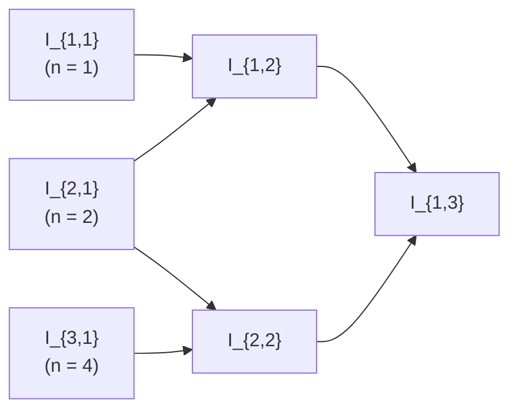

# 20장 — 방정식의 수치 적분

[레포지토리 안내](../../README.ko.md) | [English](Concepts_Lecture.md) | [한국어](Concepts_Lecture.ko.md)

> **최종 수정일:** 2026-10-20
>
> Applied Numerical Methods with Python for Engineers and Scientists, Chapra and Clough, Ch 20

> **학습 목표:**
> 1. 리처드슨 외삽법으로 사다리꼴 추정값의 정확도를 높일 수 있다
> 2. 롬버그 표를 구성하고 종료 기준을 적용할 수 있다
> 3. 미정 계수법으로 2점 가우스-르장드르 공식을 유도할 수 있다
> 4. 변수 치환을 이용해 가우스 구적법을 임의의 구간에 적용할 수 있다

---

<br>

## 목차

- [1. 목표](#1-목표)
- [2. 롬버그 적분(Romberg Integration)](#2-롬버그-적분romberg-integration)
  - [2.1 리처드슨 외삽법(Richardson Extrapolation)](#21-리처드슨-외삽법richardson-extrapolation)
  - [2.2 사다리꼴 법칙 오차 분석](#22-사다리꼴-법칙-오차-분석)
  - [2.3 리처드슨 외삽 공식의 유도](#23-리처드슨-외삽-공식의-유도)
  - [2.4 대안적 유도 (오차 비율 접근법)](#24-대안적-유도-오차-비율-접근법)
  - [2.5 롬버그 적분으로의 일반화](#25-롬버그-적분으로의-일반화)
  - [2.6 롬버그 적분 공식](#26-롬버그-적분-공식)
  - [2.7 종료 기준](#27-종료-기준)
- [3. 가우스 구적법(Gauss Quadrature)](#3-가우스-구적법gauss-quadrature)
  - [3.1 동기: 사다리꼴 법칙에서 가우스 구적법으로](#31-동기-사다리꼴-법칙에서-가우스-구적법으로)
  - [3.2 미정 계수법 (사다리꼴 법칙의 복원)](#32-미정-계수법-사다리꼴-법칙의-복원)
  - [3.3 2점 가우스-르장드르 공식의 유도](#33-2점-가우스-르장드르-공식의-유도)
  - [3.4 예제 20.3: 변수 치환을 이용한 2점 가우스-르장드르](#34-예제-203-변수-치환을-이용한-2점-가우스-르장드르)
  - [3.5 고차 가우스-르장드르 공식 (교재 표 20.1)](#35-고차-가우스-르장드르-공식-교재-표-201)
  - [3.6 가우스-로바토 법칙(Gauss-Lobatto Rules)](#36-가우스-로바토-법칙gauss-lobatto-rules)
- [4. 방법 비교](#4-방법-비교)
- [요약](#요약)
- [점검 문제](#점검-문제)

<br>

---

<br>

## 1. 목표

이 장에서는 두 가지 고급 수치 적분 기법을 다룬다:

1. **롬버그 적분(Romberg Integration)**: 리처드슨 외삽법을 통해 사다리꼴 법칙의 정확도를 체계적으로 개선하는 방법이다.
2. **가우스 구적법(Gauss Quadrature)**: 적분 정확도를 최대화하기 위해 최적의 평가점(반드시 끝점일 필요는 없는)을 선택하는 방법이다.

<br>

---

<br>

## 2. 롬버그 적분(Romberg Integration)

롬버그 적분은 **리처드슨 외삽법(Richardson Extrapolation)** 을 사용하여 **사다리꼴 법칙의 정확도를 체계적으로 개선**한다.

핵심 아이디어:
1. 스텝 크기가 서로 다른 적분의 **두 추정값**을 구한다.
2. 이들을 결합하여 **더 정확한 세 번째 근사값**을 계산한다.

<br>

### 2.1 리처드슨 외삽법(Richardson Extrapolation)

**리처드슨 외삽법**은 **주도적 오차항을 제거하여 수치 근사의 정확도를 향상시키는** 기법이다.

스텝 크기 $`h`$와 $`n`$개의 세그먼트를 사용하여 적분 $`I`$를 근사할 때, $`h = \frac{b - a}{n}`$:

```math
I = I(h) + E(h)
```

여기서:
- $`I(h)`$는 수치 근사값이다.
- $`E(h)`$는 절단 오차이다.

서로 다른 두 스텝 크기 $`h_1`$과 $`h_2`$가 있으면:

```math
I = I(h_1) + E(h_1) = I(h_2) + E(h_2)
```

> **핵심:** 두 근사값은 동일한 참값 $`I`$를 추정하므로, 오차항들을 연관시키면 주도적 오차를 상쇄할 수 있다.

<br>

### 2.2 사다리꼴 법칙 오차 분석

**사다리꼴 법칙**의 절단 오차는:

```math
E \approx -\frac{b - a}{12} \bar{f''} \, h^2
```

이는 오차가 $`O(h^2)`$임을 의미한다. 두 스텝 크기 $`h_1`$과 $`h_2`$에 대해:

```math
E_1 = E(h_1) = -\frac{b - a}{12} \bar{f''} \, h_1^2
```

```math
E_2 = E(h_2) = -\frac{b - a}{12} \bar{f''} \, h_2^2
```

보다 일반적으로, 사다리꼴 법칙의 전체 오차 전개는:

```math
I = I_1 + C h_1^2 + D h_1^4 + O(h_1^6)
```

```math
I = I_2 + C h_2^2 + D h_2^4 + O(h_2^6)
```

여기서 $`C`$와 $`D`$는 함수와 구간에 의존하지만, 스텝 크기에는 **의존하지 않는** 상수이다.

<br>

### 2.3 리처드슨 외삽 공식의 유도

**단계 1.** 두 오차 전개식에서 시작한다:

```math
I = I_1 + C h_1^2 + D h_1^4 + O(h_1^6)
```

```math
I = I_2 + C h_2^2 + D h_2^4 + O(h_2^6)
```

**단계 2.** 두 번째 방정식에 $`\frac{h_1^2}{h_2^2}`$를 곱한다:

```math
\frac{h_1^2}{h_2^2} I = \frac{h_1^2}{h_2^2} I_2 + C h_1^2 + D \frac{h_1^2}{h_2^2} h_2^4 + O\!\left(\frac{h_1^2}{h_2^2} h_2^6\right)
```

> **참고:** 첫 번째 방정식의 $`C h_1^2`$ 항이 이제 곱셈으로 생성한 $`C h_1^2`$ 항과 일치한다. 이것이 상쇄를 가능하게 하는 핵심 단계이다.

**단계 3.** 첫 번째 방정식에서 스케일링된 두 번째 방정식을 뺀다:

```math
\left(1 - \frac{h_1^2}{h_2^2}\right) I = \left(I_1 - \frac{h_1^2}{h_2^2} I_2\right) + D(h_1^4 - h_1^2 h_2^2) + O(h_1^6 - h_1^2 h_2^4)
```

$`C h^2`$ 항이 **제거**되어 $`O(h^4)`$ 오차만 남는다.

**단계 4.** $`h_1 = 2h_2`$ (스텝 크기를 반으로 줄임)로 설정한다:

```math
\frac{h_1^2}{h_2^2} = \frac{(2h_2)^2}{h_2^2} = 4
```

```math
(1 - 4)I = (I_1 - 4I_2) + O(h^4)
```

```math
\boxed{I = \frac{4}{3} I_2 - \frac{1}{3} I_1 + O(h^4)}
```

이를 통해 $`O(h^2)`$ 사다리꼴 추정값을 $`O(h^4)`$ 결과로 변환할 수 있다.

<br>

### 2.4 대안적 유도 (오차 비율 접근법)

두 오차 모두 $`O(h^2)`$이므로, 그 비율은:

```math
\frac{E_1}{E_2} \approx \frac{h_1^2}{h_2^2} = \left(\frac{h_1}{h_2}\right)^2
```

따라서:

```math
E_1 = \left(\frac{h_1}{h_2}\right)^2 E_2
```

$`I_1 + E_1 = I_2 + E_2`$ (둘 다 참값 $`I`$와 같음)로부터:

```math
I_1 + \left(\frac{h_1}{h_2}\right)^2 E_2 = I_2 + E_2
```

```math
I_1 - I_2 = \left(1 - \left(\frac{h_1}{h_2}\right)^2\right) E_2
```

```math
E_2 = \frac{I_1 - I_2}{1 - \left(\frac{h_1}{h_2}\right)^2}
```

따라서 개선된 추정값은:

```math
I = I_2 + E_2 = I_2 + \frac{1}{\left(\frac{h_1}{h_2}\right)^2 - 1}(I_2 - I_1) \quad \sim O(h^4)
```

$`h_1 = 2h_2`$인 경우:

```math
I = I_2 + \frac{1}{3}(I_2 - I_1) = \frac{4}{3} I_2 - \frac{1}{3} I_1 \quad \sim O(h^4)
```

<br>

### 2.5 롬버그 적분으로의 일반화

이 아이디어는 점점 더 작은 스텝 크기를 사용하는 세 개(또는 그 이상)의 사다리꼴 법칙 추정값에 **재귀적으로** 적용할 수 있다.

**세 개의 추정값** $`I_1`$ (1세그먼트), $`I_2`$ (2세그먼트), $`I_3`$ (4세그먼트)인 경우:

**수준 1 (k=1):** 사다리꼴 추정값, $`O(h^2)`$

```math
I_1, \quad I_2, \quad I_3
```

**수준 2 (k=2):** 첫 번째 리처드슨 외삽, $`O(h^4)`$

```math
I_{12} = \frac{4}{3} I_2 - \frac{1}{3} I_1 \quad \sim O(h^4)
```

```math
I_{23} = \frac{4}{3} I_3 - \frac{1}{3} I_2 \quad \sim O(h^4)
```

**수준 3 (k=3):** 두 번째 리처드슨 외삽, $`O(h^6)`$

```math
I_{123} = \frac{16}{15} I_{23} - \frac{1}{15} I_{12} \quad \sim O(h^6)
```

> **참고:** 각 연속적인 수준에서 다음 주도적 오차항을 제거한다. 수준 $`k`$($`k \ge 2`$)는 수준 $`k-1`$ 추정값의 주도 오차항 $`O(h^{2(k-1)})`$을 제거하므로, 결과는 $`O(h^{2k})`$ 오차를 가진다. 수준 3에서 제거하는 오차는 $`O(h^4)`$이므로, 비율이 $`4^1 = 4`$ 대신 $`4^2 = 16`$이 되어 계수가 바뀐다.

<br>

### 2.6 롬버그 적분 공식

이중 인덱스 표기법 $`I_{j,k}`$를 사용한다:
- $`j`$는 행 인덱스이며, 어떤 사다리꼴 추정값에서 출발했는지를 나타낸다.
- $`k`$는 적분 수준(열)이다.

**롬버그 표(Romberg Table)** 의 구조는 다음과 같다:

| k=1 ($`O(h^2)`$) | k=2 ($`O(h^4)`$) | k=3 ($`O(h^6)`$) |
|:---:|:---:|:---:|
| $`I_{1,1}`$ | $`I_{1,2}`$ | $`I_{1,3}`$ |
| $`I_{2,1}`$ | $`I_{2,2}`$ | |
| $`I_{3,1}`$ | | |

*표 1. 롬버그 표의 구조*

각 원소는 왼쪽 열에서 같은 행과 바로 아래 행에 있는 두 원소를 결합하여 만든다.



*그림 1. 롬버그 표에서 추정값이 결합되는 방향*

**일반 점화 공식**은:

```math
\boxed{I_{j,k} = \frac{4^{k-1} \, I_{j+1,\,k-1} - I_{j,\,k-1}}{4^{k-1} - 1}}
```

여기서:
- $`I_{j+1,\,k-1}`$은 더 세밀한 스텝 크기로 구한 **더 정확한** 적분값이다.
- $`I_{j,\,k-1}`$은 더 거친 스텝 크기로 구한 **덜 정확한** 적분값이다.

**검증 예시:**

```math
I_{1,2} = \frac{4^1 \cdot I_{2,1} - I_{1,1}}{4^1 - 1} = \frac{4 I_{2,1} - I_{1,1}}{3} = \frac{4}{3} I_{2,1} - \frac{1}{3} I_{1,1}
```

이는 앞서 유도한 리처드슨 외삽 공식과 일치한다.

```python
import numpy as np

def romberg(f, a, b, max_level):
    """
    Romberg integration of f from a to b.
    max_level: number of levels (columns) in the Romberg table.
    Returns the Romberg table as a 2D list.
    """
    R = np.zeros((max_level, max_level))

    # k=1 column: trapezoidal rule estimates
    for j in range(max_level):
        n = 2 ** j  # number of segments: 1, 2, 4, 8, ...
        h = (b - a) / n
        # Composite trapezoidal rule
        x = np.linspace(a, b, n + 1)
        y = f(x)
        R[j, 0] = h * (0.5 * y[0] + np.sum(y[1:-1]) + 0.5 * y[-1])

    # Fill in higher levels using Richardson extrapolation
    for k in range(1, max_level):
        for j in range(max_level - k):
            R[j, k] = (4**k * R[j + 1, k - 1] - R[j, k - 1]) / (4**k - 1)

    return R

# Example: integrate f(x) = 0.2 + 25x - 200x^2 + 675x^3 - 900x^4 + 400x^5
# from 0 to 0.8 (exact answer = 1.640533)
f = lambda x: 0.2 + 25*x - 200*x**2 + 675*x**3 - 900*x**4 + 400*x**5
R = romberg(f, 0, 0.8, 4)

print("Romberg Table:")
for j in range(4):
    row = ""
    for k in range(4 - j):
        row += f"  {R[j, k]:.6f}"
    print(row)

print(f"\nBest estimate: {R[0, 3]:.6f}")
print(f"Exact value:   1.640533")
```

실행 결과는 다음과 같다.

```text
Romberg Table:
  0.172800  1.367467  1.640533  1.640533
  1.068800  1.623467  1.640533
  1.484800  1.639467
  1.600800

Best estimate: 1.640533
Exact value:   1.640533
```

피적분함수가 5차 다항식이고 세 번째 열($`k = 3`$, $`O(h^6)`$)의 추정값은 5차 이하의 다항식에 대해 정확하므로, $`I_{1,3}`$과 그 오른쪽 값은 참값 1.640533과 같다.

<br>

### 2.7 종료 기준

**Q: 롬버그 절차를 언제 중단하는가?**

현재 수준의 최선 추정값과 이전 수준의 최선 추정값 사이의 **백분율 상대 오차**를 사용한다:

```math
|\varepsilon_a| = \left|\frac{I_{1,k} - I_{2,k-1}}{I_{1,k}}\right| \times 100\%
```

롬버그 표의 대각선 원소를 비교한다:

- $`k = 2`$일 때: $`\displaystyle |\varepsilon_a^{k=2}| = \left|\frac{I_{1,2} - I_{2,1}}{I_{1,2}}\right| \times 100\%`$

- $`k = 3`$일 때: $`\displaystyle |\varepsilon_a^{k=3}| = \left|\frac{I_{1,3} - I_{2,2}}{I_{1,3}}\right| \times 100\%`$

$`|\varepsilon_a| < \varepsilon_s`$ (지정된 허용 오차)일 때 중단한다.

> **참고:** 비교는 항상 현재 우상단 원소 $`I_{1,k}`$와 대각선을 따라 이전 열에 있는 원소 $`I_{2,k-1}`$ 사이에서 이루어진다. $`I_{2,k-1}`$은 $`I_{1,k}`$를 만드는 데 결합된 두 값 중 더 정확한 값으로, 이전 수준의 최선 추정값이다.

<br>

---

<br>

## 3. 가우스 구적법(Gauss Quadrature)

### 3.1 동기: 사다리꼴 법칙에서 가우스 구적법으로

**사다리꼴 법칙**은 적분 구간 $`[a, b]`$의 **양 끝**에서의 함수값을 잇는 **직선** 아래의 넓이를 기반으로 한다.

**핵심 질문:** 끝점 대신 **내부 점**에서의 함수값을 사용하면 어떻게 되는가?

평가점을 끝점이 아닌 곳에서 **최적으로** 선택하면, 같은 수의 함수 평가로 훨씬 높은 정확도를 달성할 수 있다.

**목표:** 적분의 **정확도를 최대화하는** 점들을 찾는다.

이는 **미정 계수법(Method of Undetermined Coefficients)** 으로 이어진다.

<br>

### 3.2 미정 계수법 (사다리꼴 법칙의 복원)

사다리꼴 법칙에서 시작한다:

```math
I \approx (b - a) \frac{f(b) + f(a)}{2} = \frac{b - a}{2} f(a) + \frac{b - a}{2} f(b)
```

계수를 일반화한다:

```math
I \approx c_0 f(a) + c_1 f(b)
```

사다리꼴 법칙이 **상수 함수와 선형 함수에 대해 정확**하다는 것을 알고 있다. 이 조건들을 사용하여 $`c_0`$와 $`c_1`$을 결정한다:

**i)** $`f(x) = 1`$로 놓으면:

```math
I = \int_a^b 1 \, dx = b - a = c_0 \cdot 1 + c_1 \cdot 1 = c_0 + c_1 \quad \cdots (*)
```

**ii)** $`f(x) = x`$로 놓으면:

```math
I = \int_a^b x \, dx = \frac{1}{2}(b^2 - a^2) = c_0 \cdot a + c_1 \cdot b
```

**iii)** (i)과 (ii)로부터:

```math
\frac{1}{2}(b - a)(b + a) = a \, c_0 + b \, c_1
```

```math
\frac{1}{2}(c_0 + c_1)(b + a) = a \, c_0 + b \, c_1
```

```math
\frac{1}{2}(b - a) c_0 + \frac{1}{2}(a - b) c_1 = 0
```

```math
\therefore \quad c_0 = c_1 \quad \xrightarrow{(*)} \quad c_0 = c_1 = \frac{b - a}{2}
```

이는 **사다리꼴 법칙을 복원**한다: $`I = \frac{b-a}{2} f(a) + \frac{b-a}{2} f(b)`$.

> **참고:** 구간의 위치는 계수 유도에 영향을 미치지 않는다. 구간을 원점 중심의 $`\left[-\frac{b-a}{2}, \frac{b-a}{2}\right]`$로 이동해도 동일한 결과 $`c_0 = c_1 = \frac{b-a}{2}`$를 얻는다.

<br>

### 3.3 2점 가우스-르장드르 공식의 유도

이제 **계수**와 **평가점** 모두를 미지수로 둔다:

```math
I \approx c_0 f(x_0) + c_1 f(x_1)
```

**4개의 미지수**: $`c_0, c_1, x_0, x_1`$이 있다.

따라서 **4개의 조건**이 필요하다(3차 이하의 다항식에 대해 정확).

표준 구간 $`[-1, 1]`$에서 작업한다:

**i)** $`\displaystyle \int_{-1}^{1} 1 \, dx = 2 = c_0 \cdot 1 + c_1 \cdot 1`$

**ii)** $`\displaystyle \int_{-1}^{1} x \, dx = 0 = c_0 \cdot x_0 + c_1 \cdot x_1`$

**iii)** $`\displaystyle \int_{-1}^{1} x^2 \, dx = \frac{2}{3} = c_0 \cdot x_0^2 + c_1 \cdot x_1^2`$

**iv)** $`\displaystyle \int_{-1}^{1} x^3 \, dx = 0 = c_0 \cdot x_0^3 + c_1 \cdot x_1^3`$

**연립방정식 풀기:**

**v)** (ii)로부터: $`c_0 x_0 = -c_1 x_1`$

**(iv)에 대입:**

```math
-c_1 x_1 x_0^2 + c_1 x_1^3 = 0
```

```math
c_1 x_1 (x_1^2 - x_0^2) = 0
```

$`c_1`$과 $`x_1`$은 0이 될 수 없으므로(0이면 조건 (i)~(iv)를 동시에 만족할 수 없다):

```math
x_1^2 = x_0^2 \quad \text{이고} \quad x_1 \neq x_0
```

```math
\therefore \quad \boxed{x_1 = -x_0} \quad \cdots (*)
```

**vi)** $`(*)`$를 (ii)에 대입하면:

```math
c_0 x_0 + c_1(-x_0) = 0 \implies c_0 x_0 - c_1 x_0 = 0
```

```math
\therefore \quad \boxed{c_0 = c_1} \quad \cdots (**)
```

**vii)** $`(**)`$를 (i)에 대입하면:

```math
c_0 + c_1 = 2 \implies 2c_0 = 2
```

```math
\therefore \quad \boxed{c_0 = 1 = c_1}
```

**viii)** (iii)으로부터:

```math
c_0 x_0^2 + c_1 x_1^2 = \frac{2}{3} \implies 2 x_0^2 = \frac{2}{3}
```

```math
\therefore \quad x_0 = \pm \frac{1}{\sqrt{3}}, \quad x_1 = \mp \frac{1}{\sqrt{3}}
```

**2점 가우스-르장드르 공식** ($`[-1, 1]`$ 위):

```math
\boxed{I \approx f\!\left(-\frac{1}{\sqrt{3}}\right) + f\!\left(\frac{1}{\sqrt{3}}\right)}
```

이는 **3차 정확도**(3차 이하의 다항식에 대해 정확)를 가지며, 동일한 점 수의 사다리꼴 법칙(1차에 대해서만 정확)보다 크게 우수하다.

```python
import numpy as np

def gauss_legendre_2pt(f, a, b):
    """
    Two-point Gauss-Legendre quadrature for integral of f from a to b.
    Uses change of variable: x = ((b-a)/2)*z + (a+b)/2, z in [-1, 1].
    """
    # Gauss points on [-1, 1]
    z0 = -1.0 / np.sqrt(3)
    z1 =  1.0 / np.sqrt(3)

    # Weights (both equal to 1)
    w0, w1 = 1.0, 1.0

    # Change of variable: x = ((b-a)/2)*z + (a+b)/2
    # dx = ((b-a)/2)*dz
    scale = (b - a) / 2.0
    shift = (a + b) / 2.0

    x0 = scale * z0 + shift
    x1 = scale * z1 + shift

    return scale * (w0 * f(x0) + w1 * f(x1))

# Example
f = lambda x: 0.2 + 25*x - 200*x**2 + 675*x**3 - 900*x**4 + 400*x**5
result = gauss_legendre_2pt(f, 0, 0.8)
print(f"Two-point Gauss-Legendre: {result:.6f}")
print(f"Exact value:             1.640533")
```

<br>

### 3.4 예제 20.3: 변수 치환을 이용한 2점 가우스-르장드르

**문제:** 다음 함수의 적분을 계산하라:

```math
f(x) = 0.2 + 25x - 200x^2 + 675x^3 - 900x^4 + 400x^5
```

적분 범위: $`x = 0`$에서 $`x = 0.8`$까지.

**풀이:**

가우스-르장드르 공식은 $`[-1, 1]`$에서 작동하므로, **변수 치환**이 필요하다:

```math
x = \frac{b - a}{2} \zeta + \frac{a + b}{2} = 0.4\zeta + 0.4
```

```math
dx = 0.4 \, d\zeta
```

적분을 변환하면:

```math
\int_0^{0.8} f(x) \, dx = \int_{-1}^{1} f(\zeta) \cdot 0.4 \, d\zeta
```

2점 가우스-르장드르 공식을 적용하면:

```math
\approx 0.4 \left[ f\!\left(-\frac{1}{\sqrt{3}}\right) + f\!\left(\frac{1}{\sqrt{3}}\right) \right]
```

여기서 $`f(\zeta)`$는 원래 $`f`$를 $`x = 0.4\zeta + 0.4`$에서 평가하는 것을 의미한다:

- $`\zeta = -\frac{1}{\sqrt{3}}`$일 때: $`x = 0.4 \cdot \left(-\frac{1}{\sqrt{3}}\right) + 0.4 \approx 0.1690`$
- $`\zeta = +\frac{1}{\sqrt{3}}`$일 때: $`x = 0.4 \cdot \left(+\frac{1}{\sqrt{3}}\right) + 0.4 \approx 0.6310`$

```python
import numpy as np

f = lambda x: 0.2 + 25*x - 200*x**2 + 675*x**3 - 900*x**4 + 400*x**5

a, b = 0, 0.8
z = np.array([-1/np.sqrt(3), 1/np.sqrt(3)])
x = 0.4 * z + 0.4  # change of variable

result = 0.4 * (f(x[0]) + f(x[1]))
print(f"x values: {x[0]:.6f}, {x[1]:.6f}")
print(f"f(x0) = {f(x[0]):.6f}")
print(f"f(x1) = {f(x[1]):.6f}")
print(f"Result: {result:.6f}")
print(f"Exact:  1.640533")
```

실행 결과는 다음과 같다.

```text
x values: 0.169060, 0.630940
f(x0) = 1.291851
f(x1) = 3.264593
Result: 1.822578
Exact:  1.640533
```

따라서 적분값은 $`0.4(1.291851 + 3.264593) \approx 1.822578`$이고, 참 상대 오차는 $`\varepsilon_t = \frac{1.640533 - 1.822578}{1.640533} \times 100\% \approx -11.1\%`$이다. 이 값은 같은 두 번의 함수 평가를 쓰는 단일 적용 사다리꼴 법칙의 값 0.1728보다 훨씬 정확하다.

<br>

### 3.5 고차 가우스-르장드르 공식 (교재 표 20.1)

$`[-1, 1]`$에서의 일반 형태:

```math
I \approx \sum_{i=0}^{n-1} c_i \, f(x_i)
```

| 점 수($`n`$) | 가중치($`c_i`$) | 절점($`x_i`$) | 오차 | 정확한 차수 |
|:---:|:---|:---|:---:|:---:|
| **1** | $`c_0 = 2`$ | $`x_0 = 0`$ | $`\sim f^{(2)}(\zeta)`$ | 1 |
| **2** | $`c_0 = 1`$, $`c_1 = 1`$ | $`x_0 = -\frac{1}{\sqrt{3}}`$, $`x_1 = \frac{1}{\sqrt{3}}`$ | $`\sim f^{(4)}(\zeta)`$ | 3 |
| **3** | $`c_0 = \frac{5}{9}`$, $`c_1 = \frac{8}{9}`$, $`c_2 = \frac{5}{9}`$ | $`x_0 = -\sqrt{\frac{3}{5}}`$, $`x_1 = 0`$, $`x_2 = \sqrt{\frac{3}{5}}`$ | $`\sim f^{(6)}(\zeta)`$ | 5 |
| **$`n`$** | (수치표 참조) | (수치표 참조) | $`\sim f^{(2n)}(\zeta)`$ | $`2n - 1`$ |

*표 2. 점 수별 가우스-르장드르 공식의 가중치, 절점, 오차, 정확한 차수*

**핵심 성질:** $`n`$점 가우스 구적법은 **$`(2n-1)`$차 정확도**를 가진다. 즉, $`2n - 1`$차 이하의 모든 다항식에 대해 정확하다.

> **참고:** **최적 배치의 효과.** 이것은 주목할 만한 결과이다. $`n`$개의 점으로 $`2n - 1`$차까지의 다항식을 정확히 적분할 수 있다. 사다리꼴 법칙(2개의 끝점)은 1차에 대해서만 정확하지만, 2점 가우스-르장드르는 3차에 대해 정확하다. 이 추가 정확도는 평가점의 위치를 최적화한 결과이다.

```python
import numpy as np

def gauss_legendre_3pt(f, a, b):
    """
    Three-point Gauss-Legendre quadrature for integral of f from a to b.
    """
    # Gauss points on [-1, 1]
    z = np.array([-np.sqrt(3/5), 0, np.sqrt(3/5)])
    # Weights
    w = np.array([5/9, 8/9, 5/9])

    # Change of variable
    scale = (b - a) / 2.0
    shift = (a + b) / 2.0
    x = scale * z + shift

    return scale * np.sum(w * f(x))

# Example
f = lambda x: 0.2 + 25*x - 200*x**2 + 675*x**3 - 900*x**4 + 400*x**5
result = gauss_legendre_3pt(f, 0, 0.8)
print(f"Three-point Gauss-Legendre: {result:.6f}")
print(f"Exact value:               1.640533")
```

실행 결과는 다음과 같다.

```text
Three-point Gauss-Legendre: 1.640533
Exact value:               1.640533
```

3점 공식은 5차 이하의 다항식에 대해 정확하므로, 5차 다항식인 이 피적분함수의 참값을 그대로 얻는다.

<br>

### 3.6 가우스-로바토 법칙(Gauss-Lobatto Rules)

**가우스-로바토 법칙**은 적분점이 구간의 **끝점을 포함**하는 변형이다.

**3점 가우스-로바토** ($`[-1, 1]`$ 위):

```math
\int_{-1}^{1} f(x) \, dx \approx \frac{1}{3} f(-1) + \frac{4}{3} f(0) + \frac{1}{3} f(1)
```

| 점 수($`n`$) | 가중치($`c_i`$) | 절점($`x_i`$) | 오차 | 정확한 차수 |
|:---:|:---|:---|:---:|:---:|
| **3** | $`c_0 = \frac{1}{3}`$, $`c_1 = \frac{4}{3}`$, $`c_2 = \frac{1}{3}`$ | $`x_0 = -1`$, $`x_1 = 0`$, $`x_2 = 1`$ | $`\sim f^{(4)}(\zeta)`$ | 3 |
| **4** | $`c_0 = \frac{1}{6}`$, $`c_1 = \frac{5}{6}`$, $`c_2 = \frac{5}{6}`$, $`c_3 = \frac{1}{6}`$ | $`x_0 = -1`$, $`x_1 = -\frac{1}{\sqrt{5}}`$, $`x_2 = \frac{1}{\sqrt{5}}`$, $`x_3 = 1`$ | $`\sim f^{(6)}(\zeta)`$ | 5 |
| **$`n`$** | (수치표 참조) | (수치표 참조) | $`\sim f^{(2n-2)}(\zeta)`$ | $`2n - 3`$ |

*표 3. 점 수별 가우스-로바토 공식의 가중치, 절점, 오차, 정확한 차수*

**핵심 성질:** $`n`$점 가우스-로바토 구적법은 **$`(2n-3)`$차 정확도**를 가진다. 즉, $`2n - 3`$차 이하의 다항식에 대해 정확하다.

> **참고:** **가우스-로바토와 가우스-르장드르의 비교.** 가우스-로바토는 같은 점 수의 가우스-르장드르보다 약간 덜 정확하다($`2n - 3`$ 대 $`2n - 1`$). 이는 두 점이 끝점에 고정되어 최적화에 사용할 수 있는 자유도가 줄어들기 때문이다. 그러나 경계값이 이미 알려져 있거나 소구간을 결합할 때 끝점을 포함하는 것이 유리할 수 있다.

<br>

---

<br>

## 4. 방법 비교

| 방법 | 공식 / 핵심 아이디어 | 오차 차수 | 비고 |
|:---|:---|:---:|:---|
| **리처드슨 외삽법(Richardson Extrapolation)** | $`I = \frac{4}{3}I_2 - \frac{1}{3}I_1`$ | $`O(h^4)`$ | 사다리꼴 법칙의 $`O(h^2)`$ 오차를 제거 |
| **롬버그 적분(Romberg Integration)** | $`I_{j,k} = \frac{4^{k-1}I_{j+1,k-1} - I_{j,k-1}}{4^{k-1} - 1}`$ | 수준 $`k`$에서 $`O(h^{2k})`$ | 재귀적 리처드슨 외삽; 각 수준에서 $`O(h^2)`$ 향상 |
| **2점 가우스-르장드르(2-point Gauss-Legendre)** | $`I \approx f(-1/\sqrt{3}) + f(1/\sqrt{3})`$ | $`\sim f^{(4)}`$ | 3차 이하의 다항식에 대해 정확 |
| **3점 가우스-르장드르(3-point Gauss-Legendre)** | $`I \approx \frac{5}{9}f(-\sqrt{3/5}) + \frac{8}{9}f(0) + \frac{5}{9}f(\sqrt{3/5})`$ | $`\sim f^{(6)}`$ | 5차 이하의 다항식에 대해 정확 |
| **$`n`$점 가우스-르장드르($`n`$-point Gauss-Legendre)** | $`I \approx \sum c_i f(x_i)`$ | $`\sim f^{(2n)}`$ | $`2n-1`$차에 대해 정확; 최적 점 배치 |
| **$`n`$점 가우스-로바토($`n`$-point Gauss-Lobatto)** | 동일 형태, 단 끝점 포함 | $`\sim f^{(2n-2)}`$ | $`2n-3`$차에 대해 정확; 경계점 포함 |

*표 4. 롬버그 적분과 가우스 구적법의 비교*

---

<br>

## 요약

| 개념 | 핵심 요약 |
|------|------------|
| 리처드슨 외삽법 | 스텝 크기가 다른 두 추정값을 결합해 주도 오차항을 제거하며, $`h_1 = 2h_2`$인 사다리꼴 추정값에서 $`I = \frac{4}{3}I_2 - \frac{1}{3}I_1`$은 $`O(h^4)`$ 정확도를 가진다. |
| 롬버그 적분 | 사다리꼴 추정값에 리처드슨 외삽을 재귀적으로 적용하며, 수준 $`k`$의 추정값은 $`O(h^{2k})`$ 오차를 가진다. |
| 롬버그 종료 기준 | $`I_{1,k}`$와 $`I_{2,k-1}`$ 사이의 백분율 상대 오차가 허용 오차 $`\varepsilon_s`$보다 작아지면 멈춘다. |
| 미정 계수법 | 공식이 정확해야 할 다항식들을 대입하여 계수와 평가점을 정하며, 평가점을 끝점에 고정하면 사다리꼴 법칙이 복원된다. |
| 가우스-르장드르 구적법 | $`n`$개의 가중치와 절점을 최적으로 정하여 $`2n - 1`$차 이하의 다항식을 정확히 적분하며, 2점 공식은 $`f(-1/\sqrt{3}) + f(1/\sqrt{3})`$이다. |
| 변수 치환 | $`x = \frac{b-a}{2}\zeta + \frac{a+b}{2}`$로 $`[a, b]`$를 $`[-1, 1]`$로 옮기고 결과에 $`\frac{b-a}{2}`$를 곱한다. |
| 가우스-로바토 구적법 | 양 끝점을 절점에 포함하므로 자유도가 줄어 $`n`$점 공식이 $`2n - 3`$차 이하의 다항식에 대해 정확하다. |

---

<br>

## 점검 문제

1. **리처드슨 외삽:** $`f(x) = 0.2 + 25x - 200x^2 + 675x^3 - 900x^4 + 400x^5`$를 0에서 0.8까지 적분할 때 1, 2, 4세그먼트 사다리꼴 추정값은 0.1728, 1.0688, 1.4848이다. $`I_{1,2}`$와 $`I_{2,2}`$를 구하라.

   <details>
   <summary>정답</summary>

   $`I_{1,2} = \frac{4}{3}(1.0688) - \frac{1}{3}(0.1728) = 1.425067 - 0.0576 = 1.367467`$이다. $`I_{2,2} = \frac{4}{3}(1.4848) - \frac{1}{3}(1.0688) = 1.979733 - 0.356267 = 1.623467`$이다.

   </details>

2. **롬버그 수준 3과 종료 기준:** 1번의 결과로 $`I_{1,3}`$을 구하고, 종료 기준의 $`|\varepsilon_a|`$를 계산하라.

   <details>
   <summary>정답</summary>

   $`I_{1,3} = \frac{16(1.623467) - 1.367467}{15} = \frac{24.608}{15} = 1.640533`$이다. $`|\varepsilon_a| = \left|\frac{1.640533 - 1.623467}{1.640533}\right| \times 100\% \approx 1.04\%`$이다. $`I_{1,3}`$은 참값 1.640533과 같은데, $`k = 3`$ 열은 5차 이하의 다항식에 대해 정확하기 때문이다.

   </details>

3. **2점 가우스-르장드르:** 1번과 같은 적분을 2점 가우스-르장드르 공식으로 계산하고 참 상대 오차를 구하라.

   <details>
   <summary>정답</summary>

   $`x = 0.4\zeta + 0.4`$로 치환하면 절점은 $`x \approx 0.169060`$, $`0.630940`$이고 함수값은 약 1.291851, 3.264593이다. 적분값은 $`0.4(1.291851 + 3.264593) \approx 1.822578`$이고, 참 상대 오차는 $`\frac{1.640533 - 1.822578}{1.640533} \times 100\% \approx -11.1\%`$이다.

   </details>

4. **정확도 차수:** $`n`$점 가우스-르장드르 공식이 $`2n - 1`$차 이하의 다항식에 대해 정확한 이유를 미지수의 수로 설명하라.

   <details>
   <summary>정답</summary>

   가중치 $`n`$개와 절점 $`n`$개로 미지수가 $`2n`$개이므로, $`1, x, \ldots, x^{2n-1}`$의 $`2n`$개 단항식에 대해 정확하다는 조건 $`2n`$개를 세울 수 있다. 적분과 공식이 모두 선형이므로, 이 단항식들의 선형결합인 $`2n - 1`$차 이하의 모든 다항식에 대해 정확하다. 2점 공식은 조건 4개로 3차까지 정확하다.

   </details>

5. **가우스-로바토와 심프슨 법칙:** 3점 가우스-로바토 공식이 $`[-1, 1]`$에서 19장의 심프슨의 1/3 법칙과 같음을 보이라.

   <details>
   <summary>정답</summary>

   $`[-1, 1]`$에서 심프슨의 1/3 법칙은 $`h = 1`$이므로 $`\frac{h}{3}\bigl(f(-1) + 4f(0) + f(1)\bigr) = \frac{1}{3}f(-1) + \frac{4}{3}f(0) + \frac{1}{3}f(1)`$이다. 이는 3점 가우스-로바토 공식과 같으며, 두 공식 모두 3차 이하의 다항식에 대해 정확하다($`2n - 3 = 3`$).

   </details>
