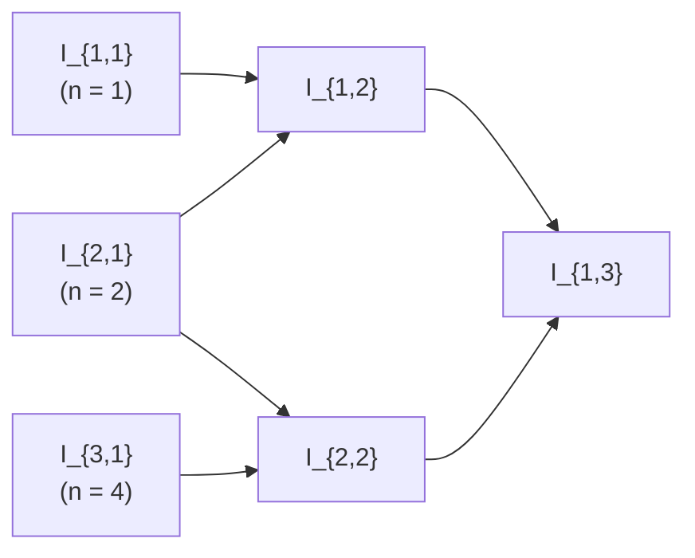
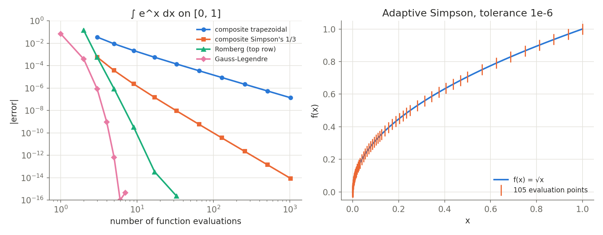

# 20장 — 함수의 수치 적분

[레포지토리 안내](../../README.ko.md) | [English](Concepts_Lecture.md) | [한국어](Concepts_Lecture.ko.md)

> **최종 수정일:** 2026-11-19
>
> Applied Numerical Methods with Python for Engineers and Scientists, Chapra and Clough, Ch 20

> **학습 목표:**
> 1. 리처드슨 외삽법으로 사다리꼴 추정값의 정확도를 높일 수 있다
> 2. 롬버그 표를 구성하고 종료 기준을 적용할 수 있다
> 3. 미정 계수법으로 2점 가우스-르장드르 공식을 유도할 수 있다
> 4. 변수 치환을 이용해 가우스 구적법을 임의의 구간에 적용할 수 있다
> 5. 르장드르 다항식의 근이 가우스 절점이 되는 이유를 설명하고 구적법의 효율을 함수 평가 횟수로 비교할 수 있다
> 6. 적응적 구적법의 오차 추정 원리를 설명하고 SciPy의 quad로 적분할 수 있다

---

<br>

## 목차

- [1. 목표](#1-목표)
- [2. 롬버그 적분(Romberg Integration)](#2-롬버그-적분romberg-integration)
  - [2.1 리처드슨 외삽법(Richardson Extrapolation)](#21-리처드슨-외삽법richardson-extrapolation)
  - [2.2 사다리꼴 법칙 오차 분석](#22-사다리꼴-법칙-오차-분석)
  - [2.3 리처드슨 외삽 공식의 유도](#23-리처드슨-외삽-공식의-유도)
  - [2.4 대안적 유도 (오차 비율 접근법)](#24-대안적-유도-오차-비율-접근법)
  - [2.5 롬버그 적분으로의 일반화](#25-롬버그-적분으로의-일반화)
  - [2.6 롬버그 적분 공식](#26-롬버그-적분-공식)
  - [2.7 종료 기준](#27-종료-기준)
  - [2.8 롬버그 적분의 추적과 성립 조건](#28-롬버그-적분의-추적과-성립-조건)
- [3. 가우스 구적법(Gauss Quadrature)](#3-가우스-구적법gauss-quadrature)
  - [3.1 동기: 사다리꼴 법칙에서 가우스 구적법으로](#31-동기-사다리꼴-법칙에서-가우스-구적법으로)
  - [3.2 미정 계수법 (사다리꼴 법칙의 복원)](#32-미정-계수법-사다리꼴-법칙의-복원)
  - [3.3 2점 가우스-르장드르 공식의 유도](#33-2점-가우스-르장드르-공식의-유도)
  - [3.4 예제 20.3: 변수 치환을 이용한 2점 가우스-르장드르](#34-예제-203-변수-치환을-이용한-2점-가우스-르장드르)
  - [3.5 고차 가우스-르장드르 공식 (교재 표 20.1)](#35-고차-가우스-르장드르-공식-교재-표-201)
  - [3.6 가우스-로바토 법칙(Gauss-Lobatto Rules)](#36-가우스-로바토-법칙gauss-lobatto-rules)
  - [3.7 르장드르 다항식과 가우스 절점](#37-르장드르-다항식과-가우스-절점)
  - [3.8 가우스 구적법의 오차와 효율](#38-가우스-구적법의-오차와-효율)
  - [3.9 변수 치환의 손계산과 고차 가우스-르장드르 공식](#39-변수-치환의-손계산과-고차-가우스-르장드르-공식)
- [4. 방법 비교](#4-방법-비교)
- [5. 적응적 구적법(Adaptive Quadrature)](#5-적응적-구적법adaptive-quadrature)
  - [5.1 국소 오차 추정과 구간 분할](#51-국소-오차-추정과-구간-분할)
  - [5.2 적응적 심프슨 방법의 구현](#52-적응적-심프슨-방법의-구현)
  - [5.3 SciPy의 quad](#53-scipy의-quad)
- [개념 적용](#개념-적용)
- [요약](#요약)
- [점검 문제](#점검-문제)
- [참고 문헌](#참고-문헌)

<br>

---

<br>

## 1. 목표

이 장에서는 두 가지 고급 수치 적분 기법을 다룬다:

1. **롬버그 적분(Romberg Integration)**: 리처드슨 외삽법을 통해 사다리꼴 법칙의 정확도를 체계적으로 개선하는 방법이다.
2. **가우스 구적법(Gauss Quadrature)**: 적분 정확도를 최대화하기 위해 최적의 평가점(반드시 끝점일 필요는 없는)을 선택하는 방법이다.
3. **적응적 구적법(Adaptive Quadrature)**: 구간마다 오차를 추정하여 함수가 급하게 변하는 곳에만 점을 더 두는 방법이다.

<br>

---

<br>

## 2. 롬버그 적분(Romberg Integration)

롬버그 적분은 **리처드슨 외삽법(Richardson Extrapolation)** 을 사용하여 **사다리꼴 법칙의 정확도를 체계적으로 개선**한다.

핵심 아이디어:
1. 스텝 크기가 서로 다른 적분의 **두 추정값**을 구한다.
2. 이들을 결합하여 **더 정확한 세 번째 근사값**을 계산한다.

<br>

### 2.1 리처드슨 외삽법(Richardson Extrapolation)

**리처드슨 외삽법**은 **주도적 오차항을 제거하여 수치 근사의 정확도를 향상시키는** 기법이다.

> **용어 정의:** **리처드슨 외삽법(Richardson extrapolation)** 은 오차가 $`h`$의 거듭제곱으로 전개되는 근사값 두 개를 서로 다른 스텝 크기로 계산하고, 주도 오차항이 상쇄되도록 두 값을 선형 결합하여 더 높은 차수의 근사값을 얻는 방법이다.

스텝 크기 $`h`$와 $`n`$개의 세그먼트를 사용하여 적분 $`I`$를 근사할 때, $`h = \frac{b - a}{n}`$:

```math
I = I(h) + E(h)
```

여기서:
- $`I(h)`$는 수치 근사값이다.
- $`E(h)`$는 절단 오차이다.

서로 다른 두 스텝 크기 $`h_1`$과 $`h_2`$가 있으면:

```math
I = I(h_1) + E(h_1) = I(h_2) + E(h_2)
```

> **핵심:** 두 근사값은 동일한 참값 $`I`$를 추정하므로, 오차항들을 연관시키면 주도적 오차를 상쇄할 수 있다.

<br>

### 2.2 사다리꼴 법칙 오차 분석

**사다리꼴 법칙**의 절단 오차는:

```math
E \approx -\frac{b - a}{12} \bar{f''} \, h^2
```

이는 오차가 $`O(h^2)`$임을 의미한다. 두 스텝 크기 $`h_1`$과 $`h_2`$에 대해:

```math
E_1 = E(h_1) = -\frac{b - a}{12} \bar{f''} \, h_1^2
```

```math
E_2 = E(h_2) = -\frac{b - a}{12} \bar{f''} \, h_2^2
```

보다 일반적으로, 사다리꼴 법칙의 전체 오차 전개는:

```math
I = I_1 + C h_1^2 + D h_1^4 + O(h_1^6)
```

```math
I = I_2 + C h_2^2 + D h_2^4 + O(h_2^6)
```

여기서 $`C`$와 $`D`$는 함수와 구간에 의존하지만, 스텝 크기에는 **의존하지 않는** 상수이다.

<br>

### 2.3 리처드슨 외삽 공식의 유도

**단계 1.** 두 오차 전개식에서 시작한다:

```math
I = I_1 + C h_1^2 + D h_1^4 + O(h_1^6)
```

```math
I = I_2 + C h_2^2 + D h_2^4 + O(h_2^6)
```

**단계 2.** 두 번째 방정식에 $`\frac{h_1^2}{h_2^2}`$를 곱한다:

```math
\frac{h_1^2}{h_2^2} I = \frac{h_1^2}{h_2^2} I_2 + C h_1^2 + D \frac{h_1^2}{h_2^2} h_2^4 + O\!\left(\frac{h_1^2}{h_2^2} h_2^6\right)
```

> **참고:** 첫 번째 방정식의 $`C h_1^2`$ 항이 이제 곱셈으로 생성한 $`C h_1^2`$ 항과 일치한다. 이것이 상쇄를 가능하게 하는 핵심 단계이다.

**단계 3.** 첫 번째 방정식에서 스케일링된 두 번째 방정식을 뺀다:

```math
\left(1 - \frac{h_1^2}{h_2^2}\right) I = \left(I_1 - \frac{h_1^2}{h_2^2} I_2\right) + D(h_1^4 - h_1^2 h_2^2) + O(h_1^6 - h_1^2 h_2^4)
```

$`C h^2`$ 항이 **제거**되어 $`O(h^4)`$ 오차만 남는다.

**단계 4.** $`h_1 = 2h_2`$ (스텝 크기를 반으로 줄임)로 설정한다:

```math
\frac{h_1^2}{h_2^2} = \frac{(2h_2)^2}{h_2^2} = 4
```

```math
(1 - 4)I = (I_1 - 4I_2) + O(h^4)
```

```math
\boxed{I = \frac{4}{3} I_2 - \frac{1}{3} I_1 + O(h^4)}
```

이를 통해 $`O(h^2)`$ 사다리꼴 추정값을 $`O(h^4)`$ 결과로 변환할 수 있다.

<br>

### 2.4 대안적 유도 (오차 비율 접근법)

두 오차 모두 $`O(h^2)`$이므로, 그 비율은:

```math
\frac{E_1}{E_2} \approx \frac{h_1^2}{h_2^2} = \left(\frac{h_1}{h_2}\right)^2
```

따라서:

```math
E_1 = \left(\frac{h_1}{h_2}\right)^2 E_2
```

$`I_1 + E_1 = I_2 + E_2`$ (둘 다 참값 $`I`$와 같음)로부터:

```math
I_1 + \left(\frac{h_1}{h_2}\right)^2 E_2 = I_2 + E_2
```

```math
I_1 - I_2 = \left(1 - \left(\frac{h_1}{h_2}\right)^2\right) E_2
```

```math
E_2 = \frac{I_1 - I_2}{1 - \left(\frac{h_1}{h_2}\right)^2}
```

따라서 개선된 추정값은:

```math
I = I_2 + E_2 = I_2 + \frac{1}{\left(\frac{h_1}{h_2}\right)^2 - 1}(I_2 - I_1) \quad \sim O(h^4)
```

$`h_1 = 2h_2`$인 경우:

```math
I = I_2 + \frac{1}{3}(I_2 - I_1) = \frac{4}{3} I_2 - \frac{1}{3} I_1 \quad \sim O(h^4)
```

<br>

### 2.5 롬버그 적분으로의 일반화

이 아이디어는 점점 더 작은 스텝 크기를 사용하는 세 개(또는 그 이상)의 사다리꼴 법칙 추정값에 **재귀적으로** 적용할 수 있다.

**세 개의 추정값** $`I_1`$ (1세그먼트), $`I_2`$ (2세그먼트), $`I_3`$ (4세그먼트)인 경우:

**수준 1 (k=1):** 사다리꼴 추정값, $`O(h^2)`$

```math
I_1, \quad I_2, \quad I_3
```

**수준 2 (k=2):** 첫 번째 리처드슨 외삽, $`O(h^4)`$

```math
I_{12} = \frac{4}{3} I_2 - \frac{1}{3} I_1 \quad \sim O(h^4)
```

```math
I_{23} = \frac{4}{3} I_3 - \frac{1}{3} I_2 \quad \sim O(h^4)
```

**수준 3 (k=3):** 두 번째 리처드슨 외삽, $`O(h^6)`$

```math
I_{123} = \frac{16}{15} I_{23} - \frac{1}{15} I_{12} \quad \sim O(h^6)
```

> **참고:** 각 연속적인 수준에서 다음 주도적 오차항을 제거한다. 수준 $`k`$($`k \ge 2`$)는 수준 $`k-1`$ 추정값의 주도 오차항 $`O(h^{2(k-1)})`$을 제거하므로, 결과는 $`O(h^{2k})`$ 오차를 가진다. 수준 3에서 제거하는 오차는 $`O(h^4)`$이므로, 비율이 $`4^1 = 4`$ 대신 $`4^2 = 16`$이 되어 계수가 바뀐다.

<br>

### 2.6 롬버그 적분 공식

이중 인덱스 표기법 $`I_{j,k}`$를 사용한다:
- $`j`$는 행 인덱스이며, 어떤 사다리꼴 추정값에서 출발했는지를 나타낸다.
- $`k`$는 적분 수준(열)이다.

**롬버그 표(Romberg Table)** 의 구조는 다음과 같다:

| k=1 ($`O(h^2)`$) | k=2 ($`O(h^4)`$) | k=3 ($`O(h^6)`$) |
|:---:|:---:|:---:|
| $`I_{1,1}`$ | $`I_{1,2}`$ | $`I_{1,3}`$ |
| $`I_{2,1}`$ | $`I_{2,2}`$ | |
| $`I_{3,1}`$ | | |

*표 1. 롬버그 표의 구조*

각 원소는 왼쪽 열에서 같은 행과 바로 아래 행에 있는 두 원소를 결합하여 만든다.



*그림 1. 롬버그 표에서 추정값이 결합되는 방향*

**일반 점화 공식**은:

```math
\boxed{I_{j,k} = \frac{4^{k-1} \, I_{j+1,\,k-1} - I_{j,\,k-1}}{4^{k-1} - 1}}
```

여기서:
- $`I_{j+1,\,k-1}`$은 더 세밀한 스텝 크기로 구한 **더 정확한** 적분값이다.
- $`I_{j,\,k-1}`$은 더 거친 스텝 크기로 구한 **덜 정확한** 적분값이다.

**검증 예시:**

```math
I_{1,2} = \frac{4^1 \cdot I_{2,1} - I_{1,1}}{4^1 - 1} = \frac{4 I_{2,1} - I_{1,1}}{3} = \frac{4}{3} I_{2,1} - \frac{1}{3} I_{1,1}
```

이는 앞서 유도한 리처드슨 외삽 공식과 일치한다.

```python
import numpy as np

def romberg(f, a, b, max_level):
    """
    Romberg integration of f from a to b.
    max_level: number of levels (columns) in the Romberg table.
    Returns the Romberg table as a 2D list.
    """
    R = np.zeros((max_level, max_level))

    # k=1 column: trapezoidal rule estimates
    for j in range(max_level):
        n = 2 ** j  # number of segments: 1, 2, 4, 8, ...
        h = (b - a) / n
        # Composite trapezoidal rule
        x = np.linspace(a, b, n + 1)
        y = f(x)
        R[j, 0] = h * (0.5 * y[0] + np.sum(y[1:-1]) + 0.5 * y[-1])

    # Fill in higher levels using Richardson extrapolation
    for k in range(1, max_level):
        for j in range(max_level - k):
            R[j, k] = (4**k * R[j + 1, k - 1] - R[j, k - 1]) / (4**k - 1)

    return R

# Example: integrate f(x) = 0.2 + 25x - 200x^2 + 675x^3 - 900x^4 + 400x^5
# from 0 to 0.8 (exact answer = 1.640533)
f = lambda x: 0.2 + 25*x - 200*x**2 + 675*x**3 - 900*x**4 + 400*x**5
R = romberg(f, 0, 0.8, 4)

print("Romberg Table:")
for j in range(4):
    row = ""
    for k in range(4 - j):
        row += f"  {R[j, k]:.6f}"
    print(row)

print(f"\nBest estimate: {R[0, 3]:.6f}")
print(f"Exact value:   1.640533")
```

실행 결과는 다음과 같다.

```text
Romberg Table:
  0.172800  1.367467  1.640533  1.640533
  1.068800  1.623467  1.640533
  1.484800  1.639467
  1.600800

Best estimate: 1.640533
Exact value:   1.640533
```

피적분함수가 5차 다항식이고 세 번째 열($`k = 3`$, $`O(h^6)`$)의 추정값은 5차 이하의 다항식에 대해 정확하므로, $`I_{1,3}`$과 그 오른쪽 값은 참값 1.640533과 같다.

<br>

### 2.7 종료 기준

**롬버그 절차의 중단 시점**

현재 수준의 최선 추정값과 이전 수준의 최선 추정값 사이의 **백분율 상대 오차**를 사용한다:

```math
|\varepsilon_a| = \left|\frac{I_{1,k} - I_{2,k-1}}{I_{1,k}}\right| \times 100\%
```

롬버그 표의 대각선 원소를 비교한다:

- $`k = 2`$일 때: $`\displaystyle |\varepsilon_a^{k=2}| = \left|\frac{I_{1,2} - I_{2,1}}{I_{1,2}}\right| \times 100\%`$

- $`k = 3`$일 때: $`\displaystyle |\varepsilon_a^{k=3}| = \left|\frac{I_{1,3} - I_{2,2}}{I_{1,3}}\right| \times 100\%`$

$`|\varepsilon_a| < \varepsilon_s`$ (지정된 허용 오차)일 때 중단한다.

> **참고:** 비교는 항상 현재 우상단 원소 $`I_{1,k}`$와 대각선을 따라 이전 열에 있는 원소 $`I_{2,k-1}`$ 사이에서 이루어진다. $`I_{2,k-1}`$은 $`I_{1,k}`$를 만드는 데 결합된 두 값 중 더 정확한 값으로, 이전 수준의 최선 추정값이다.

<br>

### 2.8 롬버그 적분의 추적과 성립 조건

2.6절의 예제는 피적분함수가 다항식이어서 세 번째 열에서 바로 참값이 나왔다. 다항식이 아닌 함수에서 롬버그 표가 어떻게 수렴하는지 $`\int_0^1 e^x\,dx = e - 1`$로 확인한다.

```python
import numpy as np

def romberg_table(f, a, b, levels):
    R = np.zeros((levels, levels))
    for j in range(levels):
        n = 2**j
        x = np.linspace(a, b, n + 1); y = f(x)
        R[j, 0] = (b - a) / n * (y[0] / 2 + y[1:-1].sum() + y[-1] / 2)
    for k in range(1, levels):
        for j in range(levels - k):
            R[j, k] = (4**k * R[j + 1, k - 1] - R[j, k - 1]) / (4**k - 1)
    return R

exact = np.e - 1.0
R = romberg_table(np.exp, 0.0, 1.0, 5)
for j in range(5):
    print("  ".join(f"{R[j, k]:.10f}" for k in range(5 - j)))
print("errors of the top row:", ["%.1e" % (exact - R[0, k]) for k in range(5)])
for k in range(1, 5):
    ea = abs((R[0, k] - R[1, k - 1]) / R[0, k]) * 100
    print(f"k = {k + 1}: |ea| = {ea:.2e} %")
```

```text
1.8591409142  1.7188611519  1.7182826879  1.7182818288  1.7182818285
1.7539310925  1.7183188419  1.7182818422  1.7182818285
1.7272219046  1.7182841547  1.7182818287
1.7205185922  1.7182819741
1.7188411286
errors of the top row: ['-1.4e-01', '-5.8e-04', '-8.6e-07', '-3.4e-10', '-3.3e-14']
k = 2: |ea| = 2.04e+00 %
k = 3: |ea| = 2.10e-03 %
k = 4: |ea| = 7.81e-07 %
k = 5: |ea| = 7.63e-11 %
```

- 첫 열은 세그먼트 1, 2, 4, 8, 16개의 사다리꼴 추정값이고, 이후의 열은 2.6절의 점화 공식으로 채운다.
- 첫 행의 오차는 열이 하나 늘 때마다 수백 배에서 수천 배씩 줄어든다. $`I_{1,5}`$는 함수값 17개만으로 $`3.3 \times 10^{-14}`$의 오차를 얻으며, 19장의 복합 심프슨 1/3 법칙은 같은 정확도에 약 700개의 점이 필요하다.
- 2.7절의 $`|\varepsilon_a|`$는 실제 오차보다 다소 크게 나와 안전한 쪽의 기준이 된다. 예를 들어 $`\varepsilon_s = 10^{-4}\%`$이면 $`k = 4`$에서 멈추며, 그때의 실제 상대 오차는 $`2 \times 10^{-8}\%`$ 정도이다.

표의 둘째 열과 셋째 열은 19장의 공식과 일치한다. $`I_{1,2} = 1.7188611519`$는 단일 적용 심프슨의 1/3 법칙, $`I_{2,2} = 1.7183188419`$는 $`n = 4`$인 복합 심프슨 1/3 법칙의 값이고, $`I_{1,3} = 1.7182826879`$는 19장 10절의 Boole의 법칙과 같다. 실제로 1세그먼트와 2세그먼트 사다리꼴 값 $`T_1 = \frac{b-a}{2}(f_0 + f_2)`$, $`T_2 = \frac{b-a}{4}(f_0 + 2f_1 + f_2)`$로 $`\frac{4T_2 - T_1}{3}`$을 계산하면 $`\frac{b-a}{6}(f_0 + 4f_1 + f_2)`$가 되어 심프슨 법칙이 나온다. 즉 리처드슨 외삽은 사다리꼴 값으로부터 더 높은 차수의 뉴턴-코츠 공식을 자동으로 만들어 낸다.

> **주의:** 롬버그 적분은 사다리꼴 법칙의 오차가 $`h^2, h^4, h^6, \ldots`$의 짝수 거듭제곱으로 전개된다는 사실에 의존하며, 이 전개는 피적분함수가 구간에서 충분히 여러 번 연속 미분 가능할 때 성립한다. $`\sqrt{x}`$처럼 끝점에서 도함수가 발산하는 함수에서는 오차에 $`h^{1.5}`$ 같은 항이 섞여, $`\int_0^1 \sqrt{x}\,dx`$의 롬버그 표 첫 행 오차가 $`0.17, 0.029, 0.0089, 0.0031, \ldots`$처럼 단계마다 약 3배씩만 줄어든다. 이런 함수에는 5절의 적응적 방법이 적합하다.

<br>

---

<br>

## 3. 가우스 구적법(Gauss Quadrature)

### 3.1 동기: 사다리꼴 법칙에서 가우스 구적법으로

**사다리꼴 법칙**은 적분 구간 $`[a, b]`$의 **양 끝**에서의 함수값을 잇는 **직선** 아래의 넓이를 기반으로 한다.

**핵심 질문:** 끝점 대신 **내부 점**에서의 함수값을 사용하면 어떻게 되는가?

평가점을 끝점이 아닌 곳에서 **최적으로** 선택하면, 같은 수의 함수 평가로 훨씬 높은 정확도를 달성할 수 있다.

> **용어 정의:** **가우스 구적법(Gauss quadrature)** 은 적분 공식 $`\sum_i c_i f(x_i)`$의 가중치 $`c_i`$뿐 아니라 절점 $`x_i`$까지 미지수로 두고, 가능한 가장 높은 차수의 다항식을 정확히 적분하도록 둘을 함께 정한 공식이다. $`n`$점 공식은 $`2n - 1`$차까지 정확하다.

**목표:** 적분의 **정확도를 최대화하는** 점들을 찾는다.

이는 **미정 계수법(Method of Undetermined Coefficients)** 으로 이어진다.

<br>

### 3.2 미정 계수법 (사다리꼴 법칙의 복원)

사다리꼴 법칙에서 시작한다:

```math
I \approx (b - a) \frac{f(b) + f(a)}{2} = \frac{b - a}{2} f(a) + \frac{b - a}{2} f(b)
```

계수를 일반화한다:

```math
I \approx c_0 f(a) + c_1 f(b)
```

사다리꼴 법칙이 **상수 함수와 선형 함수에 대해 정확**하다는 것을 알고 있다. 이 조건들을 사용하여 $`c_0`$와 $`c_1`$을 결정한다:

**i)** $`f(x) = 1`$로 놓으면:

```math
I = \int_a^b 1 \, dx = b - a = c_0 \cdot 1 + c_1 \cdot 1 = c_0 + c_1 \quad \cdots (*)
```

**ii)** $`f(x) = x`$로 놓으면:

```math
I = \int_a^b x \, dx = \frac{1}{2}(b^2 - a^2) = c_0 \cdot a + c_1 \cdot b
```

**iii)** (i)과 (ii)로부터:

```math
\frac{1}{2}(b - a)(b + a) = a \, c_0 + b \, c_1
```

```math
\frac{1}{2}(c_0 + c_1)(b + a) = a \, c_0 + b \, c_1
```

```math
\frac{1}{2}(b - a) c_0 + \frac{1}{2}(a - b) c_1 = 0
```

```math
\therefore \quad c_0 = c_1 \quad \xrightarrow{(*)} \quad c_0 = c_1 = \frac{b - a}{2}
```

이는 **사다리꼴 법칙을 복원**한다: $`I = \frac{b-a}{2} f(a) + \frac{b-a}{2} f(b)`$.

> **참고:** 구간의 위치는 계수 유도에 영향을 미치지 않는다. 구간을 원점 중심의 $`\left[-\frac{b-a}{2}, \frac{b-a}{2}\right]`$로 이동해도 동일한 결과 $`c_0 = c_1 = \frac{b-a}{2}`$를 얻는다.

<br>

### 3.3 2점 가우스-르장드르 공식의 유도

이제 **계수**와 **평가점** 모두를 미지수로 둔다:

```math
I \approx c_0 f(x_0) + c_1 f(x_1)
```

**4개의 미지수**: $`c_0, c_1, x_0, x_1`$이 있다.

따라서 **4개의 조건**이 필요하다(3차 이하의 다항식에 대해 정확).

표준 구간 $`[-1, 1]`$에서 작업한다:

**i)** $`\displaystyle \int_{-1}^{1} 1 \, dx = 2 = c_0 \cdot 1 + c_1 \cdot 1`$

**ii)** $`\displaystyle \int_{-1}^{1} x \, dx = 0 = c_0 \cdot x_0 + c_1 \cdot x_1`$

**iii)** $`\displaystyle \int_{-1}^{1} x^2 \, dx = \frac{2}{3} = c_0 \cdot x_0^2 + c_1 \cdot x_1^2`$

**iv)** $`\displaystyle \int_{-1}^{1} x^3 \, dx = 0 = c_0 \cdot x_0^3 + c_1 \cdot x_1^3`$

**연립방정식 풀기:**

**v)** (ii)로부터: $`c_0 x_0 = -c_1 x_1`$

**(iv)에 대입:**

```math
-c_1 x_1 x_0^2 + c_1 x_1^3 = 0
```

```math
c_1 x_1 (x_1^2 - x_0^2) = 0
```

$`c_1`$과 $`x_1`$은 0이 될 수 없으므로(0이면 조건 (i)~(iv)를 동시에 만족할 수 없다):

```math
x_1^2 = x_0^2 \quad \text{이고} \quad x_1 \neq x_0
```

```math
\therefore \quad \boxed{x_1 = -x_0} \quad \cdots (*)
```

**vi)** $`(*)`$를 (ii)에 대입하면:

```math
c_0 x_0 + c_1(-x_0) = 0 \implies c_0 x_0 - c_1 x_0 = 0
```

```math
\therefore \quad \boxed{c_0 = c_1} \quad \cdots (**)
```

**vii)** $`(**)`$를 (i)에 대입하면:

```math
c_0 + c_1 = 2 \implies 2c_0 = 2
```

```math
\therefore \quad \boxed{c_0 = 1 = c_1}
```

**viii)** (iii)으로부터:

```math
c_0 x_0^2 + c_1 x_1^2 = \frac{2}{3} \implies 2 x_0^2 = \frac{2}{3}
```

```math
\therefore \quad x_0 = \pm \frac{1}{\sqrt{3}}, \quad x_1 = \mp \frac{1}{\sqrt{3}}
```

**2점 가우스-르장드르 공식** ($`[-1, 1]`$ 위):

```math
\boxed{I \approx f\!\left(-\frac{1}{\sqrt{3}}\right) + f\!\left(\frac{1}{\sqrt{3}}\right)}
```

이는 **3차 정확도**(3차 이하의 다항식에 대해 정확)를 가지며, 동일한 점 수의 사다리꼴 법칙(1차에 대해서만 정확)보다 크게 우수하다.

```python
import numpy as np

def gauss_legendre_2pt(f, a, b):
    """
    Two-point Gauss-Legendre quadrature for integral of f from a to b.
    Uses change of variable: x = ((b-a)/2)*z + (a+b)/2, z in [-1, 1].
    """
    # Gauss points on [-1, 1]
    z0 = -1.0 / np.sqrt(3)
    z1 =  1.0 / np.sqrt(3)

    # Weights (both equal to 1)
    w0, w1 = 1.0, 1.0

    # Change of variable: x = ((b-a)/2)*z + (a+b)/2
    # dx = ((b-a)/2)*dz
    scale = (b - a) / 2.0
    shift = (a + b) / 2.0

    x0 = scale * z0 + shift
    x1 = scale * z1 + shift

    return scale * (w0 * f(x0) + w1 * f(x1))

# Example
f = lambda x: 0.2 + 25*x - 200*x**2 + 675*x**3 - 900*x**4 + 400*x**5
result = gauss_legendre_2pt(f, 0, 0.8)
print(f"Two-point Gauss-Legendre: {result:.6f}")
print(f"Exact value:             1.640533")
```

```text
Two-point Gauss-Legendre: 1.822578
Exact value:             1.640533
```

코드의 `scale`과 `shift`는 3.4절의 변수 치환 $`x = \frac{b-a}{2}z + \frac{a+b}{2}`$이고, 마지막 줄에서 결과에 `scale`, 곧 $`dx = \frac{b-a}{2}dz`$의 인수를 곱한다. 결과의 해석은 3.4절에서 다룬다.

<br>

### 3.4 예제 20.3: 변수 치환을 이용한 2점 가우스-르장드르

**문제:** 다음 함수의 적분을 계산하라:

```math
f(x) = 0.2 + 25x - 200x^2 + 675x^3 - 900x^4 + 400x^5
```

적분 범위: $`x = 0`$에서 $`x = 0.8`$까지.

**풀이:**

가우스-르장드르 공식은 $`[-1, 1]`$에서 작동하므로, **변수 치환**이 필요하다:

```math
x = \frac{b - a}{2} \zeta + \frac{a + b}{2} = 0.4\zeta + 0.4
```

```math
dx = 0.4 \, d\zeta
```

적분을 변환하면:

```math
\int_0^{0.8} f(x) \, dx = \int_{-1}^{1} f(\zeta) \cdot 0.4 \, d\zeta
```

2점 가우스-르장드르 공식을 적용하면:

```math
\approx 0.4 \left[ f\!\left(-\frac{1}{\sqrt{3}}\right) + f\!\left(\frac{1}{\sqrt{3}}\right) \right]
```

여기서 $`f(\zeta)`$는 원래 $`f`$를 $`x = 0.4\zeta + 0.4`$에서 평가하는 것을 의미한다:

- $`\zeta = -\frac{1}{\sqrt{3}}`$일 때: $`x = 0.4 \cdot \left(-\frac{1}{\sqrt{3}}\right) + 0.4 \approx 0.1690`$
- $`\zeta = +\frac{1}{\sqrt{3}}`$일 때: $`x = 0.4 \cdot \left(+\frac{1}{\sqrt{3}}\right) + 0.4 \approx 0.6310`$

```python
import numpy as np

f = lambda x: 0.2 + 25*x - 200*x**2 + 675*x**3 - 900*x**4 + 400*x**5

a, b = 0, 0.8
z = np.array([-1/np.sqrt(3), 1/np.sqrt(3)])
x = 0.4 * z + 0.4  # change of variable

result = 0.4 * (f(x[0]) + f(x[1]))
print(f"x values: {x[0]:.6f}, {x[1]:.6f}")
print(f"f(x0) = {f(x[0]):.6f}")
print(f"f(x1) = {f(x[1]):.6f}")
print(f"Result: {result:.6f}")
print(f"Exact:  1.640533")
```

실행 결과는 다음과 같다.

```text
x values: 0.169060, 0.630940
f(x0) = 1.291851
f(x1) = 3.264593
Result: 1.822578
Exact:  1.640533
```

따라서 적분값은 $`0.4(1.291851 + 3.264593) \approx 1.822578`$이고, 참 상대 오차는 $`\varepsilon_t = \frac{1.640533 - 1.822578}{1.640533} \times 100\% \approx -11.1\%`$이다. 이 값은 같은 두 번의 함수 평가를 쓰는 단일 적용 사다리꼴 법칙의 값 0.1728보다 훨씬 정확하다.

<br>

### 3.5 고차 가우스-르장드르 공식 (교재 표 20.1)

$`[-1, 1]`$에서의 일반 형태:

```math
I \approx \sum_{i=0}^{n-1} c_i \, f(x_i)
```

| 점 수($`n`$) | 가중치($`c_i`$) | 절점($`x_i`$) | 오차 | 정확한 차수 |
|:---:|:---|:---|:---:|:---:|
| **1** | $`c_0 = 2`$ | $`x_0 = 0`$ | $`\sim f^{(2)}(\zeta)`$ | 1 |
| **2** | $`c_0 = 1`$, $`c_1 = 1`$ | $`x_0 = -\frac{1}{\sqrt{3}}`$, $`x_1 = \frac{1}{\sqrt{3}}`$ | $`\sim f^{(4)}(\zeta)`$ | 3 |
| **3** | $`c_0 = \frac{5}{9}`$, $`c_1 = \frac{8}{9}`$, $`c_2 = \frac{5}{9}`$ | $`x_0 = -\sqrt{\frac{3}{5}}`$, $`x_1 = 0`$, $`x_2 = \sqrt{\frac{3}{5}}`$ | $`\sim f^{(6)}(\zeta)`$ | 5 |
| **$`n`$** | (수치표 참조) | (수치표 참조) | $`\sim f^{(2n)}(\zeta)`$ | $`2n - 1`$ |

*표 2. 점 수별 가우스-르장드르 공식의 가중치, 절점, 오차, 정확한 차수*

**핵심 성질:** $`n`$점 가우스 구적법은 **$`(2n-1)`$차 정확도**를 가진다. 즉, $`2n - 1`$차 이하의 모든 다항식에 대해 정확하다.

> **참고:** **최적 배치의 효과.** 이것은 주목할 만한 결과이다. $`n`$개의 점으로 $`2n - 1`$차까지의 다항식을 정확히 적분할 수 있다. 사다리꼴 법칙(2개의 끝점)은 1차에 대해서만 정확하지만, 2점 가우스-르장드르는 3차에 대해 정확하다. 이 추가 정확도는 평가점의 위치를 최적화한 결과이다.

```python
import numpy as np

def gauss_legendre_3pt(f, a, b):
    """
    Three-point Gauss-Legendre quadrature for integral of f from a to b.
    """
    # Gauss points on [-1, 1]
    z = np.array([-np.sqrt(3/5), 0, np.sqrt(3/5)])
    # Weights
    w = np.array([5/9, 8/9, 5/9])

    # Change of variable
    scale = (b - a) / 2.0
    shift = (a + b) / 2.0
    x = scale * z + shift

    return scale * np.sum(w * f(x))

# Example
f = lambda x: 0.2 + 25*x - 200*x**2 + 675*x**3 - 900*x**4 + 400*x**5
result = gauss_legendre_3pt(f, 0, 0.8)
print(f"Three-point Gauss-Legendre: {result:.6f}")
print(f"Exact value:               1.640533")
```

실행 결과는 다음과 같다.

```text
Three-point Gauss-Legendre: 1.640533
Exact value:               1.640533
```

3점 공식은 5차 이하의 다항식에 대해 정확하므로, 5차 다항식인 이 피적분함수의 참값을 그대로 얻는다.

<br>

### 3.6 가우스-로바토 법칙(Gauss-Lobatto Rules)

**가우스-로바토 법칙**은 적분점이 구간의 **끝점을 포함**하는 변형이다.

**3점 가우스-로바토** ($`[-1, 1]`$ 위):

```math
\int_{-1}^{1} f(x) \, dx \approx \frac{1}{3} f(-1) + \frac{4}{3} f(0) + \frac{1}{3} f(1)
```

| 점 수($`n`$) | 가중치($`c_i`$) | 절점($`x_i`$) | 오차 | 정확한 차수 |
|:---:|:---|:---|:---:|:---:|
| **3** | $`c_0 = \frac{1}{3}`$, $`c_1 = \frac{4}{3}`$, $`c_2 = \frac{1}{3}`$ | $`x_0 = -1`$, $`x_1 = 0`$, $`x_2 = 1`$ | $`\sim f^{(4)}(\zeta)`$ | 3 |
| **4** | $`c_0 = \frac{1}{6}`$, $`c_1 = \frac{5}{6}`$, $`c_2 = \frac{5}{6}`$, $`c_3 = \frac{1}{6}`$ | $`x_0 = -1`$, $`x_1 = -\frac{1}{\sqrt{5}}`$, $`x_2 = \frac{1}{\sqrt{5}}`$, $`x_3 = 1`$ | $`\sim f^{(6)}(\zeta)`$ | 5 |
| **$`n`$** | (수치표 참조) | (수치표 참조) | $`\sim f^{(2n-2)}(\zeta)`$ | $`2n - 3`$ |

*표 3. 점 수별 가우스-로바토 공식의 가중치, 절점, 오차, 정확한 차수*

**핵심 성질:** $`n`$점 가우스-로바토 구적법은 **$`(2n-3)`$차 정확도**를 가진다. 즉, $`2n - 3`$차 이하의 다항식에 대해 정확하다.

> **참고:** **가우스-로바토와 가우스-르장드르의 비교.** 가우스-로바토는 같은 점 수의 가우스-르장드르보다 약간 덜 정확하다($`2n - 3`$ 대 $`2n - 1`$). 이는 두 점이 끝점에 고정되어 최적화에 사용할 수 있는 자유도가 줄어들기 때문이다. 그러나 경계값이 이미 알려져 있거나 소구간을 결합할 때 끝점을 포함하는 것이 유리할 수 있다.

<br>

### 3.7 르장드르 다항식과 가우스 절점

3.3절은 2점 공식의 절점을 4개의 비선형 방정식으로 구했다. 점이 많아지면 이 방법은 쓰기 어려우므로, 절점을 직접 주는 성질을 이용한다. **르장드르 다항식(Legendre polynomials)** $`P_0 = 1`$, $`P_1 = x`$, $`P_2 = \frac{1}{2}(3x^2 - 1)`$, $`P_3 = \frac{1}{2}(5x^3 - 3x)`$, $`\ldots`$는 $`[-1, 1]`$에서 서로 직교한다. 즉 $`m \ne n`$이면 $`\int_{-1}^{1} P_m(x)P_n(x)\,dx = 0`$이고, 따라서 $`P_n`$은 차수가 $`n - 1`$ 이하인 모든 다항식과 직교한다.

> **핵심:** $`n`$점 가우스-르장드르 공식의 절점은 $`P_n(x)`$의 $`n`$개의 근이고, 가중치는 그 절점에 대한 라그랑주 기저 함수의 적분 $`c_i = \int_{-1}^{1} L_i(x)\,dx`$이다. 가중치는 모두 양수이다.

이 선택이 $`2n - 1`$차까지 정확한 이유는 다음과 같다. 차수가 $`2n - 1`$ 이하인 다항식 $`p`$를 $`P_n`$으로 나누면 $`p = qP_n + r`$이고, 몫 $`q`$와 나머지 $`r`$은 모두 차수가 $`n - 1`$ 이하이다.

1. 직교성에 따라 $`\int_{-1}^{1} qP_n\,dx = 0`$이므로 $`\int p\,dx = \int r\,dx`$이다.
2. 절점에서 $`P_n(x_i) = 0`$이므로 $`p(x_i) = r(x_i)`$이고, 공식의 값은 $`\sum c_i p(x_i) = \sum c_i r(x_i)`$이다.
3. 가중치가 라그랑주 기저 함수의 적분이므로 공식은 $`n - 1`$차 이하의 $`r`$을 정확히 적분한다. 따라서 $`\sum c_i r(x_i) = \int r\,dx = \int p\,dx`$이다.

예를 들어 $`P_2 = \frac{1}{2}(3x^2 - 1)`$의 근은 $`\pm 1/\sqrt{3}`$로 3.3절의 결과와 같고, $`P_3 = \frac{1}{2}x(5x^2 - 3)`$의 근은 $`0, \pm\sqrt{3/5}`$로 표 2의 3점 공식과 같다. NumPy의 `np.polynomial.legendre.leggauss(n)`은 이 절점과 가중치를 돌려준다.

```python
import numpy as np

exact = np.e - 1.0
print(" n   nodes on [-1, 1]                          weights")
for n in [2, 3, 4]:
    z, w = np.polynomial.legendre.leggauss(n)
    print(f"{n:2d}  {np.array2string(z, precision=6):40s}  {np.array2string(w, precision=6)}")

print("\n n   Gauss-Legendre for e^x on [0, 1]   error")
for n in [1, 2, 3, 4, 5]:
    z, w = np.polynomial.legendre.leggauss(n)
    x = 0.5 * z + 0.5                      # map [-1, 1] -> [0, 1]
    I = 0.5 * np.sum(w * np.exp(x))
    print(f"{n:2d}   {I:.12f}             {exact - I:+.1e}")
```

```text
 n   nodes on [-1, 1]                          weights
 2  [-0.57735  0.57735]                       [1. 1.]
 3  [-0.774597  0.        0.774597]           [0.555556 0.888889 0.555556]
 4  [-0.861136 -0.339981  0.339981  0.861136]  [0.347855 0.652145 0.652145 0.347855]

 n   Gauss-Legendre for e^x on [0, 1]   error
 1   1.648721270700             +7.0e-02
 2   1.717896378008             +3.9e-04
 3   1.718281004373             +8.2e-07
 4   1.718281827526             +9.3e-10
 5   1.718281828458             +6.5e-13
```

- `leggauss(n)`은 $`[-1, 1]`$의 절점 `z`와 가중치 `w`를 돌려준다. 3점 가중치 0.555556과 0.888889는 $`\frac{5}{9}`$와 $`\frac{8}{9}`$이다.
- `x = 0.5 * z + 0.5`와 결과에 곱한 0.5는 $`[0, 1]`$로 옮기는 변수 치환이다.
- 1점 공식은 중점 법칙이며, 점을 하나 늘릴 때마다 오차가 약 1,000배씩 줄어든다.

양수 가중치는 수치적으로 중요하다. 19장 10절에서 본 고차 뉴턴-코츠 공식의 음수 가중치와 달리, 가우스 공식의 가중치는 모두 양수이고 합이 구간의 길이 2이므로, 함수값의 반올림 오차가 결과에서 증폭되지 않는다.

<br>

### 3.8 가우스 구적법의 오차와 효율

$`n`$점 가우스-르장드르 공식의 오차는 $`f`$가 $`2n`$번 연속 미분 가능할 때 다음과 같다.

```math
E_n = \frac{2^{2n+1}(n!)^4}{(2n+1)\,[(2n)!]^3}\,f^{(2n)}(\xi), \qquad -1 < \xi < 1
```

$`n = 1`$이면 $`E_1 = \frac{1}{3}f''(\xi)`$, $`n = 2`$이면 $`E_2 = \frac{1}{135}f^{(4)}(\xi)`$이다. 구간 $`[a, b]`$에서는 변수 치환 때문에 $`\left(\frac{b-a}{2}\right)^{2n+1}`$이 곱해진다. $`n = 1`$은 $`\frac{(b-a)^3}{24}f''`$로 19장의 중점 법칙의 오차와 같고, $`n = 2`$는 $`\frac{(b-a)^5}{4320}f^{(4)}`$이다. 함수를 세 번 평가하는 심프슨의 1/3 법칙의 오차 상수 $`\frac{1}{2880}`$보다 2점 가우스 공식의 상수가 더 작다.

예제 20.3에 적용하면 $`f^{(4)}(x) = -21600 + 48000x`$이고 오차는 $`E_2 = \frac{0.8^5}{4320}f^{(4)}(\xi) = 7.585 \times 10^{-5}f^{(4)}(\xi)`$이다. 실제 오차 $`1.640533 - 1.822578 = -0.182045`$는 $`f^{(4)}(\xi) = -2400`$, 곧 $`\xi = 0.4`$에 해당하며, 구간 안에 있다.

함수 평가 한 번당 얻는 정확도를 비교하면 그림 2의 왼쪽과 같다. 같은 $`\int_0^1 e^x\,dx`$에서 복합 사다리꼴 법칙은 오차가 평가 횟수의 제곱에 반비례하여 줄고, 복합 심프슨 법칙은 4제곱에 반비례하여 줄며, 롬버그 적분과 가우스 구적법은 그보다 훨씬 빠르게 줄어 각각 33번과 6번의 평가로 반올림 오차 수준에 닿는다.



*그림 2. 함수 평가 횟수에 따른 구적법의 오차와 적응적 심프슨 방법의 평가점 분포*

가우스 구적법에는 제약도 있다. 절점이 무리수 위치에 있으므로 함수를 원하는 점에서 계산할 수 있을 때만 쓸 수 있고, 등간격 측정 데이터에는 19장의 공식을 쓴다. 또 $`n`$을 바꾸면 절점이 모두 바뀌어 이전 계산을 재사용할 수 없다. 이를 보완하려고 가우스 절점에 점을 더하여 이전 절점을 그대로 쓰는 가우스-크론로드(Gauss-Kronrod) 공식이 쓰이며, 이 공식은 두 결과의 차이로 오차도 추정할 수 있어 5절의 적응적 방법과 잘 맞는다.

<br>

### 3.9 변수 치환의 손계산과 고차 가우스-르장드르 공식

표 2는 3점까지의 절점과 가중치를 분수와 근호로 주었다. 점이 더 많은 공식의 값은 3.7절의 `leggauss`로 계산하며, 5점까지를 소수 여섯째 자리로 정리하면 다음과 같다.

| $`n`$ | 절점 $`z_i`$ ($`[-1, 1]`$) | 가중치 $`c_i`$ |
|:---:|:-----|:-----|
| 1 | $`0`$ | $`2`$ |
| 2 | $`\pm 0.577350`$ | $`1, 1`$ |
| 3 | $`0, \pm 0.774597`$ | $`0.888889`$ (중앙), $`0.555556`$ (양쪽) |
| 4 | $`\pm 0.339981, \pm 0.861136`$ | $`0.652145`$ (안쪽), $`0.347855`$ (바깥쪽) |
| 5 | $`0, \pm 0.538469, \pm 0.906180`$ | $`0.568889`$ (중앙), $`0.478629`$ (안쪽), $`0.236927`$ (바깥쪽) |

*표 4. 1점에서 5점까지의 가우스-르장드르 절점과 가중치*

표에서 세 가지 규칙성을 읽을 수 있다. 절점은 원점에 대해 대칭이고 대칭인 두 절점의 가중치는 같다. $`n`$이 홀수이면 원점이 절점에 포함된다. 가중치의 합은 언제나 구간의 길이 2이며, 이는 $`f = 1`$을 정확히 적분하는 조건과 같다. 절점은 17장의 체비셰프 노드처럼 구간의 양 끝으로 갈수록 촘촘해진다.

$`\int_0^1 e^x\,dx`$에 3점 공식을 손으로 적용하는 과정은 다음과 같다. 3.4절의 변수 치환에서 $`a = 0`$, $`b = 1`$이므로 $`x = \frac{1}{2}z + \frac{1}{2}`$, $`dx = \frac{1}{2}dz`$이다.

| $`z_i`$ | $`x_i = 0.5z_i + 0.5`$ | $`c_i`$ | $`e^{x_i}`$ | $`0.5\,c_i e^{x_i}`$ |
|:-----|:-----|:-----|:-----|:-----|
| $`-0.774597`$ | 0.112702 | 0.555556 | 1.119298 | 0.310916 |
| $`0`$ | 0.500000 | 0.888889 | 1.648721 | 0.732765 |
| $`+0.774597`$ | 0.887298 | 0.555556 | 2.428560 | 0.674600 |

*표 5. 3점 가우스-르장드르 공식으로 $`\int_0^1 e^x\,dx`$를 계산하는 과정*

마지막 열의 합은 $`0.310916 + 0.732765 + 0.674600 = 1.718281`$이고, 참값 $`e - 1 = 1.7182818`$과의 오차는 $`8.2 \times 10^{-7}`$이다. 함수를 세 번 평가하여 얻은 이 정확도는 19장의 단일 적용 심프슨 법칙(같은 세 번의 평가, 오차 $`5.8 \times 10^{-4}`$)보다 약 700배 좋다. 변수 치환에서 흔한 실수는 마지막의 인수 $`\frac{b-a}{2}`$를 빠뜨리는 것과, 절점은 옮기면서 가중치에도 치환을 적용하는 것이다. 가중치 $`c_i`$는 $`[-1, 1]`$의 값을 그대로 쓰고, 구간 길이의 영향은 $`\frac{b-a}{2}`$ 한 번으로만 들어간다.

피적분함수가 구간 전체에서 하나의 다항식으로 잘 근사되지 않으면, 19장의 복합 공식처럼 구간을 $`m`$개로 나누고 각 소구간에 가우스 공식을 적용한다. $`\int_0^1 e^x\,dx`$에 2점 공식을 $`m = 1, 2, 4, 8`$개의 소구간에 적용하면 오차는 $`3.9 \times 10^{-4}`$, $`2.5 \times 10^{-5}`$, $`1.6 \times 10^{-6}`$, $`9.7 \times 10^{-8}`$로, 소구간을 두 배로 늘릴 때마다 약 16분의 1로 줄어든다. 2점 공식의 오차가 소구간 폭의 5제곱에 비례하고 소구간 수는 두 배가 되므로 전체 오차는 $`2 \times \frac{1}{32} = \frac{1}{16}`$배가 되기 때문이다. 8번의 평가($`m = 4`$)로 얻은 오차 $`1.6 \times 10^{-6}`$은 9번의 평가를 쓰는 복합 심프슨 1/3 법칙($`n = 8`$)의 오차 $`2.3 \times 10^{-6}`$보다 작다.

> **참고:** **가중 가우스 구적법.** 3.7절의 증명은 르장드르 다항식의 직교성만 사용하므로, 정해진 가중 함수 $`w(x)`$에 대해 직교하는 다항식의 근을 절점으로 잡으면 $`\int w(x)f(x)\,dx \approx \sum_i c_i f(x_i)`$가 차수 $`2n - 1`$ 이하의 다항식 $`f`$에서 정확한 공식을 얻는다. $`w(x) = e^{-x}`$로 $`[0, \infty)`$의 적분을 다루는 가우스-라게르 공식(`np.polynomial.laguerre.laggauss`)과 $`w(x) = e^{-x^2}`$로 $`(-\infty, \infty)`$의 적분을 다루는 가우스-에르미트 공식(`np.polynomial.hermite.hermgauss`)이 대표적이다. 가중 함수는 공식 안에 들어 있으므로 $`f`$만 계산하면 된다.
>
> 예를 들어 3점 가우스-라게르 공식은 $`\int_0^\infty e^{-x}x^5\,dx = 5! = 120`$을 정확히 주고, 다항식이 아닌 $`f = 1/(1 + x)`$에서도 $`n = 2, 4, 8, 16`$일 때 오차가 $`2.5 \times 10^{-2}`$, $`3.0 \times 10^{-3}`$, $`1.3 \times 10^{-4}`$, $`1.4 \times 10^{-6}`$으로 줄어든다(참값은 지수 적분 $`E_1`$로 나타낸 $`e\,E_1(1) \approx 0.596347`$). 확률 변수 $`X \sim N(\mu, \sigma^2)`$의 기댓값은 $`x = \mu + \sqrt{2}\sigma t`$로 치환하면 $`E[g(X)] = \frac{1}{\sqrt{\pi}}\int e^{-t^2}g(\mu + \sqrt{2}\sigma t)\,dt`$가 되어 가우스-에르미트 공식에 맞고, 8점 공식은 $`X \sim N(0, 1)`$에서 $`E[\cos X] = e^{-1/2}`$를 $`1.5 \times 10^{-9}`$의 오차로 준다. 무한 구간을 잘라 가우스-르장드르 공식을 쓰는 방법과 달리 꼬리의 오차를 따로 다룰 필요가 없지만, $`f`$가 무한대에서 빠르게 커지거나 진동하면 5.3절의 `quad`처럼 적응적 방법을 쓰는 편이 안전하다.

<br>

---

<br>

## 4. 방법 비교

| 방법 | 공식 / 핵심 아이디어 | 오차 차수 | 비고 |
|:---|:---|:---:|:---|
| **리처드슨 외삽법(Richardson Extrapolation)** | $`I = \frac{4}{3}I_2 - \frac{1}{3}I_1`$ | $`O(h^4)`$ | 사다리꼴 법칙의 $`O(h^2)`$ 오차를 제거 |
| **롬버그 적분(Romberg Integration)** | $`I_{j,k} = \frac{4^{k-1}I_{j+1,k-1} - I_{j,k-1}}{4^{k-1} - 1}`$ | 수준 $`k`$에서 $`O(h^{2k})`$ | 재귀적 리처드슨 외삽; 각 수준에서 $`O(h^2)`$ 향상 |
| **2점 가우스-르장드르(2-point Gauss-Legendre)** | $`I \approx f(-1/\sqrt{3}) + f(1/\sqrt{3})`$ | $`\sim f^{(4)}`$ | 3차 이하의 다항식에 대해 정확 |
| **3점 가우스-르장드르(3-point Gauss-Legendre)** | $`I \approx \frac{5}{9}f(-\sqrt{3/5}) + \frac{8}{9}f(0) + \frac{5}{9}f(\sqrt{3/5})`$ | $`\sim f^{(6)}`$ | 5차 이하의 다항식에 대해 정확 |
| **$`n`$점 가우스-르장드르($`n`$-point Gauss-Legendre)** | $`I \approx \sum c_i f(x_i)`$ | $`\sim f^{(2n)}`$ | $`2n-1`$차에 대해 정확; 최적 점 배치 |
| **$`n`$점 가우스-로바토($`n`$-point Gauss-Lobatto)** | 동일 형태, 단 끝점 포함 | $`\sim f^{(2n-2)}`$ | $`2n-3`$차에 대해 정확; 경계점 포함 |
| **적응적 심프슨(Adaptive Simpson)** | 구간을 반으로 나눈 두 심프슨 값의 차로 오차를 추정하고 필요한 곳만 다시 나눔 | 허용 오차로 제어 | 끝점 특이성이나 국소적 급변에 효율적 |

*표 6. 롬버그 적분과 가우스 구적법의 비교*

---

<br>

## 5. 적응적 구적법(Adaptive Quadrature)

2절과 3절의 방법은 구간 전체에 같은 간격이나 같은 공식을 쓴다. 그러나 실제 피적분함수는 한 곳에서만 급하게 변하고 나머지에서는 완만한 경우가 많다. **적응적 구적법(adaptive quadrature)** 은 소구간마다 오차를 추정하여, 오차가 큰 소구간만 다시 나누는 방법이다.

<br>

### 5.1 국소 오차 추정과 구간 분할

소구간 $`[a, b]`$에서 심프슨의 1/3 법칙을 한 번 적용한 값을 $`S_1`$, 중점 $`m`$에서 두 반쪽에 각각 적용하여 더한 값을 $`S_2`$라 한다. 19장의 오차 공식에 따라 한 번 적용한 오차는 소구간 폭의 5제곱에 비례하므로, 폭이 절반인 두 반쪽의 오차를 합하면 $`S_1`$ 오차의 약 $`2 \times \frac{1}{32} = \frac{1}{16}`$이다($`f^{(4)}`$가 소구간에서 거의 일정하다고 가정한다).

```math
I - S_1 \approx 16\,(I - S_2) \quad \Longrightarrow \quad I - S_2 \approx \frac{S_2 - S_1}{15}
```

따라서 $`|S_2 - S_1|/15`$를 $`S_2`$의 오차 추정값으로 쓴다. 이 값이 그 소구간에 배정한 허용 오차보다 작으면 $`S_2`$(또는 추정 오차를 더한 $`S_2 + \frac{S_2 - S_1}{15}`$)를 받아들이고, 그렇지 않으면 두 반쪽을 각각 같은 방법으로 다시 처리한다. 반쪽마다 허용 오차를 절반씩 나누어 주면 전체 오차가 원래의 허용 오차를 넘지 않는다.

```text
procedure AdaptiveSimpson(a, b, tol)
    m = (a + b) / 2
    S1 = Simpson(a, b)
    S2 = Simpson(a, m) + Simpson(m, b)
    if |S2 - S1| <= 15 * tol
        return S2 + (S2 - S1) / 15
    return AdaptiveSimpson(a, m, tol / 2) + AdaptiveSimpson(m, b, tol / 2)
```

$`S_2 + \frac{S_2 - S_1}{15} = \frac{16S_2 - S_1}{15}`$는 2절의 롬버그 점화 공식에서 $`k = 3`$인 경우와 같은 리처드슨 외삽이다.

<br>

### 5.2 적응적 심프슨 방법의 구현

끝점 $`x = 0`$에서 기울기가 무한대인 $`\sqrt{x}`$를 $`[0, 1]`$에서 적분하여(참값 $`\frac{2}{3}`$) 균일한 복합 심프슨 법칙과 비교한다.

```python
import numpy as np

f = lambda x: np.sqrt(x)                     # infinite slope at x = 0
exact = 2.0 / 3.0

points = []                                  # every x where f is evaluated
def F(x):
    points.append(x)
    return f(x)

def simpson(fa, fm, fb, a, b):
    return (b - a) / 6.0 * (fa + 4.0 * fm + fb)

def adapt(a, b, fa, fm, fb, whole, tol, depth=0):
    m = (a + b) / 2.0
    lm, rm = (a + m) / 2.0, (m + b) / 2.0
    flm, frm = F(lm), F(rm)                  # two new evaluations
    left = simpson(fa, flm, fm, a, m)
    right = simpson(fm, frm, fb, m, b)
    diff = left + right - whole
    if abs(diff) <= 15.0 * tol or depth > 50:
        return left + right + diff / 15.0    # Richardson correction
    return (adapt(a, m, fa, flm, fm, left, tol / 2.0, depth + 1)
            + adapt(m, b, fm, frm, fb, right, tol / 2.0, depth + 1))

a, b = 0.0, 1.0
fa, fm, fb = F(a), F((a + b) / 2.0), F(b)
I = adapt(a, b, fa, fm, fb, simpson(fa, fm, fb, a, b), 1e-6)
p = np.array(points)
print(f"adaptive Simpson: I = {I:.10f}, error = {exact - I:+.1e}, evaluations = {len(p)}")
print(f"points in [0, 0.01]: {np.sum(p <= 0.01)}, points in [0.5, 1]: {np.sum(p >= 0.5)}")

for n in [64, 1024, 16384]:                  # uniform composite Simpson
    x = np.linspace(a, b, n + 1); y = f(x)
    S = (b - a) / (3 * n) * (y[0] + 4 * y[1:-1:2].sum() + 2 * y[2:-1:2].sum() + y[-1])
    print(f"uniform Simpson n = {n:5d}: error = {exact - S:+.1e}, evaluations = {n + 1}")
```

```text
adaptive Simpson: I = 0.6666666471, error = +2.0e-08, evaluations = 105
points in [0, 0.01]: 62, points in [0.5, 1]: 9
uniform Simpson n =    64: error = +1.6e-04, evaluations = 65
uniform Simpson n =  1024: error = +2.5e-06, evaluations = 1025
uniform Simpson n = 16384: error = +3.9e-08, evaluations = 16385
```

- `F`는 함수를 계산할 때마다 그 위치를 `points`에 기록하여 평가 횟수와 위치를 셀 수 있게 한다.
- `adapt`는 부모 소구간의 세 함수값 `fa`, `fm`, `fb`와 심프슨 값 `whole`을 넘겨받으므로, 한 번 호출될 때 새로 계산하는 함수값은 두 반쪽의 중점 두 개뿐이다.
- `diff`는 $`S_2 - S_1`$이고, 조건 `abs(diff) <= 15.0 * tol`은 5.1절의 오차 추정값 $`|S_2 - S_1|/15`$가 허용 오차 이하인지 검사한다. `depth > 50`은 무한 재귀를 막는 안전장치이다.
- 재귀 호출에 `tol / 2.0`을 넘겨 두 반쪽의 허용 오차 합이 부모의 허용 오차와 같게 한다.

적응적 방법은 105번의 평가로 오차 $`2.0 \times 10^{-8}`$을 얻었지만, 균일한 복합 심프슨 법칙은 16,385번의 평가로도 $`3.9 \times 10^{-8}`$에 머문다. 평가점 105개 가운데 62개가 $`[0, 0.01]`$에 몰려 있고, 함수가 완만한 $`[0.5, 1]`$에는 9개뿐이다(그림 2의 오른쪽). 균일한 방법이 느린 것은 $`\sqrt{x}`$의 4계 도함수가 $`x = 0`$에서 발산하여 19장의 $`O(h^4)`$ 오차 공식이 성립하지 않기 때문이며, 실제 수렴 속도는 $`O(h^{1.5})`$ 정도이다.

<br>

### 5.3 SciPy의 quad

실무에서는 SciPy의 `scipy.integrate.quad`를 쓴다. `quad`는 Fortran 라이브러리 QUADPACK을 사용하며, 유한 구간에서는 구간을 적응적으로 나누고 외삽을 결합하는 루틴을, 무한 구간에서는 구간을 유한 구간으로 변환하는 루틴을 쓴다. 반환값은 적분값과 그 절대 오차의 추정값이고, 허용 오차의 기본값은 절대 오차와 상대 오차 모두 $`1.49 \times 10^{-8}`$이다[1].

```python
import numpy as np
from scipy.integrate import quad

f = lambda x: 1.0 / (1.0 + 100.0 * (x - 0.3)**2)
exact = (np.arctan(7.0) + np.arctan(3.0)) / 10.0
I, err, info = quad(f, 0.0, 1.0, full_output=1)
print(f"quad: I = {I:.12f}, estimated error = {err:.1e}, true error = {exact - I:+.1e}, "
      f"evaluations = {info['neval']}")

g = lambda x: np.exp(-x**2)                       # infinite upper limit
I2, err2 = quad(g, 0.0, np.inf)
print(f"integral of exp(-x^2) on [0, inf) = {I2:.12f}, sqrt(pi)/2 = {np.sqrt(np.pi) / 2:.12f}")

h = lambda x: 1.0 / np.sqrt(x)                    # integrable singularity at 0
I3, err3 = quad(h, 0.0, 1.0)
print(f"integral of 1/sqrt(x) on [0, 1] = {I3:.12f} (exact 2)")
```

```text
quad: I = 0.267794504459, estimated error = 5.0e-13, true error = -5.6e-17, evaluations = 147
integral of exp(-x^2) on [0, inf) = 0.886226925453, sqrt(pi)/2 = 0.886226925453
integral of 1/sqrt(x) on [0, 1] = 2.000000000000 (exact 2)
```

- 첫 예는 $`x = 0.3`$에 뾰족한 봉우리가 있는 함수이며, 참값은 $`\frac{1}{10}[\arctan 7 + \arctan 3]`$이다. `full_output=1`을 주면 셋째 반환값 `info`에 진단 정보가 담기고, `info['neval']`은 함수 평가 횟수이다[1].
- 둘째 예처럼 적분 한계에 `np.inf`를 줄 수 있다. 결과는 $`\int_0^\infty e^{-x^2}\,dx = \frac{\sqrt{\pi}}{2}`$와 일치한다.
- 셋째 예의 $`1/\sqrt{x}`$는 $`x = 0`$에서 발산하지만 적분은 유한하다. 끝점의 함수값을 쓰지 않는 가우스형 공식을 바탕으로 한 방법은 이런 적분도 다룰 수 있으며, `quad`는 이 예에서 정확한 값 2를 준다.

> **주의:** `quad`가 돌려주는 오차는 추정값이며 보장이 아니다. 피적분함수가 구간 안의 알려진 점에서 불연속이거나 뾰족하면 `points` 인수로 그 위치를 알려 주어야 하고[1], 매우 빠르게 진동하는 함수나 매우 좁은 봉우리는 적응적 분할이 놓칠 수 있다. 결과가 의심스러우면 구간을 나누어 따로 적분하거나 허용 오차를 바꾸어 결과가 안정적인지 확인한다.

---

<br>

## 개념 적용

**T/F 점검:**

| 문장 | 판단과 근거 |
|:-----|:-----|
| 롬버그 적분은 피적분함수가 매끄럽지 않아도 열이 하나 늘 때마다 오차가 크게 줄어든다. | **F.** 롬버그 적분은 사다리꼴 오차의 짝수 거듭제곱 전개에 의존하므로, $`\sqrt{x}`$ 같은 함수에서는 단계마다 약 3배씩만 줄어든다(2.8절). |
| 롬버그 표의 둘째 열은 심프슨의 1/3 법칙과 같다. | **T.** $`\frac{4T_2 - T_1}{3}`$을 전개하면 $`\frac{b-a}{6}(f_0 + 4f_1 + f_2)`$가 된다(2.8절). |
| $`n`$점 가우스-르장드르 공식은 $`2n`$차 다항식까지 정확하다. | **F.** 가중치와 절점이 $`2n`$개이므로 $`2n - 1`$차까지 정확하며, $`x^{2n}`$에서는 오차가 생긴다(3.5절, 3.7절). |
| 가우스-르장드르 공식을 $`[a, b]`$에 적용할 때는 가중치에도 $`\frac{b-a}{2}`$를 곱하고 결과에 다시 $`\frac{b-a}{2}`$를 곱한다. | **F.** 인수 $`\frac{b-a}{2}`$는 한 번만 곱한다. 가중치를 미리 조정했다면 결과에 다시 곱하지 않는다(3.9절). |
| 2점 가우스 공식을 소구간에 나누어 적용하면 소구간 수를 두 배로 할 때마다 오차가 약 16분의 1로 줄어든다. | **T.** 소구간 하나의 오차가 폭의 5제곱에 비례하고 소구간 수가 두 배가 되므로 $`2 \times \frac{1}{32} = \frac{1}{16}`$이다(3.9절). |
| 적응적 심프슨 방법은 오차가 큰 소구간만 다시 나누므로, 끝점 특이성이 있는 함수에서 균일한 복합 공식보다 훨씬 적은 평가로 같은 정확도를 얻는다. | **T.** $`\sqrt{x}`$의 예에서 105번의 평가가 균일한 공식의 16,385번보다 정확했다(5.2절). |

---

<br>

## 요약

| 개념 | 핵심 요약 |
|------|------------|
| 리처드슨 외삽법 | 스텝 크기가 다른 두 추정값을 결합해 주도 오차항을 제거하며, $`h_1 = 2h_2`$인 사다리꼴 추정값에서 $`I = \frac{4}{3}I_2 - \frac{1}{3}I_1`$은 $`O(h^4)`$ 정확도를 가진다. |
| 롬버그 적분 | 사다리꼴 추정값에 리처드슨 외삽을 재귀적으로 적용하며, 수준 $`k`$의 추정값은 $`O(h^{2k})`$ 오차를 가진다. |
| 롬버그 종료 기준 | $`I_{1,k}`$와 $`I_{2,k-1}`$ 사이의 백분율 상대 오차가 허용 오차 $`\varepsilon_s`$보다 작아지면 멈춘다. |
| 미정 계수법 | 공식이 정확해야 할 다항식들을 대입하여 계수와 평가점을 정하며, 평가점을 끝점에 고정하면 사다리꼴 법칙이 복원된다. |
| 가우스-르장드르 구적법 | $`n`$개의 가중치와 절점을 최적으로 정하여 $`2n - 1`$차 이하의 다항식을 정확히 적분하며, 2점 공식은 $`f(-1/\sqrt{3}) + f(1/\sqrt{3})`$이다. |
| 변수 치환 | $`x = \frac{b-a}{2}\zeta + \frac{a+b}{2}`$로 $`[a, b]`$를 $`[-1, 1]`$로 옮기고 결과에 $`\frac{b-a}{2}`$를 곱한다. |
| 가우스-로바토 구적법 | 양 끝점을 절점에 포함하므로 자유도가 줄어 $`n`$점 공식이 $`2n - 3`$차 이하의 다항식에 대해 정확하다. |
| 롬버그 표와 뉴턴-코츠 | 롬버그 표의 둘째 열은 복합 심프슨 1/3 법칙, 셋째 열은 Boole의 법칙과 같으며, 피적분함수가 매끄럽지 않으면 수렴이 크게 느려진다. |
| 르장드르 다항식과 가우스 절점 | $`n`$점 공식의 절점은 $`P_n`$의 근이고 가중치는 모두 양수이며, 직교성 때문에 $`2n - 1`$차까지 정확하다. |
| 가우스 구적법의 오차 | 2점 공식의 오차는 $`[a, b]`$에서 $`\frac{(b-a)^5}{4320}f^{(4)}(\xi)`$로, 세 점을 쓰는 심프슨의 1/3 법칙보다 상수가 작다. |
| 적응적 구적법 | 한 소구간의 두 심프슨 값 $`S_1`$, $`S_2`$로 오차를 $`(S_2 - S_1)/15`$로 추정하고, 허용 오차를 넘는 소구간만 다시 나눈다. |
| SciPy의 quad | QUADPACK 기반의 적응적 구적법이며 적분값과 오차 추정값을 돌려주고, 무한 구간과 끝점 특이성도 다룬다. |
| 고차 가우스-르장드르 공식 | 절점은 원점에 대해 대칭이고 양 끝으로 갈수록 촘촘하며, 가중치는 양수이고 합이 2이다. 구간을 옮길 때는 결과에 $`\frac{b-a}{2}`$를 한 번 곱한다. |


---

<br>

## 점검 문제

1. **리처드슨 외삽:** $`f(x) = 0.2 + 25x - 200x^2 + 675x^3 - 900x^4 + 400x^5`$를 0에서 0.8까지 적분할 때 1, 2, 4세그먼트 사다리꼴 추정값은 0.1728, 1.0688, 1.4848이다. $`I_{1,2}`$와 $`I_{2,2}`$를 구하라.

   <details>
   <summary>정답</summary>

   $`I_{1,2} = \frac{4}{3}(1.0688) - \frac{1}{3}(0.1728) = 1.425067 - 0.0576 = 1.367467`$이다. $`I_{2,2} = \frac{4}{3}(1.4848) - \frac{1}{3}(1.0688) = 1.979733 - 0.356267 = 1.623467`$이다.

   </details>

2. **롬버그 수준 3과 종료 기준:** 1번의 결과로 $`I_{1,3}`$을 구하고, 종료 기준의 $`|\varepsilon_a|`$를 계산하라.

   <details>
   <summary>정답</summary>

   $`I_{1,3} = \frac{16(1.623467) - 1.367467}{15} = \frac{24.608}{15} = 1.640533`$이다. $`|\varepsilon_a| = \left|\frac{1.640533 - 1.623467}{1.640533}\right| \times 100\% \approx 1.04\%`$이다. $`I_{1,3}`$은 참값 1.640533과 같은데, $`k = 3`$ 열은 5차 이하의 다항식에 대해 정확하기 때문이다.

   </details>

3. **2점 가우스-르장드르:** 1번과 같은 적분을 2점 가우스-르장드르 공식으로 계산하고 참 상대 오차를 구하라.

   <details>
   <summary>정답</summary>

   $`x = 0.4\zeta + 0.4`$로 치환하면 절점은 $`x \approx 0.169060`$, $`0.630940`$이고 함수값은 약 1.291851, 3.264593이다. 적분값은 $`0.4(1.291851 + 3.264593) \approx 1.822578`$이고, 참 상대 오차는 $`\frac{1.640533 - 1.822578}{1.640533} \times 100\% \approx -11.1\%`$이다.

   </details>

4. **정확도 차수:** $`n`$점 가우스-르장드르 공식이 $`2n - 1`$차 이하의 다항식에 대해 정확한 이유를 미지수의 수로 설명하라.

   <details>
   <summary>정답</summary>

   가중치 $`n`$개와 절점 $`n`$개로 미지수가 $`2n`$개이므로, $`1, x, \ldots, x^{2n-1}`$의 $`2n`$개 단항식에 대해 정확하다는 조건 $`2n`$개를 세울 수 있다. 적분과 공식이 모두 선형이므로, 이 단항식들의 선형결합인 $`2n - 1`$차 이하의 모든 다항식에 대해 정확하다. 2점 공식은 조건 4개로 3차까지 정확하다.

   </details>

5. **가우스-로바토와 심프슨 법칙:** 3점 가우스-로바토 공식이 $`[-1, 1]`$에서 19장의 심프슨의 1/3 법칙과 같음을 보이라.

   <details>
   <summary>정답</summary>

   $`[-1, 1]`$에서 심프슨의 1/3 법칙은 $`h = 1`$이므로 $`\frac{h}{3}\bigl(f(-1) + 4f(0) + f(1)\bigr) = \frac{1}{3}f(-1) + \frac{4}{3}f(0) + \frac{1}{3}f(1)`$이다. 이는 3점 가우스-로바토 공식과 같으며, 두 공식 모두 3차 이하의 다항식에 대해 정확하다($`2n - 3 = 3`$).

   </details>

6. **롬버그 표와 심프슨 법칙:** 1세그먼트와 2세그먼트 사다리꼴 값 $`T_1`$, $`T_2`$로 만든 $`\frac{4T_2 - T_1}{3}`$이 심프슨의 1/3 법칙과 같음을 보이라.

   <details>
   <summary>정답</summary>

   $`f_0 = f(a)`$, $`f_1 = f(m)`$, $`f_2 = f(b)`$라 하면 $`T_1 = \frac{b-a}{2}(f_0 + f_2)`$, $`T_2 = \frac{b-a}{4}(f_0 + 2f_1 + f_2)`$이다. $`4T_2 - T_1 = (b - a)(f_0 + 2f_1 + f_2) - \frac{b-a}{2}(f_0 + f_2) = \frac{b-a}{2}(f_0 + 4f_1 + f_2)`$이므로 3으로 나누면 $`\frac{b-a}{6}(f_0 + 4f_1 + f_2)`$, 곧 심프슨의 1/3 법칙이다.

   </details>

7. **3점 가우스 공식:** $`P_3 = \frac{1}{2}(5x^3 - 3x)`$의 근으로 3점 가우스-르장드르 공식의 절점을 구하고, 대칭성과 미정 계수법으로 가중치를 구하라.

   <details>
   <summary>정답</summary>

   $`x(5x^2 - 3) = 0`$에서 절점은 $`0`$과 $`\pm\sqrt{3/5}`$이다. 대칭성에 따라 $`c_0 = c_2`$로 두면, $`f = 1`$에서 $`2c_0 + c_1 = 2`$, $`f = x^2`$에서 $`2c_0 \cdot \frac{3}{5} = \frac{2}{3}`$이다. 따라서 $`c_0 = c_2 = \frac{5}{9}`$, $`c_1 = 2 - \frac{10}{9} = \frac{8}{9}`$이다. 홀수 차수의 단항식은 대칭성 때문에 자동으로 정확하다.

   </details>

8. **적응적 구적법의 오차 추정:** 적응적 심프슨 방법에서 오차를 $`(S_2 - S_1)/15`$로 추정하는 근거를 쓰고, $`\sqrt{x}`$의 평가점이 $`x = 0`$ 근처에 몰리는 이유를 설명하라.

   <details>
   <summary>정답</summary>

   심프슨 법칙을 한 번 적용한 오차는 소구간 폭의 5제곱에 비례하므로, 반쪽 두 개에 적용한 $`S_2`$의 오차는 $`S_1`$ 오차의 약 $`\frac{1}{16}`$이다. $`I - S_1 \approx 16(I - S_2)`$에서 $`I - S_2 \approx (S_2 - S_1)/15`$를 얻는다. $`\sqrt{x}`$는 $`x = 0`$ 근처에서 도함수가 매우 커서 그 소구간들의 오차 추정값이 크므로, 허용 오차를 만족할 때까지 그곳만 반복해서 나뉜다.

   </details>

---

<br>

## 참고 문헌

1. SciPy Developers, "scipy.integrate.quad," *SciPy Documentation*. [Online]. Available: https://docs.scipy.org/doc/scipy/reference/generated/scipy.integrate.quad.html

