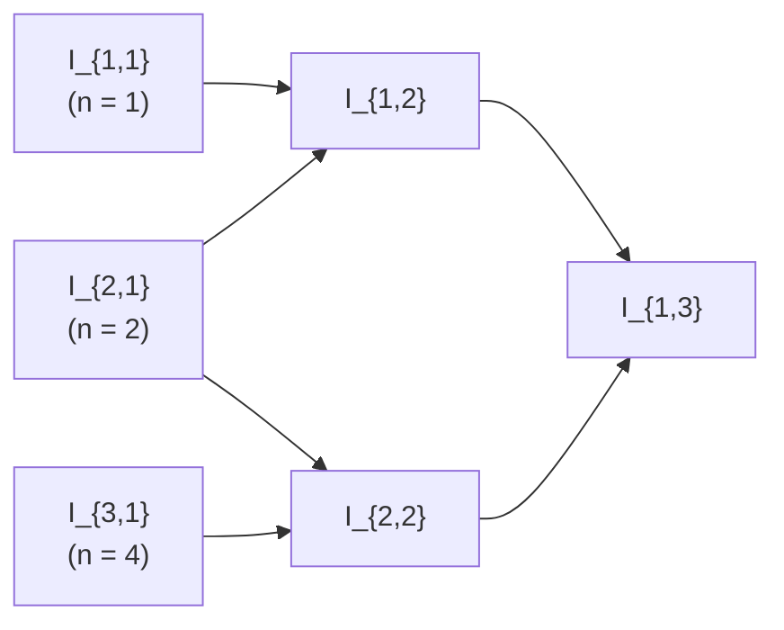
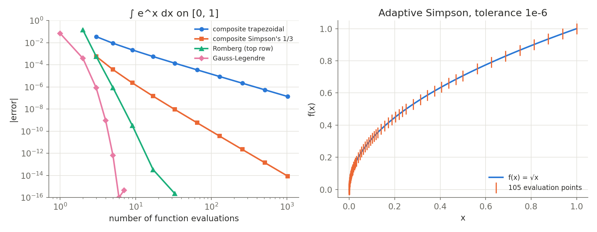

# Chapter 20 — Numerical Integration of Functions

[Repository Guide](../../README.md) | [English](Concepts_Lecture.md) | [한국어](Concepts_Lecture.ko.md)

> **Last Updated:** 2026-11-19
>
> Applied Numerical Methods with Python for Engineers and Scientists, Chapra and Clough, Ch 20

> **Learning Objectives:**
> 1. Improve the accuracy of trapezoidal estimates with Richardson extrapolation
> 2. Build a Romberg table and apply its stopping criterion
> 3. Derive the two-point Gauss-Legendre formula with the method of undetermined coefficients
> 4. Apply Gauss quadrature on an arbitrary interval through a change of variable
> 5. Explain why the roots of Legendre polynomials are the Gauss nodes, and compare the efficiency of quadrature rules by the number of function evaluations
> 6. Explain the error estimate behind adaptive quadrature and integrate with SciPy's quad

---

<br>

## Table of Contents

- [1. Goal](#1-goal)
- [2. Romberg Integration](#2-romberg-integration)
  - [2.1 Richardson Extrapolation](#21-richardson-extrapolation)
  - [2.2 Trapezoidal Rule Error Analysis](#22-trapezoidal-rule-error-analysis)
  - [2.3 Derivation of the Richardson Extrapolation Formula](#23-derivation-of-the-richardson-extrapolation-formula)
  - [2.4 Alternative Derivation (Error Ratio Approach)](#24-alternative-derivation-error-ratio-approach)
  - [2.5 Generalizing to Romberg Integration](#25-generalizing-to-romberg-integration)
  - [2.6 Romberg Integration Formula](#26-romberg-integration-formula)
  - [2.7 Stopping Criterion](#27-stopping-criterion)
  - [2.8 Tracing Romberg Integration and Its Conditions](#28-tracing-romberg-integration-and-its-conditions)
- [3. Gauss Quadrature](#3-gauss-quadrature)
  - [3.1 Motivation: From Trapezoidal Rule to Gauss Quadrature](#31-motivation-from-trapezoidal-rule-to-gauss-quadrature)
  - [3.2 Method of Undetermined Coefficients (Trapezoidal Recovery)](#32-method-of-undetermined-coefficients-trapezoidal-recovery)
  - [3.3 Derivation of Two-Point Gauss-Legendre Formula](#33-derivation-of-two-point-gauss-legendre-formula)
  - [3.4 Example 20.3: Two-Point Gauss-Legendre with Variable Substitution](#34-example-203-two-point-gauss-legendre-with-variable-substitution)
  - [3.5 Higher-Order Gauss-Legendre Formulas (Textbook Table 20.1)](#35-higher-order-gauss-legendre-formulas-textbook-table-201)
  - [3.6 Gauss-Lobatto Rules](#36-gauss-lobatto-rules)
  - [3.7 Legendre Polynomials and the Gauss Nodes](#37-legendre-polynomials-and-the-gauss-nodes)
  - [3.8 Error and Efficiency of Gauss Quadrature](#38-error-and-efficiency-of-gauss-quadrature)
  - [3.9 The Change of Interval by Hand and Higher-Order Gauss-Legendre Formulas](#39-the-change-of-interval-by-hand-and-higher-order-gauss-legendre-formulas)
- [4. Comparison of Methods](#4-comparison-of-methods)
- [5. Adaptive Quadrature](#5-adaptive-quadrature)
  - [5.1 Local Error Estimates and Interval Subdivision](#51-local-error-estimates-and-interval-subdivision)
  - [5.2 Implementing Adaptive Simpson Quadrature](#52-implementing-adaptive-simpson-quadrature)
  - [5.3 SciPy's quad](#53-scipys-quad)
- [Concept Applications](#concept-applications)
- [Summary](#summary)
- [Self-Check Questions](#self-check-questions)
- [References](#references)

<br>

---

<br>

## 1. Goal

This chapter covers two advanced numerical integration techniques:

1. **Romberg Integration**: a method that systematically improves the accuracy of the trapezoidal rule via Richardson extrapolation.
2. **Gauss Quadrature**: a method that chooses optimal evaluation points (not necessarily at the endpoints) to maximize integration accuracy.
3. **Adaptive Quadrature**: a method that estimates the error on each subinterval and places additional points only where the function changes rapidly.

<br>

---

<br>

## 2. Romberg Integration

Romberg integration **systematically improves the accuracy of the trapezoidal rule** using **Richardson extrapolation**.

The core idea:
1. Use **two estimates** of an integral (with different step sizes).
2. Compute a **third, more accurate** approximation by combining them.

<br>

### 2.1 Richardson Extrapolation

**Richardson extrapolation** is a technique to **improve accuracy of a numerical approximation by eliminating the leading-order error term**.

> **Definition:** **Richardson extrapolation** is a method that computes two approximations, whose errors expand in powers of $`h`$, with different step sizes and combines them linearly so that the leading error term cancels, giving a higher-order approximation.

Given an integral $`I`$ approximated with step size $`h`$ using $`n`$ segments where $`h = \frac{b - a}{n}`$:

```math
I = I(h) + E(h)
```

where:
- $`I(h)`$ is the numerical approximation.
- $`E(h)`$ is the truncation error.

If we have two different step sizes $`h_1`$ and $`h_2`$:

```math
I = I(h_1) + E(h_1) = I(h_2) + E(h_2)
```

> **Key Point:** Both approximations estimate the same true integral $`I`$, so by relating their error terms, we can cancel out the leading-order error.

<br>

### 2.2 Trapezoidal Rule Error Analysis

For the **trapezoidal rule**, the truncation error is:

```math
E \approx -\frac{b - a}{12} \bar{f''} \, h^2
```

This means the error is $`O(h^2)`$. For two step sizes $`h_1`$ and $`h_2`$:

```math
E_1 = E(h_1) = -\frac{b - a}{12} \bar{f''} \, h_1^2
```

```math
E_2 = E(h_2) = -\frac{b - a}{12} \bar{f''} \, h_2^2
```

More generally, the full error expansion for the trapezoidal rule is:

```math
I = I_1 + C h_1^2 + D h_1^4 + O(h_1^6)
```

```math
I = I_2 + C h_2^2 + D h_2^4 + O(h_2^6)
```

where $`C`$ and $`D`$ are constants that depend on the function and the interval, but **not** on the step size.

<br>

### 2.3 Derivation of the Richardson Extrapolation Formula

**Step 1.** Start with the two error expansions:

```math
I = I_1 + C h_1^2 + D h_1^4 + O(h_1^6)
```

```math
I = I_2 + C h_2^2 + D h_2^4 + O(h_2^6)
```

**Step 2.** Multiply the second equation by $`\frac{h_1^2}{h_2^2}`$:

```math
\frac{h_1^2}{h_2^2} I = \frac{h_1^2}{h_2^2} I_2 + C h_1^2 + D \frac{h_1^2}{h_2^2} h_2^4 + O\!\left(\frac{h_1^2}{h_2^2} h_2^6\right)
```

> **Note:** The $`C h_1^2`$ term in the first equation now matches the $`C h_1^2`$ term created by the multiplication. This is the key step that allows cancellation.

**Step 3.** Subtract the scaled second equation from the first equation:

```math
\left(1 - \frac{h_1^2}{h_2^2}\right) I = \left(I_1 - \frac{h_1^2}{h_2^2} I_2\right) + D(h_1^4 - h_1^2 h_2^2) + O(h_1^6 - h_1^2 h_2^4)
```

The $`C h^2`$ term is **eliminated**, leaving only $`O(h^4)`$ error.

**Step 4.** Set $`h_1 = 2h_2`$ (halving the step size):

```math
\frac{h_1^2}{h_2^2} = \frac{(2h_2)^2}{h_2^2} = 4
```

```math
(1 - 4)I = (I_1 - 4I_2) + O(h^4)
```

```math
\boxed{I = \frac{4}{3} I_2 - \frac{1}{3} I_1 + O(h^4)}
```

This transforms an $`O(h^2)`$ trapezoidal estimate into an $`O(h^4)`$ result.

<br>

### 2.4 Alternative Derivation (Error Ratio Approach)

Since both errors are $`O(h^2)`$, their ratio is:

```math
\frac{E_1}{E_2} \approx \frac{h_1^2}{h_2^2} = \left(\frac{h_1}{h_2}\right)^2
```

Therefore:

```math
E_1 = \left(\frac{h_1}{h_2}\right)^2 E_2
```

From $`I_1 + E_1 = I_2 + E_2`$ (both equal the true value $`I`$):

```math
I_1 + \left(\frac{h_1}{h_2}\right)^2 E_2 = I_2 + E_2
```

```math
I_1 - I_2 = \left(1 - \left(\frac{h_1}{h_2}\right)^2\right) E_2
```

```math
E_2 = \frac{I_1 - I_2}{1 - \left(\frac{h_1}{h_2}\right)^2}
```

Therefore the improved estimate is:

```math
I = I_2 + E_2 = I_2 + \frac{1}{\left(\frac{h_1}{h_2}\right)^2 - 1}(I_2 - I_1) \quad \sim O(h^4)
```

With $`h_1 = 2h_2`$:

```math
I = I_2 + \frac{1}{3}(I_2 - I_1) = \frac{4}{3} I_2 - \frac{1}{3} I_1 \quad \sim O(h^4)
```

<br>

### 2.5 Generalizing to Romberg Integration

The idea can be applied **recursively** with three (or more) trapezoidal rule estimates using progressively finer step sizes.

**With three estimates** $`I_1`$ (1 segment), $`I_2`$ (2 segments), $`I_3`$ (4 segments):

**Level 1 (k=1):** Trapezoidal estimates, $`O(h^2)`$

```math
I_1, \quad I_2, \quad I_3
```

**Level 2 (k=2):** First Richardson extrapolation, $`O(h^4)`$

```math
I_{12} = \frac{4}{3} I_2 - \frac{1}{3} I_1 \quad \sim O(h^4)
```

```math
I_{23} = \frac{4}{3} I_3 - \frac{1}{3} I_2 \quad \sim O(h^4)
```

**Level 3 (k=3):** Second Richardson extrapolation, $`O(h^6)`$

```math
I_{123} = \frac{16}{15} I_{23} - \frac{1}{15} I_{12} \quad \sim O(h^6)
```

> **Note:** At each successive level, we eliminate the next leading error term. Level $`k`$ ($`k \ge 2`$) eliminates the leading $`O(h^{2(k-1)})`$ error term of the level $`k-1`$ estimates, so the result has error $`O(h^{2k})`$. The coefficients change because the error being eliminated at level 3 is $`O(h^4)`$, so the ratio becomes $`4^2 = 16`$ instead of $`4^1 = 4`$.

<br>

### 2.6 Romberg Integration Formula

Using double-index notation $`I_{j,k}`$:
- $`j`$ is the row index (which trapezoidal estimate is used).
- $`k`$ is the level of integration (column).

The **Romberg table** is structured as:

| k=1 ($`O(h^2)`$) | k=2 ($`O(h^4)`$) | k=3 ($`O(h^6)`$) |
|:---:|:---:|:---:|
| $`I_{1,1}`$ | $`I_{1,2}`$ | $`I_{1,3}`$ |
| $`I_{2,1}`$ | $`I_{2,2}`$ | |
| $`I_{3,1}`$ | | |

*Table 1. Structure of the Romberg table*

Each element is formed by combining the two elements of the column to its left in the same row and in the row just below.



*Figure 1. Direction in which estimates are combined in the Romberg table*

The **general recurrence formula** is:

```math
\boxed{I_{j,k} = \frac{4^{k-1} \, I_{j+1,\,k-1} - I_{j,\,k-1}}{4^{k-1} - 1}}
```

where:
- $`I_{j+1,\,k-1}`$ is the **more accurate** integral (finer step size).
- $`I_{j,\,k-1}`$ is the **less accurate** integral (coarser step size).

**Verification example:**

```math
I_{1,2} = \frac{4^1 \cdot I_{2,1} - I_{1,1}}{4^1 - 1} = \frac{4 I_{2,1} - I_{1,1}}{3} = \frac{4}{3} I_{2,1} - \frac{1}{3} I_{1,1}
```

This matches the Richardson extrapolation formula derived earlier.

```python
import numpy as np

def romberg(f, a, b, max_level):
    """
    Romberg integration of f from a to b.
    max_level: number of levels (columns) in the Romberg table.
    Returns the Romberg table as a 2D list.
    """
    R = np.zeros((max_level, max_level))

    # k=1 column: trapezoidal rule estimates
    for j in range(max_level):
        n = 2 ** j  # number of segments: 1, 2, 4, 8, ...
        h = (b - a) / n
        # Composite trapezoidal rule
        x = np.linspace(a, b, n + 1)
        y = f(x)
        R[j, 0] = h * (0.5 * y[0] + np.sum(y[1:-1]) + 0.5 * y[-1])

    # Fill in higher levels using Richardson extrapolation
    for k in range(1, max_level):
        for j in range(max_level - k):
            R[j, k] = (4**k * R[j + 1, k - 1] - R[j, k - 1]) / (4**k - 1)

    return R

# Example: integrate f(x) = 0.2 + 25x - 200x^2 + 675x^3 - 900x^4 + 400x^5
# from 0 to 0.8 (exact answer = 1.640533)
f = lambda x: 0.2 + 25*x - 200*x**2 + 675*x**3 - 900*x**4 + 400*x**5
R = romberg(f, 0, 0.8, 4)

print("Romberg Table:")
for j in range(4):
    row = ""
    for k in range(4 - j):
        row += f"  {R[j, k]:.6f}"
    print(row)

print(f"\nBest estimate: {R[0, 3]:.6f}")
print(f"Exact value:   1.640533")
```

The output is as follows.

```text
Romberg Table:
  0.172800  1.367467  1.640533  1.640533
  1.068800  1.623467  1.640533
  1.484800  1.639467
  1.600800

Best estimate: 1.640533
Exact value:   1.640533
```

Since the integrand is a fifth-degree polynomial and the estimates of the third column ($`k = 3`$, $`O(h^6)`$) are exact for polynomials up to degree 5, $`I_{1,3}`$ and the value to its right equal the true value 1.640533.

<br>

### 2.7 Stopping Criterion

**Stopping point of the Romberg procedure**

Use the **percent relative error** between the best estimate at the current level and the best estimate at the previous level:

```math
|\varepsilon_a| = \left|\frac{I_{1,k} - I_{2,k-1}}{I_{1,k}}\right| \times 100\%
```

The diagonal elements of the Romberg table are compared:

- At $`k = 2`$: $`\displaystyle |\varepsilon_a^{k=2}| = \left|\frac{I_{1,2} - I_{2,1}}{I_{1,2}}\right| \times 100\%`$

- At $`k = 3`$: $`\displaystyle |\varepsilon_a^{k=3}| = \left|\frac{I_{1,3} - I_{2,2}}{I_{1,3}}\right| \times 100\%`$

Stop when $`|\varepsilon_a| < \varepsilon_s`$ (a prescribed tolerance).

> **Note:** The comparison is always between the current top-right element $`I_{1,k}`$ and the element $`I_{2,k-1}`$ of the previous column along the diagonal. $`I_{2,k-1}`$ is the more accurate of the two values combined to form $`I_{1,k}`$, that is, the best estimate of the previous level.

<br>

### 2.8 Tracing Romberg Integration and Its Conditions

In the example of Section 2.6 the integrand was a polynomial, so the third column gave the true value immediately. How the Romberg table converges for a function that is not a polynomial is checked with $`\int_0^1 e^x\,dx = e - 1`$.

```python
import numpy as np

def romberg_table(f, a, b, levels):
    R = np.zeros((levels, levels))
    for j in range(levels):
        n = 2**j
        x = np.linspace(a, b, n + 1); y = f(x)
        R[j, 0] = (b - a) / n * (y[0] / 2 + y[1:-1].sum() + y[-1] / 2)
    for k in range(1, levels):
        for j in range(levels - k):
            R[j, k] = (4**k * R[j + 1, k - 1] - R[j, k - 1]) / (4**k - 1)
    return R

exact = np.e - 1.0
R = romberg_table(np.exp, 0.0, 1.0, 5)
for j in range(5):
    print("  ".join(f"{R[j, k]:.10f}" for k in range(5 - j)))
print("errors of the top row:", ["%.1e" % (exact - R[0, k]) for k in range(5)])
for k in range(1, 5):
    ea = abs((R[0, k] - R[1, k - 1]) / R[0, k]) * 100
    print(f"k = {k + 1}: |ea| = {ea:.2e} %")
```

```text
1.8591409142  1.7188611519  1.7182826879  1.7182818288  1.7182818285
1.7539310925  1.7183188419  1.7182818422  1.7182818285
1.7272219046  1.7182841547  1.7182818287
1.7205185922  1.7182819741
1.7188411286
errors of the top row: ['-1.4e-01', '-5.8e-04', '-8.6e-07', '-3.4e-10', '-3.3e-14']
k = 2: |ea| = 2.04e+00 %
k = 3: |ea| = 2.10e-03 %
k = 4: |ea| = 7.81e-07 %
k = 5: |ea| = 7.63e-11 %
```

- The first column holds the trapezoidal estimates with 1, 2, 4, 8, and 16 segments, and the later columns are filled with the recurrence of Section 2.6.
- The error of the top row shrinks by a factor of hundreds to thousands with each added column. $`I_{1,5}`$ reaches an error of $`3.3 \times 10^{-14}`$ with only 17 function values, whereas the composite Simpson's 1/3 rule of Chapter 19 needs about 700 points for the same accuracy.
- The $`|\varepsilon_a|`$ of Section 2.7 comes out somewhat larger than the actual error, so it is a criterion on the safe side. For example, with $`\varepsilon_s = 10^{-4}\%`$ the procedure stops at $`k = 4`$, where the actual relative error is about $`2 \times 10^{-8}\%`$.

The second and third columns of the table coincide with formulas of Chapter 19. $`I_{1,2} = 1.7188611519`$ is the single-application Simpson's 1/3 rule, $`I_{2,2} = 1.7183188419`$ is the composite Simpson's 1/3 rule with $`n = 4`$, and $`I_{1,3} = 1.7182826879`$ equals Boole's rule of Section 10 of Chapter 19. Indeed, computing $`\frac{4T_2 - T_1}{3}`$ from the one- and two-segment trapezoidal values $`T_1 = \frac{b-a}{2}(f_0 + f_2)`$ and $`T_2 = \frac{b-a}{4}(f_0 + 2f_1 + f_2)`$ gives $`\frac{b-a}{6}(f_0 + 4f_1 + f_2)`$, which is Simpson's rule. Richardson extrapolation thus generates higher-order Newton-Cotes formulas automatically from trapezoidal values.

> **Caution:** Romberg integration relies on the fact that the error of the trapezoidal rule expands in even powers $`h^2, h^4, h^6, \ldots`$, and this expansion holds when the integrand is continuously differentiable sufficiently many times on the interval. For a function such as $`\sqrt{x}`$, whose derivative blows up at an end point, terms such as $`h^{1.5}`$ enter the error, and the top-row errors of the Romberg table for $`\int_0^1 \sqrt{x}\,dx`$ decrease only by a factor of about 3 per step: $`0.17, 0.029, 0.0089, 0.0031, \ldots`$. The adaptive methods of Section 5 suit such functions.

<br>

---

<br>

## 3. Gauss Quadrature

### 3.1 Motivation: From Trapezoidal Rule to Gauss Quadrature

The **trapezoidal rule** is based on taking the area under the **straight line** connecting the function values **at the ends** of the integration interval $`[a, b]`$.

**Key question:** Why not use function values at **interior points** instead?

By choosing evaluation points **optimally** (not at the endpoints), we can achieve much higher accuracy with the same number of function evaluations.

> **Definition:** **Gauss quadrature** is an integration formula $`\sum_i c_i f(x_i)`$ in which not only the weights $`c_i`$ but also the nodes $`x_i`$ are unknowns, chosen together so that polynomials of the highest possible degree are integrated exactly. The $`n`$-point formula is exact up to degree $`2n - 1`$.

**Goal:** Find the points which **maximize the accuracy** of the integral.

This leads to the **method of undetermined coefficients**.

<br>

### 3.2 Method of Undetermined Coefficients (Trapezoidal Recovery)

Starting from the trapezoidal rule:

```math
I \approx (b - a) \frac{f(b) + f(a)}{2} = \frac{b - a}{2} f(a) + \frac{b - a}{2} f(b)
```

Generalize the coefficients:

```math
I \approx c_0 f(a) + c_1 f(b)
```

We know the trapezoidal rule is **exact for a constant and a linear function**. Use these conditions to determine $`c_0`$ and $`c_1`$:

**i)** Let $`f(x) = 1`$:

```math
I = \int_a^b 1 \, dx = b - a = c_0 \cdot 1 + c_1 \cdot 1 = c_0 + c_1 \quad \cdots (*)
```

**ii)** Let $`f(x) = x`$:

```math
I = \int_a^b x \, dx = \frac{1}{2}(b^2 - a^2) = c_0 \cdot a + c_1 \cdot b
```

**iii)** From (i) and (ii):

```math
\frac{1}{2}(b - a)(b + a) = a \, c_0 + b \, c_1
```

```math
\frac{1}{2}(c_0 + c_1)(b + a) = a \, c_0 + b \, c_1
```

```math
\frac{1}{2}(b - a) c_0 + \frac{1}{2}(a - b) c_1 = 0
```

```math
\therefore \quad c_0 = c_1 \quad \xrightarrow{(*)} \quad c_0 = c_1 = \frac{b - a}{2}
```

This **recovers the trapezoidal rule**: $`I = \frac{b-a}{2} f(a) + \frac{b-a}{2} f(b)`$.

> **Note:** The location of the interval does not matter for deriving the coefficients. We can shift the interval to $`\left[-\frac{b-a}{2}, \frac{b-a}{2}\right]`$ centered at the origin and obtain the same result $`c_0 = c_1 = \frac{b-a}{2}`$.

<br>

### 3.3 Derivation of Two-Point Gauss-Legendre Formula

Now allow both the **coefficients** and the **evaluation points** to be unknowns:

```math
I \approx c_0 f(x_0) + c_1 f(x_1)
```

We have **4 unknowns**: $`c_0, c_1, x_0, x_1`$.

Therefore, we need **4 conditions** (exact for polynomials up to degree 3).

Work on the standard interval $`[-1, 1]`$:

**i)** $`\displaystyle \int_{-1}^{1} 1 \, dx = 2 = c_0 \cdot 1 + c_1 \cdot 1`$

**ii)** $`\displaystyle \int_{-1}^{1} x \, dx = 0 = c_0 \cdot x_0 + c_1 \cdot x_1`$

**iii)** $`\displaystyle \int_{-1}^{1} x^2 \, dx = \frac{2}{3} = c_0 \cdot x_0^2 + c_1 \cdot x_1^2`$

**iv)** $`\displaystyle \int_{-1}^{1} x^3 \, dx = 0 = c_0 \cdot x_0^3 + c_1 \cdot x_1^3`$

**Solving the system:**

**v)** From (ii): $`c_0 x_0 = -c_1 x_1`$

**Plug into (iv):**

```math
-c_1 x_1 x_0^2 + c_1 x_1^3 = 0
```

```math
c_1 x_1 (x_1^2 - x_0^2) = 0
```

Since $`c_1`$ and $`x_1`$ cannot be zero (otherwise conditions (i)-(iv) cannot hold simultaneously), we require:

```math
x_1^2 = x_0^2 \quad \text{and} \quad x_1 \neq x_0
```

```math
\therefore \quad \boxed{x_1 = -x_0} \quad \cdots (*)
```

**vi)** Substituting $`(*)`$ into (ii):

```math
c_0 x_0 + c_1(-x_0) = 0 \implies c_0 x_0 - c_1 x_0 = 0
```

```math
\therefore \quad \boxed{c_0 = c_1} \quad \cdots (**)
```

**vii)** Plugging $`(**)`$ into (i):

```math
c_0 + c_1 = 2 \implies 2c_0 = 2
```

```math
\therefore \quad \boxed{c_0 = 1 = c_1}
```

**viii)** From (iii):

```math
c_0 x_0^2 + c_1 x_1^2 = \frac{2}{3} \implies 2 x_0^2 = \frac{2}{3}
```

```math
\therefore \quad x_0 = \pm \frac{1}{\sqrt{3}}, \quad x_1 = \mp \frac{1}{\sqrt{3}}
```

**The two-point Gauss-Legendre formula** (on $`[-1, 1]`$):

```math
\boxed{I \approx f\!\left(-\frac{1}{\sqrt{3}}\right) + f\!\left(\frac{1}{\sqrt{3}}\right)}
```

This is **third-order accurate** (exact for polynomials up to degree 3), which is significantly better than the trapezoidal rule (exact only for degree 1) with the same number of points.

```python
import numpy as np

def gauss_legendre_2pt(f, a, b):
    """
    Two-point Gauss-Legendre quadrature for integral of f from a to b.
    Uses change of variable: x = ((b-a)/2)*z + (a+b)/2, z in [-1, 1].
    """
    # Gauss points on [-1, 1]
    z0 = -1.0 / np.sqrt(3)
    z1 =  1.0 / np.sqrt(3)

    # Weights (both equal to 1)
    w0, w1 = 1.0, 1.0

    # Change of variable: x = ((b-a)/2)*z + (a+b)/2
    # dx = ((b-a)/2)*dz
    scale = (b - a) / 2.0
    shift = (a + b) / 2.0

    x0 = scale * z0 + shift
    x1 = scale * z1 + shift

    return scale * (w0 * f(x0) + w1 * f(x1))

# Example
f = lambda x: 0.2 + 25*x - 200*x**2 + 675*x**3 - 900*x**4 + 400*x**5
result = gauss_legendre_2pt(f, 0, 0.8)
print(f"Two-point Gauss-Legendre: {result:.6f}")
print(f"Exact value:             1.640533")
```

```text
Two-point Gauss-Legendre: 1.822578
Exact value:             1.640533
```

In the code, `scale` and `shift` implement the change of variable $`x = \frac{b-a}{2}z + \frac{a+b}{2}`$ of Section 3.4, and the last line multiplies the result by `scale`, the factor in $`dx = \frac{b-a}{2}dz`$. The result is interpreted in Section 3.4.

<br>

### 3.4 Example 20.3: Two-Point Gauss-Legendre with Variable Substitution

**Problem:** Evaluate the integral of

```math
f(x) = 0.2 + 25x - 200x^2 + 675x^3 - 900x^4 + 400x^5
```

between the limits $`x = 0`$ to $`x = 0.8`$.

**Solution:**

The Gauss-Legendre formula works on $`[-1, 1]`$, so we need a **change of variable**:

```math
x = \frac{b - a}{2} \zeta + \frac{a + b}{2} = 0.4\zeta + 0.4
```

```math
dx = 0.4 \, d\zeta
```

Transform the integral:

```math
\int_0^{0.8} f(x) \, dx = \int_{-1}^{1} f(\zeta) \cdot 0.4 \, d\zeta
```

Apply the two-point Gauss-Legendre formula:

```math
\approx 0.4 \left[ f\!\left(-\frac{1}{\sqrt{3}}\right) + f\!\left(\frac{1}{\sqrt{3}}\right) \right]
```

where $`f(\zeta)`$ means evaluating the original $`f`$ at $`x = 0.4\zeta + 0.4`$:

- At $`\zeta = -\frac{1}{\sqrt{3}}`$: $`x = 0.4 \cdot \left(-\frac{1}{\sqrt{3}}\right) + 0.4 \approx 0.1690`$
- At $`\zeta = +\frac{1}{\sqrt{3}}`$: $`x = 0.4 \cdot \left(+\frac{1}{\sqrt{3}}\right) + 0.4 \approx 0.6310`$

```python
import numpy as np

f = lambda x: 0.2 + 25*x - 200*x**2 + 675*x**3 - 900*x**4 + 400*x**5

a, b = 0, 0.8
z = np.array([-1/np.sqrt(3), 1/np.sqrt(3)])
x = 0.4 * z + 0.4  # change of variable

result = 0.4 * (f(x[0]) + f(x[1]))
print(f"x values: {x[0]:.6f}, {x[1]:.6f}")
print(f"f(x0) = {f(x[0]):.6f}")
print(f"f(x1) = {f(x[1]):.6f}")
print(f"Result: {result:.6f}")
print(f"Exact:  1.640533")
```

The output is as follows.

```text
x values: 0.169060, 0.630940
f(x0) = 1.291851
f(x1) = 3.264593
Result: 1.822578
Exact:  1.640533
```

The integral is therefore $`0.4(1.291851 + 3.264593) \approx 1.822578`$, with a true relative error of $`\varepsilon_t = \frac{1.640533 - 1.822578}{1.640533} \times 100\% \approx -11.1\%`$. This is far more accurate than the value 0.1728 of the single-application trapezoidal rule, which uses the same two function evaluations.

<br>

### 3.5 Higher-Order Gauss-Legendre Formulas (Textbook Table 20.1)

The general form on $`[-1, 1]`$:

```math
I \approx \sum_{i=0}^{n-1} c_i \, f(x_i)
```

| Points ($`n`$) | Weights ($`c_i`$) | Nodes ($`x_i`$) | Error | Exact for degree |
|:---:|:---|:---|:---:|:---:|
| **1** | $`c_0 = 2`$ | $`x_0 = 0`$ | $`\sim f^{(2)}(\zeta)`$ | 1 |
| **2** | $`c_0 = 1`$, $`c_1 = 1`$ | $`x_0 = -\frac{1}{\sqrt{3}}`$, $`x_1 = \frac{1}{\sqrt{3}}`$ | $`\sim f^{(4)}(\zeta)`$ | 3 |
| **3** | $`c_0 = \frac{5}{9}`$, $`c_1 = \frac{8}{9}`$, $`c_2 = \frac{5}{9}`$ | $`x_0 = -\sqrt{\frac{3}{5}}`$, $`x_1 = 0`$, $`x_2 = \sqrt{\frac{3}{5}}`$ | $`\sim f^{(6)}(\zeta)`$ | 5 |
| **$`n`$** | (tabulated) | (tabulated) | $`\sim f^{(2n)}(\zeta)`$ | $`2n - 1`$ |

*Table 2. Weights, nodes, error, and exact degree of the Gauss-Legendre formulas by number of points*

**Key property:** Gauss quadrature with $`n`$ points is **$`(2n-1)`$th-order accurate**: it is exact for all polynomials up to degree $`2n - 1`$.

> **Note:** **Effect of optimal placement.** This is a remarkable result: with $`n`$ points, we can exactly integrate polynomials of degree up to $`2n - 1`$. The trapezoidal rule (2 endpoints) is only exact for degree 1, but two-point Gauss-Legendre is exact for degree 3. The extra accuracy comes from optimizing the positions of the evaluation points.

```python
import numpy as np

def gauss_legendre_3pt(f, a, b):
    """
    Three-point Gauss-Legendre quadrature for integral of f from a to b.
    """
    # Gauss points on [-1, 1]
    z = np.array([-np.sqrt(3/5), 0, np.sqrt(3/5)])
    # Weights
    w = np.array([5/9, 8/9, 5/9])

    # Change of variable
    scale = (b - a) / 2.0
    shift = (a + b) / 2.0
    x = scale * z + shift

    return scale * np.sum(w * f(x))

# Example
f = lambda x: 0.2 + 25*x - 200*x**2 + 675*x**3 - 900*x**4 + 400*x**5
result = gauss_legendre_3pt(f, 0, 0.8)
print(f"Three-point Gauss-Legendre: {result:.6f}")
print(f"Exact value:               1.640533")
```

The output is as follows.

```text
Three-point Gauss-Legendre: 1.640533
Exact value:               1.640533
```

The three-point formula is exact for polynomials up to degree 5, so it reproduces the true value of this fifth-degree integrand.

<br>

### 3.6 Gauss-Lobatto Rules

**Gauss-Lobatto rules** are a variant where integration points **include the endpoints** of the interval.

**3-point Gauss-Lobatto** on $`[-1, 1]`$:

```math
\int_{-1}^{1} f(x) \, dx \approx \frac{1}{3} f(-1) + \frac{4}{3} f(0) + \frac{1}{3} f(1)
```

| Points ($`n`$) | Weights ($`c_i`$) | Nodes ($`x_i`$) | Error | Exact for degree |
|:---:|:---|:---|:---:|:---:|
| **3** | $`c_0 = \frac{1}{3}`$, $`c_1 = \frac{4}{3}`$, $`c_2 = \frac{1}{3}`$ | $`x_0 = -1`$, $`x_1 = 0`$, $`x_2 = 1`$ | $`\sim f^{(4)}(\zeta)`$ | 3 |
| **4** | $`c_0 = \frac{1}{6}`$, $`c_1 = \frac{5}{6}`$, $`c_2 = \frac{5}{6}`$, $`c_3 = \frac{1}{6}`$ | $`x_0 = -1`$, $`x_1 = -\frac{1}{\sqrt{5}}`$, $`x_2 = \frac{1}{\sqrt{5}}`$, $`x_3 = 1`$ | $`\sim f^{(6)}(\zeta)`$ | 5 |
| **$`n`$** | (tabulated) | (tabulated) | $`\sim f^{(2n-2)}(\zeta)`$ | $`2n - 3`$ |

*Table 3. Weights, nodes, error, and exact degree of the Gauss-Lobatto formulas by number of points*

**Key property:** Gauss-Lobatto quadrature with $`n`$ points is **$`(2n-3)`$th-order accurate**: it is exact for polynomials up to degree $`2n - 3`$.

> **Note:** **Gauss-Lobatto versus Gauss-Legendre.** Gauss-Lobatto is slightly less accurate than Gauss-Legendre for the same number of points ($`2n - 3`$ vs $`2n - 1`$) because two of the points are fixed at the endpoints, reducing the degrees of freedom available for optimization. However, including endpoints can be advantageous when boundary values are already known or when combining sub-intervals.

<br>

### 3.7 Legendre Polynomials and the Gauss Nodes

Section 3.3 found the nodes of the two-point formula from four nonlinear equations. That approach becomes impractical with more points, so a property that gives the nodes directly is used instead. The **Legendre polynomials** $`P_0 = 1`$, $`P_1 = x`$, $`P_2 = \frac{1}{2}(3x^2 - 1)`$, $`P_3 = \frac{1}{2}(5x^3 - 3x)`$, $`\ldots`$ are mutually orthogonal on $`[-1, 1]`$. That is, $`\int_{-1}^{1} P_m(x)P_n(x)\,dx = 0`$ for $`m \ne n`$, and therefore $`P_n`$ is orthogonal to every polynomial of degree $`n - 1`$ or less.

> **Key Point:** The nodes of the $`n`$-point Gauss-Legendre formula are the $`n`$ roots of $`P_n(x)`$, and the weights are the integrals of the Lagrange basis functions for those nodes, $`c_i = \int_{-1}^{1} L_i(x)\,dx`$. All weights are positive.

This choice is exact up to degree $`2n - 1`$ for the following reason. Dividing a polynomial $`p`$ of degree $`2n - 1`$ or less by $`P_n`$ gives $`p = qP_n + r`$, where the quotient $`q`$ and the remainder $`r`$ both have degree $`n - 1`$ or less.

1. By orthogonality, $`\int_{-1}^{1} qP_n\,dx = 0`$, so $`\int p\,dx = \int r\,dx`$.
2. Since $`P_n(x_i) = 0`$ at the nodes, $`p(x_i) = r(x_i)`$, and the value of the formula is $`\sum c_i p(x_i) = \sum c_i r(x_i)`$.
3. Because the weights are integrals of the Lagrange basis functions, the formula integrates $`r`$ of degree $`n - 1`$ or less exactly. Therefore $`\sum c_i r(x_i) = \int r\,dx = \int p\,dx`$.

For example, the roots of $`P_2 = \frac{1}{2}(3x^2 - 1)`$ are $`\pm 1/\sqrt{3}`$, matching Section 3.3, and the roots of $`P_3 = \frac{1}{2}x(5x^2 - 3)`$ are $`0, \pm\sqrt{3/5}`$, matching the three-point formula of Table 2. NumPy's `np.polynomial.legendre.leggauss(n)` returns these nodes and weights.

```python
import numpy as np

exact = np.e - 1.0
print(" n   nodes on [-1, 1]                          weights")
for n in [2, 3, 4]:
    z, w = np.polynomial.legendre.leggauss(n)
    print(f"{n:2d}  {np.array2string(z, precision=6):40s}  {np.array2string(w, precision=6)}")

print("\n n   Gauss-Legendre for e^x on [0, 1]   error")
for n in [1, 2, 3, 4, 5]:
    z, w = np.polynomial.legendre.leggauss(n)
    x = 0.5 * z + 0.5                      # map [-1, 1] -> [0, 1]
    I = 0.5 * np.sum(w * np.exp(x))
    print(f"{n:2d}   {I:.12f}             {exact - I:+.1e}")
```

```text
 n   nodes on [-1, 1]                          weights
 2  [-0.57735  0.57735]                       [1. 1.]
 3  [-0.774597  0.        0.774597]           [0.555556 0.888889 0.555556]
 4  [-0.861136 -0.339981  0.339981  0.861136]  [0.347855 0.652145 0.652145 0.347855]

 n   Gauss-Legendre for e^x on [0, 1]   error
 1   1.648721270700             +7.0e-02
 2   1.717896378008             +3.9e-04
 3   1.718281004373             +8.2e-07
 4   1.718281827526             +9.3e-10
 5   1.718281828458             +6.5e-13
```

- `leggauss(n)` returns the nodes `z` and weights `w` on $`[-1, 1]`$. The three-point weights 0.555556 and 0.888889 are $`\frac{5}{9}`$ and $`\frac{8}{9}`$.
- `x = 0.5 * z + 0.5` and the factor 0.5 on the result implement the change of variable to $`[0, 1]`$.
- The one-point formula is the midpoint rule, and each additional point reduces the error by a factor of about 1,000.

Positive weights matter numerically. Unlike the negative weights of high-order Newton-Cotes formulas seen in Section 10 of Chapter 19, the weights of Gauss formulas are all positive and sum to the interval length 2, so roundoff errors in the function values are not amplified in the result.

<br>

### 3.8 Error and Efficiency of Gauss Quadrature

If $`f`$ is $`2n`$ times continuously differentiable, the error of the $`n`$-point Gauss-Legendre formula is as follows.

```math
E_n = \frac{2^{2n+1}(n!)^4}{(2n+1)\,[(2n)!]^3}\,f^{(2n)}(\xi), \qquad -1 < \xi < 1
```

For $`n = 1`$, $`E_1 = \frac{1}{3}f''(\xi)`$, and for $`n = 2`$, $`E_2 = \frac{1}{135}f^{(4)}(\xi)`$. On an interval $`[a, b]`$ the change of variable contributes a factor $`\left(\frac{b-a}{2}\right)^{2n+1}`$. For $`n = 1`$ this gives $`\frac{(b-a)^3}{24}f''`$, the same as the error of the midpoint rule in Chapter 19, and for $`n = 2`$ it gives $`\frac{(b-a)^5}{4320}f^{(4)}`$. The constant of the two-point Gauss formula is smaller than the constant $`\frac{1}{2880}`$ of Simpson's 1/3 rule, which evaluates the function three times.

Applied to Example 20.3, $`f^{(4)}(x) = -21600 + 48000x`$ and the error is $`E_2 = \frac{0.8^5}{4320}f^{(4)}(\xi) = 7.585 \times 10^{-5}f^{(4)}(\xi)`$. The actual error $`1.640533 - 1.822578 = -0.182045`$ corresponds to $`f^{(4)}(\xi) = -2400`$, that is, $`\xi = 0.4`$, which lies inside the interval.

Comparing the accuracy gained per function evaluation gives the left panel of Figure 2. For the same $`\int_0^1 e^x\,dx`$, the error of the composite trapezoidal rule decreases inversely with the square of the number of evaluations, that of the composite Simpson's rule with the fourth power, and Romberg integration and Gauss quadrature decrease much faster, reaching the roundoff level with 33 and 6 evaluations, respectively.



*Figure 2. Error of quadrature rules versus the number of function evaluations, and the distribution of evaluation points in adaptive Simpson quadrature*

Gauss quadrature also has limitations. Its nodes lie at irrational positions, so it can be used only when the function can be evaluated at chosen points; equally spaced measurement data call for the formulas of Chapter 19. Moreover, changing $`n`$ moves all the nodes, so previous computations cannot be reused. To remedy this, Gauss-Kronrod formulas add points to the Gauss nodes while keeping the previous nodes; the difference of the two results also estimates the error, which fits the adaptive methods of Section 5 well.

<br>

### 3.9 The Change of Interval by Hand and Higher-Order Gauss-Legendre Formulas

Table 2 gave the nodes and weights up to three points as fractions and radicals. The values for formulas with more points are computed with `leggauss` of Section 3.7, and the formulas up to five points are summarized below to six decimal places.

| $`n`$ | Nodes $`z_i`$ ($`[-1, 1]`$) | Weights $`c_i`$ |
|:---:|:-----|:-----|
| 1 | $`0`$ | $`2`$ |
| 2 | $`\pm 0.577350`$ | $`1, 1`$ |
| 3 | $`0, \pm 0.774597`$ | $`0.888889`$ (center), $`0.555556`$ (sides) |
| 4 | $`\pm 0.339981, \pm 0.861136`$ | $`0.652145`$ (inner), $`0.347855`$ (outer) |
| 5 | $`0, \pm 0.538469, \pm 0.906180`$ | $`0.568889`$ (center), $`0.478629`$ (inner), $`0.236927`$ (outer) |

*Table 4. Gauss-Legendre nodes and weights from one to five points*

Three regularities can be read from the table. The nodes are symmetric about the origin, and two symmetric nodes have equal weights. When $`n`$ is odd, the origin is a node. The weights always sum to the interval length 2, which is the condition for integrating $`f = 1`$ exactly. Like the Chebyshev nodes of Chapter 17, the nodes become denser toward both ends of the interval.

Applying the three-point formula to $`\int_0^1 e^x\,dx`$ by hand proceeds as follows. In the change of variable of Section 3.4, $`a = 0`$ and $`b = 1`$, so $`x = \frac{1}{2}z + \frac{1}{2}`$ and $`dx = \frac{1}{2}dz`$.

| $`z_i`$ | $`x_i = 0.5z_i + 0.5`$ | $`c_i`$ | $`e^{x_i}`$ | $`0.5\,c_i e^{x_i}`$ |
|:-----|:-----|:-----|:-----|:-----|
| $`-0.774597`$ | 0.112702 | 0.555556 | 1.119298 | 0.310916 |
| $`0`$ | 0.500000 | 0.888889 | 1.648721 | 0.732765 |
| $`+0.774597`$ | 0.887298 | 0.555556 | 2.428560 | 0.674600 |

*Table 5. Steps of computing $`\int_0^1 e^x\,dx`$ with the three-point Gauss-Legendre formula*

The last column sums to $`0.310916 + 0.732765 + 0.674600 = 1.718281`$, and the error relative to the true value $`e - 1 = 1.7182818`$ is $`8.2 \times 10^{-7}`$. This accuracy from three function evaluations is about 700 times better than the single-application Simpson's rule of Chapter 19 (the same three evaluations, error $`5.8 \times 10^{-4}`$). Common mistakes in the change of variable are forgetting the final factor $`\frac{b-a}{2}`$, and transforming the weights as well as the nodes. The weights $`c_i`$ are used as they are on $`[-1, 1]`$, and the interval length enters only once, through $`\frac{b-a}{2}`$.

If the integrand is not well approximated by a single polynomial over the whole interval, the interval is divided into $`m`$ subintervals and a Gauss formula is applied to each, as in the composite formulas of Chapter 19. Applying the two-point formula to $`\int_0^1 e^x\,dx`$ on $`m = 1, 2, 4, 8`$ subintervals gives errors of $`3.9 \times 10^{-4}`$, $`2.5 \times 10^{-5}`$, $`1.6 \times 10^{-6}`$, and $`9.7 \times 10^{-8}`$, falling to about one sixteenth each time the number of subintervals doubles. The error of the two-point formula is proportional to the fifth power of the subinterval width and the number of subintervals doubles, so the total error changes by a factor of $`2 \times \frac{1}{32} = \frac{1}{16}`$. The error $`1.6 \times 10^{-6}`$ from 8 evaluations ($`m = 4`$) is smaller than the error $`2.3 \times 10^{-6}`$ of the composite Simpson's 1/3 rule ($`n = 8`$), which uses 9 evaluations.

> **Note:** **Weighted Gauss quadrature.** The proof of Section 3.7 uses only the orthogonality of the Legendre polynomials, so taking as nodes the roots of the polynomials orthogonal with respect to a fixed weight function $`w(x)`$ gives a formula $`\int w(x)f(x)\,dx \approx \sum_i c_i f(x_i)`$ that is exact for polynomials $`f`$ of degree $`2n - 1`$ or less. The most common are the Gauss-Laguerre formula (`np.polynomial.laguerre.laggauss`), which handles integrals over $`[0, \infty)`$ with $`w(x) = e^{-x}`$, and the Gauss-Hermite formula (`np.polynomial.hermite.hermgauss`), which handles integrals over $`(-\infty, \infty)`$ with $`w(x) = e^{-x^2}`$. The weight function is built into the formula, so only $`f`$ is evaluated.
>
> For example, the three-point Gauss-Laguerre formula gives $`\int_0^\infty e^{-x}x^5\,dx = 5! = 120`$ exactly, and even for the non-polynomial $`f = 1/(1 + x)`$ the error falls as $`2.5 \times 10^{-2}`$, $`3.0 \times 10^{-3}`$, $`1.3 \times 10^{-4}`$, $`1.4 \times 10^{-6}`$ for $`n = 2, 4, 8, 16`$ (the true value is $`e\,E_1(1) \approx 0.596347`$ in terms of the exponential integral $`E_1`$). The expectation of a random variable $`X \sim N(\mu, \sigma^2)`$ becomes $`E[g(X)] = \frac{1}{\sqrt{\pi}}\int e^{-t^2}g(\mu + \sqrt{2}\sigma t)\,dt`$ under the substitution $`x = \mu + \sqrt{2}\sigma t`$, which fits the Gauss-Hermite formula, and the eight-point formula gives $`E[\cos X] = e^{-1/2}`$ for $`X \sim N(0, 1)`$ with an error of $`1.5 \times 10^{-9}`$. Unlike truncating an infinite interval and applying Gauss-Legendre, these formulas need no separate treatment of the tail, but if $`f`$ grows rapidly at infinity or oscillates, an adaptive method such as `quad` of Section 5.3 is the safer choice.

<br>

---

<br>

## 4. Comparison of Methods

| Method | Formula / Key Idea | Error Order | Remarks |
|:---|:---|:---:|:---|
| **Richardson Extrapolation** | $`I = \frac{4}{3}I_2 - \frac{1}{3}I_1`$ | $`O(h^4)`$ | Eliminates $`O(h^2)`$ error from trapezoidal rule |
| **Romberg Integration** | $`I_{j,k} = \frac{4^{k-1}I_{j+1,k-1} - I_{j,k-1}}{4^{k-1} - 1}`$ | $`O(h^{2k})`$ at level $`k`$ | Recursive Richardson extrapolation; each level gains $`O(h^2)`$ |
| **Gauss-Legendre (2-pt)** | $`I \approx f(-1/\sqrt{3}) + f(1/\sqrt{3})`$ | $`\sim f^{(4)}`$ | Exact for polynomials up to degree 3 |
| **Gauss-Legendre (3-pt)** | $`I \approx \frac{5}{9}f(-\sqrt{3/5}) + \frac{8}{9}f(0) + \frac{5}{9}f(\sqrt{3/5})`$ | $`\sim f^{(6)}`$ | Exact for polynomials up to degree 5 |
| **Gauss-Legendre ($`n`$-pt)** | $`I \approx \sum c_i f(x_i)`$ | $`\sim f^{(2n)}`$ | Exact for degree $`2n-1`$; optimal point placement |
| **Gauss-Lobatto ($`n`$-pt)** | Same form, but endpoints included | $`\sim f^{(2n-2)}`$ | Exact for degree $`2n-3`$; includes boundary points |
| **Adaptive Simpson** | Estimate the error from the difference of two Simpson values on halved intervals and subdivide only where needed | Controlled by the tolerance | Efficient for end-point singularities and local rapid changes |

*Table 6. Comparison of Romberg integration and Gauss quadrature*

---

<br>

## 5. Adaptive Quadrature

The methods of Sections 2 and 3 use the same spacing or the same formula over the whole interval. Real integrands, however, often change rapidly in one place and slowly elsewhere. **Adaptive quadrature** estimates the error on each subinterval and subdivides only the subintervals with large errors.

<br>

### 5.1 Local Error Estimates and Interval Subdivision

On a subinterval $`[a, b]`$, let $`S_1`$ be one application of Simpson's 1/3 rule and $`S_2`$ the sum of applications to the two halves at the midpoint $`m`$. By the error formula of Chapter 19, the error of one application is proportional to the fifth power of the subinterval width, so the combined error of the two halves of half width is about $`2 \times \frac{1}{32} = \frac{1}{16}`$ of the error of $`S_1`$ (assuming $`f^{(4)}`$ is nearly constant on the subinterval).

```math
I - S_1 \approx 16\,(I - S_2) \quad \Longrightarrow \quad I - S_2 \approx \frac{S_2 - S_1}{15}
```

$`|S_2 - S_1|/15`$ is therefore used as the error estimate of $`S_2`$. If it is smaller than the tolerance assigned to that subinterval, $`S_2`$ (or $`S_2 + \frac{S_2 - S_1}{15}`$ with the estimated error added) is accepted; otherwise each half is treated again in the same way. Giving each half half of the tolerance keeps the total error within the original tolerance.

```text
procedure AdaptiveSimpson(a, b, tol)
    m = (a + b) / 2
    S1 = Simpson(a, b)
    S2 = Simpson(a, m) + Simpson(m, b)
    if |S2 - S1| <= 15 * tol
        return S2 + (S2 - S1) / 15
    return AdaptiveSimpson(a, m, tol / 2) + AdaptiveSimpson(m, b, tol / 2)
```

$`S_2 + \frac{S_2 - S_1}{15} = \frac{16S_2 - S_1}{15}`$ is the same Richardson extrapolation as the Romberg recurrence of Section 2 with $`k = 3`$.

<br>

### 5.2 Implementing Adaptive Simpson Quadrature

$`\sqrt{x}`$, whose slope is infinite at the end point $`x = 0`$, is integrated on $`[0, 1]`$ (true value $`\frac{2}{3}`$) and compared with the uniform composite Simpson's rule.

```python
import numpy as np

f = lambda x: np.sqrt(x)                     # infinite slope at x = 0
exact = 2.0 / 3.0

points = []                                  # every x where f is evaluated
def F(x):
    points.append(x)
    return f(x)

def simpson(fa, fm, fb, a, b):
    return (b - a) / 6.0 * (fa + 4.0 * fm + fb)

def adapt(a, b, fa, fm, fb, whole, tol, depth=0):
    m = (a + b) / 2.0
    lm, rm = (a + m) / 2.0, (m + b) / 2.0
    flm, frm = F(lm), F(rm)                  # two new evaluations
    left = simpson(fa, flm, fm, a, m)
    right = simpson(fm, frm, fb, m, b)
    diff = left + right - whole
    if abs(diff) <= 15.0 * tol or depth > 50:
        return left + right + diff / 15.0    # Richardson correction
    return (adapt(a, m, fa, flm, fm, left, tol / 2.0, depth + 1)
            + adapt(m, b, fm, frm, fb, right, tol / 2.0, depth + 1))

a, b = 0.0, 1.0
fa, fm, fb = F(a), F((a + b) / 2.0), F(b)
I = adapt(a, b, fa, fm, fb, simpson(fa, fm, fb, a, b), 1e-6)
p = np.array(points)
print(f"adaptive Simpson: I = {I:.10f}, error = {exact - I:+.1e}, evaluations = {len(p)}")
print(f"points in [0, 0.01]: {np.sum(p <= 0.01)}, points in [0.5, 1]: {np.sum(p >= 0.5)}")

for n in [64, 1024, 16384]:                  # uniform composite Simpson
    x = np.linspace(a, b, n + 1); y = f(x)
    S = (b - a) / (3 * n) * (y[0] + 4 * y[1:-1:2].sum() + 2 * y[2:-1:2].sum() + y[-1])
    print(f"uniform Simpson n = {n:5d}: error = {exact - S:+.1e}, evaluations = {n + 1}")
```

```text
adaptive Simpson: I = 0.6666666471, error = +2.0e-08, evaluations = 105
points in [0, 0.01]: 62, points in [0.5, 1]: 9
uniform Simpson n =    64: error = +1.6e-04, evaluations = 65
uniform Simpson n =  1024: error = +2.5e-06, evaluations = 1025
uniform Simpson n = 16384: error = +3.9e-08, evaluations = 16385
```

- `F` records the location of every function evaluation in `points`, so the number and positions of evaluations can be counted.
- `adapt` receives the three function values `fa`, `fm`, `fb` and the Simpson value `whole` of the parent subinterval, so each call computes only two new function values, at the midpoints of the two halves.
- `diff` is $`S_2 - S_1`$, and the condition `abs(diff) <= 15.0 * tol` checks whether the error estimate $`|S_2 - S_1|/15`$ of Section 5.1 is within the tolerance. `depth > 50` is a safeguard against infinite recursion.
- Passing `tol / 2.0` to the recursive calls makes the tolerances of the two halves add up to the tolerance of the parent.

The adaptive method reaches an error of $`2.0 \times 10^{-8}`$ with 105 evaluations, whereas the uniform composite Simpson's rule stays at $`3.9 \times 10^{-8}`$ even with 16,385 evaluations. Of the 105 evaluation points, 62 cluster in $`[0, 0.01]`$, and only 9 lie in $`[0.5, 1]`$, where the function is smooth (right panel of Figure 2). The uniform method is slow because the fourth derivative of $`\sqrt{x}`$ blows up at $`x = 0`$, so the $`O(h^4)`$ error formula of Chapter 19 does not hold; the actual rate of convergence is about $`O(h^{1.5})`$.

<br>

### 5.3 SciPy's quad

In practice, SciPy's `scipy.integrate.quad` is used. `quad` uses the Fortran library QUADPACK: for finite intervals it uses a routine that subdivides the interval adaptively and combines extrapolation, and for infinite intervals a routine that maps the interval to a finite one. It returns the integral and an estimate of its absolute error, and the default tolerances are $`1.49 \times 10^{-8}`$ for both the absolute and the relative error [1].

```python
import numpy as np
from scipy.integrate import quad

f = lambda x: 1.0 / (1.0 + 100.0 * (x - 0.3)**2)
exact = (np.arctan(7.0) + np.arctan(3.0)) / 10.0
I, err, info = quad(f, 0.0, 1.0, full_output=1)
print(f"quad: I = {I:.12f}, estimated error = {err:.1e}, true error = {exact - I:+.1e}, "
      f"evaluations = {info['neval']}")

g = lambda x: np.exp(-x**2)                       # infinite upper limit
I2, err2 = quad(g, 0.0, np.inf)
print(f"integral of exp(-x^2) on [0, inf) = {I2:.12f}, sqrt(pi)/2 = {np.sqrt(np.pi) / 2:.12f}")

h = lambda x: 1.0 / np.sqrt(x)                    # integrable singularity at 0
I3, err3 = quad(h, 0.0, 1.0)
print(f"integral of 1/sqrt(x) on [0, 1] = {I3:.12f} (exact 2)")
```

```text
quad: I = 0.267794504459, estimated error = 5.0e-13, true error = -5.6e-17, evaluations = 147
integral of exp(-x^2) on [0, inf) = 0.886226925453, sqrt(pi)/2 = 0.886226925453
integral of 1/sqrt(x) on [0, 1] = 2.000000000000 (exact 2)
```

- The first example is a function with a sharp peak at $`x = 0.3`$, whose true integral is $`\frac{1}{10}[\arctan 7 + \arctan 3]`$. With `full_output=1`, the third return value `info` holds diagnostic information, and `info['neval']` is the number of function evaluations [1].
- As in the second example, `np.inf` can be given as an integration limit. The result agrees with $`\int_0^\infty e^{-x^2}\,dx = \frac{\sqrt{\pi}}{2}`$.
- The $`1/\sqrt{x}`$ of the third example blows up at $`x = 0`$, but its integral is finite. Methods based on Gauss-type formulas, which do not use the function value at the end points, can handle such integrals, and `quad` gives the exact value 2 in this example.

> **Caution:** The error returned by `quad` is an estimate, not a guarantee. If the integrand is discontinuous or sharply peaked at known points inside the interval, those locations should be given with the `points` argument [1], and adaptive subdivision can miss very rapidly oscillating functions or extremely narrow peaks. If a result looks doubtful, integrate the pieces of the interval separately or change the tolerance and check that the result is stable.

---

<br>

## Concept Applications

**True/False Check:**

| Statement | Judgment and Reason |
|:-----|:-----|
| Romberg integration reduces the error greatly with each added column even when the integrand is not smooth. | **F.** Romberg integration relies on the even-power expansion of the trapezoidal error, so for a function such as $`\sqrt{x}`$ the error falls only by a factor of about 3 per step (Section 2.8). |
| The second column of the Romberg table equals Simpson's 1/3 rule. | **T.** Expanding $`\frac{4T_2 - T_1}{3}`$ gives $`\frac{b-a}{6}(f_0 + 4f_1 + f_2)`$ (Section 2.8). |
| The $`n`$-point Gauss-Legendre formula is exact up to polynomials of degree $`2n`$. | **F.** With $`2n`$ weights and nodes it is exact up to degree $`2n - 1`$ and has an error for $`x^{2n}`$ (Sections 3.5 and 3.7). |
| When applying the Gauss-Legendre formula on $`[a, b]`$, the weights are multiplied by $`\frac{b-a}{2}`$ and the result is multiplied by $`\frac{b-a}{2}`$ again. | **F.** The factor $`\frac{b-a}{2}`$ is applied only once. If the weights have already been scaled, the result is not multiplied again (Section 3.9). |
| When the two-point Gauss formula is applied on subintervals, the error falls to about one sixteenth each time the number of subintervals doubles. | **T.** The error on one subinterval is proportional to the fifth power of its width and the number of subintervals doubles, giving $`2 \times \frac{1}{32} = \frac{1}{16}`$ (Section 3.9). |
| Adaptive Simpson quadrature subdivides only the subintervals with large errors, so for a function with an end-point singularity it reaches the same accuracy as a uniform composite rule with far fewer evaluations. | **T.** In the $`\sqrt{x}`$ example, 105 evaluations were more accurate than the 16,385 of the uniform rule (Section 5.2). |

---

<br>

## Summary

| Concept | Key Summary |
|---------|-------------|
| Richardson extrapolation | It combines two estimates with different step sizes to eliminate the leading error term, and for trapezoidal estimates with $`h_1 = 2h_2`$, $`I = \frac{4}{3}I_2 - \frac{1}{3}I_1`$ is $`O(h^4)`$ accurate. |
| Romberg integration | It applies Richardson extrapolation recursively to trapezoidal estimates, and the level $`k`$ estimates have $`O(h^{2k})`$ error. |
| Romberg stopping criterion | The procedure stops when the percent relative error between $`I_{1,k}`$ and $`I_{2,k-1}`$ falls below the tolerance $`\varepsilon_s`$. |
| Method of undetermined coefficients | It determines the coefficients and evaluation points by substituting the polynomials the formula must integrate exactly, and fixing the points at the endpoints recovers the trapezoidal rule. |
| Gauss-Legendre quadrature | It chooses $`n`$ weights and nodes optimally to integrate polynomials up to degree $`2n - 1`$ exactly, and the two-point formula is $`f(-1/\sqrt{3}) + f(1/\sqrt{3})`$. |
| Change of variable | It maps $`[a, b]`$ to $`[-1, 1]`$ with $`x = \frac{b-a}{2}\zeta + \frac{a+b}{2}`$ and multiplies the result by $`\frac{b-a}{2}`$. |
| Gauss-Lobatto quadrature | It includes both endpoints as nodes, which reduces the degrees of freedom, so the $`n`$-point formula is exact for polynomials up to degree $`2n - 3`$. |
| Romberg table and Newton-Cotes | The second column of the Romberg table equals the composite Simpson's 1/3 rule and the third equals Boole's rule; convergence slows down greatly when the integrand is not smooth. |
| Legendre polynomials and Gauss nodes | The nodes of the $`n`$-point formula are the roots of $`P_n`$, all weights are positive, and orthogonality makes the formula exact up to degree $`2n - 1`$. |
| Error of Gauss quadrature | The error of the two-point formula on $`[a, b]`$ is $`\frac{(b-a)^5}{4320}f^{(4)}(\xi)`$, with a smaller constant than Simpson's 1/3 rule, which uses three points. |
| Adaptive quadrature | The two Simpson values $`S_1`$ and $`S_2`$ on a subinterval estimate the error as $`(S_2 - S_1)/15`$, and only subintervals that exceed the tolerance are subdivided. |
| SciPy's quad | An adaptive quadrature routine based on QUADPACK that returns the integral and an error estimate, and also handles infinite intervals and end-point singularities. |
| Higher-order Gauss-Legendre formulas | The nodes are symmetric about the origin and denser toward both ends, the weights are positive and sum to 2, and the result is multiplied once by $`\frac{b-a}{2}`$ when the interval is changed. |


---

<br>

## Self-Check Questions

1. **Richardson extrapolation:** For the integral of $`f(x) = 0.2 + 25x - 200x^2 + 675x^3 - 900x^4 + 400x^5`$ from 0 to 0.8, the trapezoidal estimates with 1, 2, and 4 segments are 0.1728, 1.0688, and 1.4848. Find $`I_{1,2}`$ and $`I_{2,2}`$.

   <details>
   <summary>Answer</summary>

   $`I_{1,2} = \frac{4}{3}(1.0688) - \frac{1}{3}(0.1728) = 1.425067 - 0.0576 = 1.367467`$. $`I_{2,2} = \frac{4}{3}(1.4848) - \frac{1}{3}(1.0688) = 1.979733 - 0.356267 = 1.623467`$.

   </details>

2. **Romberg level 3 and stopping criterion:** Using the results of Question 1, find $`I_{1,3}`$ and compute $`|\varepsilon_a|`$ of the stopping criterion.

   <details>
   <summary>Answer</summary>

   $`I_{1,3} = \frac{16(1.623467) - 1.367467}{15} = \frac{24.608}{15} = 1.640533`$. $`|\varepsilon_a| = \left|\frac{1.640533 - 1.623467}{1.640533}\right| \times 100\% \approx 1.04\%`$. $`I_{1,3}`$ equals the true value 1.640533 because the $`k = 3`$ column is exact for polynomials up to degree 5.

   </details>

3. **Two-point Gauss-Legendre:** Compute the integral of Question 1 with the two-point Gauss-Legendre formula and find the true relative error.

   <details>
   <summary>Answer</summary>

   With $`x = 0.4\zeta + 0.4`$, the nodes are $`x \approx 0.169060`$ and $`0.630940`$, and the function values are about 1.291851 and 3.264593. The integral is $`0.4(1.291851 + 3.264593) \approx 1.822578`$, and the true relative error is $`\frac{1.640533 - 1.822578}{1.640533} \times 100\% \approx -11.1\%`$.

   </details>

4. **Order of accuracy:** Explain, by counting unknowns, why the $`n`$-point Gauss-Legendre formula is exact for polynomials up to degree $`2n - 1`$.

   <details>
   <summary>Answer</summary>

   The $`n`$ weights and $`n`$ nodes give $`2n`$ unknowns, so $`2n`$ conditions can be imposed requiring exactness for the $`2n`$ monomials $`1, x, \ldots, x^{2n-1}`$. Since both the integral and the formula are linear, the formula is exact for every polynomial of degree up to $`2n - 1`$, which is a linear combination of these monomials. The two-point formula uses 4 conditions and is exact up to degree 3.

   </details>

5. **Gauss-Lobatto and Simpson's rule:** Show that the three-point Gauss-Lobatto formula on $`[-1, 1]`$ is the same as Simpson's 1/3 rule of Chapter 19.

   <details>
   <summary>Answer</summary>

   On $`[-1, 1]`$, Simpson's 1/3 rule has $`h = 1`$, so it gives $`\frac{h}{3}\bigl(f(-1) + 4f(0) + f(1)\bigr) = \frac{1}{3}f(-1) + \frac{4}{3}f(0) + \frac{1}{3}f(1)`$. This is the three-point Gauss-Lobatto formula, and both formulas are exact for polynomials up to degree 3 ($`2n - 3 = 3`$).

   </details>

6. **Romberg table and Simpson's rule:** Show that $`\frac{4T_2 - T_1}{3}`$, formed from the one- and two-segment trapezoidal values $`T_1`$ and $`T_2`$, equals Simpson's 1/3 rule.

   <details>
   <summary>Answer</summary>

   With $`f_0 = f(a)`$, $`f_1 = f(m)`$, and $`f_2 = f(b)`$, $`T_1 = \frac{b-a}{2}(f_0 + f_2)`$ and $`T_2 = \frac{b-a}{4}(f_0 + 2f_1 + f_2)`$. Then $`4T_2 - T_1 = (b - a)(f_0 + 2f_1 + f_2) - \frac{b-a}{2}(f_0 + f_2) = \frac{b-a}{2}(f_0 + 4f_1 + f_2)`$, and dividing by 3 gives $`\frac{b-a}{6}(f_0 + 4f_1 + f_2)`$, which is Simpson's 1/3 rule.

   </details>

7. **Three-point Gauss formula:** Find the nodes of the three-point Gauss-Legendre formula from the roots of $`P_3 = \frac{1}{2}(5x^3 - 3x)`$, and find the weights by symmetry and the method of undetermined coefficients.

   <details>
   <summary>Answer</summary>

   From $`x(5x^2 - 3) = 0`$ the nodes are $`0`$ and $`\pm\sqrt{3/5}`$. Setting $`c_0 = c_2`$ by symmetry, $`f = 1`$ gives $`2c_0 + c_1 = 2`$ and $`f = x^2`$ gives $`2c_0 \cdot \frac{3}{5} = \frac{2}{3}`$. Therefore $`c_0 = c_2 = \frac{5}{9}`$ and $`c_1 = 2 - \frac{10}{9} = \frac{8}{9}`$. Odd-degree monomials are integrated exactly automatically because of the symmetry.

   </details>

8. **Error estimate in adaptive quadrature:** State the basis for estimating the error as $`(S_2 - S_1)/15`$ in adaptive Simpson quadrature, and explain why the evaluation points for $`\sqrt{x}`$ cluster near $`x = 0`$.

   <details>
   <summary>Answer</summary>

   The error of one application of Simpson's rule is proportional to the fifth power of the subinterval width, so the error of $`S_2`$, applied to two halves, is about $`\frac{1}{16}`$ of the error of $`S_1`$. From $`I - S_1 \approx 16(I - S_2)`$ we get $`I - S_2 \approx (S_2 - S_1)/15`$. Near $`x = 0`$ the derivatives of $`\sqrt{x}`$ are very large, so the error estimates of those subintervals are large, and only they are subdivided repeatedly until the tolerance is met.

   </details>

---

<br>

## References

1. SciPy Developers, "scipy.integrate.quad," *SciPy Documentation*. [Online]. Available: https://docs.scipy.org/doc/scipy/reference/generated/scipy.integrate.quad.html

