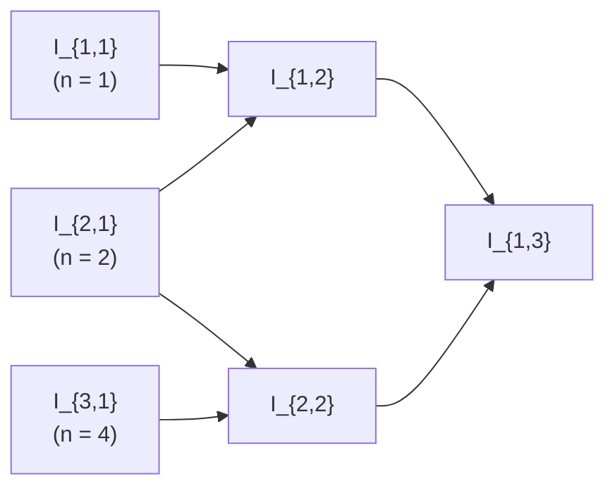

# Chapter 20 — Numerical Integration of Functions

[Repository Guide](../../README.md) | [English](Concepts_Lecture.md) | [한국어](Concepts_Lecture.ko.md)

> **Last Updated:** 2026-10-27
>
> Applied Numerical Methods with Python for Engineers and Scientists, Chapra and Clough, Ch 20

> **Learning Objectives:**
> 1. Improve the accuracy of trapezoidal estimates with Richardson extrapolation
> 2. Build a Romberg table and apply its stopping criterion
> 3. Derive the two-point Gauss-Legendre formula with the method of undetermined coefficients
> 4. Apply Gauss quadrature on an arbitrary interval through a change of variable

---

<br>

## Table of Contents

- [1. Goal](#1-goal)
- [2. Romberg Integration](#2-romberg-integration)
  - [2.1 Richardson Extrapolation](#21-richardson-extrapolation)
  - [2.2 Trapezoidal Rule Error Analysis](#22-trapezoidal-rule-error-analysis)
  - [2.3 Derivation of the Richardson Extrapolation Formula](#23-derivation-of-the-richardson-extrapolation-formula)
  - [2.4 Alternative Derivation (Error Ratio Approach)](#24-alternative-derivation-error-ratio-approach)
  - [2.5 Generalizing to Romberg Integration](#25-generalizing-to-romberg-integration)
  - [2.6 Romberg Integration Formula](#26-romberg-integration-formula)
  - [2.7 Stopping Criterion](#27-stopping-criterion)
- [3. Gauss Quadrature](#3-gauss-quadrature)
  - [3.1 Motivation: From Trapezoidal Rule to Gauss Quadrature](#31-motivation-from-trapezoidal-rule-to-gauss-quadrature)
  - [3.2 Method of Undetermined Coefficients (Trapezoidal Recovery)](#32-method-of-undetermined-coefficients-trapezoidal-recovery)
  - [3.3 Derivation of Two-Point Gauss-Legendre Formula](#33-derivation-of-two-point-gauss-legendre-formula)
  - [3.4 Example 20.3: Two-Point Gauss-Legendre with Variable Substitution](#34-example-203-two-point-gauss-legendre-with-variable-substitution)
  - [3.5 Higher-Order Gauss-Legendre Formulas (Textbook Table 20.1)](#35-higher-order-gauss-legendre-formulas-textbook-table-201)
  - [3.6 Gauss-Lobatto Rules](#36-gauss-lobatto-rules)
- [4. Comparison of Methods](#4-comparison-of-methods)
- [Summary](#summary)
- [Self-Check Questions](#self-check-questions)

<br>

---

<br>

## 1. Goal

This chapter covers two advanced numerical integration techniques:

1. **Romberg Integration**: a method that systematically improves the accuracy of the trapezoidal rule via Richardson extrapolation.
2. **Gauss Quadrature**: a method that chooses optimal evaluation points (not necessarily at the endpoints) to maximize integration accuracy.

<br>

---

<br>

## 2. Romberg Integration

Romberg integration **systematically improves the accuracy of the trapezoidal rule** using **Richardson extrapolation**.

The core idea:
1. Use **two estimates** of an integral (with different step sizes).
2. Compute a **third, more accurate** approximation by combining them.

<br>

### 2.1 Richardson Extrapolation

**Richardson extrapolation** is a technique to **improve accuracy of a numerical approximation by eliminating the leading-order error term**.

Given an integral $`I`$ approximated with step size $`h`$ using $`n`$ segments where $`h = \frac{b - a}{n}`$:

```math
I = I(h) + E(h)
```

where:
- $`I(h)`$ is the numerical approximation.
- $`E(h)`$ is the truncation error.

If we have two different step sizes $`h_1`$ and $`h_2`$:

```math
I = I(h_1) + E(h_1) = I(h_2) + E(h_2)
```

> **Key Point:** Both approximations estimate the same true integral $`I`$, so by relating their error terms, we can cancel out the leading-order error.

<br>

### 2.2 Trapezoidal Rule Error Analysis

For the **trapezoidal rule**, the truncation error is:

```math
E \approx -\frac{b - a}{12} \bar{f''} \, h^2
```

This means the error is $`O(h^2)`$. For two step sizes $`h_1`$ and $`h_2`$:

```math
E_1 = E(h_1) = -\frac{b - a}{12} \bar{f''} \, h_1^2
```

```math
E_2 = E(h_2) = -\frac{b - a}{12} \bar{f''} \, h_2^2
```

More generally, the full error expansion for the trapezoidal rule is:

```math
I = I_1 + C h_1^2 + D h_1^4 + O(h_1^6)
```

```math
I = I_2 + C h_2^2 + D h_2^4 + O(h_2^6)
```

where $`C`$ and $`D`$ are constants that depend on the function and the interval, but **not** on the step size.

<br>

### 2.3 Derivation of the Richardson Extrapolation Formula

**Step 1.** Start with the two error expansions:

```math
I = I_1 + C h_1^2 + D h_1^4 + O(h_1^6)
```

```math
I = I_2 + C h_2^2 + D h_2^4 + O(h_2^6)
```

**Step 2.** Multiply the second equation by $`\frac{h_1^2}{h_2^2}`$:

```math
\frac{h_1^2}{h_2^2} I = \frac{h_1^2}{h_2^2} I_2 + C h_1^2 + D \frac{h_1^2}{h_2^2} h_2^4 + O\!\left(\frac{h_1^2}{h_2^2} h_2^6\right)
```

> **Note:** The $`C h_1^2`$ term in the first equation now matches the $`C h_1^2`$ term created by the multiplication. This is the key step that allows cancellation.

**Step 3.** Subtract the scaled second equation from the first equation:

```math
\left(1 - \frac{h_1^2}{h_2^2}\right) I = \left(I_1 - \frac{h_1^2}{h_2^2} I_2\right) + D(h_1^4 - h_1^2 h_2^2) + O(h_1^6 - h_1^2 h_2^4)
```

The $`C h^2`$ term is **eliminated**, leaving only $`O(h^4)`$ error.

**Step 4.** Set $`h_1 = 2h_2`$ (halving the step size):

```math
\frac{h_1^2}{h_2^2} = \frac{(2h_2)^2}{h_2^2} = 4
```

```math
(1 - 4)I = (I_1 - 4I_2) + O(h^4)
```

```math
\boxed{I = \frac{4}{3} I_2 - \frac{1}{3} I_1 + O(h^4)}
```

This transforms an $`O(h^2)`$ trapezoidal estimate into an $`O(h^4)`$ result.

<br>

### 2.4 Alternative Derivation (Error Ratio Approach)

Since both errors are $`O(h^2)`$, their ratio is:

```math
\frac{E_1}{E_2} \approx \frac{h_1^2}{h_2^2} = \left(\frac{h_1}{h_2}\right)^2
```

Therefore:

```math
E_1 = \left(\frac{h_1}{h_2}\right)^2 E_2
```

From $`I_1 + E_1 = I_2 + E_2`$ (both equal the true value $`I`$):

```math
I_1 + \left(\frac{h_1}{h_2}\right)^2 E_2 = I_2 + E_2
```

```math
I_1 - I_2 = \left(1 - \left(\frac{h_1}{h_2}\right)^2\right) E_2
```

```math
E_2 = \frac{I_1 - I_2}{1 - \left(\frac{h_1}{h_2}\right)^2}
```

Therefore the improved estimate is:

```math
I = I_2 + E_2 = I_2 + \frac{1}{\left(\frac{h_1}{h_2}\right)^2 - 1}(I_2 - I_1) \quad \sim O(h^4)
```

With $`h_1 = 2h_2`$:

```math
I = I_2 + \frac{1}{3}(I_2 - I_1) = \frac{4}{3} I_2 - \frac{1}{3} I_1 \quad \sim O(h^4)
```

<br>

### 2.5 Generalizing to Romberg Integration

The idea can be applied **recursively** with three (or more) trapezoidal rule estimates using progressively finer step sizes.

**With three estimates** $`I_1`$ (1 segment), $`I_2`$ (2 segments), $`I_3`$ (4 segments):

**Level 1 (k=1):** Trapezoidal estimates, $`O(h^2)`$

```math
I_1, \quad I_2, \quad I_3
```

**Level 2 (k=2):** First Richardson extrapolation, $`O(h^4)`$

```math
I_{12} = \frac{4}{3} I_2 - \frac{1}{3} I_1 \quad \sim O(h^4)
```

```math
I_{23} = \frac{4}{3} I_3 - \frac{1}{3} I_2 \quad \sim O(h^4)
```

**Level 3 (k=3):** Second Richardson extrapolation, $`O(h^6)`$

```math
I_{123} = \frac{16}{15} I_{23} - \frac{1}{15} I_{12} \quad \sim O(h^6)
```

> **Note:** At each successive level, we eliminate the next leading error term. Level $`k`$ ($`k \ge 2`$) eliminates the leading $`O(h^{2(k-1)})`$ error term of the level $`k-1`$ estimates, so the result has error $`O(h^{2k})`$. The coefficients change because the error being eliminated at level 3 is $`O(h^4)`$, so the ratio becomes $`4^2 = 16`$ instead of $`4^1 = 4`$.

<br>

### 2.6 Romberg Integration Formula

Using double-index notation $`I_{j,k}`$:
- $`j`$ is the row index (which trapezoidal estimate is used).
- $`k`$ is the level of integration (column).

The **Romberg table** is structured as:

| k=1 ($`O(h^2)`$) | k=2 ($`O(h^4)`$) | k=3 ($`O(h^6)`$) |
|:---:|:---:|:---:|
| $`I_{1,1}`$ | $`I_{1,2}`$ | $`I_{1,3}`$ |
| $`I_{2,1}`$ | $`I_{2,2}`$ | |
| $`I_{3,1}`$ | | |

*Table 1. Structure of the Romberg table*

Each element is formed by combining the two elements of the column to its left in the same row and in the row just below.



*Figure 1. Direction in which estimates are combined in the Romberg table*

The **general recurrence formula** is:

```math
\boxed{I_{j,k} = \frac{4^{k-1} \, I_{j+1,\,k-1} - I_{j,\,k-1}}{4^{k-1} - 1}}
```

where:
- $`I_{j+1,\,k-1}`$ is the **more accurate** integral (finer step size).
- $`I_{j,\,k-1}`$ is the **less accurate** integral (coarser step size).

**Verification example:**

```math
I_{1,2} = \frac{4^1 \cdot I_{2,1} - I_{1,1}}{4^1 - 1} = \frac{4 I_{2,1} - I_{1,1}}{3} = \frac{4}{3} I_{2,1} - \frac{1}{3} I_{1,1}
```

This matches the Richardson extrapolation formula derived earlier.

```python
import numpy as np

def romberg(f, a, b, max_level):
    """
    Romberg integration of f from a to b.
    max_level: number of levels (columns) in the Romberg table.
    Returns the Romberg table as a 2D list.
    """
    R = np.zeros((max_level, max_level))

    # k=1 column: trapezoidal rule estimates
    for j in range(max_level):
        n = 2 ** j  # number of segments: 1, 2, 4, 8, ...
        h = (b - a) / n
        # Composite trapezoidal rule
        x = np.linspace(a, b, n + 1)
        y = f(x)
        R[j, 0] = h * (0.5 * y[0] + np.sum(y[1:-1]) + 0.5 * y[-1])

    # Fill in higher levels using Richardson extrapolation
    for k in range(1, max_level):
        for j in range(max_level - k):
            R[j, k] = (4**k * R[j + 1, k - 1] - R[j, k - 1]) / (4**k - 1)

    return R

# Example: integrate f(x) = 0.2 + 25x - 200x^2 + 675x^3 - 900x^4 + 400x^5
# from 0 to 0.8 (exact answer = 1.640533)
f = lambda x: 0.2 + 25*x - 200*x**2 + 675*x**3 - 900*x**4 + 400*x**5
R = romberg(f, 0, 0.8, 4)

print("Romberg Table:")
for j in range(4):
    row = ""
    for k in range(4 - j):
        row += f"  {R[j, k]:.6f}"
    print(row)

print(f"\nBest estimate: {R[0, 3]:.6f}")
print(f"Exact value:   1.640533")
```

The output is as follows.

```text
Romberg Table:
  0.172800  1.367467  1.640533  1.640533
  1.068800  1.623467  1.640533
  1.484800  1.639467
  1.600800

Best estimate: 1.640533
Exact value:   1.640533
```

Since the integrand is a fifth-degree polynomial and the estimates of the third column ($`k = 3`$, $`O(h^6)`$) are exact for polynomials up to degree 5, $`I_{1,3}`$ and the value to its right equal the true value 1.640533.

<br>

### 2.7 Stopping Criterion

**Q: When do we stop the Romberg procedure?**

Use the **percent relative error** between the best estimate at the current level and the best estimate at the previous level:

```math
|\varepsilon_a| = \left|\frac{I_{1,k} - I_{2,k-1}}{I_{1,k}}\right| \times 100\%
```

The diagonal elements of the Romberg table are compared:

- At $`k = 2`$: $`\displaystyle |\varepsilon_a^{k=2}| = \left|\frac{I_{1,2} - I_{2,1}}{I_{1,2}}\right| \times 100\%`$

- At $`k = 3`$: $`\displaystyle |\varepsilon_a^{k=3}| = \left|\frac{I_{1,3} - I_{2,2}}{I_{1,3}}\right| \times 100\%`$

Stop when $`|\varepsilon_a| < \varepsilon_s`$ (a prescribed tolerance).

> **Note:** The comparison is always between the current top-right element $`I_{1,k}`$ and the element $`I_{2,k-1}`$ of the previous column along the diagonal. $`I_{2,k-1}`$ is the more accurate of the two values combined to form $`I_{1,k}`$, that is, the best estimate of the previous level.

<br>

---

<br>

## 3. Gauss Quadrature

### 3.1 Motivation: From Trapezoidal Rule to Gauss Quadrature

The **trapezoidal rule** is based on taking the area under the **straight line** connecting the function values **at the ends** of the integration interval $`[a, b]`$.

**Key question:** Why not use function values at **interior points** instead?

By choosing evaluation points **optimally** (not at the endpoints), we can achieve much higher accuracy with the same number of function evaluations.

**Goal:** Find the points which **maximize the accuracy** of the integral.

This leads to the **method of undetermined coefficients**.

<br>

### 3.2 Method of Undetermined Coefficients (Trapezoidal Recovery)

Starting from the trapezoidal rule:

```math
I \approx (b - a) \frac{f(b) + f(a)}{2} = \frac{b - a}{2} f(a) + \frac{b - a}{2} f(b)
```

Generalize the coefficients:

```math
I \approx c_0 f(a) + c_1 f(b)
```

We know the trapezoidal rule is **exact for a constant and a linear function**. Use these conditions to determine $`c_0`$ and $`c_1`$:

**i)** Let $`f(x) = 1`$:

```math
I = \int_a^b 1 \, dx = b - a = c_0 \cdot 1 + c_1 \cdot 1 = c_0 + c_1 \quad \cdots (*)
```

**ii)** Let $`f(x) = x`$:

```math
I = \int_a^b x \, dx = \frac{1}{2}(b^2 - a^2) = c_0 \cdot a + c_1 \cdot b
```

**iii)** From (i) and (ii):

```math
\frac{1}{2}(b - a)(b + a) = a \, c_0 + b \, c_1
```

```math
\frac{1}{2}(c_0 + c_1)(b + a) = a \, c_0 + b \, c_1
```

```math
\frac{1}{2}(b - a) c_0 + \frac{1}{2}(a - b) c_1 = 0
```

```math
\therefore \quad c_0 = c_1 \quad \xrightarrow{(*)} \quad c_0 = c_1 = \frac{b - a}{2}
```

This **recovers the trapezoidal rule**: $`I = \frac{b-a}{2} f(a) + \frac{b-a}{2} f(b)`$.

> **Note:** The location of the interval does not matter for deriving the coefficients. We can shift the interval to $`\left[-\frac{b-a}{2}, \frac{b-a}{2}\right]`$ centered at the origin and obtain the same result $`c_0 = c_1 = \frac{b-a}{2}`$.

<br>

### 3.3 Derivation of Two-Point Gauss-Legendre Formula

Now allow both the **coefficients** and the **evaluation points** to be unknowns:

```math
I \approx c_0 f(x_0) + c_1 f(x_1)
```

We have **4 unknowns**: $`c_0, c_1, x_0, x_1`$.

Therefore, we need **4 conditions** (exact for polynomials up to degree 3).

Work on the standard interval $`[-1, 1]`$:

**i)** $`\displaystyle \int_{-1}^{1} 1 \, dx = 2 = c_0 \cdot 1 + c_1 \cdot 1`$

**ii)** $`\displaystyle \int_{-1}^{1} x \, dx = 0 = c_0 \cdot x_0 + c_1 \cdot x_1`$

**iii)** $`\displaystyle \int_{-1}^{1} x^2 \, dx = \frac{2}{3} = c_0 \cdot x_0^2 + c_1 \cdot x_1^2`$

**iv)** $`\displaystyle \int_{-1}^{1} x^3 \, dx = 0 = c_0 \cdot x_0^3 + c_1 \cdot x_1^3`$

**Solving the system:**

**v)** From (ii): $`c_0 x_0 = -c_1 x_1`$

**Plug into (iv):**

```math
-c_1 x_1 x_0^2 + c_1 x_1^3 = 0
```

```math
c_1 x_1 (x_1^2 - x_0^2) = 0
```

Since $`c_1`$ and $`x_1`$ cannot be zero (otherwise conditions (i)-(iv) cannot hold simultaneously), we require:

```math
x_1^2 = x_0^2 \quad \text{and} \quad x_1 \neq x_0
```

```math
\therefore \quad \boxed{x_1 = -x_0} \quad \cdots (*)
```

**vi)** Substituting $`(*)`$ into (ii):

```math
c_0 x_0 + c_1(-x_0) = 0 \implies c_0 x_0 - c_1 x_0 = 0
```

```math
\therefore \quad \boxed{c_0 = c_1} \quad \cdots (**)
```

**vii)** Plugging $`(**)`$ into (i):

```math
c_0 + c_1 = 2 \implies 2c_0 = 2
```

```math
\therefore \quad \boxed{c_0 = 1 = c_1}
```

**viii)** From (iii):

```math
c_0 x_0^2 + c_1 x_1^2 = \frac{2}{3} \implies 2 x_0^2 = \frac{2}{3}
```

```math
\therefore \quad x_0 = \pm \frac{1}{\sqrt{3}}, \quad x_1 = \mp \frac{1}{\sqrt{3}}
```

**The two-point Gauss-Legendre formula** (on $`[-1, 1]`$):

```math
\boxed{I \approx f\!\left(-\frac{1}{\sqrt{3}}\right) + f\!\left(\frac{1}{\sqrt{3}}\right)}
```

This is **third-order accurate** (exact for polynomials up to degree 3), which is significantly better than the trapezoidal rule (exact only for degree 1) with the same number of points.

```python
import numpy as np

def gauss_legendre_2pt(f, a, b):
    """
    Two-point Gauss-Legendre quadrature for integral of f from a to b.
    Uses change of variable: x = ((b-a)/2)*z + (a+b)/2, z in [-1, 1].
    """
    # Gauss points on [-1, 1]
    z0 = -1.0 / np.sqrt(3)
    z1 =  1.0 / np.sqrt(3)

    # Weights (both equal to 1)
    w0, w1 = 1.0, 1.0

    # Change of variable: x = ((b-a)/2)*z + (a+b)/2
    # dx = ((b-a)/2)*dz
    scale = (b - a) / 2.0
    shift = (a + b) / 2.0

    x0 = scale * z0 + shift
    x1 = scale * z1 + shift

    return scale * (w0 * f(x0) + w1 * f(x1))

# Example
f = lambda x: 0.2 + 25*x - 200*x**2 + 675*x**3 - 900*x**4 + 400*x**5
result = gauss_legendre_2pt(f, 0, 0.8)
print(f"Two-point Gauss-Legendre: {result:.6f}")
print(f"Exact value:             1.640533")
```

<br>

### 3.4 Example 20.3: Two-Point Gauss-Legendre with Variable Substitution

**Problem:** Evaluate the integral of

```math
f(x) = 0.2 + 25x - 200x^2 + 675x^3 - 900x^4 + 400x^5
```

between the limits $`x = 0`$ to $`x = 0.8`$.

**Solution:**

The Gauss-Legendre formula works on $`[-1, 1]`$, so we need a **change of variable**:

```math
x = \frac{b - a}{2} \zeta + \frac{a + b}{2} = 0.4\zeta + 0.4
```

```math
dx = 0.4 \, d\zeta
```

Transform the integral:

```math
\int_0^{0.8} f(x) \, dx = \int_{-1}^{1} f(\zeta) \cdot 0.4 \, d\zeta
```

Apply the two-point Gauss-Legendre formula:

```math
\approx 0.4 \left[ f\!\left(-\frac{1}{\sqrt{3}}\right) + f\!\left(\frac{1}{\sqrt{3}}\right) \right]
```

where $`f(\zeta)`$ means evaluating the original $`f`$ at $`x = 0.4\zeta + 0.4`$:

- At $`\zeta = -\frac{1}{\sqrt{3}}`$: $`x = 0.4 \cdot \left(-\frac{1}{\sqrt{3}}\right) + 0.4 \approx 0.1690`$
- At $`\zeta = +\frac{1}{\sqrt{3}}`$: $`x = 0.4 \cdot \left(+\frac{1}{\sqrt{3}}\right) + 0.4 \approx 0.6310`$

```python
import numpy as np

f = lambda x: 0.2 + 25*x - 200*x**2 + 675*x**3 - 900*x**4 + 400*x**5

a, b = 0, 0.8
z = np.array([-1/np.sqrt(3), 1/np.sqrt(3)])
x = 0.4 * z + 0.4  # change of variable

result = 0.4 * (f(x[0]) + f(x[1]))
print(f"x values: {x[0]:.6f}, {x[1]:.6f}")
print(f"f(x0) = {f(x[0]):.6f}")
print(f"f(x1) = {f(x[1]):.6f}")
print(f"Result: {result:.6f}")
print(f"Exact:  1.640533")
```

The output is as follows.

```text
x values: 0.169060, 0.630940
f(x0) = 1.291851
f(x1) = 3.264593
Result: 1.822578
Exact:  1.640533
```

The integral is therefore $`0.4(1.291851 + 3.264593) \approx 1.822578`$, with a true relative error of $`\varepsilon_t = \frac{1.640533 - 1.822578}{1.640533} \times 100\% \approx -11.1\%`$. This is far more accurate than the value 0.1728 of the single-application trapezoidal rule, which uses the same two function evaluations.

<br>

### 3.5 Higher-Order Gauss-Legendre Formulas (Textbook Table 20.1)

The general form on $`[-1, 1]`$:

```math
I \approx \sum_{i=0}^{n-1} c_i \, f(x_i)
```

| Points ($`n`$) | Weights ($`c_i`$) | Nodes ($`x_i`$) | Error | Exact for degree |
|:---:|:---|:---|:---:|:---:|
| **1** | $`c_0 = 2`$ | $`x_0 = 0`$ | $`\sim f^{(2)}(\zeta)`$ | 1 |
| **2** | $`c_0 = 1`$, $`c_1 = 1`$ | $`x_0 = -\frac{1}{\sqrt{3}}`$, $`x_1 = \frac{1}{\sqrt{3}}`$ | $`\sim f^{(4)}(\zeta)`$ | 3 |
| **3** | $`c_0 = \frac{5}{9}`$, $`c_1 = \frac{8}{9}`$, $`c_2 = \frac{5}{9}`$ | $`x_0 = -\sqrt{\frac{3}{5}}`$, $`x_1 = 0`$, $`x_2 = \sqrt{\frac{3}{5}}`$ | $`\sim f^{(6)}(\zeta)`$ | 5 |
| **$`n`$** | (tabulated) | (tabulated) | $`\sim f^{(2n)}(\zeta)`$ | $`2n - 1`$ |

*Table 2. Weights, nodes, error, and exact degree of the Gauss-Legendre formulas by number of points*

**Key property:** Gauss quadrature with $`n`$ points is **$`(2n-1)`$th-order accurate**: it is exact for all polynomials up to degree $`2n - 1`$.

> **Note:** **Effect of optimal placement.** This is a remarkable result: with $`n`$ points, we can exactly integrate polynomials of degree up to $`2n - 1`$. The trapezoidal rule (2 endpoints) is only exact for degree 1, but two-point Gauss-Legendre is exact for degree 3. The extra accuracy comes from optimizing the positions of the evaluation points.

```python
import numpy as np

def gauss_legendre_3pt(f, a, b):
    """
    Three-point Gauss-Legendre quadrature for integral of f from a to b.
    """
    # Gauss points on [-1, 1]
    z = np.array([-np.sqrt(3/5), 0, np.sqrt(3/5)])
    # Weights
    w = np.array([5/9, 8/9, 5/9])

    # Change of variable
    scale = (b - a) / 2.0
    shift = (a + b) / 2.0
    x = scale * z + shift

    return scale * np.sum(w * f(x))

# Example
f = lambda x: 0.2 + 25*x - 200*x**2 + 675*x**3 - 900*x**4 + 400*x**5
result = gauss_legendre_3pt(f, 0, 0.8)
print(f"Three-point Gauss-Legendre: {result:.6f}")
print(f"Exact value:               1.640533")
```

The output is as follows.

```text
Three-point Gauss-Legendre: 1.640533
Exact value:               1.640533
```

The three-point formula is exact for polynomials up to degree 5, so it reproduces the true value of this fifth-degree integrand.

<br>

### 3.6 Gauss-Lobatto Rules

**Gauss-Lobatto rules** are a variant where integration points **include the endpoints** of the interval.

**3-point Gauss-Lobatto** on $`[-1, 1]`$:

```math
\int_{-1}^{1} f(x) \, dx \approx \frac{1}{3} f(-1) + \frac{4}{3} f(0) + \frac{1}{3} f(1)
```

| Points ($`n`$) | Weights ($`c_i`$) | Nodes ($`x_i`$) | Error | Exact for degree |
|:---:|:---|:---|:---:|:---:|
| **3** | $`c_0 = \frac{1}{3}`$, $`c_1 = \frac{4}{3}`$, $`c_2 = \frac{1}{3}`$ | $`x_0 = -1`$, $`x_1 = 0`$, $`x_2 = 1`$ | $`\sim f^{(4)}(\zeta)`$ | 3 |
| **4** | $`c_0 = \frac{1}{6}`$, $`c_1 = \frac{5}{6}`$, $`c_2 = \frac{5}{6}`$, $`c_3 = \frac{1}{6}`$ | $`x_0 = -1`$, $`x_1 = -\frac{1}{\sqrt{5}}`$, $`x_2 = \frac{1}{\sqrt{5}}`$, $`x_3 = 1`$ | $`\sim f^{(6)}(\zeta)`$ | 5 |
| **$`n`$** | (tabulated) | (tabulated) | $`\sim f^{(2n-2)}(\zeta)`$ | $`2n - 3`$ |

*Table 3. Weights, nodes, error, and exact degree of the Gauss-Lobatto formulas by number of points*

**Key property:** Gauss-Lobatto quadrature with $`n`$ points is **$`(2n-3)`$th-order accurate**: it is exact for polynomials up to degree $`2n - 3`$.

> **Note:** **Gauss-Lobatto versus Gauss-Legendre.** Gauss-Lobatto is slightly less accurate than Gauss-Legendre for the same number of points ($`2n - 3`$ vs $`2n - 1`$) because two of the points are fixed at the endpoints, reducing the degrees of freedom available for optimization. However, including endpoints can be advantageous when boundary values are already known or when combining sub-intervals.

<br>

---

<br>

## 4. Comparison of Methods

| Method | Formula / Key Idea | Error Order | Remarks |
|:---|:---|:---:|:---|
| **Richardson Extrapolation** | $`I = \frac{4}{3}I_2 - \frac{1}{3}I_1`$ | $`O(h^4)`$ | Eliminates $`O(h^2)`$ error from trapezoidal rule |
| **Romberg Integration** | $`I_{j,k} = \frac{4^{k-1}I_{j+1,k-1} - I_{j,k-1}}{4^{k-1} - 1}`$ | $`O(h^{2k})`$ at level $`k`$ | Recursive Richardson extrapolation; each level gains $`O(h^2)`$ |
| **Gauss-Legendre (2-pt)** | $`I \approx f(-1/\sqrt{3}) + f(1/\sqrt{3})`$ | $`\sim f^{(4)}`$ | Exact for polynomials up to degree 3 |
| **Gauss-Legendre (3-pt)** | $`I \approx \frac{5}{9}f(-\sqrt{3/5}) + \frac{8}{9}f(0) + \frac{5}{9}f(\sqrt{3/5})`$ | $`\sim f^{(6)}`$ | Exact for polynomials up to degree 5 |
| **Gauss-Legendre ($`n`$-pt)** | $`I \approx \sum c_i f(x_i)`$ | $`\sim f^{(2n)}`$ | Exact for degree $`2n-1`$; optimal point placement |
| **Gauss-Lobatto ($`n`$-pt)** | Same form, but endpoints included | $`\sim f^{(2n-2)}`$ | Exact for degree $`2n-3`$; includes boundary points |

*Table 4. Comparison of Romberg integration and Gauss quadrature*

---

<br>

## Summary

| Concept | Key Summary |
|---------|-------------|
| Richardson extrapolation | It combines two estimates with different step sizes to eliminate the leading error term, and for trapezoidal estimates with $`h_1 = 2h_2`$, $`I = \frac{4}{3}I_2 - \frac{1}{3}I_1`$ is $`O(h^4)`$ accurate. |
| Romberg integration | It applies Richardson extrapolation recursively to trapezoidal estimates, and the level $`k`$ estimates have $`O(h^{2k})`$ error. |
| Romberg stopping criterion | The procedure stops when the percent relative error between $`I_{1,k}`$ and $`I_{2,k-1}`$ falls below the tolerance $`\varepsilon_s`$. |
| Method of undetermined coefficients | It determines the coefficients and evaluation points by substituting the polynomials the formula must integrate exactly, and fixing the points at the endpoints recovers the trapezoidal rule. |
| Gauss-Legendre quadrature | It chooses $`n`$ weights and nodes optimally to integrate polynomials up to degree $`2n - 1`$ exactly, and the two-point formula is $`f(-1/\sqrt{3}) + f(1/\sqrt{3})`$. |
| Change of variable | It maps $`[a, b]`$ to $`[-1, 1]`$ with $`x = \frac{b-a}{2}\zeta + \frac{a+b}{2}`$ and multiplies the result by $`\frac{b-a}{2}`$. |
| Gauss-Lobatto quadrature | It includes both endpoints as nodes, which reduces the degrees of freedom, so the $`n`$-point formula is exact for polynomials up to degree $`2n - 3`$. |

---

<br>

## Self-Check Questions

1. **Richardson extrapolation:** For the integral of $`f(x) = 0.2 + 25x - 200x^2 + 675x^3 - 900x^4 + 400x^5`$ from 0 to 0.8, the trapezoidal estimates with 1, 2, and 4 segments are 0.1728, 1.0688, and 1.4848. Find $`I_{1,2}`$ and $`I_{2,2}`$.

   <details>
   <summary>Answer</summary>

   $`I_{1,2} = \frac{4}{3}(1.0688) - \frac{1}{3}(0.1728) = 1.425067 - 0.0576 = 1.367467`$. $`I_{2,2} = \frac{4}{3}(1.4848) - \frac{1}{3}(1.0688) = 1.979733 - 0.356267 = 1.623467`$.

   </details>

2. **Romberg level 3 and stopping criterion:** Using the results of Question 1, find $`I_{1,3}`$ and compute $`|\varepsilon_a|`$ of the stopping criterion.

   <details>
   <summary>Answer</summary>

   $`I_{1,3} = \frac{16(1.623467) - 1.367467}{15} = \frac{24.608}{15} = 1.640533`$. $`|\varepsilon_a| = \left|\frac{1.640533 - 1.623467}{1.640533}\right| \times 100\% \approx 1.04\%`$. $`I_{1,3}`$ equals the true value 1.640533 because the $`k = 3`$ column is exact for polynomials up to degree 5.

   </details>

3. **Two-point Gauss-Legendre:** Compute the integral of Question 1 with the two-point Gauss-Legendre formula and find the true relative error.

   <details>
   <summary>Answer</summary>

   With $`x = 0.4\zeta + 0.4`$, the nodes are $`x \approx 0.169060`$ and $`0.630940`$, and the function values are about 1.291851 and 3.264593. The integral is $`0.4(1.291851 + 3.264593) \approx 1.822578`$, and the true relative error is $`\frac{1.640533 - 1.822578}{1.640533} \times 100\% \approx -11.1\%`$.

   </details>

4. **Order of accuracy:** Explain, by counting unknowns, why the $`n`$-point Gauss-Legendre formula is exact for polynomials up to degree $`2n - 1`$.

   <details>
   <summary>Answer</summary>

   The $`n`$ weights and $`n`$ nodes give $`2n`$ unknowns, so $`2n`$ conditions can be imposed requiring exactness for the $`2n`$ monomials $`1, x, \ldots, x^{2n-1}`$. Since both the integral and the formula are linear, the formula is exact for every polynomial of degree up to $`2n - 1`$, which is a linear combination of these monomials. The two-point formula uses 4 conditions and is exact up to degree 3.

   </details>

5. **Gauss-Lobatto and Simpson's rule:** Show that the three-point Gauss-Lobatto formula on $`[-1, 1]`$ is the same as Simpson's 1/3 rule of Chapter 19.

   <details>
   <summary>Answer</summary>

   On $`[-1, 1]`$, Simpson's 1/3 rule has $`h = 1`$, so it gives $`\frac{h}{3}\bigl(f(-1) + 4f(0) + f(1)\bigr) = \frac{1}{3}f(-1) + \frac{4}{3}f(0) + \frac{1}{3}f(1)`$. This is the three-point Gauss-Lobatto formula, and both formulas are exact for polynomials up to degree 3 ($`2n - 3 = 3`$).

   </details>
