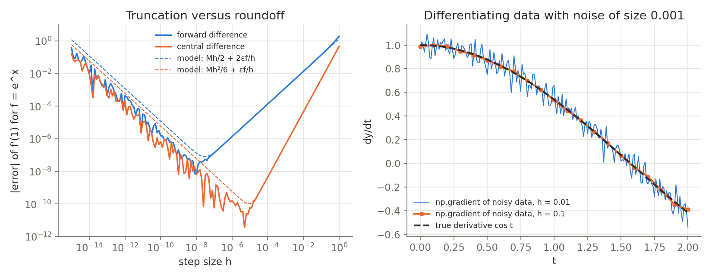
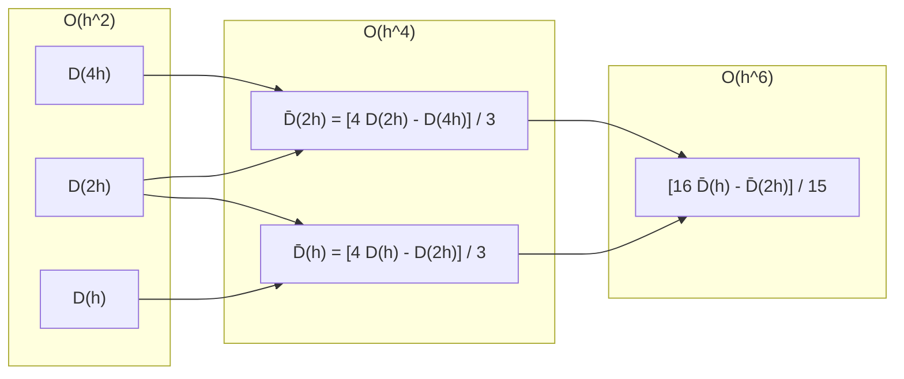

# 21장 — 수치 미분

[레포지토리 안내](../../README.ko.md) | [English](Concepts_Lecture.md) | [한국어](Concepts_Lecture.ko.md)

> **최종 수정일:** 2026-11-27
>
> Applied Numerical Methods with Python for Engineers and Scientists, Chapra and Clough, Ch 21

> **학습 목표:**
> 1. 미분을 위해 유한 차분 공식을 적용할 수 있다
> 2. 수치 미분에서 절단 오차를 분석할 수 있다
> 3. 정확도 향상을 위해 Richardson 외삽법을 구현할 수 있다
> 4. 비등간격 데이터와 다변수 함수에 수치 미분 공식을 적용할 수 있다
> 5. 절단 오차와 반올림 오차의 균형으로 최적 스텝 크기를 추정할 수 있다
> 6. 잡음이 있는 데이터를 미분할 때 생기는 오차의 증폭을 설명하고 NumPy의 gradient로 데이터를 미분할 수 있다

---

<br>

## 목차

- [1. 수치 미분 개요](#1-수치-미분-개요)
  - [1.1 극한으로서의 도함수](#11-극한으로서의-도함수)
  - [1.2 2계도함수](#12-2계도함수)
  - [1.3 편도함수](#13-편도함수)
  - [1.4 물리적 응용: 열유속(Heat Flux)](#14-물리적-응용-열유속heat-flux)
- [2. 1계도함수의 유한 차분 근사(Finite Difference Approximation)](#2-1계도함수의-유한-차분-근사finite-difference-approximation)
  - [2.1 전진 차분(Forward Difference) (1차)](#21-전진-차분forward-difference-1차)
  - [2.2 후진 차분(Backward Difference) (1차)](#22-후진-차분backward-difference-1차)
  - [2.3 중심 차분(Central Difference) (2차)](#23-중심-차분central-difference-2차)
  - [2.4 절단 오차와 반올림 오차의 균형](#24-절단-오차와-반올림-오차의-균형)
  - [2.5 4차 중심 차분과 공식의 정리](#25-4차-중심-차분과-공식의-정리)
- [3. 2계도함수의 유한 차분 근사](#3-2계도함수의-유한-차분-근사)
  - [3.1 Taylor 급수를 이용한 중심 차분](#31-taylor-급수를-이용한-중심-차분)
  - [3.2 2계도함수의 전진 차분](#32-2계도함수의-전진-차분)
  - [3.3 2계 도함수 근사의 오차와 수치 확인](#33-2계-도함수-근사의-오차와-수치-확인)
- [4. 정확도 향상: 고차 전진 차분](#4-정확도-향상-고차-전진-차분)
- [5. 미분을 위한 Richardson 외삽법(Richardson Extrapolation)](#5-미분을-위한-richardson-외삽법richardson-extrapolation)
  - [5.1 기본 아이디어](#51-기본-아이디어)
  - [5.2 중심 차분의 오차 구조 재검토](#52-중심-차분의-오차-구조-재검토)
  - [5.3 첫 번째 외삽 수준](#53-첫-번째-외삽-수준)
  - [5.4 두 번째 외삽 수준](#54-두-번째-외삽-수준)
- [6. 비등간격 데이터의 도함수(Derivatives of Unequally Spaced Data)](#6-비등간격-데이터의-도함수derivatives-of-unequally-spaced-data)
  - [6.1 Lagrange 다항식 접근법](#61-lagrange-다항식-접근법)
  - [6.2 Lagrange 기저 함수의 도함수](#62-lagrange-기저-함수의-도함수)
  - [6.3 잡음이 있는 데이터의 미분](#63-잡음이-있는-데이터의-미분)
  - [6.4 비등간격 공식의 계산 예](#64-비등간격-공식의-계산-예)
- [7. 수치 편도함수(Numerical Partial Derivatives)](#7-수치-편도함수numerical-partial-derivatives)
  - [7.1 1계 편도함수 (중심 차분)](#71-1계-편도함수-중심-차분)
  - [7.2 혼합 편도함수(Mixed Partial Derivative)](#72-혼합-편도함수mixed-partial-derivative)
  - [7.3 편도함수 근사의 계산 예](#73-편도함수-근사의-계산-예)
- [8. 미정 계수법(Method of Undetermined Coefficients)](#8-미정-계수법method-of-undetermined-coefficients)
  - [8.1 문제 설정](#81-문제-설정)
  - [8.2 Taylor 전개와 매칭](#82-taylor-전개와-매칭)
  - [8.3 계수 풀기](#83-계수-풀기)
  - [8.4 절단 오차(Truncation Error)](#84-절단-오차truncation-error)
  - [8.5 비중심 스텐실의 미정 계수법](#85-비중심-스텐실의-미정-계수법)
- [9. 미분 가능 프로그래밍(Differentiable Programming) (간략 개요)](#9-미분-가능-프로그래밍differentiable-programming-간략-개요)
- [10. Python 구현](#10-python-구현)
  - [10.1 전진, 후진, 중심 차분](#101-전진-후진-중심-차분)
  - [10.2 미분을 위한 Richardson 외삽법](#102-미분을-위한-richardson-외삽법)
  - [10.3 비등간격 데이터의 도함수 (Lagrange)](#103-비등간격-데이터의-도함수-lagrange)
  - [10.4 수치 편도함수](#104-수치-편도함수)
  - [10.5 NumPy의 diff와 gradient](#105-numpy의-diff와-gradient)
- [개념 적용](#개념-적용)
- [요약](#요약)
- [점검 문제](#점검-문제)
- [참고 문헌](#참고-문헌)

---

<br>

## 1. 수치 미분 개요

수치 미분(Numerical Differentiation)은 해석적으로 계산하는 대신 이산 데이터나 함수 평가로부터 도함수를 추정하는 과정이다. 이는 다음과 같은 경우에 필수적이다:

- 함수가 이산 점에서만 알려진 경우 (실험/현장 데이터)
- 해석적 도함수가 너무 복잡하거나 구할 수 없는 경우
- 더 큰 수치 알고리즘(예: ODE/PDE 풀기) 내에서 도함수가 필요한 경우

### 1.1 극한으로서의 도함수

유한 차분비(Finite Difference Ratio)는 자연스러운 출발점을 제공한다:

```math
\frac{\Delta y}{\Delta x} = \frac{f(x + \Delta x) - f(x)}{\Delta x}
```

$`\Delta x \to 0`$으로 극한을 취하면:

```math
\frac{dy}{dx} = \lim_{\Delta x \to 0} \frac{f(x + \Delta x) - f(x)}{\Delta x} =: f'(x)
```

이것이 **$`x`$에 대한 $`y`$의 1계도함수**이다. 기하학적으로 도함수는 점 $`x_i`$에서 곡선에 대한 접선의 기울기이다.

> **[미적분학]** $`\Delta x`$가 줄어들면 할선(곡선 위의 두 점을 잇는 선)은 $`x_i`$에서의 접선에 가까워지고, 할선의 기울기는 $`f'(x_i)`$에 수렴한다. 이 장의 유한 차분 근사는 이 극한을 취하지 않고 유한한 $`\Delta x`$에서 멈춘 할선의 기울기를 도함수 대신 쓰는 것이다.

### 1.2 2계도함수

2계도함수는 1계도함수의 도함수이다:

```math
\frac{d^2 y}{dx^2} = \frac{d}{dx}\left(\frac{dy}{dx}\right)
```

이것은 **기울기가 얼마나 빠르게 변하는지**를 측정하며, 함수 그래프가 휘는 방향(오목성)과 정도를 나타낸다.

### 1.3 편도함수

두 변수의 함수 $`f(x, y)`$에 대해:

```math
\frac{\partial f}{\partial x} = \lim_{\Delta x \to 0} \frac{f(x + \Delta x, y) - f(x, y)}{\Delta x}
```

```math
\frac{\partial f}{\partial y} = \lim_{\Delta y \to 0} \frac{f(x, y + \Delta y) - f(x, y)}{\Delta y}
```

이것들은 각각 $`x`$와 $`y`$에 대한 $`f`$의 **편도함수**이다. 각 편도함수는 다른 변수를 고정한 채 $`f`$의 변화율을 측정한다.

### 1.4 물리적 응용: 열유속(Heat Flux)

대표적인 공학적 응용은 Fourier의 열전도 법칙이다. 온도 분포 $`T(x)`$가 주어지면, 열유속은:

```math
\vec{q} = -k \frac{\partial T}{\partial x}
```

여기서 $`k`$는 열전도율이다. 음의 부호는 열이 고온에서 저온으로 흐름을 나타낸다:

- **양의 기울기**($`\partial T / \partial x > 0`$)는 **음의 열유속**(열이 $`-x`$ 방향으로 흐름)을 만든다.
- **음의 기울기**($`\partial T / \partial x < 0`$)는 **양의 열유속**(열이 $`+x`$ 방향으로 흐름)을 만든다.

> **참고:** **열 흐름의 방향.** 열은 항상 온도 기울기의 반대 방향으로 흐른다. 이것은 도함수 개념의 직접적인 물리적 응용이다.

---

<br>

## 2. 1계도함수의 유한 차분 근사(Finite Difference Approximation)

이 장의 등간격 유한 차분 공식은 Taylor 급수 전개(Taylor Series Expansion)로부터 유도한다. $`h`$를 등간격 점들 사이의 스텝 크기로 놓으면 $`x_{i+1} = x_i + h`$이다.

> **용어 정의:** **유한 차분 근사(finite difference approximation)** 는 도함수를 정의하는 극한을 취하지 않고, 간격 $`h`$만큼 떨어진 몇 개의 점에서의 함수값의 가중 결합으로 도함수를 근사하는 방법이다. 오차가 $`O(h^p)`$이면 그 근사를 $`p`$차 정확도라 한다.

### 2.1 전진 차분(Forward Difference) (1차)

$`x_i`$에서의 전진 방향 **Taylor 전개**:

```math
f(x_{i+1}) = f(x_i) + f'(x_i)\,h + f''(x_i)\frac{h^2}{2} + f'''(x_i)\frac{h^3}{6} + \cdots \quad (\ast)
```

식 $`(\ast)`$에서 $`f'(x_i)`$를 풀면:

```math
f'(x_i) = \frac{f(x_{i+1}) - f(x_i)}{h} - f''(x_i)\frac{h}{2} + O(h^2)
```

절단 오차항을 버리면 **전진 차분** 근사를 얻는다:

```math
\boxed{f'(x_i) \approx \frac{f(x_{i+1}) - f(x_i)}{h}}
```

- **절단 오차**: $`O(h)`$이며, 1차 정확도이다.
- **주도적 오차항**: $`-f''(x_i)\dfrac{h}{2}`$이다.
- 점 $`x_i`$와 $`x_{i+1}`$(해당 점과 앞의 한 점)을 사용한다.

### 2.2 후진 차분(Backward Difference) (1차)

마찬가지로, $`x_i`$에서 $`f(x_{i-1})`$을 전개하면:

```math
f(x_{i-1}) = f(x_i) - f'(x_i)\,h + f''(x_i)\frac{h^2}{2} - f'''(x_i)\frac{h^3}{6} + \cdots \quad (\ast\ast)
```

$`f'(x_i)`$를 풀면:

```math
\boxed{f'(x_i) \approx \frac{f(x_i) - f(x_{i-1})}{h}}
```

- **절단 오차**: $`O(h)`$이며, 1차 정확도이다.
- 점 $`x_{i-1}`$과 $`x_i`$를 사용한다.

### 2.3 중심 차분(Central Difference) (2차)

$`(\ast)`$에서 $`(\ast\ast)`$를 빼면:

```math
f(x_{i+1}) - f(x_{i-1}) = 2f'(x_i)\,h + 2f'''(x_i)\frac{h^3}{6} + \cdots
```

$`f'(x_i)`$를 풀면:

```math
\boxed{f'(x_i) \approx \frac{f(x_{i+1}) - f(x_{i-1})}{2h}}
```

- **절단 오차**: $`O(h^2)`$이며, 2차 정확도이다.
- **주도적 오차항**: $`-f'''(x_i)\dfrac{h^2}{6}`$이다.
- 점 $`x_{i-1}`$과 $`x_{i+1}`$($`x_i`$에 대해 대칭)을 사용한다.

> **핵심:** 중심 차분은 대칭성 때문에 $`h`$의 홀수 거듭제곱 오차항이 상쇄되므로, 전진 차분과 후진 차분의 $`O(h)`$보다 높은 $`O(h^2)`$ 정확도를 달성한다. 이것은 양쪽 이웃 점을 모두 사용할 수 있을 때의 핵심적인 장점이다.

### 2.4 절단 오차와 반올림 오차의 균형

2.1절과 2.3절의 오차 차수만 보면 $`h`$를 작게 할수록 근사가 좋아질 것 같지만, 컴퓨터에서는 그렇지 않다. 함수값 $`f(x_i)`$는 부동 소수점으로 저장되므로 상대 오차가 기계 엡실론 $`\varepsilon \approx 2.2 \times 10^{-16}`$ 정도 섞이고(4장), 차분 $`f(x_{i+1}) - f(x_i)`$는 $`h`$가 작을수록 거의 같은 두 수의 뺄셈이 되어 유효 숫자를 잃는다. 이 반올림 오차는 분모의 $`h`$로 나누어지면서 커진다.

전진 차분의 전체 오차는 절단 오차 $`\frac{h}{2}|f''|`$와, 두 함수값의 반올림 오차 $`2\varepsilon|f|`$를 $`h`$로 나눈 값의 합으로 근사할 수 있다. $`M = \max|f''|`$로 놓으면

```math
E(h) \approx \frac{M}{2}h + \frac{2\varepsilon|f|}{h}
```

이다. 첫 항은 $`h`$와 함께 줄고 둘째 항은 $`h`$가 줄면 커지므로, $`E'(h) = 0`$에서 최솟값을 얻는다.

```math
\frac{M}{2} - \frac{2\varepsilon|f|}{h^2} = 0 \quad \Longrightarrow \quad h_{\mathrm{opt}} = 2\sqrt{\frac{\varepsilon|f|}{M}}, \qquad E(h_{\mathrm{opt}}) = 2\sqrt{\varepsilon|f|M}
```

중심 차분은 절단 오차가 $`\frac{h^2}{6}|f'''|`$이고 반올림 오차가 $`\frac{2\varepsilon|f|}{2h}`$이므로, $`M_3 = \max|f'''|`$로 놓고 같은 방법으로 최소화하면 $`h_{\mathrm{opt}} = \left(\frac{3\varepsilon|f|}{M_3}\right)^{1/3}`$이다. $`f(x) = e^x`$의 $`x = 1`$에서는 $`f = f'' = f''' = e`$이므로 전진 차분은 $`h_{\mathrm{opt}} = 2\sqrt{\varepsilon} \approx 3 \times 10^{-8}`$, 중심 차분은 $`h_{\mathrm{opt}} = (3\varepsilon)^{1/3} \approx 9 \times 10^{-6}`$이다.

```python
import numpy as np

f, x0, exact = np.exp, 1.0, np.exp(1.0)       # f'(1) = e
print("     h       forward error    central error")
for k in range(1, 15, 2):
    h = 10.0**(-k)
    fwd = (f(x0 + h) - f(x0)) / h
    cen = (f(x0 + h) - f(x0 - h)) / (2 * h)
    print(f"  1e-{k:02d}    {abs(fwd - exact):12.3e}    {abs(cen - exact):12.3e}")

eps = np.finfo(float).eps                      # machine epsilon
print(f"machine epsilon = {eps:.3e}")
print(f"h_opt forward  ~ 2*sqrt(eps)  = {2 * np.sqrt(eps):.1e}")
print(f"h_opt central  ~ (3*eps)^(1/3) = {(3 * eps)**(1 / 3):.1e}")
```

```text
     h       forward error    central error
  1e-01       1.406e-01       4.533e-03
  1e-03       1.360e-03       4.530e-07
  1e-05       1.359e-05       5.859e-11
  1e-07       1.399e-07       5.859e-11
  1e-09       2.154e-07       6.603e-09
  1e-11       3.263e-05       1.043e-05
  1e-13       4.559e-04       4.559e-04
machine epsilon = 2.220e-16
h_opt forward  ~ 2*sqrt(eps)  = 3.0e-08
h_opt central  ~ (3*eps)^(1/3) = 8.7e-06
```

- `np.finfo(float).eps`는 배정밀도의 기계 엡실론 $`2^{-52}`$이다.
- 전진 차분의 오차는 $`h`$를 100분의 1로 줄일 때마다 100분의 1로 줄다가($`O(h)`$) $`h = 10^{-7}`$ 근처에서 최소가 되고, 그보다 작은 $`h`$에서는 다시 커진다. 중심 차분은 $`h = 10^{-1}`$에서 $`10^{-3}`$으로 갈 때 오차가 만분의 1로 줄어($`O(h^2)`$) $`h = 10^{-5}`$ 근처에서 최소가 된다.
- $`h = 10^{-13}`$에서는 두 방법의 오차가 같아진다. 절단 오차는 무시할 만하고, 오차가 거의 전부 반올림 오차이기 때문이다.

그림 1의 왼쪽은 $`h`$를 연속적으로 바꾸며 그린 오차 곡선과 위의 모형 $`E(h)`$를 함께 보여 준다. 오른쪽 아래로 내려가는 직선 부분은 절단 오차, 왼쪽에서 올라가는 부분은 반올림 오차이며, 반올림 오차 부분이 들쭉날쭉한 것은 반올림이 $`h`$에 따라 불규칙하게 일어나기 때문이다. 중심 차분은 최적 $`h`$가 더 크고 최소 오차도 더 작으므로, 같은 계산 비용으로 더 정확하다.



*그림 1. 스텝 크기에 따른 유한 차분 오차와 잡음이 있는 데이터의 미분*

> **주의:** 수치 미분에서 $`h`$를 무조건 작게 잡는 것은 흔한 실수이다. 배정밀도에서 전진 차분은 약 8자리, 중심 차분은 약 10\~11자리의 정확도가 한계이며, 함수값 자체에 측정 오차나 반복 계산의 오차가 섞여 있으면 최적 $`h`$는 훨씬 커지고 얻을 수 있는 정확도는 더 낮아진다.

### 2.5 4차 중심 차분과 공식의 정리

중심 차분 $`D(h) = \frac{f(x+h) - f(x-h)}{2h}`$의 오차는 $`f'''\frac{h^2}{6} + f^{(5)}\frac{h^4}{120} + \cdots`$처럼 짝수 거듭제곱으로만 이루어진다. 5절의 Richardson 외삽을 $`h`$와 $`2h`$에 적용하여 $`h^2`$ 항을 없애면

```math
\frac{4D(h) - D(2h)}{3} = \frac{f(x - 2h) - 8f(x - h) + 8f(x + h) - f(x + 2h)}{12h} = f'(x) - \frac{h^4}{30}f^{(5)}(x) + \cdots
```

이 되어 오차가 $`O(h^4)`$인 5점 중심 차분 공식을 얻는다. 오차 상수는 $`\frac{4 - 16}{3} \cdot \frac{1}{120} = -\frac{1}{30}`$에서 나온다.

```python
import numpy as np

f, x0, exact = np.exp, 1.0, np.exp(1.0)
D = lambda h: (f(x0 + h) - f(x0 - h)) / (2 * h)                      # O(h^2)
D4 = lambda h: (f(x0 - 2*h) - 8*f(x0 - h) + 8*f(x0 + h) - f(x0 + 2*h)) / (12 * h)   # O(h^4)
for h in [0.2, 0.1, 0.05]:
    print(f"h = {h:4.2f}: central error = {D(h) - exact:+.3e}, "
          f"fourth-order error = {D4(h) - exact:+.3e}")
print("Richardson (4D(h) - D(2h))/3 at h = 0.1:", (4 * D(0.1) - D(0.2)) / 3, " D4(0.1):", D4(0.1))
```

```text
h = 0.20: central error = +1.816e-02, fourth-order error = -1.457e-04
h = 0.10: central error = +4.533e-03, fourth-order error = -9.072e-06
h = 0.05: central error = +1.133e-03, fourth-order error = -5.665e-07
Richardson (4D(h) - D(2h))/3 at h = 0.1: 2.7182727567264906  D4(0.1): 2.71827275672649
```

$`h`$를 절반으로 줄일 때 중심 차분의 오차는 약 4분의 1, 5점 공식의 오차는 약 16분의 1로 줄어든다. $`h = 0.1`$에서 5점 공식의 오차 $`-9.072 \times 10^{-6}`$은 주도 오차항 $`-\frac{(0.1)^4}{30}e = -9.06 \times 10^{-6}`$과 거의 같고, 마지막 줄은 Richardson 외삽의 결과와 5점 공식이 같은 수임을 확인해 준다. 지금까지의 공식을 정리하면 다음과 같다.

| 도함수 | 공식 | 사용하는 점 | 주도 오차항 |
|:-----|:-----|:-----|:-----|
| $`f'`$ 전진 | $`\frac{f_{i+1} - f_i}{h}`$ | $`i, i+1`$ | $`-\frac{h}{2}f''`$ |
| $`f'`$ 후진 | $`\frac{f_i - f_{i-1}}{h}`$ | $`i-1, i`$ | $`+\frac{h}{2}f''`$ |
| $`f'`$ 중심 | $`\frac{f_{i+1} - f_{i-1}}{2h}`$ | $`i-1, i+1`$ | $`-\frac{h^2}{6}f'''`$ |
| $`f'`$ 3점 전진 | $`\frac{-f_{i+2} + 4f_{i+1} - 3f_i}{2h}`$ | $`i, i+1, i+2`$ | $`+\frac{h^2}{3}f'''`$ |
| $`f'`$ 5점 중심 | $`\frac{f_{i-2} - 8f_{i-1} + 8f_{i+1} - f_{i+2}}{12h}`$ | $`i-2, \ldots, i+2`$ | $`+\frac{h^4}{30}f^{(5)}`$ |
| $`f''`$ 중심 | $`\frac{f_{i+1} - 2f_i + f_{i-1}}{h^2}`$ | $`i-1, i, i+1`$ | $`-\frac{h^2}{12}f^{(4)}`$ |

*표 1. 유한 차분 공식과 주도 오차항(참값에서 근삿값을 뺀 값)*

표의 주도 오차항은 참값에서 근삿값을 뺀 $`f' - (\text{근삿값})`$이다. 전진 차분과 후진 차분은 오차의 부호가 반대이므로 두 값의 평균을 내면 $`h`$ 항이 상쇄되어 중심 차분이 되며, 이것이 중심 차분이 한 차수 높은 이유를 보여 주는 또 하나의 설명이다.

---

<br>

## 3. 2계도함수의 유한 차분 근사

### 3.1 Taylor 급수를 이용한 중심 차분

$`(\ast)`$와 $`(\ast\ast)`$를 더하면:

```math
f(x_{i+1}) + f(x_{i-1}) = 2f(x_i) + f''(x_i)\,h^2 + O(h^4)
```

$`f''(x_i)`$를 풀면:

```math
\boxed{f''(x_i) = \frac{f(x_{i+1}) - 2f(x_i) + f(x_{i-1})}{h^2} + O(h^2)}
```

이것이 **2계도함수의 중심 차분 근사**이다:

- **절단 오차**: $`O(h^2)`$이며, 2차 정확도이다.
- 등간격의 세 점 $`x_{i-1}`$, $`x_i`$, $`x_{i+1}`$을 사용한다.

> **참고:** **공식의 해석.** 이 공식의 분자는 $`2\left(\frac{f(x_{i+1}) + f(x_{i-1})}{2} - f(x_i)\right)`$이므로, $`x_i`$에서의 함수값이 양쪽 이웃의 평균으로부터 얼마나 벗어나는지를 측정한다. 양의 $`f''`$은 그래프가 아래로 볼록(concave up)함을, 음의 $`f''`$은 그래프가 위로 볼록(concave down)함을 의미한다.

### 3.2 2계도함수의 전진 차분

전진 점만 사용하여 $`f''(x_i)`$의 **전진** 공식을 유도하기 위해, $`f(x_{i+2})`$를 전개한다:

```math
f(x_{i+2}) = f(x_i) + f'(x_i)\,(2h) + f''(x_i)\frac{(2h)^2}{2} + f'''(x_i)\frac{(2h)^3}{6} + O(h^4) \quad (\ast\ast\ast)
```

$`(\ast\ast\ast) - 2(\ast)`$를 계산하면:

```math
f(x_{i+2}) - 2f(x_{i+1}) = -f(x_i) + f''(x_i)\,h^2 + O(h^3)
```

$`f''(x_i)`$를 풀면:

```math
\boxed{f''(x_i) = \frac{f(x_{i+2}) - 2f(x_{i+1}) + f(x_i)}{h^2} + O(h)}
```

- **절단 오차**: $`O(h)`$이며, 1차 정확도이다(중심 공식보다 덜 정확하다).
- 세 개의 전진 점 $`x_i`$, $`x_{i+1}`$, $`x_{i+2}`$를 사용한다.

### 3.3 2계 도함수 근사의 오차와 수치 확인

3.1절의 중심 차분과 3.2절의 전진 차분의 오차를 Taylor 전개로 비교하면 다음과 같다(중심 차분의 오차는 8.4절에서 나머지항까지 엄밀하게 유도한다).

```math
\frac{f(x+h) - 2f(x) + f(x-h)}{h^2} = f''(x) + \frac{h^2}{12}f^{(4)}(x) + O(h^4), \qquad \frac{f(x+2h) - 2f(x+h) + f(x)}{h^2} = f''(x) + h\,f'''(x) + O(h^2)
```

중심 차분에서는 $`f(x \pm h)`$의 전개에서 홀수 차수 항이 상쇄되어 오차의 첫 항이 $`h^2`$이지만, 전진 차분은 대칭이 아니어서 $`h`$ 항이 남는다. $`f(x) = e^x`$의 $`x = 1`$($`f'' = e`$)에서 확인하면 다음과 같다.

| $`h`$ | 중심 차분의 오차 | 전진 차분의 오차 |
|:-----|:-----|:-----|
| 0.1 | $`+2.266 \times 10^{-3}`$ | $`+2.884 \times 10^{-1}`$ |
| 0.05 | $`+5.664 \times 10^{-4}`$ | $`+1.400 \times 10^{-1}`$ |
| 0.025 | $`+1.416 \times 10^{-4}`$ | $`+6.896 \times 10^{-2}`$ |

*표 2. $`f(x) = e^x`$의 $`x = 1`$에서 2계 도함수 근사의 오차(근삿값에서 참값을 뺀 값)*

중심 차분의 오차는 $`h`$를 절반으로 줄일 때마다 4분의 1로 줄고, $`h = 0.1`$의 오차는 주도 항 $`\frac{(0.1)^2}{12}e = 2.265 \times 10^{-3}`$과 거의 같다. 전진 차분의 오차는 절반씩만 줄며 주도 항 $`h\,e = 0.272`$에 가깝다.

2계 도함수는 분모가 $`h^2`$이어서 반올림 오차에 더 민감하다. 세 함수값의 반올림 오차가 합쳐 최대 $`4\varepsilon|f|`$이므로 전체 오차는 $`E(h) \approx \frac{h^2}{12}|f^{(4)}| + \frac{4\varepsilon|f|}{h^2}`$이고, 2.4절과 같은 방법으로 최소화하면 $`h_{\mathrm{opt}} = \left(\frac{48\varepsilon|f|}{|f^{(4)}|}\right)^{1/4}`$이다. $`e^x`$의 $`x = 1`$에서는 $`(48\varepsilon)^{1/4} \approx 3 \times 10^{-4}`$이다. 실제로 중심 차분의 오차는 $`h = 10^{-1}, 10^{-2}, 10^{-3}`$에서 $`2.3 \times 10^{-3}`$, $`2.3 \times 10^{-5}`$, $`2.3 \times 10^{-7}`$로 줄다가 $`h = 10^{-4}`$에서 최소 $`3.8 \times 10^{-8}`$이 되고, $`h = 10^{-5}`$에서는 $`6.0 \times 10^{-6}`$, $`h = 10^{-7}`$에서는 $`8 \times 10^{-2}`$로 커진다. 1계 도함수의 중심 차분이 $`h \approx 10^{-5}`$에서 약 $`10^{-11}`$의 오차를 낸 것과 비교하면, 2계 도함수는 얻을 수 있는 정확도의 한계가 약 8자리로 더 낮다.

---

<br>

## 4. 정확도 향상: 고차 전진 차분

2계도함수 보정항을 포함하여 $`f'(x_i)`$의 전진 차분을 개선할 수 있다. 2.1절에서 얻은 다음 식에서 출발한다:

```math
f'(x_i) = \frac{f(x_{i+1}) - f(x_i)}{h} - \underbrace{f''(x_i)}_{\text{FD 근사 대입}}\frac{h}{2} + O(h^2)
```

$`f''(x_i)`$의 전진 차분 근사:

```math
f''(x_i) \approx \frac{f(x_{i+2}) - 2f(x_{i+1}) + f(x_i)}{h^2}
```

를 오차항에 대입하면:

```math
f'(x_i) = \frac{f(x_{i+1}) - f(x_i)}{h} - \frac{f(x_{i+2}) - 2f(x_{i+1}) + f(x_i)}{2h} + O(h^2)
```

결합하면:

```math
\boxed{f'(x_i) = \frac{-f(x_{i+2}) + 4f(x_{i+1}) - 3f(x_i)}{2h} + O(h^2)}
```

이것이 $`f'(x_i)`$에 대한 **2차 전진 차분** 공식이다.

- 추가 점 하나를 포함하여 정확도가 $`O(h)`$에서 $`O(h^2)`$로 **향상된다**.
- 2계도함수(확산) 보정항을 추가함으로써 정확도를 높인다.

지금까지 유도한 공식이 사용하는 점을 정리하면 그림 2과 같다.

```text
         x_{i-1}     x_i     x_{i+1}   x_{i+2}
  ──────────┼─────────┼─────────┼─────────┼────
            ●─────────●                          backward difference: f'(x_i), O(h)
                      ●─────────●                forward difference: f'(x_i), O(h)
            ●───────────────────●                central difference: f'(x_i), O(h^2)
            ●─────────●─────────●                central difference: f''(x_i), O(h^2)
                      ●─────────●─────────●      forward difference: f''(x_i), O(h); second-order forward: f'(x_i), O(h^2)
```

*그림 2. 유한 차분 공식이 사용하는 점(스텐실)*

> **참고:** **보정항 대입과 Richardson 외삽법.** 주도적 오차항에 수치 근사를 대입하는 이 아이디어는 정확도를 높이는 일반적인 기법이다. 이것은 5절의 Richardson 외삽법과 밀접한 관련이 있다.

---

<br>

## 5. 미분을 위한 Richardson 외삽법(Richardson Extrapolation)

### 5.1 기본 아이디어

20장의 수치 적분에서 Richardson 외삽법은 서로 다른 스텝 크기로 계산한 두 추정값을 사용하여 주도적 오차항을 제거했다. 오차가 $`O(h^2)`$인 사다리꼴 법칙의 적분값에 대해서는 다음과 같다:

```math
I = I(h_2) + \frac{1}{(h_1/h_2)^2 - 1}\bigl(I(h_2) - I(h_1)\bigr)
```

$`h_1/h_2 = 2`$일 때:

```math
I = \frac{4}{3}I(h_2) - \frac{1}{3}I(h_1)
```

마찬가지로, 중심 차분처럼 오차가 $`O(h^2)`$인 도함수 추정값에 대해서는 다음과 같다:

```math
\boxed{D = \frac{4}{3}D(h_2) - \frac{1}{3}D(h_1)}
```

여기서 $`D(h_1)`$과 $`D(h_2)`$는 스텝 크기 $`h_1`$ (더 큰 것)과 $`h_2 = h_1/2`$ (더 작은 것)으로 계산한 도함수 추정값이다.

### 5.2 중심 차분의 오차 구조 재검토

Taylor 전개에서 시작한다:

```math
f(x+h) = \sum_{k=0}^{\infty} \frac{f^{(k)}(x)}{k!}h^k
```

```math
f(x-h) = \sum_{k=0}^{\infty} \frac{f^{(k)}(x)}{k!}(-h)^k = \sum_{k=0}^{\infty} \frac{f^{(k)}(x)}{k!}(-1)^k h^k
```

$`f(x+h) - f(x-h)`$을 계산하면:

```math
f(x+h) - f(x-h) = 2h\,f'(x) + 2f'''(x)\frac{h^3}{3!} + 2f^{(5)}(x)\frac{h^5}{5!} + \cdots
```

$`2h`$로 나누면:

```math
f'(x) = \frac{f(x+h) - f(x-h)}{2h} - f'''(x)\frac{h^2}{3!} - f^{(5)}(x)\frac{h^4}{5!} - \cdots
```

중심 차분 연산자와 오차 계수를 정의한다:

```math
D(h) = \frac{f(x+h) - f(x-h)}{2h}
```

```math
e_2 = -\frac{f^{(3)}(x)}{3!}, \qquad e_4 = -\frac{f^{(5)}(x)}{5!}
```

그러면:

```math
f'(x) = D(h) + e_2\,h^2 + e_4\,h^4 + \cdots
```

여기서 오차 $`E(h) = e_2\,h^2 + e_4\,h^4 + \cdots`$이다.

> **핵심:** 오차 계수 $`e_2, e_4, \ldots`$는 $`h`$에 **독립**이며, 함수와 평가점 $`x`$에만 의존한다. 이것이 바로 Richardson 외삽법을 가능하게 하는 성질이다.

### 5.3 첫 번째 외삽 수준

**목표**: $`h^2`$ 항을 제거한다.

스텝 크기 $`h`$와 $`2h`$에서의 근사를 작성한다:

```math
f'(x) = D(h) + e_2\,h^2 + e_4\,h^4 + \cdots \quad \text{(4를 곱함)}
```

```math
f'(x) = D(2h) + e_2\,(2h)^2 + e_4\,(2h)^4 + \cdots
```

$`4 \times (\text{첫 번째}) - (\text{두 번째})`$를 계산하면:

```math
3f'(x) = 4D(h) - D(2h) - 12h^4 e_4 + O(h^6)
```

```math
\boxed{f'(x) = \underbrace{\frac{4}{3}D(h) - \frac{1}{3}D(2h)}_{=:\,\bar{D}(h)} - 4h^4 e_4 + O(h^6)}
```

결합된 추정값 $`\bar{D}(h)`$는 $`h^2`$ 오차가 제거되어 **$`O(h^4)`$** 정확도를 가진다.

### 5.4 두 번째 외삽 수준

같은 과정을 계속하여 $`h^4`$ 항을 제거한다. 스텝 크기 $`h`$와 $`2h`$에서:

```math
f'(x) = \bar{D}(h) - 4h^4 e_4 + O(h^6)
```

```math
f'(x) = \bar{D}(2h) - 4(2h)^4 e_4 + O(h^6)
```

$`16 \times (\text{첫 번째}) - (\text{두 번째})`$를 계산하면:

```math
15f'(x) = 16\bar{D}(h) - \bar{D}(2h) + O(h^6)
```

```math
\boxed{f'(x) = \frac{16}{15}\bar{D}(h) - \frac{1}{15}\bar{D}(2h) + O(h^6)}
```

이제 **$`O(h^6)`$** 정확도를 가진다. 이 과정은 원리적으로 계속 반복할 수 있으며, 각 수준에서 $`h`$의 다음 짝수 거듭제곱을 제거한다.

> **참고:** **일반 패턴.** Richardson 외삽법은 수렴을 가속하는 체계적인 방법이다. 각 수준에서 서로 다른 스텝 크기의 추정값을 결합하여 주도적 오차항을 상쇄한다. 오차가 $`h`$의 짝수 거듭제곱으로만 이루어진 중심 차분에서는 $`n`$번째 수준에서 비율 $`4^n`$을 사용하며, 가중치는 $`\frac{4^n}{4^n - 1}`$과 $`\frac{-1}{4^n - 1}`$이다.

스텝 크기 $`h`$, $`2h`$, $`4h`$의 중심 차분으로 두 수준의 외삽을 수행하는 과정은 그림 3와 같다. 10.2절의 `richardson_diff` 함수는 이 표를 계산한다.



*그림 3. Richardson 외삽 표의 구성*

---

<br>

## 6. 비등간격 데이터의 도함수(Derivatives of Unequally Spaced Data)

실제로 실험이나 현장 조사에서 수집된 데이터는 흔히 **비등간격**이다. 위에서 유도한 유한 차분 공식은 등간격 점을 가정하므로 직접 적용할 수 없다.

### 6.1 Lagrange 다항식 접근법

비등간격 데이터를 다루는 한 가지 방법은 **Lagrange 다항식(Lagrange Polynomial)** 을 맞추고 미분하는 것이다.

세 데이터 점 $`(x_0, y_0)`$, $`(x_1, y_1)`$, $`(x_2, y_2)`$가 주어지면, 2차 Lagrange 다항식을 구성한다:

```math
f(x) = y_0\,N_0(x) + y_1\,N_1(x) + y_2\,N_2(x)
```

여기서 $`N_k(x)`$는 Lagrange 기저 함수이다. 미분하면:

```math
f'(x) = y_0\,N_0'(x) + y_1\,N_1'(x) + y_2\,N_2'(x)
```

### 6.2 Lagrange 기저 함수의 도함수

세 점에 대해, 기저 함수와 그 도함수는:

**기저 함수 $`N_0(x)`$**:

```math
N_0(x) = \frac{(x - x_1)(x - x_2)}{(x_0 - x_1)(x_0 - x_2)} = \frac{x^2 - (x_1 + x_2)x + x_1 x_2}{(x_0 - x_1)(x_0 - x_2)}
```

```math
N_0'(x) = \frac{2x - x_1 - x_2}{(x_0 - x_1)(x_0 - x_2)}
```

**기저 함수 $`N_1(x)`$**:

```math
N_1(x) = \frac{(x - x_0)(x - x_2)}{(x_1 - x_0)(x_1 - x_2)} = \frac{x^2 - (x_0 + x_2)x + x_0 x_2}{(x_1 - x_0)(x_1 - x_2)}
```

```math
N_1'(x) = \frac{2x - x_0 - x_2}{(x_1 - x_0)(x_1 - x_2)}
```

**기저 함수 $`N_2(x)`$**:

```math
N_2(x) = \frac{(x - x_0)(x - x_1)}{(x_2 - x_0)(x_2 - x_1)} = \frac{x^2 - (x_0 + x_1)x + x_0 x_1}{(x_2 - x_0)(x_2 - x_1)}
```

```math
N_2'(x) = \frac{2x - x_0 - x_1}{(x_2 - x_0)(x_2 - x_1)}
```

임의의 점 $`x`$에서의 도함수는:

```math
f'(x) = y_0 \cdot \frac{2x - x_1 - x_2}{(x_0 - x_1)(x_0 - x_2)} + y_1 \cdot \frac{2x - x_0 - x_2}{(x_1 - x_0)(x_1 - x_2)} + y_2 \cdot \frac{2x - x_0 - x_1}{(x_2 - x_0)(x_2 - x_1)}
```

> **참고:** **등간격 데이터와의 관계.** 이 접근법은 데이터 점의 간격에 관계없이 작동한다. 점들이 등간격이면(즉, $`x_1 - x_0 = x_2 - x_1 = h`$) 위 공식에 $`x = x_1`$을 대입하여 표준 중심 차분 공식 $`f'(x_1) \approx (y_2 - y_0)/(2h)`$를 얻는다.

### 6.3 잡음이 있는 데이터의 미분

측정 데이터에는 잡음이 섞여 있다. 각 함수값에 표준 편차 $`\sigma`$인 독립 잡음이 있으면, 중심 차분 $`\frac{y_{i+1} - y_{i-1}}{2h}`$의 잡음 부분은 표준 편차가 $`\frac{\sqrt{2}\sigma}{2h} = \frac{\sigma}{\sqrt{2}h}`$이다. 이 값은 $`h`$가 작을수록 커지므로, 촘촘한 데이터일수록 미분값이 잡음에 크게 흔들린다. 2.4절의 반올림 오차와 같은 구조이며, 잡음의 크기가 $`\varepsilon|f|`$보다 훨씬 크다는 점만 다르다.

```python
import numpy as np

rng = np.random.default_rng(0)
sigma = 0.001                                          # noise standard deviation
for h in [0.01, 0.1]:
    t = np.arange(0.0, 2.0 + h / 2, h)
    y = np.sin(t) + rng.normal(0.0, sigma, t.size)     # noisy samples of sin(t)
    dydt = np.gradient(y, t)                           # central differences inside
    err = dydt[1:-1] - np.cos(t[1:-1])
    print(f"h = {h:4.2f}: max |error| = {np.max(np.abs(err)):.4f}, "
          f"noise std sigma/(sqrt(2) h) = {sigma / (np.sqrt(2) * h):.4f}")
```

```text
h = 0.01: max |error| = 0.1884, noise std sigma/(sqrt(2) h) = 0.0707
h = 0.10: max |error| = 0.0249, noise std sigma/(sqrt(2) h) = 0.0071
```

- `rng.normal(0.0, sigma, t.size)`는 평균 0, 표준 편차 0.001인 잡음을 만든다. 시드를 0으로 고정하여 결과를 재현할 수 있게 했다.
- `np.gradient(y, t)`는 내부 점에서 중심 차분을 계산한다(10.5절). 끝점은 비교에서 뺐다.
- 잡음은 함수값의 0.1% 정도에 불과하지만, $`h = 0.01`$에서는 도함수의 최대 오차가 0.19로 도함수 크기의 약 20%에 이른다(그림 1의 오른쪽).

적분은 잡음을 평균하여 줄이지만 미분은 잡음을 $`1/h`$배로 키운다. 잡음이 있는 데이터를 미분할 때는 다음 방법을 쓴다.

1. 간격을 넓혀 차분한다. 위의 예에서 $`h = 0.1`$의 오차는 0.025로 줄지만, 너무 넓히면 절단 오차가 커진다.
2. 14장과 15장의 회귀로 매끄러운 곡선을 먼저 적합한 뒤, 그 곡선을 해석적으로 미분한다.
3. 18장의 스플라인처럼 매끄러운 함수로 데이터를 근사한 뒤 미분한다. 다만 보간 스플라인은 모든 점을 지나므로 잡음도 따라가며, 잡음을 줄이려면 점을 정확히 지나지 않는 평활 스플라인을 쓴다.

### 6.4 비등간격 공식의 계산 예

6.2절의 공식을 정리하면, 세 점 $`(x_0, f_0)`$, $`(x_1, f_1)`$, $`(x_2, f_2)`$를 지나는 2차 다항식의 도함수는 다음과 같다.

```math
f'(x) \approx f_0\frac{2x - x_1 - x_2}{(x_0 - x_1)(x_0 - x_2)} + f_1\frac{2x - x_0 - x_2}{(x_1 - x_0)(x_1 - x_2)} + f_2\frac{2x - x_0 - x_1}{(x_2 - x_0)(x_2 - x_1)}
```

$`f(x) = \sin x`$를 등간격이 아닌 $`x = 0, 0.4, 1.0`$에서 표본으로 얻었다고 하고, 세 점 각각에서 도함수를 추정한다.

```python
import numpy as np

def lagrange_deriv(xd, fd, x):
    """Derivative at x of the quadratic through three (possibly unequal) points."""
    x0, x1, x2 = xd; f0, f1, f2 = fd
    return (f0 * (2*x - x1 - x2) / ((x0 - x1) * (x0 - x2))
            + f1 * (2*x - x0 - x2) / ((x1 - x0) * (x1 - x2))
            + f2 * (2*x - x0 - x1) / ((x2 - x0) * (x2 - x1)))

xd = np.array([0.0, 0.4, 1.0]); fd = np.sin(xd)
for x in xd:
    d = lagrange_deriv(xd, fd, x)
    print(f"x = {x:.1f}: estimate = {d:.6f}, exact cos x = {np.cos(x):.6f}, error = {d - np.cos(x):+.6f}")
```

```text
x = 0.0: estimate = 1.061596, exact cos x = 1.000000, error = +0.061596
x = 0.4: estimate = 0.885496, exact cos x = 0.921061, error = -0.035565
x = 1.0: estimate = 0.621346, exact cos x = 0.540302, error = +0.081044
```

- `lagrange_deriv`의 세 항은 6.2절의 기저 함수 도함수 $`L_i'(x)`$에 $`f_i`$를 곱한 것이다. 분모는 데이터에만 의존하므로, 같은 데이터에서 여러 점의 도함수를 구할 때는 한 번만 계산해 두면 된다.
- 가운데 점 $`x_1 = 0.4`$의 오차가 양 끝보다 작다. 가운데 점의 오차는 주도 항까지 $`\frac{h_0h_1}{6}f'''`$($`h_0 = 0.4`$, $`h_1 = 0.6`$)로, $`f''' = -\cos x`$를 넣으면 $`-\frac{0.24}{6}\cos 0.4 = -0.0368`$이 되어 실제 오차 $`-0.0356`$과 가깝다.
- 끝점에서는 한쪽 차분처럼 한쪽 이웃만 쓰므로 오차가 더 크다. 17장의 외삽과 같은 이유로, 보간 다항식의 도함수는 데이터 구간의 가장자리에서 덜 정확하다.

등간격이면($`x_1 - x_0 = x_2 - x_1 = h`$) 가운데 점의 공식은 중심 차분 $`\frac{f_2 - f_0}{2h}`$로, 왼쪽 끝의 공식은 4절의 3점 전진 차분 $`\frac{-3f_0 + 4f_1 - f_2}{2h}`$로 줄어든다. 두 공식 모두 같은 2차 다항식을 미분한 결과이기 때문이다.

---

<br>

## 7. 수치 편도함수(Numerical Partial Derivatives)

### 7.1 1계 편도함수 (중심 차분)

함수 $`f(x, y)`$에 대해, 편도함수의 중심 유한 차분 근사는:

```math
\boxed{\frac{\partial f}{\partial x} \approx \frac{f(x + \Delta x,\, y) - f(x - \Delta x,\, y)}{2\,\Delta x}}
```

```math
\boxed{\frac{\partial f}{\partial y} \approx \frac{f(x,\, y + \Delta y) - f(x,\, y - \Delta y)}{2\,\Delta y}}
```

각각 $`O(\Delta x^2)`$과 $`O(\Delta y^2)`$ 정확도를 가진다.

### 7.2 혼합 편도함수(Mixed Partial Derivative)

혼합 2계 편도함수 $`\dfrac{\partial^2 f}{\partial x \,\partial y}`$는 중심 차분을 두 번 적용하여 계산한다:

```math
\frac{\partial^2 f}{\partial x \,\partial y} = \frac{\partial}{\partial x}\left(\frac{\partial f}{\partial y}\right)
```

```math
\approx \frac{1}{2\,\Delta x}\left(\left.\frac{\partial f}{\partial y}\right|_{x+\Delta x,\,y} - \left.\frac{\partial f}{\partial y}\right|_{x-\Delta x,\,y}\right)
```

각 점에서 $`\partial f / \partial y`$에 중심 차분을 적용하면:

```math
\approx \frac{1}{2\,\Delta x}\left(\frac{f(x+\Delta x,\, y+\Delta y) - f(x+\Delta x,\, y-\Delta y)}{2\,\Delta y} - \frac{f(x-\Delta x,\, y+\Delta y) - f(x-\Delta x,\, y-\Delta y)}{2\,\Delta y}\right)
```

정리하면:

```math
\boxed{\frac{\partial^2 f}{\partial x \,\partial y} \approx \frac{f(x+\Delta x,\, y+\Delta y) - f(x+\Delta x,\, y-\Delta y) - f(x-\Delta x,\, y+\Delta y) + f(x-\Delta x,\, y-\Delta y)}{4\,\Delta x\,\Delta y}}
```

이 근사는 $`(x, y)`$를 둘러싼 대각선 위치의 네 점 $`(x \pm \Delta x, y \pm \Delta y)`$에서 함수를 평가해야 하며, 각 점의 가중치 부호는 그림 4과 같다.

```text
            x - Δx          x           x + Δx

  y + Δy      ● -1                        ● +1

     y                      ○ (x, y)

  y - Δy      ● +1                        ● -1
```

*그림 4. 혼합 편도함수 근사에 쓰이는 네 대각선 점과 가중치 부호*

### 7.3 편도함수 근사의 계산 예

$`f(x, y) = e^x\sin y`$의 $`(0.5, 1.0)`$에서 7.1절과 7.2절의 공식을 $`\Delta x = \Delta y = h`$로 적용한다. 참값은 $`f_x = e^{0.5}\sin 1 = 1.387351`$, $`f_y = f_{xy} = e^{0.5}\cos 1 = 0.890808`$이다.

| $`h`$ | $`f_x`$ 근삿값 (오차) | $`f_y`$ 근삿값 (오차) | $`f_{xy}`$ 근삿값 (오차) |
|:-----|:-----|:-----|:-----|
| 0.1 | 1.389665 ($`+2.31 \times 10^{-3}`$) | 0.889324 ($`-1.48 \times 10^{-3}`$) | 0.890807 ($`-9.9 \times 10^{-7}`$) |
| 0.05 | 1.387929 ($`+5.78 \times 10^{-4}`$) | 0.890437 ($`-3.71 \times 10^{-4}`$) | 0.890808 ($`-6.2 \times 10^{-8}`$) |

*표 3. $`f = e^x\sin y`$의 $`(0.5, 1.0)`$에서 편도함수 근사와 오차*

$`f_x`$와 $`f_y`$의 오차는 $`h`$를 절반으로 줄일 때 4분의 1로 줄어 1변수 중심 차분과 같은 $`O(h^2)`$이다. 각 편도함수는 다른 변수를 고정한 1변수 함수의 도함수이므로, 2절의 오차 분석이 그대로 적용된다. $`f_x`$의 오차가 양수이고 $`f_y`$의 오차가 음수인 것은 주도 항 $`\frac{h^2}{6}f_{xxx}`$와 $`\frac{h^2}{6}f_{yyy}`$의 부호가 다르기 때문이다($`f_{xxx} = e^x\sin y > 0`$, $`f_{yyy} = -e^x\cos y < 0`$). $`f_{xy}`$의 오차가 유난히 작은 것은 이 함수가 $`x`$와 $`y`$의 함수의 곱이어서, 혼합 차분이 두 1변수 중심 차분의 곱 $`\frac{\sinh h}{h} \cdot \frac{\sin h}{h} \cdot e^x\cos y`$가 되고, 두 인수의 $`h^2`$ 항 $`+\frac{h^2}{6}`$과 $`-\frac{h^2}{6}`$이 상쇄되기 때문이다. 일반적인 함수에서 혼합 차분의 오차는 $`O(h^2)`$이다.


---

<br>

## 8. 미정 계수법(Method of Undetermined Coefficients)

이것은 지정된 점 집합을 사용하여 도함수를 근사하는 유한 차분 공식을 유도하는 체계적인 기법이다.

> **용어 정의:** **스텐실(stencil)** 은 유한 차분 공식이 한 점의 도함수를 근사하는 데 사용하는 격자점의 집합과 그 상대 위치이다. 예를 들어 중심 차분의 스텐실은 $`\{x-h, x+h\}`$, 2계 도함수 중심 차분의 스텐실은 $`\{x-h, x, x+h\}`$이다.

### 8.1 문제 설정

등간격 세 점에서의 함수값 $`f(x-h)`$, $`f(x)`$, $`f(x+h)`$를 사용하여 2계도함수 $`f''(x)`$의 근사를 구한다:

```math
f''(x) \approx a\,f(x-h) + b\,f(x) + c\,f(x+h)
```

계수 $`a`$, $`b`$, $`c`$는 Taylor 전개를 대입하고 각 도함수의 계수를 맞추어 결정한다.

### 8.2 Taylor 전개와 매칭

$`f(x-h)`$와 $`f(x+h)`$를 Taylor 급수로 전개한다(나머지항의 $`\xi_- \in [x-h, x]`$, $`\xi_+ \in [x, x+h]`$):

```math
f(x-h) = f(x) - f'(x)\,h + f''(x)\frac{h^2}{2} - f'''(x)\frac{h^3}{6} + f^{(4)}(\xi_-)\frac{h^4}{24}
```

```math
f(x+h) = f(x) + f'(x)\,h + f''(x)\frac{h^2}{2} + f'''(x)\frac{h^3}{6} + f^{(4)}(\xi_+)\frac{h^4}{24}
```

근사식에 대입하고 도함수별로 정리하면:

```math
a\,f(x-h) + b\,f(x) + c\,f(x+h) = (a + b + c)\,f(x) + (-a + c)\,h\,f'(x) + (a + c)\frac{h^2}{2}\,f''(x)
```
```math
\quad + (c - a)\frac{h^3}{6}\,f'''(x) + \frac{h^4}{24}\bigl(a\,f^{(4)}(\xi_-) + c\,f^{(4)}(\xi_+)\bigr)
```

### 8.3 계수 풀기

이 식이 $`f''(x)`$와 같으려면 다음이 필요하다:

| 조건 | 방정식 |
|:-----|:-------|
| $`f(x)`$의 계수 = 0 | $`a + b + c = 0`$ |
| $`f'(x)`$의 계수 = 0 | $`-a + c = 0`$ (즉, $`c = a`$) |
| $`f''(x)`$의 계수 = 1 | $`(a + c)\dfrac{h^2}{2} = 1`$ |

*표 4. 2계도함수 근사의 계수 조건*

$`c = a`$와 $`(a + c)\dfrac{h^2}{2} = 1`$로부터:

```math
2a \cdot \frac{h^2}{2} = 1 \implies a = \frac{1}{h^2}
```

따라서:

```math
\boxed{a = \frac{1}{h^2}, \quad c = \frac{1}{h^2}, \quad b = -\frac{2}{h^2}}
```

### 8.4 절단 오차(Truncation Error)

다시 대입하면 $`c - a = 0`$이므로 3계도함수 항이 사라진다. 절단 오차는 4계도함수를 포함하는 나머지항에서 온다:

```math
f''(x) = \frac{1}{h^2}\bigl(f(x-h) - 2f(x) + f(x+h)\bigr) - \frac{h^2}{24}\bigl(f^{(4)}(\xi_-) + f^{(4)}(\xi_+)\bigr)
```

$`f^{(4)}`$가 연속이면 $`f^{(4)}(\xi_-)`$와 $`f^{(4)}(\xi_+)`$의 평균은 두 값 사이에 있으므로, **중간값 정리(Intermediate Value Theorem)** 에 의해 $`[x-h, x+h]`$에 다음을 만족하는 $`\xi`$가 존재한다:

```math
f^{(4)}(\xi) = \frac{1}{2}\bigl(f^{(4)}(\xi_-) + f^{(4)}(\xi_+)\bigr)
```

따라서:

```math
\boxed{f''(x) = \frac{f(x-h) - 2f(x) + f(x+h)}{h^2} - \frac{h^2}{12}\,f^{(4)}(\xi)}
```

이는 $`f''`$의 중심 차분이 $`O(h^2)`$ 정확도이며, 명시적 절단 오차항이 $`-\dfrac{h^2}{12}f^{(4)}(\xi)`$임을 확인한다.

> **핵심:** 미정 계수법은 범용적이다. 포함할 점과 근사할 도함수를 선택하면 어떤 유한 차분 스텐실(stencil)이든 유도할 수 있다. 미지 계수에 대한 연립방정식은 항상 선형이므로 풀기가 간단하다.

### 8.5 비중심 스텐실의 미정 계수법

미정 계수법은 대칭이 아닌 스텐실에도 그대로 적용된다. 왼쪽에 한 점, 오른쪽에 두 점이 있는 스텐실 $`\{x-h, x, x+h, x+2h\}`$로 $`f'(x)`$를 근사하는 경우를 구한다. 경계 바로 옆의 점처럼 한쪽 이웃이 부족한 곳에서 이런 공식을 쓴다.

근사를 $`f'(x) \approx \frac{1}{h}\sum_j w_j f(x + s_jh)`$, $`s_j \in \{-1, 0, 1, 2\}`$로 두고 각 $`f(x + s_jh)`$를 Taylor 전개하면, $`f^{(k)}(x)`$의 계수는 $`\frac{h^{k-1}}{k!}\sum_j w_js_j^k`$이다. $`f'`$만 남기려면 $`k = 0, 1, 2, 3`$에 대해 다음 조건이 필요하다.

```math
\sum_j w_j = 0, \qquad \sum_j w_js_j = 1, \qquad \sum_j w_js_j^2 = 0, \qquad \sum_j w_js_j^3 = 0
```

이 연립방정식의 해는 $`w = \left(-\frac{1}{3}, -\frac{1}{2}, 1, -\frac{1}{6}\right)`$이고, 공식은

```math
f'(x) \approx \frac{-2f(x-h) - 3f(x) + 6f(x+h) - f(x+2h)}{6h}
```

이다. 다음 항의 계수는 $`\frac{h^3}{4!}\sum_j w_js_j^4 = \frac{h^3}{24}\left(-\frac{1}{3} + 1 - \frac{16}{6}\right) = -\frac{h^3}{12}`$이므로, 근삿값은 $`f'(x) - \frac{h^3}{12}f^{(4)}(x) + \cdots`$이고 3차 정확도이다.

```python
import numpy as np
from math import factorial

def fd_weights(offsets, m):
    """Weights w_j with sum_j w_j f(x + s_j h) ~ h^m f^(m)(x), from Taylor matching."""
    s = np.asarray(offsets, dtype=float)
    k = np.arange(len(s))
    A = s[None, :] ** k[:, None] / np.array([factorial(i) for i in k])[:, None]
    rhs = (k == m).astype(float)                 # match only the m-th derivative
    return np.linalg.solve(A, rhs)

w = fd_weights([-1, 0, 1, 2], 1)
print("stencil (-1, 0, 1, 2), f':", w, "x 6 =", np.round(6 * w, 10))
print("central (-1, 0, 1), f'':", fd_weights([-1, 0, 1], 2))

f, x0, exact = np.exp, 1.0, np.exp(1.0)
prev = None
for h in [0.2, 0.1, 0.05]:
    approx = sum(wj * f(x0 + sj * h) for wj, sj in zip(w, [-1, 0, 1, 2])) / h
    err = approx - exact
    print(f"h = {h:4.2f}: f'(1) ~ {approx:.8f}, error = {err:+.3e}" + (f", ratio = {prev / err:.2f}" if prev else ""))
    prev = err
```

```text
stencil (-1, 0, 1, 2), f': [-0.33333333 -0.5         1.         -0.16666667] x 6 = [-2. -3.  6. -1.]
central (-1, 0, 1), f'': [ 1. -2.  1.]
h = 0.20: f'(1) ~ 2.71631186, error = -1.970e-03
h = 0.10: f'(1) ~ 2.71804586, error = -2.360e-04, ratio = 8.35
h = 0.05: f'(1) ~ 2.71825293, error = -2.889e-05, ratio = 8.17
```

- `A`의 $`k`$행 $`j`$열은 $`s_j^k/k!`$이고, 우변은 $`m`$번째 원소만 1이다. 이 연립방정식이 위의 조건들을 행렬로 쓴 것이며, 해는 $`h = 1`$일 때의 가중치이다. 실제 공식은 결과를 $`h^m`$으로 나눈다.
- 둘째 줄은 같은 함수가 8.3절의 2계 도함수 중심 차분 $`(1, -2, 1)`$을 다시 만들어 냄을 확인한다.
- 오차의 비가 8에 가까우므로 공식이 3차 정확도임을 확인할 수 있고, $`h = 0.1`$의 오차 $`-2.36 \times 10^{-4}`$는 주도 항 $`-\frac{(0.1)^3}{12}e = -2.27 \times 10^{-4}`$과 가깝다.

점의 개수가 $`n`$이면 일반적으로 $`n`$개의 조건을 세울 수 있어 $`m`$계 도함수에 대해 $`n - m`$차 정확도를 얻는다. 대칭 스텐실은 홀수 차수 항이 저절로 상쇄되어 한 차수를 더 얻는 경우가 많다(중심 차분은 점 2개로 2차). 스텐실이 한쪽으로 치우칠수록 오차 상수가 커지고, 계수의 절댓값 합이 커져 반올림 오차도 더 증폭된다.

---

<br>

## 9. 미분 가능 프로그래밍(Differentiable Programming) (간략 개요)

**미분 가능 프로그래밍**은 프로그램의 모든 것이 **자동으로 미분 가능**하도록 작성되는 현대적 프로그래밍 패러다임이다.

주요 특징은 다음과 같다:

- 입력의 작은 변화가 출력에 어떻게 영향을 미치는지 계산할 수 있다.
- **기울기 기반 최적화**(예: 신경망 학습)를 가능하게 한다.
- 전통적인 수치 방법과 데이터 기반 방법을 결합하는 **새로운 하이브리드 접근법**이다.
- 자동 미분(AD, Automatic Differentiation)을 사용하여 유한 차분보다 더 정확하고 기호적 미분보다 더 효율적인 **정확한 기울기**를 제공한다.

**미분 가능 프로그래밍을 위한 인기 있는 도구**:
- **PyTorch** (Python)
- **TensorFlow** (Python)
- **JAX** (Python, Google 개발)
- **Zygote** (Julia)

> **참고:** **자동 미분과 수치 미분.** 자동 미분은 수치 미분과 근본적으로 다르다. 수치 미분은 유한 차분으로 도함수를 근사하므로 절단 오차와 반올림 오차를 겪는다. 반면 AD는 프로그램의 모든 연산에 연쇄 법칙(Chain Rule)을 체계적으로 적용하여 머신 엡실론 수준의 정확도로 도함수를 계산한다.

---

<br>

## 10. Python 구현

### 10.1 전진, 후진, 중심 차분

```python
import numpy as np

def forward_diff(f, x, h):
    """First derivative using forward difference -- O(h)"""
    return (f(x + h) - f(x)) / h

def backward_diff(f, x, h):
    """First derivative using backward difference -- O(h)"""
    return (f(x) - f(x - h)) / h

def central_diff(f, x, h):
    """First derivative using central difference -- O(h^2)"""
    return (f(x + h) - f(x - h)) / (2 * h)

def central_diff_2nd(f, x, h):
    """Second derivative using central difference -- O(h^2)"""
    return (f(x + h) - 2 * f(x) + f(x - h)) / h**2

def forward_diff_2nd_order(f, x, h):
    """First derivative using 2nd-order forward difference -- O(h^2)"""
    return (-f(x + 2*h) + 4*f(x + h) - 3*f(x)) / (2 * h)
```

### 10.2 미분을 위한 Richardson 외삽법

```python
def richardson_diff(f, x, h, levels=3):
    """
    Richardson extrapolation for central difference.
    Returns a triangular table of increasingly accurate estimates.
    """
    # Build step sizes: h, 2h, 4h, ...
    D = np.zeros((levels, levels))

    # First column: central differences with step sizes h, 2h, 4h, ...
    for i in range(levels):
        hi = h * (2 ** i)
        D[i, 0] = (f(x + hi) - f(x - hi)) / (2 * hi)

    # Richardson extrapolation (note: entries go from fine to coarse)
    # We rearrange so D[0,0] uses smallest h (most accurate base)
    # Rebuild with D[i,0] using step size h * 2^(levels-1-i)
    R = np.zeros((levels, levels))
    for i in range(levels):
        hi = h * (2 ** (levels - 1 - i))
        R[i, 0] = (f(x + hi) - f(x - hi)) / (2 * hi)

    for j in range(1, levels):
        for i in range(j, levels):
            R[i, j] = R[i, j-1] + (R[i, j-1] - R[i-1, j-1]) / (4**j - 1)

    return R

# --- Example ---
f = lambda x: np.exp(x)   # f(x) = e^x, true derivative = e^x
x0 = 1.0
h = 0.1
true_val = np.exp(x0)

print(f"True f'({x0}) = {true_val:.10f}")
print(f"Forward diff:           {forward_diff(f, x0, h):.10f}  "
      f"Error: {abs(forward_diff(f, x0, h) - true_val):.2e}")
print(f"Central diff:           {central_diff(f, x0, h):.10f}  "
      f"Error: {abs(central_diff(f, x0, h) - true_val):.2e}")
print(f"2nd-order forward diff: {forward_diff_2nd_order(f, x0, h):.10f}  "
      f"Error: {abs(forward_diff_2nd_order(f, x0, h) - true_val):.2e}")

R = richardson_diff(f, x0, h, levels=3)
print(f"Richardson (level 1):   {R[1,1]:.10f}  "
      f"Error: {abs(R[1,1] - true_val):.2e}")
print(f"Richardson (level 2):   {R[2,2]:.10f}  "
      f"Error: {abs(R[2,2] - true_val):.2e}")
```

이 예제를 실행하면 참값 $`e \approx 2.7182818285`$에 대한 오차는 전진 차분 $`1.41 \times 10^{-1}`$, 중심 차분 $`4.53 \times 10^{-3}`$, 2차 전진 차분 $`9.77 \times 10^{-3}`$, Richardson 1수준 `R[1,1]` $`1.46 \times 10^{-4}`$, 2수준 `R[2,2]` $`3.46 \times 10^{-8}`$이다. `R[1,1]`은 스텝 크기 $`4h`$와 $`2h`$의 추정값을 결합하므로 스텝 크기 $`2h`$와 $`h`$를 결합하는 `R[2,1]`보다 오차가 크다.

### 10.3 비등간격 데이터의 도함수 (Lagrange)

```python
def lagrange_deriv(x_pts, y_pts, x_eval):
    """
    Compute the derivative at x_eval using the derivative
    of the Lagrange interpolating polynomial.

    Parameters:
        x_pts: array of x data points
        y_pts: array of y data points (same length)
        x_eval: point at which to evaluate the derivative

    Returns:
        Approximate value of f'(x_eval)
    """
    n = len(x_pts)
    deriv = 0.0

    for i in range(n):
        # Compute N_i'(x_eval)
        Ni_prime = 0.0
        for j in range(n):
            if j == i:
                continue
            # Product of all (x_eval - x_k) / (x_i - x_k) for k != i, k != j
            prod = 1.0
            for k in range(n):
                if k == i or k == j:
                    continue
                prod *= (x_eval - x_pts[k]) / (x_pts[i] - x_pts[k])
            Ni_prime += prod / (x_pts[i] - x_pts[j])
        deriv += y_pts[i] * Ni_prime

    return deriv

# --- Example: unequally spaced data ---
x_data = np.array([1.0, 2.5, 4.0])
y_data = np.exp(x_data)  # f(x) = e^x
x_eval = 2.5

approx = lagrange_deriv(x_data, y_data, x_eval)
true = np.exp(x_eval)
print(f"\nUnequally spaced data derivative at x={x_eval}:")
print(f"  Lagrange approx: {approx:.8f}")
print(f"  True value:      {true:.8f}")
print(f"  Error:           {abs(approx - true):.2e}")
```

> **참고:** **예제 데이터의 간격.** 이 예제의 점 1.0, 2.5, 4.0은 실제로는 간격 1.5의 등간격이다. 따라서 결과 17.29329는 $`h = 1.5`$인 중심 차분 $`(e^4 - e^1)/3`$과 같고, 간격이 커서 참값 12.18249와 5.11만큼 차이가 난다. 함수 `lagrange_deriv` 자체는 비등간격 점에도 그대로 동작한다.

### 10.4 수치 편도함수

```python
def partial_x_central(f, x, y, dx):
    """Central difference for df/dx"""
    return (f(x + dx, y) - f(x - dx, y)) / (2 * dx)

def partial_y_central(f, x, y, dy):
    """Central difference for df/dy"""
    return (f(x, y + dy) - f(x, y - dy)) / (2 * dy)

def mixed_partial_xy(f, x, y, dx, dy):
    """Central difference for d^2f/(dx dy)"""
    return (f(x+dx, y+dy) - f(x+dx, y-dy)
          - f(x-dx, y+dy) + f(x-dx, y-dy)) / (4 * dx * dy)

# --- Example ---
g = lambda x, y: x**2 * y + np.sin(x * y)  # test function
x0, y0 = 1.0, 2.0
h = 1e-5

print(f"\nPartial derivatives of f(x,y) = x^2*y + sin(x*y) at ({x0},{y0}):")
print(f"  df/dx (central):      {partial_x_central(g, x0, y0, h):.8f}")
print(f"  df/dy (central):      {partial_y_central(g, x0, y0, h):.8f}")
print(f"  d^2f/(dx dy) (mixed): {mixed_partial_xy(g, x0, y0, h, h):.8f}")
```

실행 결과의 $`\partial f/\partial x`$와 $`\partial f/\partial y`$는 해석적 값 $`2xy + y\cos(xy) = 4 + 2\cos 2 \approx 3.16770633`$, $`x^2 + x\cos(xy) = 1 + \cos 2 \approx 0.58385316`$과 소수점 아래 여덟째 자리까지 일치한다. 혼합 편도함수의 결과 $`-0.23474334`$는 해석적 값 $`2x + \cos(xy) - xy\sin(xy) = 2 + \cos 2 - 2\sin 2 \approx -0.23474169`$와 약 $`1.7 \times 10^{-6}`$ 차이가 난다. 분모 $`4h^2 = 4 \times 10^{-10}`$이 매우 작아 반올림 오차가 커지기 때문이다.

### 10.5 NumPy의 diff와 gradient

NumPy의 `np.gradient`는 배열로 주어진 데이터의 도함수를 계산한다. 내부 점에서는 2차 정확도의 중심 차분을, 양 끝에서는 1차 또는 2차 정확도의 한쪽 차분을 쓰며, 끝점의 차수는 `edge_order` 인수(기본값 1)로 고른다. 둘째 인수에 좌표 배열을 주면 간격이 일정하지 않은 데이터도 처리한다[1].

```python
import numpy as np

x = np.array([0.0, 0.5, 1.5, 2.0, 3.0])        # unequal spacing
y = x**3                                        # exact derivative 3x^2
print("exact          :", 3 * x**2)
print("edge_order = 1 :", np.round(np.gradient(y, x), 4))
print("edge_order = 2 :", np.round(np.gradient(y, x, edge_order=2), 4))
```

```text
exact          : [ 0.    0.75  6.75 12.   27.  ]
edge_order = 1 : [ 0.25  1.25  7.25 12.5  19.  ]
edge_order = 2 : [-0.75  1.25  7.25 12.5  25.5 ]
```

- 내부의 세 점에서는 두 결과가 같고, 참값과의 차이는 모두 0.5이다. 간격이 같지 않은 2차 정확도 공식의 근삿값은 주도 항까지 보면 참값보다 $`\frac{h_{i-1}h_i}{6}f'''`$만큼 크고, 이 예에서는 세 점 모두 $`h_{i-1}h_i = 0.5`$, $`f''' = 6`$이므로 오차가 0.5로 같다.
- 끝점에서는 `edge_order=2`가 오른쪽 끝의 오차를 8에서 1.5로 줄이지만, 왼쪽 끝에서는 오차의 크기가 0.25에서 0.75로 오히려 커졌다. 차수가 높다고 모든 점에서 오차가 작아지는 것은 아니며, 차수는 $`h`$를 줄일 때 오차가 줄어드는 속도를 말한다.
- 6.2절의 Lagrange 방법과 같이, `np.gradient`의 비등간격 공식은 세 점을 지나는 2차 다항식을 미분한 것과 같은 결과를 준다.

NumPy의 `np.diff(y)`는 이웃한 원소의 차 $`y_{i+1} - y_i`$를 원래보다 원소가 하나 적은 배열로 돌려준다. 이를 `np.diff(x)`로 나누면 각 구간의 기울기 $`(y_{i+1} - y_i)/(x_{i+1} - x_i)`$를 얻는데, 이 값은 $`x_i`$에서의 전진 차분(1차 정확도)이고, 구간의 중점 $`(x_i + x_{i+1})/2`$에서의 값으로 읽으면 중심 차분(등간격이면 2차 정확도)이다. 결과의 원소가 하나 적으므로 원래의 $`x`$가 아니라 중점과 짝지어 비교해야 한다. 예를 들어 $`y = x^3`$을 $`x = 0, 1, 2, 3`$에서 표본화하면 차는 $`(1, 7, 19)`$이고, 중점 $`0.5, 1.5, 2.5`$에서의 참값 $`3x^2`$은 $`0.75, 6.75, 18.75`$이므로 각 기울기는 중심 차분의 주도 오차 $`\frac{h^2}{24}f''' = 0.25`$만큼 크다. 원래 점에서의 값이 필요하면 위의 `np.gradient`를 쓴다.

---

<br>

## 개념 적용

**T/F 점검:**

| 문장 | 판단과 근거 |
|:-----|:-----|
| 중심 차분은 같은 $`h`$에서 언제나 전진 차분보다 정확하다. | **F.** 일반적으로 차수가 높아 더 정확하지만, 오차 상수와 $`h`$의 크기에 따라 달라지며 $`h`$가 매우 작으면 두 방법 모두 반올림 오차가 지배한다(2.4절). |
| 수치 미분에서 $`h`$를 줄이면 오차가 계속 줄어든다. | **F.** 절단 오차는 줄지만 반올림 오차가 $`1/h`$(2계 도함수는 $`1/h^2`$)에 비례하여 커지므로 최적 $`h`$가 있다(2.4절, 3.3절). |
| 2계 도함수의 중심 차분 $`\frac{f_{i+1} - 2f_i + f_{i-1}}{h^2}`$의 주도 오차항은 $`h^2`$에 비례한다. | **T.** 참값과의 차는 $`\frac{h^2}{12}f^{(4)}`$ 정도이다(3.3절, 8.4절). |
| 미정 계수법은 대칭 스텐실에만 쓸 수 있다. | **F.** 조건식이 선형이므로 임의의 스텐실에 쓸 수 있으며, $`\{x-h, x, x+h, x+2h\}`$로 3차 정확도의 공식을 얻었다(8.5절). |
| 비등간격 세 점의 Lagrange 공식은 가운데 점에서 양 끝보다 대체로 정확하다. | **T.** 가운데 점은 양쪽 이웃을 모두 쓰며, 끝점은 한쪽 차분처럼 동작한다(6.4절). |
| 잡음이 있는 데이터를 촘촘하게 측정할수록 중심 차분으로 구한 도함수가 정확해진다. | **F.** 도함수의 잡음은 $`\sigma/(\sqrt{2}h)`$로 $`h`$가 작을수록 커진다(6.3절). |

---

<br>

## 요약

| 개념 | 핵심 요약 |
|:-----|:-----|
| 전진 차분(Forward Difference) ($`f'`$) | $`f'(x_i) \approx \dfrac{f_{i+1} - f_i}{h}`$이며, 점 $`x_i, x_{i+1}`$을 사용하는 $`O(h)`$ 공식이다. |
| 후진 차분(Backward Difference) ($`f'`$) | $`f'(x_i) \approx \dfrac{f_i - f_{i-1}}{h}`$이며, 점 $`x_{i-1}, x_i`$를 사용하는 $`O(h)`$ 공식이다. |
| 중심 차분(Central Difference) ($`f'`$) | $`f'(x_i) \approx \dfrac{f_{i+1} - f_{i-1}}{2h}`$이며, 점 $`x_{i-1}, x_{i+1}`$을 사용하는 $`O(h^2)`$ 공식으로, 대칭성에 의한 오차 상쇄 때문에 같은 스텝 크기에서 전진 차분과 후진 차분보다 정확하다. |
| 2차 전진(2nd-Order Forward) ($`f'`$) | $`f'(x_i) \approx \dfrac{-f_{i+2} + 4f_{i+1} - 3f_i}{2h}`$이며, 점 $`x_i, x_{i+1}, x_{i+2}`$를 사용하는 $`O(h^2)`$ 공식이다. |
| 중심 차분(Central Difference) ($`f''`$) | $`f''(x_i) \approx \dfrac{f_{i+1} - 2f_i + f_{i-1}}{h^2}`$이며, 점 $`x_{i-1}, x_i, x_{i+1}`$을 사용하는 $`O(h^2)`$ 공식이다. |
| 전진 차분(Forward Difference) ($`f''`$) | $`f''(x_i) \approx \dfrac{f_{i+2} - 2f_{i+1} + f_i}{h^2}`$이며, 점 $`x_i, x_{i+1}, x_{i+2}`$를 사용하는 $`O(h)`$ 공식이다. |
| Taylor 급수 전개 | 등간격 유한 차분 공식은 여러 점에서의 Taylor 급수 전개를 조합하여 유도한다. |
| Richardson 외삽(Richardson Extrapolation) (1수준) | $`\dfrac{4}{3}D(h) - \dfrac{1}{3}D(2h)`$는 중심 차분 $`D(h)`$의 $`h^2`$ 오차를 제거하여 $`O(h^4)`$ 정확도를 얻는다. |
| Richardson 외삽(Richardson Extrapolation) (2수준) | $`\dfrac{16}{15}\bar{D}(h) - \dfrac{1}{15}\bar{D}(2h)`$는 $`\bar{D}(h)`$의 $`h^4`$ 오차를 제거하여 $`O(h^6)`$ 정확도를 얻으며, 이 과정을 반복하면 정확도가 $`O(h^2) \to O(h^4) \to O(h^6) \to \cdots`$로 향상된다. |
| 비등간격 데이터 | Lagrange 보간 다항식을 미분하여 도함수를 구하며, 점이 등간격이면 중심 차분 공식과 같아진다. |
| 혼합 편도함수(Mixed Partial) ($`f_{xy}`$) | $`\dfrac{f(x\!+\!\Delta x, y\!+\!\Delta y) - f(x\!+\!\Delta x, y\!-\!\Delta y) - f(x\!-\!\Delta x, y\!+\!\Delta y) + f(x\!-\!\Delta x, y\!-\!\Delta y)}{4\Delta x \Delta y}`$로 근사하며, 대각선 4점을 사용하는 $`O(\Delta x^2, \Delta y^2)`$ 공식이다. |
| 미정 계수법 | Taylor 전개의 계수를 맞추는 선형 연립방정식을 풀어 임의의 유한 차분 스텐실을 체계적으로 유도한다. |
| 미분 가능 프로그래밍 | PyTorch, JAX, TensorFlow 같은 도구는 자동 미분으로 정확한 기울기를 제공하며, 수치 미분의 현대적 대안이다. |
| 최적 스텝 크기 | 절단 오차와 반올림 오차의 합을 최소화하면 전진 차분은 $`h \approx 2\sqrt{\varepsilon\lvert f \rvert/M}`$, 중심 차분은 $`h \approx (3\varepsilon\lvert f \rvert/M_3)^{1/3}`$이다. |
| 5점 중심 차분 | $`\frac{f_{i-2} - 8f_{i-1} + 8f_{i+1} - f_{i+2}}{12h}`$는 오차가 $`O(h^4)`$이며, 중심 차분에 Richardson 외삽을 한 번 적용한 것과 같다. |
| 잡음이 있는 데이터 | 중심 차분의 잡음은 표준 편차가 $`\sigma/(\sqrt{2}h)`$로 $`h`$가 작을수록 커지므로, 회귀나 평활화로 먼저 매끄럽게 한 뒤 미분한다. |
| np.gradient | 내부는 2차 정확도의 중심 차분, 끝은 `edge_order`에 따른 한쪽 차분을 쓰며, 좌표 배열로 비등간격 데이터도 다룬다. |
| 2계 도함수의 오차 | 중심 차분은 근삿값이 $`f'' + \frac{h^2}{12}f^{(4)}`$, 전진 차분은 $`f'' + hf'''`$이며, 반올림 오차가 $`1/h^2`$에 비례하여 최적 $`h`$가 $`(48\varepsilon\lvert f \rvert/\lvert f^{(4)} \rvert)^{1/4}`$이다. |
| 비중심 스텐실 | $`\{x-h, x, x+h, x+2h\}`$에서 $`f' \approx \frac{-2f_{i-1} - 3f_i + 6f_{i+1} - f_{i+2}}{6h}`$이며 3차 정확도이다. |
| 비등간격 공식의 오차 | 세 점의 2차 다항식을 미분한 공식은 가운데 점에서 주도 항이 $`\frac{h_0h_1}{6}f'''`$이고, 끝점에서는 오차가 더 크다. |

---

<br>

## 점검 문제

1. **전진 차분과 중심 차분:** $`f(x) = e^x`$, $`x = 1`$, $`h = 0.1`$일 때 전진 차분과 중심 차분으로 $`f'(1)`$을 근사하고, 참값 $`e \approx 2.718282`$에 대한 오차를 각각 구하라.

   <details>
   <summary>정답</summary>

   $`e^{1.1} \approx 3.004166`$, $`e^{0.9} \approx 2.459603`$이다. 전진 차분은 $`(3.004166 - 2.718282)/0.1 \approx 2.858842`$이고 오차는 약 0.140560이다. 중심 차분은 $`(3.004166 - 2.459603)/0.2 \approx 2.722815`$이고 오차는 약 0.004533이다. 중심 차분의 오차가 약 31배 작으며, 이는 $`O(h)`$와 $`O(h^2)`$ 공식의 차이를 보여 준다.

   </details>

2. **Richardson 외삽:** 1번의 함수에서 중심 차분 값이 $`D(0.2) \approx 2.736440`$, $`D(0.1) \approx 2.722815`$일 때 1수준 Richardson 외삽값과 그 오차를 구하라.

   <details>
   <summary>정답</summary>

   $`\bar{D}(0.1) = \frac{4}{3}(2.722815) - \frac{1}{3}(2.736440) \approx 3.630420 - 0.912147 = 2.718273`$이다. 참값과의 오차는 약 $`9.1 \times 10^{-6}`$이며, $`D(0.1)`$의 오차 0.004533보다 약 500배 작다.

   </details>

3. **비등간격 데이터:** 데이터 $`(0, 1)`$, $`(1, 3)`$, $`(3, 2)`$에 2차 Lagrange 다항식을 맞추어 $`x = 1`$에서의 도함수를 구하라.

   <details>
   <summary>정답</summary>

   6.2절의 식에 $`x = 1`$을 대입하면 $`N_0'(1) = \frac{2 - 1 - 3}{(0 - 1)(0 - 3)} = -\frac{2}{3}`$, $`N_1'(1) = \frac{2 - 0 - 3}{(1 - 0)(1 - 3)} = \frac{1}{2}`$, $`N_2'(1) = \frac{2 - 0 - 1}{(3 - 0)(3 - 1)} = \frac{1}{6}`$이다. 따라서 $`f'(1) = 1 \cdot \left(-\frac{2}{3}\right) + 3 \cdot \frac{1}{2} + 2 \cdot \frac{1}{6} = \frac{7}{6} \approx 1.1667`$이다.

   </details>

4. **스텝 크기와 오차:** 스텝 크기 $`h`$를 절반으로 줄이면 전진 차분, 중심 차분, 1수준 Richardson 외삽값의 절단 오차는 대략 몇 배가 되는가? 또 $`h`$를 계속 줄일 때 주의할 점은 무엇인가?

   <details>
   <summary>정답</summary>

   절단 오차가 각각 $`O(h)`$, $`O(h^2)`$, $`O(h^4)`$이므로 대략 $`\frac{1}{2}`$, $`\frac{1}{4}`$, $`\frac{1}{16}`$배가 된다. 그러나 $`h`$가 너무 작으면 $`f(x+h) - f(x-h)`$처럼 가까운 두 값의 차를 작은 수로 나누는 과정에서 반올림 오차가 커지므로, 전체 오차가 오히려 증가할 수 있다.

   </details>

5. **최적 스텝 크기:** 함수값을 단정밀도($`\varepsilon \approx 1.2 \times 10^{-7}`$)로 계산할 때 $`f(x) = e^x`$의 $`x = 1`$에서 전진 차분과 중심 차분의 최적 스텝 크기를 추정하라.

   <details>
   <summary>정답</summary>

   $`f = f'' = f''' = e`$이므로 전진 차분은 $`h_{\mathrm{opt}} = 2\sqrt{\varepsilon} = 2\sqrt{1.2 \times 10^{-7}} \approx 6.9 \times 10^{-4}`$, 중심 차분은 $`h_{\mathrm{opt}} = (3\varepsilon)^{1/3} = (3.6 \times 10^{-7})^{1/3} \approx 7.1 \times 10^{-3}`$이다. 배정밀도보다 정밀도가 낮으므로 최적 $`h`$가 훨씬 크다.

   </details>

6. **잡음과 간격:** 표준 편차 0.01인 잡음이 섞인 데이터를 간격 $`h = 0.05`$의 중심 차분으로 미분하면 도함수 잡음의 표준 편차는 얼마인가? 이 잡음을 0.02 이하로 줄이려면 간격을 얼마 이상으로 해야 하는가?

   <details>
   <summary>정답</summary>

   표준 편차는 $`\frac{\sigma}{\sqrt{2}h} = \frac{0.01}{\sqrt{2} \times 0.05} \approx 0.141`$이다. $`\frac{0.01}{\sqrt{2}h} \le 0.02`$에서 $`h \ge \frac{0.01}{0.02\sqrt{2}} \approx 0.354`$이다. 간격을 이만큼 넓히면 절단 오차 $`\frac{h^2}{6}\lvert f''' \rvert`$가 커지므로, 함수의 3계 도함수가 크면 회귀나 평활화를 먼저 하는 편이 낫다.

   </details>

7. **비중심 스텐실:** 미정 계수법으로 스텐실 $`\{x, x+h, x+2h\}`$의 $`f'(x)`$ 공식(3점 전진 차분)을 유도하고 정확도의 차수를 쓰라.

   <details>
   <summary>정답</summary>

   $`f'(x) \approx \frac{1}{h}(w_0f(x) + w_1f(x+h) + w_2f(x+2h))`$에서 조건은 $`w_0 + w_1 + w_2 = 0`$, $`w_1 + 2w_2 = 1`$, $`w_1 + 4w_2 = 0`$이다. 셋째에서 둘째를 빼면 $`2w_2 = -1`$이므로 $`w_2 = -\frac{1}{2}`$, $`w_1 = 2`$, $`w_0 = -\frac{3}{2}`$이고, 공식은 $`\frac{-3f(x) + 4f(x+h) - f(x+2h)}{2h}`$로 4절의 결과와 같다. 다음 계수는 $`\frac{h^2}{6}(w_1 + 8w_2) = \frac{h^2}{6}(2 - 4) = -\frac{h^2}{3}`$이므로 2차 정확도이다.

   </details>

---

<br>

## 참고 문헌

1. NumPy Developers, "numpy.gradient," *NumPy Documentation*. [Online]. Available: https://numpy.org/doc/stable/reference/generated/numpy.gradient.html

