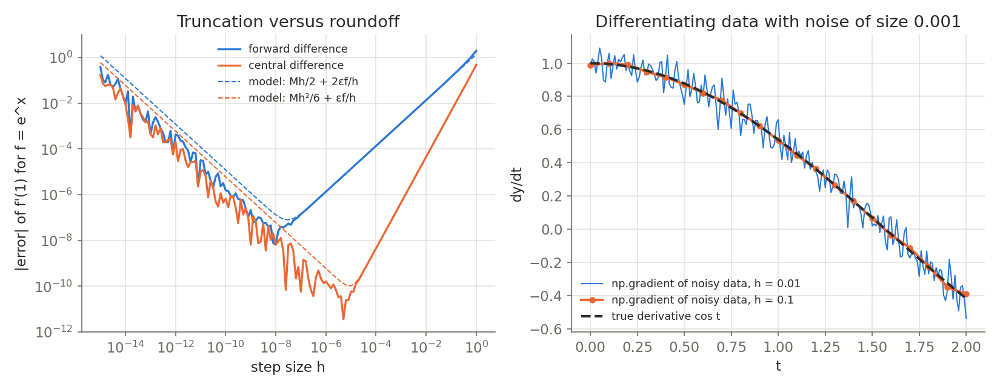
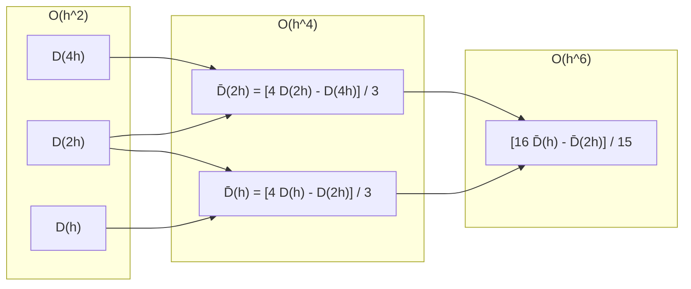

# Chapter 21 — Numerical Differentiation

[Repository Guide](../../README.md) | [English](Concepts_Lecture.md) | [한국어](Concepts_Lecture.ko.md)

> **Last Updated:** 2026-11-19
>
> Applied Numerical Methods with Python for Engineers and Scientists, Chapra and Clough, Ch 21

> **Learning Objectives:**
> 1. Apply finite difference formulas for differentiation
> 2. Analyze truncation error in numerical derivatives
> 3. Implement Richardson extrapolation for improved accuracy
> 4. Apply numerical differentiation formulas to unequally spaced data and multivariable functions
> 5. Estimate the optimal step size from the balance between truncation and roundoff errors
> 6. Explain how differentiating noisy data amplifies errors, and differentiate data with NumPy's gradient

---

<br>

## Table of Contents

- [1. Introduction to Numerical Differentiation](#1-introduction-to-numerical-differentiation)
  - [1.1 The Derivative as a Limit](#11-the-derivative-as-a-limit)
  - [1.2 Second Derivative](#12-second-derivative)
  - [1.3 Partial Derivatives](#13-partial-derivatives)
  - [1.4 Physical Application: Heat Flux](#14-physical-application-heat-flux)
- [2. Finite Difference Approximation for the First Derivative](#2-finite-difference-approximation-for-the-first-derivative)
  - [2.1 Forward Difference (First-Order)](#21-forward-difference-first-order)
  - [2.2 Backward Difference (First-Order)](#22-backward-difference-first-order)
  - [2.3 Central Difference (Second-Order)](#23-central-difference-second-order)
  - [2.4 Balancing Truncation and Roundoff Errors](#24-balancing-truncation-and-roundoff-errors)
  - [2.5 The Fourth-Order Central Difference and a Summary of Formulas](#25-the-fourth-order-central-difference-and-a-summary-of-formulas)
- [3. Finite Difference Approximation for the Second Derivative](#3-finite-difference-approximation-for-the-second-derivative)
  - [3.1 Central Difference via Taylor Series](#31-central-difference-via-taylor-series)
  - [3.2 Forward Difference for the Second Derivative](#32-forward-difference-for-the-second-derivative)
  - [3.3 Error of the Second-Derivative Approximations and a Numerical Check](#33-error-of-the-second-derivative-approximations-and-a-numerical-check)
- [4. Improving Accuracy: Higher-Order Forward Difference](#4-improving-accuracy-higher-order-forward-difference)
- [5. Richardson Extrapolation for Differentiation](#5-richardson-extrapolation-for-differentiation)
  - [5.1 Basic Idea](#51-basic-idea)
  - [5.2 Revisiting the Central Difference Error Structure](#52-revisiting-the-central-difference-error-structure)
  - [5.3 First Extrapolation Level](#53-first-extrapolation-level)
  - [5.4 Second Extrapolation Level](#54-second-extrapolation-level)
- [6. Derivatives of Unequally Spaced Data](#6-derivatives-of-unequally-spaced-data)
  - [6.1 Lagrange Polynomial Approach](#61-lagrange-polynomial-approach)
  - [6.2 Derivatives of the Lagrange Basis Functions](#62-derivatives-of-the-lagrange-basis-functions)
  - [6.3 Differentiating Noisy Data](#63-differentiating-noisy-data)
  - [6.4 A Worked Example of the Unequal-Spacing Formula](#64-a-worked-example-of-the-unequal-spacing-formula)
- [7. Numerical Partial Derivatives](#7-numerical-partial-derivatives)
  - [7.1 First-Order Partial Derivatives (Central Difference)](#71-first-order-partial-derivatives-central-difference)
  - [7.2 Mixed Partial Derivative](#72-mixed-partial-derivative)
  - [7.3 A Worked Example of Partial Derivative Approximations](#73-a-worked-example-of-partial-derivative-approximations)
- [8. Method of Undetermined Coefficients](#8-method-of-undetermined-coefficients)
  - [8.1 Problem Setup](#81-problem-setup)
  - [8.2 Taylor Expansion and Matching](#82-taylor-expansion-and-matching)
  - [8.3 Solving for Coefficients](#83-solving-for-coefficients)
  - [8.4 Truncation Error](#84-truncation-error)
  - [8.5 Undetermined Coefficients for a Non-Centered Stencil](#85-undetermined-coefficients-for-a-non-centered-stencil)
- [9. Differentiable Programming (Brief Overview)](#9-differentiable-programming-brief-overview)
- [10. Python Implementation](#10-python-implementation)
  - [10.1 Forward, Backward, and Central Differences](#101-forward-backward-and-central-differences)
  - [10.2 Richardson Extrapolation for Differentiation](#102-richardson-extrapolation-for-differentiation)
  - [10.3 Derivative of Unequally Spaced Data (Lagrange)](#103-derivative-of-unequally-spaced-data-lagrange)
  - [10.4 Numerical Partial Derivatives](#104-numerical-partial-derivatives)
  - [10.5 NumPy's diff and gradient](#105-numpys-diff-and-gradient)
- [Concept Applications](#concept-applications)
- [Summary](#summary)
- [Self-Check Questions](#self-check-questions)
- [References](#references)

---

<br>

## 1. Introduction to Numerical Differentiation

Numerical differentiation is the process of estimating derivatives from discrete data or function evaluations, rather than computing them analytically. This is essential when:

- The function is known only at discrete points (experimental/field data)
- The analytical derivative is too complex or impossible to obtain
- Derivatives are needed within a larger numerical algorithm (e.g., solving ODEs/PDEs)

### 1.1 The Derivative as a Limit

The finite difference ratio provides a natural starting point:

```math
\frac{\Delta y}{\Delta x} = \frac{f(x + \Delta x) - f(x)}{\Delta x}
```

Taking the limit as $`\Delta x \to 0`$:

```math
\frac{dy}{dx} = \lim_{\Delta x \to 0} \frac{f(x + \Delta x) - f(x)}{\Delta x} =: f'(x)
```

This is **the first derivative of $`y`$ with respect to $`x`$**. Geometrically, the derivative is the slope of the tangent line to the curve at point $`x_i`$.

> **[Calculus]** As $`\Delta x`$ shrinks, the secant line (connecting two points on the curve) approaches the tangent line at $`x_i`$, and the slope of the secant converges to $`f'(x_i)`$. The finite difference approximations of this chapter stop short of this limit and use the slope of the secant at a finite $`\Delta x`$ in place of the derivative.

### 1.2 Second Derivative

The second derivative is the derivative of the first derivative:

```math
\frac{d^2 y}{dx^2} = \frac{d}{dx}\left(\frac{dy}{dx}\right)
```

It measures **how fast the slope is changing**, which indicates the direction (concavity) and degree of bending of the graph.

### 1.3 Partial Derivatives

For a function of two variables $`f(x, y)`$:

```math
\frac{\partial f}{\partial x} = \lim_{\Delta x \to 0} \frac{f(x + \Delta x, y) - f(x, y)}{\Delta x}
```

```math
\frac{\partial f}{\partial y} = \lim_{\Delta y \to 0} \frac{f(x, y + \Delta y) - f(x, y)}{\Delta y}
```

These are the **partial derivatives of $`f`$** with respect to $`x`$ and $`y`$, respectively. Each partial derivative measures the rate of change of $`f`$ while holding the other variable fixed.

### 1.4 Physical Application: Heat Flux

A classic engineering application is Fourier's law of heat conduction. Given a temperature distribution $`T(x)`$, the heat flux is:

```math
\vec{q} = -k \frac{\partial T}{\partial x}
```

where $`k`$ is the thermal conductivity. The negative sign indicates that heat flows from high temperature to low temperature:

- A **positive slope** ($`\partial T / \partial x > 0`$) drives a **negative heat flux** (heat flows in the $`-x`$ direction).
- A **negative slope** ($`\partial T / \partial x < 0`$) drives a **positive heat flux** (heat flows in the $`+x`$ direction).

> **Note:** **Direction of heat flow.** Heat always flows opposite to the temperature gradient. This is a direct physical application of the derivative concept.

---

<br>

## 2. Finite Difference Approximation for the First Derivative

The equally spaced finite difference formulas in this chapter are derived from Taylor series expansions. Let $`h`$ denote the step size between equally spaced points, so that $`x_{i+1} = x_i + h`$.

> **Definition:** A **finite difference approximation** approximates a derivative, without taking the limit that defines it, by a weighted combination of function values at a few points spaced $`h`$ apart. If its error is $`O(h^p)`$, the approximation is said to be $`p`$-th order accurate.

### 2.1 Forward Difference (First-Order)

**Taylor expansion** about $`x_i`$ in the forward direction:

```math
f(x_{i+1}) = f(x_i) + f'(x_i)\,h + f''(x_i)\frac{h^2}{2} + f'''(x_i)\frac{h^3}{6} + \cdots \quad (\ast)
```

Solving equation $`(\ast)`$ for $`f'(x_i)`$:

```math
f'(x_i) = \frac{f(x_{i+1}) - f(x_i)}{h} - f''(x_i)\frac{h}{2} + O(h^2)
```

Dropping the truncation error terms yields the **forward difference** approximation:

```math
\boxed{f'(x_i) \approx \frac{f(x_{i+1}) - f(x_i)}{h}}
```

- **Truncation error**: $`O(h)`$, so the formula is first-order accurate.
- **Leading error term**: $`-f''(x_i)\dfrac{h}{2}`$.
- It uses points $`x_i`$ and $`x_{i+1}`$ (the point itself and one point ahead).

### 2.2 Backward Difference (First-Order)

Similarly, expanding $`f(x_{i-1})`$ about $`x_i`$:

```math
f(x_{i-1}) = f(x_i) - f'(x_i)\,h + f''(x_i)\frac{h^2}{2} - f'''(x_i)\frac{h^3}{6} + \cdots \quad (\ast\ast)
```

Solving for $`f'(x_i)`$:

```math
\boxed{f'(x_i) \approx \frac{f(x_i) - f(x_{i-1})}{h}}
```

- **Truncation error**: $`O(h)`$, so the formula is first-order accurate.
- It uses points $`x_{i-1}`$ and $`x_i`$.

### 2.3 Central Difference (Second-Order)

Subtracting $`(\ast\ast)`$ from $`(\ast)`$:

```math
f(x_{i+1}) - f(x_{i-1}) = 2f'(x_i)\,h + 2f'''(x_i)\frac{h^3}{6} + \cdots
```

Solving for $`f'(x_i)`$:

```math
\boxed{f'(x_i) \approx \frac{f(x_{i+1}) - f(x_{i-1})}{2h}}
```

- **Truncation error**: $`O(h^2)`$, so the formula is second-order accurate.
- **Leading error term**: $`-f'''(x_i)\dfrac{h^2}{6}`$.
- It uses points $`x_{i-1}`$ and $`x_{i+1}`$ (symmetric about $`x_i`$).

> **Key Point:** Because of symmetry, the error terms in odd powers of $`h`$ cancel, so the central difference achieves $`O(h^2)`$ accuracy, higher than the $`O(h)`$ of the forward and backward differences. This is a key advantage whenever both neighboring points are available.

### 2.4 Balancing Truncation and Roundoff Errors

Judging only by the orders of error in Sections 2.1 and 2.3, a smaller $`h`$ should always give a better approximation, but on a computer it does not. The function values $`f(x_i)`$ are stored in floating point, so they carry relative errors of about the machine epsilon $`\varepsilon \approx 2.2 \times 10^{-16}`$ (Chapter 4), and as $`h`$ shrinks, the difference $`f(x_{i+1}) - f(x_i)`$ becomes a subtraction of two nearly equal numbers that loses significant digits. This roundoff error grows when it is divided by the $`h`$ in the denominator.

The total error of the forward difference can be approximated as the sum of the truncation error $`\frac{h}{2}|f''|`$ and the roundoff error of the two function values, $`2\varepsilon|f|`$, divided by $`h`$. With $`M = \max|f''|`$,

```math
E(h) \approx \frac{M}{2}h + \frac{2\varepsilon|f|}{h}
```

The first term decreases with $`h`$ and the second increases as $`h`$ decreases, so the minimum is reached where $`E'(h) = 0`$.

```math
\frac{M}{2} - \frac{2\varepsilon|f|}{h^2} = 0 \quad \Longrightarrow \quad h_{\mathrm{opt}} = 2\sqrt{\frac{\varepsilon|f|}{M}}, \qquad E(h_{\mathrm{opt}}) = 2\sqrt{\varepsilon|f|M}
```

For the central difference the truncation error is $`\frac{h^2}{6}|f'''|`$ and the roundoff error is $`\frac{2\varepsilon|f|}{2h}`$, so with $`M_3 = \max|f'''|`$ the same minimization gives $`h_{\mathrm{opt}} = \left(\frac{3\varepsilon|f|}{M_3}\right)^{1/3}`$. For $`f(x) = e^x`$ at $`x = 1`$, $`f = f'' = f''' = e`$, so the forward difference has $`h_{\mathrm{opt}} = 2\sqrt{\varepsilon} \approx 3 \times 10^{-8}`$ and the central difference $`h_{\mathrm{opt}} = (3\varepsilon)^{1/3} \approx 9 \times 10^{-6}`$.

```python
import numpy as np

f, x0, exact = np.exp, 1.0, np.exp(1.0)       # f'(1) = e
print("     h       forward error    central error")
for k in range(1, 15, 2):
    h = 10.0**(-k)
    fwd = (f(x0 + h) - f(x0)) / h
    cen = (f(x0 + h) - f(x0 - h)) / (2 * h)
    print(f"  1e-{k:02d}    {abs(fwd - exact):12.3e}    {abs(cen - exact):12.3e}")

eps = np.finfo(float).eps                      # machine epsilon
print(f"machine epsilon = {eps:.3e}")
print(f"h_opt forward  ~ 2*sqrt(eps)  = {2 * np.sqrt(eps):.1e}")
print(f"h_opt central  ~ (3*eps)^(1/3) = {(3 * eps)**(1 / 3):.1e}")
```

```text
     h       forward error    central error
  1e-01       1.406e-01       4.533e-03
  1e-03       1.360e-03       4.530e-07
  1e-05       1.359e-05       5.859e-11
  1e-07       1.399e-07       5.859e-11
  1e-09       2.154e-07       6.603e-09
  1e-11       3.263e-05       1.043e-05
  1e-13       4.559e-04       4.559e-04
machine epsilon = 2.220e-16
h_opt forward  ~ 2*sqrt(eps)  = 3.0e-08
h_opt central  ~ (3*eps)^(1/3) = 8.7e-06
```

- `np.finfo(float).eps` is the machine epsilon of double precision, $`2^{-52}`$.
- The forward-difference error shrinks by a factor of 100 each time $`h`$ is reduced by a factor of 100 ($`O(h)`$), reaches its minimum near $`h = 10^{-7}`$, and grows again for smaller $`h`$. The central-difference error shrinks by a factor of ten thousand from $`h = 10^{-1}`$ to $`10^{-3}`$ ($`O(h^2)`$) and reaches its minimum near $`h = 10^{-5}`$.
- At $`h = 10^{-13}`$ the two methods have the same error, because the truncation error is negligible and almost all of the error is roundoff.

The left panel of Figure 1 shows the error curves for continuously varying $`h`$ together with the model $`E(h)`$ above. The straight part descending to the lower right is truncation error, the part rising on the left is roundoff error, and the roundoff part is jagged because rounding varies irregularly with $`h`$. The central difference has a larger optimal $`h`$ and a smaller minimum error, so it is more accurate for the same computational cost.



*Figure 1. Finite difference error versus step size, and differentiation of noisy data*

> **Caution:** Choosing $`h`$ as small as possible is a common mistake in numerical differentiation. In double precision, the forward difference is limited to about 8 digits and the central difference to about 10 to 11 digits, and if the function values themselves contain measurement errors or errors from iterative computations, the optimal $`h`$ becomes much larger and the attainable accuracy lower.

### 2.5 The Fourth-Order Central Difference and a Summary of Formulas

The error of the central difference $`D(h) = \frac{f(x+h) - f(x-h)}{2h}`$ consists of even powers only, $`f'''\frac{h^2}{6} + f^{(5)}\frac{h^4}{120} + \cdots`$. Applying the Richardson extrapolation of Section 5 to $`h`$ and $`2h`$ to remove the $`h^2`$ term gives

```math
\frac{4D(h) - D(2h)}{3} = \frac{f(x - 2h) - 8f(x - h) + 8f(x + h) - f(x + 2h)}{12h} = f'(x) - \frac{h^4}{30}f^{(5)}(x) + \cdots
```

the five-point central difference formula with $`O(h^4)`$ error. The error constant comes from $`\frac{4 - 16}{3} \cdot \frac{1}{120} = -\frac{1}{30}`$.

```python
import numpy as np

f, x0, exact = np.exp, 1.0, np.exp(1.0)
D = lambda h: (f(x0 + h) - f(x0 - h)) / (2 * h)                      # O(h^2)
D4 = lambda h: (f(x0 - 2*h) - 8*f(x0 - h) + 8*f(x0 + h) - f(x0 + 2*h)) / (12 * h)   # O(h^4)
for h in [0.2, 0.1, 0.05]:
    print(f"h = {h:4.2f}: central error = {D(h) - exact:+.3e}, "
          f"fourth-order error = {D4(h) - exact:+.3e}")
print("Richardson (4D(h) - D(2h))/3 at h = 0.1:", (4 * D(0.1) - D(0.2)) / 3, " D4(0.1):", D4(0.1))
```

```text
h = 0.20: central error = +1.816e-02, fourth-order error = -1.457e-04
h = 0.10: central error = +4.533e-03, fourth-order error = -9.072e-06
h = 0.05: central error = +1.133e-03, fourth-order error = -5.665e-07
Richardson (4D(h) - D(2h))/3 at h = 0.1: 2.7182727567264906  D4(0.1): 2.71827275672649
```

Halving $`h`$ reduces the error of the central difference to about one quarter and that of the five-point formula to about one sixteenth. At $`h = 0.1`$ the five-point error $`-9.072 \times 10^{-6}`$ is almost equal to the leading error term $`-\frac{(0.1)^4}{30}e = -9.06 \times 10^{-6}`$, and the last line confirms that Richardson extrapolation and the five-point formula give the same number. The formulas so far are summarized below.

| Derivative | Formula | Points used | Leading error term |
|:-----|:-----|:-----|:-----|
| $`f'`$ forward | $`\frac{f_{i+1} - f_i}{h}`$ | $`i, i+1`$ | $`-\frac{h}{2}f''`$ |
| $`f'`$ backward | $`\frac{f_i - f_{i-1}}{h}`$ | $`i-1, i`$ | $`+\frac{h}{2}f''`$ |
| $`f'`$ central | $`\frac{f_{i+1} - f_{i-1}}{2h}`$ | $`i-1, i+1`$ | $`-\frac{h^2}{6}f'''`$ |
| $`f'`$ three-point forward | $`\frac{-f_{i+2} + 4f_{i+1} - 3f_i}{2h}`$ | $`i, i+1, i+2`$ | $`+\frac{h^2}{3}f'''`$ |
| $`f'`$ five-point central | $`\frac{f_{i-2} - 8f_{i-1} + 8f_{i+1} - f_{i+2}}{12h}`$ | $`i-2, \ldots, i+2`$ | $`+\frac{h^4}{30}f^{(5)}`$ |
| $`f''`$ central | $`\frac{f_{i+1} - 2f_i + f_{i-1}}{h^2}`$ | $`i-1, i, i+1`$ | $`-\frac{h^2}{12}f^{(4)}`$ |

*Table 1. Finite difference formulas and their leading error terms (true value minus approximation)*

The leading error term in the table is the true value minus the approximation, $`f' - (\text{approximation})`$. The forward and backward differences have errors of opposite sign, so their average cancels the $`h`$ term and gives the central difference, which is another way to see why the central difference is one order higher.

---

<br>

## 3. Finite Difference Approximation for the Second Derivative

### 3.1 Central Difference via Taylor Series

Adding $`(\ast)`$ and $`(\ast\ast)`$ together:

```math
f(x_{i+1}) + f(x_{i-1}) = 2f(x_i) + f''(x_i)\,h^2 + O(h^4)
```

Solving for $`f''(x_i)`$:

```math
\boxed{f''(x_i) = \frac{f(x_{i+1}) - 2f(x_i) + f(x_{i-1})}{h^2} + O(h^2)}
```

This is the **central difference approximation for the second derivative**:

- **Truncation error**: $`O(h^2)`$, so the formula is second-order accurate.
- It uses three equally spaced points: $`x_{i-1}`$, $`x_i`$, $`x_{i+1}`$.

> **Note:** **Interpretation of the formula.** The numerator equals $`2\left(\frac{f(x_{i+1}) + f(x_{i-1})}{2} - f(x_i)\right)`$, so the formula measures how much the function value at $`x_i`$ deviates from the average of its two neighbors. A positive $`f''`$ means the graph curves upward (concave up), while a negative $`f''`$ means it curves downward (concave down).

### 3.2 Forward Difference for the Second Derivative

To derive a **forward** formula for $`f''(x_i)`$ using only forward points, expand $`f(x_{i+2})`$:

```math
f(x_{i+2}) = f(x_i) + f'(x_i)\,(2h) + f''(x_i)\frac{(2h)^2}{2} + f'''(x_i)\frac{(2h)^3}{6} + O(h^4) \quad (\ast\ast\ast)
```

Computing $`(\ast\ast\ast) - 2(\ast)`$:

```math
f(x_{i+2}) - 2f(x_{i+1}) = -f(x_i) + f''(x_i)\,h^2 + O(h^3)
```

Solving for $`f''(x_i)`$:

```math
\boxed{f''(x_i) = \frac{f(x_{i+2}) - 2f(x_{i+1}) + f(x_i)}{h^2} + O(h)}
```

- **Truncation error**: $`O(h)`$, so the formula is first-order accurate (less accurate than the central formula).
- It uses three forward points: $`x_i`$, $`x_{i+1}`$, $`x_{i+2}`$.

### 3.3 Error of the Second-Derivative Approximations and a Numerical Check

Comparing the errors of the central difference of Section 3.1 and the forward difference of Section 3.2 by Taylor expansion gives the following (the error of the central difference is derived rigorously, including the remainder, in Section 8.4).

```math
\frac{f(x+h) - 2f(x) + f(x-h)}{h^2} = f''(x) + \frac{h^2}{12}f^{(4)}(x) + O(h^4), \qquad \frac{f(x+2h) - 2f(x+h) + f(x)}{h^2} = f''(x) + h\,f'''(x) + O(h^2)
```

In the central difference the odd-order terms of the expansions of $`f(x \pm h)`$ cancel, so the error starts at $`h^2`$, whereas the forward difference is not symmetric and keeps an $`h`$ term. Checking with $`f(x) = e^x`$ at $`x = 1`$ ($`f'' = e`$) gives the following.

| $`h`$ | Error of the central difference | Error of the forward difference |
|:-----|:-----|:-----|
| 0.1 | $`+2.266 \times 10^{-3}`$ | $`+2.884 \times 10^{-1}`$ |
| 0.05 | $`+5.664 \times 10^{-4}`$ | $`+1.400 \times 10^{-1}`$ |
| 0.025 | $`+1.416 \times 10^{-4}`$ | $`+6.896 \times 10^{-2}`$ |

*Table 2. Errors of second-derivative approximations for $`f(x) = e^x`$ at $`x = 1`$ (approximation minus true value)*

The error of the central difference drops to a quarter each time $`h`$ is halved, and at $`h = 0.1`$ it nearly equals the leading term $`\frac{(0.1)^2}{12}e = 2.265 \times 10^{-3}`$. The error of the forward difference only halves and is close to the leading term $`h\,e = 0.272`$.

The second derivative has $`h^2`$ in the denominator, so it is more sensitive to roundoff. The roundoff errors of the three function values add up to at most $`4\varepsilon|f|`$, so the total error is $`E(h) \approx \frac{h^2}{12}|f^{(4)}| + \frac{4\varepsilon|f|}{h^2}`$, and minimizing it as in Section 2.4 gives $`h_{\mathrm{opt}} = \left(\frac{48\varepsilon|f|}{|f^{(4)}|}\right)^{1/4}`$. For $`e^x`$ at $`x = 1`$ this is $`(48\varepsilon)^{1/4} \approx 3 \times 10^{-4}`$. Indeed, the error of the central difference falls as $`2.3 \times 10^{-3}`$, $`2.3 \times 10^{-5}`$, $`2.3 \times 10^{-7}`$ for $`h = 10^{-1}, 10^{-2}, 10^{-3}`$, reaches its minimum $`3.8 \times 10^{-8}`$ at $`h = 10^{-4}`$, and grows to $`6.0 \times 10^{-6}`$ at $`h = 10^{-5}`$ and $`8 \times 10^{-2}`$ at $`h = 10^{-7}`$. Compared with the central difference for the first derivative, which reached an error of about $`10^{-11}`$ near $`h \approx 10^{-5}`$, the attainable accuracy for the second derivative is lower, about 8 digits.

---

<br>

## 4. Improving Accuracy: Higher-Order Forward Difference

We can improve the forward difference for $`f'(x_i)`$ by incorporating the second derivative correction term. Recall from Section 2.1:

```math
f'(x_i) = \frac{f(x_{i+1}) - f(x_i)}{h} - \underbrace{f''(x_i)}_{\text{plug in FD approx.}}\frac{h}{2} + O(h^2)
```

Substituting the forward difference approximation for $`f''(x_i)`$:

```math
f''(x_i) \approx \frac{f(x_{i+2}) - 2f(x_{i+1}) + f(x_i)}{h^2}
```

into the error term:

```math
f'(x_i) = \frac{f(x_{i+1}) - f(x_i)}{h} - \frac{f(x_{i+2}) - 2f(x_{i+1}) + f(x_i)}{2h} + O(h^2)
```

Combining:

```math
\boxed{f'(x_i) = \frac{-f(x_{i+2}) + 4f(x_{i+1}) - 3f(x_i)}{2h} + O(h^2)}
```

This is the **second-order forward difference** formula for $`f'(x_i)`$.

- **Accuracy improves** from $`O(h)`$ to $`O(h^2)`$ by including one additional point.
- Adding the second-derivative (diffusion) correction term enhances the accuracy.

Figure 2 summarizes the points used by the formulas derived so far.

```text
         x_{i-1}     x_i     x_{i+1}   x_{i+2}
  ──────────┼─────────┼─────────┼─────────┼────
            ●─────────●                          backward difference: f'(x_i), O(h)
                      ●─────────●                forward difference: f'(x_i), O(h)
            ●───────────────────●                central difference: f'(x_i), O(h^2)
            ●─────────●─────────●                central difference: f''(x_i), O(h^2)
                      ●─────────●─────────●      forward difference: f''(x_i), O(h); second-order forward: f'(x_i), O(h^2)
```

*Figure 2. Points (stencils) used by the finite difference formulas*

> **Note:** **Correction terms and Richardson extrapolation.** The idea of substituting a numerical approximation for the error's leading term back into the formula is a general technique for increasing accuracy. It is closely related to Richardson extrapolation (Section 5).

---

<br>

## 5. Richardson Extrapolation for Differentiation

### 5.1 Basic Idea

Recall from numerical integration (Chapter 20) that Richardson extrapolation uses two estimates computed with different step sizes to eliminate leading error terms. For integrals computed with the trapezoidal rule, whose error is $`O(h^2)`$:

```math
I = I(h_2) + \frac{1}{(h_1/h_2)^2 - 1}\bigl(I(h_2) - I(h_1)\bigr)
```

When $`h_1/h_2 = 2`$:

```math
I = \frac{4}{3}I(h_2) - \frac{1}{3}I(h_1)
```

Similarly, for derivative estimates whose error is $`O(h^2)`$, such as the central difference:

```math
\boxed{D = \frac{4}{3}D(h_2) - \frac{1}{3}D(h_1)}
```

where $`D(h_1)`$ and $`D(h_2)`$ are derivative estimates computed with step sizes $`h_1`$ (larger) and $`h_2 = h_1/2`$ (smaller).

### 5.2 Revisiting the Central Difference Error Structure

Start with the Taylor expansions:

```math
f(x+h) = \sum_{k=0}^{\infty} \frac{f^{(k)}(x)}{k!}h^k
```

```math
f(x-h) = \sum_{k=0}^{\infty} \frac{f^{(k)}(x)}{k!}(-h)^k = \sum_{k=0}^{\infty} \frac{f^{(k)}(x)}{k!}(-1)^k h^k
```

Computing $`f(x+h) - f(x-h)`$:

```math
f(x+h) - f(x-h) = 2h\,f'(x) + 2f'''(x)\frac{h^3}{3!} + 2f^{(5)}(x)\frac{h^5}{5!} + \cdots
```

Dividing by $`2h`$:

```math
f'(x) = \frac{f(x+h) - f(x-h)}{2h} - f'''(x)\frac{h^2}{3!} - f^{(5)}(x)\frac{h^4}{5!} - \cdots
```

Define the central difference operator and error coefficients:

```math
D(h) = \frac{f(x+h) - f(x-h)}{2h}
```

```math
e_2 = -\frac{f^{(3)}(x)}{3!}, \qquad e_4 = -\frac{f^{(5)}(x)}{5!}
```

Then:

```math
f'(x) = D(h) + e_2\,h^2 + e_4\,h^4 + \cdots
```

where the error $`E(h) = e_2\,h^2 + e_4\,h^4 + \cdots`$.

> **Key Point:** The error coefficients $`e_2, e_4, \ldots`$ are **independent of $`h`$**; they depend only on the function and the evaluation point $`x`$. This is exactly the property that makes Richardson extrapolation possible.

### 5.3 First Extrapolation Level

**Goal**: Eliminate the $`h^2`$ term.

Write the approximation at step sizes $`h`$ and $`2h`$:

```math
f'(x) = D(h) + e_2\,h^2 + e_4\,h^4 + \cdots \quad \text{(multiply by 4)}
```

```math
f'(x) = D(2h) + e_2\,(2h)^2 + e_4\,(2h)^4 + \cdots
```

Compute $`4 \times (\text{first}) - (\text{second})`$:

```math
3f'(x) = 4D(h) - D(2h) - 12h^4 e_4 + O(h^6)
```

```math
\boxed{f'(x) = \underbrace{\frac{4}{3}D(h) - \frac{1}{3}D(2h)}_{=:\,\bar{D}(h)} - 4h^4 e_4 + O(h^6)}
```

The combined estimate $`\bar{D}(h)`$ is now **$`O(h^4)`$** accurate because the $`h^2`$ error has been eliminated.

### 5.4 Second Extrapolation Level

Continue the same process to eliminate the $`h^4`$ term. At step sizes $`h`$ and $`2h`$:

```math
f'(x) = \bar{D}(h) - 4h^4 e_4 + O(h^6)
```

```math
f'(x) = \bar{D}(2h) - 4(2h)^4 e_4 + O(h^6)
```

Compute $`16 \times (\text{first}) - (\text{second})`$:

```math
15f'(x) = 16\bar{D}(h) - \bar{D}(2h) + O(h^6)
```

```math
\boxed{f'(x) = \frac{16}{15}\bar{D}(h) - \frac{1}{15}\bar{D}(2h) + O(h^6)}
```

This is now **$`O(h^6)`$** accurate. In principle the process can be continued, each level eliminating the next even power of $`h`$.

> **Note:** **General pattern.** Richardson extrapolation is a systematic way to accelerate convergence. At each level, the leading error term is cancelled by combining estimates at two different step sizes. For the central difference, whose errors contain only even powers of $`h`$, the $`n`$th level uses the ratio $`4^n`$: the weights are $`\frac{4^n}{4^n - 1}`$ and $`\frac{-1}{4^n - 1}`$.

Figure 3 shows how two levels of extrapolation are built from central differences with step sizes $`h`$, $`2h`$, and $`4h`$. The `richardson_diff` function in Section 10.2 computes this table.



*Figure 3. Structure of the Richardson extrapolation table*

---

<br>

## 6. Derivatives of Unequally Spaced Data

In practice, data from experiments or field studies is often collected at **unequal intervals**. The finite difference formulas derived above assume equally spaced points and cannot be applied directly.

### 6.1 Lagrange Polynomial Approach

One way to handle non-equispaced data is to fit a **Lagrange polynomial** and then differentiate it.

Given three data points $`(x_0, y_0)`$, $`(x_1, y_1)`$, $`(x_2, y_2)`$, construct a 2nd-order Lagrange polynomial:

```math
f(x) = y_0\,N_0(x) + y_1\,N_1(x) + y_2\,N_2(x)
```

where $`N_k(x)`$ are the Lagrange basis functions. Differentiating:

```math
f'(x) = y_0\,N_0'(x) + y_1\,N_1'(x) + y_2\,N_2'(x)
```

### 6.2 Derivatives of the Lagrange Basis Functions

For three points, the basis functions and their derivatives are:

**Basis function $`N_0(x)`$**:

```math
N_0(x) = \frac{(x - x_1)(x - x_2)}{(x_0 - x_1)(x_0 - x_2)} = \frac{x^2 - (x_1 + x_2)x + x_1 x_2}{(x_0 - x_1)(x_0 - x_2)}
```

```math
N_0'(x) = \frac{2x - x_1 - x_2}{(x_0 - x_1)(x_0 - x_2)}
```

**Basis function $`N_1(x)`$**:

```math
N_1(x) = \frac{(x - x_0)(x - x_2)}{(x_1 - x_0)(x_1 - x_2)} = \frac{x^2 - (x_0 + x_2)x + x_0 x_2}{(x_1 - x_0)(x_1 - x_2)}
```

```math
N_1'(x) = \frac{2x - x_0 - x_2}{(x_1 - x_0)(x_1 - x_2)}
```

**Basis function $`N_2(x)`$**:

```math
N_2(x) = \frac{(x - x_0)(x - x_1)}{(x_2 - x_0)(x_2 - x_1)} = \frac{x^2 - (x_0 + x_1)x + x_0 x_1}{(x_2 - x_0)(x_2 - x_1)}
```

```math
N_2'(x) = \frac{2x - x_0 - x_1}{(x_2 - x_0)(x_2 - x_1)}
```

The derivative at any point $`x`$ is then:

```math
f'(x) = y_0 \cdot \frac{2x - x_1 - x_2}{(x_0 - x_1)(x_0 - x_2)} + y_1 \cdot \frac{2x - x_0 - x_2}{(x_1 - x_0)(x_1 - x_2)} + y_2 \cdot \frac{2x - x_0 - x_1}{(x_2 - x_0)(x_2 - x_1)}
```

> **Note:** **Relation to equally spaced data.** This approach works for any spacing of the data points. When the points happen to be equally spaced (i.e., $`x_1 - x_0 = x_2 - x_1 = h`$), substituting $`x = x_1`$ into the formula above recovers the standard central difference formula $`f'(x_1) \approx (y_2 - y_0)/(2h)`$.

### 6.3 Differentiating Noisy Data

Measured data contain noise. If each function value carries independent noise of standard deviation $`\sigma`$, the noise part of the central difference $`\frac{y_{i+1} - y_{i-1}}{2h}`$ has standard deviation $`\frac{\sqrt{2}\sigma}{2h} = \frac{\sigma}{\sqrt{2}h}`$. This grows as $`h`$ shrinks, so the denser the data, the more the derivative is shaken by noise. The structure is the same as that of the roundoff error in Section 2.4; the only difference is that the noise is much larger than $`\varepsilon|f|`$.

```python
import numpy as np

rng = np.random.default_rng(0)
sigma = 0.001                                          # noise standard deviation
for h in [0.01, 0.1]:
    t = np.arange(0.0, 2.0 + h / 2, h)
    y = np.sin(t) + rng.normal(0.0, sigma, t.size)     # noisy samples of sin(t)
    dydt = np.gradient(y, t)                           # central differences inside
    err = dydt[1:-1] - np.cos(t[1:-1])
    print(f"h = {h:4.2f}: max |error| = {np.max(np.abs(err)):.4f}, "
          f"noise std sigma/(sqrt(2) h) = {sigma / (np.sqrt(2) * h):.4f}")
```

```text
h = 0.01: max |error| = 0.1884, noise std sigma/(sqrt(2) h) = 0.0707
h = 0.10: max |error| = 0.0249, noise std sigma/(sqrt(2) h) = 0.0071
```

- `rng.normal(0.0, sigma, t.size)` generates noise with mean 0 and standard deviation 0.001. The seed is fixed at 0 so that the results can be reproduced.
- `np.gradient(y, t)` computes central differences at the interior points (Section 10.5). The end points are excluded from the comparison.
- The noise is only about 0.1% of the function values, yet at $`h = 0.01`$ the maximum error of the derivative is 0.19, about 20% of the size of the derivative (right panel of Figure 1).

Integration averages noise and reduces it, but differentiation amplifies it by a factor of $`1/h`$. The following approaches are used to differentiate noisy data.

1. Difference over a wider spacing. In the example above the error drops to 0.025 at $`h = 0.1`$, but too wide a spacing increases the truncation error.
2. First fit a smooth curve by the regression of Chapters 14 and 15, and then differentiate that curve analytically.
3. Approximate the data by a smooth function such as a spline of Chapter 18 and then differentiate it. An interpolating spline passes through every point and therefore follows the noise; to reduce noise, a smoothing spline that does not pass exactly through the points is used.

### 6.4 A Worked Example of the Unequal-Spacing Formula

Written out, the formula of Section 6.2, the derivative of the quadratic through the three points $`(x_0, f_0)`$, $`(x_1, f_1)`$, $`(x_2, f_2)`$, is as follows.

```math
f'(x) \approx f_0\frac{2x - x_1 - x_2}{(x_0 - x_1)(x_0 - x_2)} + f_1\frac{2x - x_0 - x_2}{(x_1 - x_0)(x_1 - x_2)} + f_2\frac{2x - x_0 - x_1}{(x_2 - x_0)(x_2 - x_1)}
```

Suppose $`f(x) = \sin x`$ is sampled at the unequally spaced points $`x = 0, 0.4, 1.0`$, and the derivative is estimated at each of the three points.

```python
import numpy as np

def lagrange_deriv(xd, fd, x):
    """Derivative at x of the quadratic through three (possibly unequal) points."""
    x0, x1, x2 = xd; f0, f1, f2 = fd
    return (f0 * (2*x - x1 - x2) / ((x0 - x1) * (x0 - x2))
            + f1 * (2*x - x0 - x2) / ((x1 - x0) * (x1 - x2))
            + f2 * (2*x - x0 - x1) / ((x2 - x0) * (x2 - x1)))

xd = np.array([0.0, 0.4, 1.0]); fd = np.sin(xd)
for x in xd:
    d = lagrange_deriv(xd, fd, x)
    print(f"x = {x:.1f}: estimate = {d:.6f}, exact cos x = {np.cos(x):.6f}, error = {d - np.cos(x):+.6f}")
```

```text
x = 0.0: estimate = 1.061596, exact cos x = 1.000000, error = +0.061596
x = 0.4: estimate = 0.885496, exact cos x = 0.921061, error = -0.035565
x = 1.0: estimate = 0.621346, exact cos x = 0.540302, error = +0.081044
```

- The three terms of `lagrange_deriv` are the basis function derivatives $`L_i'(x)`$ of Section 6.2 multiplied by $`f_i`$. The denominators depend only on the data, so when derivatives at several points are needed from the same data, they can be computed once.
- The error at the middle point $`x_1 = 0.4`$ is smaller than at the ends. Up to the leading term, the error at the middle point is $`\frac{h_0h_1}{6}f'''`$ ($`h_0 = 0.4`$, $`h_1 = 0.6`$), and with $`f''' = -\cos x`$ this gives $`-\frac{0.24}{6}\cos 0.4 = -0.0368`$, close to the actual error $`-0.0356`$.
- At the end points only one side's neighbors are used, as in a one-sided difference, so the error is larger. For the same reason as extrapolation in Chapter 17, the derivative of an interpolating polynomial is less accurate at the edges of the data interval.

With equal spacing ($`x_1 - x_0 = x_2 - x_1 = h`$), the formula at the middle point reduces to the central difference $`\frac{f_2 - f_0}{2h}`$, and the formula at the left end to the three-point forward difference of Section 4, $`\frac{-3f_0 + 4f_1 - f_2}{2h}`$, because both are derivatives of the same quadratic.

---

<br>

## 7. Numerical Partial Derivatives

### 7.1 First-Order Partial Derivatives (Central Difference)

For a function $`f(x, y)`$, the centered finite difference approximations for partial derivatives are:

```math
\boxed{\frac{\partial f}{\partial x} \approx \frac{f(x + \Delta x,\, y) - f(x - \Delta x,\, y)}{2\,\Delta x}}
```

```math
\boxed{\frac{\partial f}{\partial y} \approx \frac{f(x,\, y + \Delta y) - f(x,\, y - \Delta y)}{2\,\Delta y}}
```

They are $`O(\Delta x^2)`$ and $`O(\Delta y^2)`$ accurate, respectively.

### 7.2 Mixed Partial Derivative

The mixed second partial derivative $`\dfrac{\partial^2 f}{\partial x \,\partial y}`$ is computed by applying the central difference twice:

```math
\frac{\partial^2 f}{\partial x \,\partial y} = \frac{\partial}{\partial x}\left(\frac{\partial f}{\partial y}\right)
```

```math
\approx \frac{1}{2\,\Delta x}\left(\left.\frac{\partial f}{\partial y}\right|_{x+\Delta x,\,y} - \left.\frac{\partial f}{\partial y}\right|_{x-\Delta x,\,y}\right)
```

Applying the central difference for $`\partial f / \partial y`$ at each point:

```math
\approx \frac{1}{2\,\Delta x}\left(\frac{f(x+\Delta x,\, y+\Delta y) - f(x+\Delta x,\, y-\Delta y)}{2\,\Delta y} - \frac{f(x-\Delta x,\, y+\Delta y) - f(x-\Delta x,\, y-\Delta y)}{2\,\Delta y}\right)
```

Simplifying:

```math
\boxed{\frac{\partial^2 f}{\partial x \,\partial y} \approx \frac{f(x+\Delta x,\, y+\Delta y) - f(x+\Delta x,\, y-\Delta y) - f(x-\Delta x,\, y+\Delta y) + f(x-\Delta x,\, y-\Delta y)}{4\,\Delta x\,\Delta y}}
```

This requires four function evaluations at the diagonal points $`(x \pm \Delta x, y \pm \Delta y)`$ around $`(x, y)`$, with the weight signs shown in Figure 4.

```text
            x - Δx          x           x + Δx

  y + Δy      ● -1                        ● +1

     y                      ○ (x, y)

  y - Δy      ● +1                        ● -1
```

*Figure 4. Four diagonal points and weight signs of the mixed partial derivative approximation*

### 7.3 A Worked Example of Partial Derivative Approximations

The formulas of Sections 7.1 and 7.2 are applied to $`f(x, y) = e^x\sin y`$ at $`(0.5, 1.0)`$ with $`\Delta x = \Delta y = h`$. The true values are $`f_x = e^{0.5}\sin 1 = 1.387351`$ and $`f_y = f_{xy} = e^{0.5}\cos 1 = 0.890808`$.

| $`h`$ | $`f_x`$ estimate (error) | $`f_y`$ estimate (error) | $`f_{xy}`$ estimate (error) |
|:-----|:-----|:-----|:-----|
| 0.1 | 1.389665 ($`+2.31 \times 10^{-3}`$) | 0.889324 ($`-1.48 \times 10^{-3}`$) | 0.890807 ($`-9.9 \times 10^{-7}`$) |
| 0.05 | 1.387929 ($`+5.78 \times 10^{-4}`$) | 0.890437 ($`-3.71 \times 10^{-4}`$) | 0.890808 ($`-6.2 \times 10^{-8}`$) |

*Table 3. Partial derivative approximations and errors for $`f = e^x\sin y`$ at $`(0.5, 1.0)`$ with two step sizes*

The errors of $`f_x`$ and $`f_y`$ drop to a quarter when $`h`$ is halved, the same $`O(h^2)`$ as the one-variable central difference. Each partial derivative is the derivative of a one-variable function with the other variable fixed, so the error analysis of Section 2 applies as is. The error of $`f_x`$ is positive and that of $`f_y`$ negative because the leading terms $`\frac{h^2}{6}f_{xxx}`$ and $`\frac{h^2}{6}f_{yyy}`$ have opposite signs ($`f_{xxx} = e^x\sin y > 0`$, $`f_{yyy} = -e^x\cos y < 0`$). The error of $`f_{xy}`$ is unusually small because this function is a product of a function of $`x`$ and a function of $`y`$, so the mixed difference becomes the product of two one-variable central differences, $`\frac{\sinh h}{h} \cdot \frac{\sin h}{h} \cdot e^x\cos y`$, and the $`h^2`$ terms of the two factors, $`+\frac{h^2}{6}`$ and $`-\frac{h^2}{6}`$, cancel. For general functions the error of the mixed difference is $`O(h^2)`$.


---

<br>

## 8. Method of Undetermined Coefficients

This is a systematic technique for deriving finite difference formulas that approximate a derivative using a specified set of points.

> **Definition:** A **stencil** is the set of grid points, with their relative positions, that a finite difference formula uses to approximate the derivative at one point. For example, the stencil of the central difference is $`\{x-h, x+h\}`$, and that of the central difference for the second derivative is $`\{x-h, x, x+h\}`$.

### 8.1 Problem Setup

Seek an approximation of the second derivative $`f''(x)`$ based on the function values $`f(x-h)`$, $`f(x)`$, $`f(x+h)`$ at three equally spaced points:

```math
f''(x) \approx a\,f(x-h) + b\,f(x) + c\,f(x+h)
```

The coefficients $`a`$, $`b`$, $`c`$ are determined by substituting Taylor expansions and matching the coefficient of each derivative.

### 8.2 Taylor Expansion and Matching

Expand $`f(x-h)`$ and $`f(x+h)`$ in Taylor series (with remainders involving $`\xi_- \in [x-h, x]`$ and $`\xi_+ \in [x, x+h]`$):

```math
f(x-h) = f(x) - f'(x)\,h + f''(x)\frac{h^2}{2} - f'''(x)\frac{h^3}{6} + f^{(4)}(\xi_-)\frac{h^4}{24}
```

```math
f(x+h) = f(x) + f'(x)\,h + f''(x)\frac{h^2}{2} + f'''(x)\frac{h^3}{6} + f^{(4)}(\xi_+)\frac{h^4}{24}
```

Substituting into the approximation and grouping by derivatives:

```math
a\,f(x-h) + b\,f(x) + c\,f(x+h) = (a + b + c)\,f(x) + (-a + c)\,h\,f'(x) + (a + c)\frac{h^2}{2}\,f''(x)
```
```math
\quad + (c - a)\frac{h^3}{6}\,f'''(x) + \frac{h^4}{24}\bigl(a\,f^{(4)}(\xi_-) + c\,f^{(4)}(\xi_+)\bigr)
```

### 8.3 Solving for Coefficients

For this expression to equal $`f''(x)`$, we need:

| Condition | Equation |
|:----------|:---------|
| Coefficient of $`f(x)`$ is 0 | $`a + b + c = 0`$ |
| Coefficient of $`f'(x)`$ is 0 | $`-a + c = 0`$ (equivalently, $`c = a`$) |
| Coefficient of $`f''(x)`$ is 1 | $`(a + c)\dfrac{h^2}{2} = 1`$ |

*Table 4. Coefficient conditions for the second derivative approximation*

From $`c = a`$ and $`(a + c)\dfrac{h^2}{2} = 1`$:

```math
2a \cdot \frac{h^2}{2} = 1 \implies a = \frac{1}{h^2}
```

Therefore:

```math
\boxed{a = \frac{1}{h^2}, \quad c = \frac{1}{h^2}, \quad b = -\frac{2}{h^2}}
```

### 8.4 Truncation Error

Plugging back in, the third-derivative term vanishes since $`c - a = 0`$. The truncation error comes from the remainder involving the fourth derivative:

```math
f''(x) = \frac{1}{h^2}\bigl(f(x-h) - 2f(x) + f(x+h)\bigr) - \frac{h^2}{24}\bigl(f^{(4)}(\xi_-) + f^{(4)}(\xi_+)\bigr)
```

If $`f^{(4)}`$ is continuous, the average of $`f^{(4)}(\xi_-)`$ and $`f^{(4)}(\xi_+)`$ lies between the two values, so by the **Intermediate Value Theorem** there exists some $`\xi \in [x-h, x+h]`$ such that:

```math
f^{(4)}(\xi) = \frac{1}{2}\bigl(f^{(4)}(\xi_-) + f^{(4)}(\xi_+)\bigr)
```

Therefore:

```math
\boxed{f''(x) = \frac{f(x-h) - 2f(x) + f(x+h)}{h^2} - \frac{h^2}{12}\,f^{(4)}(\xi)}
```

This confirms the central difference for $`f''`$ is $`O(h^2)`$ accurate, with the explicit truncation error term $`-\dfrac{h^2}{12}f^{(4)}(\xi)`$.

> **Key Point:** The method of undetermined coefficients is versatile. By choosing which points to include and which derivative to approximate, one can derive any finite difference stencil. The system of equations is always linear in the unknown coefficients, making it straightforward to solve.

### 8.5 Undetermined Coefficients for a Non-Centered Stencil

The method of undetermined coefficients applies equally to asymmetric stencils. Consider approximating $`f'(x)`$ with the stencil $`\{x-h, x, x+h, x+2h\}`$, which has one point on the left and two on the right. Such formulas are used where one side lacks neighbors, as at a point next to a boundary.

Write the approximation as $`f'(x) \approx \frac{1}{h}\sum_j w_j f(x + s_jh)`$ with $`s_j \in \{-1, 0, 1, 2\}`$, and expand each $`f(x + s_jh)`$ in a Taylor series; the coefficient of $`f^{(k)}(x)`$ is then $`\frac{h^{k-1}}{k!}\sum_j w_js_j^k`$. Keeping only $`f'`$ requires the following conditions for $`k = 0, 1, 2, 3`$.

```math
\sum_j w_j = 0, \qquad \sum_j w_js_j = 1, \qquad \sum_j w_js_j^2 = 0, \qquad \sum_j w_js_j^3 = 0
```

The solution of this system is $`w = \left(-\frac{1}{3}, -\frac{1}{2}, 1, -\frac{1}{6}\right)`$, and the formula is

```math
f'(x) \approx \frac{-2f(x-h) - 3f(x) + 6f(x+h) - f(x+2h)}{6h}
```

The coefficient of the next term is $`\frac{h^3}{4!}\sum_j w_js_j^4 = \frac{h^3}{24}\left(-\frac{1}{3} + 1 - \frac{16}{6}\right) = -\frac{h^3}{12}`$, so the approximation equals $`f'(x) - \frac{h^3}{12}f^{(4)}(x) + \cdots`$ and is third-order accurate.

```python
import numpy as np
from math import factorial

def fd_weights(offsets, m):
    """Weights w_j with sum_j w_j f(x + s_j h) ~ h^m f^(m)(x), from Taylor matching."""
    s = np.asarray(offsets, dtype=float)
    k = np.arange(len(s))
    A = s[None, :] ** k[:, None] / np.array([factorial(i) for i in k])[:, None]
    rhs = (k == m).astype(float)                 # match only the m-th derivative
    return np.linalg.solve(A, rhs)

w = fd_weights([-1, 0, 1, 2], 1)
print("stencil (-1, 0, 1, 2), f':", w, "x 6 =", np.round(6 * w, 10))
print("central (-1, 0, 1), f'':", fd_weights([-1, 0, 1], 2))

f, x0, exact = np.exp, 1.0, np.exp(1.0)
prev = None
for h in [0.2, 0.1, 0.05]:
    approx = sum(wj * f(x0 + sj * h) for wj, sj in zip(w, [-1, 0, 1, 2])) / h
    err = approx - exact
    print(f"h = {h:4.2f}: f'(1) ~ {approx:.8f}, error = {err:+.3e}" + (f", ratio = {prev / err:.2f}" if prev else ""))
    prev = err
```

```text
stencil (-1, 0, 1, 2), f': [-0.33333333 -0.5         1.         -0.16666667] x 6 = [-2. -3.  6. -1.]
central (-1, 0, 1), f'': [ 1. -2.  1.]
h = 0.20: f'(1) ~ 2.71631186, error = -1.970e-03
h = 0.10: f'(1) ~ 2.71804586, error = -2.360e-04, ratio = 8.35
h = 0.05: f'(1) ~ 2.71825293, error = -2.889e-05, ratio = 8.17
```

- Row $`k`$, column $`j`$ of `A` is $`s_j^k/k!`$, and only the $`m`$-th entry of the right-hand side is 1. This system is the conditions above in matrix form, and its solution gives the weights for $`h = 1`$; the actual formula divides the result by $`h^m`$.
- The second line confirms that the same function reproduces the central difference $`(1, -2, 1)`$ for the second derivative from Section 8.3.
- The error ratio is close to 8, confirming third-order accuracy, and the error $`-2.36 \times 10^{-4}`$ at $`h = 0.1`$ is close to the leading term $`-\frac{(0.1)^3}{12}e = -2.27 \times 10^{-4}`$.

In general, $`n`$ points allow $`n`$ conditions, which gives order $`n - m`$ accuracy for the $`m`$-th derivative. Symmetric stencils often gain one more order because the odd-order terms cancel by themselves (the central difference is second-order with two points). The more lopsided the stencil, the larger the error constant, and the larger the sum of the absolute values of the coefficients, which amplifies roundoff error more.

---

<br>

## 9. Differentiable Programming (Brief Overview)

**Differentiable programming** is a modern programming paradigm where everything in the program is written so that it can be **differentiated automatically**.

Its main features are:

- It computes how small changes in input affect the output.
- It enables **gradient-based optimization** (e.g., training neural networks).
- It represents a **new hybrid approach** combining traditional numerical methods and data-driven methods.
- It provides **exact gradients** using automatic differentiation (AD), which is more accurate than finite differences and more efficient than symbolic differentiation.

**Popular tools** for differentiable programming:
- **PyTorch** (Python)
- **TensorFlow** (Python)
- **JAX** (Python, by Google)
- **Zygote** (Julia)

> **Note:** **Automatic versus numerical differentiation.** Automatic differentiation is fundamentally different from numerical differentiation. Numerical differentiation approximates derivatives using finite differences and therefore suffers from truncation and roundoff errors. AD instead computes derivatives to the accuracy of machine epsilon by systematically applying the chain rule through every operation in the program.

---

<br>

## 10. Python Implementation

### 10.1 Forward, Backward, and Central Differences

```python
import numpy as np

def forward_diff(f, x, h):
    """First derivative using forward difference -- O(h)"""
    return (f(x + h) - f(x)) / h

def backward_diff(f, x, h):
    """First derivative using backward difference -- O(h)"""
    return (f(x) - f(x - h)) / h

def central_diff(f, x, h):
    """First derivative using central difference -- O(h^2)"""
    return (f(x + h) - f(x - h)) / (2 * h)

def central_diff_2nd(f, x, h):
    """Second derivative using central difference -- O(h^2)"""
    return (f(x + h) - 2 * f(x) + f(x - h)) / h**2

def forward_diff_2nd_order(f, x, h):
    """First derivative using 2nd-order forward difference -- O(h^2)"""
    return (-f(x + 2*h) + 4*f(x + h) - 3*f(x)) / (2 * h)
```

### 10.2 Richardson Extrapolation for Differentiation

```python
def richardson_diff(f, x, h, levels=3):
    """
    Richardson extrapolation for central difference.
    Returns a triangular table of increasingly accurate estimates.
    """
    # Build step sizes: h, 2h, 4h, ...
    D = np.zeros((levels, levels))

    # First column: central differences with step sizes h, 2h, 4h, ...
    for i in range(levels):
        hi = h * (2 ** i)
        D[i, 0] = (f(x + hi) - f(x - hi)) / (2 * hi)

    # Richardson extrapolation (note: entries go from fine to coarse)
    # We rearrange so D[0,0] uses smallest h (most accurate base)
    # Rebuild with D[i,0] using step size h * 2^(levels-1-i)
    R = np.zeros((levels, levels))
    for i in range(levels):
        hi = h * (2 ** (levels - 1 - i))
        R[i, 0] = (f(x + hi) - f(x - hi)) / (2 * hi)

    for j in range(1, levels):
        for i in range(j, levels):
            R[i, j] = R[i, j-1] + (R[i, j-1] - R[i-1, j-1]) / (4**j - 1)

    return R

# --- Example ---
f = lambda x: np.exp(x)   # f(x) = e^x, true derivative = e^x
x0 = 1.0
h = 0.1
true_val = np.exp(x0)

print(f"True f'({x0}) = {true_val:.10f}")
print(f"Forward diff:           {forward_diff(f, x0, h):.10f}  "
      f"Error: {abs(forward_diff(f, x0, h) - true_val):.2e}")
print(f"Central diff:           {central_diff(f, x0, h):.10f}  "
      f"Error: {abs(central_diff(f, x0, h) - true_val):.2e}")
print(f"2nd-order forward diff: {forward_diff_2nd_order(f, x0, h):.10f}  "
      f"Error: {abs(forward_diff_2nd_order(f, x0, h) - true_val):.2e}")

R = richardson_diff(f, x0, h, levels=3)
print(f"Richardson (level 1):   {R[1,1]:.10f}  "
      f"Error: {abs(R[1,1] - true_val):.2e}")
print(f"Richardson (level 2):   {R[2,2]:.10f}  "
      f"Error: {abs(R[2,2] - true_val):.2e}")
```

Running this example gives errors relative to the true value $`e \approx 2.7182818285`$ of $`1.41 \times 10^{-1}`$ (forward), $`4.53 \times 10^{-3}`$ (central), $`9.77 \times 10^{-3}`$ (second-order forward), $`1.46 \times 10^{-4}`$ (Richardson level 1, `R[1,1]`), and $`3.46 \times 10^{-8}`$ (level 2, `R[2,2]`). Because `R[1,1]` combines the estimates with step sizes $`4h`$ and $`2h`$, its error is larger than that of `R[2,1]`, which combines $`2h`$ and $`h`$.

### 10.3 Derivative of Unequally Spaced Data (Lagrange)

```python
def lagrange_deriv(x_pts, y_pts, x_eval):
    """
    Compute the derivative at x_eval using the derivative
    of the Lagrange interpolating polynomial.

    Parameters:
        x_pts: array of x data points
        y_pts: array of y data points (same length)
        x_eval: point at which to evaluate the derivative

    Returns:
        Approximate value of f'(x_eval)
    """
    n = len(x_pts)
    deriv = 0.0

    for i in range(n):
        # Compute N_i'(x_eval)
        Ni_prime = 0.0
        for j in range(n):
            if j == i:
                continue
            # Product of all (x_eval - x_k) / (x_i - x_k) for k != i, k != j
            prod = 1.0
            for k in range(n):
                if k == i or k == j:
                    continue
                prod *= (x_eval - x_pts[k]) / (x_pts[i] - x_pts[k])
            Ni_prime += prod / (x_pts[i] - x_pts[j])
        deriv += y_pts[i] * Ni_prime

    return deriv

# --- Example: unequally spaced data ---
x_data = np.array([1.0, 2.5, 4.0])
y_data = np.exp(x_data)  # f(x) = e^x
x_eval = 2.5

approx = lagrange_deriv(x_data, y_data, x_eval)
true = np.exp(x_eval)
print(f"\nUnequally spaced data derivative at x={x_eval}:")
print(f"  Lagrange approx: {approx:.8f}")
print(f"  True value:      {true:.8f}")
print(f"  Error:           {abs(approx - true):.2e}")
```

> **Note:** **Spacing of the example data.** The points 1.0, 2.5, 4.0 in this example are in fact equally spaced with spacing 1.5. The result 17.29329 is therefore the central difference $`(e^4 - e^1)/3`$ with $`h = 1.5`$, and because the spacing is large it differs from the true value 12.18249 by 5.11. The function `lagrange_deriv` itself works unchanged for unequally spaced points.

### 10.4 Numerical Partial Derivatives

```python
def partial_x_central(f, x, y, dx):
    """Central difference for df/dx"""
    return (f(x + dx, y) - f(x - dx, y)) / (2 * dx)

def partial_y_central(f, x, y, dy):
    """Central difference for df/dy"""
    return (f(x, y + dy) - f(x, y - dy)) / (2 * dy)

def mixed_partial_xy(f, x, y, dx, dy):
    """Central difference for d^2f/(dx dy)"""
    return (f(x+dx, y+dy) - f(x+dx, y-dy)
          - f(x-dx, y+dy) + f(x-dx, y-dy)) / (4 * dx * dy)

# --- Example ---
g = lambda x, y: x**2 * y + np.sin(x * y)  # test function
x0, y0 = 1.0, 2.0
h = 1e-5

print(f"\nPartial derivatives of f(x,y) = x^2*y + sin(x*y) at ({x0},{y0}):")
print(f"  df/dx (central):      {partial_x_central(g, x0, y0, h):.8f}")
print(f"  df/dy (central):      {partial_y_central(g, x0, y0, h):.8f}")
print(f"  d^2f/(dx dy) (mixed): {mixed_partial_xy(g, x0, y0, h, h):.8f}")
```

The computed $`\partial f/\partial x`$ and $`\partial f/\partial y`$ agree to eight decimal places with the analytical values $`2xy + y\cos(xy) = 4 + 2\cos 2 \approx 3.16770633`$ and $`x^2 + x\cos(xy) = 1 + \cos 2 \approx 0.58385316`$. The mixed partial result $`-0.23474334`$ differs by about $`1.7 \times 10^{-6}`$ from the analytical value $`2x + \cos(xy) - xy\sin(xy) = 2 + \cos 2 - 2\sin 2 \approx -0.23474169`$, because the very small denominator $`4h^2 = 4 \times 10^{-10}`$ amplifies roundoff error.

### 10.5 NumPy's diff and gradient

NumPy's `np.gradient` computes the derivative of data given as an array. It uses second-order accurate central differences at interior points and first- or second-order accurate one-sided differences at the boundaries, with the boundary order chosen by the `edge_order` argument (default 1). Passing a coordinate array as the second argument handles data with nonuniform spacing [1].

```python
import numpy as np

x = np.array([0.0, 0.5, 1.5, 2.0, 3.0])        # unequal spacing
y = x**3                                        # exact derivative 3x^2
print("exact          :", 3 * x**2)
print("edge_order = 1 :", np.round(np.gradient(y, x), 4))
print("edge_order = 2 :", np.round(np.gradient(y, x, edge_order=2), 4))
```

```text
exact          : [ 0.    0.75  6.75 12.   27.  ]
edge_order = 1 : [ 0.25  1.25  7.25 12.5  19.  ]
edge_order = 2 : [-0.75  1.25  7.25 12.5  25.5 ]
```

- At the three interior points the two results agree, and each differs from the true value by 0.5. Up to the leading term, the second-order formula for unequal spacing exceeds the true value by $`\frac{h_{i-1}h_i}{6}f'''`$, and in this example $`h_{i-1}h_i = 0.5`$ and $`f''' = 6`$ at all three points, so the error is 0.5 in each case.
- At the end points, `edge_order=2` reduces the error at the right end from 8 to 1.5, but at the left end the size of the error actually grows from 0.25 to 0.75. A higher order does not make the error smaller at every point; the order describes how fast the error decreases as $`h`$ shrinks.
- Like the Lagrange method of Section 6.2, the nonuniform formula of `np.gradient` gives the same result as differentiating the quadratic through three points.

NumPy's `np.diff(y)` returns the differences of neighboring entries, $`y_{i+1} - y_i`$, as an array one element shorter than the original. Dividing it by `np.diff(x)` gives the slope of each interval, $`(y_{i+1} - y_i)/(x_{i+1} - x_i)`$, which is the forward difference at $`x_i`$ (first-order accurate) or, read as a value at the interval midpoint $`(x_i + x_{i+1})/2`$, a central difference (second-order accurate for equal spacing). Because the result has one fewer element, it must be paired with the midpoints rather than the original $`x`$. For example, sampling $`y = x^3`$ at $`x = 0, 1, 2, 3`$ gives the differences $`(1, 7, 19)`$, while the true values of $`3x^2`$ at the midpoints $`0.5, 1.5, 2.5`$ are $`0.75, 6.75, 18.75`$, so each slope exceeds the true value by the leading central-difference error $`\frac{h^2}{24}f''' = 0.25`$. When values at the original points are needed, `np.gradient` above is used.

---

<br>

## Concept Applications

**True/False Check:**

| Statement | Judgment and Reason |
|:-----|:-----|
| The central difference is always more accurate than the forward difference for the same $`h`$. | **F.** It is generally more accurate because of its higher order, but this depends on the error constants and the size of $`h`$, and for very small $`h`$ roundoff dominates both (Section 2.4). |
| In numerical differentiation, reducing $`h`$ keeps reducing the error. | **F.** The truncation error decreases, but the roundoff error grows like $`1/h`$ ($`1/h^2`$ for the second derivative), so there is an optimal $`h`$ (Sections 2.4 and 3.3). |
| The leading error term of the central difference $`\frac{f_{i+1} - 2f_i + f_{i-1}}{h^2}`$ for the second derivative is proportional to $`h^2`$. | **T.** The difference from the true value is about $`\frac{h^2}{12}f^{(4)}`$ (Sections 3.3 and 8.4). |
| The method of undetermined coefficients works only for symmetric stencils. | **F.** The conditions are linear, so it works for any stencil; $`\{x-h, x, x+h, x+2h\}`$ gave a third-order formula (Section 8.5). |
| The three-point Lagrange formula for unequal spacing is generally more accurate at the middle point than at the ends. | **T.** The middle point uses neighbors on both sides, while the end points behave like one-sided differences (Section 6.4). |
| The more densely noisy data are measured, the more accurate the derivative obtained by central differences. | **F.** The noise in the derivative is $`\sigma/(\sqrt{2}h)`$ and grows as $`h`$ shrinks (Section 6.3). |

---

<br>

## Summary

| Concept | Key Summary |
|:-----|:-----|
| Forward Difference ($`f'`$) | $`f'(x_i) \approx \dfrac{f_{i+1} - f_i}{h}`$ is an $`O(h)`$ formula that uses the points $`x_i, x_{i+1}`$. |
| Backward Difference ($`f'`$) | $`f'(x_i) \approx \dfrac{f_i - f_{i-1}}{h}`$ is an $`O(h)`$ formula that uses the points $`x_{i-1}, x_i`$. |
| Central Difference ($`f'`$) | $`f'(x_i) \approx \dfrac{f_{i+1} - f_{i-1}}{2h}`$ is an $`O(h^2)`$ formula that uses the points $`x_{i-1}, x_{i+1}`$ and, owing to error cancellation from symmetry, is more accurate than the forward and backward differences at the same step size. |
| 2nd-Order Forward ($`f'`$) | $`f'(x_i) \approx \dfrac{-f_{i+2} + 4f_{i+1} - 3f_i}{2h}`$ is an $`O(h^2)`$ formula that uses the points $`x_i, x_{i+1}, x_{i+2}`$. |
| Central Difference ($`f''`$) | $`f''(x_i) \approx \dfrac{f_{i+1} - 2f_i + f_{i-1}}{h^2}`$ is an $`O(h^2)`$ formula that uses the points $`x_{i-1}, x_i, x_{i+1}`$. |
| Forward Difference ($`f''`$) | $`f''(x_i) \approx \dfrac{f_{i+2} - 2f_{i+1} + f_i}{h^2}`$ is an $`O(h)`$ formula that uses the points $`x_i, x_{i+1}, x_{i+2}`$. |
| Taylor series expansions | Equally spaced finite difference formulas are derived by combining Taylor series expansions at several points. |
| Richardson extrapolation (1 level) | $`\dfrac{4}{3}D(h) - \dfrac{1}{3}D(2h)`$ eliminates the $`h^2`$ error of the central difference $`D(h)`$ and gives $`O(h^4)`$ accuracy. |
| Richardson extrapolation (2 levels) | $`\dfrac{16}{15}\bar{D}(h) - \dfrac{1}{15}\bar{D}(2h)`$ eliminates the $`h^4`$ error of $`\bar{D}(h)`$ and gives $`O(h^6)`$ accuracy, so repeating the process raises the accuracy as $`O(h^2) \to O(h^4) \to O(h^6) \to \cdots`$. |
| Unequally spaced data | The derivative is obtained by differentiating the Lagrange interpolating polynomial, which reduces to the central difference formula when the points are equally spaced. |
| Mixed Partial ($`f_{xy}`$) | $`\dfrac{f(x\!+\!\Delta x, y\!+\!\Delta y) - f(x\!+\!\Delta x, y\!-\!\Delta y) - f(x\!-\!\Delta x, y\!+\!\Delta y) + f(x\!-\!\Delta x, y\!-\!\Delta y)}{4\Delta x \Delta y}`$ is an $`O(\Delta x^2, \Delta y^2)`$ approximation that uses four diagonal points. |
| Method of undetermined coefficients | Solving the linear system that matches Taylor expansion coefficients systematically derives any finite difference stencil. |
| Differentiable programming | Tools such as PyTorch, JAX, and TensorFlow provide exact gradients via automatic differentiation, a modern alternative to numerical differentiation. |
| Optimal step size | Minimizing the sum of truncation and roundoff errors gives $`h \approx 2\sqrt{\varepsilon\lvert f \rvert/M}`$ for the forward difference and $`h \approx (3\varepsilon\lvert f \rvert/M_3)^{1/3}`$ for the central difference. |
| Five-point central difference | $`\frac{f_{i-2} - 8f_{i-1} + 8f_{i+1} - f_{i+2}}{12h}`$ has $`O(h^4)`$ error and equals one step of Richardson extrapolation applied to the central difference. |
| Noisy data | The noise in a central difference has standard deviation $`\sigma/(\sqrt{2}h)`$, which grows as $`h`$ shrinks, so the data are smoothed by regression or smoothing before differentiation. |
| np.gradient | It uses second-order central differences inside and one-sided differences at the ends according to `edge_order`, and handles nonuniform data through a coordinate array. |
| Error of second-derivative formulas | The central difference gives $`f'' + \frac{h^2}{12}f^{(4)}`$ and the forward difference $`f'' + hf'''`$; roundoff grows like $`1/h^2`$, so the optimal $`h`$ is $`(48\varepsilon\lvert f \rvert/\lvert f^{(4)} \rvert)^{1/4}`$. |
| Non-centered stencil | On $`\{x-h, x, x+h, x+2h\}`$, $`f' \approx \frac{-2f_{i-1} - 3f_i + 6f_{i+1} - f_{i+2}}{6h}`$, which is third-order accurate. |
| Error of the unequal-spacing formula | The derivative of the quadratic through three points has leading term $`\frac{h_0h_1}{6}f'''`$ at the middle point and larger errors at the end points. |

---

<br>

## Self-Check Questions

1. **Forward and central differences:** For $`f(x) = e^x`$, $`x = 1`$, and $`h = 0.1`$, approximate $`f'(1)`$ with the forward and central differences and find each error relative to the true value $`e \approx 2.718282`$.

   <details>
   <summary>Answer</summary>

   $`e^{1.1} \approx 3.004166`$ and $`e^{0.9} \approx 2.459603`$. The forward difference is $`(3.004166 - 2.718282)/0.1 \approx 2.858842`$ with an error of about 0.140560. The central difference is $`(3.004166 - 2.459603)/0.2 \approx 2.722815`$ with an error of about 0.004533. The central difference error is about 31 times smaller, showing the difference between $`O(h)`$ and $`O(h^2)`$ formulas.

   </details>

2. **Richardson extrapolation:** For the function in Question 1, the central differences are $`D(0.2) \approx 2.736440`$ and $`D(0.1) \approx 2.722815`$. Find the first-level Richardson estimate and its error.

   <details>
   <summary>Answer</summary>

   $`\bar{D}(0.1) = \frac{4}{3}(2.722815) - \frac{1}{3}(2.736440) \approx 3.630420 - 0.912147 = 2.718273`$. Its error is about $`9.1 \times 10^{-6}`$, about 500 times smaller than the error 0.004533 of $`D(0.1)`$.

   </details>

3. **Unequally spaced data:** Fit a second-order Lagrange polynomial to the data $`(0, 1)`$, $`(1, 3)`$, $`(3, 2)`$ and find the derivative at $`x = 1`$.

   <details>
   <summary>Answer</summary>

   Substituting $`x = 1`$ into the formulas of Section 6.2 gives $`N_0'(1) = \frac{2 - 1 - 3}{(0 - 1)(0 - 3)} = -\frac{2}{3}`$, $`N_1'(1) = \frac{2 - 0 - 3}{(1 - 0)(1 - 3)} = \frac{1}{2}`$, and $`N_2'(1) = \frac{2 - 0 - 1}{(3 - 0)(3 - 1)} = \frac{1}{6}`$. Therefore $`f'(1) = 1 \cdot \left(-\frac{2}{3}\right) + 3 \cdot \frac{1}{2} + 2 \cdot \frac{1}{6} = \frac{7}{6} \approx 1.1667`$.

   </details>

4. **Step size and error:** If the step size $`h`$ is halved, by roughly what factor does the truncation error of the forward difference, the central difference, and the first-level Richardson estimate change? What should one watch for when $`h`$ keeps decreasing?

   <details>
   <summary>Answer</summary>

   The truncation errors are $`O(h)`$, $`O(h^2)`$, and $`O(h^4)`$, so they change by factors of roughly $`\frac{1}{2}`$, $`\frac{1}{4}`$, and $`\frac{1}{16}`$. If $`h`$ becomes too small, however, dividing the difference of two nearly equal values such as $`f(x+h) - f(x-h)`$ by a small number amplifies roundoff error, so the total error can increase.

   </details>

5. **Optimal step size:** When the function values are computed in single precision ($`\varepsilon \approx 1.2 \times 10^{-7}`$), estimate the optimal step sizes of the forward and central differences for $`f(x) = e^x`$ at $`x = 1`$.

   <details>
   <summary>Answer</summary>

   Since $`f = f'' = f''' = e`$, the forward difference has $`h_{\mathrm{opt}} = 2\sqrt{\varepsilon} = 2\sqrt{1.2 \times 10^{-7}} \approx 6.9 \times 10^{-4}`$ and the central difference $`h_{\mathrm{opt}} = (3\varepsilon)^{1/3} = (3.6 \times 10^{-7})^{1/3} \approx 7.1 \times 10^{-3}`$. The precision is lower than double precision, so the optimal $`h`$ is much larger.

   </details>

6. **Noise and spacing:** If data with noise of standard deviation 0.01 are differentiated by central differences with spacing $`h = 0.05`$, what is the standard deviation of the noise in the derivative? How large must the spacing be to reduce this noise to 0.02 or less?

   <details>
   <summary>Answer</summary>

   The standard deviation is $`\frac{\sigma}{\sqrt{2}h} = \frac{0.01}{\sqrt{2} \times 0.05} \approx 0.141`$. From $`\frac{0.01}{\sqrt{2}h} \le 0.02`$, $`h \ge \frac{0.01}{0.02\sqrt{2}} \approx 0.354`$. Widening the spacing this much increases the truncation error $`\frac{h^2}{6}\lvert f''' \rvert`$, so if the third derivative of the function is large, it is better to apply regression or smoothing first.

   </details>

7. **Non-centered stencil:** Derive the formula for $`f'(x)`$ on the stencil $`\{x, x+h, x+2h\}`$ (the three-point forward difference) by the method of undetermined coefficients, and state its order of accuracy.

   <details>
   <summary>Answer</summary>

   With $`f'(x) \approx \frac{1}{h}(w_0f(x) + w_1f(x+h) + w_2f(x+2h))`$, the conditions are $`w_0 + w_1 + w_2 = 0`$, $`w_1 + 2w_2 = 1`$, and $`w_1 + 4w_2 = 0`$. Subtracting the second from the third gives $`2w_2 = -1`$, so $`w_2 = -\frac{1}{2}`$, $`w_1 = 2`$, $`w_0 = -\frac{3}{2}`$, and the formula is $`\frac{-3f(x) + 4f(x+h) - f(x+2h)}{2h}`$, the same as in Section 4. The next coefficient is $`\frac{h^2}{6}(w_1 + 8w_2) = \frac{h^2}{6}(2 - 4) = -\frac{h^2}{3}`$, so the formula is second-order accurate.

   </details>

---

<br>

## References

1. NumPy Developers, "numpy.gradient," *NumPy Documentation*. [Online]. Available: https://numpy.org/doc/stable/reference/generated/numpy.gradient.html

