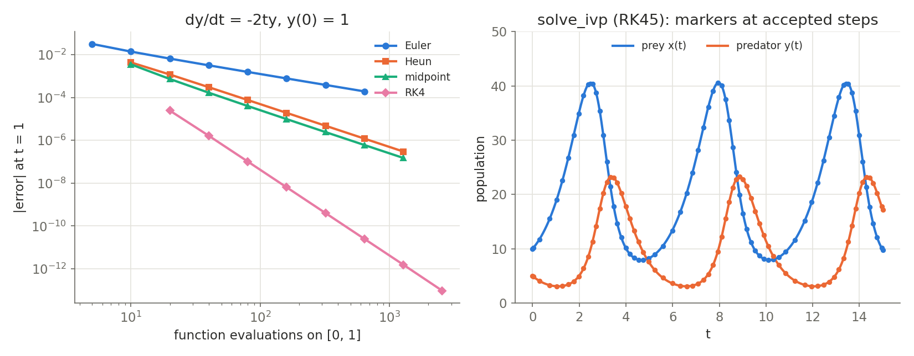
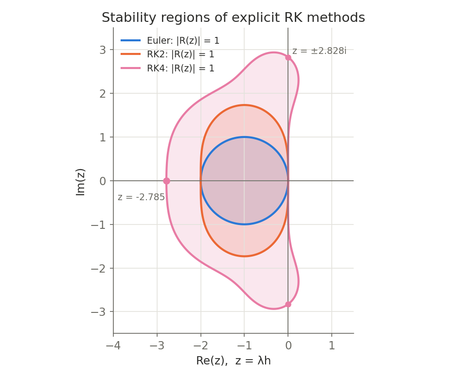

# 22장 — 상미분방정식의 초기값 문제

[레포지토리 안내](../../README.ko.md) | [English](Concepts_Lecture.md) | [한국어](Concepts_Lecture.ko.md)

> **최종 수정일:** 2026-11-19
>
> Applied Numerical Methods with Python for Engineers and Scientists, Chapra and Clough, Ch 22

> **학습 목표:**
> 1. 초기값 문제에 오일러 방법을 적용할 수 있다
> 2. 룽게-쿠타 방법(RK2, RK4)을 구현할 수 있다
> 3. ODE 풀이의 안정성과 정확도를 분석할 수 있다
> 4. 고차 ODE를 1차 연립 ODE로 변환하여 수치적으로 풀 수 있다
> 5. 스텝 크기를 바꾸며 오일러, 호인, 중점, RK4 방법의 수렴 차수와 비용을 비교할 수 있다
> 6. SciPy의 solve_ivp로 연립 ODE를 풀고 허용 오차와 결과 필드를 해석할 수 있다

---

<br>

## 목차

- [1. ODE와 초기값 문제 개요](#1-ode와-초기값-문제-개요)
  - [1.1 상미분방정식(Ordinary Differential Equations)](#11-상미분방정식ordinary-differential-equations)
  - [1.2 초기값 문제(IVP)](#12-초기값-문제ivp)
  - [1.3 연립 ODE](#13-연립-ode)
  - [1.4 적분 형태](#14-적분-형태)
- [2. 오일러 방법(Euler Method)](#2-오일러-방법euler-method)
  - [2.1 유도](#21-유도)
  - [2.2 기하학적 해석](#22-기하학적-해석)
  - [2.3 오일러 방법의 계산 예](#23-오일러-방법의-계산-예)
- [3. 국소 및 전역 절단 오차](#3-국소-및-전역-절단-오차)
  - [3.1 전역 오차(Global Error)](#31-전역-오차global-error)
  - [3.2 오차에 대한 Big-O 표기법](#32-오차에-대한-big-o-표기법)
  - [3.3 오일러 방법의 테일러 급수 분석](#33-오일러-방법의-테일러-급수-분석)
  - [3.4 근사 국소 절단 오차](#34-근사-국소-절단-오차)
  - [3.5 국소 오차에서 전역 오차로](#35-국소-오차에서-전역-오차로)
  - [3.6 전역 오차 차수의 수치 확인](#36-전역-오차-차수의-수치-확인)
  - [3.7 국소 오차와 전역 오차의 추적](#37-국소-오차와-전역-오차의-추적)
- [4. 룽게-쿠타(RK) 방법](#4-룽게-쿠타rk-방법)
  - [4.1 핵심 아이디어](#41-핵심-아이디어)
  - [4.2 증분 함수(Increment Function)](#42-증분-함수increment-function)
  - [4.3 양적 RK 방법의 일반 프레임워크](#43-양적-rk-방법의-일반-프레임워크)
  - [4.4 부처 테이블(Butcher Tableau)](#44-부처-테이블butcher-tableau)
- [5. 2차 룽게-쿠타 방법](#5-2차-룽게-쿠타-방법)
  - [5.1 일반적인 2단계 RK 형태](#51-일반적인-2단계-rk-형태)
  - [5.2 차수 조건 유도](#52-차수-조건-유도)
  - [5.3 2차 정확도를 위한 차수 조건](#53-2차-정확도를-위한-차수-조건)
  - [5.4 호인 방법(Heun's Method) (b2 = 1/2)](#54-호인-방법heuns-method-b2--12)
  - [5.5 수정 오일러 / 중점 방법(Midpoint Method) (b2 = 1)](#55-수정-오일러--중점-방법midpoint-method-b2--1)
  - [5.6 호인 방법과 중점 방법의 계산 예](#56-호인-방법과-중점-방법의-계산-예)
  - [5.7 랄스턴 방법과 교정자를 반복하는 호인 방법](#57-랄스턴-방법과-교정자를-반복하는-호인-방법)
- [6. 고전적 4차 룽게-쿠타 방법(RK4)](#6-고전적-4차-룽게-쿠타-방법rk4)
  - [6.1 공식](#61-공식)
  - [6.2 RK4의 부처 테이블](#62-rk4의-부처-테이블)
  - [6.3 Python 구현](#63-python-구현)
  - [6.4 RK4의 한 스텝과 방법별 수렴 비교](#64-rk4의-한-스텝과-방법별-수렴-비교)
- [7. 연립 ODE](#7-연립-ode)
  - [7.1 벡터 형태](#71-벡터-형태)
  - [7.2 고차 ODE의 연립 변환](#72-고차-ode의-연립-변환)
  - [7.3 연립 ODE를 위한 RK4의 Python 구현](#73-연립-ode를-위한-rk4의-python-구현)
  - [7.4 SciPy의 solve_ivp](#74-scipy의-solve_ivp)
  - [7.5 연립 ODE의 손계산](#75-연립-ode의-손계산)
- [8. 수치적 안정성(Numerical Stability)](#8-수치적-안정성numerical-stability)
  - [8.1 모델 문제(Model Problem)](#81-모델-문제model-problem)
  - [8.2 정확해의 안정성](#82-정확해의-안정성)
  - [8.3 오일러 방법(전진 오일러)의 안정성](#83-오일러-방법전진-오일러의-안정성)
  - [8.4 전진 오일러의 안정 영역](#84-전진-오일러의-안정-영역)
  - [8.5 후진 오일러 방법의 안정성](#85-후진-오일러-방법의-안정성)
  - [8.6 사다리꼴 방법의 안정성](#86-사다리꼴-방법의-안정성)
  - [8.7 A-안정성과 L-안정성](#87-a-안정성과-l-안정성)
  - [8.8 양적 RK 방법의 안정 영역과 스텝 크기 선택](#88-양적-rk-방법의-안정-영역과-스텝-크기-선택)
- [개념 적용](#개념-적용)
- [요약](#요약)
- [점검 문제](#점검-문제)
- [참고 문헌](#참고-문헌)

---

<br>

## 1. ODE와 초기값 문제 개요

### 1.1 상미분방정식(Ordinary Differential Equations)

$`y = y(t)`$를 독립변수 $`t`$의 미지함수라 하자. **상미분방정식(ODE)** 은 $`y`$와 그 도함수 사이의 관계를 나타낸다:

```math
\frac{dy}{dt} = f(t, y)
```

함수 $`f(t, y)`$는 알려져 있으며, $`t`$-$`y`$ 평면의 임의의 점 $`(t, y)`$에서 해의 **기울기**(경향)를 제공한다. 해 $`y(t)`$는 이 기울기장을 따라 **해 곡선**을 그린다.

> **[미적분학]** 대수 방정식에서 미지수가 숫자인 것과 달리, 미분방정식에서 미지수는 *함수*이다. ODE $`\frac{dy}{dt} = f(t,y)`$는 임의의 시각 $`t`$에서 $`y`$의 변화율이 $`t`$와 $`y`$의 현재 값에 의해 결정된다는 것을 의미한다.

### 1.2 초기값 문제(IVP)

초기 조건 $`y(t_0) = y_0`$이 주어지면, $`t > t_0`$에 대해 $`y(t)`$를 구한다. 이것이 **초기값 문제(Initial Value Problem)** 이다:

```math
\begin{cases} \dfrac{dy}{dt} = f(t, y), & t > t_0 \\[6pt] y(t_0) = y_0 \end{cases}
```

초기 조건은 ODE의 모든 해 곡선 중에서 유일한 해 곡선을 선택한다.

> **용어 정의:** **초기값 문제(initial value problem)** 는 미분방정식 $`y' = f(t, y)`$와 한 시각의 값 $`y(t_0) = y_0`$로 이루어진 문제이다. $`f`$가 연속이고 $`y`$에 대해 립시츠 조건 $`|f(t, y_1) - f(t, y_2)| \le L|y_1 - y_2|`$를 만족하면 $`t_0`$ 근처에서 해가 존재하고 유일하다.

### 1.3 연립 ODE

연립된 두 ODE를 고려한다:

```math
\frac{du}{dt} = p(t, u, v), \quad u(t_0) = u_0
```

```math
\frac{dv}{dt} = q(t, u, v), \quad v(t_0) = v_0
```

**벡터 형태**로, $`\mathbf{y} := (u, v)^T`$ 및 $`\mathbf{f} := (p, q)^T`$로 정의하면:

```math
\frac{d\mathbf{y}}{dt} = \mathbf{f}(t, \mathbf{y}), \quad \mathbf{y}(t_0) = (u_0, v_0)^T
```

이것이 **연립 ODE**이다. 이 장의 단일 방정식 방법(오일러, 룽게-쿠타 등)은 스칼라 연산을 벡터 연산으로 대체하면 연립계로 자연스럽게 확장된다.

### 1.4 적분 형태

ODE를 $`t_0`$에서 $`t_1`$까지 적분하면:

```math
\int_{t_0}^{t_1} \frac{dy}{dt}\,dt = y(t_1) - y(t_0) = \int_{t_0}^{t_1} f(t, y(t))\,dt
```

따라서:

```math
y(t_1) = y(t_0) + \int_{t_0}^{t_1} f(t, y(t))\,dt
```

핵심 질문은 $`y(t)`$를 닫힌 형태로 모를 때 **이 적분을 어떻게 수치적으로 근사할 수 있는가**이다.

---

<br>

## 2. 오일러 방법(Euler Method)

### 2.1 유도

시간 구간 $`[t_0, T]`$를 균일한 스텝 크기를 갖는 $`n`$개의 소구간으로 분할한다:

```math
h = \frac{T - t_0}{n}, \quad t_{n+1} = t_n + h
```

한 스텝에 대한 적분 형태로부터:

```math
y(t_{n+1}) = y(t_n) + \int_{t_n}^{t_{n+1}} f(t, y(t))\,dt
```

가장 간단한 근사는 $`f`$를 $`[t_n, t_{n+1}]`$에서 상수로 취급하고 왼쪽 끝점에서 평가하는 것이다:

```math
\int_{t_n}^{t_{n+1}} f(t, y(t))\,dt \approx f(t_n, y_n) \cdot \int_{t_n}^{t_{n+1}} dt = f(t_n, y_n) \cdot h
```

이로부터 **오일러 방법**(전진 오일러, Forward Euler)을 얻는다:

```math
\boxed{y_{n+1} = y_n + h\,f_n, \quad f_n := f(t_n, y_n)}
```

### 2.2 기하학적 해석

각 시간 스텝에서 오일러 방법은 현재 점 $`(t_n, y_n)`$에서의 접선을 따라 해를 전진시킨다. 이 접선의 기울기는 $`f(t_n, y_n)`$이므로, 수평 거리 $`h`$만큼 이동하면 수직 변화량 $`h \cdot f(t_n, y_n)`$을 생성한다(그림 1).

```text
  y
  │                               ● (t_{n+1}, y_{n+1})
  │                            ╱  ┊
  │                         ╱     ┊  h f(t_n, y_n)
  │                      ╱        ┊
  │                   ╱           ┊
  │     (t_n, y_n) ●┈┈┈┈┈┈┈┈┈┈┈┈┈┈┘
  │                ├────── h ─────┤
  └──────────────────────────────────────────── t
```

*그림 1. 접선을 따라 한 스텝 전진하는 오일러 방법*

> **참고:** **구적법과의 관계.** 오일러 방법은 수치 ODE 풀이법의 방대한 계열 중 가장 간단한 방법이다. 이는 적분 $`\int f\,dt`$를 왼쪽 끝점 직사각형 법칙(left-endpoint rectangle rule)으로 근사하는 것에 해당한다. 더 좋은 구적법은 더 좋은 ODE 방법으로 이어지며, 이것이 룽게-쿠타 방법의 아이디어이다.

### 2.3 오일러 방법의 계산 예

초기값 문제 $`\frac{dy}{dt} = -2ty`$, $`y(0) = 1`$의 정확해는 $`y = e^{-t^2}`$이다. $`h = 0.25`$로 오일러 방법을 적용하여 $`t = 1`$까지 계산한다.

```python
import numpy as np

f = lambda t, y: -2.0 * t * y + 0.0            # dy/dt = -2ty, y(0) = 1
exact = lambda t: np.exp(-t**2)

h, t, y = 0.25, 0.0, 1.0
print("  n     t      y_n        f_n       exact     error")
for n in range(5):
    fn = f(t, y)
    print(f"{n:3d}  {t:5.2f}  {y:9.6f}  {fn:9.6f}  {exact(t):9.6f}  {exact(t) - y:+.6f}")
    y, t = y + h * fn, t + h
```

```text
  n     t      y_n        f_n       exact     error
  0   0.00   1.000000   0.000000   1.000000  +0.000000
  1   0.25   1.000000  -0.500000   0.939413  -0.060587
  2   0.50   0.875000  -0.875000   0.778801  -0.096199
  3   0.75   0.656250  -0.984375   0.569783  -0.086467
  4   1.00   0.410156  -0.820312   0.367879  -0.042277
```

- 함수 `f`의 `+ 0.0`은 $`t = 0`$에서 부호가 붙은 0(`-0.0`)이 출력되지 않게 하는 장치이며 값에는 영향이 없다.
- 반복문의 마지막 줄 `y, t = y + h * fn, t + h`가 2.1절의 공식 $`y_{n+1} = y_n + hf_n`$이다.

첫 스텝에서 $`f(0, 1) = 0`$이므로 오일러 방법은 $`y`$를 1로 그대로 두지만, 실제 해는 $`t = 0.25`$까지 0.939로 줄어든다. 오일러 방법은 각 구간의 왼쪽 끝 기울기를 구간 전체에 쓰므로, 기울기가 점점 가파르게 음수가 되는 $`t < 0.7`$ 근처에서는 감소를 과소평가하여 근삿값이 참값보다 크다. 오차는 $`t = 0.5`$에서 최대가 되었다가, 기울기의 크기가 줄어드는 뒤쪽 구간에서 일부 상쇄되어 $`t = 1`$에서 $`-0.042`$가 된다. 전역 오차는 이처럼 각 스텝의 국소 오차가 쌓이고 전파된 결과이다.

---

<br>

## 3. 국소 및 전역 절단 오차

### 3.1 전역 오차(Global Error)

스텝 $`n`$에서의 **전역 오차**는 참 해와 수치 근사 사이의 차이이다:

```math
e_n = y(t_n) - y_n
```

초기 조건에 의해 $`e_0 = y(t_0) - y_0 = 0`$이다. 전역 오차는 $`t_0`$에서 $`t_n`$까지 모든 스텝에 걸친 국소 오차의 **누적**이다.

> **용어 정의:** **국소 절단 오차(local truncation error)** 는 한 스텝의 시작값이 정확하다고 가정하고, 즉 $`y_n = y(t_n)`$에서 출발하여 한 스텝만 진행했을 때 생기는 오차 $`y(t_{n+1}) - \bigl[y(t_n) + h\,\phi(t_n, y(t_n))\bigr]`$이다. 전역 오차는 이 국소 오차들이 쌓이고 이후 스텝으로 전파된 결과이다.

### 3.2 오차에 대한 Big-O 표기법

양 $`z`$가 $`O(h^p)`$라 함은 상수 $`h_0, C > 0`$가 존재하여 다음이 성립하는 것이다:

```math
|z| \le C h^p \quad \forall\; 0 < h < h_0
```

이는 $`p > 0`$일 때 $`z`$가 $`h \to 0`$에 따라 0으로 수렴하며, **수렴 속도**가 $`p`$임을 의미한다.

### 3.3 오일러 방법의 테일러 급수 분석

$`(t_n, y_n)`$ 주위에서 $`h = t_{n+1} - t_n`$에 대한 $`y`$의 테일러 전개는 다음과 같다:

```math
y(t_n + h) = y(t_n) + y'(t_n)\,h + y''(t_n)\frac{h^2}{2} + \cdots + y^{(n)}(t_n)\frac{h^n}{n!} + R_n
```

여기서 $`R_n = y^{(n+1)}(\xi)\frac{h^{n+1}}{(n+1)!}`$이며, 어떤 $`\xi \in [t_n, t_n + h]`$이다.

$`y'(t_n) = f(t_n, y_n)`$이므로, $`f`$의 도함수를 사용하여 테일러 전개를 다시 쓸 수 있다:

```math
y(t_n + h) = \underbrace{y_n + f(t_n, y_n)\,h}_{\text{오일러 근사}} + \underbrace{f'(t_n, y_n)\frac{h^2}{2} + \cdots + f^{(n)}(t_n, y_n)\frac{h^n}{n!} + O(h^{n+1})}_{\text{절단된 항 (국소 절단 오차)}}
```

오일러 방법의 **참 국소 절단 오차**는 버려지는 항 가운데 선행 항(leading term)의 차수인 $`O(h^2)`$이다.

### 3.4 근사 국소 절단 오차

오일러 방법의 국소 절단 오차의 선행 항은:

```math
E_a = f'(t_n, y_n)\frac{h^2}{2} = O(h^2)
```

이것이 각 스텝에서의 **근사 국소 절단 오차**이다.

### 3.5 국소 오차에서 전역 오차로

$`[0, T]`$에서 균일 스텝 크기 $`h`$를 사용하면, $`n = \frac{T}{h}`$ 스텝이 된다. 국소 오차를 합산하면:

```math
\left|\sum_{i=1}^{n} E_{a,i}\right| = \left|(f'_0 + f'_1 + \cdots + f'_{n-1})\frac{h^2}{2}\right| \le \tilde{f}' \cdot \frac{h^2}{2} \cdot n
```

여기서 $`\tilde{f}' = \max_{0 \le i \le n-1} |f'_i|`$이다.

$`n = \frac{T}{h}`$를 대입하면:

```math
\left|\sum E_{a,i}\right| \le \tilde{f}' \cdot \frac{h^2}{2} \cdot \frac{T}{h} = \frac{\tilde{f}'\,T}{2}\,h = O(h)
```

**핵심 결과: 오일러 방법은 국소 절단 오차 $`O(h^2)`$, 전역 절단 오차 $`O(h)`$를 갖는다.** 오일러 방법은 **1차 방법**이다.

> **참고:** **국소 오차와 전역 오차의 차수.** 국소 오차가 전역 오차로 누적될 때 $`h`$의 차수가 하나 줄어드는데, 이는 스텝 수 $`n = T/h`$가 $`h`$가 감소함에 따라 증가하기 때문이다. $`f`$가 립시츠(Lipschitz) 조건을 만족하면 일단계 방법에서 이 패턴이 일반적으로 성립하여, 국소 오차가 $`O(h^{p+1})`$인 방법의 전역 오차는 $`O(h^p)`$이다. 위의 단순 합산은 앞 스텝의 오차가 이후 스텝으로 전파되는 효과를 무시했지만, 전파를 고려한 엄밀한 분석에서도 차수는 같다.

### 3.6 전역 오차 차수의 수치 확인

2.3절의 문제를 $`t = 1`$까지 풀며 $`h`$를 절반씩 줄이면, 오일러 방법의 전역 오차는 다음과 같다(6.4절의 코드로 계산).

| $`h`$ | 0.1 | 0.05 | 0.025 | 0.0125 |
|:-----|:-----|:-----|:-----|:-----|
| $`\lvert y(1) - y_n \rvert`$ | $`1.38 \times 10^{-2}`$ | $`6.50 \times 10^{-3}`$ | $`3.16 \times 10^{-3}`$ | $`1.56 \times 10^{-3}`$ |
| 직전 오차와의 비 | | 2.13 | 2.06 | 2.03 |

*표 1. 스텝 크기에 따른 오일러 방법의 전역 오차*

$`h`$를 절반으로 줄일 때 오차가 절반으로 줄어 비가 2에 수렴하므로, 3.5절의 결론대로 전역 오차는 $`O(h)`$이다. 국소 오차는 $`O(h^2)`$이어서 한 스텝의 오차는 4분의 1로 줄지만, 같은 구간을 가는 데 스텝 수가 두 배가 되므로 전역 오차는 2분의 1로만 준다. 이 비는 $`h`$가 작을수록 2에 가까워지는데, $`O(h)`$가 $`h \to 0`$에서의 거동을 말하는 점근적 성질이기 때문이다.

### 3.7 국소 오차와 전역 오차의 추적

2.3절의 계산을 다시 보며, 각 스텝의 국소 절단 오차와 전역 오차를 따로 계산하면 둘의 관계를 구체적으로 볼 수 있다. 국소 오차는 정확한 값 $`y(t_n)`$에서 출발하여 오일러 한 스텝을 갔을 때의 오차이고, 전역 오차는 실제 계산값 $`y_n`$에서 출발해 온 누적 결과이다.

| 스텝 | $`t_{n+1}`$ | 국소 오차 | 전역 오차 $`e_{n+1}`$ | 국소 오차의 단순 합 |
|:---:|:-----|:-----|:-----|:-----|
| 1 | 0.25 | $`-0.060587`$ | $`-0.060587`$ | $`-0.060587`$ |
| 2 | 0.50 | $`-0.043186`$ | $`-0.096199`$ | $`-0.103773`$ |
| 3 | 0.75 | $`-0.014318`$ | $`-0.086467`$ | $`-0.118090`$ |
| 4 | 1.00 | $`+0.011765`$ | $`-0.042277`$ | $`-0.106325`$ |

*표 2. $`dy/dt = -2ty`$를 $`h = 0.25`$의 오일러 방법으로 풀 때의 국소 오차와 전역 오차*

첫 스텝에서는 시작값이 정확하므로 국소 오차와 전역 오차가 같다. 둘째 스텝부터는 전역 오차가 국소 오차의 단순 합과 달라지는데, 앞 스텝에서 생긴 오차가 이후 스텝을 거치며 변하기 때문이다. 한 스텝의 오차 전파는 대략 $`e_{n+1} \approx (1 + h\,\partial f/\partial y)\,e_n + (\text{국소 오차})`$로 나타나며, 이 문제에서는 $`\partial f/\partial y = -2t < 0`$이어서 인자 $`1 - 2th`$가 1보다 작아 앞의 오차가 줄어든다. 그래서 $`t = 1`$의 전역 오차 $`-0.042`$는 국소 오차의 합 $`-0.106`$보다 작다. 반대로 $`\partial f/\partial y > 0`$인 문제(해가 지수적으로 자라는 문제)에서는 앞의 오차가 증폭되어 전역 오차가 국소 오차의 합보다 커진다. 3.5절의 단순 합산이 차수만 맞고 크기는 맞지 않는 이유가 이것이다.

---

<br>

## 4. 룽게-쿠타(RK) 방법

### 4.1 핵심 아이디어

룽게-쿠타 방법은 $`f`$의 고차 도함수를 명시적으로 계산하지 않으면서, 구간 $`[t_n, t_{n+1}]`$ 내의 여러 지점에서 **다수의 기울기 추정치를 조합하여 정확도를 향상**시킨다.

적분 형태에서 출발하여 $`t = (t_{n+1} - t_n)z + t_n`$ ($`z \in [0, 1]`$)으로 변수 치환을 수행하면:

```math
y_{n+1} = y_n + \int_{t_n}^{t_{n+1}} f(t, y)\,dt = y_n + h \int_0^1 f(z, y(z))\,dz
```

### 4.2 증분 함수(Increment Function)

적분 $`\int_0^1 f(z, y(z))\,dz`$를 구적법으로 근사한다:

```math
\int_0^1 f(z, y(z))\,dz \approx \phi
```

여기서 $`\phi`$는 **증분 함수**(평균 기울기)이다:

```math
y_{n+1} = y_n + \phi \cdot h
```

증분 함수는 기울기 평가값의 가중합이다:

```math
\phi = \sum_{i=1}^{s} b_i k_i = \sum_{i=1}^{s} b_i\,f(t_n + c_i h,\; y(t_n + c_i h))
```

이는 본질적으로 스텝에 걸친 $`f`$의 **구적법(quadrature)** 이며, $`b_i`$는 가중치, $`c_i`$는 절점(node)이다.

### 4.3 양적 RK 방법의 일반 프레임워크

일반적으로 $`y(t_n + c_i h)`$를 모르므로, **내부 단계(internal stage)** 값 $`Y_i`$로 근사한다:

**내부 단계** (순차적으로 계산):

```math
Y_1 = y_n \quad \Rightarrow \quad k_1 = f(t_n, Y_1)
```

```math
Y_2 = y_n + h\,a_{21}\,k_1 \quad \Rightarrow \quad k_2 = f(t_n + c_2 h, Y_2)
```

```math
Y_3 = y_n + h(a_{31}\,k_1 + a_{32}\,k_2) \quad \Rightarrow \quad k_3 = f(t_n + c_3 h, Y_3)
```

```math
\vdots
```

```math
Y_s = y_n + h \sum_{j=1}^{s-1} a_{sj}\,k_j \quad \Rightarrow \quad k_s = f(t_n + c_s h, Y_s)
```

**스텝 완료:**

```math
y_{n+1} = y_n + h \sum_{i=1}^{s} b_i\,k_i
```

여기서 $`s`$는 **단계 수(number of stages)** 이다.

> **핵심:** RK 방법의 핵심 아이디어는 미지의 중간 해 값에서 $`f`$를 평가해야 하는 다루기 어려운 문제를 부트스트래핑(bootstrapping) 절차로 대체하는 것이다. 오일러 방법과 비슷한 예측으로 중간값을 추정하고, 그 점에서 $`f`$를 평가한 뒤, 그 기울기들을 결합한다.

### 4.4 부처 테이블(Butcher Tableau)

양적 RK 방법은 행렬 $`A`$(순 하삼각 행렬), 가중치 벡터 $`\mathbf{b} = (b_1, b_2, \ldots, b_s)^T`$, 절점 벡터 $`\mathbf{c} = (c_1, c_2, \ldots, c_s)^T`$에 의해 완전히 지정된다.

내부 단계에 대한 행렬 형태:

```math
\begin{pmatrix} Y_1 \\ Y_2 \\ Y_3 \\ \vdots \\ Y_s \end{pmatrix} = \begin{pmatrix} y_n \\ y_n \\ y_n \\ \vdots \\ y_n \end{pmatrix} + h \begin{pmatrix} 0 & 0 & 0 & \cdots & 0 \\ a_{21} & 0 & 0 & \cdots & 0 \\ a_{31} & a_{32} & 0 & \cdots & 0 \\ \vdots & \vdots & \vdots & \ddots & \vdots \\ a_{s1} & a_{s2} & a_{s3} & \cdots & 0 \end{pmatrix} \begin{pmatrix} k_1 \\ k_2 \\ k_3 \\ \vdots \\ k_s \end{pmatrix}
```

행렬 $`A`$가 순 하삼각 행렬이므로 방법은 **양적(explicit)** 이 된다. 각 단계를 이전에 계산된 단계들로부터 바로 계산할 수 있기 때문이다.

**부처 테이블(Butcher tableau)** 은 표준적인 간결한 표기법이다:

```math
\begin{array}{c|c} \mathbf{c} & A \\ \hline & \mathbf{b}^T \end{array}
```

---

<br>

## 5. 2차 룽게-쿠타 방법

### 5.1 일반적인 2단계 RK 형태

2단계($`s = 2`$) 양적 RK 방법은 다음의 형태를 갖는다:

```math
y_{n+1} = y_n + h(b_1 k_1 + b_2 k_2)
```

여기서:

```math
k_1 = f(t_n, y_n)
```

```math
k_2 = f(t_n + ch,\; y_n + h\,a\,k_1)
```

결정해야 할 매개변수는 $`b_1, b_2, c, a`$ (4개의 미지수)이다.

### 5.2 차수 조건 유도

**참 해의 테일러 전개** ($`t`$에 대한 전미분 사용):

```math
y(t_n + h) = y_n + h\,f + \frac{h^2}{2}(f_t + f_y f) + O(h^3)
```

여기서 모든 $`f, f_t, f_y`$는 $`(t_n, y_n)`$에서 평가된다.

> **[미적분학]** 2계도함수 $`y'' = \frac{d}{dt}f(t, y) = f_t + f_y \cdot \frac{dy}{dt} = f_t + f_y f`$는 전미분에 대한 **연쇄 법칙(chain rule)** 을 사용한다. 이는 $`f`$가 $`t`$에 직접적으로도, $`y(t)`$를 통해 간접적으로도 의존하기 때문이다.

**RK2 공식의 테일러 전개:**

$`k_2 = f(t_n + ch, y_n + a\,f(t_n,y_n)\,h)`$를 $`\Delta t = ch`$, $`\Delta y = a\,f(t_n,y_n)\,h`$로 다변수 테일러 전개하면:

```math
f(t_n + \Delta t, y_n + \Delta y) = f + f_t \cdot ch + f_y \cdot a\,f\,h + O(h^2)
```

RK2 공식에 다시 대입하면:

```math
y_{n+1} = y_n + h(b_1 + b_2)f + \frac{h^2}{2} \cdot 2b_2(c\,f_t + a\,f_y f) + O(h^3)
```

### 5.3 2차 정확도를 위한 차수 조건

$`O(h^2)`$ 항까지 테일러 전개와 매칭하면 **4개의 미지수에 대한 3개의 방정식** (자유도 1개)을 얻는다:

```math
b_1 + b_2 = 1
```

```math
b_2 c = \frac{1}{2}
```

```math
b_2 a = \frac{1}{2}
```

마지막 두 조건으로부터 $`c = a`$이다.

### 5.4 호인 방법(Heun's Method) (b2 = 1/2)

$`b_2 = 1/2`$를 선택하면:

```math
b_1 = \frac{1}{2}, \quad a = 1, \quad c = 1
```

```math
Y_1 = y_n \quad \Rightarrow \quad k_1 = f(t_n, y_n)
```

```math
Y_2 = y_n + h\,k_1 \quad \Rightarrow \quad k_2 = f(t_n + h, Y_2)
```

```math
\boxed{y_{n+1} = y_n + h\left(\frac{k_1 + k_2}{2}\right)}
```

이것이 **호인 방법(Heun's method)**(개선된 오일러 또는 사다리꼴 예측-교정법이라고도 함)이다. 부처 테이블은:

```math
\begin{array}{c|cc} 0 & & \\ 1 & 1 & \\ \hline & 1/2 & 1/2 \end{array}
```

> **참고:** **사다리꼴 법칙과의 유사성.** 호인 방법은 먼저 전체 오일러 스텝으로 $`t_{n+1}`$에서 $`Y_2`$를 예측하고, 그 점에서의 기울기를 평가한 뒤, 양 끝점에서의 기울기를 평균한다. 이는 19장의 적분에 대한 사다리꼴 법칙과 유사하다.

### 5.5 수정 오일러 / 중점 방법(Midpoint Method) (b2 = 1)

$`b_2 = 1`$을 선택하면:

```math
b_1 = 0, \quad a = \frac{1}{2}, \quad c = \frac{1}{2}
```

```math
k_1 = f(t_n, y_n)
```

```math
k_2 = f\!\left(t_n + \frac{h}{2},\; y_n + \frac{h}{2}\,k_1\right)
```

```math
\boxed{y_{n+1} = y_n + h\,k_2}
```

이것이 **수정 오일러(중점) 방법**이다. 부처 테이블은:

```math
\begin{array}{c|cc} 0 & & \\ 1/2 & 1/2 & \\ \hline & 0 & 1 \end{array}
```

> **참고:** **중점 법칙과의 유사성.** 중점 방법은 오일러 반스텝으로 구간의 중점에서의 기울기를 추정한 뒤, 그 중점 기울기를 사용하여 전체 스텝을 전진시킨다. 이는 적분에 대한 중점 법칙(midpoint rule)과 유사하다.

### 5.6 호인 방법과 중점 방법의 계산 예

2.3절의 문제에서 $`h = 0.25`$로 첫 스텝을 계산한다.

**호인 방법.** $`k_1 = f(0, 1) = 0`$이고, 오일러로 예측한 $`Y_2 = 1 + 0.25 \times 0 = 1`$에서 $`k_2 = f(0.25, 1) = -0.5`$이다. 따라서 $`y_1 = 1 + 0.25 \times \frac{0 + (-0.5)}{2} = 0.9375`$이다.

**중점 방법.** $`k_1 = 0`$이고, 반스텝 예측 $`1 + 0.125 \times 0 = 1`$에서 $`k_2 = f(0.125, 1) = -0.25`$이다. 따라서 $`y_1 = 1 + 0.25 \times (-0.25) = 0.9375`$이다.

정확한 값 $`e^{-0.0625} = 0.939413`$과의 오차는 두 방법 모두 $`0.0019`$로, 오일러 방법의 오차 $`0.0606`$보다 약 30배 작다. 이 문제의 첫 스텝에서는 $`y`$가 그대로이고 기울기가 $`t`$에 비례하므로 구간 양 끝 기울기의 평균과 중점의 기울기가 같아 두 방법의 값이 일치하지만, 일반적으로는 다른 값을 준다. $`t = 1`$까지의 전역 오차는 $`h = 0.1`$에서 호인 방법이 $`1.17 \times 10^{-3}`$, 중점 방법이 $`7.27 \times 10^{-4}`$이며, $`h`$를 절반으로 줄일 때마다 두 오차 모두 약 4분의 1로 줄어 2차 방법임을 확인할 수 있다(6.4절).

### 5.7 랄스턴 방법과 교정자를 반복하는 호인 방법

5.3절의 차수 조건 $`b_1 + b_2 = 1`$, $`b_2c = b_2a = \frac{1}{2}`$을 만족하는 2단계 방법은 무수히 많다. 교재는 호인 방법과 중점 방법 외에 $`b_2 = \frac{3}{4}`$인 경우를 랄스턴(Ralston) 방법으로 소개한다. 이때 $`b_1 = \frac{1}{4}`$, $`a = c = \frac{2}{3}`$이다.

```math
k_1 = f(t_n, y_n), \qquad k_2 = f\left(t_n + \frac{2}{3}h,\ y_n + \frac{2}{3}h\,k_1\right), \qquad y_{n+1} = y_n + h\left(\frac{1}{4}k_1 + \frac{3}{4}k_2\right)
```

이 선택은 2차 방법의 국소 오차 주도 항의 크기에 대한 상한을 가장 작게 만드는 값으로 알려져 있다. 2.3절의 문제를 $`t = 1`$까지 풀면 $`h = 0.1`$에서 전역 오차가 $`9.4 \times 10^{-5}`$로, 같은 스텝의 호인 방법($`1.17 \times 10^{-3}`$)과 중점 방법($`7.27 \times 10^{-4}`$)보다 작다. 이 문제에서는 $`h`$를 절반으로 줄일 때 오차가 8분의 1 가까이 줄어드는데, 이 함수에서 주도 오차항이 부분적으로 상쇄된 특수한 경우이며 방법의 차수는 일반적으로 2이다.

호인 방법의 교정 단계 $`y_{n+1} = y_n + \frac{h}{2}\bigl(f(t_n, y_n) + f(t_{n+1}, Y)\bigr)`$에서 $`Y`$ 자리에 방금 얻은 $`y_{n+1}`$을 다시 넣어 교정을 반복할 수도 있다. 교재는 이 반복을 상대 변화가 허용 오차보다 작아질 때까지 계속하는 형태로 호인 방법을 설명한다. 2.3절의 첫 스텝($`h = 0.25`$)에 적용하면 다음과 같다.

| 반복 | $`y_1`$ | 상대 변화 |
|:---:|:-----|:-----|
| 1 | 0.93750000 | $`6.7 \times 10^{-2}`$ |
| 2 | 0.94140625 | $`4.1 \times 10^{-3}`$ |
| 3 | 0.94116211 | $`2.6 \times 10^{-4}`$ |
| 4 | 0.94117737 | $`1.6 \times 10^{-5}`$ |
| 5 | 0.94117641 | $`1.0 \times 10^{-6}`$ |

*표 3. 호인 방법의 교정자를 반복할 때 첫 스텝 값의 변화*

반복은 0.9411765로 수렴한다. 이 값은 정확한 값 0.9394131이 아니라, 음적 사다리꼴 방법 $`y_1 = y_0 + \frac{h}{2}(f_0 + f_1)`$의 해 $`1/1.0625 = 0.9411765`$이다. 교정자를 반복하면 사다리꼴 방법의 음적 방정식을 고정점 반복으로 푸는 것과 같으므로, 오차는 사다리꼴 방법의 국소 오차($`O(h^3)`$) 아래로 줄지 않는다. 이 예에서 반복하지 않은 호인 방법의 값 0.9375(오차 0.0019)와 반복한 값(오차 $`-0.0018`$)의 정확도는 비슷하다. 반복은 함수 평가를 늘리므로, 정확도를 높이려면 반복보다 스텝을 줄이거나 차수가 높은 방법을 쓰는 편이 효율적이다.

---

<br>

## 6. 고전적 4차 룽게-쿠타 방법(RK4)

### 6.1 공식

고전적 RK4는 국소 절단 오차 $`O(h^5)`$, 전역 오차 $`O(h^4)`$인 4단계 방법이다:

```math
k_1 = f(t_n,\; y_n)
```

```math
k_2 = f\!\left(t_n + \frac{h}{2},\; y_n + \frac{h}{2}\,k_1\right)
```

```math
k_3 = f\!\left(t_n + \frac{h}{2},\; y_n + \frac{h}{2}\,k_2\right)
```

```math
k_4 = f(t_n + h,\; y_n + h\,k_3)
```

```math
\boxed{y_{n+1} = y_n + \frac{h}{6}(k_1 + 2k_2 + 2k_3 + k_4)}
```

가중치 $`\frac{1}{6}, \frac{2}{6}, \frac{2}{6}, \frac{1}{6}`$는 네 기울기 추정치에 적용된 **심프슨의 1/3 법칙(Simpson's 1/3 rule)** 에 해당한다. 심프슨의 1/3 법칙(19장)에서 중점에 주는 가중치 $`\frac{4}{6}`$를 두 중점 기울기 $`k_2`$와 $`k_3`$에 나누어 준 형태이며, 기울기의 평가 위치는 그림 2와 같다.

```text
   t_n                  t_n + h/2                t_n + h
    ●───────────────────────●───────────────────────●
   k_1                  k_2, k_3                   k_4
 w = 1/6              w = 2/6, 2/6               w = 1/6
```

*그림 2. RK4의 기울기 평가 위치와 가중치*

> **핵심:** RK4는 ODE 풀이의 주력 방법이다. $`f`$의 어떤 도함수도 필요 없이 스텝당 4번의 함수 평가만으로 4차 정확도를 달성하며, 많은 실용적 문제에서 정확도와 계산 비용 사이의 훌륭한 균형을 제공한다.

### 6.2 RK4의 부처 테이블

```math
\begin{array}{c|cccc} 0 & & & & \\ 1/2 & 1/2 & & & \\ 1/2 & 0 & 1/2 & & \\ 1 & 0 & 0 & 1 & \\ \hline & 1/6 & 1/3 & 1/3 & 1/6 \end{array}
```

### 6.3 Python 구현

```python
import numpy as np

def rk4(f, t0, y0, T, h):
    """
    Classical 4th-order Runge-Kutta method.

    Parameters
    ----------
    f  : callable, f(t, y) -> dy/dt
    t0 : float, initial time
    y0 : float, initial value
    T  : float, final time
    h  : float, step size

    Returns
    -------
    t_arr : ndarray, time values
    y_arr : ndarray, solution values
    """
    n = int((T - t0) / h)
    t_arr = np.linspace(t0, T, n + 1)
    y_arr = np.zeros(n + 1)
    y_arr[0] = y0

    for i in range(n):
        t = t_arr[i]
        y = y_arr[i]
        k1 = f(t, y)
        k2 = f(t + h/2, y + h/2 * k1)
        k3 = f(t + h/2, y + h/2 * k2)
        k4 = f(t + h, y + h * k3)
        y_arr[i+1] = y + h/6 * (k1 + 2*k2 + 2*k3 + k4)

    return t_arr, y_arr
```

### 6.4 RK4의 한 스텝과 방법별 수렴 비교

2.3절의 문제에서 $`h = 0.25`$로 RK4의 첫 스텝을 계산하면 네 기울기는 다음과 같다.

```math
k_1 = f(0, 1) = 0, \qquad k_2 = f\left(0.125,\ 1 + 0.125 \times 0\right) = -0.25
```

```math
k_3 = f\left(0.125,\ 1 + 0.125 \times (-0.25)\right) = -0.2421875, \qquad k_4 = f\left(0.25,\ 1 + 0.25 \times (-0.2421875)\right) = -0.4697266
```

```math
y_1 = 1 + \frac{0.25}{6}\left(0 + 2(-0.25) + 2(-0.2421875) - 0.4697266\right) = 0.9394124
```

정확한 값 0.9394131과의 오차는 $`6.3 \times 10^{-7}`$로, 같은 스텝에서 2차 방법의 오차 0.0019보다 약 3,000배 작다. 네 방법의 전역 오차를 $`h`$를 줄여 가며 비교하면 다음과 같다.

```python
import numpy as np

f = lambda t, y: -2.0 * t * y
exact = np.exp(-1.0)                           # y(1)

def euler(h):
    t, y = 0.0, 1.0
    for _ in range(round(1 / h)):
        y += h * f(t, y); t += h
    return y

def heun(h):
    t, y = 0.0, 1.0
    for _ in range(round(1 / h)):
        k1 = f(t, y); k2 = f(t + h, y + h * k1)
        y += h * (k1 + k2) / 2; t += h
    return y

def midpoint(h):
    t, y = 0.0, 1.0
    for _ in range(round(1 / h)):
        k1 = f(t, y); k2 = f(t + h / 2, y + h / 2 * k1)
        y += h * k2; t += h
    return y

def rk4(h):
    t, y = 0.0, 1.0
    for _ in range(round(1 / h)):
        k1 = f(t, y); k2 = f(t + h/2, y + h/2 * k1)
        k3 = f(t + h/2, y + h/2 * k2); k4 = f(t + h, y + h * k3)
        y += h / 6 * (k1 + 2*k2 + 2*k3 + k4); t += h
    return y

print("     h      Euler      Heun     Midpoint     RK4")
prev = None
for h in [0.1, 0.05, 0.025, 0.0125]:
    e = [abs(exact - m(h)) for m in (euler, heun, midpoint, rk4)]
    print(f"{h:7.4f}  " + "  ".join(f"{v:.2e}" for v in e))
    if prev:
        print("  ratio  " + "  ".join(f"{p / v:8.2f}" for p, v in zip(prev, e)))
    prev = e
```

```text
     h      Euler      Heun     Midpoint     RK4
 0.1000  1.38e-02  1.17e-03  7.27e-04  1.63e-06
 0.0500  6.50e-03  3.01e-04  1.66e-04  1.03e-07
  ratio      2.13      3.90      4.36     15.85
 0.0250  3.16e-03  7.60e-05  3.99e-05  6.41e-09
  ratio      2.06      3.96      4.17     16.00
 0.0125  1.56e-03  1.91e-05  9.78e-06  4.00e-10
  ratio      2.03      3.98      4.08     16.02
```

- 네 함수는 같은 틀에서 한 스텝의 갱신식만 다르다. `round(1 / h)`는 $`t = 1`$까지의 스텝 수이며, `int`를 쓰면 부동 소수점 오차로 스텝이 하나 모자랄 수 있어 `round`를 썼다.
- `ratio` 줄은 $`h`$를 절반으로 줄였을 때의 오차 비로, 오일러 2, 호인과 중점 4, RK4 16으로 수렴하여 각각 1차, 2차, 4차 방법임을 보여 준다.

공정한 비교를 하려면 비용도 따져야 한다. 한 스텝에 필요한 $`f`$의 평가 횟수는 오일러 1번, 호인과 중점 2번, RK4 4번이다. 같은 평가 횟수에서의 오차를 그리면 그림 3의 왼쪽과 같으며, RK4는 한 스텝의 비용이 4배이지만 거의 모든 정확도 범위에서 같은 비용당 가장 작은 오차를 준다. 예를 들어 평가 40번으로 오일러는 $`h = 0.025`$에서 $`3.2 \times 10^{-3}`$, RK4는 $`h = 0.1`$에서 $`1.6 \times 10^{-6}`$의 오차를 얻는다.



*그림 3. 함수 평가 횟수에 따른 RK 방법의 오차와 solve_ivp의 적응적 스텝*

---

<br>

## 7. 연립 ODE

### 7.1 벡터 형태

$`m`$개의 1차 ODE 연립계는 벡터 형태로 다음과 같이 쓴다:

```math
\frac{d\mathbf{y}}{dt} = \mathbf{f}(t, \mathbf{y}), \quad \mathbf{y}(t_0) = \mathbf{y}_0
```

여기서 $`\mathbf{y} = (y_1, y_2, \ldots, y_m)^T`$이고 $`\mathbf{f} = (f_1, f_2, \ldots, f_m)^T`$이다.

모든 오일러 및 룽게-쿠타 공식은 **성분별로(component-by-component)** 적용된다. 스칼라 $`y`$, $`f`$, $`k`$를 벡터 $`\mathbf{y}`$, $`\mathbf{f}`$, $`\mathbf{k}`$로 바꾸기만 하면 된다.

### 7.2 고차 ODE의 연립 변환

$`m`$차 ODE는 $`m`$개의 1차 ODE 연립계로 변환할 수 있다. 예를 들어, 2차 ODE:

```math
y'' = g(t, y, y')
```

$`u = y`$, $`v = y'`$를 도입하여 다시 쓰면:

```math
\frac{du}{dt} = v, \quad \frac{dv}{dt} = g(t, u, v)
```

초기 조건은 $`u(t_0) = y(t_0)`$, $`v(t_0) = y'(t_0)`$이다.

> **참고:** **고차 ODE의 축소.** 이 축소 기법은 기본적이다. 1차 연립계에 대한 *모든* 수치적 방법은 고차 ODE를 먼저 1차 연립계로 변환하면 그대로 적용할 수 있다. 예를 들어, 뉴턴의 제2법칙 $`m\,x'' = F(t, x, x')`$는 위치 $`x`$와 속도 $`v = x'`$에 대한 1차 연립계가 된다.

### 7.3 연립 ODE를 위한 RK4의 Python 구현

```python
import numpy as np

def rk4_system(f, t0, y0, T, h):
    """
    RK4 for a system of ODEs.

    Parameters
    ----------
    f  : callable, f(t, y) -> ndarray of shape (m,)
    t0 : float, initial time
    y0 : ndarray of shape (m,), initial conditions
    T  : float, final time
    h  : float, step size

    Returns
    -------
    t_arr : ndarray of shape (n+1,)
    y_arr : ndarray of shape (n+1, m)
    """
    n = int((T - t0) / h)
    m = len(y0)
    t_arr = np.linspace(t0, T, n + 1)
    y_arr = np.zeros((n + 1, m))
    y_arr[0] = y0

    for i in range(n):
        t = t_arr[i]
        y = y_arr[i]
        k1 = f(t, y)
        k2 = f(t + h/2, y + h/2 * k1)
        k3 = f(t + h/2, y + h/2 * k2)
        k4 = f(t + h, y + h * k3)
        y_arr[i+1] = y + h/6 * (k1 + 2*k2 + 2*k3 + k4)

    return t_arr, y_arr


# Example: Solve y'' + y = 0  (simple harmonic oscillator)
# Convert to system: u' = v, v' = -u
# with u(0) = 1, v(0) = 0  => exact solution: u(t) = cos(t)

def harmonic(t, y):
    u, v = y
    return np.array([v, -u])

t, sol = rk4_system(harmonic, 0, np.array([1.0, 0.0]), 10, 0.01)
# sol[:, 0] is u(t) ≈ cos(t)
# sol[:, 1] is v(t) ≈ -sin(t)
```

이 예제에서 $`t = 10`$의 `sol[-1, 0]`은 $`-0.8390715295`$이며, 정확해 $`\cos 10 \approx -0.8390715291`$과의 차이는 약 $`4.5 \times 10^{-10}`$이다.

### 7.4 SciPy의 solve_ivp

SciPy의 `scipy.integrate.solve_ivp`는 연립 ODE의 초기값 문제를 푸는 표준 함수이다. 기본 방법은 5(4)차 양적 룽게-쿠타 방법 `'RK45'`이며, 4차 공식으로 오차를 추정하여 스텝 크기를 조절하고 5차 공식으로 스텝을 진행한다. 상대 허용 오차 `rtol`과 절대 허용 오차 `atol`의 기본값은 각각 $`10^{-3}`$과 $`10^{-6}`$이다[1]. 스텝 크기를 조절하는 원리는 23장에서 다룬다.

포식자와 피식자의 개체 수를 나타내는 로트카-볼테라 방정식 $`x' = x - 0.1xy`$, $`y' = -1.5y + 0.075xy`$를 $`x(0) = 10`$, $`y(0) = 5`$로 풀어 본다.

```python
import numpy as np
from scipy.integrate import solve_ivp

def lotka_volterra(t, z):                      # prey x, predator y
    x, y = z
    return [1.0 * x - 0.1 * x * y, -1.5 * y + 0.075 * x * y]

sol = solve_ivp(lotka_volterra, (0.0, 15.0), [10.0, 5.0],
                method="RK45", rtol=1e-6, atol=1e-9, dense_output=True)
print("status:", sol.status, "| steps:", sol.t.size - 1, "| nfev:", sol.nfev)
h = np.diff(sol.t)
print(f"step size: min {h.min():.4f}, max {h.max():.4f}")
for tq in [5.0, 10.0, 15.0]:
    x, y = sol.sol(tq)                         # dense output at any time
    print(f"t = {tq:4.1f}: prey = {x:8.4f}, predator = {y:8.4f}")

# The quantity V = 0.075x - 1.5 ln x + 0.1y - 1.0 ln y is conserved exactly
V = lambda x, y: 0.075 * x - 1.5 * np.log(x) + 0.1 * y - 1.0 * np.log(y)
x, y = sol.y
print(f"drift of V over [0, 15]: {np.max(np.abs(V(x, y) - V(10.0, 5.0))):.1e}")
```

```text
status: 0 | steps: 72 | nfev: 524
step size: min 0.0263, max 0.4473
t =  5.0: prey =   8.2933, predator =   7.4188
t = 10.0: prey =   8.0066, predator =  11.4162
t = 15.0: prey =   9.7800, predator =  17.1665
drift of V over [0, 15]: 9.9e-07
```

- 우변 함수는 `fun(t, y)` 형태로, 상태 벡터와 같은 길이의 배열을 돌려준다. 7.1절의 벡터 형태와 같다.
- `status`가 0이면 적분 구간 끝까지 성공적으로 도달한 것이다. `sol.t`와 `sol.y`에는 실제로 받아들인 스텝의 시각과 해가 들어 있고, `nfev`는 우변 함수의 평가 횟수이다[1].
- `dense_output=True`를 주면 `sol.sol(t)`로 스텝 사이의 임의 시각에서도 해를 얻는다. 특정 시각만 필요하면 `t_eval`에 그 시각들을 줄 수도 있다[1].
- 로트카-볼테라 방정식에서 $`V = 0.075x - 1.5\ln x + 0.1y - \ln y`$는 정확히 보존되는 양이다($`dV/dt = 0`$). 수치해에서 이 값의 변화가 $`10^{-6}`$ 정도이므로 허용 오차에 맞는 정확도를 얻었음을 확인할 수 있다.

72개의 스텝 크기는 0.026에서 0.447까지 변한다. 개체 수가 급하게 변하는 봉우리 근처에서는 스텝이 작고, 완만한 구간에서는 크다(그림 3의 오른쪽). 고정 스텝 RK4로 같은 정확도를 얻으려면 가장 작은 스텝을 구간 전체에 써야 하므로 훨씬 많은 평가가 필요하다.

> **주의:** `solve_ivp`의 기본 허용 오차 `rtol=1e-3`은 유효 숫자 약 3자리에 해당하는 느슨한 값이다. 정확한 결과가 필요하면 `rtol`과 `atol`을 명시해야 하며, 해의 크기가 0에 가까워지는 성분이 있으면 상대 오차만으로는 제어되지 않으므로 `atol`을 그 성분의 크기보다 충분히 작게 정한다.

### 7.5 연립 ODE의 손계산

7.3절의 조화 진동자 $`u' = v`$, $`v' = -u`$, $`u(0) = 1`$, $`v(0) = 0`$을 $`h = 0.1`$로 두 스텝 계산한다. 정확해는 $`u = \cos t`$, $`v = -\sin t`$이다. 연립 ODE에서는 모든 성분의 기울기를 같은 시각의 값으로 먼저 계산한 뒤 한꺼번에 갱신해야 한다.

**오일러 방법.** 첫 스텝의 기울기는 $`(u', v') = (v_0, -u_0) = (0, -1)`$이므로 $`(u_1, v_1) = (1 + 0.1 \times 0,\ 0 + 0.1 \times (-1)) = (1, -0.1)`$이다. 둘째 스텝의 기울기는 $`(-0.1, -1)`$이므로 $`(u_2, v_2) = (1 - 0.01,\ -0.1 - 0.1) = (0.99, -0.2)`$이다.

**호인 방법.** 첫 스텝에서 $`k_1 = (0, -1)`$이고, 오일러 예측 $`(1, -0.1)`$에서 $`k_2 = (-0.1, -1)`$이다. 평균 기울기 $`(-0.05, -1)`$로 $`(u_1, v_1) = (0.995, -0.1)`$을 얻는다. 둘째 스텝에서 $`k_1 = (-0.1, -0.995)`$, 예측 $`(0.985, -0.1995)`$에서 $`k_2 = (-0.1995, -0.985)`$이고, 평균 $`(-0.14975, -0.99)`$로 $`(u_2, v_2) = (0.980025, -0.199)`$이다.

| $`t`$ | 오일러 $`(u, v)`$ | 호인 $`(u, v)`$ | 정확해 $`(\cos t, -\sin t)`$ |
|:-----|:-----|:-----|:-----|
| 0.1 | $`(1.000000, -0.100000)`$ | $`(0.995000, -0.100000)`$ | $`(0.995004, -0.099833)`$ |
| 0.2 | $`(0.990000, -0.200000)`$ | $`(0.980025, -0.199000)`$ | $`(0.980067, -0.198669)`$ |

*표 4. 조화 진동자를 $`h = 0.1`$의 오일러 방법과 호인 방법으로 두 스텝 계산한 결과*

정확해는 $`u^2 + v^2 = 1`$을 유지하지만, 두 스텝 뒤 오일러 해의 $`u^2 + v^2`$은 1.0201, 호인 해는 1.00005이다. 오일러 방법은 한 스텝마다 이 양을 정확히 $`1 + h^2 = 1.01`$배로 키우므로 진동의 진폭이 계속 커진다. 이것은 8.8절에서 보듯 순허수 고유값 $`\pm i`$가 오일러 방법의 안정 영역 밖에 있기 때문이다. 손계산에서 흔한 실수는 $`u`$를 먼저 갱신한 뒤 그 새 값으로 $`v`$의 기울기를 계산하는 것이며, 그러면 방법 자체가 달라진다.

---

<br>

## 8. 수치적 안정성(Numerical Stability)

### 8.1 모델 문제(Model Problem)

오차가 지수적으로 증가하는 수치 해를 **불안정(unstable)** 하다고 한다. 안정성을 분석하기 위해 다음 **모델(시험) 문제**를 고려한다:

```math
\frac{dy}{dt} = \lambda y, \quad y(0) = y_0
```

정확해는:

```math
y(t) = y_0 e^{\lambda t}
```

### 8.2 정확해의 안정성

정확해의 거동은 $`\lambda`$에 따라 달라진다:

| $`\lambda`$의 값 | $`y(t) = y_0 e^{\lambda t}`$의 거동 |
|:---|:---|
| $`\lambda > 0`$ | 지수적 증가 (불안정) |
| $`\lambda = 0`$ | 상수 (중립 안정) |
| $`\lambda < 0`$ | 지수적 감소 (안정) |

*표 5. $`\lambda`$의 부호에 따른 정확해의 거동*

$`\lambda < 0`$일 때 해는 점근적으로 0에 접근한다. **안정적인** 수치 방법은 $`\lambda < 0`$에서 이 감소 거동을 재현해야 한다.

### 8.3 오일러 방법(전진 오일러)의 안정성

오일러 방법을 $`y' = \lambda y`$에 적용하면:

```math
y_{n+1} = y_n + h \lambda y_n = y_n(1 + \lambda h)
```

인자 $`(1 + \lambda h)`$는 **증폭 인자(amplification factor)** (또는 **안정성 함수** $`\phi(\lambda h)`$)이다. 귀납법에 의해:

```math
y_1 = y_0(1 + \lambda h)
```

```math
y_2 = y_0(1 + \lambda h)^2
```

```math
\vdots
```

```math
y_n = y_0(1 + \lambda h)^n
```

안정성(유계 해)을 위해 다음이 필요하다:

```math
|1 + \lambda h| \le 1
```

### 8.4 전진 오일러의 안정 영역

$`z = \lambda h \in \mathbb{C}`$로 놓는다. 안정 조건은 다음과 같다:

```math
|1 + z| \le 1
```

이것은 복소 $`z`$-평면에서 **$`(-1, 0)`$을 중심으로 하는 반지름 1의 원판**이다.

**실수축** 위에서, 조건은 다음으로 축소된다:

```math
-1 \le 1 + z \le 1 \quad \Rightarrow \quad -2 \le z \le 0
```

$`z = \lambda h`$이고 $`h > 0`$이므로, 다음이 요구된다:

```math
\lambda \le 0 \quad \text{그리고} \quad h \le \frac{-2}{\lambda} = \frac{2}{|\lambda|}
```

**전진 오일러 방법은 조건부 안정(conditionally stable)** 이다. 즉 안정성을 보장하려면 스텝 크기 $`h`$를 충분히 작게 선택해야 한다. 강하게 음인 $`\lambda`$(강성 문제)에 대해서는 $`h`$가 매우 작아야 한다.

### 8.5 후진 오일러 방법의 안정성

**후진 오일러 방법(Backward Euler method)**(음적 방법)은 *다음* 시간 스텝에서의 기울기를 평가한다:

```math
y_{n+1} = y_n + h\,f(t_{n+1}, y_{n+1})
```

$`\frac{dy}{dt} = \lambda y`$에 적용하면:

```math
y_{n+1} = y_n + \lambda h\,y_{n+1}
```

```math
(1 - \lambda h)\,y_{n+1} = y_n
```

```math
y_{n+1} = \frac{1}{1 - \lambda h}\,y_n
```

귀납법에 의해:

```math
y_n = (1 - \lambda h)^{-n}\,y_0
```

안정성 함수는 $`\phi(z) = \frac{1}{1 - z}`$이다. 안정성을 위해:

```math
\frac{1}{|1 - z|} \le 1 \quad \Rightarrow \quad |1 - z| \ge 1
```

안정 영역은 복소 $`z`$-평면에서 $`(1, 0)`$을 중심으로 하는 반지름 1 원판의 **외부**(경계 포함)이다. 이 영역은 **전체 왼쪽 반평면** $`\text{Re}(z) \le 0`$을 포함한다.

임의의 $`\lambda < 0`$에 대해 스텝 크기 $`h`$를 **임의로 크게** 선택해도 방법은 안정적이다. 즉 후진 오일러 방법은 안정성을 위한 스텝 크기 제한이 없으며, 오직 정확도만이 $`h`$를 제한한다.

> **주의:** 이 무조건적 안정성의 대가는 후진 오일러가 **음적(implicit)** 방법이라는 것이다. 각 스텝에서 $`y_{n+1}`$에 대한 방정식(비선형일 수 있음)을 풀어야 한다. 선형 시험 문제에서는 단순한 대수적 풀이로 귀결되지만, 일반적인 비선형 $`f`$에 대해서는 뉴턴 방법이나 유사한 기법이 필요하다.

### 8.6 사다리꼴 방법의 안정성

**사다리꼴 방법(Trapezoidal method)** 은 양 끝점에서의 평균 기울기를 사용한다:

```math
y_{n+1} = y_n + \frac{h}{2}(f_n + f_{n+1})
```

$`\frac{dy}{dt} = \lambda y`$에 적용하면:

```math
y_{n+1} = y_n + \frac{\lambda h}{2}(y_n + y_{n+1})
```

```math
\left(1 - \frac{\lambda h}{2}\right)y_{n+1} = \left(1 + \frac{\lambda h}{2}\right)y_n
```

귀납법에 의해:

```math
y_n = \left(\frac{1 + \frac{\lambda h}{2}}{1 - \frac{\lambda h}{2}}\right)^n y_0
```

안정성 함수는 $`\phi(z) = \frac{1 + z/2}{1 - z/2}`$이다. 안정성을 위해:

```math
\left|\frac{1 + z/2}{1 - z/2}\right| \le 1 \quad \Rightarrow \quad |1 + z/2| \le |1 - z/2| \quad \Rightarrow \quad |2 + z| \le |2 - z|
```

이 조건은 **전체 왼쪽 반평면** $`\text{Re}(z) \le 0`$에서 만족되므로, 사다리꼴 방법도 스텝 크기에 관계없이 임의의 $`\lambda < 0`$에 대해 안정적이다.

### 8.7 A-안정성과 L-안정성

**A-안정성(A-stability):** 수치 방법의 안정 영역이 **전체 왼쪽 반평면** $`\{z \in \mathbb{C} : \text{Re}(z) \le 0\}`$을 포함하면 **A-안정**이라 한다.

- 전진 오일러는 안정 영역이 유한하므로 A-안정이 **아니다**.
- 후진 오일러는 **A-안정**이다.
- 사다리꼴 방법은 **A-안정**이다.

**L-안정성(L-stability):** 수치 방법이 **L-안정**이려면 다음 두 조건을 모두 만족해야 한다:
1. 방법이 A-안정이다.
2. $`z \to \infty`$일 때 안정성 함수 $`\phi(z) \to 0`$이다.

L-안정성은 A-안정성보다 **더 엄격한** 조건이다. 이는 **점근적 거동**에 관한 조건으로, L-안정 방법은 매우 강성인 성분의 빠른 감소를 올바르게 포착한다.

- 후진 오일러는 $`z \to -\infty`$일 때 $`\phi(z) = \frac{1}{1-z} \to 0`$이므로 **L-안정**이다.
- 사다리꼴 방법은 $`z \to -\infty`$일 때 $`\phi(z) = \frac{1 + z/2}{1 - z/2} \to -1`$이므로 A-안정이지만 L-안정은 **아니다**.

> **참고:** **강성 문제와 L-안정성.** 강성 문제($`|\lambda|`$가 매우 큰 경우, 23장)에서는 L-안정성이 바람직하다. 빠르게 감소하는 성분의 수치 해도 빠르게 감소하도록 보장하기 때문이다. 사다리꼴 방법은 A-안정이지만, 큰 $`|z|`$에서 안정성 함수가 $`0`$이 아닌 $`-1`$에 접근하므로 매우 강성인 문제에서 가짜 진동(spurious oscillation)을 보일 수 있다.

### 8.8 양적 RK 방법의 안정 영역과 스텝 크기 선택

모델 문제 $`y' = \lambda y`$에 양적 RK 방법을 적용하면 한 스텝이 $`y_{n+1} = R(z)\,y_n`$ ($`z = \lambda h`$)의 꼴이 되고, $`R(z)`$를 그 방법의 안정 함수라 한다. 8.3절의 전진 오일러는 $`R(z) = 1 + z`$이고, 2단계 2차 방법은 $`b_2`$와 관계없이 $`R(z) = 1 + z + \frac{z^2}{2}`$, 고전적 RK4는 $`R(z) = 1 + z + \frac{z^2}{2} + \frac{z^3}{6} + \frac{z^4}{24}`$이다. 모두 $`e^z`$의 테일러 급수를 방법의 차수까지 자른 것이다.

> **용어 정의:** **안정 영역(region of absolute stability)** 은 복소 평면에서 $`|R(z)| \le 1`$을 만족하는 $`z = \lambda h`$의 집합이다. 모델 문제의 수치해가 커지지 않으려면 $`\lambda h`$가 이 영역 안에 있어야 한다.



*그림 4. 전진 오일러, 2차 RK, 고전적 RK4의 안정 영역*

```python
import numpy as np
from scipy.optimize import brentq

R1 = lambda z: 1 + z                                   # Euler
R2 = lambda z: 1 + z + z**2 / 2                        # any two-stage second-order RK
R4 = lambda z: 1 + z + z**2 / 2 + z**3 / 6 + z**4 / 24 # classical RK4

for name, R in [("Euler", R1), ("RK2", R2), ("RK4", R4)]:
    left = brentq(lambda x: abs(R(x)) - 1, -3.5, -1.0)          # real-axis limit
    print(f"{name:5s}: stable on the real axis for {left:.4f} <= z <= 0")
top = brentq(lambda y: abs(R4(1j * y)) - 1, 0.5, 3.5)
print(f"RK4  : stable on the imaginary axis for |Im z| <= {top:.4f}")
print(f"Euler on z = 0.1i: |R| = {abs(R1(0.1j)):.6f}  (> 1, unstable for oscillation)")

lam = -20.0
for h in [0.13, 0.15]:
    y = 1.0
    for _ in range(round(2.0 / h)):
        y *= R4(lam * h)                                # RK4 step for y' = lam*y
    print(f"RK4 on y' = -20y, h = {h}: amplification {R4(lam * h):+.4f}, y after ~2 s = {y:.3e}")
```

```text
Euler: stable on the real axis for -2.0000 <= z <= 0
RK2  : stable on the real axis for -2.0000 <= z <= 0
RK4  : stable on the real axis for -2.7853 <= z <= 0
RK4  : stable on the imaginary axis for |Im z| <= 2.8284
Euler on z = 0.1i: |R| = 1.004988  (> 1, unstable for oscillation)
RK4 on y' = -20y, h = 0.13: amplification +0.7547, y after ~2 s = 1.469e-02
RK4 on y' = -20y, h = 0.15: amplification +1.3750, y after ~2 s = 6.280e+01
```

- `brentq`(6장의 브렌트 방법)는 실수축과 허수축 위에서 $`|R(z)| = 1`$인 경계를 찾는다.
- 실수축에서 전진 오일러와 2차 RK의 안정 구간은 $`[-2, 0]`$으로 같고, RK4는 $`[-2.785, 0]`$으로 조금 넓다. 허수축에서는 RK4만 $`|\mathrm{Im}\,z| \le 2.828`$의 구간을 포함하며, 전진 오일러는 원점을 제외한 허수축 전체가 영역 밖이다.
- $`y' = -20y`$에 RK4를 쓰면 $`h \le 2.785/20 = 0.139`$가 안정 조건이다. $`h = 0.13`$에서는 증폭 인자가 0.755로 해가 줄어들고, $`h = 0.15`$에서는 1.375로 해가 커진다.

스텝 크기는 정확도와 안정성의 두 조건 가운데 엄격한 쪽으로 정한다.

1. **안정 조건:** 문제의 야코비 행렬(스칼라 문제는 $`\partial f/\partial y`$)의 고유값 $`\lambda`$마다 $`\lambda h`$가 안정 영역 안에 있어야 한다. 감쇠 문제는 실수축 구간이, 진동 문제는 허수축 근처의 영역이 중요하다. 조화 진동자처럼 고유값이 $`\pm i`$인 문제에서 전진 오일러는 어떤 $`h`$에서도 진폭이 커지므로(7.5절) 쓰지 않아야 하고, RK4는 $`h < 2.83`$이면 안정하다.
2. **정확도 조건:** 안정해도 정확하다는 보장은 없다. 위에서 $`h = 0.13`$의 RK4 해는 안정하지만, $`t \approx 2`$에서 $`1.5 \times 10^{-2}`$로 참값 $`e^{-40} \approx 4 \times 10^{-18}`$과 전혀 다르다. 실제 계산에서는 원하는 정확도를 주는 $`h`$를 6.4절의 수렴 비교처럼 $`h`$를 줄여 가며 확인하거나, 23장의 적응적 방법으로 자동으로 정한다.

안정 조건이 정확도 조건보다 훨씬 엄격하여 스텝 크기를 정하는 문제를 강성 문제라 하며, 23장에서 다룬다.

---

<br>

## 개념 적용

**T/F 점검:**

| 문장 | 판단과 근거 |
|:-----|:-----|
| 국소 절단 오차가 $`O(h^{p+1})`$인 일단계 방법의 전역 오차는 $`O(h^p)`$이다. | **T.** 스텝 수가 $`T/h`$로 늘어나 한 차수가 줄어든다($`f`$가 립시츠 조건을 만족할 때, 3.5절). |
| 전역 오차는 항상 국소 오차의 단순 합과 같다. | **F.** 앞 스텝의 오차가 이후 스텝에서 증폭되거나 감쇠되므로 단순 합과 다르다(3.7절). |
| 호인 방법의 교정자를 충분히 반복하면 정확해에 수렴한다. | **F.** 반복은 음적 사다리꼴 방법의 해에 수렴하며, 그 방법의 오차는 남는다(5.7절). |
| 2단계 2차 RK 방법의 안정 함수는 $`b_2`$의 값과 관계없이 같다. | **T.** 차수 조건을 만족하면 모두 $`R(z) = 1 + z + \frac{z^2}{2}`$이다(8.8절). |
| 전진 오일러는 스텝 크기를 충분히 줄이면 조화 진동자 $`u'' + u = 0`$을 진폭이 일정하게 풀 수 있다. | **F.** 고유값 $`\pm i`$에서 $`\lvert 1 + ih \rvert = \sqrt{1 + h^2} > 1`$이므로 어떤 $`h`$에서도 진폭이 커진다(7.5절, 8.8절). |
| 안정 조건을 만족하는 스텝 크기는 정확한 해를 보장한다. | **F.** 안정성은 해가 커지지 않는다는 것일 뿐이며, 정확도는 따로 확인해야 한다(8.8절). |

---

<br>

## 요약

| 개념 | 핵심 요약 |
|:-----|:-----|
| 초기값 문제(IVP) | $`\frac{dy}{dt} = f(t,y)`$와 초기 조건 $`y(t_0) = y_0`$으로 해 곡선 하나를 정한다. |
| 오일러 방법 | $`y_{n+1} = y_n + h\,f(t_n, y_n)`$으로 현재 점의 접선을 따라 전진한다. |
| 오일러 국소 오차 | 오일러 방법의 국소 절단 오차는 $`O(h^2)`$이다. |
| 오일러 전역 오차 | 오일러 방법의 전역 절단 오차는 $`O(h)`$이므로 오일러 방법은 1차 방법이다. |
| RK 일반 형태 | 내부 단계의 기울기를 가중 평균하여 $`y_{n+1} = y_n + h \sum b_i k_i`$로 전진한다. |
| RK2 차수 조건 | 2차 정확도를 위해 $`b_1 + b_2 = 1`$, $`b_2 c = 1/2`$, $`b_2 a = 1/2`$를 만족해야 하며, 자유도가 하나 남는다. |
| 호인 방법 | $`k_2 = f(t_n+h, y_n+hk_1)`$, $`y_{n+1} = y_n + \frac{h}{2}(k_1 + k_2)`$인 $`b_2 = 1/2`$의 RK2이다. |
| 중점 방법 | $`k_2 = f(t_n + h/2, y_n + \frac{h}{2}k_1)`$, $`y_{n+1} = y_n + h\,k_2`$인 $`b_2 = 1`$의 RK2이다. |
| RK4 | $`y_{n+1} = y_n + \frac{h}{6}(k_1 + 2k_2 + 2k_3 + k_4)`$로 전진하는 4단계 4차 방법이다. |
| 연립 ODE | 스칼라를 벡터로 바꾸면 같은 공식을 그대로 적용할 수 있고, 고차 ODE는 1차 연립계로 변환하여 푼다. |
| 시험 방정식 | $`y' = \lambda y`$의 정확해 $`y(t) = y_0 e^{\lambda t}`$는 안정성 분석의 기준이 된다. |
| 전진 오일러 안정성 | $`\vert 1 + \lambda h \vert \le 1`$일 때만 안정하므로 조건부 안정이다. |
| 후진 오일러 안정성 | $`\vert 1 - \lambda h \vert^{-1} \le 1`$이 모든 $`\lambda < 0`$와 $`h > 0`$에서 성립하므로 무조건 안정이며, A-안정이자 L-안정이다. |
| 사다리꼴 안정성 | $`\left\vert \frac{1+z/2}{1-z/2} \right\vert \le 1`$이 왼쪽 반평면 전체에서 성립하므로 A-안정이지만 L-안정은 아니다. |
| A-안정 | 안정 영역이 전체 왼쪽 반평면을 포함하는 성질이다. |
| L-안정 | A-안정이면서 $`z \to \infty`$일 때 $`\phi(z) \to 0`$인 성질이다. |
| 오일러 방법의 계산 예 | 왼쪽 끝의 기울기를 구간 전체에 쓰므로, 기울기가 가팔라지는 구간에서 변화를 과소평가하고 국소 오차가 쌓여 전역 오차가 된다. |
| 수렴 차수의 확인 | $`h`$를 절반으로 줄일 때 전역 오차의 비가 오일러 2, 호인과 중점 4, RK4 16으로 수렴한다. |
| 비용과 정확도 | 한 스텝의 평가 횟수는 오일러 1, 2차 RK 2, RK4 4이며, 같은 평가 횟수에서 RK4의 오차가 가장 작다. |
| solve_ivp | 기본 방법은 RK45이고 기본 허용 오차는 `rtol=1e-3`, `atol=1e-6`이며, 받아들인 스텝, 평가 횟수, 연속 해를 돌려준다. |
| 국소 오차와 전역 오차 | 국소 오차는 정확한 시작값에서 한 스텝의 오차이고, 전역 오차는 국소 오차가 $`1 + h\,\partial f/\partial y`$ 인자로 전파되며 쌓인 결과이다. |
| 랄스턴 방법과 반복 호인 | 랄스턴 방법은 $`b_2 = \frac{3}{4}`$인 2차 RK이며, 호인 교정자를 반복하면 음적 사다리꼴 방법의 해로 수렴한다. |
| 안정 영역 | $`\lvert R(\lambda h) \rvert \le 1`$인 영역이며, 실수축에서 오일러와 2차 RK는 $`[-2, 0]`$, RK4는 $`[-2.785, 0]`$이고 허수축은 RK4만 일부 포함한다. |

---

<br>

## 점검 문제

1. **오일러 방법:** $`y' = y`$, $`y(0) = 1`$을 $`h = 0.1`$인 오일러 방법으로 두 스텝 풀어 $`y(0.2)`$의 근사값과 참 오차를 구하라.

   <details>
   <summary>정답</summary>

   $`y_1 = 1 + 0.1 \times 1 = 1.1`$, $`y_2 = 1.1 + 0.1 \times 1.1 = 1.21`$이다. 참값은 $`e^{0.2} \approx 1.221403`$이므로 참 오차는 약 0.011403이다.

   </details>

2. **RK4 한 스텝:** 같은 문제를 $`h = 0.1`$인 RK4 한 스텝으로 풀어 $`y(0.1)`$을 구하라.

   <details>
   <summary>정답</summary>

   $`k_1 = 1`$, $`k_2 = 1 + 0.05 \times 1 = 1.05`$, $`k_3 = 1 + 0.05 \times 1.05 = 1.0525`$, $`k_4 = 1 + 0.1 \times 1.0525 = 1.10525`$이다. 따라서 $`y_1 = 1 + \frac{0.1}{6}(1 + 2.1 + 2.105 + 1.10525) = 1 + \frac{0.1}{6}(6.31025) \approx 1.1051708`$이다. 참값 $`e^{0.1} \approx 1.1051709`$와의 오차는 약 $`8.5 \times 10^{-8}`$이다.

   </details>

3. **RK2 매개변수:** 2단계 RK 방법에서 $`b_2 = 2/3`$를 선택하면 $`b_1`$, $`a`$, $`c`$는 얼마인가? 이때의 $`k_2`$와 $`y_{n+1}`$ 식을 쓰라.

   <details>
   <summary>정답</summary>

   $`b_1 = 1 - b_2 = 1/3`$이고, $`c = a = \frac{1}{2b_2} = \frac{3}{4}`$이다. 따라서 $`k_2 = f\!\left(t_n + \frac{3}{4}h,\; y_n + \frac{3}{4}h\,k_1\right)`$이고 $`y_{n+1} = y_n + h\left(\frac{1}{3}k_1 + \frac{2}{3}k_2\right)`$이다. 이 선택은 랄스톤 방법(Ralston's method)이다.

   </details>

4. **안정성 한계:** $`y' = -50y`$를 전진 오일러로 풀 때 안정성을 위한 최대 스텝 크기는 얼마인가? $`h = 0.05`$일 때 전진 오일러와 후진 오일러의 증폭 인자를 구하고 거동을 설명하라.

   <details>
   <summary>정답</summary>

   $`h \le 2/|\lambda| = 2/50 = 0.04`$이어야 한다. $`h = 0.05`$이면 전진 오일러의 증폭 인자는 $`1 + \lambda h = 1 - 2.5 = -1.5`$이고, 절댓값이 1보다 크므로 수치 해는 부호가 번갈아 바뀌며 크기가 커진다. 후진 오일러의 증폭 인자는 $`1/(1 - \lambda h) = 1/3.5 \approx 0.2857`$이므로 수치 해는 안정하게 감소한다.

   </details>

5. **고차 ODE의 변환:** $`y'' + 3y' + 2y = 0`$, $`y(0) = 1`$, $`y'(0) = 0`$을 1차 연립계로 바꾸고, $`h = 0.1`$인 오일러 방법 한 스텝으로 $`(u, v)`$를 구하라.

   <details>
   <summary>정답</summary>

   $`u = y`$, $`v = y'`$로 놓으면 $`u' = v`$, $`v' = -2u - 3v`$이고 $`u(0) = 1`$, $`v(0) = 0`$이다. 오일러 한 스텝은 $`u_1 = 1 + 0.1 \times 0 = 1`$, $`v_1 = 0 + 0.1 \times (-2 \times 1 - 3 \times 0) = -0.2`$이다.

   </details>

6. **호인 방법의 한 스텝:** $`y' = y`$, $`y(0) = 1`$을 $`h = 0.1`$인 호인 방법과 중점 방법으로 한 스텝 계산하고, $`e^{0.1}`$과의 오차를 비교하라.

   <details>
   <summary>정답</summary>

   호인 방법은 $`k_1 = 1`$, $`k_2 = f(0.1, 1.1) = 1.1`$이므로 $`y_1 = 1 + 0.1 \times \frac{1 + 1.1}{2} = 1.105`$이다. 중점 방법은 $`k_2 = f(0.05, 1.05) = 1.05`$이므로 $`y_1 = 1 + 0.1 \times 1.05 = 1.105`$이다. $`e^{0.1} = 1.105171`$이므로 오차는 둘 다 $`1.7 \times 10^{-4}`$이다. $`f`$가 $`y`$에 대해 선형이고 $`t`$를 포함하지 않으면 두 2차 방법은 모두 $`1 + h + \frac{h^2}{2}`$, 곧 테일러 급수의 2차까지를 준다.

   </details>

7. **허용 오차와 평가 횟수:** 어떤 문제를 `solve_ivp`로 `rtol=1e-6`에서 풀었더니 `nfev`가 500이었다. 같은 문제를 `rtol=1e-9`로 풀면 `nfev`가 대략 어떻게 되는지 RK45의 차수로 추정하라.

   <details>
   <summary>정답</summary>

   RK45는 4차 공식으로 오차를 제어하므로 한 스텝의 국소 오차는 대략 $`h^5`$에 비례한다. 허용 오차를 $`10^{-3}`$배로 줄이면 스텝 크기는 대략 $`(10^{-3})^{1/5} \approx 0.25`$배가 되고, 스텝 수와 평가 횟수는 약 4배인 2,000 정도가 된다. 실제 값은 문제와 스텝 조절 방식에 따라 다르며, 7.4절의 로트카-볼테라 문제에서는 `atol`을 함께 줄였을 때 524에서 1,694로 약 3.2배가 되었다. 어느 경우든 허용 오차를 1,000배 줄여도 비용이 1,000배가 되지 않는다는 점이 고차 방법의 장점이다.

   </details>

8. **스텝 크기의 선택:** $`y' = -50y + 50\cos t`$를 RK4로 풀 때 안정성 때문에 필요한 스텝 크기의 상한을 구하고, 같은 문제를 전진 오일러로 풀 때와 비교하라.

   <details>
   <summary>정답</summary>

   $`\partial f/\partial y = -50`$이므로 $`\lambda = -50`$이다. RK4는 $`-2.785 \le \lambda h \le 0`$이어야 하므로 $`h \le 2.785/50 \approx 0.0557`$이고, 전진 오일러는 $`h \le 2/50 = 0.04`$이다. 해의 느린 부분 $`\cos t`$는 주기가 약 6.3이므로 정확도만 보면 훨씬 큰 스텝도 충분할 수 있으며, 이렇게 안정성이 스텝을 제한하는 문제는 23장의 음적 방법이 효율적이다.

   </details>


---

<br>

## 참고 문헌

1. SciPy Developers, "scipy.integrate.solve_ivp," *SciPy Documentation*. [Online]. Available: https://docs.scipy.org/doc/scipy/reference/generated/scipy.integrate.solve_ivp.html

