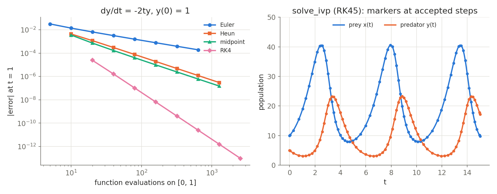
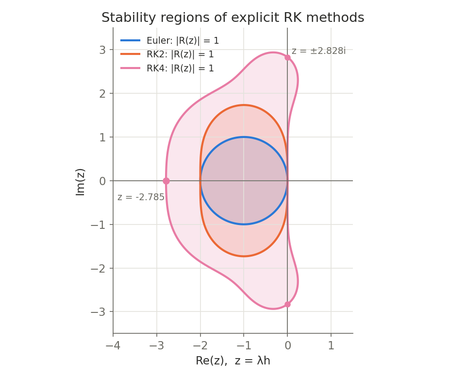

# Chapter 22 — Initial-Value Problems for ODEs

[Repository Guide](../../README.md) | [English](Concepts_Lecture.md) | [한국어](Concepts_Lecture.ko.md)

> **Last Updated:** 2026-11-19
>
> Applied Numerical Methods with Python for Engineers and Scientists, Chapra and Clough, Ch 22

> **Learning Objectives:**
> 1. Apply Euler's method for initial value problems
> 2. Implement Runge-Kutta methods (RK2, RK4)
> 3. Analyze stability and accuracy of ODE solvers
> 4. Convert higher-order ODEs into first-order systems and solve them numerically
> 5. Compare the orders of convergence and costs of the Euler, Heun, midpoint, and RK4 methods by varying the step size
> 6. Solve systems of ODEs with SciPy's solve_ivp and interpret its tolerances and result fields

---

<br>

## Table of Contents

- [1. Overview of ODEs and Initial-Value Problems](#1-overview-of-odes-and-initial-value-problems)
  - [1.1 Ordinary Differential Equations](#11-ordinary-differential-equations)
  - [1.2 The Initial-Value Problem (IVP)](#12-the-initial-value-problem-ivp)
  - [1.3 Systems of ODEs](#13-systems-of-odes)
  - [1.4 Integral Formulation](#14-integral-formulation)
- [2. Euler Method](#2-euler-method)
  - [2.1 Derivation](#21-derivation)
  - [2.2 Geometric Interpretation](#22-geometric-interpretation)
  - [2.3 A Worked Example of Euler's Method](#23-a-worked-example-of-eulers-method)
- [3. Local and Global Truncation Errors](#3-local-and-global-truncation-errors)
  - [3.1 Global Error](#31-global-error)
  - [3.2 Big-O Notation for Errors](#32-big-o-notation-for-errors)
  - [3.3 Taylor Series Analysis of Euler's Method](#33-taylor-series-analysis-of-eulers-method)
  - [3.4 Approximate Local Truncation Error](#34-approximate-local-truncation-error)
  - [3.5 From Local to Global Error](#35-from-local-to-global-error)
  - [3.6 Numerical Confirmation of the Global Error Order](#36-numerical-confirmation-of-the-global-error-order)
  - [3.7 Tracing Local and Global Errors](#37-tracing-local-and-global-errors)
- [4. Runge-Kutta (RK) Methods](#4-runge-kutta-rk-methods)
  - [4.1 Core Idea](#41-core-idea)
  - [4.2 The Increment Function](#42-the-increment-function)
  - [4.3 General Framework of Explicit RK Methods](#43-general-framework-of-explicit-rk-methods)
  - [4.4 Butcher Tableau](#44-butcher-tableau)
- [5. 2nd-Order Runge-Kutta Methods](#5-2nd-order-runge-kutta-methods)
  - [5.1 General 2-Stage RK Form](#51-general-2-stage-rk-form)
  - [5.2 Deriving the Order Conditions](#52-deriving-the-order-conditions)
  - [5.3 Order Conditions for 2nd-Order Accuracy](#53-order-conditions-for-2nd-order-accuracy)
  - [5.4 Heun's Method (b2 = 1/2)](#54-heuns-method-b2--12)
  - [5.5 Modified Euler / Midpoint Method (b2 = 1)](#55-modified-euler--midpoint-method-b2--1)
  - [5.6 Worked Examples of Heun's and the Midpoint Methods](#56-worked-examples-of-heuns-and-the-midpoint-methods)
  - [5.7 Ralston's Method and Heun's Method with an Iterated Corrector](#57-ralstons-method-and-heuns-method-with-an-iterated-corrector)
- [6. Classical 4th-Order Runge-Kutta Method (RK4)](#6-classical-4th-order-runge-kutta-method-rk4)
  - [6.1 The Formula](#61-the-formula)
  - [6.2 Butcher Tableau for RK4](#62-butcher-tableau-for-rk4)
  - [6.3 Python Implementation](#63-python-implementation)
  - [6.4 One RK4 Step and a Convergence Comparison of the Methods](#64-one-rk4-step-and-a-convergence-comparison-of-the-methods)
- [7. Systems of ODEs](#7-systems-of-odes)
  - [7.1 Vector Form](#71-vector-form)
  - [7.2 Higher-Order ODEs as Systems](#72-higher-order-odes-as-systems)
  - [7.3 Python Implementation of RK4 for Systems](#73-python-implementation-of-rk4-for-systems)
  - [7.4 SciPy's solve_ivp](#74-scipys-solve_ivp)
  - [7.5 A System of ODEs by Hand](#75-a-system-of-odes-by-hand)
- [8. Numerical Stability](#8-numerical-stability)
  - [8.1 The Model Problem](#81-the-model-problem)
  - [8.2 Stability of the Exact Solution](#82-stability-of-the-exact-solution)
  - [8.3 Stability of Euler's Method (Forward Euler)](#83-stability-of-eulers-method-forward-euler)
  - [8.4 Stability Region of Forward Euler](#84-stability-region-of-forward-euler)
  - [8.5 Stability of Backward Euler Method](#85-stability-of-backward-euler-method)
  - [8.6 Stability of the Trapezoidal Method](#86-stability-of-the-trapezoidal-method)
  - [8.7 A-Stability and L-Stability](#87-a-stability-and-l-stability)
  - [8.8 Stability Regions of Explicit RK Methods and the Choice of Step Size](#88-stability-regions-of-explicit-rk-methods-and-the-choice-of-step-size)
- [Concept Applications](#concept-applications)
- [Summary](#summary)
- [Self-Check Questions](#self-check-questions)
- [References](#references)

---

<br>

## 1. Overview of ODEs and Initial-Value Problems

### 1.1 Ordinary Differential Equations

Let $`y = y(t)`$ be an unknown function of the independent variable $`t`$. An **ordinary differential equation (ODE)** relates $`y`$ and its derivatives:

```math
\frac{dy}{dt} = f(t, y)
```

The function $`f(t, y)`$ is known and gives the **slope** (tendency) of the solution at any point $`(t, y)`$ in the $`t`$-$`y`$ plane. The solution $`y(t)`$ traces a **solution curve** through this slope field.

> **[Calculus]** Unlike algebraic equations where the unknown is a number, the unknown in a differential equation is a *function*. The ODE $`\frac{dy}{dt} = f(t,y)`$ states that the rate of change of $`y`$ at any time $`t`$ is determined by the current values of $`t`$ and $`y`$.

### 1.2 The Initial-Value Problem (IVP)

Given an initial condition $`y(t_0) = y_0`$, solve for $`y(t)`$ for $`t > t_0`$. This is the **initial-value problem**:

```math
\begin{cases} \dfrac{dy}{dt} = f(t, y), & t > t_0 \\[6pt] y(t_0) = y_0 \end{cases}
```

The initial condition selects a unique solution curve from the family of all solutions to the ODE.

> **Definition:** An **initial value problem** consists of a differential equation $`y' = f(t, y)`$ and the value at one time, $`y(t_0) = y_0`$. If $`f`$ is continuous and satisfies the Lipschitz condition $`|f(t, y_1) - f(t, y_2)| \le L|y_1 - y_2|`$ in $`y`$, a solution exists and is unique near $`t_0`$.

### 1.3 Systems of ODEs

Consider a pair of coupled ODEs:

```math
\frac{du}{dt} = p(t, u, v), \quad u(t_0) = u_0
```

```math
\frac{dv}{dt} = q(t, u, v), \quad v(t_0) = v_0
```

In **vector form**, define $`\mathbf{y} := (u, v)^T`$ and $`\mathbf{f} := (p, q)^T`$:

```math
\frac{d\mathbf{y}}{dt} = \mathbf{f}(t, \mathbf{y}), \quad \mathbf{y}(t_0) = (u_0, v_0)^T
```

This is a **system of ODEs**. The single-equation methods in this chapter (Euler, Runge-Kutta, etc.) extend naturally to systems by replacing scalar operations with vector operations.

### 1.4 Integral Formulation

Integrating the ODE from $`t_0`$ to $`t_1`$:

```math
\int_{t_0}^{t_1} \frac{dy}{dt}\,dt = y(t_1) - y(t_0) = \int_{t_0}^{t_1} f(t, y(t))\,dt
```

Therefore:

```math
y(t_1) = y(t_0) + \int_{t_0}^{t_1} f(t, y(t))\,dt
```

The key question is: **how can we numerically approximate this integral** when we do not know $`y(t)`$ in closed form?

---

<br>

## 2. Euler Method

### 2.1 Derivation

Decompose the time interval $`[t_0, T]`$ into $`n`$ subintervals with uniform step size:

```math
h = \frac{T - t_0}{n}, \quad t_{n+1} = t_n + h
```

From the integral formulation over one step:

```math
y(t_{n+1}) = y(t_n) + \int_{t_n}^{t_{n+1}} f(t, y(t))\,dt
```

The simplest approximation is to treat $`f`$ as constant over $`[t_n, t_{n+1}]`$, evaluated at the left endpoint:

```math
\int_{t_n}^{t_{n+1}} f(t, y(t))\,dt \approx f(t_n, y_n) \cdot \int_{t_n}^{t_{n+1}} dt = f(t_n, y_n) \cdot h
```

This gives **Euler's method** (Forward Euler):

```math
\boxed{y_{n+1} = y_n + h\,f_n, \quad f_n := f(t_n, y_n)}
```

### 2.2 Geometric Interpretation

At each time step, Euler's method advances the solution along the tangent line at the current point $`(t_n, y_n)`$. The slope of this tangent is $`f(t_n, y_n)`$, so moving a horizontal distance $`h`$ produces a vertical change of $`h \cdot f(t_n, y_n)`$ (Figure 1).

```text
  y
  │                               ● (t_{n+1}, y_{n+1})
  │                            ╱  ┊
  │                         ╱     ┊  h f(t_n, y_n)
  │                      ╱        ┊
  │                   ╱           ┊
  │     (t_n, y_n) ●┈┈┈┈┈┈┈┈┈┈┈┈┈┈┘
  │                ├────── h ─────┤
  └──────────────────────────────────────────── t
```

*Figure 1. Euler's method advancing one step along the tangent line*

> **Note:** **Relation to quadrature.** Euler's method is the simplest member of a vast family of numerical ODE solvers. It corresponds to approximating the integral $`\int f\,dt`$ by a left-endpoint rectangle rule. Better quadrature rules lead to better ODE methods, which is the idea behind Runge-Kutta methods.

### 2.3 A Worked Example of Euler's Method

The initial value problem $`\frac{dy}{dt} = -2ty`$, $`y(0) = 1`$ has the exact solution $`y = e^{-t^2}`$. Euler's method is applied with $`h = 0.25`$ up to $`t = 1`$.

```python
import numpy as np

f = lambda t, y: -2.0 * t * y + 0.0            # dy/dt = -2ty, y(0) = 1
exact = lambda t: np.exp(-t**2)

h, t, y = 0.25, 0.0, 1.0
print("  n     t      y_n        f_n       exact     error")
for n in range(5):
    fn = f(t, y)
    print(f"{n:3d}  {t:5.2f}  {y:9.6f}  {fn:9.6f}  {exact(t):9.6f}  {exact(t) - y:+.6f}")
    y, t = y + h * fn, t + h
```

```text
  n     t      y_n        f_n       exact     error
  0   0.00   1.000000   0.000000   1.000000  +0.000000
  1   0.25   1.000000  -0.500000   0.939413  -0.060587
  2   0.50   0.875000  -0.875000   0.778801  -0.096199
  3   0.75   0.656250  -0.984375   0.569783  -0.086467
  4   1.00   0.410156  -0.820312   0.367879  -0.042277
```

- The `+ 0.0` in `f` keeps a signed zero (`-0.0`) from being printed at $`t = 0`$ and does not affect the values.
- The last line of the loop, `y, t = y + h * fn, t + h`, is the formula $`y_{n+1} = y_n + hf_n`$ of Section 2.1.

In the first step $`f(0, 1) = 0`$, so Euler's method keeps $`y`$ at 1, while the true solution drops to 0.939 by $`t = 0.25`$. Euler's method uses the slope at the left end of each interval for the whole interval, so near $`t < 0.7`$, where the slope becomes increasingly negative, it underestimates the decrease and the approximation exceeds the true value. The error peaks at $`t = 0.5`$ and is partly offset in the later intervals, where the magnitude of the slope decreases, leaving $`-0.042`$ at $`t = 1`$. The global error is thus the result of local errors that accumulate and propagate from step to step.

---

<br>

## 3. Local and Global Truncation Errors

### 3.1 Global Error

The **global error** at step $`n`$ is the difference between the true solution and the numerical approximation:

```math
e_n = y(t_n) - y_n
```

Note that $`e_0 = y(t_0) - y_0 = 0`$ by the initial condition. The global error is the **accumulation** of local errors over all steps from $`t_0`$ to $`t_n`$.

> **Definition:** The **local truncation error** is the error made in one step when the starting value of the step is assumed exact, that is, starting from $`y_n = y(t_n)`$ and advancing one step: $`y(t_{n+1}) - \bigl[y(t_n) + h\,\phi(t_n, y(t_n))\bigr]`$. The global error is the result of these local errors accumulating and propagating into later steps.

### 3.2 Big-O Notation for Errors

A quantity $`z`$ is $`O(h^p)`$ if there exist constants $`h_0, C > 0`$ such that:

```math
|z| \le C h^p \quad \forall\; 0 < h < h_0
```

For $`p > 0`$, this means $`z`$ converges to zero as $`h \to 0`$, and the **rate of convergence** is $`p`$.

### 3.3 Taylor Series Analysis of Euler's Method

Recall the Taylor expansion of $`y`$ about $`(t_n, y_n)`$ with $`h = t_{n+1} - t_n`$:

```math
y(t_n + h) = y(t_n) + y'(t_n)\,h + y''(t_n)\frac{h^2}{2} + \cdots + y^{(n)}(t_n)\frac{h^n}{n!} + R_n
```

where $`R_n = y^{(n+1)}(\xi)\frac{h^{n+1}}{(n+1)!}`$ for some $`\xi \in [t_n, t_n + h]`$.

Since $`y'(t_n) = f(t_n, y_n)`$, we can rewrite the Taylor expansion using derivatives of $`f`$:

```math
y(t_n + h) = \underbrace{y_n + f(t_n, y_n)\,h}_{\text{Euler approx}} + \underbrace{f'(t_n, y_n)\frac{h^2}{2} + \cdots + f^{(n)}(t_n, y_n)\frac{h^n}{n!} + O(h^{n+1})}_{\text{truncated terms (local truncation error)}}
```

The **true local truncation error** of Euler's method is $`O(h^2)`$, the order of the leading term of what is discarded.

### 3.4 Approximate Local Truncation Error

The leading term of the local truncation error for Euler's method is:

```math
E_a = f'(t_n, y_n)\frac{h^2}{2} = O(h^2)
```

This is the **approximate local truncation error** at each step.

### 3.5 From Local to Global Error

With a uniform step size $`h`$ over $`[0, T]`$, we have $`n = \frac{T}{h}`$ steps. Summing the local errors:

```math
\left|\sum_{i=1}^{n} E_{a,i}\right| = \left|(f'_0 + f'_1 + \cdots + f'_{n-1})\frac{h^2}{2}\right| \le \tilde{f}' \cdot \frac{h^2}{2} \cdot n
```

where $`\tilde{f}' = \max_{0 \le i \le n-1} |f'_i|`$.

Substituting $`n = \frac{T}{h}`$:

```math
\left|\sum E_{a,i}\right| \le \tilde{f}' \cdot \frac{h^2}{2} \cdot \frac{T}{h} = \frac{\tilde{f}'\,T}{2}\,h = O(h)
```

**Key result: Euler's method has local truncation error $`O(h^2)`$ and global truncation error $`O(h)`$.** Euler's method is a **first-order method**.

> **Note:** **Orders of local and global error.** The local error loses one order of $`h`$ when accumulated into global error because the number of steps $`n = T/h`$ grows as $`h`$ decreases. For one-step methods applied to an $`f`$ that satisfies a Lipschitz condition, this pattern holds in general: for a method with local error $`O(h^{p+1})`$, the global error is $`O(h^p)`$. The simple sum above ignores how errors from earlier steps propagate into later steps, but a rigorous analysis that includes propagation gives the same order.

### 3.6 Numerical Confirmation of the Global Error Order

Solving the problem of Section 2.3 up to $`t = 1`$ while halving $`h`$ gives the following global errors for Euler's method (computed with the code of Section 6.4).

| $`h`$ | 0.1 | 0.05 | 0.025 | 0.0125 |
|:-----|:-----|:-----|:-----|:-----|
| $`\lvert y(1) - y_n \rvert`$ | $`1.38 \times 10^{-2}`$ | $`6.50 \times 10^{-3}`$ | $`3.16 \times 10^{-3}`$ | $`1.56 \times 10^{-3}`$ |
| Ratio to the previous error | | 2.13 | 2.06 | 2.03 |

*Table 1. Global error of Euler's method versus step size*

Halving $`h`$ halves the error, and the ratio converges to 2, so the global error is $`O(h)`$, as concluded in Section 3.5. The local error is $`O(h^2)`$, so the error of one step drops to a quarter, but twice as many steps are needed to cover the same interval, so the global error drops only by half. The ratio approaches 2 as $`h`$ decreases because $`O(h)`$ is an asymptotic property describing the behavior as $`h \to 0`$.

### 3.7 Tracing Local and Global Errors

Revisiting the computation of Section 2.3 and computing the local truncation error and the global error of each step separately shows their relation concretely. The local error is the error of one Euler step starting from the exact value $`y(t_n)`$, and the global error is the accumulated result starting from the computed value $`y_n`$.

| Step | $`t_{n+1}`$ | Local error | Global error $`e_{n+1}`$ | Simple sum of local errors |
|:---:|:-----|:-----|:-----|:-----|
| 1 | 0.25 | $`-0.060587`$ | $`-0.060587`$ | $`-0.060587`$ |
| 2 | 0.50 | $`-0.043186`$ | $`-0.096199`$ | $`-0.103773`$ |
| 3 | 0.75 | $`-0.014318`$ | $`-0.086467`$ | $`-0.118090`$ |
| 4 | 1.00 | $`+0.011765`$ | $`-0.042277`$ | $`-0.106325`$ |

*Table 2. Local and global errors when $`dy/dt = -2ty`$ is solved by Euler's method with step size 0.25*

In the first step the starting value is exact, so the local and global errors are equal. From the second step on, the global error differs from the simple sum of local errors because the errors made in earlier steps change as they pass through later steps. The propagation over one step is roughly $`e_{n+1} \approx (1 + h\,\partial f/\partial y)\,e_n + (\text{local error})`$; in this problem $`\partial f/\partial y = -2t < 0`$, so the factor $`1 - 2th`$ is less than 1 and earlier errors shrink. That is why the global error $`-0.042`$ at $`t = 1`$ is smaller than the sum of local errors, $`-0.106`$. Conversely, in problems with $`\partial f/\partial y > 0`$ (problems whose solutions grow exponentially), earlier errors are amplified and the global error exceeds the sum of local errors. This is why the simple summation of Section 3.5 gets the order right but not the size.

---

<br>

## 4. Runge-Kutta (RK) Methods

### 4.1 Core Idea

Runge-Kutta methods **improve accuracy by combining multiple slope estimates** from different points within the interval $`[t_n, t_{n+1}]`$, without requiring explicit computation of higher derivatives of $`f`$.

Starting from the integral form and performing a change of variable $`t = (t_{n+1} - t_n)z + t_n`$ where $`z \in [0, 1]`$:

```math
y_{n+1} = y_n + \int_{t_n}^{t_{n+1}} f(t, y)\,dt = y_n + h \int_0^1 f(z, y(z))\,dz
```

### 4.2 The Increment Function

Approximate the integral $`\int_0^1 f(z, y(z))\,dz`$ using a quadrature rule:

```math
\int_0^1 f(z, y(z))\,dz \approx \phi
```

where $`\phi`$ is the **increment function** (an averaged slope):

```math
y_{n+1} = y_n + \phi \cdot h
```

The increment function is a weighted sum of slope evaluations:

```math
\phi = \sum_{i=1}^{s} b_i k_i = \sum_{i=1}^{s} b_i\,f(t_n + c_i h,\; y(t_n + c_i h))
```

This is essentially a **quadrature** of $`f`$ over the step, where $`b_i`$ are weights and $`c_i`$ are nodes.

### 4.3 General Framework of Explicit RK Methods

Since we do not know $`y(t_n + c_i h)`$ in general, we approximate it by an **internal stage** value $`Y_i`$:

**Internal stages** (computed sequentially):

```math
Y_1 = y_n \quad \Rightarrow \quad k_1 = f(t_n, Y_1)
```

```math
Y_2 = y_n + h\,a_{21}\,k_1 \quad \Rightarrow \quad k_2 = f(t_n + c_2 h, Y_2)
```

```math
Y_3 = y_n + h(a_{31}\,k_1 + a_{32}\,k_2) \quad \Rightarrow \quad k_3 = f(t_n + c_3 h, Y_3)
```

```math
\vdots
```

```math
Y_s = y_n + h \sum_{j=1}^{s-1} a_{sj}\,k_j \quad \Rightarrow \quad k_s = f(t_n + c_s h, Y_s)
```

**Step completion:**

```math
y_{n+1} = y_n + h \sum_{i=1}^{s} b_i\,k_i
```

where $`s`$ is the **number of stages**.

> **Key Point:** The key insight of RK methods is replacing the intractable problem of evaluating $`f`$ at unknown intermediate solution values with a bootstrapping procedure: use Euler-like predictions to estimate intermediate values, evaluate $`f`$ there, then combine those slopes.

### 4.4 Butcher Tableau

An explicit RK method is fully specified by the matrix $`A`$ (strictly lower triangular), the weight vector $`\mathbf{b} = (b_1, b_2, \ldots, b_s)^T`$, and the node vector $`\mathbf{c} = (c_1, c_2, \ldots, c_s)^T`$.

In matrix form for the internal stages:

```math
\begin{pmatrix} Y_1 \\ Y_2 \\ Y_3 \\ \vdots \\ Y_s \end{pmatrix} = \begin{pmatrix} y_n \\ y_n \\ y_n \\ \vdots \\ y_n \end{pmatrix} + h \begin{pmatrix} 0 & 0 & 0 & \cdots & 0 \\ a_{21} & 0 & 0 & \cdots & 0 \\ a_{31} & a_{32} & 0 & \cdots & 0 \\ \vdots & \vdots & \vdots & \ddots & \vdots \\ a_{s1} & a_{s2} & a_{s3} & \cdots & 0 \end{pmatrix} \begin{pmatrix} k_1 \\ k_2 \\ k_3 \\ \vdots \\ k_s \end{pmatrix}
```

The matrix $`A`$ being strictly lower triangular is what makes the method **explicit**: each stage can be computed from previously computed stages.

The **Butcher tableau** is the standard compact notation:

```math
\begin{array}{c|c} \mathbf{c} & A \\ \hline & \mathbf{b}^T \end{array}
```

---

<br>

## 5. 2nd-Order Runge-Kutta Methods

### 5.1 General 2-Stage RK Form

A 2-stage ($`s = 2`$) explicit RK method has the form:

```math
y_{n+1} = y_n + h(b_1 k_1 + b_2 k_2)
```

where:

```math
k_1 = f(t_n, y_n)
```

```math
k_2 = f(t_n + ch,\; y_n + h\,a\,k_1)
```

The parameters to determine are $`b_1, b_2, c, a`$ (4 unknowns).

### 5.2 Deriving the Order Conditions

**Taylor expansion of the true solution** (using total derivative with respect to $`t`$):

```math
y(t_n + h) = y_n + h\,f + \frac{h^2}{2}(f_t + f_y f) + O(h^3)
```

where all $`f, f_t, f_y`$ are evaluated at $`(t_n, y_n)`$.

> **[Calculus]** The second derivative $`y'' = \frac{d}{dt}f(t, y) = f_t + f_y \cdot \frac{dy}{dt} = f_t + f_y f`$ uses the **chain rule** for the total derivative. This is because $`f`$ depends on $`t`$ both directly and indirectly through $`y(t)`$.

**Taylor expansion of the RK2 formula:**

Expanding $`k_2 = f(t_n + ch, y_n + a\,f(t_n,y_n)\,h)`$ using a multivariable Taylor expansion with $`\Delta t = ch`$ and $`\Delta y = a\,f(t_n,y_n)\,h`$:

```math
f(t_n + \Delta t, y_n + \Delta y) = f + f_t \cdot ch + f_y \cdot a\,f\,h + O(h^2)
```

Substituting back into the RK2 formula:

```math
y_{n+1} = y_n + h(b_1 + b_2)f + \frac{h^2}{2} \cdot 2b_2(c\,f_t + a\,f_y f) + O(h^3)
```

### 5.3 Order Conditions for 2nd-Order Accuracy

Matching with the Taylor expansion up to $`O(h^2)`$ terms gives **3 equations in 4 unknowns** (one degree of freedom):

```math
b_1 + b_2 = 1
```

```math
b_2 c = \frac{1}{2}
```

```math
b_2 a = \frac{1}{2}
```

The last two conditions imply $`c = a`$.

### 5.4 Heun's Method (b2 = 1/2)

Choose $`b_2 = 1/2`$:

```math
b_1 = \frac{1}{2}, \quad a = 1, \quad c = 1
```

```math
Y_1 = y_n \quad \Rightarrow \quad k_1 = f(t_n, y_n)
```

```math
Y_2 = y_n + h\,k_1 \quad \Rightarrow \quad k_2 = f(t_n + h, Y_2)
```

```math
\boxed{y_{n+1} = y_n + h\left(\frac{k_1 + k_2}{2}\right)}
```

This is **Heun's method** (also called the improved Euler or trapezoidal predictor-corrector). The Butcher tableau is:

```math
\begin{array}{c|cc} 0 & & \\ 1 & 1 & \\ \hline & 1/2 & 1/2 \end{array}
```

> **Note:** **Analogy with the trapezoidal rule.** Heun's method first predicts $`Y_2`$ using a full Euler step to $`t_{n+1}`$, evaluates the slope there, then averages the slopes at both endpoints. This is analogous to the trapezoidal rule for integration (Chapter 19).

### 5.5 Modified Euler / Midpoint Method (b2 = 1)

Choose $`b_2 = 1`$:

```math
b_1 = 0, \quad a = \frac{1}{2}, \quad c = \frac{1}{2}
```

```math
k_1 = f(t_n, y_n)
```

```math
k_2 = f\!\left(t_n + \frac{h}{2},\; y_n + \frac{h}{2}\,k_1\right)
```

```math
\boxed{y_{n+1} = y_n + h\,k_2}
```

This is the **modified Euler** (midpoint) method. The Butcher tableau is:

```math
\begin{array}{c|cc} 0 & & \\ 1/2 & 1/2 & \\ \hline & 0 & 1 \end{array}
```

> **Note:** **Analogy with the midpoint rule.** The midpoint method uses an Euler half-step to estimate the slope at the interval's midpoint, then uses that midpoint slope to advance the full step. This is analogous to the midpoint rule for integration.

### 5.6 Worked Examples of Heun's and the Midpoint Methods

The first step of the problem of Section 2.3 is computed with $`h = 0.25`$.

**Heun's method.** $`k_1 = f(0, 1) = 0`$, and at the Euler prediction $`Y_2 = 1 + 0.25 \times 0 = 1`$, $`k_2 = f(0.25, 1) = -0.5`$. Therefore $`y_1 = 1 + 0.25 \times \frac{0 + (-0.5)}{2} = 0.9375`$.

**Midpoint method.** $`k_1 = 0`$, and at the half-step prediction $`1 + 0.125 \times 0 = 1`$, $`k_2 = f(0.125, 1) = -0.25`$. Therefore $`y_1 = 1 + 0.25 \times (-0.25) = 0.9375`$.

The error relative to the exact value $`e^{-0.0625} = 0.939413`$ is $`0.0019`$ for both methods, about 30 times smaller than Euler's error $`0.0606`$. In the first step of this problem $`y`$ stays the same and the slope is proportional to $`t`$, so the average of the end slopes equals the midpoint slope and the two methods agree, but in general they give different values. The global errors up to $`t = 1`$ at $`h = 0.1`$ are $`1.17 \times 10^{-3}`$ for Heun's method and $`7.27 \times 10^{-4}`$ for the midpoint method, and both drop to about a quarter each time $`h`$ is halved, confirming that they are second-order methods (Section 6.4).

### 5.7 Ralston's Method and Heun's Method with an Iterated Corrector

Infinitely many two-stage methods satisfy the order conditions of Section 5.3, $`b_1 + b_2 = 1`$ and $`b_2c = b_2a = \frac{1}{2}`$. Besides Heun's and the midpoint methods, the textbook presents the case $`b_2 = \frac{3}{4}`$ as Ralston's method. Then $`b_1 = \frac{1}{4}`$ and $`a = c = \frac{2}{3}`$.

```math
k_1 = f(t_n, y_n), \qquad k_2 = f\left(t_n + \frac{2}{3}h,\ y_n + \frac{2}{3}h\,k_1\right), \qquad y_{n+1} = y_n + h\left(\frac{1}{4}k_1 + \frac{3}{4}k_2\right)
```

This choice is known to minimize a bound on the size of the leading local error term among second-order methods. Solving the problem of Section 2.3 up to $`t = 1`$ with $`h = 0.1`$ gives a global error of $`9.4 \times 10^{-5}`$, smaller than Heun's method ($`1.17 \times 10^{-3}`$) and the midpoint method ($`7.27 \times 10^{-4}`$) at the same step. For this problem the error drops by nearly a factor of 8 when $`h`$ is halved, a special case in which the leading error terms partly cancel for this function; in general the method is second-order.

In the corrector of Heun's method, $`y_{n+1} = y_n + \frac{h}{2}\bigl(f(t_n, y_n) + f(t_{n+1}, Y)\bigr)`$, the value just obtained for $`y_{n+1}`$ can be substituted for $`Y`$ to repeat the correction. The textbook describes Heun's method in this form, continuing the iteration until the relative change falls below a tolerance. Applied to the first step of Section 2.3 ($`h = 0.25`$), it gives the following.

| Iteration | $`y_1`$ | Relative change |
|:---:|:-----|:-----|
| 1 | 0.93750000 | $`6.7 \times 10^{-2}`$ |
| 2 | 0.94140625 | $`4.1 \times 10^{-3}`$ |
| 3 | 0.94116211 | $`2.6 \times 10^{-4}`$ |
| 4 | 0.94117737 | $`1.6 \times 10^{-5}`$ |
| 5 | 0.94117641 | $`1.0 \times 10^{-6}`$ |

*Table 3. Change in the first-step value when the corrector of Heun's method is iterated*

The iteration converges to 0.9411765. This value is not the exact value 0.9394131 but the solution of the implicit trapezoidal method $`y_1 = y_0 + \frac{h}{2}(f_0 + f_1)`$, namely $`1/1.0625 = 0.9411765`$. Iterating the corrector amounts to solving the implicit equation of the trapezoidal method by fixed-point iteration, so the error does not fall below the local error of the trapezoidal method ($`O(h^3)`$). In this example the non-iterated Heun value 0.9375 (error 0.0019) and the iterated value (error $`-0.0018`$) have similar accuracy. Iteration adds function evaluations, so to improve accuracy it is more efficient to reduce the step or use a higher-order method than to iterate.

---

<br>

## 6. Classical 4th-Order Runge-Kutta Method (RK4)

### 6.1 The Formula

The classical RK4 is a 4-stage method with local truncation error $`O(h^5)`$ and global error $`O(h^4)`$:

```math
k_1 = f(t_n,\; y_n)
```

```math
k_2 = f\!\left(t_n + \frac{h}{2},\; y_n + \frac{h}{2}\,k_1\right)
```

```math
k_3 = f\!\left(t_n + \frac{h}{2},\; y_n + \frac{h}{2}\,k_2\right)
```

```math
k_4 = f(t_n + h,\; y_n + h\,k_3)
```

```math
\boxed{y_{n+1} = y_n + \frac{h}{6}(k_1 + 2k_2 + 2k_3 + k_4)}
```

The weights $`\frac{1}{6}, \frac{2}{6}, \frac{2}{6}, \frac{1}{6}`$ correspond to **Simpson's 1/3 rule** applied to the four slope estimates. The midpoint weight $`\frac{4}{6}`$ of Simpson's 1/3 rule (Chapter 19) is split between the two midpoint slopes $`k_2`$ and $`k_3`$; Figure 2 shows where the slopes are evaluated.

```text
   t_n                  t_n + h/2                t_n + h
    ●───────────────────────●───────────────────────●
   k_1                  k_2, k_3                   k_4
 w = 1/6              w = 2/6, 2/6               w = 1/6
```

*Figure 2. Slope evaluation points and weights of RK4*

> **Key Point:** RK4 is the workhorse of ODE solving. It achieves 4th-order accuracy using only 4 function evaluations per step, without requiring any derivatives of $`f`$, and for many practical problems it provides an excellent balance between accuracy and computational cost.

### 6.2 Butcher Tableau for RK4

```math
\begin{array}{c|cccc} 0 & & & & \\ 1/2 & 1/2 & & & \\ 1/2 & 0 & 1/2 & & \\ 1 & 0 & 0 & 1 & \\ \hline & 1/6 & 1/3 & 1/3 & 1/6 \end{array}
```

### 6.3 Python Implementation

```python
import numpy as np

def rk4(f, t0, y0, T, h):
    """
    Classical 4th-order Runge-Kutta method.

    Parameters
    ----------
    f  : callable, f(t, y) -> dy/dt
    t0 : float, initial time
    y0 : float, initial value
    T  : float, final time
    h  : float, step size

    Returns
    -------
    t_arr : ndarray, time values
    y_arr : ndarray, solution values
    """
    n = int((T - t0) / h)
    t_arr = np.linspace(t0, T, n + 1)
    y_arr = np.zeros(n + 1)
    y_arr[0] = y0

    for i in range(n):
        t = t_arr[i]
        y = y_arr[i]
        k1 = f(t, y)
        k2 = f(t + h/2, y + h/2 * k1)
        k3 = f(t + h/2, y + h/2 * k2)
        k4 = f(t + h, y + h * k3)
        y_arr[i+1] = y + h/6 * (k1 + 2*k2 + 2*k3 + k4)

    return t_arr, y_arr
```

### 6.4 One RK4 Step and a Convergence Comparison of the Methods

Computing the first RK4 step of the problem of Section 2.3 with $`h = 0.25`$ gives the four slopes below.

```math
k_1 = f(0, 1) = 0, \qquad k_2 = f\left(0.125,\ 1 + 0.125 \times 0\right) = -0.25
```

```math
k_3 = f\left(0.125,\ 1 + 0.125 \times (-0.25)\right) = -0.2421875, \qquad k_4 = f\left(0.25,\ 1 + 0.25 \times (-0.2421875)\right) = -0.4697266
```

```math
y_1 = 1 + \frac{0.25}{6}\left(0 + 2(-0.25) + 2(-0.2421875) - 0.4697266\right) = 0.9394124
```

The error relative to the exact value 0.9394131 is $`6.3 \times 10^{-7}`$, about 3,000 times smaller than the error 0.0019 of the second-order methods for the same step. Comparing the global errors of the four methods while reducing $`h`$ gives the following.

```python
import numpy as np

f = lambda t, y: -2.0 * t * y
exact = np.exp(-1.0)                           # y(1)

def euler(h):
    t, y = 0.0, 1.0
    for _ in range(round(1 / h)):
        y += h * f(t, y); t += h
    return y

def heun(h):
    t, y = 0.0, 1.0
    for _ in range(round(1 / h)):
        k1 = f(t, y); k2 = f(t + h, y + h * k1)
        y += h * (k1 + k2) / 2; t += h
    return y

def midpoint(h):
    t, y = 0.0, 1.0
    for _ in range(round(1 / h)):
        k1 = f(t, y); k2 = f(t + h / 2, y + h / 2 * k1)
        y += h * k2; t += h
    return y

def rk4(h):
    t, y = 0.0, 1.0
    for _ in range(round(1 / h)):
        k1 = f(t, y); k2 = f(t + h/2, y + h/2 * k1)
        k3 = f(t + h/2, y + h/2 * k2); k4 = f(t + h, y + h * k3)
        y += h / 6 * (k1 + 2*k2 + 2*k3 + k4); t += h
    return y

print("     h      Euler      Heun     Midpoint     RK4")
prev = None
for h in [0.1, 0.05, 0.025, 0.0125]:
    e = [abs(exact - m(h)) for m in (euler, heun, midpoint, rk4)]
    print(f"{h:7.4f}  " + "  ".join(f"{v:.2e}" for v in e))
    if prev:
        print("  ratio  " + "  ".join(f"{p / v:8.2f}" for p, v in zip(prev, e)))
    prev = e
```

```text
     h      Euler      Heun     Midpoint     RK4
 0.1000  1.38e-02  1.17e-03  7.27e-04  1.63e-06
 0.0500  6.50e-03  3.01e-04  1.66e-04  1.03e-07
  ratio      2.13      3.90      4.36     15.85
 0.0250  3.16e-03  7.60e-05  3.99e-05  6.41e-09
  ratio      2.06      3.96      4.17     16.00
 0.0125  1.56e-03  1.91e-05  9.78e-06  4.00e-10
  ratio      2.03      3.98      4.08     16.02
```

- The four functions share the same structure and differ only in the update of one step. `round(1 / h)` is the number of steps up to $`t = 1`$; `round` is used because `int` could drop one step due to floating-point error.
- The `ratio` lines give the error ratio when $`h`$ is halved; it converges to 2 for Euler, 4 for Heun and midpoint, and 16 for RK4, showing that they are first-, second-, and fourth-order methods.

A fair comparison must also account for cost. The number of evaluations of $`f`$ per step is 1 for Euler, 2 for Heun and midpoint, and 4 for RK4. Plotting the error against the number of evaluations gives the left panel of Figure 3: although one RK4 step costs four times as much, RK4 gives the smallest error per unit cost over almost the whole range of accuracy. For example, with 40 evaluations Euler reaches an error of $`3.2 \times 10^{-3}`$ at $`h = 0.025`$, whereas RK4 reaches $`1.6 \times 10^{-6}`$ at $`h = 0.1`$.



*Figure 3. Error of RK methods versus the number of function evaluations, and the adaptive steps of solve_ivp*

---

<br>

## 7. Systems of ODEs

### 7.1 Vector Form

A system of $`m`$ first-order ODEs is written in vector form as:

```math
\frac{d\mathbf{y}}{dt} = \mathbf{f}(t, \mathbf{y}), \quad \mathbf{y}(t_0) = \mathbf{y}_0
```

where $`\mathbf{y} = (y_1, y_2, \ldots, y_m)^T`$ and $`\mathbf{f} = (f_1, f_2, \ldots, f_m)^T`$.

All Euler and Runge-Kutta formulas apply **component-by-component**: simply replace scalar $`y`$, $`f`$, and $`k`$ with vectors $`\mathbf{y}`$, $`\mathbf{f}`$, and $`\mathbf{k}`$.

### 7.2 Higher-Order ODEs as Systems

An $`m`$-th order ODE can be converted to a system of $`m`$ first-order ODEs. For example, the second-order ODE:

```math
y'' = g(t, y, y')
```

is rewritten by introducing $`u = y`$ and $`v = y'`$:

```math
\frac{du}{dt} = v, \quad \frac{dv}{dt} = g(t, u, v)
```

with initial conditions $`u(t_0) = y(t_0)`$ and $`v(t_0) = y'(t_0)`$.

> **Note:** **Reducing higher-order ODEs.** This reduction technique is fundamental: *any* numerical method for first-order systems can solve higher-order ODEs by first converting them. For instance, Newton's second law $`m\,x'' = F(t, x, x')`$ becomes a first-order system in position $`x`$ and velocity $`v = x'`$.

### 7.3 Python Implementation of RK4 for Systems

```python
import numpy as np

def rk4_system(f, t0, y0, T, h):
    """
    RK4 for a system of ODEs.

    Parameters
    ----------
    f  : callable, f(t, y) -> ndarray of shape (m,)
    t0 : float, initial time
    y0 : ndarray of shape (m,), initial conditions
    T  : float, final time
    h  : float, step size

    Returns
    -------
    t_arr : ndarray of shape (n+1,)
    y_arr : ndarray of shape (n+1, m)
    """
    n = int((T - t0) / h)
    m = len(y0)
    t_arr = np.linspace(t0, T, n + 1)
    y_arr = np.zeros((n + 1, m))
    y_arr[0] = y0

    for i in range(n):
        t = t_arr[i]
        y = y_arr[i]
        k1 = f(t, y)
        k2 = f(t + h/2, y + h/2 * k1)
        k3 = f(t + h/2, y + h/2 * k2)
        k4 = f(t + h, y + h * k3)
        y_arr[i+1] = y + h/6 * (k1 + 2*k2 + 2*k3 + k4)

    return t_arr, y_arr


# Example: Solve y'' + y = 0  (simple harmonic oscillator)
# Convert to system: u' = v, v' = -u
# with u(0) = 1, v(0) = 0  => exact solution: u(t) = cos(t)

def harmonic(t, y):
    u, v = y
    return np.array([v, -u])

t, sol = rk4_system(harmonic, 0, np.array([1.0, 0.0]), 10, 0.01)
# sol[:, 0] is u(t) ≈ cos(t)
# sol[:, 1] is v(t) ≈ -sin(t)
```

In this example, `sol[-1, 0]` at $`t = 10`$ is $`-0.8390715295`$, which differs from the exact value $`\cos 10 \approx -0.8390715291`$ by about $`4.5 \times 10^{-10}`$.

### 7.4 SciPy's solve_ivp

SciPy's `scipy.integrate.solve_ivp` is the standard function for initial value problems of ODE systems. Its default method is the explicit Runge-Kutta method of order 5(4), `'RK45'`, which estimates the error with the fourth-order formula to control the step size and advances with the fifth-order formula. The default relative tolerance `rtol` and absolute tolerance `atol` are $`10^{-3}`$ and $`10^{-6}`$ [1]. The principle of step-size control is covered in Chapter 23.

The Lotka-Volterra equations for predator and prey populations, $`x' = x - 0.1xy`$ and $`y' = -1.5y + 0.075xy`$, are solved with $`x(0) = 10`$ and $`y(0) = 5`$.

```python
import numpy as np
from scipy.integrate import solve_ivp

def lotka_volterra(t, z):                      # prey x, predator y
    x, y = z
    return [1.0 * x - 0.1 * x * y, -1.5 * y + 0.075 * x * y]

sol = solve_ivp(lotka_volterra, (0.0, 15.0), [10.0, 5.0],
                method="RK45", rtol=1e-6, atol=1e-9, dense_output=True)
print("status:", sol.status, "| steps:", sol.t.size - 1, "| nfev:", sol.nfev)
h = np.diff(sol.t)
print(f"step size: min {h.min():.4f}, max {h.max():.4f}")
for tq in [5.0, 10.0, 15.0]:
    x, y = sol.sol(tq)                         # dense output at any time
    print(f"t = {tq:4.1f}: prey = {x:8.4f}, predator = {y:8.4f}")

# The quantity V = 0.075x - 1.5 ln x + 0.1y - 1.0 ln y is conserved exactly
V = lambda x, y: 0.075 * x - 1.5 * np.log(x) + 0.1 * y - 1.0 * np.log(y)
x, y = sol.y
print(f"drift of V over [0, 15]: {np.max(np.abs(V(x, y) - V(10.0, 5.0))):.1e}")
```

```text
status: 0 | steps: 72 | nfev: 524
step size: min 0.0263, max 0.4473
t =  5.0: prey =   8.2933, predator =   7.4188
t = 10.0: prey =   8.0066, predator =  11.4162
t = 15.0: prey =   9.7800, predator =  17.1665
drift of V over [0, 15]: 9.9e-07
```

- The right-hand side has the form `fun(t, y)` and returns an array of the same length as the state vector, as in the vector form of Section 7.1.
- `status` 0 means the integration reached the end of the interval successfully. `sol.t` and `sol.y` hold the times and solutions of the accepted steps, and `nfev` is the number of evaluations of the right-hand side [1].
- With `dense_output=True`, `sol.sol(t)` gives the solution at any time between steps. If only particular times are needed, they can instead be passed in `t_eval` [1].
- For the Lotka-Volterra equations, $`V = 0.075x - 1.5\ln x + 0.1y - \ln y`$ is exactly conserved ($`dV/dt = 0`$). Its change in the numerical solution is about $`10^{-6}`$, confirming accuracy consistent with the tolerances.

The 72 step sizes range from 0.026 to 0.447. Steps are small near the peaks, where the populations change rapidly, and large in the smooth stretches (right panel of Figure 3). Fixed-step RK4 would have to use the smallest step over the whole interval to achieve the same accuracy, which requires far more evaluations.

> **Caution:** The default tolerance of `solve_ivp`, `rtol=1e-3`, is a loose value corresponding to about three significant digits. When accurate results are needed, `rtol` and `atol` should be set explicitly, and if some component approaches zero, the relative error alone does not control it, so `atol` should be chosen sufficiently smaller than the size of that component.

### 7.5 A System of ODEs by Hand

The harmonic oscillator of Section 7.3, $`u' = v`$, $`v' = -u`$, $`u(0) = 1`$, $`v(0) = 0`$, is computed for two steps with $`h = 0.1`$. The exact solution is $`u = \cos t`$, $`v = -\sin t`$. For a system of ODEs, the slopes of all components must first be computed from values at the same time and then all components updated together.

**Euler's method.** The slopes of the first step are $`(u', v') = (v_0, -u_0) = (0, -1)`$, so $`(u_1, v_1) = (1 + 0.1 \times 0,\ 0 + 0.1 \times (-1)) = (1, -0.1)`$. The slopes of the second step are $`(-0.1, -1)`$, so $`(u_2, v_2) = (1 - 0.01,\ -0.1 - 0.1) = (0.99, -0.2)`$.

**Heun's method.** In the first step $`k_1 = (0, -1)`$, and at the Euler prediction $`(1, -0.1)`$, $`k_2 = (-0.1, -1)`$. The average slope $`(-0.05, -1)`$ gives $`(u_1, v_1) = (0.995, -0.1)`$. In the second step $`k_1 = (-0.1, -0.995)`$, and at the prediction $`(0.985, -0.1995)`$, $`k_2 = (-0.1995, -0.985)`$; the average $`(-0.14975, -0.99)`$ gives $`(u_2, v_2) = (0.980025, -0.199)`$.

| $`t`$ | Euler $`(u, v)`$ | Heun $`(u, v)`$ | Exact $`(\cos t, -\sin t)`$ |
|:-----|:-----|:-----|:-----|
| 0.1 | $`(1.000000, -0.100000)`$ | $`(0.995000, -0.100000)`$ | $`(0.995004, -0.099833)`$ |
| 0.2 | $`(0.990000, -0.200000)`$ | $`(0.980025, -0.199000)`$ | $`(0.980067, -0.198669)`$ |

*Table 4. Two steps of the harmonic oscillator by Euler's and Heun's methods with step size 0.1*

The exact solution keeps $`u^2 + v^2 = 1`$, but after two steps $`u^2 + v^2`$ is 1.0201 for Euler and 1.00005 for Heun. Euler's method multiplies this quantity by exactly $`1 + h^2 = 1.01`$ at every step, so the amplitude of the oscillation keeps growing. As Section 8.8 shows, this is because the purely imaginary eigenvalues $`\pm i`$ lie outside the stability region of Euler's method. A common mistake in hand computation is to update $`u`$ first and then compute the slope of $`v`$ from the new value, which changes the method itself.

---

<br>

## 8. Numerical Stability

### 8.1 The Model Problem

A numerical solution is said to be **unstable** if errors grow exponentially. To analyze stability, consider the **model (test) problem**:

```math
\frac{dy}{dt} = \lambda y, \quad y(0) = y_0
```

The exact solution is:

```math
y(t) = y_0 e^{\lambda t}
```

### 8.2 Stability of the Exact Solution

The behavior of the exact solution depends on $`\lambda`$:

| Value of $`\lambda`$ | Behavior of $`y(t) = y_0 e^{\lambda t}`$ |
|:---|:---|
| $`\lambda > 0`$ | Exponential growth (unstable) |
| $`\lambda = 0`$ | Constant (neutrally stable) |
| $`\lambda < 0`$ | Exponential decay (stable) |

*Table 5. Behavior of the exact solution by $`\lambda`$ sign*

The solution asymptotically approaches zero when $`\lambda < 0`$. A **stable** numerical method should reproduce this decaying behavior for $`\lambda < 0`$.

### 8.3 Stability of Euler's Method (Forward Euler)

Applying Euler's method to $`y' = \lambda y`$:

```math
y_{n+1} = y_n + h \lambda y_n = y_n(1 + \lambda h)
```

The factor $`(1 + \lambda h)`$ is the **amplification factor** (or **stability function** $`\phi(\lambda h)`$). By induction:

```math
y_1 = y_0(1 + \lambda h)
```

```math
y_2 = y_0(1 + \lambda h)^2
```

```math
\vdots
```

```math
y_n = y_0(1 + \lambda h)^n
```

For stability (bounded solution), we need:

```math
|1 + \lambda h| \le 1
```

### 8.4 Stability Region of Forward Euler

Let $`z = \lambda h \in \mathbb{C}`$. The stability condition is:

```math
|1 + z| \le 1
```

This is a **disk of radius 1 centered at $`(-1, 0)`$** in the complex $`z`$-plane.

On the **real axis**, the condition reduces to:

```math
-1 \le 1 + z \le 1 \quad \Rightarrow \quad -2 \le z \le 0
```

Since $`z = \lambda h`$ with $`h > 0`$, this requires:

```math
\lambda \le 0 \quad \text{and} \quad h \le \frac{-2}{\lambda} = \frac{2}{|\lambda|}
```

**The forward Euler method is conditionally stable**: the step size $`h`$ must be chosen sufficiently small to ensure stability. For strongly negative $`\lambda`$ (stiff problems), $`h`$ must be very small.

### 8.5 Stability of Backward Euler Method

The **backward Euler method** (implicit) evaluates the slope at the *next* time step:

```math
y_{n+1} = y_n + h\,f(t_{n+1}, y_{n+1})
```

Applied to $`\frac{dy}{dt} = \lambda y`$:

```math
y_{n+1} = y_n + \lambda h\,y_{n+1}
```

```math
(1 - \lambda h)\,y_{n+1} = y_n
```

```math
y_{n+1} = \frac{1}{1 - \lambda h}\,y_n
```

By induction:

```math
y_n = (1 - \lambda h)^{-n}\,y_0
```

The stability function is $`\phi(z) = \frac{1}{1 - z}`$. For stability:

```math
\frac{1}{|1 - z|} \le 1 \quad \Rightarrow \quad |1 - z| \ge 1
```

The stability region is the **exterior** (including the boundary) of the disk of radius 1 centered at $`(1, 0)`$ in the complex $`z`$-plane. This region contains the **entire left half-plane** $`\text{Re}(z) \le 0`$.

For any $`\lambda < 0`$, we can choose the step size $`h`$ **arbitrarily large** and the method remains stable. This means the backward Euler method does not require step size restrictions for stability; only accuracy considerations limit $`h`$.

> **Caution:** The price of this unconditional stability is that backward Euler is **implicit**: at each step we must solve an equation (possibly nonlinear) for $`y_{n+1}`$. For the linear test problem, this reduces to a simple algebraic solve, but for general nonlinear $`f`$, Newton's method or similar techniques are required.

### 8.6 Stability of the Trapezoidal Method

The **trapezoidal method** uses the averaged slope at both endpoints:

```math
y_{n+1} = y_n + \frac{h}{2}(f_n + f_{n+1})
```

Applied to $`\frac{dy}{dt} = \lambda y`$:

```math
y_{n+1} = y_n + \frac{\lambda h}{2}(y_n + y_{n+1})
```

```math
\left(1 - \frac{\lambda h}{2}\right)y_{n+1} = \left(1 + \frac{\lambda h}{2}\right)y_n
```

By induction:

```math
y_n = \left(\frac{1 + \frac{\lambda h}{2}}{1 - \frac{\lambda h}{2}}\right)^n y_0
```

The stability function is $`\phi(z) = \frac{1 + z/2}{1 - z/2}`$. For stability:

```math
\left|\frac{1 + z/2}{1 - z/2}\right| \le 1 \quad \Rightarrow \quad |1 + z/2| \le |1 - z/2| \quad \Rightarrow \quad |2 + z| \le |2 - z|
```

This condition is satisfied for the **entire left half-plane** $`\text{Re}(z) \le 0`$, meaning the trapezoidal method is also stable for any $`\lambda < 0`$ regardless of step size.

### 8.7 A-Stability and L-Stability

**A-stability:** A numerical method is **A-stable** if its stability region includes the **entire left half-plane** $`\{z \in \mathbb{C} : \text{Re}(z) \le 0\}`$.

- Forward Euler is **NOT** A-stable because its stability region is finite.
- Backward Euler is **A-stable**.
- The trapezoidal method is **A-stable**.

**L-stability:** A numerical method is **L-stable** if both of the following hold:
1. The method is A-stable.
2. The stability function $`\phi(z) \to 0`$ as $`z \to \infty`$.

L-stability is **more restrictive** than A-stability. It concerns the **asymptotic behavior**: an L-stable method correctly captures the rapid decay of very stiff components.

- Backward Euler is **L-stable** because $`\phi(z) = \frac{1}{1-z} \to 0`$ as $`z \to -\infty`$.
- The trapezoidal method is A-stable but **NOT** L-stable because $`\phi(z) = \frac{1 + z/2}{1 - z/2} \to -1`$ as $`z \to -\infty`$.

> **Note:** **Stiff problems and L-stability.** For stiff problems (where $`|\lambda|`$ is very large; see Chapter 23), L-stability is desirable because it ensures the numerical solution of rapidly decaying components also decays rapidly. The trapezoidal method, while A-stable, may exhibit spurious oscillations for very stiff problems because its stability function approaches $`-1`$ rather than $`0`$ for large $`|z|`$.

### 8.8 Stability Regions of Explicit RK Methods and the Choice of Step Size

Applying an explicit RK method to the model problem $`y' = \lambda y`$ gives one step of the form $`y_{n+1} = R(z)\,y_n`$ ($`z = \lambda h`$), and $`R(z)`$ is called the stability function of the method. Forward Euler of Section 8.3 has $`R(z) = 1 + z`$, every two-stage second-order method has $`R(z) = 1 + z + \frac{z^2}{2}`$ regardless of $`b_2`$, and classical RK4 has $`R(z) = 1 + z + \frac{z^2}{2} + \frac{z^3}{6} + \frac{z^4}{24}`$. Each is the Taylor series of $`e^z`$ truncated at the order of the method.

> **Definition:** The **region of absolute stability** is the set of $`z = \lambda h`$ in the complex plane that satisfy $`|R(z)| \le 1`$. For the numerical solution of the model problem not to grow, $`\lambda h`$ must lie inside this region.



*Figure 4. Stability regions of forward Euler, second-order RK, and classical RK4*

```python
import numpy as np
from scipy.optimize import brentq

R1 = lambda z: 1 + z                                   # Euler
R2 = lambda z: 1 + z + z**2 / 2                        # any two-stage second-order RK
R4 = lambda z: 1 + z + z**2 / 2 + z**3 / 6 + z**4 / 24 # classical RK4

for name, R in [("Euler", R1), ("RK2", R2), ("RK4", R4)]:
    left = brentq(lambda x: abs(R(x)) - 1, -3.5, -1.0)          # real-axis limit
    print(f"{name:5s}: stable on the real axis for {left:.4f} <= z <= 0")
top = brentq(lambda y: abs(R4(1j * y)) - 1, 0.5, 3.5)
print(f"RK4  : stable on the imaginary axis for |Im z| <= {top:.4f}")
print(f"Euler on z = 0.1i: |R| = {abs(R1(0.1j)):.6f}  (> 1, unstable for oscillation)")

lam = -20.0
for h in [0.13, 0.15]:
    y = 1.0
    for _ in range(round(2.0 / h)):
        y *= R4(lam * h)                                # RK4 step for y' = lam*y
    print(f"RK4 on y' = -20y, h = {h}: amplification {R4(lam * h):+.4f}, y after ~2 s = {y:.3e}")
```

```text
Euler: stable on the real axis for -2.0000 <= z <= 0
RK2  : stable on the real axis for -2.0000 <= z <= 0
RK4  : stable on the real axis for -2.7853 <= z <= 0
RK4  : stable on the imaginary axis for |Im z| <= 2.8284
Euler on z = 0.1i: |R| = 1.004988  (> 1, unstable for oscillation)
RK4 on y' = -20y, h = 0.13: amplification +0.7547, y after ~2 s = 1.469e-02
RK4 on y' = -20y, h = 0.15: amplification +1.3750, y after ~2 s = 6.280e+01
```

- `brentq` (Brent's method of Chapter 6) finds the boundary $`|R(z)| = 1`$ on the real and imaginary axes.
- On the real axis, forward Euler and second-order RK share the stable interval $`[-2, 0]`$, and RK4 has a slightly wider $`[-2.785, 0]`$. On the imaginary axis only RK4 contains an interval, $`|\mathrm{Im}\,z| \le 2.828`$, while for forward Euler the whole imaginary axis except the origin lies outside the region.
- For $`y' = -20y`$, RK4 requires $`h \le 2.785/20 = 0.139`$ for stability. At $`h = 0.13`$ the amplification factor is 0.755 and the solution decays; at $`h = 0.15`$ it is 1.375 and the solution grows.

The step size is set by the stricter of two conditions, accuracy and stability.

1. **Stability condition:** For every eigenvalue $`\lambda`$ of the Jacobian of the problem ($`\partial f/\partial y`$ for a scalar problem), $`\lambda h`$ must lie inside the stability region. For decaying problems the real-axis interval matters, and for oscillatory problems the region near the imaginary axis. For problems with eigenvalues $`\pm i`$, such as the harmonic oscillator, forward Euler increases the amplitude for every $`h`$ (Section 7.5) and should not be used, while RK4 is stable for $`h < 2.83`$.
2. **Accuracy condition:** Stability does not guarantee accuracy. Above, the RK4 solution with $`h = 0.13`$ is stable, but at $`t \approx 2`$ it is $`1.5 \times 10^{-2}`$, nothing like the true value $`e^{-40} \approx 4 \times 10^{-18}`$. In practice, an $`h`$ that gives the desired accuracy is confirmed by reducing $`h`$ as in the convergence comparison of Section 6.4, or chosen automatically by the adaptive methods of Chapter 23.

Problems in which the stability condition is far stricter than the accuracy condition and thus sets the step size are called stiff problems, and they are covered in Chapter 23.

---

<br>

## Concept Applications

**True/False Check:**

| Statement | Judgment and Reason |
|:-----|:-----|
| A one-step method whose local truncation error is $`O(h^{p+1})`$ has global error $`O(h^p)`$. | **T.** The number of steps grows as $`T/h`$, which lowers the order by one (when $`f`$ satisfies a Lipschitz condition, Section 3.5). |
| The global error always equals the simple sum of the local errors. | **F.** Errors from earlier steps are amplified or damped in later steps, so the global error differs from the simple sum (Section 3.7). |
| Iterating the corrector of Heun's method enough times converges to the exact solution. | **F.** The iteration converges to the solution of the implicit trapezoidal method, whose error remains (Section 5.7). |
| The stability function of a two-stage second-order RK method is the same regardless of the value of $`b_2`$. | **T.** Every method satisfying the order conditions has $`R(z) = 1 + z + \frac{z^2}{2}`$ (Section 8.8). |
| With a small enough step size, forward Euler can solve the harmonic oscillator $`u'' + u = 0`$ with constant amplitude. | **F.** At the eigenvalues $`\pm i`$, $`\lvert 1 + ih \rvert = \sqrt{1 + h^2} > 1`$, so the amplitude grows for every $`h`$ (Sections 7.5 and 8.8). |
| A step size that satisfies the stability condition guarantees an accurate solution. | **F.** Stability only means that the solution does not grow; accuracy must be checked separately (Section 8.8). |

---

<br>

## Summary

| Concept | Key Summary |
|:-----|:-----|
| IVP | The ODE $`\frac{dy}{dt} = f(t,y)`$ with the initial condition $`y(t_0) = y_0`$ selects a single solution curve. |
| Euler method | $`y_{n+1} = y_n + h\,f(t_n, y_n)`$ advances along the tangent line at the current point. |
| Euler local error | The local truncation error of Euler's method is $`O(h^2)`$. |
| Euler global error | The global truncation error of Euler's method is $`O(h)`$, so it is a first-order method. |
| RK general form | A weighted average of internal stage slopes advances the solution as $`y_{n+1} = y_n + h \sum b_i k_i`$. |
| RK2 order conditions | Second-order accuracy requires $`b_1 + b_2 = 1`$, $`b_2 c = 1/2`$, and $`b_2 a = 1/2`$, leaving one degree of freedom. |
| Heun's method | It is the RK2 method with $`b_2 = 1/2`$, where $`k_2 = f(t_n+h, y_n+hk_1)`$ and $`y_{n+1} = y_n + \frac{h}{2}(k_1 + k_2)`$. |
| Midpoint method | It is the RK2 method with $`b_2 = 1`$, where $`k_2 = f(t_n + h/2, y_n + \frac{h}{2}k_1)`$ and $`y_{n+1} = y_n + h\,k_2`$. |
| RK4 | It is a 4-stage, 4th-order method that advances as $`y_{n+1} = y_n + \frac{h}{6}(k_1 + 2k_2 + 2k_3 + k_4)`$. |
| Systems of ODEs | Replacing scalars with vectors lets the same formulas apply, and higher-order ODEs are solved after conversion to first-order systems. |
| Test equation | The exact solution $`y(t) = y_0 e^{\lambda t}`$ of $`y' = \lambda y`$ is the reference for stability analysis. |
| Forward Euler stability | It is stable only when $`\vert 1 + \lambda h \vert \le 1`$, so it is conditionally stable. |
| Backward Euler stability | Since $`\vert 1 - \lambda h \vert^{-1} \le 1`$ holds for all $`\lambda < 0`$ and $`h > 0`$, it is unconditionally stable, and it is both A-stable and L-stable. |
| Trapezoidal stability | Since $`\left\vert \frac{1+z/2}{1-z/2} \right\vert \le 1`$ holds on the entire left half-plane, it is A-stable but not L-stable. |
| A-stable | The stability region contains the entire left half-plane. |
| L-stable | The method is A-stable and $`\phi(z) \to 0`$ as $`z \to \infty`$. |
| Worked example of Euler's method | Using the left-end slope over the whole interval underestimates the change where the slope steepens, and local errors accumulate into the global error. |
| Confirming the order of convergence | When $`h`$ is halved, the global error ratio converges to 2 for Euler, 4 for Heun and midpoint, and 16 for RK4. |
| Cost and accuracy | The evaluations per step are 1 for Euler, 2 for second-order RK, and 4 for RK4, and RK4 has the smallest error for the same number of evaluations. |
| solve_ivp | The default method is RK45 with default tolerances `rtol=1e-3` and `atol=1e-6`, and it returns the accepted steps, the number of evaluations, and a continuous solution. |
| Local and global errors | The local error is the error of one step from an exact starting value, and the global error is the accumulation of local errors propagated by the factor $`1 + h\,\partial f/\partial y`$. |
| Ralston's method and iterated Heun | Ralston's method is the second-order RK with $`b_2 = \frac{3}{4}`$, and iterating Heun's corrector converges to the solution of the implicit trapezoidal method. |
| Stability region | The region where $`\lvert R(\lambda h) \rvert \le 1`$; on the real axis it is $`[-2, 0]`$ for Euler and second-order RK and $`[-2.785, 0]`$ for RK4, and only RK4 contains part of the imaginary axis. |

---

<br>

## Self-Check Questions

1. **Euler's method:** Solve $`y' = y`$, $`y(0) = 1`$ with two steps of Euler's method with $`h = 0.1`$, and find the approximation of $`y(0.2)`$ and its true error.

   <details>
   <summary>Answer</summary>

   $`y_1 = 1 + 0.1 \times 1 = 1.1`$ and $`y_2 = 1.1 + 0.1 \times 1.1 = 1.21`$. The true value is $`e^{0.2} \approx 1.221403`$, so the true error is about 0.011403.

   </details>

2. **One RK4 step:** Solve the same problem with one RK4 step with $`h = 0.1`$ to find $`y(0.1)`$.

   <details>
   <summary>Answer</summary>

   $`k_1 = 1`$, $`k_2 = 1 + 0.05 \times 1 = 1.05`$, $`k_3 = 1 + 0.05 \times 1.05 = 1.0525`$, and $`k_4 = 1 + 0.1 \times 1.0525 = 1.10525`$. Therefore $`y_1 = 1 + \frac{0.1}{6}(1 + 2.1 + 2.105 + 1.10525) = 1 + \frac{0.1}{6}(6.31025) \approx 1.1051708`$. The error relative to $`e^{0.1} \approx 1.1051709`$ is about $`8.5 \times 10^{-8}`$.

   </details>

3. **RK2 parameters:** If a 2-stage RK method uses $`b_2 = 2/3`$, what are $`b_1`$, $`a`$, and $`c`$? Write the resulting formulas for $`k_2`$ and $`y_{n+1}`$.

   <details>
   <summary>Answer</summary>

   $`b_1 = 1 - b_2 = 1/3`$ and $`c = a = \frac{1}{2b_2} = \frac{3}{4}`$. Hence $`k_2 = f\!\left(t_n + \frac{3}{4}h,\; y_n + \frac{3}{4}h\,k_1\right)`$ and $`y_{n+1} = y_n + h\left(\frac{1}{3}k_1 + \frac{2}{3}k_2\right)`$. This is a second-order method whose weights differ from those of Ralston's method in Section 5.7 ($`b_2 = \frac{3}{4}`$).

   </details>

4. **Stability limit:** What is the largest stable step size when forward Euler is applied to $`y' = -50y`$? For $`h = 0.05`$, find the amplification factors of forward and backward Euler and describe the behavior.

   <details>
   <summary>Answer</summary>

   The step size must satisfy $`h \le 2/|\lambda| = 2/50 = 0.04`$. For $`h = 0.05`$, the forward Euler amplification factor is $`1 + \lambda h = 1 - 2.5 = -1.5`$; its magnitude exceeds 1, so the numerical solution alternates in sign and grows. The backward Euler amplification factor is $`1/(1 - \lambda h) = 1/3.5 \approx 0.2857`$, so the numerical solution decays stably.

   </details>

5. **Converting a higher-order ODE:** Rewrite $`y'' + 3y' + 2y = 0`$, $`y(0) = 1`$, $`y'(0) = 0`$ as a first-order system and take one Euler step with $`h = 0.1`$ to find $`(u, v)`$.

   <details>
   <summary>Answer</summary>

   With $`u = y`$ and $`v = y'`$, the system is $`u' = v`$, $`v' = -2u - 3v`$ with $`u(0) = 1`$ and $`v(0) = 0`$. One Euler step gives $`u_1 = 1 + 0.1 \times 0 = 1`$ and $`v_1 = 0 + 0.1 \times (-2 \times 1 - 3 \times 0) = -0.2`$.

   </details>

6. **One step of Heun's method:** Compute one step of $`y' = y`$, $`y(0) = 1`$ with $`h = 0.1`$ by Heun's method and by the midpoint method, and compare the errors relative to $`e^{0.1}`$.

   <details>
   <summary>Answer</summary>

   For Heun's method $`k_1 = 1`$ and $`k_2 = f(0.1, 1.1) = 1.1`$, so $`y_1 = 1 + 0.1 \times \frac{1 + 1.1}{2} = 1.105`$. For the midpoint method $`k_2 = f(0.05, 1.05) = 1.05`$, so $`y_1 = 1 + 0.1 \times 1.05 = 1.105`$. Since $`e^{0.1} = 1.105171`$, both errors are $`1.7 \times 10^{-4}`$. When $`f`$ is linear in $`y`$ and does not contain $`t`$, both second-order methods give $`1 + h + \frac{h^2}{2}`$, the Taylor series through the second order.

   </details>

7. **Tolerance and number of evaluations:** A problem solved with `solve_ivp` at `rtol=1e-6` took `nfev` = 500. Estimate roughly how `nfev` changes if the same problem is solved at `rtol=1e-9`, using the order of RK45.

   <details>
   <summary>Answer</summary>

   RK45 controls the error with the fourth-order formula, so the local error of a step is roughly proportional to $`h^5`$. Reducing the tolerance by a factor of $`10^{-3}`$ makes the step size roughly $`(10^{-3})^{1/5} \approx 0.25`$ times as large, so the numbers of steps and evaluations grow about fourfold, to about 2,000. The actual value depends on the problem and the step-control scheme; for the Lotka-Volterra problem of Section 7.4, with `atol` reduced as well, it went from 524 to 1,694, about 3.2 times. In either case, reducing the tolerance by a factor of 1,000 does not multiply the cost by 1,000, which is the advantage of high-order methods.

   </details>

8. **Choice of step size:** When $`y' = -50y + 50\cos t`$ is solved by RK4, find the upper bound on the step size required for stability, and compare it with solving the same problem by forward Euler.

   <details>
   <summary>Answer</summary>

   Since $`\partial f/\partial y = -50`$, $`\lambda = -50`$. RK4 requires $`-2.785 \le \lambda h \le 0`$, so $`h \le 2.785/50 \approx 0.0557`$, while forward Euler requires $`h \le 2/50 = 0.04`$. The slow part of the solution, $`\cos t`$, has a period of about 6.3, so for accuracy alone much larger steps could suffice; problems in which stability limits the step in this way are handled efficiently by the implicit methods of Chapter 23.

   </details>


---

<br>

## References

1. SciPy Developers, "scipy.integrate.solve_ivp," *SciPy Documentation*. [Online]. Available: https://docs.scipy.org/doc/scipy/reference/generated/scipy.integrate.solve_ivp.html

