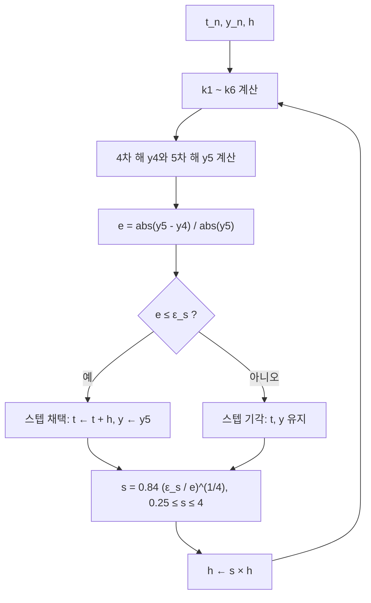

# 23장 — 강성 ODE와 적응적 방법

[레포지토리 안내](../../README.ko.md) | [English](Concepts_Lecture.md) | [한국어](Concepts_Lecture.ko.md)

> **최종 수정일:** 2026-10-20
>
> Applied Numerical Methods with Python for Engineers and Scientists, Chapra and Clough, Ch 23

> **학습 목표:**
> 1. 내장 RK 방법(RKF45)으로 국소 오차를 추정하고 스텝 크기를 조정할 수 있다
> 2. 예측-교정법에서 도함수 없이 교정자 오차를 추정할 수 있다
> 3. 강성 미분방정식을 식별할 수 있다
> 4. 강성 시스템에 음적 방법을 적용할 수 있다
> 5. 양적 방법과 음적 방법의 풀이 성능을 비교할 수 있다

---

<br>

## 목차

- [1. 적응적 룽게-쿠타 방법(Adaptive Runge-Kutta Methods)](#1-적응적-룽게-쿠타-방법adaptive-runge-kutta-methods)
  - [1.1 고정 스텝 크기 vs. 가변 스텝 크기](#11-고정-스텝-크기-vs-가변-스텝-크기)
  - [1.2 오차 추정과 스텝 크기 제어](#12-오차-추정과-스텝-크기-제어)
  - [1.3 적응적 스텝에 대한 두 가지 접근법](#13-적응적-스텝에-대한-두-가지-접근법)
- [2. 내장 RK 방법: RKF45](#2-내장-rk-방법-rkf45)
  - [2.1 6개의 단계 ($`k_1`$에서 $`k_6`$까지)](#21-6개의-단계-k_1에서-k_6까지)
  - [2.2 4차 및 5차 해](#22-4차-및-5차-해)
  - [2.3 국소 상대 오차](#23-국소-상대-오차)
  - [2.4 스케일 인자와 스텝 크기 조정](#24-스케일-인자와-스텝-크기-조정)
- [3. 스텝 크기 제어의 상세 유도](#3-스텝-크기-제어의-상세-유도)
  - [3.1 RKF45의 절단 오차 차수](#31-rkf45의-절단-오차-차수)
  - [3.2 오차 상수 $`C`$의 추정](#32-오차-상수-c의-추정)
  - [3.3 새로운 스텝 크기 $`h_{\text{new}}`$ 선택](#33-새로운-스텝-크기-h_textnew-선택)
- [4. 다단계 방법(Multistep Methods)](#4-다단계-방법multistep-methods)
  - [4.1 다단(Multistage) vs. 다단계(Multistep)](#41-다단multistage-vs-다단계multistep)
  - [4.2 비자기시작 호인 방법(Non-Self-Starting Heun Method) (예측-교정법)](#42-비자기시작-호인-방법non-self-starting-heun-method-예측-교정법)
  - [4.3 예측-교정법의 오차 추정](#43-예측-교정법의-오차-추정)
  - [4.4 도함수 없는 오차 추정](#44-도함수-없는-오차-추정)
- [5. 강성 시스템(Stiff Systems)](#5-강성-시스템stiff-systems)
  - [5.1 정의와 특성](#51-정의와-특성)
  - [5.2 예제: 효소 동역학 (미카엘리스-멘텐, Michaelis-Menten)](#52-예제-효소-동역학-미카엘리스-멘텐-michaelis-menten)
  - [5.3 예제: 심장에 대한 FitzHugh-Nagumo 모델](#53-예제-심장에-대한-fitzhugh-nagumo-모델)
  - [5.4 양적 방법에 대한 안정성 제약](#54-양적-방법에-대한-안정성-제약)
  - [5.5 강성 시스템을 위한 음적 방법](#55-강성-시스템을-위한-음적-방법)
- [6. Python 구현](#6-python-구현)
  - [6.1 RKF45 적응적 풀이기](#61-rkf45-적응적-풀이기)
  - [6.2 강성 시스템을 위한 후진 오일러 (선형 경우)](#62-강성-시스템을-위한-후진-오일러-선형-경우)
  - [6.3 비자기시작 호인 예측-교정법](#63-비자기시작-호인-예측-교정법)
- [요약](#요약)
- [점검 문제](#점검-문제)

---

<br>

## 1. 적응적 룽게-쿠타 방법(Adaptive Runge-Kutta Methods)

### 1.1 고정 스텝 크기 vs. 가변 스텝 크기

22장의 ODE 풀이법은 전체 적분 구간 $`[0, T]`$에 걸쳐 **고정 스텝 크기** $`\Delta t`$를 사용했다. 이는 간단하지만 비효율적이다:

- **매끄러운 영역** (느리게 변하는 해): 큰 스텝 크기로 충분하지만, 고정 스텝이 불필요하게 작을 수 있다.
- **급변하는 영역** (급격한 과도 현상): 고정 스텝 크기가 너무 커서 부정확하거나 심지어 불안정할 수 있다.

적응적 접근법은 단일 상수 $`\Delta t`$를 한 스텝에서 다음 스텝으로 변하는 **가변 스텝 크기** $`\Delta t_1, \Delta t_2, \Delta t_3, \ldots`$로 대체한다.

> **참고:** **적응적 스텝 크기 제어.** 알고리즘은 과잉(매끄러운 영역에서 너무 많은 스텝)이나 부정확성(급변 근처에서 너무 적은 스텝)을 피하기 위해 스텝 크기를 자동으로 조정할 수 있다. 핵심 아이디어는 각 스텝에서의 **오차 추정**에 따라 스텝 크기를 적응적으로 제어하는 것이다.

### 1.2 오차 추정과 스텝 크기 제어

핵심 질문은 **각 스텝에서 국소 오차를 어떻게 추정하는가**이다.

오차가 크면 스텝을 줄이고, 오차가 작으면 스텝을 키운다. 오차 추정은 동일한 스텝 내에서 얻은 서로 다른 정확도의 두 수치 해를 비교하여 계산한다.

### 1.3 적응적 스텝에 대한 두 가지 접근법

두 가지 주요 접근법이 있다:

| 접근법 | 설명 |
|----------|-------------|
| **1. 스텝 크기 반감** | 스텝 $`\Delta t`$로 $`y_1`$을 계산한 뒤, 반 스텝 $`\Delta t/2`$ 두 번으로 $`y_2`$를 계산한다. 차이 $`y_1 - y_2`$가 오차 추정을 제공한다. |
| **2. 내장 RK 방법(Embedded RK methods)** | 고차와 저차 스킴을 동시에 사용하여(동일한 단계 평가를 공유) 국소 절단 오차를 계산한다. **Fehlberg**가 개발했다. |

*표 1. 적응적 스텝 크기 제어를 위한 두 가지 오차 추정 접근법*

**내장 RK 접근법**(접근법 2)은 함수 평가를 재사용하므로 훨씬 효율적이며, 널리 사용되는 RKF45 방법의 기초이다.

---

<br>

## 2. 내장 RK 방법: RKF45

**룽게-쿠타-펠베르크 방법(RKF45, Runge-Kutta-Fehlberg method)** 은 **4차**와 **5차** 룽게-쿠타 공식의 조합을 사용하여 국소 절단 오차를 추정한다. 두 공식 모두 **동일한 6개의 단계** $`k_1, \ldots, k_6`$를 공유하므로, 오차 추정의 추가 비용이 최소화된다.

주어진 ODE:

```math
\frac{dy}{dt} = f(t, y)
```

$`h = \Delta t = t_{n+1} - t_n`$으로 놓는다.

### 2.1 6개의 단계 ($`k_1`$에서 $`k_6`$까지)

```math
k_1 = h \, f(t_n, \, y_n)
```

```math
k_2 = h \, f\!\left(t_n + \frac{h}{4}, \, y_n + \frac{k_1}{4}\right)
```

```math
k_3 = h \, f\!\left(t_n + \frac{3}{8}h, \, y_n + \frac{3}{32}k_1 + \frac{9}{32}k_2\right)
```

```math
k_4 = h \, f\!\left(t_n + \frac{12}{13}h, \, y_n + \frac{1932}{2197}k_1 - \frac{7200}{2197}k_2 + \frac{7296}{2197}k_3\right)
```

```math
k_5 = h \, f\!\left(t_n + h, \, y_n + \frac{439}{216}k_1 - 8k_2 + \frac{3680}{513}k_3 - \frac{845}{4104}k_4\right)
```

```math
k_6 = h \, f\!\left(t_n + \frac{1}{2}h, \, y_n - \frac{8}{27}k_1 + 2k_2 - \frac{3544}{2565}k_3 + \frac{1859}{4104}k_4 - \frac{11}{40}k_5\right)
```

> **참고:** **내장 구조의 이점.** 6개의 $`k_i`$ 값은 모두 스텝당 한 번 계산된다. 4차 공식은 $`k_1`$에서 $`k_5`$까지 사용하고, 5차 공식은 추가로 $`k_6`$를 사용한다. 이 내장(embedding) 구조 덕분에 오차 추정에 드는 추가 비용이 사실상 없다.

### 2.2 4차 및 5차 해

**4차 RK 해:**

```math
y_{n+1}^{[4]} = y_n + \frac{25}{216}k_1 + \frac{1408}{2565}k_3 + \frac{2197}{4104}k_4 - \frac{1}{5}k_5
```

**5차 RK 해:**

```math
y_{n+1}^{[5]} = y_n + \frac{16}{135}k_1 + \frac{6656}{12825}k_3 + \frac{28561}{56430}k_4 - \frac{9}{50}k_5 + \frac{2}{55}k_6
```

> **참고:** **$`k_2`$의 역할과 채택 해.** $`k_2`$는 두 최종 공식 어디에도 명시적으로 나타나지 않는다. 그 기여는 단계 의존성을 통해 이후 단계에 포함된다. 5차 해 $`y_{n+1}^{[5]}`$가 더 정확하므로 다음 스텝으로 전진할 때 채택하는 해로 사용한다.

### 2.3 국소 상대 오차

$`t_{n+1}`$에서의 국소 상대 오차는 두 해를 비교하여 추정한다:

```math
e_{n+1} = \left| \frac{y_{n+1}^{[5]} - y_{n+1}^{[4]}}{y_{n+1}^{[5]}} \right|
```

이 양은 4차와 5차 해가 얼마나 불일치하는지를 알려 준다. 큰 불일치는 스텝 크기가 너무 크고 절단 오차가 상당함을 나타낸다.

### 2.4 스케일 인자와 스텝 크기 조정

오차 추정이 주어지면, 스텝 크기를 조정하기 위한 **스케일 인자(scale factor)** $`s`$를 계산한다:

```math
s = \left(\frac{\varepsilon_s}{2 \, e_{n+1}}\right)^{1/4} \approx 0.84 \left(\frac{\varepsilon_s}{e_{n+1}}\right)^{1/4}
```

여기서 $`\varepsilon_s`$는 **지정된 국소 오차 허용 범위(tolerance)**(사용자 정의)이다.

스케일 인자는 극단적인 변화를 방지하기 위해 **클램핑(clamping)** 된다:

```math
0.25 \leq s \leq 4
```

새로운 스텝 크기는:

```math
h^{\text{new}} = s \cdot h
```

> **참고:** **클램핑의 역할.** 클램핑 $`0.25 \leq s \leq 4`$는 한 스텝에서 스텝 크기가 4배를 넘게 줄어들거나 늘어나는 것을 막는다. 이 안전장치는 스텝 크기 제어의 진동적 거동을 피하고 매끄러운 적응을 보장한다.

**각 스텝에서의 결정 로직:**
- $`e_{n+1} > \varepsilon_s`$이면 스텝을 **기각**하고, $`h`$를 줄여 스텝을 **재실행**한다.
- $`e_{n+1} \leq \varepsilon_s`$이면 스텝을 **채택**하고, $`t_{n+1}`$로 전진하며, 필요하면 다음 스텝을 위해 $`h`$를 키운다.

이 결정 과정을 RKF45 한 스텝의 흐름으로 나타내면 그림 1과 같다.



*그림 1. RKF45의 스텝 채택과 스텝 크기 조정 흐름*

---

<br>

## 3. 스텝 크기 제어의 상세 유도

이 절에서는 RKF45에 대한 스텝 크기 제어 공식의 엄밀한 유도를 제공한다.

### 3.1 RKF45의 절단 오차 차수

두 해와 참값 사이의 관계를 다시 쓰면 다음과 같다:

```math
y(t_{n+1}) = y_{n+1}^{[4]} + C h^5 + O(h^6)
```

```math
y(t_{n+1}) = y_{n+1}^{[5]} + O(h^6)
```

여기서 $`y(t_{n+1})`$는 **참값**이다. 4차 방법의 선행 오차 항은 $`h^5`$에 비례하고, 5차 방법의 선행 오차는 $`O(h^6)`$이다.

### 3.2 오차 상수 $`C`$의 추정

두 식을 빼면:

```math
C h^5 = y_{n+1}^{[5]} - y_{n+1}^{[4]}
```

따라서:

```math
C = \frac{\left| y_{n+1}^{[5]} - y_{n+1}^{[4]} \right|}{h^5}
```

상수 $`C`$는 해의 고차 도함수의 국소 거동을 포착한다. 현재 스텝에서 추정되며 다음 스텝에서도 거의 동일하게 유지된다고 가정한다.

### 3.3 새로운 스텝 크기 $`h_{\text{new}}`$ 선택

**다음** 스텝(스텝 $`n+2`$)에서의 오차가 허용 범위 $`\varepsilon`$을 만족하도록 새로운 스텝 크기 $`h_{\text{new}}`$를 원한다:

```math
\left| y_{n+2}^{[5]} - y_{n+2}^{[4]} \right| < s_f \cdot \varepsilon
```

여기서 $`s_f`$는 **안전 계수(safety factor)**(일반적으로 $`s_f \approx 0.84`$)이다. 동일한 상수 $`C`$를 사용하면:

```math
C = \frac{\left| y_{n+2}^{[5]} - y_{n+2}^{[4]} \right|}{h_{\text{new}}^5} < \frac{s_f \cdot \varepsilon}{h_{\text{new}}^5}
```

$`h_{\text{new}}`$에 대해 정리하면:

```math
h_{\text{new}} < \left(\frac{s_f \cdot \varepsilon}{C}\right)^{1/5}
```

현재 스텝의 추정값으로 $`C`$를 대체하면:

```math
\boxed{h_{\text{new}} < \left(\frac{s_f \cdot \varepsilon}{\left| y_{n+1}^{[5]} - y_{n+1}^{[4]} \right|}\right)^{1/5} \cdot h}
```

> **참고:** **지수 $`1/5`$의 유래.** 이것이 완전한 스텝 크기 제어 공식이다. 지수 $`1/5`$는 4차 방법의 선행 오차가 $`O(h^5)`$라는 사실에서 비롯된다. 차수 $`p`$와 $`p+1`$의 일반적인 내장 쌍에서는 지수가 $`1/(p+1)`$이 된다.

---

<br>

## 4. 다단계 방법(Multistep Methods)

### 4.1 다단(Multistage) vs. 다단계(Multistep)

**다단(multistage)** 방법과 **다단계(multistep)** 방법은 근본적으로 다른 전략을 따른다:

| 특성 | 다단(Multistage) (예: RK4) | 다단계(Multistep) (예: Adams-Bashforth) |
|---------|------------------------|-----------------------------------|
| **스텝당 단계 수** | 단일 스텝 $`[t_n, t_{n+1}]`$ 내에서 여러 중간 평가($`s`$ 단계) | 일반적으로 스텝당 한 번의 평가 |
| **사용하는 이전 스텝** | $`(t_n, y_n)`$만 사용 | 여러 이전 스텝의 값: $`y_n, y_{n-1}, y_{n-2}, \ldots`$ |
| **자기시작(Self-starting)** | 가능 | 불가능 (다른 방법으로부터의 초기값 필요) |
| **메모리** | 이력 불필요 | 과거 값을 저장해야 함 |

*표 2. 다단 방법과 다단계 방법의 비교*

**다단계 방법**은 **이전 시간 스텝**의 값들을 사용하여 $`y_{n+1}`$을 계산한다:

```math
y_{n+1} = y_{n+1}(y_n, y_{n-1}, \ldots)
```

### 4.2 비자기시작 호인 방법(Non-Self-Starting Heun Method) (예측-교정법)

예측-교정 스킴인 22장의 **호인 접근법(Heun approach)** 은 다음 두 단계로 이루어진다:

**i) 예측자(Predictor)** (오일러 방법):

```math
Y_1 = y_n + h \, f(t_n, y_n) + O(h^2)
```

**ii) 교정자(Corrector)** (사다리꼴 법칙):

```math
y_{n+1} = y_n + h \cdot \frac{f(t_n, y_n) + f(t_{n+1}, Y_1)}{2} + O(h^3)
```

> **참고:** **예측자와 교정자의 정확도.** 예측자의 국소 절단 오차는 $`O(h^2)`$(1차)이고, 교정자는 $`O(h^3)`$(2차)를 달성한다. 예측자는 교정자가 정제하는 초기 추측을 제공한다.

**예측자 정확도 향상:**

표준 오일러 예측자의 절단 오차는 $`O(h^2)`$이다. 교정자의 $`O(h^3)`$ 정확도에 맞추기 위해, 예측자로 **중점 방법(midpoint method)** 을 사용할 수 있다:

```math
Y_1 = y_{n-1} + 2h \, f(t_n, y_n) + O(h^3)
```

이 예측자는 구간 $`[t_{n-1}, t_{n+1}]`$에 개방형 중점 적분 공식을 적용한 것으로, 22장의 RK2 중점 방법과는 다르다. 이제 예측자와 교정자 모두 $`O(h^3)`$의 국소 절단 오차를 갖는다.

**그러나**, 이 개선된 예측자는 **자기시작이 불가능(NOT self-starting)** 하다: $`t_{n-1}`$에서의 값이 필요하며, 이는 첫 번째 스텝($`n = 0`$)에서는 사용할 수 없다.

이 문제를 해결하려면 첫 스텝($`t = 0`$)에서 RK2 중점 방법, 표준 오일러, 호인 방법 같은 자기시작 방법으로 $`t_1`$의 값을 만든 뒤, 이후 모든 스텝에서 비자기시작 호인 방법으로 전환한다. 6.3절의 구현은 첫 스텝에 표준 호인 방법을 사용한다. 두 단계가 사용하는 점은 그림 2와 같다.

```text
     t_{n-1}             t_n             t_{n+1}
        ●─────────────────●─────────────────○
     y_{n-1}             y_n

        └───────── 2h f(t_n, y_n) ──────────> Y_1      (예측자)
                          └─────── h ───────> y_{n+1}  (교정자: f(t_n, y_n)과 f(t_{n+1}, Y_1)의 평균 기울기)
```

*그림 2. 비자기시작 호인 방법의 예측자와 교정자*

### 4.3 예측-교정법의 오차 추정

**i) 예측자 오차** (중점 방법, 교재 표 19.4):

```math
E_p = \frac{1}{3} h^3 f''(\xi_p)
```

여기서 $`Y_{1,\text{true}} = Y_1 + E_p`$이다.

**ii) 교정자 오차** (사다리꼴 법칙, 교재 표 19.2):

```math
E_c = -\frac{1}{12} h^3 f''(\xi_c)
```

여기서 $`y_{n+1,\text{true}} = y_{n+1} + E_c`$이다.

### 4.4 도함수 없는 오차 추정

참 예측값과 참 교정값 모두 동일한 참 해로 수렴하므로:

```math
Y_{1,\text{true}} = y_{n+1,\text{true}}
```

$`f''(\xi_p) \approx f''(\xi_c)`$라 가정한다(두 $`\xi`$ 값이 가까움). 식 (ii)에서 식 (i)을 빼면:

```math
0 = y_{n+1} - Y_1 + E_c - E_p = y_{n+1} - Y_1 - \frac{5}{12} h^3 f''(\xi)
```

이것이 핵심 방정식 ($`\ast`$)이다. ($`\ast`$)를 5로 나누고 정리하면:

```math
\frac{Y_1 - y_{n+1}}{5} = -\frac{1}{12} h^3 f''(\xi) = E_c
```

> **참고:** **결과의 의미.** 이것은 중요한 결과이다. **교정자 오차** $`E_c`$를 $`f`$의 어떤 도함수도 계산하지 **않고**, 예측자 $`Y_1`$과 교정자 $`y_{n+1}`$의 차이만으로 추정할 수 있다. 이 덕분에 오차 추정이 실용적이고 저비용이 된다.

---

<br>

## 5. 강성 시스템(Stiff Systems)

### 5.1 정의와 특성

**강성 시스템(stiff system)** 은 고유한 특성으로 인해 수치적으로 풀기 어려운 ODE 시스템이다. 형식적으로 정의하면 다음과 같다:

> **용어 정의:** 강성 시스템은 **고유값의 범위가 넓은**(시간 척도가 크게 다른) 시스템이다. 가장 큰 고유값 크기와 가장 작은 고유값 크기의 비율(**강성비, stiffness ratio**)이 매우 크다.

강성은 해가 크게 다른 속도로 감소하는 성분들을 포함할 때 발생한다. 양적 방법(explicit methods)은 **가장 느린** 성분이 해의 거동을 지배할 때도, 안정성을 위해 **가장 빠르게** 감소하는 성분에 의해 결정되는 스텝 크기를 사용해야 한다.

### 5.2 예제: 효소 동역학 (미카엘리스-멘텐, Michaelis-Menten)

화학 과정은 화학 종의 농도에 의존하며 미분방정식으로 기술할 수 있다. 화학 반응은 보통 **비선형**이며 종종 **다른 시간 척도**에서 발생한다.

단일 기질 효소 반응 (미카엘리스-멘텐 동역학):

```math
E + S \underset{k_{-1}}{\overset{k_1}{\rightleftharpoons}} ES \overset{k_2}{\longrightarrow} E^0 + P
```

여기서:
- $`E`$ = 효소, $`S`$ = 기질, $`ES`$ = 효소-기질 복합체
- $`P`$ = 생성물, $`E^0`$ = 재생된 효소
- $`k_1, k_{-1}, k_2`$는 **속도 상수(rate constants)** 이다.

기질 $`S`$가 효소 $`E`$와 결합하여 효소-기질 복합체 $`ES`$를 형성하며, 이는 **해리**(속도 $`k_{-1}`$의 역반응)되거나 $`E`$와 생성물 $`P`$를 형성하는 **진행**(속도 $`k_2`$의 정반응)이 가능하다.

물질 손실이 없으므로(보존 법칙), 시스템은 **비선형 특이 섭동 미분방정식(nonlinear singular perturbed differential equations)** 으로 쓸 수 있다:

```math
y'(t) = -y(t) + (\mu + y(t)) \, z(t)
```

```math
\epsilon \, z'(t) = y(t) - (\lambda + y(t)) \, z(t)
```

여기서 $`\epsilon \ll 1`$이다.

> **참고:** **빠름-느림 분해.** $`z'(t)`$에 곱해진 매개변수 $`\epsilon \ll 1`$은 **빠름-느림 분해(fast-slow decomposition)** 를 만든다. $`z(t)`$는 빠른 시간 척도 $`\sim \epsilon`$에서 변하고, $`y(t)`$는 느린 시간 척도 $`\sim 1`$에서 변한다. 이것이 강성의 특징이다. 서로 다른 시간 척도 때문에 양적 방법은 빠른 변수가 준평형에 도달한 후에도 그 변수를 따라가기 위해 매우 작은 스텝을 사용해야 한다.

### 5.3 예제: 심장에 대한 FitzHugh-Nagumo 모델

**심장 세포**는 뉴런과 마찬가지로 **흥분성 거동(excitable behavior)** 을 보인다: 휴지 상태이고, 자극에 의해 활성화될 수 있으며, 그 후 회복된다.

FitzHugh-Nagumo 모델은 이 거동을 기술한다:

```math
u_t = D_u \Delta u - u^3 + u - v
```

```math
v_t = D_v \Delta v + \varepsilon(u - bv + a)
```

여기서 $`D_u, D_v`$는 확산 계수, $`\varepsilon`$는 작은 매개변수, $`a, b`$는 모델 매개변수이다.

> **참고:** **시간 척도의 분리.** $`\varepsilon`$가 작으면 $`v`$ 방정식은 느리게 변하고(회복 변수), $`u`$는 빠르게 변한다(흥분 변수). 이 시간 척도의 분리가 시스템을 강성으로 만든다. 확산 항이 없는 ODE 형태의 모델에서 외부 자극 $`I = 0.5`$, $`a = 0.7`$, $`b = 0.8`$, 회복 변수의 시간 상수 $`\tau = 12.5`$로 흥분 변수를 시간에 따라 그리면, 날카로운 스파이크(빠른 흥분)에 이어 느린 회복이 나타난다. 이는 강성의 전형적인 특징이다.

### 5.4 양적 방법에 대한 안정성 제약

다음의 간단한 강성 ODE를 고려한다:

```math
\frac{dy}{dt} = -100000 \, y
```

해석해는 $`y = y_0 \, e^{-10^5 t}`$이며, **매우 빠르게** 감소한다.

**양적 오일러 방법(explicit Euler method)** 의 경우, 안정 조건은 $`|1 + z| \leq 1`$ ($`z = \lambda h`$)을 요구한다. $`\lambda = -10^5`$이면:

```math
|1 + (-10^5) h| \leq 1
```

이로부터:

```math
h \leq \frac{2}{10^5} = 2 \times 10^{-5}
```

> **참고:** **안정성에 의한 스텝 크기 제한.** 이는 지나치게 작은 스텝 크기 요구이다. 해가 사실상 0으로 감소하여 관심 있는 동역학이 끝났더라도, 양적 오일러 방법은 안정성을 위해 $`h \leq 2 \times 10^{-5}`$를 계속 사용**해야 한다**. 이것이 강성 시스템에 양적 방법을 적용할 때의 근본적 문제이다. 스텝 크기가 **정확도**가 아닌 **안정성**에 의해 제한된다.

### 5.5 강성 시스템을 위한 음적 방법

양적 방법의 안정성 제약은 음적 방법으로 우회할 수 있다.

**음적 방법(implicit methods)** 의 예로 **후진 오일러 방법(backward Euler method)** 은 다음과 같다:

```math
y_{n+1} = y_n + h \, f(t_{n+1}, y_{n+1})
```

후진 오일러의 안정 조건은 $`|z - 1| \geq 1`$ ($`z = \lambda h`$)이다. $`\lambda = -10^5`$이면:

```math
|(-10^5 h) - 1| \geq 1
```

이는 **모든** $`h > 0`$에 대해 만족된다. 후진 오일러 방법은 **무조건 안정(unconditionally stable)**(A-안정)이다.

| 방법 | 안정 조건 | 스텝 크기 제한 |
|--------|--------------------|-----------------------|
| 양적 오일러 | $`\vert 1 + \lambda h \vert \leq 1`$ | $`h \leq 2/\vert \lambda \vert`$ (강성 시스템에서 매우 제한적) |
| 후진 오일러 | $`\vert 1 - \lambda h \vert \geq 1`$ ($`\lambda < 0`$인 경우) | 없음(무조건 안정) |

*표 3. 양적 오일러와 후진 오일러의 안정 조건 비교*

> **참고:** **음적 방법의 비용.** 음적 방법의 대가는 각 스텝에서 $`y_{n+1}`$에 대한 (비선형일 수 있는) 방정식을 풀어야 한다는 것이다. 선형 문제에서는 선형 방정식을 풀고, 비선형 문제에서는 일반적으로 뉴턴 방법을 사용한다. 그러나 강성 시스템에서는 음적 방정식을 푸는 비용이 수백만 개의 작은 양적 스텝을 밟는 비용보다 훨씬 적다.

---

<br>

## 6. Python 구현

### 6.1 RKF45 적응적 풀이기

```python
import numpy as np
import matplotlib.pyplot as plt

def rkf45(f, t0, y0, tf, h0, tol=1e-6, hmin=1e-10, hmax=1.0):
    """
    Runge-Kutta-Fehlberg (RKF45) adaptive ODE solver.

    Parameters
    ----------
    f    : callable, f(t, y) — the ODE right-hand side
    t0   : float — initial time
    y0   : float — initial value
    tf   : float — final time
    h0   : float — initial step size
    tol  : float — local error tolerance (epsilon_s)
    hmin : float — minimum allowable step size
    hmax : float — maximum allowable step size

    Returns
    -------
    ts   : list of time values
    ys   : list of solution values
    """
    t = t0
    y = y0
    h = h0
    ts = [t]
    ys = [y]

    while t < tf:
        if t + h > tf:
            h = tf - t

        # --- Six stages ---
        k1 = h * f(t, y)
        k2 = h * f(t + h / 4, y + k1 / 4)
        k3 = h * f(t + 3 * h / 8, y + 3 * k1 / 32 + 9 * k2 / 32)
        k4 = h * f(t + 12 * h / 13,
                    y + 1932 * k1 / 2197 - 7200 * k2 / 2197 + 7296 * k3 / 2197)
        k5 = h * f(t + h,
                    y + 439 * k1 / 216 - 8 * k2 + 3680 * k3 / 513 - 845 * k4 / 4104)
        k6 = h * f(t + h / 2,
                    y - 8 * k1 / 27 + 2 * k2 - 3544 * k3 / 2565
                    + 1859 * k4 / 4104 - 11 * k5 / 40)

        # --- 4th-order and 5th-order solutions ---
        y4 = y + 25 * k1 / 216 + 1408 * k3 / 2565 + 2197 * k4 / 4104 - k5 / 5
        y5 = y + 16 * k1 / 135 + 6656 * k3 / 12825 + 28561 * k4 / 56430 \
             - 9 * k5 / 50 + 2 * k6 / 55

        # --- Error estimate ---
        error = abs(y5 - y4)
        if y5 != 0:
            rel_error = error / abs(y5)
        else:
            rel_error = error

        # --- Step size control ---
        if rel_error <= tol or h <= hmin:
            # Accept step
            t = t + h
            y = y5  # advance with 5th-order solution
            ts.append(t)
            ys.append(y)

        # Compute scale factor
        if rel_error > 0:
            s = 0.84 * (tol / rel_error) ** 0.25
        else:
            s = 4.0

        # Clamp scale factor
        s = max(0.25, min(s, 4.0))

        # Update step size
        h = s * h
        h = max(hmin, min(h, hmax))

    return ts, ys


# --- Example: dy/dt = -100000*y (stiff equation) ---
f_stiff = lambda t, y: -100000 * y

ts, ys = rkf45(f_stiff, 0, 1, 0.001, h0=1e-6, tol=1e-8)

plt.figure(figsize=(8, 5))
plt.plot(ts, ys, 'b.-', markersize=4)
plt.xlabel('t')
plt.ylabel('y')
plt.title('RKF45 Adaptive Solution: dy/dt = -100000y')
plt.grid(True)
plt.tight_layout()
plt.show()
```

이 예제에서 RKF45는 $`t = 0.001`$까지 1236개의 스텝을 채택하며, 스텝 크기는 약 $`3.1 \times 10^{-7}`$에서 $`8.2 \times 10^{-7}`$ 사이에 머문다. 반면 6.2절의 후진 오일러는 같은 구간을 $`h = 10^{-4}`$로 10스텝 만에 적분한다.

### 6.2 강성 시스템을 위한 후진 오일러 (선형 경우)

```python
import numpy as np
import matplotlib.pyplot as plt

def backward_euler_linear(lam, y0, t0, tf, h):
    """
    Backward Euler for dy/dt = lambda * y (linear case).

    Analytical implicit step: y_{n+1} = y_n / (1 - lambda * h)
    """
    t = np.arange(t0, tf + h, h)
    y = np.zeros(len(t))
    y[0] = y0

    for i in range(len(t) - 1):
        y[i + 1] = y[i] / (1 - lam * h)

    return t, y


# --- Compare explicit vs. implicit Euler for stiff ODE ---
lam = -100000
y0 = 1.0
tf = 0.001

# Backward Euler — large step size works fine
h_implicit = 1e-4
t_imp, y_imp = backward_euler_linear(lam, y0, 0, tf, h_implicit)

# Analytical solution
t_exact = np.linspace(0, tf, 500)
y_exact = y0 * np.exp(lam * t_exact)

plt.figure(figsize=(8, 5))
plt.plot(t_exact, y_exact, 'k-', label='Exact', linewidth=2)
plt.plot(t_imp, y_imp, 'rs--', label=f'Backward Euler (h={h_implicit})', markersize=4)
plt.xlabel('t')
plt.ylabel('y')
plt.title('Backward Euler vs Exact for Stiff ODE')
plt.legend()
plt.grid(True)
plt.tight_layout()
plt.show()
```

후진 오일러의 수치 해는 $`h = 10^{-4}`$에서도 스텝마다 $`1/(1 + 10) \approx 0.0909`$배로 안정하게 감소한다. 다만 첫 스텝의 값 0.0909는 정확해 $`e^{-10} \approx 4.5 \times 10^{-5}`$보다 훨씬 크다. 큰 스텝에서 안정성은 보장되지만 빠른 초기 변화의 정확도까지 보장되지는 않는다.

### 6.3 비자기시작 호인 예측-교정법

```python
import numpy as np
import matplotlib.pyplot as plt

def nss_heun(f, t0, y0, tf, h):
    """
    Non-self-starting Heun method (predictor-corrector).
    Uses midpoint predictor + trapezoidal corrector.
    First step uses standard Heun (self-starting).
    """
    n = int((tf - t0) / h)
    t = np.linspace(t0, tf, n + 1)
    y = np.zeros(n + 1)
    y[0] = y0

    # First step: standard Heun (self-starting)
    Y1 = y[0] + h * f(t[0], y[0])
    y[1] = y[0] + h / 2 * (f(t[0], y[0]) + f(t[1], Y1))

    # Subsequent steps: non-self-starting Heun
    for i in range(1, n):
        # Predictor (midpoint method) — uses y[i-1]
        Y1 = y[i - 1] + 2 * h * f(t[i], y[i])
        # Corrector (trapezoidal rule)
        y[i + 1] = y[i] + h / 2 * (f(t[i], y[i]) + f(t[i + 1], Y1))

        # Error estimate: E_c ≈ (Y1 - y[i+1]) / 5
        error = abs(Y1 - y[i + 1]) / 5
        # (In practice, use this error to adapt step size)

    return t, y


# Example: dy/dt = -y, y(0) = 1
f = lambda t, y: -y
t, y = nss_heun(f, 0, 1, 5, 0.1)

t_exact = np.linspace(0, 5, 500)
y_exact = np.exp(-t_exact)

plt.figure(figsize=(8, 5))
plt.plot(t_exact, y_exact, 'k-', label='Exact', linewidth=2)
plt.plot(t, y, 'bo--', label='NSS Heun', markersize=4)
plt.xlabel('t')
plt.ylabel('y')
plt.title('Non-Self-Starting Heun Method')
plt.legend()
plt.grid(True)
plt.tight_layout()
plt.show()
```

이 예제에서 $`t = 5`$의 수치 해는 0.0067021이고, 정확해 $`e^{-5} \approx 0.0067379`$와의 차이는 약 $`3.6 \times 10^{-5}`$이다. 코드는 오차 추정값 `error`를 계산만 하고 스텝 크기 조정에는 쓰지 않는다.

---

<br>

## 요약

| 개념 | 핵심 요약 |
|:-----|:-----|
| 적응적 RK | 오차 추정에 따라 스텝 크기를 자동으로 조절하여, 해가 급변하는 곳에서는 작은 스텝을, 매끄러운 곳에서는 큰 스텝을 쓴다. |
| RKF45 | 6개의 단계를 공유하는 4차, 5차 내장 쌍이며, 오차를 $`\vert y^{[5]} - y^{[4]} \vert`$로 추정한다. |
| 스케일 인자 | $`s = 0.84 (\varepsilon_s / e_{n+1})^{1/4}`$를 $`[0.25, 4]`$로 클램핑한 뒤 $`h^{\text{new}} = s \cdot h`$로 스텝 크기를 바꾼다. |
| 스텝 크기 제어 (상세) | $`C h^5 = y^{[5]} - y^{[4]}`$로부터 $`h_{\text{new}} < \left(\frac{s_f \varepsilon}{\vert y_{n+1}^{[5]} - y_{n+1}^{[4]} \vert}\right)^{1/5} h`$를 얻는다. |
| 다단계 방법 | 이전 스텝의 값($`y_n, y_{n-1}, \ldots`$)을 사용하므로 스텝당 더 효율적이지만 자기시작이 불가능하다. |
| 비자기시작 호인 | 중점 예측자 $`O(h^3)`$와 사다리꼴 교정자 $`O(h^3)`$를 짝지으며, 교정자 오차를 $`E_c \approx (Y_1 - y_{n+1})/5`$로 추정한다. |
| 강성 시스템 | 고유값 분포가 넓은 시스템이며, 양적 오일러 방법은 안정성을 위해 $`h \leq 2/\vert \lambda_{\max} \vert`$가 필요하다. |
| 강성 예제 | 효소 동역학(미카엘리스-멘텐)과 FitzHugh-Nagumo 심장 모델은 시간 척도가 크게 다른 변수를 포함하는 강성 시스템이다. |
| 음적 방법 | 후진 오일러는 무조건 안정(A-안정)이므로 강성 문제에서 모든 $`h > 0`$에 대해 안정하다. |
| 트레이드오프 | 음적 방법은 각 스텝에서 방정식을 풀어야 해서 스텝당 작업량이 많지만, 강성 시스템에서는 훨씬 큰 스텝 크기를 허용한다. |

---

<br>

## 점검 문제

1. **스케일 인자:** $`\varepsilon_s = 10^{-6}`$인 RKF45의 한 스텝에서 국소 상대 오차가 $`e_{n+1} = 1.6 \times 10^{-5}`$이었다. 이 스텝은 채택되는가? 스케일 인자 $`s`$와 새 스텝 크기를 구하라. 오차가 $`e_{n+1} = 10^{-10}`$이었다면 어떻게 되는가?

   <details>
   <summary>정답</summary>

   $`e_{n+1} > \varepsilon_s`$이므로 스텝을 기각한다. $`s = 0.84 \times (10^{-6} / 1.6 \times 10^{-5})^{1/4} = 0.84 \times 0.0625^{1/4} = 0.84 \times 0.5 = 0.42`$이고 $`[0.25, 4]`$ 안에 있으므로, $`h^{\text{new}} = 0.42h`$로 스텝을 다시 계산한다. $`e_{n+1} = 10^{-10}`$이면 스텝을 채택하고, $`s = 0.84 \times (10^4)^{1/4} = 8.4`$가 상한을 넘으므로 $`s = 4`$로 클램핑하여 다음 스텝에 $`4h`$를 쓴다.

   </details>

2. **양적 방법의 스텝 수:** $`dy/dt = -100000y`$를 $`t \in [0, 1]`$에서 양적 오일러로 풀 때 안정성을 위해 필요한 최소 스텝 수는 얼마인가? 후진 오일러를 $`h = 0.1`$로 쓰면 스텝 수와 증폭 인자는 얼마인가?

   <details>
   <summary>정답</summary>

   안정성을 위해 $`h \le 2 \times 10^{-5}`$이어야 하므로 최소 $`1 / (2 \times 10^{-5}) = 50{,}000`$스텝이 필요하다. 후진 오일러는 $`h = 0.1`$로 10스텝이면 되고, 증폭 인자는 $`1/(1 + 10^5 \times 0.1) = 1/10001 \approx 10^{-4}`$이므로 안정하게 감소한다.

   </details>

3. **예측-교정 오차 추정:** 비자기시작 호인 방법의 한 스텝에서 예측자 $`Y_1 = 0.9050`$, 교정자 $`y_{n+1} = 0.9048`$이었다. 교정자 오차의 추정값과 이를 반영한 참값의 추정값을 구하라.

   <details>
   <summary>정답</summary>

   $`E_c \approx (Y_1 - y_{n+1})/5 = (0.9050 - 0.9048)/5 = 4 \times 10^{-5}`$이다. $`y_{n+1,\text{true}} = y_{n+1} + E_c`$이므로 참값은 약 $`0.9048 + 0.00004 = 0.90484`$로 추정한다.

   </details>

4. **강성비:** 고유값이 $`-1`$과 $`-1000`$인 선형 시스템의 강성비는 얼마인가? 양적 오일러의 최대 안정 스텝 크기와, 느린 성분이 $`e^{-5} \approx 0.0067`$로 줄어드는 $`t = 5`$까지 필요한 스텝 수를 구하라.

   <details>
   <summary>정답</summary>

   강성비는 $`1000/1 = 1000`$이다. 안정성은 가장 빠른 성분이 결정하므로 $`h \le 2/1000 = 0.002`$이고, $`t = 5`$까지 최소 $`5/0.002 = 2500`$스텝이 필요하다. 해의 거동을 지배하는 것은 느린 성분 $`e^{-t}`$인데도 스텝 크기는 빠른 성분 $`e^{-1000t}`$가 정한다.

   </details>

5. **다단 방법과 다단계 방법:** RKF45와 비자기시작 호인 방법은 한 스텝에서 서로 다른 $`f`$ 평가를 각각 몇 번 하는가? 각 방법은 자기시작이 가능한가?

   <details>
   <summary>정답</summary>

   RKF45는 $`k_1`$에서 $`k_6`$까지 6번 평가하며, $`(t_n, y_n)`$만 사용하므로 자기시작이 가능하다. 비자기시작 호인 방법은 $`f(t_n, y_n)`$과 $`f(t_{n+1}, Y_1)`$의 2번 평가하지만, 예측자가 $`y_{n-1}`$을 사용하므로 자기시작이 불가능하며 첫 스텝에는 다른 방법이 필요하다.

   </details>
