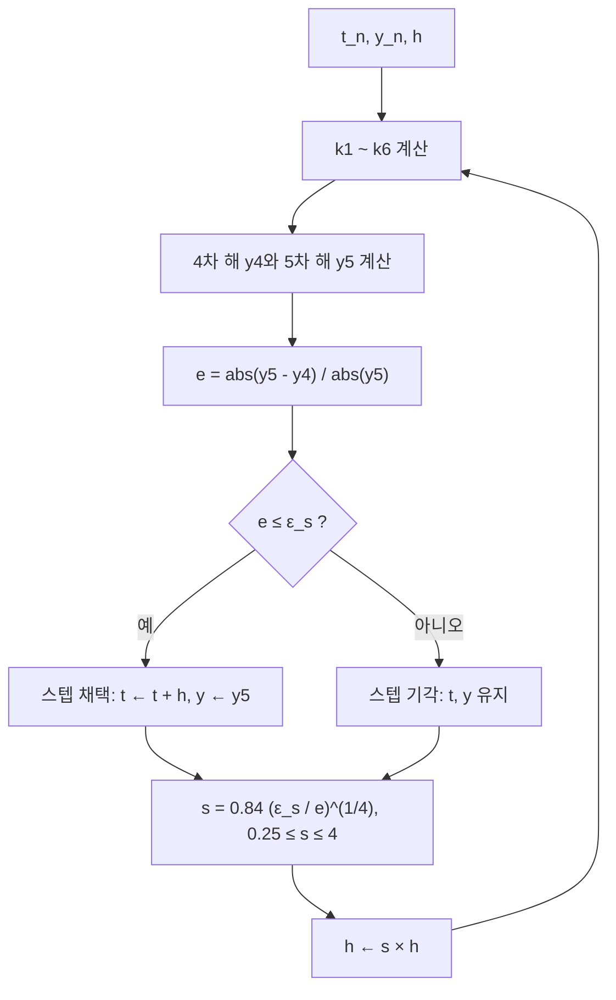
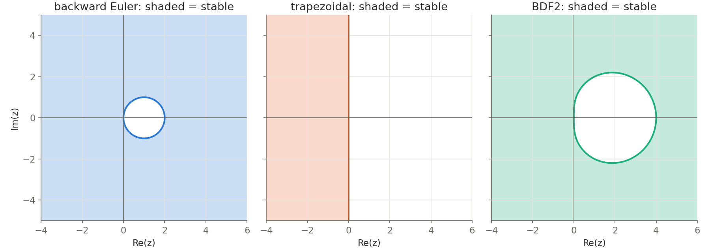
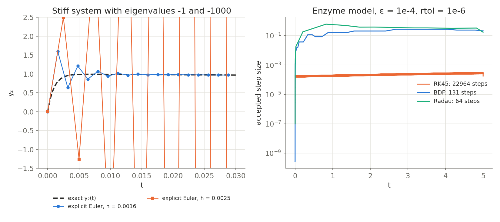
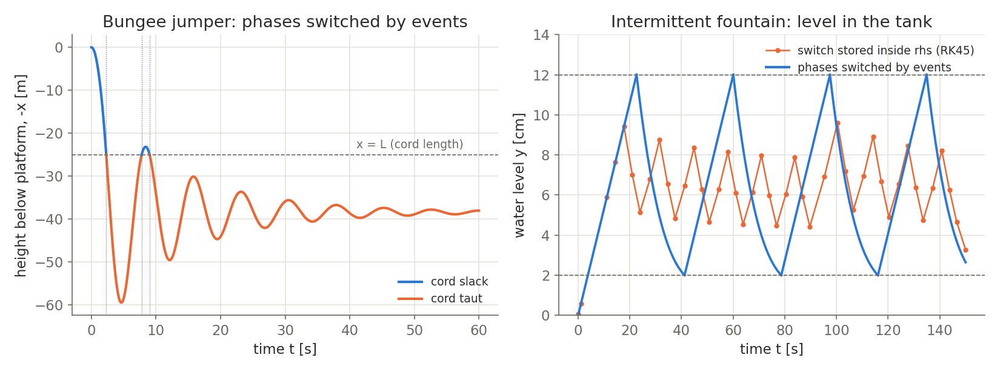

# 23장 — 강성 ODE와 적응적 방법

[레포지토리 안내](../../README.ko.md) | [English](Concepts_Lecture.md) | [한국어](Concepts_Lecture.ko.md)

> **최종 수정일:** 2026-11-27
>
> Applied Numerical Methods with Python for Engineers and Scientists, Chapra and Clough, Ch 23

> **학습 목표:**
> 1. 내장 RK 방법(RKF45)으로 국소 오차를 추정하고 스텝 크기를 조정할 수 있다
> 2. 예측-교정법에서 도함수 없이 교정자 오차를 추정할 수 있다
> 3. 강성 미분방정식을 식별할 수 있다
> 4. 강성 시스템에 음적 방법을 적용할 수 있다
> 5. 양적 방법과 음적 방법의 풀이 성능을 비교할 수 있다
> 6. Jacobian 행렬의 고유값으로 강성을 판별하고 solve_ivp의 BDF와 Radau 방법으로 강성 문제를 풀 수 있다

---

<br>

## 목차

- [1. 적응적 Runge-Kutta 방법(Adaptive Runge-Kutta Methods)](#1-적응적-runge-kutta-방법adaptive-runge-kutta-methods)
  - [1.1 고정 스텝 크기 vs. 가변 스텝 크기](#11-고정-스텝-크기-vs-가변-스텝-크기)
  - [1.2 오차 추정과 스텝 크기 제어](#12-오차-추정과-스텝-크기-제어)
  - [1.3 적응적 스텝에 대한 두 가지 접근법](#13-적응적-스텝에-대한-두-가지-접근법)
  - [1.4 스텝 반감법의 계산 예](#14-스텝-반감법의-계산-예)
- [2. 내장 RK 방법: RKF45](#2-내장-rk-방법-rkf45)
  - [2.1 6개의 단계 (k₁에서 k₆까지)](#21-6개의-단계-k_1에서-k_6까지)
  - [2.2 4차 및 5차 해](#22-4차-및-5차-해)
  - [2.3 국소 상대 오차](#23-국소-상대-오차)
  - [2.4 스케일 인자와 스텝 크기 조정](#24-스케일-인자와-스텝-크기-조정)
  - [2.5 내장 쌍의 오차 추정과 스텝 조정의 추적](#25-내장-쌍의-오차-추정과-스텝-조정의-추적)
  - [2.6 급변 구간의 스텝 크기와 좁은 펄스](#26-급변-구간의-스텝-크기와-좁은-펄스)
- [3. 스텝 크기 제어의 상세 유도](#3-스텝-크기-제어의-상세-유도)
  - [3.1 RKF45의 절단 오차 차수](#31-rkf45의-절단-오차-차수)
  - [3.2 오차 상수 C의 추정](#32-오차-상수-c의-추정)
  - [3.3 새로운 스텝 크기 h_new 선택](#33-새로운-스텝-크기-h_textnew-선택)
- [4. 다단계 방법(Multistep Methods)](#4-다단계-방법multistep-methods)
  - [4.1 다단(Multistage) vs. 다단계(Multistep)](#41-다단multistage-vs-다단계multistep)
  - [4.2 비자기시작 Heun 방법(Non-Self-Starting Heun Method) (예측-교정법)](#42-비자기시작-heun-방법non-self-starting-heun-method-예측-교정법)
  - [4.3 예측-교정법의 오차 추정](#43-예측-교정법의-오차-추정)
  - [4.4 도함수 없는 오차 추정](#44-도함수-없는-오차-추정)
  - [4.5 교정자 반복과 오차 추정의 계산 예](#45-교정자-반복과-오차-추정의-계산-예)
- [5. 강성 시스템(Stiff Systems)](#5-강성-시스템stiff-systems)
  - [5.1 정의와 특성](#51-정의와-특성)
  - [5.2 예제: 효소 동역학 (Michaelis-Menten)](#52-예제-효소-동역학-michaelis-menten)
  - [5.3 예제: 심장에 대한 FitzHugh-Nagumo 모델](#53-예제-심장에-대한-fitzhugh-nagumo-모델)
  - [5.4 양적 방법에 대한 안정성 제약](#54-양적-방법에-대한-안정성-제약)
  - [5.5 강성 시스템을 위한 음적 방법](#55-강성-시스템을-위한-음적-방법)
  - [5.6 고유값으로 본 강성과 양적 안정 한계의 수치 확인](#56-고유값으로-본-강성과-양적-안정-한계의-수치-확인)
  - [5.7 연립 시스템의 후진 Euler와 Newton 방법](#57-연립-시스템의-후진-euler와-newton-방법)
  - [5.8 후진 차분 공식(BDF)](#58-후진-차분-공식bdf)
  - [5.9 음적 방법의 안정 영역과 A-안정성](#59-음적-방법의-안정-영역과-a-안정성)
- [6. Python 구현](#6-python-구현)
  - [6.1 RKF45 적응적 풀이기](#61-rkf45-적응적-풀이기)
  - [6.2 강성 시스템을 위한 후진 Euler (선형 경우)](#62-강성-시스템을-위한-후진-euler-선형-경우)
  - [6.3 비자기시작 Heun 예측-교정법](#63-비자기시작-heun-예측-교정법)
  - [6.4 SciPy로 강성 문제 풀기](#64-scipy로-강성-문제-풀기)
  - [6.5 solve_ivp의 사건 감지](#65-solve_ivp의-사건-감지)
- [7. 사례 연구: 모형이 바뀌는 시스템](#7-사례-연구-모형이-바뀌는-시스템)
  - [7.1 줄이 팽팽해지는 번지 점프](#71-줄이-팽팽해지는-번지-점프)
  - [7.2 히스테리시스가 있는 간헐 분수](#72-히스테리시스가-있는-간헐-분수)
- [8. 흔한 실수](#8-흔한-실수)
- [개념 적용](#개념-적용)
- [요약](#요약)
- [점검 문제](#점검-문제)
- [참고 문헌](#참고-문헌)

---

<br>

## 1. 적응적 Runge-Kutta 방법(Adaptive Runge-Kutta Methods)

### 1.1 고정 스텝 크기 vs. 가변 스텝 크기

22장의 ODE 풀이법은 전체 적분 구간 $`[0, T]`$에 걸쳐 **고정 스텝 크기** $`\Delta t`$를 사용했다. 이는 간단하지만 비효율적이다:

- **매끄러운 영역** (느리게 변하는 해): 큰 스텝 크기로 충분하지만, 고정 스텝이 불필요하게 작을 수 있다.
- **급변하는 영역** (급격한 과도 현상): 고정 스텝 크기가 너무 커서 부정확하거나 심지어 불안정할 수 있다.

적응적 접근법은 단일 상수 $`\Delta t`$를 한 스텝에서 다음 스텝으로 변하는 **가변 스텝 크기** $`\Delta t_1, \Delta t_2, \Delta t_3, \ldots`$로 대체한다.

> **참고:** **적응적 스텝 크기 제어.** 알고리즘은 과잉(매끄러운 영역에서 너무 많은 스텝)이나 부정확성(급변 근처에서 너무 적은 스텝)을 피하기 위해 스텝 크기를 자동으로 조정할 수 있다. 핵심 아이디어는 각 스텝에서의 **오차 추정**에 따라 스텝 크기를 적응적으로 제어하는 것이다.

### 1.2 오차 추정과 스텝 크기 제어

핵심 질문은 **각 스텝에서 국소 오차를 어떻게 추정하는가**이다.

오차가 크면 스텝을 줄이고, 오차가 작으면 스텝을 키운다. 오차 추정은 동일한 스텝 내에서 얻은 서로 다른 정확도의 두 수치 해를 비교하여 계산한다.

### 1.3 적응적 스텝에 대한 두 가지 접근법

두 가지 주요 접근법이 있다:

| 접근법 | 설명 |
|----------|-------------|
| **1. 스텝 크기 반감** | 스텝 $`\Delta t`$로 $`y_1`$을 계산한 뒤, 반 스텝 $`\Delta t/2`$ 두 번으로 $`y_2`$를 계산한다. 차이 $`y_1 - y_2`$가 오차 추정을 제공한다. |
| **2. 내장 RK 방법(Embedded RK methods)** | 고차와 저차 스킴을 동시에 사용하여(동일한 단계 평가를 공유) 국소 절단 오차를 계산한다. **Fehlberg**가 개발했다. |

*표 1. 적응적 스텝 크기 제어를 위한 두 가지 오차 추정 접근법*

**내장 RK 접근법**(접근법 2)은 함수 평가를 재사용하므로 훨씬 효율적이며, 널리 사용되는 RKF45 방법의 기초이다.

### 1.4 스텝 반감법의 계산 예

표 1의 첫째 방법을 22장의 RK4로 확인한다. 스텝 크기 $`h`$로 한 번 진행한 값을 $`y_1`$, $`h/2`$로 두 번 진행한 값을 $`y_2`$라 하자. RK4의 국소 오차가 $`Ch^5`$이면 반 스텝 두 번의 오차는 $`2C(h/2)^5 = Ch^5/16`$이므로, 참값 $`y`$에 대해 $`y = y_1 + Ch^5 = y_2 + Ch^5/16`$이다. 두 식을 빼서 $`Ch^5`$를 소거하면 다음 추정을 얻는다.

```math
y - y_2 \approx \frac{y_2 - y_1}{15}
```

이 추정값을 $`y_2`$에 더하는 것은 20장의 Richardson 외삽과 같은 방식이다. 2.5절과 같은 문제 $`y' = -2ty`$를 $`t = 0.5`$의 정확한 값에서 시작하여 두 가지 $`h`$로 계산한다.

```python
import numpy as np

f = lambda t, y: -2.0 * t * y
exact = lambda t: np.exp(-t**2)

def rk4_step(t, y, h):
    k1 = f(t, y)
    k2 = f(t + h / 2, y + h * k1 / 2)
    k3 = f(t + h / 2, y + h * k2 / 2)
    k4 = f(t + h, y + h * k3)
    return y + h * (k1 + 2 * k2 + 2 * k3 + k4) / 6

t = 0.5
for h in [0.5, 0.125]:
    y1 = rk4_step(t, exact(t), h)                                 # one full step
    y2 = rk4_step(t + h / 2, rk4_step(t, exact(t), h / 2), h / 2)  # two half steps
    est = (y2 - y1) / 15                                          # estimated error of y2
    true = exact(t + h)
    print(f"h = {h}: error of y1 = {true - y1:+.2e}, error of y2 = {true - y2:+.2e}, "
          f"estimate = {est:+.2e}, error of y2 + estimate = {true - y2 - est:+.2e}")
```

```text
h = 0.5: error of y1 = -2.26e-04, error of y2 = -5.70e-05, estimate = -1.12e-05, error of y2 + estimate = -4.58e-05
h = 0.125: error of y1 = -1.92e-07, error of y2 = -1.66e-08, estimate = -1.17e-08, error of y2 + estimate = -4.93e-09
```

- `rk4_step`은 22장 6.1절의 RK4 공식이고, `y2`는 반 스텝을 두 번 이어서 얻는다.
- `est`가 위 식의 오차 추정값이며, 마지막 값은 그 추정값을 더해 고친 값의 오차이다.

$`h = 0.125`$에서는 추정값 $`-1.17 \times 10^{-8}`$이 $`y_2`$의 실제 오차 $`-1.66 \times 10^{-8}`$과 부호와 자릿수가 같고, 추정값을 더하면 오차가 $`-4.9 \times 10^{-9}`$로 준다. 반면 $`h = 0.5`$에서는 $`y_1`$과 $`y_2`$의 오차 비가 16이 아니라 4 정도여서 추정값이 실제 오차의 5분의 1에 그친다. 유도가 $`C`$를 스텝 안에서 일정하다고 가정하므로, 해가 한 스텝 동안 크게 변하면 오차 추정 자체가 부정확해진다. 실제 풀이기가 3.3절의 안전 계수를 곱해 스텝을 보수적으로 고르는 이유이다. 비용도 단점이다. 한 스텝을 확인하는 데 $`y_1`$에 4번, $`y_2`$에 8번의 함수 평가가 들고, 시작점의 기울기 하나를 함께 쓰므로 모두 11번이 필요하다. 2절의 RKF45는 6번의 평가로 오차 추정까지 끝낸다.

---

<br>

## 2. 내장 RK 방법: RKF45

**Runge-Kutta-Fehlberg 방법(RKF45, Runge-Kutta-Fehlberg method)** 은 **4차**와 **5차** Runge-Kutta 공식의 조합을 사용하여 국소 절단 오차를 추정한다. 두 공식 모두 **동일한 6개의 단계** $`k_1, \ldots, k_6`$를 공유하므로, 오차 추정의 추가 비용이 최소화된다.

> **용어 정의:** **내장 Runge-Kutta 방법(embedded Runge-Kutta method)** 은 같은 단계 기울기 $`k_i`$들을 서로 다른 가중치로 결합하여 차수가 다른 두 근삿값을 한 번에 얻고, 그 차이로 국소 오차를 추정하는 RK 방법이다. 오차 추정에 별도의 함수 평가가 거의 들지 않는다.

주어진 ODE:

```math
\frac{dy}{dt} = f(t, y)
```

$`h = \Delta t = t_{n+1} - t_n`$으로 놓는다.

### 2.1 6개의 단계 ($`k_1`$에서 $`k_6`$까지)

```math
k_1 = h \, f(t_n, \, y_n)
```

```math
k_2 = h \, f\!\left(t_n + \frac{h}{4}, \, y_n + \frac{k_1}{4}\right)
```

```math
k_3 = h \, f\!\left(t_n + \frac{3}{8}h, \, y_n + \frac{3}{32}k_1 + \frac{9}{32}k_2\right)
```

```math
k_4 = h \, f\!\left(t_n + \frac{12}{13}h, \, y_n + \frac{1932}{2197}k_1 - \frac{7200}{2197}k_2 + \frac{7296}{2197}k_3\right)
```

```math
k_5 = h \, f\!\left(t_n + h, \, y_n + \frac{439}{216}k_1 - 8k_2 + \frac{3680}{513}k_3 - \frac{845}{4104}k_4\right)
```

```math
k_6 = h \, f\!\left(t_n + \frac{1}{2}h, \, y_n - \frac{8}{27}k_1 + 2k_2 - \frac{3544}{2565}k_3 + \frac{1859}{4104}k_4 - \frac{11}{40}k_5\right)
```

> **참고:** **내장 구조의 이점.** 6개의 $`k_i`$ 값은 모두 스텝당 한 번 계산된다. 4차 공식은 $`k_1`$에서 $`k_5`$까지 사용하고, 5차 공식은 추가로 $`k_6`$를 사용한다. 이 내장(embedding) 구조 덕분에 오차 추정에 드는 추가 비용이 사실상 없다.

### 2.2 4차 및 5차 해

**4차 RK 해:**

```math
y_{n+1}^{[4]} = y_n + \frac{25}{216}k_1 + \frac{1408}{2565}k_3 + \frac{2197}{4104}k_4 - \frac{1}{5}k_5
```

**5차 RK 해:**

```math
y_{n+1}^{[5]} = y_n + \frac{16}{135}k_1 + \frac{6656}{12825}k_3 + \frac{28561}{56430}k_4 - \frac{9}{50}k_5 + \frac{2}{55}k_6
```

> **참고:** **$`k_2`$의 역할과 채택 해.** $`k_2`$는 두 최종 공식 어디에도 명시적으로 나타나지 않는다. 그 기여는 단계 의존성을 통해 이후 단계에 포함된다. 5차 해 $`y_{n+1}^{[5]}`$가 더 정확하므로 다음 스텝으로 전진할 때 채택하는 해로 사용한다.

### 2.3 국소 상대 오차

$`t_{n+1}`$에서의 국소 상대 오차는 두 해를 비교하여 추정한다:

```math
e_{n+1} = \left| \frac{y_{n+1}^{[5]} - y_{n+1}^{[4]}}{y_{n+1}^{[5]}} \right|
```

이 양은 4차와 5차 해가 얼마나 불일치하는지를 알려 준다. 큰 불일치는 스텝 크기가 너무 크고 절단 오차가 상당함을 나타낸다.

### 2.4 스케일 인자와 스텝 크기 조정

오차 추정이 주어지면, 스텝 크기를 조정하기 위한 **스케일 인자(scale factor)** $`s`$를 계산한다:

```math
s = \left(\frac{\varepsilon_s}{2 \, e_{n+1}}\right)^{1/4} \approx 0.84 \left(\frac{\varepsilon_s}{e_{n+1}}\right)^{1/4}
```

여기서 $`\varepsilon_s`$는 **지정된 국소 오차 허용 범위(tolerance)**(사용자 정의)이다.

스케일 인자는 극단적인 변화를 방지하기 위해 **클램핑(clamping)** 된다:

```math
0.25 \leq s \leq 4
```

새로운 스텝 크기는:

```math
h^{\text{new}} = s \cdot h
```

> **참고:** **클램핑의 역할.** 클램핑 $`0.25 \leq s \leq 4`$는 한 스텝에서 스텝 크기가 4배를 넘게 줄어들거나 늘어나는 것을 막는다. 이 안전장치는 스텝 크기 제어의 진동적 거동을 피하고 매끄러운 적응을 보장한다.

**각 스텝에서의 결정 로직:**
- $`e_{n+1} > \varepsilon_s`$이면 스텝을 **기각**하고, $`h`$를 줄여 스텝을 **재실행**한다.
- $`e_{n+1} \leq \varepsilon_s`$이면 스텝을 **채택**하고, $`t_{n+1}`$로 전진하며, 필요하면 다음 스텝을 위해 $`h`$를 키운다.

이 결정 과정을 RKF45 한 스텝의 흐름으로 나타내면 그림 1과 같다.



*그림 1. RKF45의 스텝 채택과 스텝 크기 조정 흐름*

### 2.5 내장 쌍의 오차 추정과 스텝 조정의 추적

2.1절에서 2.4절의 절차를 22장의 문제 $`y' = -2ty`$에 적용하여 한 스텝을 끝까지 따라간다. 시작점은 $`t = 0.5`$에서 정확한 값 $`y = e^{-0.25}`$이고, 처음 스텝 크기는 $`h = 0.5`$, 상대 허용 오차는 $`\varepsilon_s = 10^{-6}`$이다. 시작값이 정확하므로 결과와 정확해의 차이가 곧 그 스텝의 국소 오차이다.

```python
import numpy as np

f = lambda t, y: -2.0 * t * y
exact = lambda t: np.exp(-t**2)

def rkf45_step(t, y, h):
    k1 = h * f(t, y)
    k2 = h * f(t + h/4, y + k1/4)
    k3 = h * f(t + 3*h/8, y + 3*k1/32 + 9*k2/32)
    k4 = h * f(t + 12*h/13, y + 1932*k1/2197 - 7200*k2/2197 + 7296*k3/2197)
    k5 = h * f(t + h, y + 439*k1/216 - 8*k2 + 3680*k3/513 - 845*k4/4104)
    k6 = h * f(t + h/2, y - 8*k1/27 + 2*k2 - 3544*k3/2565 + 1859*k4/4104 - 11*k5/40)
    y4 = y + 25*k1/216 + 1408*k3/2565 + 2197*k4/4104 - k5/5
    y5 = y + 16*k1/135 + 6656*k3/12825 + 28561*k4/56430 - 9*k5/50 + 2*k6/55
    return y4, y5

t, y, h, tol = 0.5, exact(0.5), 0.5, 1e-6         # start from the exact value
while True:
    y4, y5 = rkf45_step(t, y, h)
    e = abs((y5 - y4) / y5)                        # estimated local relative error
    s = min(max(0.84 * (tol / e)**0.25, 0.25), 4.0)
    true4 = abs(exact(t + h) - y4) / exact(t + h)
    true5 = abs(exact(t + h) - y5) / exact(t + h)
    status = "accept" if e <= tol else "reject"
    print(f"h = {h:.5f}: e = {e:.2e}, true rel. error of y4 = {true4:.2e}, of y5 = {true5:.2e}, "
          f"s = {s:.3f} -> {status}")
    if e <= tol:
        print(f"accepted y({t + h:.5f}) = {y5:.8f}, next h = {s * h:.5f}")
        break
    h = s * h
```

```text
h = 0.50000: e = 8.01e-04, true rel. error of y4 = 1.64e-03, of y5 = 8.39e-04, s = 0.250 -> reject
h = 0.12500: e = 1.90e-07, true rel. error of y4 = 2.47e-07, of y5 = 5.69e-08, s = 1.272 -> accept
accepted y(0.62500) = 0.67663388, next h = 0.15896
```

- `rkf45_step`은 2.1절과 2.2절의 계수를 그대로 옮긴 것이며, 기울기 6개로 4차 해 `y4`와 5차 해 `y5`를 함께 돌려준다.
- `s`는 2.4절의 스케일 인자 $`0.84(\varepsilon_s/e)^{1/4}`$를 $`[0.25, 4]`$로 제한한 값이다.

첫 시도($`h = 0.5`$)의 오차 추정값 $`e = 8.0 \times 10^{-4}`$은 허용 오차를 800배 넘으므로 스텝을 기각한다. 계산된 스케일 인자 $`0.84 \times (10^{-6}/8.0 \times 10^{-4})^{1/4} = 0.158`$이 하한 0.25보다 작아 $`h`$는 0.125로 줄어든다. 둘째 시도의 추정값 $`1.9 \times 10^{-7}`$은 허용 오차 이하이므로 스텝을 채택하고, 다음 스텝은 스케일 인자 1.27을 곱한 0.159로 시작한다.

추정값 $`e`$는 4차 해의 실제 오차($`1.64 \times 10^{-3}`$, $`2.47 \times 10^{-7}`$)와 자릿수가 같다. $`e`$가 사실상 4차 해의 오차를 추정하기 때문이다. 채택하는 5차 해의 실제 오차($`5.69 \times 10^{-8}`$)는 그보다 작아, 결과는 허용 오차보다 여유 있게 정확하다. 이것이 22장 7.4절에서 말한 국소 외삽, 곧 오차는 낮은 차수의 공식으로 제어하고 스텝은 높은 차수의 공식으로 진행하는 방식이다. 기각된 시도의 함수 평가 6번은 버려지므로, 처음 스텝 크기를 너무 크게 잡으면 그만큼 비용이 든다.

### 2.6 급변 구간의 스텝 크기와 좁은 펄스

적응적 방법의 이점은 해가 일부 구간에서만 급하게 변할 때 드러난다. 정적분 $`\int_a^b f(x)\,dx`$도 초기값 문제 $`y' = f(x)`$, $`y(a) = 0`$의 $`y(b)`$와 같으므로, 같은 이점이 급하게 변하는 함수의 적분에도 적용된다. 감쇠하는 양에 폭 $`w`$인 짧은 펄스가 더해진 $`y' = 5e^{-((t-2)/w)^2} - 0.4y`$, $`y(0) = 1`$을 $`t \in [0, 6]`$에서 SciPy의 RK45로 푼다.

```python
import numpy as np
from scipy.integrate import solve_ivp

def make_rhs(width):                             # decay plus a pulse of the given width at t = 2
    return lambda t, y: 5.0 * np.exp(-((t - 2.0) / width)**2) - 0.4 * y

sol = solve_ivp(make_rhs(0.1), (0.0, 6.0), [1.0], rtol=1e-6, atol=1e-9)
h = np.diff(sol.t); mid = 0.5 * (sol.t[:-1] + sol.t[1:])
near = np.abs(mid - 2.0) < 0.3
print(f"width 0.1 : {h.size} steps, {near.sum()} of them within 0.3 of t = 2")
print(f"            h near the pulse {h[near].min():.4f}-{h[near].max():.4f}, largest h elsewhere {h[~near].max():.4f}")

for kw in [dict(rtol=1e-6, atol=1e-9), dict(rtol=1e-6, atol=1e-9, max_step=0.002)]:
    s = solve_ivp(make_rhs(0.01), (0.0, 6.0), [1.0], **kw)
    print(f"width 0.01: max_step = {kw.get('max_step', 'inf')}: {s.t.size - 1} steps, y(6) = {s.y[0, -1]:.6f}")
print(f"decay only: y(6) = {np.exp(-2.4):.6f}")
```

```text
width 0.1 : 27 steps, 12 of them within 0.3 of t = 2
            h near the pulse 0.0383-0.0672, largest h elsewhere 0.5842
width 0.01: max_step = inf: 14 steps, y(6) = 0.090718
width 0.01: max_step = 0.002: 3001 steps, y(6) = 0.108611
decay only: y(6) = 0.090718
```

- `make_rhs`는 펄스의 폭을 고정한 우변 함수를 만들어 돌려준다.
- `near`는 스텝의 중점이 펄스 중심 $`t = 2`$에서 0.3 안에 있는 스텝을 고르는 논리 배열이다.
- `max_step`은 스텝 크기의 상한이며 기본값은 무한대이다[1].

폭 0.1인 펄스에서는 27개의 스텝 가운데 12개가 펄스 근처에 몰려 스텝이 0.04에서 0.07 사이로 줄고, 펄스에서 먼 곳의 스텝은 0.58까지 커진다. 가장 작은 스텝 0.038을 구간 전체에 쓰는 고정 스텝 방법이라면 157스텝이 필요하다. 그러나 폭이 0.01로 좁아지면 결과가 펄스가 없을 때의 값 $`e^{-2.4} = 0.090718`$과 같아진다. 정확한 값은 $`e^{-2.4}\left(1 + 5\int_0^6 e^{0.4u}e^{-((u-2)/w)^2}\,du\right) = 0.108611`$이므로 펄스 전체를 놓친 것이다. 풀이기는 펄스에 이르기 전의 매끄러운 구간에서 스텝을 키웠고, 큰 스텝의 단계 평가가 모두 펄스를 비켜 가서 오차 추정값도 작게 나왔다. 오차 추정은 풀이기가 평가한 점의 정보만 쓰므로, 평가점 사이에 숨은 변화는 알아챌 수 없다. 입력이 언제 변하는지 알면 `max_step`으로 스텝을 제한하거나 적분 구간을 펄스의 앞뒤에서 나누어 푼다. 20장 5.4절에서 `quad`가 좁은 봉우리를 놓친 것과 같은 현상이다.

---

<br>

## 3. 스텝 크기 제어의 상세 유도

이 절에서는 RKF45에 대한 스텝 크기 제어 공식의 엄밀한 유도를 제공한다.

### 3.1 RKF45의 절단 오차 차수

두 해와 참값 사이의 관계를 다시 쓰면 다음과 같다:

```math
y(t_{n+1}) = y_{n+1}^{[4]} + C h^5 + O(h^6)
```

```math
y(t_{n+1}) = y_{n+1}^{[5]} + O(h^6)
```

여기서 $`y(t_{n+1})`$는 **참값**이다. 4차 방법의 선행 오차 항은 $`h^5`$에 비례하고, 5차 방법의 선행 오차는 $`O(h^6)`$이다.

### 3.2 오차 상수 $`C`$의 추정

두 식을 빼면:

```math
C h^5 = y_{n+1}^{[5]} - y_{n+1}^{[4]}
```

따라서:

```math
C = \frac{\left| y_{n+1}^{[5]} - y_{n+1}^{[4]} \right|}{h^5}
```

상수 $`C`$는 해의 고차 도함수의 국소 거동을 포착한다. 현재 스텝에서 추정되며 다음 스텝에서도 거의 동일하게 유지된다고 가정한다.

### 3.3 새로운 스텝 크기 $`h_{\text{new}}`$ 선택

**다음** 스텝(스텝 $`n+2`$)에서의 오차가 허용 범위 $`\varepsilon`$을 만족하도록 새로운 스텝 크기 $`h_{\text{new}}`$를 원한다:

```math
\left| y_{n+2}^{[5]} - y_{n+2}^{[4]} \right| < s_f \cdot \varepsilon
```

여기서 $`s_f`$는 **안전 계수(safety factor)**(일반적으로 $`s_f \approx 0.84`$)이다. 동일한 상수 $`C`$를 사용하면:

```math
C = \frac{\left| y_{n+2}^{[5]} - y_{n+2}^{[4]} \right|}{h_{\text{new}}^5} < \frac{s_f \cdot \varepsilon}{h_{\text{new}}^5}
```

$`h_{\text{new}}`$에 대해 정리하면:

```math
h_{\text{new}} < \left(\frac{s_f \cdot \varepsilon}{C}\right)^{1/5}
```

현재 스텝의 추정값으로 $`C`$를 대체하면:

```math
\boxed{h_{\text{new}} < \left(\frac{s_f \cdot \varepsilon}{\left| y_{n+1}^{[5]} - y_{n+1}^{[4]} \right|}\right)^{1/5} \cdot h}
```

> **참고:** **지수 $`1/5`$의 유래.** 이것이 완전한 스텝 크기 제어 공식이다. 지수 $`1/5`$는 4차 방법의 선행 오차가 $`O(h^5)`$라는 사실에서 비롯된다. 차수 $`p`$와 $`p+1`$의 일반적인 내장 쌍에서는 지수가 $`1/(p+1)`$이 된다.

---

<br>

## 4. 다단계 방법(Multistep Methods)

### 4.1 다단(Multistage) vs. 다단계(Multistep)

**다단(multistage)** 방법과 **다단계(multistep)** 방법은 근본적으로 다른 전략을 따른다:

| 특성 | 다단(Multistage) (예: RK4) | 다단계(Multistep) (예: Adams-Bashforth) |
|---------|------------------------|-----------------------------------|
| **스텝당 단계 수** | 단일 스텝 $`[t_n, t_{n+1}]`$ 내에서 여러 중간 평가($`s`$ 단계) | 일반적으로 스텝당 한 번의 평가 |
| **사용하는 이전 스텝** | $`(t_n, y_n)`$만 사용 | 여러 이전 스텝의 값: $`y_n, y_{n-1}, y_{n-2}, \ldots`$ |
| **자기시작(Self-starting)** | 가능 | 불가능 (다른 방법으로부터의 초기값 필요) |
| **메모리** | 이력 불필요 | 과거 값을 저장해야 함 |

*표 2. 다단 방법과 다단계 방법의 비교*

**다단계 방법**은 **이전 시간 스텝**의 값들을 사용하여 $`y_{n+1}`$을 계산한다:

```math
y_{n+1} = y_{n+1}(y_n, y_{n-1}, \ldots)
```

### 4.2 비자기시작 Heun 방법(Non-Self-Starting Heun Method) (예측-교정법)

예측-교정 스킴인 22장의 **Heun 접근법(Heun approach)** 은 다음 두 단계로 이루어진다:

**i) 예측자(Predictor)** (Euler 방법):

```math
Y_1 = y_n + h \, f(t_n, y_n) + O(h^2)
```

**ii) 교정자(Corrector)** (사다리꼴 법칙):

```math
y_{n+1} = y_n + h \cdot \frac{f(t_n, y_n) + f(t_{n+1}, Y_1)}{2} + O(h^3)
```

> **참고:** **예측자와 교정자의 정확도.** 예측자의 국소 절단 오차는 $`O(h^2)`$(1차)이고, 교정자는 $`O(h^3)`$(2차)를 달성한다. 예측자는 교정자가 정제하는 초기 추측을 제공한다.

**예측자 정확도 향상:**

표준 Euler 예측자의 절단 오차는 $`O(h^2)`$이다. 교정자의 $`O(h^3)`$ 정확도에 맞추기 위해, 예측자로 **중점 방법(midpoint method)** 을 사용할 수 있다:

```math
Y_1 = y_{n-1} + 2h \, f(t_n, y_n) + O(h^3)
```

이 예측자는 구간 $`[t_{n-1}, t_{n+1}]`$에 개방형 중점 적분 공식을 적용한 것으로, 22장의 RK2 중점 방법과는 다르다. 이제 예측자와 교정자 모두 $`O(h^3)`$의 국소 절단 오차를 갖는다.

**그러나**, 이 개선된 예측자는 **자기시작이 불가능(NOT self-starting)** 하다: $`t_{n-1}`$에서의 값이 필요하며, 이는 첫 번째 스텝($`n = 0`$)에서는 사용할 수 없다.

이 문제를 해결하려면 첫 스텝($`t = 0`$)에서 RK2 중점 방법, 표준 Euler, Heun 방법 같은 자기시작 방법으로 $`t_1`$의 값을 만든 뒤, 이후 모든 스텝에서 비자기시작 Heun 방법으로 전환한다. 6.3절의 구현은 첫 스텝에 표준 Heun 방법을 사용한다. 두 단계가 사용하는 점은 그림 2와 같다.

```text
     t_{n-1}             t_n             t_{n+1}
        ●─────────────────●─────────────────○
     y_{n-1}             y_n

        └───────── 2h f(t_n, y_n) ──────────> Y_1      (예측자)
                          └─────── h ───────> y_{n+1}  (교정자: f(t_n, y_n)과 f(t_{n+1}, Y_1)의 평균 기울기)
```

*그림 2. 비자기시작 Heun 방법의 예측자와 교정자*

### 4.3 예측-교정법의 오차 추정

**i) 예측자 오차** (중점 방법, 교재 표 19.4):

```math
E_p = \frac{1}{3} h^3 f''(\xi_p)
```

여기서 $`Y_{1,\text{true}} = Y_1 + E_p`$이다.

**ii) 교정자 오차** (사다리꼴 법칙, 교재 표 19.2):

```math
E_c = -\frac{1}{12} h^3 f''(\xi_c)
```

여기서 $`y_{n+1,\text{true}} = y_{n+1} + E_c`$이다.

### 4.4 도함수 없는 오차 추정

참 예측값과 참 교정값 모두 동일한 참 해로 수렴하므로:

```math
Y_{1,\text{true}} = y_{n+1,\text{true}}
```

$`f''(\xi_p) \approx f''(\xi_c)`$라 가정한다(두 $`\xi`$ 값이 가까움). 식 (ii)에서 식 (i)을 빼면:

```math
0 = y_{n+1} - Y_1 + E_c - E_p = y_{n+1} - Y_1 - \frac{5}{12} h^3 f''(\xi)
```

이것이 핵심 방정식 ($`\ast`$)이다. ($`\ast`$)를 5로 나누고 정리하면:

```math
\frac{Y_1 - y_{n+1}}{5} = -\frac{1}{12} h^3 f''(\xi) = E_c
```

> **참고:** **결과의 의미.** 이것은 중요한 결과이다. **교정자 오차** $`E_c`$를 $`f`$의 어떤 도함수도 계산하지 **않고**, 예측자 $`Y_1`$과 교정자 $`y_{n+1}`$의 차이만으로 추정할 수 있다. 이 덕분에 오차 추정이 실용적이고 저비용이 된다.

### 4.5 교정자 반복과 오차 추정의 계산 예

4.2절의 교정자는 한 번만 적용할 수도 있지만, 교정한 값을 우변에 다시 넣어 값이 더 변하지 않을 때까지 반복할 수도 있다. $`j`$번째 반복은 다음과 같다.

```math
y_{n+1}^{(j)} = y_n + \frac{h}{2}\left[f(t_n, y_n) + f\bigl(t_{n+1}, y_{n+1}^{(j-1)}\bigr)\right], \qquad y_{n+1}^{(0)} = Y_1
```

근사 상대 오차 $`\lvert\varepsilon_a\rvert = \lvert(y_{n+1}^{(j)} - y_{n+1}^{(j-1)})/y_{n+1}^{(j)}\rvert`$가 허용 오차보다 작아지면 멈추며, 반복이 수렴한 값은 음적 방법인 사다리꼴 방법의 해이다. $`y' = -0.8y + 2e^{-0.2t}`$, $`y(0) = 1`$(정확해 $`y = \frac{10}{3}e^{-0.2t} - \frac{7}{3}e^{-0.8t}`$)을 $`h = 0.5`$로 두 스텝 진행한다. 첫 예측자에 필요한 $`y_{-1}`$은 정확해의 $`t = -0.5`$ 값으로 준다.

```python
import numpy as np

f = lambda t, y: -0.8 * y + 2.0 * np.exp(-0.2 * t)
exact = lambda t: (10.0 / 3.0) * np.exp(-0.2 * t) - (7.0 / 3.0) * np.exp(-0.8 * t)

h, es = 0.5, 1e-4                                  # step size, relative tolerance (0.01 %)
t_prev, y_prev = -h, exact(-h)                      # extra starting value y_{-1}
t, y = 0.0, 1.0
for step in range(2):
    t_new = t + h
    y0 = y_prev + 2.0 * h * f(t, y)                 # midpoint predictor
    yc = y0
    print(f"t = {t_new}: predictor = {y0:.6f}")
    for j in range(1, 20):                          # iterate the trapezoidal corrector
        y_old = yc
        yc = y + h / 2 * (f(t, y) + f(t_new, y_old))
        ea = abs((yc - y_old) / yc)
        print(f"   corrector {j}: {yc:.6f}, |ea| = {100 * ea:.4f} %")
        if ea < es:
            break
    Ec = (y0 - yc) / 5.0                            # error estimate of the corrector
    print(f"   estimate Ec = {Ec:+.6f}, true error = {exact(t_new) - yc:+.6f}, "
          f"exact = {exact(t_new):.6f}")
    t_prev, y_prev, t, y = t, y, t_new, yc
```

```text
t = 0.5: predictor = 1.402979
   corrector 1: 1.471823, |ea| = 4.6775 %
   corrector 2: 1.458054, |ea| = 0.9443 %
   corrector 3: 1.460808, |ea| = 0.1885 %
   corrector 4: 1.460257, |ea| = 0.0377 %
   corrector 5: 1.460367, |ea| = 0.0075 %
   estimate Ec = -0.011478, true error = -0.008323, exact = 1.452045
t = 1.0: predictor = 1.641381
   corrector 1: 1.701802, |ea| = 3.5504 %
   corrector 2: 1.689718, |ea| = 0.7152 %
   corrector 3: 1.692134, |ea| = 0.1428 %
   corrector 4: 1.691651, |ea| = 0.0286 %
   corrector 5: 1.691748, |ea| = 0.0057 %
   estimate Ec = -0.010073, true error = -0.011079, exact = 1.680668
```

- `y0`는 중점 예측자 $`Y_1 = y_{n-1} + 2hf(t_n, y_n)`$이고, 안쪽 반복문이 사다리꼴 교정자를 $`\lvert\varepsilon_a\rvert < 0.01\%`$가 될 때까지 반복한다.
- `Ec`는 4.4절의 추정값 $`(Y_1 - y_{n+1})/5`$이며, 수렴한 교정자 값으로 계산한다.

교정자 반복의 $`\lvert\varepsilon_a\rvert`$는 $`4.68\%`$, $`0.94\%`$, $`0.19\%`$처럼 매번 약 5분의 1이 된다. 이 반복은 6장의 고정점 반복이고, 반복 함수의 도함수가 $`\frac{h}{2}\,\partial f/\partial y = 0.25 \times (-0.8) = -0.2`$이므로 오차가 반복마다 0.2배가 되기 때문이다. 이 배율의 크기가 1보다 작아야 반복이 수렴하므로, $`\lvert\partial f/\partial y\rvert`$가 큰 강성 문제에서는 5.7절의 주의처럼 Newton 방법이 필요하다.

첫 스텝의 오차 추정값 $`-0.0115`$는 실제 오차 $`-0.0083`$과 부호와 크기가 비슷하다. 시작값이 정확하므로 이 오차가 곧 그 스텝의 국소 오차이다. 둘째 스텝의 추정값 $`-0.0101`$은 그 스텝의 국소 오차를 추정한 것이고, 실제 오차 $`-0.0111`$에는 첫 스텝에서 넘어온 오차가 함께 들어 있다. 추정은 $`y'''`$가 예측자와 교정자의 구간에서 거의 일정하다는 가정에 기대므로 오차의 자릿수를 알려 주는 정도이지만, 스텝 크기를 늘리거나 줄일지 정하는 데는 이 정도로 충분하다.

---

<br>

## 5. 강성 시스템(Stiff Systems)

### 5.1 정의와 특성

**강성 시스템(stiff system)** 은 고유한 특성으로 인해 수치적으로 풀기 어려운 ODE 시스템이다. 형식적으로 정의하면 다음과 같다:

> **용어 정의:** **강성 시스템(stiff system)** 은 고유값의 범위가 넓은(시간 척도가 크게 다른) 시스템이다.

> **용어 정의:** **강성비(stiffness ratio)** 는 가장 큰 고유값 크기와 가장 작은 고유값 크기의 비율이며, 강성 시스템에서는 이 값이 매우 크다.

강성은 해가 크게 다른 속도로 감소하는 성분들을 포함할 때 발생한다. 양적 방법(explicit methods)은 **가장 느린** 성분이 해의 거동을 지배할 때도, 안정성을 위해 **가장 빠르게** 감소하는 성분에 의해 결정되는 스텝 크기를 사용해야 한다. 시간 척도가 매우 다른 여러 과정이 함께 작용하는 대기 모형이 대표적인 예이다.

### 5.2 예제: 효소 동역학 (Michaelis-Menten)

화학 과정은 화학 종의 농도에 의존하며 미분방정식으로 기술할 수 있다. 화학 반응은 보통 **비선형**이며 종종 **다른 시간 척도**에서 발생한다.

단일 기질 효소 반응 (Michaelis-Menten 동역학):

```math
E + S \underset{k_{-1}}{\overset{k_1}{\rightleftharpoons}} ES \overset{k_2}{\longrightarrow} E^0 + P
```

여기서:
- $`E`$ = 효소, $`S`$ = 기질, $`ES`$ = 효소-기질 복합체
- $`P`$ = 생성물, $`E^0`$ = 재생된 효소
- $`k_1, k_{-1}, k_2`$는 **속도 상수(rate constants)** 이다.

기질 $`S`$가 효소 $`E`$와 결합하여 효소-기질 복합체 $`ES`$를 형성하며, 이는 **해리**(속도 $`k_{-1}`$의 역반응)되거나 $`E`$와 생성물 $`P`$를 형성하는 **진행**(속도 $`k_2`$의 정반응)이 가능하다.

물질 손실이 없으므로(보존 법칙), 시스템은 **비선형 특이 섭동 미분방정식(nonlinear singular perturbed differential equations)** 으로 쓸 수 있다:

```math
y'(t) = -y(t) + (\mu + y(t)) \, z(t)
```

```math
\epsilon \, z'(t) = y(t) - (\lambda + y(t)) \, z(t)
```

여기서 $`\epsilon \ll 1`$이다.

> **참고:** **빠름-느림 분해.** $`z'(t)`$에 곱해진 매개변수 $`\epsilon \ll 1`$은 **빠름-느림 분해(fast-slow decomposition)** 를 만든다. $`z(t)`$는 빠른 시간 척도 $`\sim \epsilon`$에서 변하고, $`y(t)`$는 느린 시간 척도 $`\sim 1`$에서 변한다. 이것이 강성의 특징이다. 서로 다른 시간 척도 때문에 양적 방법은 빠른 변수가 준평형에 도달한 후에도 그 변수를 따라가기 위해 매우 작은 스텝을 사용해야 한다.

### 5.3 예제: 심장에 대한 FitzHugh-Nagumo 모델

**심장 세포**는 뉴런과 마찬가지로 **흥분성 거동(excitable behavior)** 을 보인다: 휴지 상태이고, 자극에 의해 활성화될 수 있으며, 그 후 회복된다.

FitzHugh-Nagumo 모델은 이 거동을 기술한다:

```math
u_t = D_u \Delta u - u^3 + u - v
```

```math
v_t = D_v \Delta v + \varepsilon(u - bv + a)
```

여기서 $`D_u, D_v`$는 확산 계수, $`\varepsilon`$는 작은 매개변수, $`a, b`$는 모델 매개변수이다.

> **참고:** **시간 척도의 분리.** $`\varepsilon`$가 작으면 $`v`$ 방정식은 느리게 변하고(회복 변수), $`u`$는 빠르게 변한다(흥분 변수). 이 시간 척도의 분리가 시스템을 강성으로 만든다. 확산 항이 없는 ODE 형태의 모델에서 외부 자극 $`I = 0.5`$, $`a = 0.7`$, $`b = 0.8`$, 회복 변수의 시간 상수 $`\tau = 12.5`$로 흥분 변수를 시간에 따라 그리면, 날카로운 스파이크(빠른 흥분)에 이어 느린 회복이 나타난다. 이는 강성의 전형적인 특징이다.

### 5.4 양적 방법에 대한 안정성 제약

다음의 간단한 강성 ODE를 고려한다:

```math
\frac{dy}{dt} = -100000 \, y
```

해석해는 $`y = y_0 \, e^{-10^5 t}`$이며, **매우 빠르게** 감소한다.

**양적 Euler 방법(explicit Euler method)** 의 경우, 안정 조건은 $`|1 + z| \leq 1`$ ($`z = \lambda h`$)을 요구한다. $`\lambda = -10^5`$이면:

```math
|1 + (-10^5) h| \leq 1
```

이로부터:

```math
h \leq \frac{2}{10^5} = 2 \times 10^{-5}
```

> **참고:** **안정성에 의한 스텝 크기 제한.** 이는 지나치게 작은 스텝 크기 요구이다. 해가 사실상 0으로 감소하여 관심 있는 동역학이 끝났더라도, 양적 Euler 방법은 안정성을 위해 $`h \leq 2 \times 10^{-5}`$를 계속 사용**해야 한다**. 이것이 강성 시스템에 양적 방법을 적용할 때의 근본적 문제이다. 스텝 크기가 **정확도**가 아닌 **안정성**에 의해 제한된다.

### 5.5 강성 시스템을 위한 음적 방법

양적 방법의 안정성 제약은 음적 방법으로 우회할 수 있다.

**음적 방법(implicit methods)** 의 예로 **후진 Euler 방법(backward Euler method)** 은 다음과 같다:

```math
y_{n+1} = y_n + h \, f(t_{n+1}, y_{n+1})
```

후진 Euler의 안정 조건은 $`|z - 1| \geq 1`$ ($`z = \lambda h`$)이다. $`\lambda = -10^5`$이면:

```math
|(-10^5 h) - 1| \geq 1
```

이는 **모든** $`h > 0`$에 대해 만족된다. 후진 Euler 방법은 **무조건 안정(unconditionally stable)**(A-안정)이다.

| 방법 | 안정 조건 | 스텝 크기 제한 |
|--------|--------------------|-----------------------|
| 양적 Euler | $`\vert 1 + \lambda h \vert \leq 1`$ | $`h \leq 2/\vert \lambda \vert`$ (강성 시스템에서 매우 제한적) |
| 후진 Euler | $`\vert 1 - \lambda h \vert \geq 1`$ ($`\lambda < 0`$인 경우) | 없음(무조건 안정) |

*표 3. 양적 Euler와 후진 Euler의 안정 조건 비교*

> **참고:** **음적 방법의 비용.** 음적 방법의 대가는 각 스텝에서 $`y_{n+1}`$에 대한 (비선형일 수 있는) 방정식을 풀어야 한다는 것이다. 선형 문제에서는 선형 방정식을 풀고, 비선형 문제에서는 일반적으로 Newton 방법을 사용한다. 그러나 강성 시스템에서는 음적 방정식을 푸는 비용이 수백만 개의 작은 양적 스텝을 밟는 비용보다 훨씬 적다.

### 5.6 고유값으로 본 강성과 양적 안정 한계의 수치 확인

5.4절의 단일 방정식은 해 자체가 금방 0이 되어 강성의 핵심을 다 보여 주지 못한다. 강성은 빠르게 사라지는 성분과 오래 남는 성분이 함께 있을 때 문제가 된다. 다음 선형 시스템으로 이를 확인한다.

```math
\frac{d\mathbf{y}}{dt} = A\mathbf{y}, \qquad A = \begin{pmatrix} -500.5 & 499.5 \\ 499.5 & -500.5 \end{pmatrix}, \qquad \mathbf{y}(0) = \begin{pmatrix} 2 \\ 0 \end{pmatrix}
```

$`A`$의 고유값은 $`-1`$과 $`-1000`$이고 고유벡터는 각각 $`(1, 1)`$과 $`(1, -1)`$이므로, 정확해는

```math
\mathbf{y}(t) = e^{-t}\begin{pmatrix} 1 \\ 1 \end{pmatrix} + e^{-1000t}\begin{pmatrix} 1 \\ -1 \end{pmatrix}
```

이다. 둘째 항은 $`t = 0.005`$ 정도에서 이미 $`e^{-5} \approx 0.007`$로 줄어 사실상 사라지고, 그 뒤의 해는 느린 성분 $`e^{-t}`$뿐이다. 강성비는 $`1000/1 = 1000`$이다.

선형 시스템 $`\mathbf{y}' = A\mathbf{y}`$에 전진 Euler를 적용하면 $`\mathbf{y}_{n+1} = (I + hA)\mathbf{y}_n`$이고, 고유벡터 방향마다 22장의 모델 문제와 같은 증폭 인자 $`1 + h\lambda_i`$가 곱해진다. 따라서 모든 고유값에서 $`|1 + h\lambda_i| \le 1`$이어야 하며, 가장 큰 $`|\lambda| = 1000`$이 조건 $`h \le 2/1000 = 0.002`$를 정한다. 빠른 성분이 사라진 뒤에도 이 제한은 그대로 남는다.

```python
import numpy as np

A = np.array([[-500.5, 499.5],
              [499.5, -500.5]])
print("eigenvalues:", np.linalg.eigvals(A))
exact = lambda t: np.exp(-t) * np.array([1.0, 1.0]) + np.exp(-1000 * t) * np.array([1.0, -1.0])

def explicit_euler(h, T):
    y = np.array([2.0, 0.0])
    for _ in range(round(T / h)):
        y = y + h * (A @ y)
    return y

def implicit_euler(h, T):
    y = np.array([2.0, 0.0])
    M = np.eye(2) - h * A                      # (I - hA) y_{n+1} = y_n
    for _ in range(round(T / h)):
        y = np.linalg.solve(M, y)
    return y

T = 0.4
print("exact y(0.4)            :", exact(T))
for h in [0.0016, 0.0025]:
    print(f"explicit Euler h={h}:", explicit_euler(h, T))
for h in [0.1, 0.01]:
    print(f"implicit Euler h={h}  :", implicit_euler(h, T))
```

```text
eigenvalues: [   -1. -1000.]
exact y(0.4)            : [0.67032005 0.67032005]
explicit Euler h=0.0016: [0.67010535 0.67010535]
explicit Euler h=0.0025: [ 1.49486319e+28 -1.49486319e+28]
implicit Euler h=0.1  : [0.68301346 0.68301345]
implicit Euler h=0.01  : [0.67165314 0.67165314]
```

- `explicit_euler`는 $`\mathbf{y}_{n+1} = \mathbf{y}_n + hA\mathbf{y}_n`$을 반복한다. $`h = 0.0016`$이면 빠른 성분의 증폭 인자가 $`1 - 1.6 = -0.6`$으로 크기가 1보다 작아 안정하다.
- $`h = 0.0025`$이면 증폭 인자가 $`1 - 2.5 = -1.5`$이므로, 초기값에 들어 있던 빠른 성분이 160스텝 동안 $`1.5^{160} \approx 1.5 \times 10^{28}`$배로 커져 결과가 발산한다. 결과의 두 성분이 크기가 같고 부호가 반대인 것은 발산한 것이 빠른 성분의 방향 $`(1, -1)`$임을 보여 준다.
- `implicit_euler`는 매 스텝 $`(I - hA)\mathbf{y}_{n+1} = \mathbf{y}_n`$을 푼다(5.7절). 행렬이 스텝마다 같으므로 한 번 분해해 두고 재사용할 수도 있다.

$`h = 0.1`$은 양적 안정 한계의 50배이지만 후진 Euler는 안정하다. 느린 성분은 스텝마다 $`1/(1 + 0.1)`$배, 빠른 성분은 $`1/(1 + 100)`$배가 되어, 4스텝 뒤 느린 성분은 $`1/1.1^4 = 0.683013`$으로 정확한 값 0.670320에 1.9%의 오차로 가깝고 빠른 성분은 $`10^{-8}`$ 정도로 사라진다. 남은 오차는 안정성이 아니라 1차 방법의 정확도에서 오며, $`h = 0.01`$이면 0.2%로 줄어든다. 전진 Euler로 $`t = 0.4`$까지 가려면 적어도 200스텝이 필요하지만(그림 4의 왼쪽), 후진 Euler는 정확도가 허락하는 만큼 큰 스텝을 쓸 수 있다.

> **핵심:** 비선형 시스템의 강성은 해 근처에서 계산한 Jacobian 행렬 $`J = \partial \mathbf{f}/\partial \mathbf{y}`$의 고유값으로 판별한다. 실수부가 음수인 고유값들의 크기가 여러 자릿수에 걸쳐 퍼져 있고, 관심 있는 시간 구간이 가장 빠른 시간 척도 $`1/|\lambda_{\max}|`$보다 훨씬 길면 그 문제는 강성이다.

### 5.7 연립 시스템의 후진 Euler와 Newton 방법

후진 Euler를 연립 시스템 $`\mathbf{y}' = \mathbf{f}(t, \mathbf{y})`$에 적용하면 매 스텝 다음 방정식을 $`\mathbf{y}_{n+1}`$에 대해 풀어야 한다.

```math
\mathbf{G}(\mathbf{y}_{n+1}) = \mathbf{y}_{n+1} - \mathbf{y}_n - h\,\mathbf{f}(t_{n+1}, \mathbf{y}_{n+1}) = \mathbf{0}
```

$`\mathbf{f} = A\mathbf{y}`$처럼 선형이면 이 식은 연립 일차방정식 $`(I - hA)\mathbf{y}_{n+1} = \mathbf{y}_n`$이 되어 8장에서 11장의 방법으로 푼다. 비선형이면 6장의 Newton-Raphson법을 연립방정식으로 확장하여 쓴다. $`\mathbf{G}`$의 Jacobian 행렬은 $`I - hJ`$($`J = \partial\mathbf{f}/\partial\mathbf{y}`$)이므로 반복은 다음과 같다.

```text
procedure BackwardEulerStep(f, J, t_n, y_n, h)
    y = y_n + h * f(t_n, y_n)                  # explicit Euler as the initial guess
    repeat
        G = y - y_n - h * f(t_n + h, y)
        solve (I - h * J(t_n + h, y)) * dy = -G
        y = y + dy
    until ||dy|| is small enough
    return y
```

이 반복의 비용은 Jacobian 행렬의 계산과 LU 분해(10장)가 대부분을 차지한다. 그래서 실제 풀이기는 같은 Jacobian 행렬과 분해를 여러 스텝에 걸쳐 재사용하고, 수렴이 나빠질 때만 새로 계산한다. $`h`$가 작으면 $`I - hJ`$가 단위 행렬에 가까워 Newton 반복이 빨리 수렴하고, 초기 추정값을 양적 방법으로 주면 대개 몇 번의 반복으로 충분하다.

> **주의:** 강성 문제의 음적 방정식을 Newton 방법 대신 단순 고정점 반복 $`\mathbf{y} \leftarrow \mathbf{y}_n + h\mathbf{f}(t_{n+1}, \mathbf{y})`$로 풀면 안 된다. 이 반복은 $`h\|J\| < 1`$ 정도일 때만 수렴하므로, 결국 양적 방법과 같은 스텝 크기 제한이 되살아난다.

### 5.8 후진 차분 공식(BDF)

후진 Euler는 A-안정이지만 1차 방법이어서 정확도를 얻으려면 스텝이 작아야 한다. 차수를 높이면서 강성 문제에 적합한 안정성을 유지하는 방법으로 **후진 차분 공식(backward differentiation formula, BDF)** 이 널리 쓰인다. BDF는 $`y_{n+1}, y_n, \ldots, y_{n+1-k}`$를 지나는 보간 다항식을 미분하여 $`t_{n+1}`$의 도함수를 근사하고, 그것을 $`f(t_{n+1}, y_{n+1})`$과 같게 놓는다. $`k = 1`$이 후진 Euler이고, $`k = 2`$는 다음과 같다.

```math
\frac{3y_{n+1} - 4y_n + y_{n-1}}{2h} = f(t_{n+1}, y_{n+1})
```

좌변은 21장의 3점 후진 차분($`O(h^2)`$)이므로 BDF2는 2차 방법이고, 모델 문제에서 A-안정이다. 차수 3에서 6의 BDF는 A-안정은 아니지만 왼쪽 반평면의 대부분, 특히 음의 실수축 전체를 안정 영역에 포함하여 강성 문제에 쓸 수 있다. 다단계 방법이므로 4절의 비자기시작 문제가 있어, 실제 풀이기는 1차부터 시작하여 차수와 스텝 크기를 함께 바꾼다. SciPy의 `BDF` 방법은 1차에서 5차까지 차수를 바꾸는 음적 다단계 방법이다[1].

### 5.9 음적 방법의 안정 영역과 A-안정성

22장 8.8절의 양적 RK 방법은 안정 영역이 원점 근처의 유한한 영역이었다. 음적 방법의 안정 영역은 훨씬 넓다. 모델 문제 $`y' = \lambda y`$에 적용하면 후진 Euler는 $`y_{n+1} = \frac{1}{1 - z}y_n`$, 사다리꼴 방법은 $`y_{n+1} = \frac{1 + z/2}{1 - z/2}y_n`$ ($`z = \lambda h`$)이고, BDF2는 특성 방정식 $`\left(\frac{3}{2} - z\right)r^2 - 2r + \frac{1}{2} = 0`$의 두 근 $`r`$이 모두 $`|r| \le 1`$이어야 안정하다.

> **용어 정의:** **A-안정성(A-stability)** 은 왼쪽 반평면 $`\mathrm{Re}(z) < 0`$ 전체가 안정 영역에 포함되는 성질이다. A-안정인 방법은 $`\mathrm{Re}(\lambda) < 0`$인 모든 감쇠 성분에 대해 스텝 크기와 관계없이 안정하다.



*그림 3. 후진 Euler, 사다리꼴 방법, BDF2의 안정 영역*

후진 Euler의 안정 영역은 중심이 1이고 반지름이 1인 원의 바깥 전체이고, 사다리꼴 방법은 왼쪽 반평면과 정확히 일치하며, BDF2는 오른쪽 반평면의 일부 영역만 빠진 넓은 영역이다. 세 방법 모두 왼쪽 반평면 전체를 포함하므로 A-안정이다. 22장 8.8절의 양적 RK 방법은 다항식 $`R(z)`$가 $`|z| \to \infty`$에서 커지므로 A-안정일 수 없다. 그러나 A-안정이라도 큰 음의 $`z`$에서의 거동은 방법마다 다르다.

| $`z = \lambda h`$ | 후진 Euler $`\lvert R \rvert`$ | 사다리꼴 $`R`$ | BDF2 최대 $`\lvert r \rvert`$ |
|:-----|:-----|:-----|:-----|
| $`-0.1`$ | 0.9091 | 0.9048 | 0.9045 |
| $`-1`$ | 0.5000 | 0.3333 | 0.4472 |
| $`-10`$ | 0.0909 | $`-0.6667`$ | 0.2085 |
| $`-1000`$ | 0.0010 | $`-0.9960`$ | 0.0223 |
| $`5i`$ | 0.1961 | 크기 1.0000 | 0.4638 |

*표 4. 음적 방법의 증폭 인자*

$`z = -0.1`$처럼 $`|z|`$가 작으면 세 방법 모두 정확한 값 $`e^{-0.1} = 0.9048`$에 가깝다. $`|z|`$가 매우 크면 정확한 감쇠 인자 $`e^z`$는 0이지만, 사다리꼴 방법의 인자는 $`-1`$에 가까워져 빠른 성분이 부호를 바꾸며 거의 줄지 않는다. 안정은 하지만 강성 성분이 잔물결처럼 오래 남는 것이다. 후진 Euler와 BDF2는 인자가 0으로 가므로(L-안정, 22장 8.7절) 빠른 성분을 한두 스텝 만에 없앤다. 강성 풀이기가 BDF나 L-안정인 Radau 방법을 쓰는 이유가 이것이다. 반대로 순허수 $`z = 5i`$에서 후진 Euler의 인자는 0.196으로 진동을 지나치게 감쇠시키며, 사다리꼴 방법은 크기 1을 유지하여 진동의 진폭을 보존한다. 감쇠가 없는 진동 문제에는 이 점에서 사다리꼴 방법이 더 적합하다.

---

<br>

## 6. Python 구현

### 6.1 RKF45 적응적 풀이기

```python
import numpy as np
import matplotlib.pyplot as plt

def rkf45(f, t0, y0, tf, h0, tol=1e-6, hmin=1e-10, hmax=1.0):
    """
    Runge-Kutta-Fehlberg (RKF45) adaptive ODE solver.

    Parameters
    ----------
    f    : callable, f(t, y), the ODE right-hand side
    t0   : float, initial time
    y0   : float, initial value
    tf   : float, final time
    h0   : float, initial step size
    tol  : float, local error tolerance (epsilon_s)
    hmin : float, minimum allowable step size
    hmax : float, maximum allowable step size

    Returns
    -------
    ts   : list of time values
    ys   : list of solution values
    """
    t = t0
    y = y0
    h = h0
    ts = [t]
    ys = [y]

    while t < tf:
        if t + h > tf:
            h = tf - t

        # --- Six stages ---
        k1 = h * f(t, y)
        k2 = h * f(t + h / 4, y + k1 / 4)
        k3 = h * f(t + 3 * h / 8, y + 3 * k1 / 32 + 9 * k2 / 32)
        k4 = h * f(t + 12 * h / 13,
                    y + 1932 * k1 / 2197 - 7200 * k2 / 2197 + 7296 * k3 / 2197)
        k5 = h * f(t + h,
                    y + 439 * k1 / 216 - 8 * k2 + 3680 * k3 / 513 - 845 * k4 / 4104)
        k6 = h * f(t + h / 2,
                    y - 8 * k1 / 27 + 2 * k2 - 3544 * k3 / 2565
                    + 1859 * k4 / 4104 - 11 * k5 / 40)

        # --- 4th-order and 5th-order solutions ---
        y4 = y + 25 * k1 / 216 + 1408 * k3 / 2565 + 2197 * k4 / 4104 - k5 / 5
        y5 = y + 16 * k1 / 135 + 6656 * k3 / 12825 + 28561 * k4 / 56430 \
             - 9 * k5 / 50 + 2 * k6 / 55

        # --- Error estimate ---
        error = abs(y5 - y4)
        if y5 != 0:
            rel_error = error / abs(y5)
        else:
            rel_error = error

        # --- Step size control ---
        if rel_error <= tol or h <= hmin:
            # Accept step
            t = t + h
            y = y5  # advance with 5th-order solution
            ts.append(t)
            ys.append(y)

        # Compute scale factor
        if rel_error > 0:
            s = 0.84 * (tol / rel_error) ** 0.25
        else:
            s = 4.0

        # Clamp scale factor
        s = max(0.25, min(s, 4.0))

        # Update step size
        h = s * h
        h = max(hmin, min(h, hmax))

    return ts, ys


# --- Example: dy/dt = -100000*y (stiff equation) ---
f_stiff = lambda t, y: -100000 * y

ts, ys = rkf45(f_stiff, 0, 1, 0.001, h0=1e-6, tol=1e-8)

plt.figure(figsize=(8, 5))
plt.plot(ts, ys, 'b.-', markersize=4)
plt.xlabel('t')
plt.ylabel('y')
plt.title('RKF45 Adaptive Solution: dy/dt = -100000y')
plt.grid(True)
plt.tight_layout()
plt.show()
```

이 예제에서 RKF45는 $`t = 0.001`$까지 1236개의 스텝을 채택하며, 스텝 크기는 약 $`3.1 \times 10^{-7}`$에서 $`8.2 \times 10^{-7}`$ 사이에 머문다. 반면 6.2절의 후진 Euler는 같은 구간을 $`h = 10^{-4}`$로 10스텝 만에 적분한다.

### 6.2 강성 시스템을 위한 후진 Euler (선형 경우)

```python
import numpy as np
import matplotlib.pyplot as plt

def backward_euler_linear(lam, y0, t0, tf, h):
    """
    Backward Euler for dy/dt = lambda * y (linear case).

    Analytical implicit step: y_{n+1} = y_n / (1 - lambda * h)
    """
    t = np.arange(t0, tf + h, h)
    y = np.zeros(len(t))
    y[0] = y0

    for i in range(len(t) - 1):
        y[i + 1] = y[i] / (1 - lam * h)

    return t, y


# --- Compare explicit vs. implicit Euler for stiff ODE ---
lam = -100000
y0 = 1.0
tf = 0.001

# Backward Euler: large step size works fine
h_implicit = 1e-4
t_imp, y_imp = backward_euler_linear(lam, y0, 0, tf, h_implicit)

# Analytical solution
t_exact = np.linspace(0, tf, 500)
y_exact = y0 * np.exp(lam * t_exact)

plt.figure(figsize=(8, 5))
plt.plot(t_exact, y_exact, 'k-', label='Exact', linewidth=2)
plt.plot(t_imp, y_imp, 'rs--', label=f'Backward Euler (h={h_implicit})', markersize=4)
plt.xlabel('t')
plt.ylabel('y')
plt.title('Backward Euler vs Exact for Stiff ODE')
plt.legend()
plt.grid(True)
plt.tight_layout()
plt.show()
```

후진 Euler의 수치 해는 $`h = 10^{-4}`$에서도 스텝마다 $`1/(1 + 10) \approx 0.0909`$배로 안정하게 감소한다. 다만 첫 스텝의 값 0.0909는 정확해 $`e^{-10} \approx 4.5 \times 10^{-5}`$보다 훨씬 크다. 큰 스텝에서 안정성은 보장되지만 빠른 초기 변화의 정확도까지 보장되지는 않는다.

### 6.3 비자기시작 Heun 예측-교정법

```python
import numpy as np
import matplotlib.pyplot as plt

def nss_heun(f, t0, y0, tf, h):
    """
    Non-self-starting Heun method (predictor-corrector).
    Uses midpoint predictor + trapezoidal corrector.
    First step uses standard Heun (self-starting).
    """
    n = int((tf - t0) / h)
    t = np.linspace(t0, tf, n + 1)
    y = np.zeros(n + 1)
    y[0] = y0

    # First step: standard Heun (self-starting)
    Y1 = y[0] + h * f(t[0], y[0])
    y[1] = y[0] + h / 2 * (f(t[0], y[0]) + f(t[1], Y1))

    # Subsequent steps: non-self-starting Heun
    for i in range(1, n):
        # Predictor (midpoint method): uses y[i-1]
        Y1 = y[i - 1] + 2 * h * f(t[i], y[i])
        # Corrector (trapezoidal rule)
        y[i + 1] = y[i] + h / 2 * (f(t[i], y[i]) + f(t[i + 1], Y1))

        # Error estimate: E_c ≈ (Y1 - y[i+1]) / 5
        error = abs(Y1 - y[i + 1]) / 5
        # (In practice, use this error to adapt step size)

    return t, y


# Example: dy/dt = -y, y(0) = 1
f = lambda t, y: -y
t, y = nss_heun(f, 0, 1, 5, 0.1)

t_exact = np.linspace(0, 5, 500)
y_exact = np.exp(-t_exact)

plt.figure(figsize=(8, 5))
plt.plot(t_exact, y_exact, 'k-', label='Exact', linewidth=2)
plt.plot(t, y, 'bo--', label='NSS Heun', markersize=4)
plt.xlabel('t')
plt.ylabel('y')
plt.title('Non-Self-Starting Heun Method')
plt.legend()
plt.grid(True)
plt.tight_layout()
plt.show()
```

이 예제에서 $`t = 5`$의 수치 해는 0.0067021이고, 정확해 $`e^{-5} \approx 0.0067379`$와의 차이는 약 $`3.6 \times 10^{-5}`$이다. 코드는 오차 추정값 `error`를 계산만 하고 스텝 크기 조정에는 쓰지 않는다.

### 6.4 SciPy로 강성 문제 풀기

SciPy의 `solve_ivp`는 강성 문제용으로 음적 방법인 `'Radau'`(Radau IIA 계열의 5차 음적 RK 방법)와 `'BDF'`(1차에서 5차의 가변 차수 음적 다단계 방법)를 제공하고, `'LSODA'`는 강성을 자동으로 감지하여 Adams 방법과 BDF 사이를 전환한다[1]. 5.2절의 효소 동역학 모델을 $`\mu = 0.5`$, $`\lambda = 1`$, $`\epsilon = 10^{-4}`$, $`y(0) = 1`$, $`z(0) = 0`$으로 풀어 네 방법을 비교한다.

```python
import numpy as np
from scipy.integrate import solve_ivp

mu, lam, eps = 0.5, 1.0, 1e-4                    # slow y, fast z

def enzyme(t, w):
    y, z = w
    return [-y + (mu + y) * z, (y - (lam + y) * z) / eps]

def jac(t, w):                                   # Jacobian of the right-hand side
    y, z = w
    return [[-1.0 + z, mu + y], [(1.0 - z) / eps, -(lam + y) / eps]]

print(f"{'method':7s} {'steps':>6s} {'nfev':>7s} {'njev':>5s} {'nlu':>5s}   y(5)")
for method in ["RK45", "Radau", "BDF", "LSODA"]:
    kw = {} if method == "RK45" else {"jac": jac}
    sol = solve_ivp(enzyme, (0.0, 5.0), [1.0, 0.0], method=method,
                    rtol=1e-6, atol=1e-9, **kw)
    print(f"{method:7s} {sol.t.size - 1:6d} {sol.nfev:7d} {sol.njev:5d} {sol.nlu:5d}   {sol.y[0, -1]:.6f}")

J0 = np.array(jac(0.0, [1.0, 0.0]))
print("eigenvalues of the Jacobian at t = 0:", np.round(np.linalg.eigvals(J0), 2))
```

```text
method   steps    nfev  njev   nlu   y(5)
RK45     22964  160646     0     0   0.185375
Radau       64     492    13    74   0.185375
BDF        131     301     6    35   0.185377
LSODA      119     202    13    13   0.185375
eigenvalues of the Jacobian at t = 0: [-2.500000e-01 -2.000075e+04]
```

- `jac`는 우변의 Jacobian 행렬 $`\partial\mathbf{f}/\partial\mathbf{w}`$를 해석적으로 준다. 주지 않으면 Jacobian 행렬을 유한 차분(21장)으로 근사하며[1], 그만큼 `nfev`가 늘어난다.
- `njev`는 Jacobian 행렬의 계산 횟수, `nlu`는 LU 분해 횟수이다[1]. 음적 방법은 5.7절에서 말한 대로 Jacobian 행렬을 재사용하므로 `njev`가 스텝 수보다 훨씬 적다.
- 처음 시각의 Jacobian 행렬의 고유값은 약 $`-0.25`$와 $`-20000`$으로, 강성비가 약 $`8 \times 10^4`$이다.

네 방법 모두 $`y(5) \approx 0.18538`$을 주지만 비용은 크게 다르다. 양적 방법인 RK45는 2만 3천 개의 스텝과 16만 번의 함수 평가가 필요한 반면, Radau는 64스텝, BDF는 131스텝, LSODA는 119스텝으로 끝난다. RK45의 스텝 크기는 처음부터 끝까지 약 $`2 \times 10^{-4}`$에 머무는데, 이것은 정확도가 아니라 고유값 $`-20000`$이 정하는 양적 방법의 안정 한계 때문이다. 음적 방법은 빠른 과도 구간이 끝난 $`t > 0.1`$ 이후 스텝을 0.1 이상으로 키운다(그림 4의 오른쪽).



*그림 4. 강성 선형 시스템에서 전진 Euler의 안정 한계와 효소 모델에서 풀이기별 스텝 크기*

강성 여부를 미리 알기 어렵다면 기본 방법 RK45로 먼저 풀어 보고, 스텝 수가 비정상적으로 많거나 계산이 끝나지 않으면 강성을 의심하여 `'BDF'`, `'Radau'`, `'LSODA'`로 바꾼다. 반대로 강성이 없는 문제에 음적 방법을 쓰면 Jacobian 행렬과 선형 방정식 때문에 오히려 느려질 수 있다.

### 6.5 solve_ivp의 사건 감지

적분 도중에 해가 특정 조건을 만족하는 순간, 예를 들어 물체가 땅에 닿거나 농도가 기준값을 넘는 순간을 정확히 알아야 할 때가 있다. 교재는 이 기능을 `solve_ivp`의 사건(event)으로 다룬다. 사건 함수 `event(t, y)`를 주면 풀이기는 스텝마다 그 부호 변화를 검사하고, 부호가 바뀐 스텝 안에서 근 찾기로 사건의 시각을 정확히 구한다. 사건 함수의 `terminal` 속성을 `True`로 두면 그 시각에 적분을 멈추고, `direction` 속성으로 감소하며 0을 지날 때(-1)나 증가하며 지날 때(+1)만 사건으로 셀 수 있다.

3장의 번지 점프 모형처럼 공기 저항이 속도의 제곱에 비례하는 낙하 물체($`m = 68.1`$ kg, 저항 계수 $`c = 0.25`$ kg/m)가 높이 1000 m에서 정지 상태로 떨어질 때 땅에 닿는 시각을 구한다.

```python
import numpy as np
from scipy.integrate import solve_ivp

g, c, m, y0 = 9.81, 0.25, 68.1, 1000.0          # gravity, drag coefficient, mass, height

def fall(t, w):                                  # w = [height, downward velocity]
    y, v = w
    return [-v, g - (c / m) * v**2]

def ground(t, w):                                # event function: zero when height = 0
    return w[0]
ground.terminal = True                           # stop the integration at the event
ground.direction = -1                            # only when the height is decreasing

sol = solve_ivp(fall, (0.0, 100.0), [y0, 0.0], events=ground, rtol=1e-10, atol=1e-10)
te = sol.t_events[0][0]
print(f"status = {sol.status}, ground reached at t = {te:.6f} s, "
      f"speed = {sol.y_events[0][0][1]:.6f} m/s")

k = np.sqrt(g * c / m)                           # exact: y = y0 - (m/c) ln cosh(k t)
t_exact = np.arccosh(np.exp(y0 * c / m)) / k
print(f"exact landing time = {t_exact:.6f} s, terminal speed = {np.sqrt(g * m / c):.6f} m/s")
```

```text
status = 1, ground reached at t = 22.996380 s, speed = 51.677009 m/s
exact landing time = 22.996380 s, terminal speed = 51.693752 m/s
```

- `ground`는 높이를 그대로 돌려주므로 높이가 0이 되는 순간 부호가 바뀐다. 함수에 속성을 붙이는 방식으로 `terminal`과 `direction`을 지정한다.
- `status = 1`은 종료 사건으로 적분이 멈췄다는 뜻이다(22장 7.4절의 `status`). 사건의 시각과 그때의 상태는 `t_events`와 `y_events`에 담긴다.
- 이 문제는 해석해 $`y = y_0 - \frac{m}{c}\ln\cosh\left(\sqrt{gc/m}\,t\right)`$가 있어, 착지 시각 $`\frac{1}{k}\cosh^{-1}(e^{y_0c/m})`$와 비교할 수 있다. 두 값은 소수 여섯째 자리까지 같고, 착지 속도는 종단 속도 $`\sqrt{gm/c} = 51.69`$ m/s에 거의 도달했다.

사건 감지 없이 고정 구간 `(0, 100)`을 끝까지 풀면 높이가 음수인 비물리적 구간까지 계산하게 되고, 출력에서 0을 찾으려면 보간을 따로 해야 한다. 사건 함수를 쓰면 풀이기가 근 찾기 알고리즘으로 시각을 정확히 구한다.

---

<br>

## 7. 사례 연구: 모형이 바뀌는 시스템

어떤 시스템은 상태가 특정 값을 지날 때 지배 방정식 자체가 바뀐다. 줄이 팽팽해지는 순간 탄성력이 생기는 번지 점프와, 수위가 기준에 이르면 배수가 시작되는 탱크가 그 예이다. 우변이 불연속이거나 과거의 상태에 의존하면 적응적 풀이기의 오차 추정이 전제하는 매끄러움이 깨진다. 이때는 6.5절의 사건 감지로 바뀌는 순간을 찾고, 그 시각에서 새 방정식으로 적분을 다시 시작하는 것이 안전하다.

### 7.1 줄이 팽팽해지는 번지 점프

6.5절의 낙하 모형에 길이 $`L`$인 줄을 단다. 낙하 거리 $`x`$(아래쪽이 양수)가 $`L`$ 이하이면 줄이 느슨하여 중력과 공기 저항만 작용하고, $`x > L`$이면 늘어난 길이에 비례하는 탄성력과 속도에 비례하는 감쇠력이 더해진다.

```math
\frac{dx}{dt} = v, \qquad \frac{dv}{dt} = \begin{cases} g - \mathrm{sign}(v)\,\dfrac{c_d}{m}v^2 & (x \le L) \\[8pt] g - \mathrm{sign}(v)\,\dfrac{c_d}{m}v^2 - \dfrac{k}{m}(x - L) - \dfrac{\gamma}{m}v & (x > L) \end{cases}
```

$`\mathrm{sign}(v)`$는 저항이 언제나 운동 방향의 반대로 작용하게 한다. 감쇠력 $`\frac{\gamma}{m}v`$는 $`x = L`$에서 0에서 갑자기 생기므로 우변이 불연속이다. $`m = 75`$ kg, $`c_d = 0.28`$ kg/m, $`L = 25`$ m, $`k = 55`$ N/m, $`\gamma = 10`$ N s/m로 60초 동안 계산한다. 줄이 팽팽해지는 사건(아래로 지날 때)과 느슨해지는 사건(위로 지날 때)은 방향으로 구별하고, 가장 낮은 지점은 속도가 양수에서 음수로 바뀌는 사건으로 찾는다.

```python
import numpy as np
from scipy.integrate import solve_ivp

g, m, cd, L, k, gam = 9.81, 75.0, 0.28, 25.0, 55.0, 10.0   # jumper and cord parameters

def free(t, w):                                  # cord slack: gravity and drag only
    x, v = w
    return [v, g - np.sign(v) * cd / m * v**2]

def taut(t, w):                                  # cord stretched: spring and damping added
    x, v = w
    return [v, g - np.sign(v) * cd / m * v**2 - k / m * (x - L) - gam / m * v]

def stretch(t, w): return w[0] - L               # x passes L going down: cord becomes taut
stretch.terminal, stretch.direction = True, 1
def slack(t, w): return w[0] - L                 # x passes L going up: cord becomes slack
slack.terminal, slack.direction = True, -1
def lowest(t, w): return w[1]                    # v changes from + to -: lowest point
lowest.direction = -1

t0, w0, phase, T = 0.0, [0.0, 0.0], free, 60.0
while True:
    events = [stretch] if phase is free else [slack, lowest]
    s = solve_ivp(phase, (t0, T), w0, events=events, rtol=1e-8, atol=1e-8)
    if phase is taut:
        for tl, wl in zip(s.t_events[1], s.y_events[1]):
            print(f"   lowest point x = {wl[0]:.3f} m at t = {tl:.3f} s")
    if s.status != 1:                            # reached T without switching
        break
    t0, w0 = s.t_events[0][0], s.y_events[0][0]
    print(f"t = {t0:.4f} s: cord becomes {'taut' if phase is free else 'slack'}, v = {w0[1]:+.4f} m/s")
    phase = taut if phase is free else free
print(f"x(60) = {s.y[0, -1]:.3f} m, static equilibrium L + mg/k = {L + m * g / k:.3f} m")
```

```text
t = 2.2929 s: cord becomes taut, v = +21.1528 m/s
   lowest point x = 59.409 m at t = 4.629 s
t = 7.7760 s: cord becomes slack, v = -6.0508 m/s
t = 9.0054 s: cord becomes taut, v = +6.0091 m/s
   lowest point x = 49.518 m at t = 12.107 s
   lowest point x = 44.641 m at t = 19.479 s
   lowest point x = 42.030 m at t = 26.844 s
   lowest point x = 40.551 m at t = 34.208 s
   lowest point x = 39.685 m at t = 41.569 s
   lowest point x = 39.170 m at t = 48.930 s
   lowest point x = 38.859 m at t = 56.290 s
x(60) = 38.001 m, static equilibrium L + mg/k = 38.377 m
```

- `free`와 `taut`는 두 구간의 우변이다. 반복문은 현재 구간의 우변으로 적분하다가 종료 사건이 일어나면 그 시각과 상태 `s.y_events[0][0]`에서 다른 우변으로 다시 시작한다.
- `stretch`와 `slack`은 같은 함수 $`x - L`$이지만 `direction`이 달라 아래로 지날 때와 위로 지날 때를 구별한다. `lowest`는 종료 사건이 아니므로 적분을 멈추지 않고 시각만 기록한다.



*그림 5. 사건으로 구간을 나누어 푼 번지 점프의 위치와 간헐 분수의 수위*

첫 사건의 시각 2.2929 s와 속도 21.1528 m/s는 자유 낙하의 해석해 $`x = \frac{m}{c_d}\ln\cosh\left(\sqrt{gc_d/m}\,t\right)`$에서 $`x = L`$을 푼 값과 소수 넷째 자리까지 같다. 점프하는 사람은 4.629 s에 가장 낮은 지점 59.409 m에 이르고, 7.776 s에 줄이 다시 느슨해져 잠시 떠올랐다가 9.005 s부터는 줄이 팽팽한 채로 진동하며 정적 평형 위치 $`L + mg/k = 38.377`$ m에 가까워진다(그림 5의 왼쪽). 두 우변을 `if`문으로 고르는 함수 하나로 같은 허용 오차에서 풀어도 이 문제에서는 위치가 $`10^{-5}`$ m 이내로 같지만, 함수 평가가 2780번에서 3278번으로 늘어난다. 풀이기가 불연속을 지나는 스텝을 여러 번 기각하며 스텝을 줄이기 때문이다.

### 7.2 히스테리시스가 있는 간헐 분수

반지름 $`R_T = 0.06`$ m인 원통형 탱크에 물이 일정한 유량 $`Q_{\text{in}} = 60`$ cm³/s로 들어온다. 수위 $`y`$가 $`y_{\text{high}} = 0.12`$ m에 이르면 반지름 $`r = 8`$ mm인 사이펀 관으로 물이 빠지기 시작하여 분수가 솟고, 수위가 $`y_{\text{low}} = 0.02`$ m로 내려가면 사이펀에 공기가 들어가 배수가 멈춘다. 배수 유량은 Torricelli 법칙 $`Q_{\text{out}} = C\pi r^2\sqrt{2gy}`$($`C = 0.6`$)를 따르므로, 탱크의 부피 수지 $`\pi R_T^2\,dy/dt = Q_{\text{in}} - Q_{\text{out}}`$에서 다음 식을 얻는다.

```math
\frac{dy}{dt} = \frac{Q_{\text{in}} - s\,C\pi r^2\sqrt{2gy}}{\pi R_T^2}
```

$`s`$는 사이펀이 작동하면 1, 아니면 0인 스위치이다. 스위치는 수위가 올라가며 $`y_{\text{high}}`$를 지날 때 켜지고 내려가며 $`y_{\text{low}}`$를 지날 때 꺼지므로, 그 사이의 수위에서는 현재 수위만으로 $`s`$를 정할 수 없고 지금까지 어느 쪽으로 움직였는지를 알아야 한다. 상태가 같아도 이력에 따라 결과가 달라지는 이 성질을 **히스테리시스(hysteresis)** 라 한다. 수위가 $`y_{\text{low}}`$까지 내려가려면 그 수위에서도 배수량이 유입량보다 커야 하며, 여기서는 $`C\pi r^2\sqrt{2gy_{\text{low}}} = 75.6`$ cm³/s로 60 cm³/s보다 크다.

```python
import numpy as np
from scipy.integrate import solve_ivp

g, C, RT, r = 9.81, 0.6, 0.06, 0.008            # tank radius RT and siphon radius r [m]
Qin, ylow, yhigh = 60e-6, 0.02, 0.12            # inflow [m^3/s], switching levels [m]
A, a = np.pi * RT**2, C * np.pi * r**2          # tank area, effective siphon area [m^2]

siphon = {"on": False}                          # switch state kept outside the function
def rhs_with_memory(t, y):
    h = max(y[0], 0.0)
    if h < ylow:  siphon["on"] = False
    if h > yhigh: siphon["on"] = True
    out = a * np.sqrt(2 * g * h) if siphon["on"] else 0.0
    return [(Qin - out) / A]

s = solve_ivp(rhs_with_memory, (0.0, 150.0), [0.0])
y = s.y[0]
peaks = [y[i] for i in range(1, y.size - 1) if y[i - 1] <= y[i] > y[i + 1]]
print("switch inside the function: first level maxima", np.round(peaks[:4], 4))

fill = lambda t, y: [Qin / A]                                  # siphon off
drain = lambda t, y: [(Qin - a * np.sqrt(2 * g * max(y[0], 0.0))) / A]   # siphon on
def full(t, y): return y[0] - yhigh
full.terminal, full.direction = True, 1
def low(t, y): return y[0] - ylow
low.terminal, low.direction = True, -1

t0, y0, phase, switches = 0.0, [0.0], fill, []
while True:
    s = solve_ivp(phase, (t0, 150.0), y0, events=full if phase is fill else low,
                  rtol=1e-9, atol=1e-12)
    if s.status != 1:
        break
    t0, y0 = s.t_events[0][0], [s.y_events[0][0][0]]
    switches.append(t0)
    phase = drain if phase is fill else fill
print("switching with events: times", np.round(switches, 3))
print(f"filling time from ylow to yhigh = {(yhigh - ylow) * A / Qin:.3f} s (constant inflow)")
```

```text
switch inside the function: first level maxima [0.0941 0.0876 0.0836 0.0814]
switching with events: times [ 22.619  41.201  60.051  78.633  97.482 116.064 134.914]
filling time from ylow to yhigh = 18.850 s (constant inflow)
```

- `rhs_with_memory`는 스위치 상태를 함수 밖의 딕셔너리 `siphon`에 저장하고 호출될 때마다 수위를 보고 바꾼다. 우변이 더 이상 $`(t, y)`$만의 함수가 아니다.
- 사건으로 나누는 풀이는 사이펀이 꺼진 구간의 우변 `fill`과 켜진 구간의 우변 `drain`을 번갈아 쓰며, 수위가 위로 $`y_{\text{high}}`$를 지나는 사건 `full`과 아래로 $`y_{\text{low}}`$를 지나는 사건 `low`에서 바꾼다.

스위치를 우변 안에 둔 풀이는 틀린 결과를 준다. 첫 최고 수위 0.094 m가 $`y_{\text{high}}`$에 이르지 못했는데도 수위가 내려가고, 이후의 최고 수위도 0.088 m, 0.084 m로 기준과 맞지 않는다(그림 5의 오른쪽). 풀이기는 받아들인 해의 점에서만 우변을 계산하지 않는다. RK45의 한 스텝은 여러 단계에서 시험적인 상태로 우변을 계산하고, 기각된 스텝의 계산도 있다. 그중 하나가 $`y_{\text{high}}`$를 넘는 시험 상태에서 호출되면, 실제 해가 기준에 이르지 않았는데도 스위치가 켜진 채로 남는다. 사건으로 나눈 풀이에서는 첫 배수가 $`t = 22.619`$ s에 시작하며, 이는 빈 탱크를 $`y_{\text{high}}`$까지 채우는 시간 $`y_{\text{high}}\pi R_T^2/Q_{\text{in}} = 22.619`$ s와 같다. 이후 배수 18.582 s와 채움 18.850 s가 번갈아 되풀이되며, 채움 시간은 $`(y_{\text{high}} - y_{\text{low}})\pi R_T^2/Q_{\text{in}}`$과 같다. 작은 고정 스텝($`h = 0.01`$ s)의 RK4로 풀면 스위치를 우변 안에 두어도 시험 상태가 실제 해에서 거의 벗어나지 않아 수위가 0.0200 m와 0.1200 m 사이를 오가는 쓸 만한 결과를 얻는다. 그러나 사건으로 나누는 방법은 전환 시각을 허용 오차 수준으로 구하면서 적응적 스텝의 이점도 유지한다.

---

<br>

## 8. 흔한 실수

적응적 풀이기와 강성 풀이기를 쓸 때 자주 나오는 실수는 다음과 같다.

1. **`args`에 튜플을 주지 않는 실수.** 매개변수가 하나여도 `solve_ivp(f, t_span, y0, args=(c,))`처럼 쉼표를 넣어 튜플로 주어야 한다[1]. `args=(2.0)`은 괄호로 감싼 수일 뿐이어서 `solve_ivp`가 인수를 풀지 못하고 `TypeError`를 일으킨다.
2. **상대 오차만으로 스텝을 제어하는 실수.** 2.3절의 $`e = \lvert(y^{[5]} - y^{[4]})/y^{[5]}\rvert`$는 해가 0에 가까워지면 분모가 작아져 스텝을 지나치게 줄인다. `solve_ivp`는 국소 오차를 `atol + rtol * abs(y)` 아래로 유지하므로[1], 0 근처를 지나는 성분이 있으면 그 성분의 크기에 맞게 `atol`을 정한다.
3. **사건에서 다시 시작할 때 방향을 정하지 않는 실수.** 7.1절의 반복문에서 사건 함수의 `direction`을 정하지 않으면, 다시 시작하는 상태가 사건 함수의 근 위에 있으므로 풀이기가 시작 시각의 사건을 곧바로 다시 잡는다. 적분 구간의 길이가 0인 풀이가 되풀이되어 반복문이 앞으로 나아가지 않는다. 구간마다 다음에 기다리는 교차 방향을 `direction`으로 지정한다.

---

<br>

## 개념 적용

**T/F 점검:**

| 문장 | 판단과 근거 |
|:-----|:-----|
| 내장 RK 방법에서 두 근삿값의 차이는 채택하는 고차 해의 오차를 정확히 준다. | **F.** 차이는 주로 낮은 차수 해의 오차를 추정하며, 채택하는 높은 차수 해의 실제 오차는 대개 그보다 작다(2.5절). |
| 오차 추정값이 허용 오차를 넘으면 스텝을 기각하고 더 작은 $`h`$로 같은 스텝을 다시 계산한다. | **T.** 기각된 시도의 함수 평가는 버려진다(2.4절, 2.5절). |
| 사다리꼴 방법은 A-안정이므로 강성 성분을 한 스텝 만에 없앤다. | **F.** 사다리꼴 방법은 A-안정이지만 $`z \to -\infty`$에서 인자가 $`-1`$에 가까워져 빠른 성분이 부호를 바꾸며 오래 남는다(5.9절). |
| 양적 RK 방법도 단계 수를 충분히 늘리면 A-안정이 될 수 있다. | **F.** 양적 RK 방법의 안정 함수는 다항식이어서 $`\lvert z \rvert \to \infty`$에서 커지므로 왼쪽 반평면 전체를 포함할 수 없다(5.9절). |
| 강성비가 크고 관심 구간이 긴 문제에는 BDF나 Radau 같은 음적 방법이 효율적이다. | **T.** 효소 모델에서 RK45는 약 2만 3천 스텝, Radau는 64스텝이 필요했다(6.4절). |
| `solve_ivp`의 사건 함수는 출력 시각들 사이를 선형 보간하여 사건 시각을 구한다. | **F.** 풀이기는 부호가 바뀐 스텝 안에서 근 찾기 알고리즘으로 시각을 구한다(6.5절). |
| 스텝 반감법의 오차 추정 $`(y_2 - y_1)/15`$는 스텝 크기와 관계없이 믿을 수 있다. | **F.** 국소 오차의 계수가 스텝 안에서 일정하다는 가정이 필요하며, $`h = 0.5`$에서는 추정값이 실제 오차의 5분의 1에 그쳤다(1.4절). |
| 적응적 풀이기는 오차 추정값이 작으면 좁은 펄스 입력도 놓치지 않는다. | **F.** 단계 평가가 모두 펄스를 비켜 가면 오차 추정값도 작게 나오며, 폭 0.01인 펄스를 통째로 놓쳤다(2.6절). |
| 예측-교정법의 교정자 반복은 스텝 크기와 관계없이 수렴한다. | **F.** 반복마다 오차가 $`\frac{h}{2}\lvert\partial f/\partial y\rvert`$배가 되므로 이 값이 1보다 작아야 수렴한다(4.5절). |
| 상태를 기억하는 스위치를 우변 함수 안에 두면 적응적 풀이기가 시험 상태에서 스위치를 잘못 바꿀 수 있다. | **T.** 단계 평가와 기각된 스텝에서도 우변이 호출되므로, 간헐 분수의 예에서 수위가 기준에 이르기 전에 배수가 시작되었다(7.2절). |

---

<br>

## 요약

| 개념 | 핵심 요약 |
|:-----|:-----|
| 적응적 RK | 오차 추정에 따라 스텝 크기를 자동으로 조절하여, 해가 급변하는 곳에서는 작은 스텝을, 매끄러운 곳에서는 큰 스텝을 쓴다. |
| RKF45 | 6개의 단계를 공유하는 4차, 5차 내장 쌍이며, 오차를 $`\vert y^{[5]} - y^{[4]} \vert`$로 추정한다. |
| 스케일 인자 | $`s = 0.84 (\varepsilon_s / e_{n+1})^{1/4}`$를 $`[0.25, 4]`$로 클램핑한 뒤 $`h^{\text{new}} = s \cdot h`$로 스텝 크기를 바꾼다. |
| 스텝 크기 제어 (상세) | $`C h^5 = y^{[5]} - y^{[4]}`$로부터 $`h_{\text{new}} < \left(\frac{s_f \varepsilon}{\vert y_{n+1}^{[5]} - y_{n+1}^{[4]} \vert}\right)^{1/5} h`$를 얻는다. |
| 다단계 방법 | 이전 스텝의 값($`y_n, y_{n-1}, \ldots`$)을 사용하므로 스텝당 더 효율적이지만 자기시작이 불가능하다. |
| 비자기시작 Heun | 중점 예측자 $`O(h^3)`$와 사다리꼴 교정자 $`O(h^3)`$를 짝지으며, 교정자 오차를 $`E_c \approx (Y_1 - y_{n+1})/5`$로 추정한다. |
| 강성 시스템 | 고유값 분포가 넓은 시스템이며, 양적 Euler 방법은 안정성을 위해 $`h \leq 2/\vert \lambda_{\max} \vert`$가 필요하다. |
| 강성 예제 | 효소 동역학(Michaelis-Menten)과 FitzHugh-Nagumo 심장 모델은 시간 척도가 크게 다른 변수를 포함하는 강성 시스템이다. |
| 음적 방법 | 후진 Euler는 무조건 안정(A-안정)이므로 강성 문제에서 모든 $`h > 0`$에 대해 안정하다. |
| 트레이드오프 | 음적 방법은 각 스텝에서 방정식을 풀어야 해서 스텝당 작업량이 많지만, 강성 시스템에서는 훨씬 큰 스텝 크기를 허용한다. |
| 고유값과 강성 | Jacobian 행렬의 고유값 크기가 여러 자릿수에 걸쳐 퍼져 있으면 강성이며, 양적 방법의 스텝 크기는 가장 큰 $`\lvert \lambda \rvert`$가 정한다. |
| 연립 후진 Euler | 매 스텝 $`\mathbf{y}_{n+1} - \mathbf{y}_n - h\mathbf{f}(t_{n+1}, \mathbf{y}_{n+1}) = \mathbf{0}`$을 Jacobian 행렬 $`I - hJ`$를 쓰는 Newton 방법으로 푼다. |
| BDF | 보간 다항식의 도함수를 $`f(t_{n+1}, y_{n+1})`$과 같게 놓는 음적 다단계 방법이며, BDF2는 2차이고 A-안정이다. |
| solve_ivp의 강성 풀이기 | `'Radau'`, `'BDF'`, `'LSODA'`는 Jacobian 행렬을 이용하여 강성 문제를 양적 방법보다 훨씬 적은 스텝으로 푼다. |
| 내장 쌍의 오차 추정 | 4차 해와 5차 해의 차이로 국소 오차를 추정하고, 허용 오차를 넘으면 기각하여 $`h`$를 줄이며, 채택한 스텝 뒤에는 스케일 인자로 다음 $`h`$를 정한다. |
| A-안정성과 L-안정성 | 후진 Euler, 사다리꼴 방법, BDF2는 A-안정이며, $`z \to -\infty`$에서 인자가 0으로 가는 후진 Euler와 BDF2가 강성 성분을 빨리 없앤다. |
| 사건 감지 | `solve_ivp`의 사건 함수가 0이 되는 시각을 근 찾기로 정확히 구하며, `terminal`로 적분을 멈추고 `direction`으로 방향을 고른다. |
| 스텝 반감법 | 한 스텝과 반 스텝 두 번의 차이로 RK4의 오차를 $`(y_2 - y_1)/15`$로 추정하지만, 한 스텝 확인에 함수 평가가 11번 들어 내장 쌍보다 비싸다. |
| 급변 구간과 좁은 펄스 | 적응적 풀이기는 급변 구간에 스텝을 모으지만 평가점 사이에 숨은 좁은 펄스는 놓칠 수 있으므로 `max_step`이나 구간 분할로 막는다. |
| 교정자 반복 | 사다리꼴 교정자를 수렴할 때까지 반복하면 오차가 반복마다 $`\frac{h}{2}\lvert\partial f/\partial y\rvert`$배가 되며, 수렴한 값으로 $`E_c \approx (Y_1 - y_{n+1})/5`$를 계산한다. |
| 모형이 바뀌는 시스템 | 우변이 상태에 따라 바뀌면 방향을 지정한 종료 사건으로 전환 시각을 찾고, 그 시각에서 새 우변으로 적분을 다시 시작한다. |

---

<br>

## 점검 문제

1. **스케일 인자:** $`\varepsilon_s = 10^{-6}`$인 RKF45의 한 스텝에서 국소 상대 오차가 $`e_{n+1} = 1.6 \times 10^{-5}`$이었다. 이 스텝은 채택되는가? 스케일 인자 $`s`$와 새 스텝 크기를 구하라. 오차가 $`e_{n+1} = 10^{-10}`$이었다면 어떻게 되는가?

   <details>
   <summary>정답</summary>

   $`e_{n+1} > \varepsilon_s`$이므로 스텝을 기각한다. $`s = 0.84 \times (10^{-6} / 1.6 \times 10^{-5})^{1/4} = 0.84 \times 0.0625^{1/4} = 0.84 \times 0.5 = 0.42`$이고 $`[0.25, 4]`$ 안에 있으므로, $`h^{\text{new}} = 0.42h`$로 스텝을 다시 계산한다. $`e_{n+1} = 10^{-10}`$이면 스텝을 채택하고, $`s = 0.84 \times (10^4)^{1/4} = 8.4`$가 상한을 넘으므로 $`s = 4`$로 클램핑하여 다음 스텝에 $`4h`$를 쓴다.

   </details>

2. **양적 방법의 스텝 수:** $`dy/dt = -100000y`$를 $`t \in [0, 1]`$에서 양적 Euler로 풀 때 안정성을 위해 필요한 최소 스텝 수는 얼마인가? 후진 Euler를 $`h = 0.1`$로 쓰면 스텝 수와 증폭 인자는 얼마인가?

   <details>
   <summary>정답</summary>

   안정성을 위해 $`h \le 2 \times 10^{-5}`$이어야 하므로 최소 $`1 / (2 \times 10^{-5}) = 50{,}000`$스텝이 필요하다. 후진 Euler는 $`h = 0.1`$로 10스텝이면 되고, 증폭 인자는 $`1/(1 + 10^5 \times 0.1) = 1/10001 \approx 10^{-4}`$이므로 안정하게 감소한다.

   </details>

3. **예측-교정 오차 추정:** 비자기시작 Heun 방법의 한 스텝에서 예측자 $`Y_1 = 0.9050`$, 교정자 $`y_{n+1} = 0.9048`$이었다. 교정자 오차의 추정값과 이를 반영한 참값의 추정값을 구하라.

   <details>
   <summary>정답</summary>

   $`E_c \approx (Y_1 - y_{n+1})/5 = (0.9050 - 0.9048)/5 = 4 \times 10^{-5}`$이다. $`y_{n+1,\text{true}} = y_{n+1} + E_c`$이므로 참값은 약 $`0.9048 + 0.00004 = 0.90484`$로 추정한다.

   </details>

4. **강성비:** 고유값이 $`-1`$과 $`-1000`$인 선형 시스템의 강성비는 얼마인가? 양적 Euler의 최대 안정 스텝 크기와, 느린 성분이 $`e^{-5} \approx 0.0067`$로 줄어드는 $`t = 5`$까지 필요한 스텝 수를 구하라.

   <details>
   <summary>정답</summary>

   강성비는 $`1000/1 = 1000`$이다. 안정성은 가장 빠른 성분이 결정하므로 $`h \le 2/1000 = 0.002`$이고, $`t = 5`$까지 최소 $`5/0.002 = 2500`$스텝이 필요하다. 해의 거동을 지배하는 것은 느린 성분 $`e^{-t}`$인데도 스텝 크기는 빠른 성분 $`e^{-1000t}`$가 정한다.

   </details>

5. **다단 방법과 다단계 방법:** RKF45와 비자기시작 Heun 방법은 한 스텝에서 서로 다른 $`f`$ 평가를 각각 몇 번 하는가? 각 방법은 자기시작이 가능한가?

   <details>
   <summary>정답</summary>

   RKF45는 $`k_1`$에서 $`k_6`$까지 6번 평가하며, $`(t_n, y_n)`$만 사용하므로 자기시작이 가능하다. 비자기시작 Heun 방법은 $`f(t_n, y_n)`$과 $`f(t_{n+1}, Y_1)`$의 2번 평가하지만, 예측자가 $`y_{n-1}`$을 사용하므로 자기시작이 불가능하며 첫 스텝에는 다른 방법이 필요하다.

   </details>

6. **양적 안정 한계:** Jacobian 행렬의 고유값이 $`-2`$, $`-50`$, $`-4000`$인 선형 시스템을 전진 Euler로 풀 때 스텝 크기의 상한을 구하고, $`t = 10`$까지 필요한 최소 스텝 수를 쓰라.

   <details>
   <summary>정답</summary>

   모든 고유값에서 $`|1 + h\lambda| \le 1`$이어야 하므로 가장 큰 $`|\lambda| = 4000`$이 조건을 정하여 $`h \le 2/4000 = 5 \times 10^{-4}`$이다. $`t = 10`$까지 가려면 적어도 $`10 / (5 \times 10^{-4}) = 20000`$스텝이 필요하다. 해의 거동은 느린 고유값 $`-2`$가 정하는 시간 척도(0.5 정도)로 변하므로, 이 스텝 수는 정확도가 아니라 안정성 때문에 필요한 것이다.

   </details>

7. **후진 Euler의 한 스텝:** 5.6절의 시스템에서 $`h = 0.1`$일 때 후진 Euler의 한 스텝이 느린 성분과 빠른 성분에 곱하는 인자를 각각 구하고, 빠른 성분이 진동하지 않는 이유를 설명하라.

   <details>
   <summary>정답</summary>

   후진 Euler는 고유값 $`\lambda`$ 방향에 $`1/(1 - h\lambda)`$를 곱한다. 느린 성분($`\lambda = -1`$)은 $`1/1.1 \approx 0.909`$, 빠른 성분($`\lambda = -1000`$)은 $`1/101 \approx 0.0099`$이다. 두 인자 모두 양수이고 1보다 작으므로 성분이 부호를 바꾸지 않고 줄어든다. 특히 $`h\lambda \to -\infty`$일 때 인자가 0으로 가므로(L-안정), 빠른 성분은 한 스텝 만에 거의 사라진다.

   </details>

8. **사다리꼴 방법과 강성 성분:** $`\lambda = -1000`$인 성분을 $`h = 0.1`$의 사다리꼴 방법과 후진 Euler로 각각 다섯 스텝 진행하면 성분의 크기가 처음의 몇 배가 되는지 구하라.

   <details>
   <summary>정답</summary>

   $`z = -100`$이다. 사다리꼴 방법의 인자는 $`\frac{1 - 50}{1 + 50} = -0.9608`$이므로 다섯 스텝 뒤 $`(-0.9608)^5 \approx -0.819`$배로, 부호를 바꾸며 거의 줄지 않는다. 후진 Euler의 인자는 $`\frac{1}{101}`$이므로 다섯 스텝 뒤 약 $`9.5 \times 10^{-11}`$배로 사실상 사라진다. 정확한 값 $`e^{-50} \approx 2 \times 10^{-22}`$와 비교하면 사다리꼴 방법은 안정하지만 강성 성분을 처리하는 데 부적합하다.

   </details>

9. **스텝 반감법:** RK4로 한 스텝 진행한 값이 $`y_1 = 0.67663404`$, 반 스텝 두 번으로 진행한 값이 $`y_2 = 0.67663386`$이었다. $`y_2`$의 오차 추정값과 그것을 반영한 값을 구하고, 이 확인에 드는 함수 평가 횟수를 RKF45와 비교하라.

   <details>
   <summary>정답</summary>

   오차 추정값은 $`(y_2 - y_1)/15 = (-1.8 \times 10^{-7})/15 = -1.2 \times 10^{-8}`$이고, 반영한 값은 $`0.67663386 - 0.000000012 = 0.676633848`$이다. $`y_1`$에 4번, $`y_2`$에 8번의 평가가 들고 시작점의 기울기를 함께 쓰므로 11번이 필요하며, RKF45는 내장 쌍으로 6번이면 된다(1.4절).

   </details>

10. **사건과 재시작:** 7.1절의 반복문에서 `stretch`와 `slack` 대신 방향을 지정하지 않은 종료 사건 하나 $`x - L`$을 쓰면 반복문이 앞으로 나아가지 않는다. 그 이유와 고치는 방법을 쓰라.

   <details>
   <summary>정답</summary>

   사건에서 다시 시작하는 상태는 $`x = L`$로 사건 함수의 근 위에 있다. 방향을 지정하지 않으면 풀이기가 시작 시각에서 그 근을 다시 사건으로 잡아 곧바로 멈추므로, 길이가 0인 적분이 되풀이된다. 느슨한 구간에서는 아래로 지나는 교차(`direction = 1`), 팽팽한 구간에서는 위로 지나는 교차(`direction = -1`)만 사건으로 세도록 지정하면, 시작점의 근은 다음 사건으로 잡히지 않는다(8절).

   </details>


---

<br>

## 참고 문헌

1. SciPy Developers, "scipy.integrate.solve_ivp," *SciPy Documentation*. [Online]. Available: https://docs.scipy.org/doc/scipy/reference/generated/scipy.integrate.solve_ivp.html

