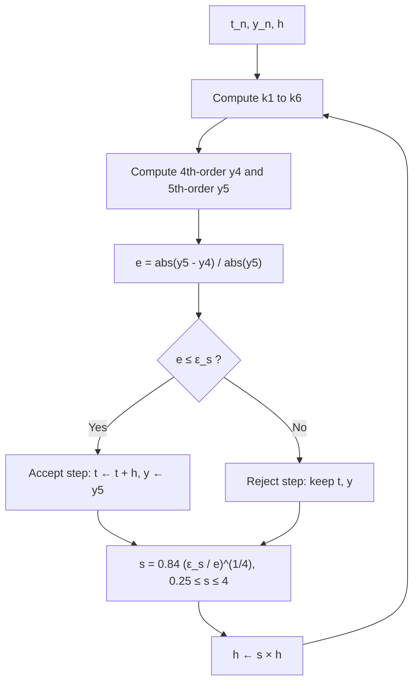
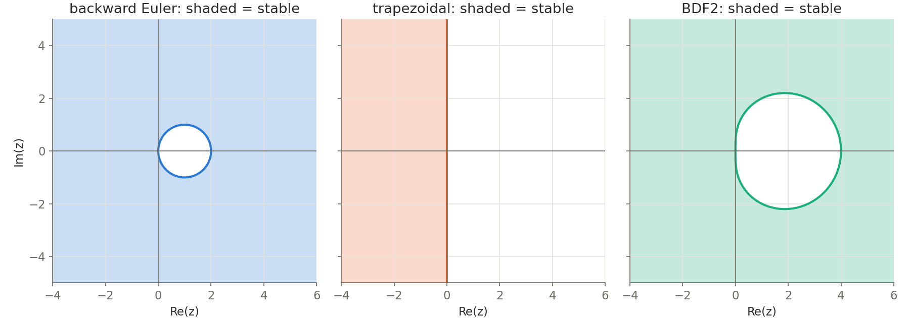
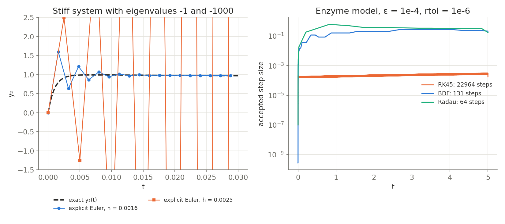
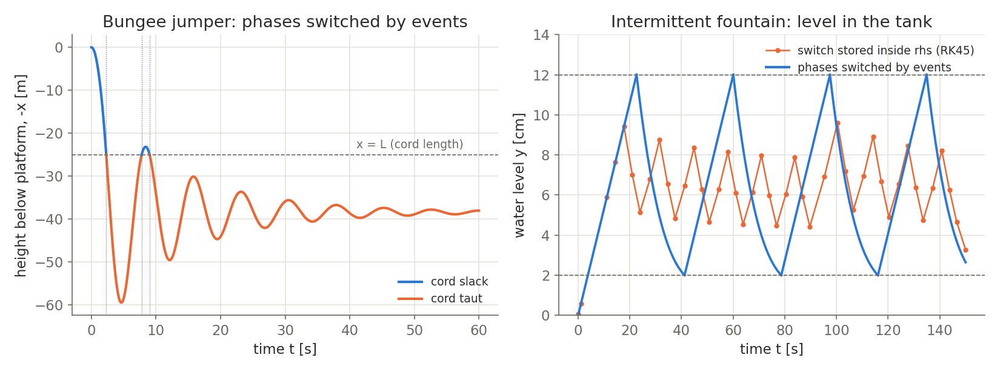

# Chapter 23 — Stiff ODEs and Adaptive Methods

[Repository Guide](../../README.md) | [English](Concepts_Lecture.md) | [한국어](Concepts_Lecture.ko.md)

> **Last Updated:** 2026-11-19
>
> Applied Numerical Methods with Python for Engineers and Scientists, Chapra and Clough, Ch 23

> **Learning Objectives:**
> 1. Estimate the local error and adjust the step size with an embedded RK method (RKF45)
> 2. Estimate the corrector error of a predictor-corrector method without derivatives
> 3. Identify stiff differential equations
> 4. Apply implicit methods for stiff systems
> 5. Compare explicit and implicit solver performance
> 6. Identify stiffness from the eigenvalues of the Jacobian and solve stiff problems with the BDF and Radau methods of solve_ivp

---

<br>

## Table of Contents

- [1. Adaptive Runge-Kutta Methods](#1-adaptive-runge-kutta-methods)
  - [1.1 Constant vs. Variable Step Size](#11-constant-vs-variable-step-size)
  - [1.2 Error Estimation and Step Size Control](#12-error-estimation-and-step-size-control)
  - [1.3 Two Approaches for Adaptive Stepping](#13-two-approaches-for-adaptive-stepping)
  - [1.4 A Worked Example of Step Halving](#14-a-worked-example-of-step-halving)
- [2. Embedded RK Methods: RKF45](#2-embedded-rk-methods-rkf45)
  - [2.1 The Six Stages (k₁ through k₆)](#21-the-six-stages-k_1-through-k_6)
  - [2.2 Fourth- and Fifth-Order Solutions](#22-fourth--and-fifth-order-solutions)
  - [2.3 Local Relative Error](#23-local-relative-error)
  - [2.4 Scale Factor and Step Size Adjustment](#24-scale-factor-and-step-size-adjustment)
  - [2.5 Tracing the Error Estimate and Step Adjustment of an Embedded Pair](#25-tracing-the-error-estimate-and-step-adjustment-of-an-embedded-pair)
  - [2.6 Step Sizes in Regions of Rapid Change and Narrow Pulses](#26-step-sizes-in-regions-of-rapid-change-and-narrow-pulses)
- [3. Detailed Derivation of Step Size Control](#3-detailed-derivation-of-step-size-control)
  - [3.1 Truncation Error Orders of RKF45](#31-truncation-error-orders-of-rkf45)
  - [3.2 Estimating the Error Constant C](#32-estimating-the-error-constant-c)
  - [3.3 Choosing the New Step Size h_new](#33-choosing-the-new-step-size-h_textnew)
- [4. Multistep Methods](#4-multistep-methods)
  - [4.1 Multistage vs. Multistep](#41-multistage-vs-multistep)
  - [4.2 Non-Self-Starting Heun Method (Predictor-Corrector)](#42-non-self-starting-heun-method-predictor-corrector)
  - [4.3 Error Estimates for the Predictor-Corrector](#43-error-estimates-for-the-predictor-corrector)
  - [4.4 Error Estimation Without Derivatives](#44-error-estimation-without-derivatives)
  - [4.5 A Worked Example of Corrector Iteration and Error Estimation](#45-a-worked-example-of-corrector-iteration-and-error-estimation)
- [5. Stiff Systems](#5-stiff-systems)
  - [5.1 Definition and Characteristics](#51-definition-and-characteristics)
  - [5.2 Example: Enzyme Kinetics (Michaelis-Menten)](#52-example-enzyme-kinetics-michaelis-menten)
  - [5.3 Example: FitzHugh-Nagumo Model for Heart](#53-example-fitzhugh-nagumo-model-for-heart)
  - [5.4 Stability Constraint for Explicit Methods](#54-stability-constraint-for-explicit-methods)
  - [5.5 Implicit Methods for Stiff Systems](#55-implicit-methods-for-stiff-systems)
  - [5.6 Stiffness Seen Through Eigenvalues and a Numerical Check of the Explicit Stability Limit](#56-stiffness-seen-through-eigenvalues-and-a-numerical-check-of-the-explicit-stability-limit)
  - [5.7 Backward Euler for Systems and Newton's Method](#57-backward-euler-for-systems-and-newtons-method)
  - [5.8 Backward Differentiation Formulas (BDF)](#58-backward-differentiation-formulas-bdf)
  - [5.9 Stability Regions of Implicit Methods and A-Stability](#59-stability-regions-of-implicit-methods-and-a-stability)
- [6. Python Implementation](#6-python-implementation)
  - [6.1 RKF45 Adaptive Solver](#61-rkf45-adaptive-solver)
  - [6.2 Backward Euler for Stiff Systems (Linear Case)](#62-backward-euler-for-stiff-systems-linear-case)
  - [6.3 Non-Self-Starting Heun Predictor-Corrector](#63-non-self-starting-heun-predictor-corrector)
  - [6.4 Solving Stiff Problems with SciPy](#64-solving-stiff-problems-with-scipy)
  - [6.5 Event Detection in solve_ivp](#65-event-detection-in-solve_ivp)
- [7. Case Study: Systems Whose Model Changes](#7-case-study-systems-whose-model-changes)
  - [7.1 A Bungee Jump Where the Cord Becomes Taut](#71-a-bungee-jump-where-the-cord-becomes-taut)
  - [7.2 An Intermittent Fountain with Hysteresis](#72-an-intermittent-fountain-with-hysteresis)
- [8. Common Mistakes](#8-common-mistakes)
- [Concept Applications](#concept-applications)
- [Summary](#summary)
- [Self-Check Questions](#self-check-questions)
- [References](#references)

---

<br>

## 1. Adaptive Runge-Kutta Methods

### 1.1 Constant vs. Variable Step Size

The ODE solvers in Chapter 22 used a **constant step size** $`\Delta t`$ across the entire integration interval $`[0, T]`$. This is simple but wasteful:

- **Smooth regions** (slowly changing solution): a large step size would suffice, but the constant step may be unnecessarily small.
- **Rapidly changing regions** (abrupt transients): the fixed step size may be too large, leading to inaccuracy or even instability.

The adaptive approach replaces a single constant $`\Delta t`$ with **variable step sizes** $`\Delta t_1, \Delta t_2, \Delta t_3, \ldots`$ that change from one step to the next.

> **Note:** **Adaptive step size control.** The algorithm can automatically adjust the step size to avoid overkill (too many steps in smooth regions) or inaccuracy (too few steps near abrupt changes). The key idea is to control the step size adaptively depending on an **error estimation** at each step.

### 1.2 Error Estimation and Step Size Control

The central question is: **how do we estimate the local error at each step?**

If the error is large, we shrink the step; if the error is small, we grow the step. The error estimate is computed by comparing two numerical solutions of different accuracy obtained within the same step.

### 1.3 Two Approaches for Adaptive Stepping

There are two main approaches:

| Approach | Description |
|----------|-------------|
| **1. Halving the step size** | Compute $`y_1`$ with step $`\Delta t`$, then $`y_2`$ with two half-steps $`\Delta t/2`$. The difference $`y_1 - y_2`$ provides an error estimate. |
| **2. Embedded RK methods** | Use high-order and low-order schemes simultaneously (sharing the same stage evaluations) to compute the local truncation error. **Fehlberg** developed this approach. |

*Table 1. Two error estimation approaches for adaptive step size control*

The **embedded RK approach** (Approach 2) is far more efficient because it reuses function evaluations and is the basis of the widely-used RKF45 method.

### 1.4 A Worked Example of Step Halving

The first approach of Table 1 is checked with the RK4 method of Chapter 22. Let $`y_1`$ be the value after one step of size $`h`$ and $`y_2`$ the value after two steps of size $`h/2`$. If the local error of RK4 is $`Ch^5`$, the error of two half steps is $`2C(h/2)^5 = Ch^5/16`$, so for the true value $`y`$ we have $`y = y_1 + Ch^5 = y_2 + Ch^5/16`$. Subtracting the two equations to eliminate $`Ch^5`$ gives the following estimate.

```math
y - y_2 \approx \frac{y_2 - y_1}{15}
```

Adding this estimate to $`y_2`$ is the same idea as the Richardson extrapolation of Chapter 20. The same problem as in Section 2.5, $`y' = -2ty`$, is started from the exact value at $`t = 0.5`$ and computed with two values of $`h`$.

```python
import numpy as np

f = lambda t, y: -2.0 * t * y
exact = lambda t: np.exp(-t**2)

def rk4_step(t, y, h):
    k1 = f(t, y)
    k2 = f(t + h / 2, y + h * k1 / 2)
    k3 = f(t + h / 2, y + h * k2 / 2)
    k4 = f(t + h, y + h * k3)
    return y + h * (k1 + 2 * k2 + 2 * k3 + k4) / 6

t = 0.5
for h in [0.5, 0.125]:
    y1 = rk4_step(t, exact(t), h)                                 # one full step
    y2 = rk4_step(t + h / 2, rk4_step(t, exact(t), h / 2), h / 2)  # two half steps
    est = (y2 - y1) / 15                                          # estimated error of y2
    true = exact(t + h)
    print(f"h = {h}: error of y1 = {true - y1:+.2e}, error of y2 = {true - y2:+.2e}, "
          f"estimate = {est:+.2e}, error of y2 + estimate = {true - y2 - est:+.2e}")
```

```text
h = 0.5: error of y1 = -2.26e-04, error of y2 = -5.70e-05, estimate = -1.12e-05, error of y2 + estimate = -4.58e-05
h = 0.125: error of y1 = -1.92e-07, error of y2 = -1.66e-08, estimate = -1.17e-08, error of y2 + estimate = -4.93e-09
```

- `rk4_step` is the RK4 formula of Chapter 22, Section 6.1, and `y2` is obtained by taking two half steps in succession.
- `est` is the error estimate from the formula above, and the last value is the error of the value corrected by adding that estimate.

At $`h = 0.125`$ the estimate $`-1.17 \times 10^{-8}`$ has the same sign and order of magnitude as the actual error of $`y_2`$, $`-1.66 \times 10^{-8}`$, and adding the estimate reduces the error to $`-4.9 \times 10^{-9}`$. At $`h = 0.5`$, in contrast, the ratio of the errors of $`y_1`$ and $`y_2`$ is about 4 rather than 16, so the estimate is only one fifth of the actual error. The derivation assumes that $`C`$ is constant within the step, so when the solution changes greatly over one step, the error estimate itself becomes inaccurate. This is why practical solvers choose steps conservatively by multiplying by the safety factor of Section 3.3. Cost is another drawback. Checking one step takes 4 function evaluations for $`y_1`$ and 8 for $`y_2`$, sharing the slope at the starting point, for a total of 11. The RKF45 method of Section 2 completes the error estimate with 6 evaluations.

---

<br>

## 2. Embedded RK Methods: RKF45

The **Runge-Kutta-Fehlberg method (RKF45)** uses a combination of **4th-order** and **5th-order** Runge-Kutta formulas to estimate the local truncation error. Both formulas share the **same six stages** $`k_1, \ldots, k_6`$, so the extra cost of error estimation is minimal.

> **Definition:** An **embedded Runge-Kutta method** is an RK method that combines the same stage slopes $`k_i`$ with different weights to obtain two approximations of different orders at once, and estimates the local error from their difference. The error estimate requires almost no additional function evaluations.

Given the ODE:

```math
\frac{dy}{dt} = f(t, y)
```

Let $`h = \Delta t = t_{n+1} - t_n`$.

### 2.1 The Six Stages ($`k_1`$ through $`k_6`$)

```math
k_1 = h \, f(t_n, \, y_n)
```

```math
k_2 = h \, f\!\left(t_n + \frac{h}{4}, \, y_n + \frac{k_1}{4}\right)
```

```math
k_3 = h \, f\!\left(t_n + \frac{3}{8}h, \, y_n + \frac{3}{32}k_1 + \frac{9}{32}k_2\right)
```

```math
k_4 = h \, f\!\left(t_n + \frac{12}{13}h, \, y_n + \frac{1932}{2197}k_1 - \frac{7200}{2197}k_2 + \frac{7296}{2197}k_3\right)
```

```math
k_5 = h \, f\!\left(t_n + h, \, y_n + \frac{439}{216}k_1 - 8k_2 + \frac{3680}{513}k_3 - \frac{845}{4104}k_4\right)
```

```math
k_6 = h \, f\!\left(t_n + \frac{1}{2}h, \, y_n - \frac{8}{27}k_1 + 2k_2 - \frac{3544}{2565}k_3 + \frac{1859}{4104}k_4 - \frac{11}{40}k_5\right)
```

> **Note:** **Benefit of embedding.** All six $`k_i`$ values are computed once per step. The 4th-order formula uses $`k_1`$ through $`k_5`$; the 5th-order formula additionally uses $`k_6`$. This embedding is what makes the error estimation essentially free.

### 2.2 Fourth- and Fifth-Order Solutions

**4th-order RK solution:**

```math
y_{n+1}^{[4]} = y_n + \frac{25}{216}k_1 + \frac{1408}{2565}k_3 + \frac{2197}{4104}k_4 - \frac{1}{5}k_5
```

**5th-order RK solution:**

```math
y_{n+1}^{[5]} = y_n + \frac{16}{135}k_1 + \frac{6656}{12825}k_3 + \frac{28561}{56430}k_4 - \frac{9}{50}k_5 + \frac{2}{55}k_6
```

> **Note:** **The role of $`k_2`$ and the accepted solution.** Notice that $`k_2`$ does not appear explicitly in either final formula; its contribution is folded into the later stages through the stage dependencies. The 5th-order solution $`y_{n+1}^{[5]}`$ is more accurate and is taken as the accepted solution for advancement.

### 2.3 Local Relative Error

The local relative error at $`t_{n+1}`$ is estimated by comparing the two solutions:

```math
e_{n+1} = \left| \frac{y_{n+1}^{[5]} - y_{n+1}^{[4]}}{y_{n+1}^{[5]}} \right|
```

This quantity tells us how much the 4th-order and 5th-order solutions disagree. A large disagreement signals that the step size is too large and the truncation error is significant.

### 2.4 Scale Factor and Step Size Adjustment

Given the error estimate, we compute a **scale factor** $`s`$ to adjust the step size:

```math
s = \left(\frac{\varepsilon_s}{2 \, e_{n+1}}\right)^{1/4} \approx 0.84 \left(\frac{\varepsilon_s}{e_{n+1}}\right)^{1/4}
```

where $`\varepsilon_s`$ is the **specified local error tolerance** (user-defined).

The scale factor is **clamped** to prevent extreme changes:

```math
0.25 \leq s \leq 4
```

The new step size is then:

```math
h^{\text{new}} = s \cdot h
```

> **Note:** **Role of clamping.** The clamping $`0.25 \leq s \leq 4`$ prevents the step size from shrinking or growing by more than a factor of 4 in a single step. This safeguard avoids oscillatory behavior in the step size control and ensures smooth adaptation.

**Decision logic at each step:**
- If $`e_{n+1} > \varepsilon_s`$: **reject** the step, shrink $`h`$, and **redo** the step.
- If $`e_{n+1} \leq \varepsilon_s`$: **accept** the step, advance to $`t_{n+1}`$, and (possibly) grow $`h`$ for the next step.

Figure 1 shows this decision process as the flow of one RKF45 step.



*Figure 1. Step acceptance and step size adjustment in RKF45*

### 2.5 Tracing the Error Estimate and Step Adjustment of an Embedded Pair

The procedure of Sections 2.1 to 2.4 is applied to the problem $`y' = -2ty`$ of Chapter 22, following one step to the end. The starting point is the exact value $`y = e^{-0.25}`$ at $`t = 0.5`$, the initial step size is $`h = 0.5`$, and the relative tolerance is $`\varepsilon_s = 10^{-6}`$. Because the starting value is exact, the difference between the result and the exact solution is the local error of that step.

```python
import numpy as np

f = lambda t, y: -2.0 * t * y
exact = lambda t: np.exp(-t**2)

def rkf45_step(t, y, h):
    k1 = h * f(t, y)
    k2 = h * f(t + h/4, y + k1/4)
    k3 = h * f(t + 3*h/8, y + 3*k1/32 + 9*k2/32)
    k4 = h * f(t + 12*h/13, y + 1932*k1/2197 - 7200*k2/2197 + 7296*k3/2197)
    k5 = h * f(t + h, y + 439*k1/216 - 8*k2 + 3680*k3/513 - 845*k4/4104)
    k6 = h * f(t + h/2, y - 8*k1/27 + 2*k2 - 3544*k3/2565 + 1859*k4/4104 - 11*k5/40)
    y4 = y + 25*k1/216 + 1408*k3/2565 + 2197*k4/4104 - k5/5
    y5 = y + 16*k1/135 + 6656*k3/12825 + 28561*k4/56430 - 9*k5/50 + 2*k6/55
    return y4, y5

t, y, h, tol = 0.5, exact(0.5), 0.5, 1e-6         # start from the exact value
while True:
    y4, y5 = rkf45_step(t, y, h)
    e = abs((y5 - y4) / y5)                        # estimated local relative error
    s = min(max(0.84 * (tol / e)**0.25, 0.25), 4.0)
    true4 = abs(exact(t + h) - y4) / exact(t + h)
    true5 = abs(exact(t + h) - y5) / exact(t + h)
    status = "accept" if e <= tol else "reject"
    print(f"h = {h:.5f}: e = {e:.2e}, true rel. error of y4 = {true4:.2e}, of y5 = {true5:.2e}, "
          f"s = {s:.3f} -> {status}")
    if e <= tol:
        print(f"accepted y({t + h:.5f}) = {y5:.8f}, next h = {s * h:.5f}")
        break
    h = s * h
```

```text
h = 0.50000: e = 8.01e-04, true rel. error of y4 = 1.64e-03, of y5 = 8.39e-04, s = 0.250 -> reject
h = 0.12500: e = 1.90e-07, true rel. error of y4 = 2.47e-07, of y5 = 5.69e-08, s = 1.272 -> accept
accepted y(0.62500) = 0.67663388, next h = 0.15896
```

- `rkf45_step` transcribes the coefficients of Sections 2.1 and 2.2 and returns the fourth-order solution `y4` and the fifth-order solution `y5` from six slopes.
- `s` is the scale factor $`0.84(\varepsilon_s/e)^{1/4}`$ of Section 2.4 clamped to $`[0.25, 4]`$.

The error estimate of the first attempt ($`h = 0.5`$), $`e = 8.0 \times 10^{-4}`$, exceeds the tolerance by a factor of 800, so the step is rejected. The computed scale factor $`0.84 \times (10^{-6}/8.0 \times 10^{-4})^{1/4} = 0.158`$ is below the lower limit 0.25, so $`h`$ is reduced to 0.125. The estimate of the second attempt, $`1.9 \times 10^{-7}`$, is within the tolerance, so the step is accepted, and the next step starts at 0.159, obtained with the scale factor 1.27.

The estimate $`e`$ has the same order of magnitude as the actual error of the fourth-order solution ($`1.64 \times 10^{-3}`$, $`2.47 \times 10^{-7}`$), because $`e`$ essentially estimates the error of the fourth-order solution. The actual error of the accepted fifth-order solution ($`5.69 \times 10^{-8}`$) is smaller, so the result is accurate with margin to spare. This is the local extrapolation mentioned in Section 7.4 of Chapter 22: the error is controlled with the lower-order formula and the step advances with the higher-order formula. The six function evaluations of a rejected attempt are discarded, so an initial step size that is too large costs that much.

### 2.6 Step Sizes in Regions of Rapid Change and Narrow Pulses

The advantage of adaptive methods shows when the solution changes rapidly only in part of the interval. A definite integral $`\int_a^b f(x)\,dx`$ also equals $`y(b)`$ of the initial-value problem $`y' = f(x)`$, $`y(a) = 0`$, so the same advantage applies to integrals of rapidly changing functions. The equation $`y' = 5e^{-((t-2)/w)^2} - 0.4y`$, $`y(0) = 1`$, a decaying quantity with an added short pulse of width $`w`$, is solved on $`t \in [0, 6]`$ with SciPy's RK45.

```python
import numpy as np
from scipy.integrate import solve_ivp

def make_rhs(width):                             # decay plus a pulse of the given width at t = 2
    return lambda t, y: 5.0 * np.exp(-((t - 2.0) / width)**2) - 0.4 * y

sol = solve_ivp(make_rhs(0.1), (0.0, 6.0), [1.0], rtol=1e-6, atol=1e-9)
h = np.diff(sol.t); mid = 0.5 * (sol.t[:-1] + sol.t[1:])
near = np.abs(mid - 2.0) < 0.3
print(f"width 0.1 : {h.size} steps, {near.sum()} of them within 0.3 of t = 2")
print(f"            h near the pulse {h[near].min():.4f}-{h[near].max():.4f}, largest h elsewhere {h[~near].max():.4f}")

for kw in [dict(rtol=1e-6, atol=1e-9), dict(rtol=1e-6, atol=1e-9, max_step=0.002)]:
    s = solve_ivp(make_rhs(0.01), (0.0, 6.0), [1.0], **kw)
    print(f"width 0.01: max_step = {kw.get('max_step', 'inf')}: {s.t.size - 1} steps, y(6) = {s.y[0, -1]:.6f}")
print(f"decay only: y(6) = {np.exp(-2.4):.6f}")
```

```text
width 0.1 : 27 steps, 12 of them within 0.3 of t = 2
            h near the pulse 0.0383-0.0672, largest h elsewhere 0.5842
width 0.01: max_step = inf: 14 steps, y(6) = 0.090718
width 0.01: max_step = 0.002: 3001 steps, y(6) = 0.108611
decay only: y(6) = 0.090718
```

- `make_rhs` builds and returns a right-hand side with the pulse width fixed.
- `near` is a Boolean array that selects the steps whose midpoints lie within 0.3 of the pulse center $`t = 2`$.
- `max_step` is an upper bound on the step size, and its default is infinity [1].

For the pulse of width 0.1, 12 of the 27 steps cluster near the pulse, where the steps shrink to between 0.04 and 0.07, while steps far from the pulse grow to 0.58. A fixed-step method using the smallest step, 0.038, over the whole interval would need 157 steps. When the width shrinks to 0.01, however, the result equals the value without the pulse, $`e^{-2.4} = 0.090718`$. The exact value is $`e^{-2.4}\left(1 + 5\int_0^6 e^{0.4u}e^{-((u-2)/w)^2}\,du\right) = 0.108611`$, so the whole pulse was missed. The solver enlarged its steps in the smooth region before the pulse, and all stage evaluations of the large steps passed around the pulse, so the error estimate was small as well. The error estimate uses only the information at the points the solver evaluates, so it cannot notice changes hidden between them. If it is known when the input changes, the step size is limited with `max_step` or the integration interval is split before and after the pulse. This is the same phenomenon as `quad` missing a narrow peak in Chapter 20, Section 5.4.

---

<br>

## 3. Detailed Derivation of Step Size Control

This section provides the rigorous derivation of the step size control formula for RKF45.

### 3.1 Truncation Error Orders of RKF45

Recall the two solutions:

```math
y(t_{n+1}) = y_{n+1}^{[4]} + C h^5 + O(h^6)
```

```math
y(t_{n+1}) = y_{n+1}^{[5]} + O(h^6)
```

where $`y(t_{n+1})`$ is the **true value**. The 4th-order method has a leading error term proportional to $`h^5`$, while the 5th-order method's leading error is $`O(h^6)`$.

### 3.2 Estimating the Error Constant $`C`$

Subtracting the two expressions:

```math
C h^5 = y_{n+1}^{[5]} - y_{n+1}^{[4]}
```

Therefore:

```math
C = \frac{\left| y_{n+1}^{[5]} - y_{n+1}^{[4]} \right|}{h^5}
```

The constant $`C`$ captures the local behavior of the solution's higher derivatives. It is estimated from the current step and assumed to remain approximately the same over the next step.

### 3.3 Choosing the New Step Size $`h_{\text{new}}`$

We want the new step size $`h_{\text{new}}`$ such that the error at the **next** step (step $`n+2`$) satisfies a tolerance $`\varepsilon`$:

```math
\left| y_{n+2}^{[5]} - y_{n+2}^{[4]} \right| < s_f \cdot \varepsilon
```

where $`s_f`$ is a **safety factor** (typically $`s_f \approx 0.84`$). Using the same constant $`C`$:

```math
C = \frac{\left| y_{n+2}^{[5]} - y_{n+2}^{[4]} \right|}{h_{\text{new}}^5} < \frac{s_f \cdot \varepsilon}{h_{\text{new}}^5}
```

Solving for $`h_{\text{new}}`$:

```math
h_{\text{new}} < \left(\frac{s_f \cdot \varepsilon}{C}\right)^{1/5}
```

Replacing $`C`$ with its estimate from the current step:

```math
\boxed{h_{\text{new}} < \left(\frac{s_f \cdot \varepsilon}{\left| y_{n+1}^{[5]} - y_{n+1}^{[4]} \right|}\right)^{1/5} \cdot h}
```

> **Note:** **Origin of the exponent $`1/5`$.** This is the complete step size control formula. The exponent $`1/5`$ comes from the fact that the leading error of the 4th-order method is $`O(h^5)`$. For a general embedded pair of orders $`p`$ and $`p+1`$, the exponent would be $`1/(p+1)`$.

---

<br>

## 4. Multistep Methods

### 4.1 Multistage vs. Multistep

**Multistage** and **multistep** methods follow fundamentally different strategies:

| Feature | Multistage (e.g., RK4) | Multistep (e.g., Adams-Bashforth) |
|---------|------------------------|-----------------------------------|
| **Stages per step** | Multiple intermediate evaluations ($`s`$ stages) within a single step $`[t_n, t_{n+1}]`$ | Typically one evaluation per step |
| **Previous steps used** | Only $`(t_n, y_n)`$ | Values from multiple previous steps: $`y_n, y_{n-1}, y_{n-2}, \ldots`$ |
| **Self-starting** | Yes | No (needs initial values from another method) |
| **Memory** | No history needed | Must store past values |

*Table 2. Comparison of multistage and multistep methods*

A **multistep method** computes $`y_{n+1}`$ using values from **previous time steps**:

```math
y_{n+1} = y_{n+1}(y_n, y_{n-1}, \ldots)
```

### 4.2 Non-Self-Starting Heun Method (Predictor-Corrector)

Recall the **Heun approach** from Chapter 22, which is a predictor-corrector scheme:

**i) Predictor** (Euler method):

```math
Y_1 = y_n + h \, f(t_n, y_n) + O(h^2)
```

**ii) Corrector** (Trapezoidal rule):

```math
y_{n+1} = y_n + h \cdot \frac{f(t_n, y_n) + f(t_{n+1}, Y_1)}{2} + O(h^3)
```

> **Note:** **Accuracy of the predictor and corrector.** The predictor has local truncation error $`O(h^2)`$ (1st-order), while the corrector achieves $`O(h^3)`$ (2nd-order). The predictor provides an initial guess that the corrector refines.

**Improving the predictor accuracy:**

The standard Euler predictor has truncation error $`O(h^2)`$. To match the corrector's $`O(h^3)`$ accuracy, we can use the **midpoint method** as a predictor instead:

```math
Y_1 = y_{n-1} + 2h \, f(t_n, y_n) + O(h^3)
```

This predictor applies the open midpoint integration formula over $`[t_{n-1}, t_{n+1}]`$ and differs from the RK2 midpoint method of Chapter 22. Now both the predictor and the corrector have local truncation error of $`O(h^3)`$.

**However**, this improved predictor is **NOT self-starting**: it requires the value at $`t_{n-1}`$, which is not available at the very first step ($`n = 0`$).

To resolve this problem, use a self-starting method such as the RK2 midpoint method, standard Euler, or Heun's method at the first step ($`t = 0`$) to generate the value at $`t_1`$, then switch to the non-self-starting Heun method for all subsequent steps. The implementation in Section 6.3 uses the standard Heun method for the first step. Figure 2 shows the points used by the two stages.

```text
     t_{n-1}             t_n             t_{n+1}
        ●─────────────────●─────────────────○
     y_{n-1}             y_n

        └───────── 2h f(t_n, y_n) ──────────> Y_1      (predictor)
                          └─────── h ───────> y_{n+1}  (corrector: average of f(t_n, y_n) and f(t_{n+1}, Y_1))
```

*Figure 2. Predictor and corrector of the non-self-starting Heun method*

### 4.3 Error Estimates for the Predictor-Corrector

**i) Predictor error** (midpoint method, textbook Table 19.4):

```math
E_p = \frac{1}{3} h^3 f''(\xi_p)
```

where $`Y_{1,\text{true}} = Y_1 + E_p`$.

**ii) Corrector error** (trapezoidal rule, textbook Table 19.2):

```math
E_c = -\frac{1}{12} h^3 f''(\xi_c)
```

where $`y_{n+1,\text{true}} = y_{n+1} + E_c`$.

### 4.4 Error Estimation Without Derivatives

Since both the true predictor and true corrector values converge to the same true solution:

```math
Y_{1,\text{true}} = y_{n+1,\text{true}}
```

Assume $`f''(\xi_p) \approx f''(\xi_c)`$ (both $`\xi`$ values are close). Subtracting equation (i) from equation (ii):

```math
0 = y_{n+1} - Y_1 + E_c - E_p = y_{n+1} - Y_1 - \frac{5}{12} h^3 f''(\xi)
```

This is the key equation ($`\ast`$). Dividing ($`\ast`$) by 5 and rearranging:

```math
\frac{Y_1 - y_{n+1}}{5} = -\frac{1}{12} h^3 f''(\xi) = E_c
```

> **Note:** **Significance of the result.** This is an important result: the **corrector error** $`E_c`$ can be estimated purely from the difference between the predictor $`Y_1`$ and the corrector $`y_{n+1}`$, **without** computing any derivatives of $`f`$. This makes error estimation practical and cheap.

### 4.5 A Worked Example of Corrector Iteration and Error Estimation

The corrector of Section 4.2 may be applied only once, but the corrected value can also be fed back into the right-hand side repeatedly until it no longer changes. The $`j`$th iteration is as follows.

```math
y_{n+1}^{(j)} = y_n + \frac{h}{2}\left[f(t_n, y_n) + f\bigl(t_{n+1}, y_{n+1}^{(j-1)}\bigr)\right], \qquad y_{n+1}^{(0)} = Y_1
```

The iteration stops when the approximate relative error $`\lvert\varepsilon_a\rvert = \lvert(y_{n+1}^{(j)} - y_{n+1}^{(j-1)})/y_{n+1}^{(j)}\rvert`$ falls below the tolerance, and the converged value is the solution of the trapezoidal method, an implicit method. The equation $`y' = -0.8y + 2e^{-0.2t}`$, $`y(0) = 1`$ (exact solution $`y = \frac{10}{3}e^{-0.2t} - \frac{7}{3}e^{-0.8t}`$) is advanced two steps with $`h = 0.5`$. The value $`y_{-1}`$ needed by the first predictor is taken from the exact solution at $`t = -0.5`$.

```python
import numpy as np

f = lambda t, y: -0.8 * y + 2.0 * np.exp(-0.2 * t)
exact = lambda t: (10.0 / 3.0) * np.exp(-0.2 * t) - (7.0 / 3.0) * np.exp(-0.8 * t)

h, es = 0.5, 1e-4                                  # step size, relative tolerance (0.01 %)
t_prev, y_prev = -h, exact(-h)                      # extra starting value y_{-1}
t, y = 0.0, 1.0
for step in range(2):
    t_new = t + h
    y0 = y_prev + 2.0 * h * f(t, y)                 # midpoint predictor
    yc = y0
    print(f"t = {t_new}: predictor = {y0:.6f}")
    for j in range(1, 20):                          # iterate the trapezoidal corrector
        y_old = yc
        yc = y + h / 2 * (f(t, y) + f(t_new, y_old))
        ea = abs((yc - y_old) / yc)
        print(f"   corrector {j}: {yc:.6f}, |ea| = {100 * ea:.4f} %")
        if ea < es:
            break
    Ec = (y0 - yc) / 5.0                            # error estimate of the corrector
    print(f"   estimate Ec = {Ec:+.6f}, true error = {exact(t_new) - yc:+.6f}, "
          f"exact = {exact(t_new):.6f}")
    t_prev, y_prev, t, y = t, y, t_new, yc
```

```text
t = 0.5: predictor = 1.402979
   corrector 1: 1.471823, |ea| = 4.6775 %
   corrector 2: 1.458054, |ea| = 0.9443 %
   corrector 3: 1.460808, |ea| = 0.1885 %
   corrector 4: 1.460257, |ea| = 0.0377 %
   corrector 5: 1.460367, |ea| = 0.0075 %
   estimate Ec = -0.011478, true error = -0.008323, exact = 1.452045
t = 1.0: predictor = 1.641381
   corrector 1: 1.701802, |ea| = 3.5504 %
   corrector 2: 1.689718, |ea| = 0.7152 %
   corrector 3: 1.692134, |ea| = 0.1428 %
   corrector 4: 1.691651, |ea| = 0.0286 %
   corrector 5: 1.691748, |ea| = 0.0057 %
   estimate Ec = -0.010073, true error = -0.011079, exact = 1.680668
```

- `y0` is the midpoint predictor $`Y_1 = y_{n-1} + 2hf(t_n, y_n)`$, and the inner loop iterates the trapezoidal corrector until $`\lvert\varepsilon_a\rvert < 0.01\%`$.
- `Ec` is the estimate $`(Y_1 - y_{n+1})/5`$ of Section 4.4, computed with the converged corrector value.

The $`\lvert\varepsilon_a\rvert`$ of the corrector iteration falls by about a factor of 5 each time, as in $`4.68\%`$, $`0.94\%`$, $`0.19\%`$. This iteration is the fixed-point iteration of Chapter 6, and the derivative of the iteration function is $`\frac{h}{2}\,\partial f/\partial y = 0.25 \times (-0.8) = -0.2`$, so the error is multiplied by 0.2 at each iteration. The iteration converges only if the magnitude of this factor is less than 1, so stiff problems with large $`\lvert\partial f/\partial y\rvert`$ require Newton's method, as the caution in Section 5.7 states.

The error estimate of the first step, $`-0.0115`$, is close in sign and size to the actual error $`-0.0083`$. Since the starting value is exact, this error is the local error of that step. The estimate for the second step, $`-0.0101`$, estimates the local error of that step, whereas the actual error $`-0.0111`$ also contains the error carried over from the first step. The estimate relies on the assumption that $`y'''`$ is nearly constant over the intervals of the predictor and the corrector, so it indicates only the order of magnitude of the error, but this is enough to decide whether to enlarge or reduce the step size.

---

<br>

## 5. Stiff Systems

### 5.1 Definition and Characteristics

A **stiff system** is an ODE system that is difficult to solve numerically due to its inherent characteristics. Formally:

> **Definition:** A **stiff system** has a wide range of eigenvalues (time scales).

> **Definition:** The **stiffness ratio** is the ratio of the largest to the smallest eigenvalue magnitude, and it is very large for a stiff system.

Stiffness arises when the solution contains components that decay at vastly different rates. Explicit methods are forced to use a step size dictated by the **fastest** decaying component (for stability), even when the **slowest** component dominates the solution's behavior. A model of the atmosphere, in which processes with very different time scales act together, is a typical example.

### 5.2 Example: Enzyme Kinetics (Michaelis-Menten)

Chemical processes depend on concentrations of chemical species and can be described by differential equations. The chemical reactions are usually **nonlinear** and often occur on **different time scales**.

A single-substrate enzyme reaction (Michaelis-Menten kinetics):

```math
E + S \underset{k_{-1}}{\overset{k_1}{\rightleftharpoons}} ES \overset{k_2}{\longrightarrow} E^0 + P
```

where:
- $`E`$ = enzyme, $`S`$ = substrate, $`ES`$ = enzyme-substrate complex
- $`P`$ = product, $`E^0`$ = regenerated enzyme
- $`k_1, k_{-1}, k_2`$ are **rate constants**.

A substrate $`S`$ binds with an enzyme $`E`$ to form an enzyme-substrate complex $`ES`$, which can either **dissociate** (reverse reaction with rate $`k_{-1}`$) or **proceed** to form $`E`$ and the product $`P`$ (forward reaction with rate $`k_2`$).

Since there is no loss of material (conservation laws), the system can be written as **nonlinear singular perturbed differential equations**:

```math
y'(t) = -y(t) + (\mu + y(t)) \, z(t)
```

```math
\epsilon \, z'(t) = y(t) - (\lambda + y(t)) \, z(t)
```

with $`\epsilon \ll 1`$.

> **Note:** **Fast-slow decomposition.** The parameter $`\epsilon \ll 1`$ multiplying $`z'(t)`$ creates a **fast-slow decomposition**: $`z(t)`$ evolves on a fast time scale $`\sim \epsilon`$ while $`y(t)`$ evolves on a slow time scale $`\sim 1`$. This is the hallmark of stiffness: the different time scales force explicit methods to use tiny steps to track the fast variable, even after it has settled to quasi-equilibrium.

### 5.3 Example: FitzHugh-Nagumo Model for Heart

**Cardiac cells**, like neurons, exhibit **excitable behavior**: they rest, can be activated by a stimulus, and then recover.

The FitzHugh-Nagumo model describes this behavior:

```math
u_t = D_u \Delta u - u^3 + u - v
```

```math
v_t = D_v \Delta v + \varepsilon(u - bv + a)
```

where $`D_u, D_v`$ are diffusion coefficients, $`\varepsilon`$ is a small parameter, and $`a, b`$ are model parameters.

> **Note:** **Separation of time scales.** When $`\varepsilon`$ is small, the $`v`$ equation evolves slowly (recovery variable) while $`u`$ evolves rapidly (excitation variable). This separation of time scales makes the system stiff. In the ODE form of the model without diffusion, plotting the excitation variable over time with external stimulus $`I = 0.5`$, $`a = 0.7`$, $`b = 0.8`$, and recovery time constant $`\tau = 12.5`$ shows sharp spikes (fast excitation) followed by slow recovery, a classic signature of stiffness.

### 5.4 Stability Constraint for Explicit Methods

Consider the simple stiff ODE:

```math
\frac{dy}{dt} = -100000 \, y
```

The analytical solution is $`y = y_0 \, e^{-10^5 t}`$, which decays **extremely rapidly**.

For the **explicit Euler method**, the stability condition requires $`|1 + z| \leq 1`$ where $`z = \lambda h`$. With $`\lambda = -10^5`$:

```math
|1 + (-10^5) h| \leq 1
```

This gives:

```math
h \leq \frac{2}{10^5} = 2 \times 10^{-5}
```

> **Note:** **Step size limited by stability.** This is a catastrophically small step size requirement. Even if the solution has effectively decayed to zero and the dynamics of interest are over, the explicit Euler method **must** continue using $`h \leq 2 \times 10^{-5}`$ for stability. This is the fundamental problem with explicit methods applied to stiff systems: the step size is limited by **stability**, not by **accuracy**.

### 5.5 Implicit Methods for Stiff Systems

The stability constraint of explicit methods can be circumvented with implicit methods.

An example of **implicit methods** is the **backward Euler method**:

```math
y_{n+1} = y_n + h \, f(t_{n+1}, y_{n+1})
```

The stability condition for backward Euler is $`|z - 1| \geq 1`$ where $`z = \lambda h`$. For $`\lambda = -10^5`$:

```math
|(-10^5 h) - 1| \geq 1
```

This is satisfied for **any** $`h > 0`$. The backward Euler method is **unconditionally stable** (A-stable).

| Method | Stability Condition | Step Size Restriction |
|--------|--------------------|-----------------------|
| Explicit Euler | $`\vert 1 + \lambda h \vert \leq 1`$ | $`h \leq 2/\vert \lambda \vert`$ (very restrictive for stiff systems) |
| Backward Euler | $`\vert 1 - \lambda h \vert \geq 1`$ (for $`\lambda < 0`$) | None (unconditionally stable) |

*Table 3. Stability conditions of explicit and backward Euler*

> **Note:** **Cost of implicit methods.** The price of implicit methods is that each step requires solving a (possibly nonlinear) equation for $`y_{n+1}`$. For linear problems this is a linear solve; for nonlinear problems, Newton's method is typically used. However, for stiff systems, the cost of solving implicit equations is far less than the cost of taking millions of tiny explicit steps.

### 5.6 Stiffness Seen Through Eigenvalues and a Numerical Check of the Explicit Stability Limit

The single equation of Section 5.4 does not show the core of stiffness fully, because the solution itself vanishes quickly. Stiffness becomes a problem when a rapidly vanishing component coexists with a long-lasting one. The following linear system illustrates this.

```math
\frac{d\mathbf{y}}{dt} = A\mathbf{y}, \qquad A = \begin{pmatrix} -500.5 & 499.5 \\ 499.5 & -500.5 \end{pmatrix}, \qquad \mathbf{y}(0) = \begin{pmatrix} 2 \\ 0 \end{pmatrix}
```

The eigenvalues of $`A`$ are $`-1`$ and $`-1000`$ with eigenvectors $`(1, 1)`$ and $`(1, -1)`$, so the exact solution is

```math
\mathbf{y}(t) = e^{-t}\begin{pmatrix} 1 \\ 1 \end{pmatrix} + e^{-1000t}\begin{pmatrix} 1 \\ -1 \end{pmatrix}
```

The second term has already dropped to $`e^{-5} \approx 0.007`$ by about $`t = 0.005`$ and is effectively gone; after that the solution is the slow component $`e^{-t}`$ alone. The stiffness ratio is $`1000/1 = 1000`$.

Applying forward Euler to the linear system $`\mathbf{y}' = A\mathbf{y}`$ gives $`\mathbf{y}_{n+1} = (I + hA)\mathbf{y}_n`$, and along each eigenvector the amplification factor $`1 + h\lambda_i`$ of the model problem of Chapter 22 is applied. Therefore $`|1 + h\lambda_i| \le 1`$ must hold for every eigenvalue, and the largest $`|\lambda| = 1000`$ sets the condition $`h \le 2/1000 = 0.002`$. This restriction remains even after the fast component has vanished.

```python
import numpy as np

A = np.array([[-500.5, 499.5],
              [499.5, -500.5]])
print("eigenvalues:", np.linalg.eigvals(A))
exact = lambda t: np.exp(-t) * np.array([1.0, 1.0]) + np.exp(-1000 * t) * np.array([1.0, -1.0])

def explicit_euler(h, T):
    y = np.array([2.0, 0.0])
    for _ in range(round(T / h)):
        y = y + h * (A @ y)
    return y

def implicit_euler(h, T):
    y = np.array([2.0, 0.0])
    M = np.eye(2) - h * A                      # (I - hA) y_{n+1} = y_n
    for _ in range(round(T / h)):
        y = np.linalg.solve(M, y)
    return y

T = 0.4
print("exact y(0.4)            :", exact(T))
for h in [0.0016, 0.0025]:
    print(f"explicit Euler h={h}:", explicit_euler(h, T))
for h in [0.1, 0.01]:
    print(f"implicit Euler h={h}  :", implicit_euler(h, T))
```

```text
eigenvalues: [   -1. -1000.]
exact y(0.4)            : [0.67032005 0.67032005]
explicit Euler h=0.0016: [0.67010535 0.67010535]
explicit Euler h=0.0025: [ 1.49486319e+28 -1.49486319e+28]
implicit Euler h=0.1  : [0.68301346 0.68301345]
implicit Euler h=0.01  : [0.67165314 0.67165314]
```

- `explicit_euler` repeats $`\mathbf{y}_{n+1} = \mathbf{y}_n + hA\mathbf{y}_n`$. With $`h = 0.0016`$ the amplification factor of the fast component is $`1 - 1.6 = -0.6`$, whose magnitude is less than 1, so the method is stable.
- With $`h = 0.0025`$ the amplification factor is $`1 - 2.5 = -1.5`$, so the fast component present in the initial value grows by $`1.5^{160} \approx 1.5 \times 10^{28}`$ over 160 steps and the result diverges. The two components of the result being equal in size and opposite in sign shows that what diverged is the direction of the fast component, $`(1, -1)`$.
- `implicit_euler` solves $`(I - hA)\mathbf{y}_{n+1} = \mathbf{y}_n`$ at every step (Section 5.7). Since the matrix is the same at every step, it could also be factored once and reused.

$`h = 0.1`$ is 50 times the explicit stability limit, yet backward Euler is stable. The slow component is multiplied by $`1/(1 + 0.1)`$ and the fast component by $`1/(1 + 100)`$ at every step, so after 4 steps the slow component is $`1/1.1^4 = 0.683013`$, within 1.9% of the exact value 0.670320, and the fast component has vanished to about $`10^{-8}`$. The remaining error comes not from stability but from the accuracy of a first-order method, and it drops to 0.2% with $`h = 0.01`$. Forward Euler needs at least 200 steps to reach $`t = 0.4`$ (left panel of Figure 4), whereas backward Euler can use steps as large as accuracy allows.

> **Key Point:** The stiffness of a nonlinear system is judged by the eigenvalues of the Jacobian $`J = \partial \mathbf{f}/\partial \mathbf{y}`$ evaluated near the solution. If the magnitudes of the eigenvalues with negative real parts spread over several orders of magnitude and the time interval of interest is much longer than the fastest time scale $`1/|\lambda_{\max}|`$, the problem is stiff.

### 5.7 Backward Euler for Systems and Newton's Method

Applying backward Euler to a system $`\mathbf{y}' = \mathbf{f}(t, \mathbf{y})`$ requires solving the following equation for $`\mathbf{y}_{n+1}`$ at every step.

```math
\mathbf{G}(\mathbf{y}_{n+1}) = \mathbf{y}_{n+1} - \mathbf{y}_n - h\,\mathbf{f}(t_{n+1}, \mathbf{y}_{n+1}) = \mathbf{0}
```

If $`\mathbf{f}`$ is linear, as in $`\mathbf{f} = A\mathbf{y}`$, this equation becomes the linear system $`(I - hA)\mathbf{y}_{n+1} = \mathbf{y}_n`$ and is solved by the methods of Chapters 8 to 11. If it is nonlinear, the Newton-Raphson method of Chapter 6 is extended to systems of equations. The Jacobian of $`\mathbf{G}`$ is $`I - hJ`$ ($`J = \partial\mathbf{f}/\partial\mathbf{y}`$), so the iteration is as follows.

```text
procedure BackwardEulerStep(f, J, t_n, y_n, h)
    y = y_n + h * f(t_n, y_n)                  # explicit Euler as the initial guess
    repeat
        G = y - y_n - h * f(t_n + h, y)
        solve (I - h * J(t_n + h, y)) * dy = -G
        y = y + dy
    until ||dy|| is small enough
    return y
```

Most of the cost of this iteration lies in evaluating the Jacobian and its LU factorization (Chapter 10). Practical solvers therefore reuse the same Jacobian and factorization over several steps and recompute them only when convergence deteriorates. When $`h`$ is small, $`I - hJ`$ is close to the identity and the Newton iteration converges quickly, and with an initial guess from an explicit method a few iterations usually suffice.

> **Caution:** The implicit equation of a stiff problem must not be solved by simple fixed-point iteration, $`\mathbf{y} \leftarrow \mathbf{y}_n + h\mathbf{f}(t_{n+1}, \mathbf{y})`$, instead of Newton's method. That iteration converges only when roughly $`h\|J\| < 1`$, which brings back the same step-size restriction as an explicit method.

### 5.8 Backward Differentiation Formulas (BDF)

Backward Euler is A-stable but only first-order, so it needs small steps for accuracy. The **backward differentiation formulas (BDF)** are widely used to raise the order while keeping stability suitable for stiff problems. A BDF differentiates the interpolating polynomial through $`y_{n+1}, y_n, \ldots, y_{n+1-k}`$ to approximate the derivative at $`t_{n+1}`$, and sets it equal to $`f(t_{n+1}, y_{n+1})`$. $`k = 1`$ is backward Euler, and $`k = 2`$ is the following.

```math
\frac{3y_{n+1} - 4y_n + y_{n-1}}{2h} = f(t_{n+1}, y_{n+1})
```

The left side is the three-point backward difference of Chapter 21 ($`O(h^2)`$), so BDF2 is a second-order method, and it is A-stable for the model problem. BDFs of orders 3 to 6 are not A-stable, but their stability regions contain most of the left half-plane, in particular the whole negative real axis, so they can be used for stiff problems. Being multistep methods, they have the non-self-starting issue of Section 4, so practical solvers start from first order and change the order and step size together. SciPy's `BDF` method is an implicit multistep method that varies its order from 1 to 5 [1].

### 5.9 Stability Regions of Implicit Methods and A-Stability

The explicit RK methods of Section 8.8 of Chapter 22 had stability regions that were finite areas near the origin. The stability regions of implicit methods are much larger. Applied to the model problem $`y' = \lambda y`$, backward Euler gives $`y_{n+1} = \frac{1}{1 - z}y_n`$ and the trapezoidal method $`y_{n+1} = \frac{1 + z/2}{1 - z/2}y_n`$ ($`z = \lambda h`$), and BDF2 is stable when both roots $`r`$ of the characteristic equation $`\left(\frac{3}{2} - z\right)r^2 - 2r + \frac{1}{2} = 0`$ satisfy $`|r| \le 1`$.

> **Definition:** **A-stability** is the property that the whole left half-plane $`\mathrm{Re}(z) < 0`$ lies in the stability region. An A-stable method is stable for every decaying component with $`\mathrm{Re}(\lambda) < 0`$, regardless of the step size.



*Figure 3. Stability regions of backward Euler, the trapezoidal method, and BDF2*

The stability region of backward Euler is the whole exterior of the circle of radius 1 centered at 1, that of the trapezoidal method coincides exactly with the left half-plane, and that of BDF2 is a large region from which only part of the right half-plane is removed. All three contain the whole left half-plane and are therefore A-stable. The explicit RK methods of Section 8.8 of Chapter 22 cannot be A-stable, because their polynomial $`R(z)`$ grows as $`|z| \to \infty`$. Even among A-stable methods, however, the behavior for large negative $`z`$ differs.

| $`z = \lambda h`$ | Backward Euler $`\lvert R \rvert`$ | Trapezoidal $`R`$ | BDF2 max $`\lvert r \rvert`$ |
|:-----|:-----|:-----|:-----|
| $`-0.1`$ | 0.9091 | 0.9048 | 0.9045 |
| $`-1`$ | 0.5000 | 0.3333 | 0.4472 |
| $`-10`$ | 0.0909 | $`-0.6667`$ | 0.2085 |
| $`-1000`$ | 0.0010 | $`-0.9960`$ | 0.0223 |
| $`5i`$ | 0.1961 | magnitude 1.0000 | 0.4638 |

*Table 4. Amplification factors of implicit methods*

For small $`|z|`$, such as $`z = -0.1`$, all three methods are close to the exact value $`e^{-0.1} = 0.9048`$. For very large $`|z|`$ the exact decay factor $`e^z`$ is 0, but the factor of the trapezoidal method approaches $`-1`$, so a fast component changes sign at every step and barely decays. The method is stable, but the stiff component lingers like a ripple. Backward Euler and BDF2 have factors that tend to 0 (L-stability, Section 8.7 of Chapter 22), so they remove fast components in one or two steps. This is why stiff solvers use BDF or the L-stable Radau method. Conversely, at the purely imaginary $`z = 5i`$, backward Euler's factor 0.196 damps the oscillation too strongly, while the trapezoidal method keeps magnitude 1 and preserves the amplitude of the oscillation. In this respect the trapezoidal method is better suited to undamped oscillation problems.

---

<br>

## 6. Python Implementation

### 6.1 RKF45 Adaptive Solver

```python
import numpy as np
import matplotlib.pyplot as plt

def rkf45(f, t0, y0, tf, h0, tol=1e-6, hmin=1e-10, hmax=1.0):
    """
    Runge-Kutta-Fehlberg (RKF45) adaptive ODE solver.

    Parameters
    ----------
    f    : callable, f(t, y), the ODE right-hand side
    t0   : float, initial time
    y0   : float, initial value
    tf   : float, final time
    h0   : float, initial step size
    tol  : float, local error tolerance (epsilon_s)
    hmin : float, minimum allowable step size
    hmax : float, maximum allowable step size

    Returns
    -------
    ts   : list of time values
    ys   : list of solution values
    """
    t = t0
    y = y0
    h = h0
    ts = [t]
    ys = [y]

    while t < tf:
        if t + h > tf:
            h = tf - t

        # --- Six stages ---
        k1 = h * f(t, y)
        k2 = h * f(t + h / 4, y + k1 / 4)
        k3 = h * f(t + 3 * h / 8, y + 3 * k1 / 32 + 9 * k2 / 32)
        k4 = h * f(t + 12 * h / 13,
                    y + 1932 * k1 / 2197 - 7200 * k2 / 2197 + 7296 * k3 / 2197)
        k5 = h * f(t + h,
                    y + 439 * k1 / 216 - 8 * k2 + 3680 * k3 / 513 - 845 * k4 / 4104)
        k6 = h * f(t + h / 2,
                    y - 8 * k1 / 27 + 2 * k2 - 3544 * k3 / 2565
                    + 1859 * k4 / 4104 - 11 * k5 / 40)

        # --- 4th-order and 5th-order solutions ---
        y4 = y + 25 * k1 / 216 + 1408 * k3 / 2565 + 2197 * k4 / 4104 - k5 / 5
        y5 = y + 16 * k1 / 135 + 6656 * k3 / 12825 + 28561 * k4 / 56430 \
             - 9 * k5 / 50 + 2 * k6 / 55

        # --- Error estimate ---
        error = abs(y5 - y4)
        if y5 != 0:
            rel_error = error / abs(y5)
        else:
            rel_error = error

        # --- Step size control ---
        if rel_error <= tol or h <= hmin:
            # Accept step
            t = t + h
            y = y5  # advance with 5th-order solution
            ts.append(t)
            ys.append(y)

        # Compute scale factor
        if rel_error > 0:
            s = 0.84 * (tol / rel_error) ** 0.25
        else:
            s = 4.0

        # Clamp scale factor
        s = max(0.25, min(s, 4.0))

        # Update step size
        h = s * h
        h = max(hmin, min(h, hmax))

    return ts, ys


# --- Example: dy/dt = -100000*y (stiff equation) ---
f_stiff = lambda t, y: -100000 * y

ts, ys = rkf45(f_stiff, 0, 1, 0.001, h0=1e-6, tol=1e-8)

plt.figure(figsize=(8, 5))
plt.plot(ts, ys, 'b.-', markersize=4)
plt.xlabel('t')
plt.ylabel('y')
plt.title('RKF45 Adaptive Solution: dy/dt = -100000y')
plt.grid(True)
plt.tight_layout()
plt.show()
```

In this example, RKF45 accepts 1236 steps up to $`t = 0.001`$, with step sizes staying between about $`3.1 \times 10^{-7}`$ and $`8.2 \times 10^{-7}`$. In contrast, the backward Euler method of Section 6.2 integrates the same interval in 10 steps with $`h = 10^{-4}`$.

### 6.2 Backward Euler for Stiff Systems (Linear Case)

```python
import numpy as np
import matplotlib.pyplot as plt

def backward_euler_linear(lam, y0, t0, tf, h):
    """
    Backward Euler for dy/dt = lambda * y (linear case).

    Analytical implicit step: y_{n+1} = y_n / (1 - lambda * h)
    """
    t = np.arange(t0, tf + h, h)
    y = np.zeros(len(t))
    y[0] = y0

    for i in range(len(t) - 1):
        y[i + 1] = y[i] / (1 - lam * h)

    return t, y


# --- Compare explicit vs. implicit Euler for stiff ODE ---
lam = -100000
y0 = 1.0
tf = 0.001

# Backward Euler: large step size works fine
h_implicit = 1e-4
t_imp, y_imp = backward_euler_linear(lam, y0, 0, tf, h_implicit)

# Analytical solution
t_exact = np.linspace(0, tf, 500)
y_exact = y0 * np.exp(lam * t_exact)

plt.figure(figsize=(8, 5))
plt.plot(t_exact, y_exact, 'k-', label='Exact', linewidth=2)
plt.plot(t_imp, y_imp, 'rs--', label=f'Backward Euler (h={h_implicit})', markersize=4)
plt.xlabel('t')
plt.ylabel('y')
plt.title('Backward Euler vs Exact for Stiff ODE')
plt.legend()
plt.grid(True)
plt.tight_layout()
plt.show()
```

The backward Euler solution decays stably even with $`h = 10^{-4}`$, shrinking by a factor of $`1/(1 + 10) \approx 0.0909`$ per step. The first-step value 0.0909, however, is far larger than the exact value $`e^{-10} \approx 4.5 \times 10^{-5}`$. A large step guarantees stability but not the accuracy of the fast initial transient.

### 6.3 Non-Self-Starting Heun Predictor-Corrector

```python
import numpy as np
import matplotlib.pyplot as plt

def nss_heun(f, t0, y0, tf, h):
    """
    Non-self-starting Heun method (predictor-corrector).
    Uses midpoint predictor + trapezoidal corrector.
    First step uses standard Heun (self-starting).
    """
    n = int((tf - t0) / h)
    t = np.linspace(t0, tf, n + 1)
    y = np.zeros(n + 1)
    y[0] = y0

    # First step: standard Heun (self-starting)
    Y1 = y[0] + h * f(t[0], y[0])
    y[1] = y[0] + h / 2 * (f(t[0], y[0]) + f(t[1], Y1))

    # Subsequent steps: non-self-starting Heun
    for i in range(1, n):
        # Predictor (midpoint method): uses y[i-1]
        Y1 = y[i - 1] + 2 * h * f(t[i], y[i])
        # Corrector (trapezoidal rule)
        y[i + 1] = y[i] + h / 2 * (f(t[i], y[i]) + f(t[i + 1], Y1))

        # Error estimate: E_c ≈ (Y1 - y[i+1]) / 5
        error = abs(Y1 - y[i + 1]) / 5
        # (In practice, use this error to adapt step size)

    return t, y


# Example: dy/dt = -y, y(0) = 1
f = lambda t, y: -y
t, y = nss_heun(f, 0, 1, 5, 0.1)

t_exact = np.linspace(0, 5, 500)
y_exact = np.exp(-t_exact)

plt.figure(figsize=(8, 5))
plt.plot(t_exact, y_exact, 'k-', label='Exact', linewidth=2)
plt.plot(t, y, 'bo--', label='NSS Heun', markersize=4)
plt.xlabel('t')
plt.ylabel('y')
plt.title('Non-Self-Starting Heun Method')
plt.legend()
plt.grid(True)
plt.tight_layout()
plt.show()
```

In this example, the numerical solution at $`t = 5`$ is 0.0067021, which differs from the exact value $`e^{-5} \approx 0.0067379`$ by about $`3.6 \times 10^{-5}`$. The code only computes the error estimate `error` and does not use it to adjust the step size.

### 6.4 Solving Stiff Problems with SciPy

For stiff problems, SciPy's `solve_ivp` provides the implicit methods `'Radau'` (an implicit RK method of order 5 from the Radau IIA family) and `'BDF'` (an implicit multistep method of variable order 1 to 5), and `'LSODA'` detects stiffness automatically and switches between Adams methods and BDF [1]. The enzyme kinetics model of Section 5.2 is solved with $`\mu = 0.5`$, $`\lambda = 1`$, $`\epsilon = 10^{-4}`$, $`y(0) = 1`$, $`z(0) = 0`$ to compare four methods.

```python
import numpy as np
from scipy.integrate import solve_ivp

mu, lam, eps = 0.5, 1.0, 1e-4                    # slow y, fast z

def enzyme(t, w):
    y, z = w
    return [-y + (mu + y) * z, (y - (lam + y) * z) / eps]

def jac(t, w):                                   # Jacobian of the right-hand side
    y, z = w
    return [[-1.0 + z, mu + y], [(1.0 - z) / eps, -(lam + y) / eps]]

print(f"{'method':7s} {'steps':>6s} {'nfev':>7s} {'njev':>5s} {'nlu':>5s}   y(5)")
for method in ["RK45", "Radau", "BDF", "LSODA"]:
    kw = {} if method == "RK45" else {"jac": jac}
    sol = solve_ivp(enzyme, (0.0, 5.0), [1.0, 0.0], method=method,
                    rtol=1e-6, atol=1e-9, **kw)
    print(f"{method:7s} {sol.t.size - 1:6d} {sol.nfev:7d} {sol.njev:5d} {sol.nlu:5d}   {sol.y[0, -1]:.6f}")

J0 = np.array(jac(0.0, [1.0, 0.0]))
print("eigenvalues of the Jacobian at t = 0:", np.round(np.linalg.eigvals(J0), 2))
```

```text
method   steps    nfev  njev   nlu   y(5)
RK45     22964  160646     0     0   0.185375
Radau       64     492    13    74   0.185375
BDF        131     301     6    35   0.185377
LSODA      119     202    13    13   0.185375
eigenvalues of the Jacobian at t = 0: [-2.500000e-01 -2.000075e+04]
```

- `jac` supplies the Jacobian $`\partial\mathbf{f}/\partial\mathbf{w}`$ of the right-hand side analytically. If it is not given, the Jacobian is approximated by finite differences (Chapter 21) [1], which increases `nfev`.
- `njev` is the number of Jacobian evaluations and `nlu` the number of LU factorizations [1]. As noted in Section 5.7, implicit methods reuse the Jacobian, so `njev` is much smaller than the number of steps.
- The eigenvalues of the Jacobian at the initial time are about $`-0.25`$ and $`-20000`$, a stiffness ratio of about $`8 \times 10^4`$.

All four methods give $`y(5) \approx 0.18538`$, but their costs differ greatly. The explicit RK45 needs 23 thousand steps and 160 thousand function evaluations, while Radau finishes in 64 steps, BDF in 131, and LSODA in 119. The step size of RK45 stays at about $`2 \times 10^{-4}`$ from start to finish, which is set not by accuracy but by the explicit stability limit imposed by the eigenvalue $`-20000`$. The implicit methods enlarge their steps to 0.1 or more after the fast transient ends around $`t > 0.1`$ (right panel of Figure 4).



*Figure 4. Explicit stability limit of forward Euler on a stiff linear system, and step sizes of the solvers on the enzyme model*

If it is hard to know in advance whether a problem is stiff, solve it first with the default RK45; if the number of steps is abnormally large or the computation does not finish, suspect stiffness and switch to `'BDF'`, `'Radau'`, or `'LSODA'`. Conversely, using an implicit method on a nonstiff problem can actually be slower because of the Jacobian and the linear systems.

### 6.5 Event Detection in solve_ivp

Sometimes the exact moment at which the solution satisfies a condition during integration must be found, such as when an object reaches the ground or a concentration crosses a threshold. The textbook treats this capability as events in `solve_ivp`. Given an event function `event(t, y)`, the solver checks for a sign change at every step and, within the step where the sign changed, finds the time of the event accurately by root finding. Setting the `terminal` attribute of the event function to `True` stops the integration at that time, and the `direction` attribute counts as events only crossings of zero while decreasing (-1) or increasing (+1).

As in the bungee jumper model of Chapter 3, a falling object with air resistance proportional to the square of the velocity ($`m = 68.1`$ kg, drag coefficient $`c = 0.25`$ kg/m) is dropped from rest at a height of 1000 m, and the time at which it reaches the ground is found.

```python
import numpy as np
from scipy.integrate import solve_ivp

g, c, m, y0 = 9.81, 0.25, 68.1, 1000.0          # gravity, drag coefficient, mass, height

def fall(t, w):                                  # w = [height, downward velocity]
    y, v = w
    return [-v, g - (c / m) * v**2]

def ground(t, w):                                # event function: zero when height = 0
    return w[0]
ground.terminal = True                           # stop the integration at the event
ground.direction = -1                            # only when the height is decreasing

sol = solve_ivp(fall, (0.0, 100.0), [y0, 0.0], events=ground, rtol=1e-10, atol=1e-10)
te = sol.t_events[0][0]
print(f"status = {sol.status}, ground reached at t = {te:.6f} s, "
      f"speed = {sol.y_events[0][0][1]:.6f} m/s")

k = np.sqrt(g * c / m)                           # exact: y = y0 - (m/c) ln cosh(k t)
t_exact = np.arccosh(np.exp(y0 * c / m)) / k
print(f"exact landing time = {t_exact:.6f} s, terminal speed = {np.sqrt(g * m / c):.6f} m/s")
```

```text
status = 1, ground reached at t = 22.996380 s, speed = 51.677009 m/s
exact landing time = 22.996380 s, terminal speed = 51.693752 m/s
```

- `ground` returns the height itself, so its sign changes at the moment the height becomes 0. `terminal` and `direction` are specified by attaching attributes to the function.
- `status = 1` means the integration stopped at a terminal event (the `status` of Section 7.4 of Chapter 22). The time of the event and the state at that time are stored in `t_events` and `y_events`.
- This problem has the analytical solution $`y = y_0 - \frac{m}{c}\ln\cosh\left(\sqrt{gc/m}\,t\right)`$, so the result can be compared with the landing time $`\frac{1}{k}\cosh^{-1}(e^{y_0c/m})`$. The two agree to six decimal places, and the landing speed has nearly reached the terminal speed $`\sqrt{gm/c} = 51.69`$ m/s.

Without event detection, solving over the fixed interval `(0, 100)` to the end computes a nonphysical stretch with negative height, and finding the zero in the output requires separate interpolation. With an event function, the solver finds the time accurately with a root-finding algorithm.

---

<br>

## 7. Case Study: Systems Whose Model Changes

In some systems, the governing equation itself changes when the state passes a certain value. Examples are a bungee jump, where an elastic force appears the moment the cord becomes taut, and a tank that starts draining when the level reaches a threshold. If the right-hand side is discontinuous or depends on past states, the smoothness assumed by the error estimates of adaptive solvers is lost. It is then safe to find the switching moment with the event detection of Section 6.5 and restart the integration with the new equation at that time.

### 7.1 A Bungee Jump Where the Cord Becomes Taut

A cord of length $`L`$ is attached to the falling model of Section 6.5. When the distance fallen $`x`$ (positive downward) is at most $`L`$, the cord is slack and only gravity and air resistance act; when $`x > L`$, an elastic force proportional to the stretch and a damping force proportional to the velocity are added.

```math
\frac{dx}{dt} = v, \qquad \frac{dv}{dt} = \begin{cases} g - \mathrm{sign}(v)\,\dfrac{c_d}{m}v^2 & (x \le L) \\[8pt] g - \mathrm{sign}(v)\,\dfrac{c_d}{m}v^2 - \dfrac{k}{m}(x - L) - \dfrac{\gamma}{m}v & (x > L) \end{cases}
```

$`\mathrm{sign}(v)`$ makes the drag always act opposite to the direction of motion. The damping force $`\frac{\gamma}{m}v`$ appears suddenly from 0 at $`x = L`$, so the right-hand side is discontinuous. The computation runs for 60 seconds with $`m = 75`$ kg, $`c_d = 0.28`$ kg/m, $`L = 25`$ m, $`k = 55`$ N/m, and $`\gamma = 10`$ N s/m. The events where the cord becomes taut (crossing downward) and slack (crossing upward) are distinguished by direction, and the lowest point is found as the event where the velocity changes from positive to negative.

```python
import numpy as np
from scipy.integrate import solve_ivp

g, m, cd, L, k, gam = 9.81, 75.0, 0.28, 25.0, 55.0, 10.0   # jumper and cord parameters

def free(t, w):                                  # cord slack: gravity and drag only
    x, v = w
    return [v, g - np.sign(v) * cd / m * v**2]

def taut(t, w):                                  # cord stretched: spring and damping added
    x, v = w
    return [v, g - np.sign(v) * cd / m * v**2 - k / m * (x - L) - gam / m * v]

def stretch(t, w): return w[0] - L               # x passes L going down: cord becomes taut
stretch.terminal, stretch.direction = True, 1
def slack(t, w): return w[0] - L                 # x passes L going up: cord becomes slack
slack.terminal, slack.direction = True, -1
def lowest(t, w): return w[1]                    # v changes from + to -: lowest point
lowest.direction = -1

t0, w0, phase, T = 0.0, [0.0, 0.0], free, 60.0
while True:
    events = [stretch] if phase is free else [slack, lowest]
    s = solve_ivp(phase, (t0, T), w0, events=events, rtol=1e-8, atol=1e-8)
    if phase is taut:
        for tl, wl in zip(s.t_events[1], s.y_events[1]):
            print(f"   lowest point x = {wl[0]:.3f} m at t = {tl:.3f} s")
    if s.status != 1:                            # reached T without switching
        break
    t0, w0 = s.t_events[0][0], s.y_events[0][0]
    print(f"t = {t0:.4f} s: cord becomes {'taut' if phase is free else 'slack'}, v = {w0[1]:+.4f} m/s")
    phase = taut if phase is free else free
print(f"x(60) = {s.y[0, -1]:.3f} m, static equilibrium L + mg/k = {L + m * g / k:.3f} m")
```

```text
t = 2.2929 s: cord becomes taut, v = +21.1528 m/s
   lowest point x = 59.409 m at t = 4.629 s
t = 7.7760 s: cord becomes slack, v = -6.0508 m/s
t = 9.0054 s: cord becomes taut, v = +6.0091 m/s
   lowest point x = 49.518 m at t = 12.107 s
   lowest point x = 44.641 m at t = 19.479 s
   lowest point x = 42.030 m at t = 26.844 s
   lowest point x = 40.551 m at t = 34.208 s
   lowest point x = 39.685 m at t = 41.569 s
   lowest point x = 39.170 m at t = 48.930 s
   lowest point x = 38.859 m at t = 56.290 s
x(60) = 38.001 m, static equilibrium L + mg/k = 38.377 m
```

- `free` and `taut` are the right-hand sides of the two regimes. The loop integrates with the right-hand side of the current regime, and when a terminal event occurs, it restarts with the other right-hand side from that time and state `s.y_events[0][0]`.
- `stretch` and `slack` are the same function $`x - L`$ but have different `direction` values, distinguishing downward and upward crossings. `lowest` is not a terminal event, so it records the times without stopping the integration.



*Figure 5. Position of the bungee jumper and water level of the intermittent fountain, solved by splitting the regimes with events*

The time 2.2929 s and velocity 21.1528 m/s of the first event agree to four decimal places with the values obtained by solving $`x = L`$ in the analytical free-fall solution $`x = \frac{m}{c_d}\ln\cosh\left(\sqrt{gc_d/m}\,t\right)`$. The jumper reaches the lowest point, 59.409 m, at 4.629 s; the cord becomes slack again at 7.776 s and the jumper rises briefly; from 9.005 s on the cord stays taut while the jumper oscillates and approaches the static equilibrium position $`L + mg/k = 38.377`$ m (left panel of Figure 5). Solving with a single function that chooses between the two right-hand sides with an `if` statement at the same tolerances gives positions within $`10^{-5}`$ m for this problem, but the number of function evaluations rises from 2780 to 3278. This is because the solver rejects and shrinks the steps that cross the discontinuity several times.

### 7.2 An Intermittent Fountain with Hysteresis

Water flows at a constant rate $`Q_{\text{in}} = 60`$ cm³/s into a cylindrical tank of radius $`R_T = 0.06`$ m. When the level $`y`$ reaches $`y_{\text{high}} = 0.12`$ m, water starts draining through a siphon pipe of radius $`r = 8`$ mm and the fountain spouts, and when the level falls to $`y_{\text{low}} = 0.02`$ m, air enters the siphon and draining stops. The outflow follows Torricelli's law $`Q_{\text{out}} = C\pi r^2\sqrt{2gy}`$ ($`C = 0.6`$), so the volume balance of the tank, $`\pi R_T^2\,dy/dt = Q_{\text{in}} - Q_{\text{out}}`$, gives the following equation.

```math
\frac{dy}{dt} = \frac{Q_{\text{in}} - s\,C\pi r^2\sqrt{2gy}}{\pi R_T^2}
```

$`s`$ is a switch equal to 1 when the siphon is running and 0 otherwise. The switch turns on when the level rises past $`y_{\text{high}}`$ and off when it falls past $`y_{\text{low}}`$, so for levels in between, $`s`$ cannot be determined from the current level alone; it depends on the direction of motion so far. This property, where the same state can give different results depending on its history, is called **hysteresis**. For the level to fall to $`y_{\text{low}}`$, the outflow at that level must still exceed the inflow, and here $`C\pi r^2\sqrt{2gy_{\text{low}}} = 75.6`$ cm³/s exceeds 60 cm³/s.

```python
import numpy as np
from scipy.integrate import solve_ivp

g, C, RT, r = 9.81, 0.6, 0.06, 0.008            # tank radius RT and siphon radius r [m]
Qin, ylow, yhigh = 60e-6, 0.02, 0.12            # inflow [m^3/s], switching levels [m]
A, a = np.pi * RT**2, C * np.pi * r**2          # tank area, effective siphon area [m^2]

siphon = {"on": False}                          # switch state kept outside the function
def rhs_with_memory(t, y):
    h = max(y[0], 0.0)
    if h < ylow:  siphon["on"] = False
    if h > yhigh: siphon["on"] = True
    out = a * np.sqrt(2 * g * h) if siphon["on"] else 0.0
    return [(Qin - out) / A]

s = solve_ivp(rhs_with_memory, (0.0, 150.0), [0.0])
y = s.y[0]
peaks = [y[i] for i in range(1, y.size - 1) if y[i - 1] <= y[i] > y[i + 1]]
print("switch inside the function: first level maxima", np.round(peaks[:4], 4))

fill = lambda t, y: [Qin / A]                                  # siphon off
drain = lambda t, y: [(Qin - a * np.sqrt(2 * g * max(y[0], 0.0))) / A]   # siphon on
def full(t, y): return y[0] - yhigh
full.terminal, full.direction = True, 1
def low(t, y): return y[0] - ylow
low.terminal, low.direction = True, -1

t0, y0, phase, switches = 0.0, [0.0], fill, []
while True:
    s = solve_ivp(phase, (t0, 150.0), y0, events=full if phase is fill else low,
                  rtol=1e-9, atol=1e-12)
    if s.status != 1:
        break
    t0, y0 = s.t_events[0][0], [s.y_events[0][0][0]]
    switches.append(t0)
    phase = drain if phase is fill else fill
print("switching with events: times", np.round(switches, 3))
print(f"filling time from ylow to yhigh = {(yhigh - ylow) * A / Qin:.3f} s (constant inflow)")
```

```text
switch inside the function: first level maxima [0.0941 0.0876 0.0836 0.0814]
switching with events: times [ 22.619  41.201  60.051  78.633  97.482 116.064 134.914]
filling time from ylow to yhigh = 18.850 s (constant inflow)
```

- `rhs_with_memory` stores the switch state in the dictionary `siphon` outside the function and changes it according to the level at every call. The right-hand side is no longer a function of $`(t, y)`$ alone.
- The solution split by events alternates between the right-hand side `fill` for the regime with the siphon off and `drain` for the regime with it on, switching at the event `full`, where the level crosses $`y_{\text{high}}`$ upward, and the event `low`, where it crosses $`y_{\text{low}}`$ downward.

The solution with the switch inside the right-hand side is wrong. The level starts to fall even though the first maximum, 0.094 m, did not reach $`y_{\text{high}}`$, and the later maxima, 0.088 m and 0.084 m, do not match the threshold either (right panel of Figure 5). A solver does not evaluate the right-hand side only at the points of the accepted solution. One step of RK45 evaluates the right-hand side at trial states in several stages, and rejected steps also make evaluations. If one of these calls occurs at a trial state above $`y_{\text{high}}`$, the switch stays on although the actual solution has not reached the threshold. In the solution split by events, the first draining starts at $`t = 22.619`$ s, equal to the time $`y_{\text{high}}\pi R_T^2/Q_{\text{in}} = 22.619`$ s needed to fill the empty tank to $`y_{\text{high}}`$. After that, draining for 18.582 s and filling for 18.850 s alternate, and the filling time equals $`(y_{\text{high}} - y_{\text{low}})\pi R_T^2/Q_{\text{in}}`$. With RK4 at a small fixed step ($`h = 0.01`$ s), the trial states hardly depart from the actual solution even with the switch inside the right-hand side, and a usable result is obtained in which the level moves between 0.0200 m and 0.1200 m. Splitting by events, however, finds the switching times to the level of the tolerance while keeping the advantage of adaptive steps.

---

<br>

## 8. Common Mistakes

Common mistakes when using adaptive solvers and stiff solvers are the following.

1. **Not passing a tuple to `args`.** Even with a single parameter, `args` must be a tuple with a comma, as in `solve_ivp(f, t_span, y0, args=(c,))` [1]. `args=(2.0)` is just a number in parentheses, so `solve_ivp` cannot unpack it and raises a `TypeError`.
2. **Controlling the step with the relative error alone.** The $`e = \lvert(y^{[5]} - y^{[4]})/y^{[5]}\rvert`$ of Section 2.3 has a small denominator when the solution approaches 0 and shrinks the steps excessively. `solve_ivp` keeps the local error below `atol + rtol * abs(y)` [1], so when a component passes near 0, `atol` is set to match the size of that component.
3. **Not setting the direction when restarting at an event.** If the `direction` of the event functions in the loop of Section 7.1 is not set, the restart state lies on a root of the event function, so the solver immediately catches the event at the starting time again. Integrations of zero length repeat and the loop makes no progress. For each regime, the direction of the next expected crossing is specified with `direction`.

---

<br>

## Concept Applications

**True/False Check:**

| Statement | Judgment and Reason |
|:-----|:-----|
| In an embedded RK method, the difference between the two approximations gives exactly the error of the accepted higher-order solution. | **F.** The difference mainly estimates the error of the lower-order solution, and the actual error of the accepted higher-order solution is usually smaller (Section 2.5). |
| If the error estimate exceeds the tolerance, the step is rejected and recomputed with a smaller $`h`$. | **T.** The function evaluations of the rejected attempt are discarded (Sections 2.4 and 2.5). |
| The trapezoidal method is A-stable, so it removes stiff components in a single step. | **F.** The trapezoidal method is A-stable, but its factor approaches $`-1`$ as $`z \to -\infty`$, so fast components change sign and linger (Section 5.9). |
| An explicit RK method can become A-stable if the number of stages is increased enough. | **F.** The stability function of an explicit RK method is a polynomial that grows as $`\lvert z \rvert \to \infty`$, so it cannot contain the whole left half-plane (Section 5.9). |
| For problems with a large stiffness ratio and a long interval of interest, implicit methods such as BDF or Radau are efficient. | **T.** On the enzyme model, RK45 needed about 23 thousand steps and Radau 64 (Section 6.4). |
| The event function of `solve_ivp` finds the event time by linear interpolation between output times. | **F.** The solver finds the time within the step where the sign changed with a root-finding algorithm (Section 6.5). |
| The step-halving error estimate $`(y_2 - y_1)/15`$ is reliable regardless of the step size. | **F.** It requires the coefficient of the local error to be constant within the step, and at $`h = 0.5`$ the estimate was only one fifth of the actual error (Section 1.4). |
| An adaptive solver does not miss even a narrow pulse input as long as its error estimate is small. | **F.** If all stage evaluations pass around the pulse, the error estimate is also small, and a pulse of width 0.01 was missed entirely (Section 2.6). |
| The corrector iteration of a predictor-corrector method converges regardless of the step size. | **F.** The error is multiplied by $`\frac{h}{2}\lvert\partial f/\partial y\rvert`$ at each iteration, so it converges only if this value is less than 1 (Section 4.5). |
| Placing a switch that remembers its state inside the right-hand side lets an adaptive solver flip the switch wrongly at trial states. | **T.** The right-hand side is also called at stage evaluations and in rejected steps, so in the intermittent fountain example draining started before the level reached the threshold (Section 7.2). |

---

<br>

## Summary

| Concept | Key Summary |
|:-----|:-----|
| Adaptive RK | The step size is varied automatically based on error estimation, with small steps where the solution changes rapidly and large steps where it is smooth. |
| RKF45 | It is an embedded 4th- and 5th-order pair sharing 6 stages, with the error estimated as $`\vert y^{[5]} - y^{[4]} \vert`$. |
| Scale factor | $`s = 0.84 (\varepsilon_s / e_{n+1})^{1/4}`$ is clamped to $`[0.25, 4]`$, and the step size becomes $`h^{\text{new}} = s \cdot h`$. |
| Step size control (detailed) | From $`C h^5 = y^{[5]} - y^{[4]}`$, one obtains $`h_{\text{new}} < \left(\frac{s_f \varepsilon}{\vert y_{n+1}^{[5]} - y_{n+1}^{[4]} \vert}\right)^{1/5} h`$. |
| Multistep methods | They use values from previous steps ($`y_n, y_{n-1}, \ldots`$), which makes them more efficient per step but not self-starting. |
| NSS Heun | It pairs a midpoint predictor $`O(h^3)`$ with a trapezoidal corrector $`O(h^3)`$ and estimates the corrector error as $`E_c \approx (Y_1 - y_{n+1})/5`$. |
| Stiff systems | They have a wide eigenvalue spread, and the explicit Euler method requires $`h \leq 2/\vert \lambda_{\max} \vert`$ for stability. |
| Stiff examples | Enzyme kinetics (Michaelis-Menten) and the FitzHugh-Nagumo cardiac model are stiff systems containing variables with very different time scales. |
| Implicit methods | Backward Euler is unconditionally stable (A-stable), so any $`h > 0`$ is stable for stiff problems. |
| Trade-off | Implicit methods solve equations at each step and thus do more work per step, but they allow much larger step sizes for stiff systems. |
| Eigenvalues and stiffness | A system is stiff when the magnitudes of the Jacobian's eigenvalues spread over several orders of magnitude, and the step size of an explicit method is set by the largest $`\lvert \lambda \rvert`$. |
| Backward Euler for systems | At every step, $`\mathbf{y}_{n+1} - \mathbf{y}_n - h\mathbf{f}(t_{n+1}, \mathbf{y}_{n+1}) = \mathbf{0}`$ is solved by Newton's method with the Jacobian $`I - hJ`$. |
| BDF | An implicit multistep method that sets the derivative of an interpolating polynomial equal to $`f(t_{n+1}, y_{n+1})`$; BDF2 is second-order and A-stable. |
| Stiff solvers of solve_ivp | `'Radau'`, `'BDF'`, and `'LSODA'` use the Jacobian to solve stiff problems in far fewer steps than explicit methods. |
| Error estimate of an embedded pair | The difference between the fourth- and fifth-order solutions estimates the local error; if it exceeds the tolerance the step is rejected and $`h`$ reduced, and after an accepted step the scale factor sets the next $`h`$. |
| A-stability and L-stability | Backward Euler, the trapezoidal method, and BDF2 are A-stable, and backward Euler and BDF2, whose factors tend to 0 as $`z \to -\infty`$, remove stiff components quickly. |
| Event detection | The event function of `solve_ivp` locates the time at which it becomes zero accurately by root finding; `terminal` stops the integration and `direction` selects the crossing direction. |
| Step halving | The difference between one step and two half steps estimates the RK4 error as $`(y_2 - y_1)/15`$, but checking one step takes 11 function evaluations, more than an embedded pair. |
| Rapid change and narrow pulses | An adaptive solver clusters its steps in regions of rapid change but can miss a narrow pulse hidden between evaluation points, which `max_step` or splitting the interval prevents. |
| Corrector iteration | Iterating the trapezoidal corrector to convergence multiplies the error by $`\frac{h}{2}\lvert\partial f/\partial y\rvert`$ at each iteration, and the converged value is used to compute $`E_c \approx (Y_1 - y_{n+1})/5`$. |
| Systems whose model changes | When the right-hand side changes with the state, a terminal event with a specified direction finds the switching time, and the integration restarts with the new right-hand side at that time. |

---

<br>

## Self-Check Questions

1. **Scale factor:** In one RKF45 step with $`\varepsilon_s = 10^{-6}`$, the local relative error is $`e_{n+1} = 1.6 \times 10^{-5}`$. Is the step accepted? Find the scale factor $`s`$ and the new step size. What happens if the error is $`e_{n+1} = 10^{-10}`$ instead?

   <details>
   <summary>Answer</summary>

   Since $`e_{n+1} > \varepsilon_s`$, the step is rejected. $`s = 0.84 \times (10^{-6} / 1.6 \times 10^{-5})^{1/4} = 0.84 \times 0.0625^{1/4} = 0.84 \times 0.5 = 0.42`$, which lies in $`[0.25, 4]`$, so the step is recomputed with $`h^{\text{new}} = 0.42h`$. If $`e_{n+1} = 10^{-10}`$, the step is accepted, and $`s = 0.84 \times (10^4)^{1/4} = 8.4`$ exceeds the upper bound, so it is clamped to $`s = 4`$ and the next step uses $`4h`$.

   </details>

2. **Steps for an explicit method:** What is the minimum number of steps required for stability when explicit Euler is applied to $`dy/dt = -100000y`$ on $`t \in [0, 1]`$? With backward Euler and $`h = 0.1`$, what are the number of steps and the amplification factor?

   <details>
   <summary>Answer</summary>

   Stability requires $`h \le 2 \times 10^{-5}`$, so at least $`1 / (2 \times 10^{-5}) = 50{,}000`$ steps are needed. Backward Euler needs only 10 steps with $`h = 0.1`$, and its amplification factor $`1/(1 + 10^5 \times 0.1) = 1/10001 \approx 10^{-4}`$ makes the solution decay stably.

   </details>

3. **Predictor-corrector error estimate:** In one step of the non-self-starting Heun method, the predictor is $`Y_1 = 0.9050`$ and the corrector is $`y_{n+1} = 0.9048`$. Estimate the corrector error and the true value that accounts for it.

   <details>
   <summary>Answer</summary>

   $`E_c \approx (Y_1 - y_{n+1})/5 = (0.9050 - 0.9048)/5 = 4 \times 10^{-5}`$. Since $`y_{n+1,\text{true}} = y_{n+1} + E_c`$, the true value is estimated as about $`0.9048 + 0.00004 = 0.90484`$.

   </details>

4. **Stiffness ratio:** What is the stiffness ratio of a linear system with eigenvalues $`-1`$ and $`-1000`$? Find the largest stable step size of explicit Euler and the number of steps needed to reach $`t = 5`$, where the slow component has decayed to $`e^{-5} \approx 0.0067`$.

   <details>
   <summary>Answer</summary>

   The stiffness ratio is $`1000/1 = 1000`$. The fastest component determines stability, so $`h \le 2/1000 = 0.002`$, and reaching $`t = 5`$ requires at least $`5/0.002 = 2500`$ steps. Although the slow component $`e^{-t}`$ dominates the behavior of the solution, the fast component $`e^{-1000t}`$ dictates the step size.

   </details>

5. **Multistage and multistep methods:** How many distinct evaluations of $`f`$ do RKF45 and the non-self-starting Heun method perform per step? Is each method self-starting?

   <details>
   <summary>Answer</summary>

   RKF45 performs 6 evaluations, $`k_1`$ through $`k_6`$, and is self-starting because it uses only $`(t_n, y_n)`$. The non-self-starting Heun method performs 2 evaluations, $`f(t_n, y_n)`$ and $`f(t_{n+1}, Y_1)`$, but it is not self-starting because the predictor uses $`y_{n-1}`$, so the first step requires another method.

   </details>

6. **Explicit stability limit:** For a linear system whose Jacobian has eigenvalues $`-2`$, $`-50`$, and $`-4000`$, find the upper bound on the step size of forward Euler and the minimum number of steps needed to reach $`t = 10`$.

   <details>
   <summary>Answer</summary>

   $`|1 + h\lambda| \le 1`$ must hold for every eigenvalue, so the largest $`|\lambda| = 4000`$ sets the condition $`h \le 2/4000 = 5 \times 10^{-4}`$. Reaching $`t = 10`$ requires at least $`10 / (5 \times 10^{-4}) = 20000`$ steps. The solution changes on the time scale set by the slow eigenvalue $`-2`$ (about 0.5), so this number of steps is needed for stability, not for accuracy.

   </details>

7. **One step of backward Euler:** For the system of Section 5.6 with $`h = 0.1`$, find the factors by which one backward Euler step multiplies the slow and fast components, and explain why the fast component does not oscillate.

   <details>
   <summary>Answer</summary>

   Backward Euler multiplies the direction of eigenvalue $`\lambda`$ by $`1/(1 - h\lambda)`$. The slow component ($`\lambda = -1`$) gets $`1/1.1 \approx 0.909`$ and the fast component ($`\lambda = -1000`$) gets $`1/101 \approx 0.0099`$. Both factors are positive and less than 1, so the components shrink without changing sign. In particular, the factor tends to 0 as $`h\lambda \to -\infty`$ (L-stability), so the fast component almost vanishes in a single step.

   </details>

8. **The trapezoidal method and stiff components:** Advance a component with $`\lambda = -1000`$ for five steps with $`h = 0.1`$ by the trapezoidal method and by backward Euler, and find the factor by which the size of the component changes in each case.

   <details>
   <summary>Answer</summary>

   $`z = -100`$. The factor of the trapezoidal method is $`\frac{1 - 50}{1 + 50} = -0.9608`$, so after five steps the component is $`(-0.9608)^5 \approx -0.819`$ times its initial size, changing sign and barely decaying. The factor of backward Euler is $`\frac{1}{101}`$, so after five steps it is about $`9.5 \times 10^{-11}`$ times, effectively gone. Compared with the exact value $`e^{-50} \approx 2 \times 10^{-22}`$, the trapezoidal method is stable but unsuited to handling stiff components.

   </details>

9. **Step halving:** One RK4 step gave $`y_1 = 0.67663404`$ and two half steps gave $`y_2 = 0.67663386`$. Compute the error estimate of $`y_2`$ and the value corrected by it, and compare the number of function evaluations for this check with RKF45.

   <details>
   <summary>Answer</summary>

   The error estimate is $`(y_2 - y_1)/15 = (-1.8 \times 10^{-7})/15 = -1.2 \times 10^{-8}`$, and the corrected value is $`0.67663386 - 0.000000012 = 0.676633848`$. It takes 4 evaluations for $`y_1`$ and 8 for $`y_2`$, sharing the slope at the starting point, so 11 are needed, whereas RKF45 needs only 6 with its embedded pair (Section 1.4).

   </details>

10. **Events and restarting:** If the loop of Section 7.1 uses a single terminal event $`x - L`$ without a direction instead of `stretch` and `slack`, the loop makes no progress. Explain why and how to fix it.

   <details>
   <summary>Answer</summary>

   The state from which the integration restarts at an event has $`x = L`$, so it lies on a root of the event function. Without a direction, the solver catches that root as an event again at the starting time and stops immediately, so integrations of zero length repeat. Specifying that only downward crossings count in the slack regime (`direction = 1`) and only upward crossings in the taut regime (`direction = -1`) keeps the root at the starting point from being caught as the next event (Section 8).

   </details>


---

<br>

## References

1. SciPy Developers, "scipy.integrate.solve_ivp," *SciPy Documentation*. [Online]. Available: https://docs.scipy.org/doc/scipy/reference/generated/scipy.integrate.solve_ivp.html

