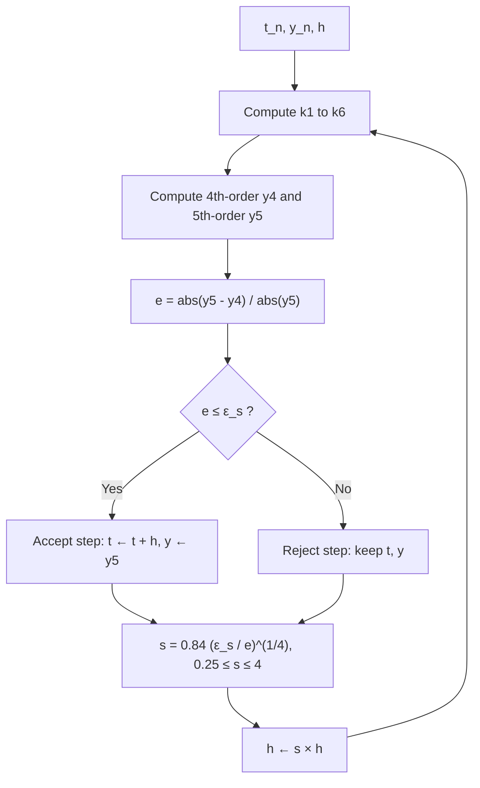

# Chapter 23 — Stiff ODEs and Adaptive Methods

[Repository Guide](../../README.md) | [English](Concepts_Lecture.md) | [한국어](Concepts_Lecture.ko.md)

> **Last Updated:** 2026-10-18
>
> Applied Numerical Methods with Python for Engineers and Scientists, Chapra and Clough, Ch 23

> **Learning Objectives:**
> 1. Estimate the local error and adjust the step size with an embedded RK method (RKF45)
> 2. Estimate the corrector error of a predictor-corrector method without derivatives
> 3. Identify stiff differential equations
> 4. Apply implicit methods for stiff systems
> 5. Compare explicit and implicit solver performance

---

<br>

## Table of Contents

- [1. Adaptive Runge-Kutta Methods](#1-adaptive-runge-kutta-methods)
  - [1.1 Constant vs. Variable Step Size](#11-constant-vs-variable-step-size)
  - [1.2 Error Estimation and Step Size Control](#12-error-estimation-and-step-size-control)
  - [1.3 Two Approaches for Adaptive Stepping](#13-two-approaches-for-adaptive-stepping)
- [2. Embedded RK Methods: RKF45](#2-embedded-rk-methods-rkf45)
  - [2.1 The Six Stages ($`k_1`$ through $`k_6`$)](#21-the-six-stages-k_1-through-k_6)
  - [2.2 Fourth- and Fifth-Order Solutions](#22-fourth--and-fifth-order-solutions)
  - [2.3 Local Relative Error](#23-local-relative-error)
  - [2.4 Scale Factor and Step Size Adjustment](#24-scale-factor-and-step-size-adjustment)
- [3. Detailed Derivation of Step Size Control](#3-detailed-derivation-of-step-size-control)
  - [3.1 Truncation Error Orders of RKF45](#31-truncation-error-orders-of-rkf45)
  - [3.2 Estimating the Error Constant $`C`$](#32-estimating-the-error-constant-c)
  - [3.3 Choosing the New Step Size $`h_{\text{new}}`$](#33-choosing-the-new-step-size-h_textnew)
- [4. Multistep Methods](#4-multistep-methods)
  - [4.1 Multistage vs. Multistep](#41-multistage-vs-multistep)
  - [4.2 Non-Self-Starting Heun Method (Predictor-Corrector)](#42-non-self-starting-heun-method-predictor-corrector)
  - [4.3 Error Estimates for the Predictor-Corrector](#43-error-estimates-for-the-predictor-corrector)
  - [4.4 Error Estimation Without Derivatives](#44-error-estimation-without-derivatives)
- [5. Stiff Systems](#5-stiff-systems)
  - [5.1 Definition and Characteristics](#51-definition-and-characteristics)
  - [5.2 Example: Enzyme Kinetics (Michaelis-Menten)](#52-example-enzyme-kinetics-michaelis-menten)
  - [5.3 Example: FitzHugh-Nagumo Model for Heart](#53-example-fitzhugh-nagumo-model-for-heart)
  - [5.4 Stability Constraint for Explicit Methods](#54-stability-constraint-for-explicit-methods)
  - [5.5 Implicit Methods for Stiff Systems](#55-implicit-methods-for-stiff-systems)
- [6. Python Implementation](#6-python-implementation)
  - [6.1 RKF45 Adaptive Solver](#61-rkf45-adaptive-solver)
  - [6.2 Backward Euler for Stiff Systems (Linear Case)](#62-backward-euler-for-stiff-systems-linear-case)
  - [6.3 Non-Self-Starting Heun Predictor-Corrector](#63-non-self-starting-heun-predictor-corrector)
- [Summary](#summary)
- [Self-Check Questions](#self-check-questions)

---

<br>

## 1. Adaptive Runge-Kutta Methods

### 1.1 Constant vs. Variable Step Size

The ODE solvers in Chapter 22 used a **constant step size** $`\Delta t`$ across the entire integration interval $`[0, T]`$. This is simple but wasteful:

- **Smooth regions** (slowly changing solution): a large step size would suffice, but the constant step may be unnecessarily small.
- **Rapidly changing regions** (abrupt transients): the fixed step size may be too large, leading to inaccuracy or even instability.

The adaptive approach replaces a single constant $`\Delta t`$ with **variable step sizes** $`\Delta t_1, \Delta t_2, \Delta t_3, \ldots`$ that change from one step to the next.

> **Note:** **Adaptive step size control.** The algorithm can automatically adjust the step size to avoid overkill (too many steps in smooth regions) or inaccuracy (too few steps near abrupt changes). The key idea is to control the step size adaptively depending on an **error estimation** at each step.

### 1.2 Error Estimation and Step Size Control

The central question is: **how do we estimate the local error at each step?**

If the error is large, we shrink the step; if the error is small, we grow the step. The error estimate is computed by comparing two numerical solutions of different accuracy obtained within the same step.

### 1.3 Two Approaches for Adaptive Stepping

There are two main approaches:

| Approach | Description |
|----------|-------------|
| **1. Halving the step size** | Compute $`y_1`$ with step $`\Delta t`$, then $`y_2`$ with two half-steps $`\Delta t/2`$. The difference $`y_1 - y_2`$ provides an error estimate. |
| **2. Embedded RK methods** | Use high-order and low-order schemes simultaneously (sharing the same stage evaluations) to compute the local truncation error. **Fehlberg** developed this approach. |

*Table 1. Two error estimation approaches for adaptive step size control*

The **embedded RK approach** (Approach 2) is far more efficient because it reuses function evaluations and is the basis of the widely-used RKF45 method.

---

<br>

## 2. Embedded RK Methods: RKF45

The **Runge-Kutta-Fehlberg method (RKF45)** uses a combination of **4th-order** and **5th-order** Runge-Kutta formulas to estimate the local truncation error. Both formulas share the **same six stages** $`k_1, \ldots, k_6`$, so the extra cost of error estimation is minimal.

Given the ODE:

```math
\frac{dy}{dt} = f(t, y)
```

Let $`h = \Delta t = t_{n+1} - t_n`$.

### 2.1 The Six Stages ($`k_1`$ through $`k_6`$)

```math
k_1 = h \, f(t_n, \, y_n)
```

```math
k_2 = h \, f\!\left(t_n + \frac{h}{4}, \, y_n + \frac{k_1}{4}\right)
```

```math
k_3 = h \, f\!\left(t_n + \frac{3}{8}h, \, y_n + \frac{3}{32}k_1 + \frac{9}{32}k_2\right)
```

```math
k_4 = h \, f\!\left(t_n + \frac{12}{13}h, \, y_n + \frac{1932}{2197}k_1 - \frac{7200}{2197}k_2 + \frac{7296}{2197}k_3\right)
```

```math
k_5 = h \, f\!\left(t_n + h, \, y_n + \frac{439}{216}k_1 - 8k_2 + \frac{3680}{513}k_3 - \frac{845}{4104}k_4\right)
```

```math
k_6 = h \, f\!\left(t_n + \frac{1}{2}h, \, y_n - \frac{8}{27}k_1 + 2k_2 - \frac{3544}{2565}k_3 + \frac{1859}{4104}k_4 - \frac{11}{40}k_5\right)
```

> **Note:** **Benefit of embedding.** All six $`k_i`$ values are computed once per step. The 4th-order formula uses $`k_1`$ through $`k_5`$; the 5th-order formula additionally uses $`k_6`$. This embedding is what makes the error estimation essentially free.

### 2.2 Fourth- and Fifth-Order Solutions

**4th-order RK solution:**

```math
y_{n+1}^{[4]} = y_n + \frac{25}{216}k_1 + \frac{1408}{2565}k_3 + \frac{2197}{4104}k_4 - \frac{1}{5}k_5
```

**5th-order RK solution:**

```math
y_{n+1}^{[5]} = y_n + \frac{16}{135}k_1 + \frac{6656}{12825}k_3 + \frac{28561}{56430}k_4 - \frac{9}{50}k_5 + \frac{2}{55}k_6
```

> **Note:** **The role of $`k_2`$ and the accepted solution.** Notice that $`k_2`$ does not appear explicitly in either final formula; its contribution is folded into the later stages through the stage dependencies. The 5th-order solution $`y_{n+1}^{[5]}`$ is more accurate and is taken as the accepted solution for advancement.

### 2.3 Local Relative Error

The local relative error at $`t_{n+1}`$ is estimated by comparing the two solutions:

```math
e_{n+1} = \left| \frac{y_{n+1}^{[5]} - y_{n+1}^{[4]}}{y_{n+1}^{[5]}} \right|
```

This quantity tells us how much the 4th-order and 5th-order solutions disagree. A large disagreement signals that the step size is too large and the truncation error is significant.

### 2.4 Scale Factor and Step Size Adjustment

Given the error estimate, we compute a **scale factor** $`s`$ to adjust the step size:

```math
s = \left(\frac{\varepsilon_s}{2 \, e_{n+1}}\right)^{1/4} \approx 0.84 \left(\frac{\varepsilon_s}{e_{n+1}}\right)^{1/4}
```

where $`\varepsilon_s`$ is the **specified local error tolerance** (user-defined).

The scale factor is **clamped** to prevent extreme changes:

```math
0.25 \leq s \leq 4
```

The new step size is then:

```math
h^{\text{new}} = s \cdot h
```

> **Note:** **Role of clamping.** The clamping $`0.25 \leq s \leq 4`$ prevents the step size from shrinking or growing by more than a factor of 4 in a single step. This safeguard avoids oscillatory behavior in the step size control and ensures smooth adaptation.

**Decision logic at each step:**
- If $`e_{n+1} > \varepsilon_s`$: **reject** the step, shrink $`h`$, and **redo** the step.
- If $`e_{n+1} \leq \varepsilon_s`$: **accept** the step, advance to $`t_{n+1}`$, and (possibly) grow $`h`$ for the next step.

Figure 1 shows this decision process as the flow of one RKF45 step.



*Figure 1. Step acceptance and step size adjustment in RKF45*

---

<br>

## 3. Detailed Derivation of Step Size Control

This section provides the rigorous derivation of the step size control formula for RKF45.

### 3.1 Truncation Error Orders of RKF45

Recall the two solutions:

```math
y(t_{n+1}) = y_{n+1}^{[4]} + C h^5 + O(h^6)
```

```math
y(t_{n+1}) = y_{n+1}^{[5]} + O(h^6)
```

where $`y(t_{n+1})`$ is the **true value**. The 4th-order method has a leading error term proportional to $`h^5`$, while the 5th-order method's leading error is $`O(h^6)`$.

### 3.2 Estimating the Error Constant $`C`$

Subtracting the two expressions:

```math
C h^5 = y_{n+1}^{[5]} - y_{n+1}^{[4]}
```

Therefore:

```math
C = \frac{\left| y_{n+1}^{[5]} - y_{n+1}^{[4]} \right|}{h^5}
```

The constant $`C`$ captures the local behavior of the solution's higher derivatives. It is estimated from the current step and assumed to remain approximately the same over the next step.

### 3.3 Choosing the New Step Size $`h_{\text{new}}`$

We want the new step size $`h_{\text{new}}`$ such that the error at the **next** step (step $`n+2`$) satisfies a tolerance $`\varepsilon`$:

```math
\left| y_{n+2}^{[5]} - y_{n+2}^{[4]} \right| < s_f \cdot \varepsilon
```

where $`s_f`$ is a **safety factor** (typically $`s_f \approx 0.84`$). Using the same constant $`C`$:

```math
C = \frac{\left| y_{n+2}^{[5]} - y_{n+2}^{[4]} \right|}{h_{\text{new}}^5} < \frac{s_f \cdot \varepsilon}{h_{\text{new}}^5}
```

Solving for $`h_{\text{new}}`$:

```math
h_{\text{new}} < \left(\frac{s_f \cdot \varepsilon}{C}\right)^{1/5}
```

Replacing $`C`$ with its estimate from the current step:

```math
\boxed{h_{\text{new}} < \left(\frac{s_f \cdot \varepsilon}{\left| y_{n+1}^{[5]} - y_{n+1}^{[4]} \right|}\right)^{1/5} \cdot h}
```

> **Note:** **Origin of the exponent $`1/5`$.** This is the complete step size control formula. The exponent $`1/5`$ comes from the fact that the leading error of the 4th-order method is $`O(h^5)`$. For a general embedded pair of orders $`p`$ and $`p+1`$, the exponent would be $`1/(p+1)`$.

---

<br>

## 4. Multistep Methods

### 4.1 Multistage vs. Multistep

**Multistage** and **multistep** methods follow fundamentally different strategies:

| Feature | Multistage (e.g., RK4) | Multistep (e.g., Adams-Bashforth) |
|---------|------------------------|-----------------------------------|
| **Stages per step** | Multiple intermediate evaluations ($`s`$ stages) within a single step $`[t_n, t_{n+1}]`$ | Typically one evaluation per step |
| **Previous steps used** | Only $`(t_n, y_n)`$ | Values from multiple previous steps: $`y_n, y_{n-1}, y_{n-2}, \ldots`$ |
| **Self-starting** | Yes | No (needs initial values from another method) |
| **Memory** | No history needed | Must store past values |

*Table 2. Comparison of multistage and multistep methods*

A **multistep method** computes $`y_{n+1}`$ using values from **previous time steps**:

```math
y_{n+1} = y_{n+1}(y_n, y_{n-1}, \ldots)
```

### 4.2 Non-Self-Starting Heun Method (Predictor-Corrector)

Recall the **Heun approach** from Chapter 22, which is a predictor-corrector scheme:

**i) Predictor** (Euler method):

```math
Y_1 = y_n + h \, f(t_n, y_n) + O(h^2)
```

**ii) Corrector** (Trapezoidal rule):

```math
y_{n+1} = y_n + h \cdot \frac{f(t_n, y_n) + f(t_{n+1}, Y_1)}{2} + O(h^3)
```

> **Note:** **Accuracy of the predictor and corrector.** The predictor has local truncation error $`O(h^2)`$ (1st-order), while the corrector achieves $`O(h^3)`$ (2nd-order). The predictor provides an initial guess that the corrector refines.

**Improving the predictor accuracy:**

The standard Euler predictor has truncation error $`O(h^2)`$. To match the corrector's $`O(h^3)`$ accuracy, we can use the **midpoint method** as a predictor instead:

```math
Y_1 = y_{n-1} + 2h \, f(t_n, y_n) + O(h^3)
```

This predictor applies the open midpoint integration formula over $`[t_{n-1}, t_{n+1}]`$ and differs from the RK2 midpoint method of Chapter 22. Now both the predictor and the corrector have local truncation error of $`O(h^3)`$.

**However**, this improved predictor is **NOT self-starting**: it requires the value at $`t_{n-1}`$, which is not available at the very first step ($`n = 0`$).

To resolve this problem, use a self-starting method such as the RK2 midpoint method, standard Euler, or Heun's method at the first step ($`t = 0`$) to generate the value at $`t_1`$, then switch to the non-self-starting Heun method for all subsequent steps. The implementation in Section 6.3 uses the standard Heun method for the first step. Figure 2 shows the points used by the two stages.

```text
     t_{n-1}             t_n             t_{n+1}
        ●─────────────────●─────────────────○
     y_{n-1}             y_n

        └───────── 2h f(t_n, y_n) ──────────> Y_1      (predictor)
                          └─────── h ───────> y_{n+1}  (corrector: average of f(t_n, y_n) and f(t_{n+1}, Y_1))
```

*Figure 2. Predictor and corrector of the non-self-starting Heun method*

### 4.3 Error Estimates for the Predictor-Corrector

**i) Predictor error** (midpoint method, textbook Table 19.4):

```math
E_p = \frac{1}{3} h^3 f''(\xi_p)
```

where $`Y_{1,\text{true}} = Y_1 + E_p`$.

**ii) Corrector error** (trapezoidal rule, textbook Table 19.2):

```math
E_c = -\frac{1}{12} h^3 f''(\xi_c)
```

where $`y_{n+1,\text{true}} = y_{n+1} + E_c`$.

### 4.4 Error Estimation Without Derivatives

Since both the true predictor and true corrector values converge to the same true solution:

```math
Y_{1,\text{true}} = y_{n+1,\text{true}}
```

Assume $`f''(\xi_p) \approx f''(\xi_c)`$ (both $`\xi`$ values are close). Subtracting equation (i) from equation (ii):

```math
0 = y_{n+1} - Y_1 + E_c - E_p = y_{n+1} - Y_1 - \frac{5}{12} h^3 f''(\xi)
```

This is the key equation ($`\ast`$). Dividing ($`\ast`$) by 5 and rearranging:

```math
\frac{Y_1 - y_{n+1}}{5} = -\frac{1}{12} h^3 f''(\xi) = E_c
```

> **Note:** **Significance of the result.** This is an important result: the **corrector error** $`E_c`$ can be estimated purely from the difference between the predictor $`Y_1`$ and the corrector $`y_{n+1}`$, **without** computing any derivatives of $`f`$. This makes error estimation practical and cheap.

---

<br>

## 5. Stiff Systems

### 5.1 Definition and Characteristics

A **stiff system** is an ODE system that is difficult to solve numerically due to its inherent characteristics. Formally:

> **Definition:** A stiff system has a **wide range of eigenvalues** (time scales). The ratio of the largest to smallest eigenvalue magnitude (the **stiffness ratio**) is very large.

Stiffness arises when the solution contains components that decay at vastly different rates. Explicit methods are forced to use a step size dictated by the **fastest** decaying component (for stability), even when the **slowest** component dominates the solution's behavior.

### 5.2 Example: Enzyme Kinetics (Michaelis-Menten)

Chemical processes depend on concentrations of chemical species and can be described by differential equations. The chemical reactions are usually **nonlinear** and often occur on **different time scales**.

A single-substrate enzyme reaction (Michaelis-Menten kinetics):

```math
E + S \underset{k_{-1}}{\overset{k_1}{\rightleftharpoons}} ES \overset{k_2}{\longrightarrow} E^0 + P
```

where:
- $`E`$ = enzyme, $`S`$ = substrate, $`ES`$ = enzyme-substrate complex
- $`P`$ = product, $`E^0`$ = regenerated enzyme
- $`k_1, k_{-1}, k_2`$ are **rate constants**.

A substrate $`S`$ binds with an enzyme $`E`$ to form an enzyme-substrate complex $`ES`$, which can either **dissociate** (reverse reaction with rate $`k_{-1}`$) or **proceed** to form $`E`$ and the product $`P`$ (forward reaction with rate $`k_2`$).

Since there is no loss of material (conservation laws), the system can be written as **nonlinear singular perturbed differential equations**:

```math
y'(t) = -y(t) + (\mu + y(t)) \, z(t)
```

```math
\epsilon \, z'(t) = y(t) - (\lambda + y(t)) \, z(t)
```

with $`\epsilon \ll 1`$.

> **Note:** **Fast-slow decomposition.** The parameter $`\epsilon \ll 1`$ multiplying $`z'(t)`$ creates a **fast-slow decomposition**: $`z(t)`$ evolves on a fast time scale $`\sim \epsilon`$ while $`y(t)`$ evolves on a slow time scale $`\sim 1`$. This is the hallmark of stiffness: the different time scales force explicit methods to use tiny steps to track the fast variable, even after it has settled to quasi-equilibrium.

### 5.3 Example: FitzHugh-Nagumo Model for Heart

**Cardiac cells**, like neurons, exhibit **excitable behavior**: they rest, can be activated by a stimulus, and then recover.

The FitzHugh-Nagumo model describes this behavior:

```math
u_t = D_u \Delta u - u^3 + u - v
```

```math
v_t = D_v \Delta v + \varepsilon(u - bv + a)
```

where $`D_u, D_v`$ are diffusion coefficients, $`\varepsilon`$ is a small parameter, and $`a, b`$ are model parameters.

> **Note:** **Separation of time scales.** When $`\varepsilon`$ is small, the $`v`$ equation evolves slowly (recovery variable) while $`u`$ evolves rapidly (excitation variable). This separation of time scales makes the system stiff. In the ODE form of the model without diffusion, plotting the excitation variable over time with external stimulus $`I = 0.5`$, $`a = 0.7`$, $`b = 0.8`$, and recovery time constant $`\tau = 12.5`$ shows sharp spikes (fast excitation) followed by slow recovery, a classic signature of stiffness.

### 5.4 Stability Constraint for Explicit Methods

Consider the simple stiff ODE:

```math
\frac{dy}{dt} = -100000 \, y
```

The analytical solution is $`y = y_0 \, e^{-10^5 t}`$, which decays **extremely rapidly**.

For the **explicit Euler method**, the stability condition requires $`|1 + z| \leq 1`$ where $`z = \lambda h`$. With $`\lambda = -10^5`$:

```math
|1 + (-10^5) h| \leq 1
```

This gives:

```math
h \leq \frac{2}{10^5} = 2 \times 10^{-5}
```

> **Note:** **Step size limited by stability.** This is a catastrophically small step size requirement. Even if the solution has effectively decayed to zero and the dynamics of interest are over, the explicit Euler method **must** continue using $`h \leq 2 \times 10^{-5}`$ for stability. This is the fundamental problem with explicit methods applied to stiff systems: the step size is limited by **stability**, not by **accuracy**.

### 5.5 Implicit Methods for Stiff Systems

The stability constraint of explicit methods can be circumvented with implicit methods.

An example of **implicit methods** is the **backward Euler method**:

```math
y_{n+1} = y_n + h \, f(t_{n+1}, y_{n+1})
```

The stability condition for backward Euler is $`|z - 1| \geq 1`$ where $`z = \lambda h`$. For $`\lambda = -10^5`$:

```math
|(-10^5 h) - 1| \geq 1
```

This is satisfied for **any** $`h > 0`$. The backward Euler method is **unconditionally stable** (A-stable).

| Method | Stability Condition | Step Size Restriction |
|--------|--------------------|-----------------------|
| Explicit Euler | $`\vert 1 + \lambda h \vert \leq 1`$ | $`h \leq 2/\vert \lambda \vert`$ (very restrictive for stiff systems) |
| Backward Euler | $`\vert 1 - \lambda h \vert \geq 1`$ (for $`\lambda < 0`$) | None (unconditionally stable) |

*Table 3. Stability conditions of explicit and backward Euler*

> **Note:** **Cost of implicit methods.** The price of implicit methods is that each step requires solving a (possibly nonlinear) equation for $`y_{n+1}`$. For linear problems this is a linear solve; for nonlinear problems, Newton's method is typically used. However, for stiff systems, the cost of solving implicit equations is far less than the cost of taking millions of tiny explicit steps.

---

<br>

## 6. Python Implementation

### 6.1 RKF45 Adaptive Solver

```python
import numpy as np
import matplotlib.pyplot as plt

def rkf45(f, t0, y0, tf, h0, tol=1e-6, hmin=1e-10, hmax=1.0):
    """
    Runge-Kutta-Fehlberg (RKF45) adaptive ODE solver.

    Parameters
    ----------
    f    : callable, f(t, y) — the ODE right-hand side
    t0   : float — initial time
    y0   : float — initial value
    tf   : float — final time
    h0   : float — initial step size
    tol  : float — local error tolerance (epsilon_s)
    hmin : float — minimum allowable step size
    hmax : float — maximum allowable step size

    Returns
    -------
    ts   : list of time values
    ys   : list of solution values
    """
    t = t0
    y = y0
    h = h0
    ts = [t]
    ys = [y]

    while t < tf:
        if t + h > tf:
            h = tf - t

        # --- Six stages ---
        k1 = h * f(t, y)
        k2 = h * f(t + h / 4, y + k1 / 4)
        k3 = h * f(t + 3 * h / 8, y + 3 * k1 / 32 + 9 * k2 / 32)
        k4 = h * f(t + 12 * h / 13,
                    y + 1932 * k1 / 2197 - 7200 * k2 / 2197 + 7296 * k3 / 2197)
        k5 = h * f(t + h,
                    y + 439 * k1 / 216 - 8 * k2 + 3680 * k3 / 513 - 845 * k4 / 4104)
        k6 = h * f(t + h / 2,
                    y - 8 * k1 / 27 + 2 * k2 - 3544 * k3 / 2565
                    + 1859 * k4 / 4104 - 11 * k5 / 40)

        # --- 4th-order and 5th-order solutions ---
        y4 = y + 25 * k1 / 216 + 1408 * k3 / 2565 + 2197 * k4 / 4104 - k5 / 5
        y5 = y + 16 * k1 / 135 + 6656 * k3 / 12825 + 28561 * k4 / 56430 \
             - 9 * k5 / 50 + 2 * k6 / 55

        # --- Error estimate ---
        error = abs(y5 - y4)
        if y5 != 0:
            rel_error = error / abs(y5)
        else:
            rel_error = error

        # --- Step size control ---
        if rel_error <= tol or h <= hmin:
            # Accept step
            t = t + h
            y = y5  # advance with 5th-order solution
            ts.append(t)
            ys.append(y)

        # Compute scale factor
        if rel_error > 0:
            s = 0.84 * (tol / rel_error) ** 0.25
        else:
            s = 4.0

        # Clamp scale factor
        s = max(0.25, min(s, 4.0))

        # Update step size
        h = s * h
        h = max(hmin, min(h, hmax))

    return ts, ys


# --- Example: dy/dt = -100000*y (stiff equation) ---
f_stiff = lambda t, y: -100000 * y

ts, ys = rkf45(f_stiff, 0, 1, 0.001, h0=1e-6, tol=1e-8)

plt.figure(figsize=(8, 5))
plt.plot(ts, ys, 'b.-', markersize=4)
plt.xlabel('t')
plt.ylabel('y')
plt.title('RKF45 Adaptive Solution: dy/dt = -100000y')
plt.grid(True)
plt.tight_layout()
plt.show()
```

In this example, RKF45 accepts 1236 steps up to $`t = 0.001`$, with step sizes staying between about $`3.1 \times 10^{-7}`$ and $`8.2 \times 10^{-7}`$. In contrast, the backward Euler method of Section 6.2 integrates the same interval in 10 steps with $`h = 10^{-4}`$.

### 6.2 Backward Euler for Stiff Systems (Linear Case)

```python
import numpy as np
import matplotlib.pyplot as plt

def backward_euler_linear(lam, y0, t0, tf, h):
    """
    Backward Euler for dy/dt = lambda * y (linear case).

    Analytical implicit step: y_{n+1} = y_n / (1 - lambda * h)
    """
    t = np.arange(t0, tf + h, h)
    y = np.zeros(len(t))
    y[0] = y0

    for i in range(len(t) - 1):
        y[i + 1] = y[i] / (1 - lam * h)

    return t, y


# --- Compare explicit vs. implicit Euler for stiff ODE ---
lam = -100000
y0 = 1.0
tf = 0.001

# Backward Euler — large step size works fine
h_implicit = 1e-4
t_imp, y_imp = backward_euler_linear(lam, y0, 0, tf, h_implicit)

# Analytical solution
t_exact = np.linspace(0, tf, 500)
y_exact = y0 * np.exp(lam * t_exact)

plt.figure(figsize=(8, 5))
plt.plot(t_exact, y_exact, 'k-', label='Exact', linewidth=2)
plt.plot(t_imp, y_imp, 'rs--', label=f'Backward Euler (h={h_implicit})', markersize=4)
plt.xlabel('t')
plt.ylabel('y')
plt.title('Backward Euler vs Exact for Stiff ODE')
plt.legend()
plt.grid(True)
plt.tight_layout()
plt.show()
```

The backward Euler solution decays stably even with $`h = 10^{-4}`$, shrinking by a factor of $`1/(1 + 10) \approx 0.0909`$ per step. The first-step value 0.0909, however, is far larger than the exact value $`e^{-10} \approx 4.5 \times 10^{-5}`$. A large step guarantees stability but not the accuracy of the fast initial transient.

### 6.3 Non-Self-Starting Heun Predictor-Corrector

```python
import numpy as np
import matplotlib.pyplot as plt

def nss_heun(f, t0, y0, tf, h):
    """
    Non-self-starting Heun method (predictor-corrector).
    Uses midpoint predictor + trapezoidal corrector.
    First step uses standard Heun (self-starting).
    """
    n = int((tf - t0) / h)
    t = np.linspace(t0, tf, n + 1)
    y = np.zeros(n + 1)
    y[0] = y0

    # First step: standard Heun (self-starting)
    Y1 = y[0] + h * f(t[0], y[0])
    y[1] = y[0] + h / 2 * (f(t[0], y[0]) + f(t[1], Y1))

    # Subsequent steps: non-self-starting Heun
    for i in range(1, n):
        # Predictor (midpoint method) — uses y[i-1]
        Y1 = y[i - 1] + 2 * h * f(t[i], y[i])
        # Corrector (trapezoidal rule)
        y[i + 1] = y[i] + h / 2 * (f(t[i], y[i]) + f(t[i + 1], Y1))

        # Error estimate: E_c ≈ (Y1 - y[i+1]) / 5
        error = abs(Y1 - y[i + 1]) / 5
        # (In practice, use this error to adapt step size)

    return t, y


# Example: dy/dt = -y, y(0) = 1
f = lambda t, y: -y
t, y = nss_heun(f, 0, 1, 5, 0.1)

t_exact = np.linspace(0, 5, 500)
y_exact = np.exp(-t_exact)

plt.figure(figsize=(8, 5))
plt.plot(t_exact, y_exact, 'k-', label='Exact', linewidth=2)
plt.plot(t, y, 'bo--', label='NSS Heun', markersize=4)
plt.xlabel('t')
plt.ylabel('y')
plt.title('Non-Self-Starting Heun Method')
plt.legend()
plt.grid(True)
plt.tight_layout()
plt.show()
```

In this example, the numerical solution at $`t = 5`$ is 0.0067021, which differs from the exact value $`e^{-5} \approx 0.0067379`$ by about $`3.6 \times 10^{-5}`$. The code only computes the error estimate `error` and does not use it to adjust the step size.

---

<br>

## Summary

| Concept | Key Summary |
|:-----|:-----|
| Adaptive RK | The step size is varied automatically based on error estimation, with small steps where the solution changes rapidly and large steps where it is smooth. |
| RKF45 | It is an embedded 4th- and 5th-order pair sharing 6 stages, with the error estimated as $`\vert y^{[5]} - y^{[4]} \vert`$. |
| Scale factor | $`s = 0.84 (\varepsilon_s / e_{n+1})^{1/4}`$ is clamped to $`[0.25, 4]`$, and the step size becomes $`h^{\text{new}} = s \cdot h`$. |
| Step size control (detailed) | From $`C h^5 = y^{[5]} - y^{[4]}`$, one obtains $`h_{\text{new}} < \left(\frac{s_f \varepsilon}{\vert y_{n+1}^{[5]} - y_{n+1}^{[4]} \vert}\right)^{1/5} h`$. |
| Multistep methods | They use values from previous steps ($`y_n, y_{n-1}, \ldots`$), which makes them more efficient per step but not self-starting. |
| NSS Heun | It pairs a midpoint predictor $`O(h^3)`$ with a trapezoidal corrector $`O(h^3)`$ and estimates the corrector error as $`E_c \approx (Y_1 - y_{n+1})/5`$. |
| Stiff systems | They have a wide eigenvalue spread, and the explicit Euler method requires $`h \leq 2/\vert \lambda_{\max} \vert`$ for stability. |
| Stiff examples | Enzyme kinetics (Michaelis-Menten) and the FitzHugh-Nagumo cardiac model are stiff systems containing variables with very different time scales. |
| Implicit methods | Backward Euler is unconditionally stable ($`A`$-stable), so any $`h > 0`$ is stable for stiff problems. |
| Trade-off | Implicit methods solve equations at each step and thus do more work per step, but they allow much larger step sizes for stiff systems. |

---

<br>

## Self-Check Questions

1. **Scale factor:** In one RKF45 step with $`\varepsilon_s = 10^{-6}`$, the local relative error is $`e_{n+1} = 1.6 \times 10^{-5}`$. Is the step accepted? Find the scale factor $`s`$ and the new step size. What happens if the error is $`e_{n+1} = 10^{-10}`$ instead?

   <details>
   <summary>Answer</summary>

   Since $`e_{n+1} > \varepsilon_s`$, the step is rejected. $`s = 0.84 \times (10^{-6} / 1.6 \times 10^{-5})^{1/4} = 0.84 \times 0.0625^{1/4} = 0.84 \times 0.5 = 0.42`$, which lies in $`[0.25, 4]`$, so the step is recomputed with $`h^{\text{new}} = 0.42h`$. If $`e_{n+1} = 10^{-10}`$, the step is accepted, and $`s = 0.84 \times (10^4)^{1/4} = 8.4`$ exceeds the upper bound, so it is clamped to $`s = 4`$ and the next step uses $`4h`$.

   </details>

2. **Steps for an explicit method:** What is the minimum number of steps required for stability when explicit Euler is applied to $`dy/dt = -100000y`$ on $`t \in [0, 1]`$? With backward Euler and $`h = 0.1`$, what are the number of steps and the amplification factor?

   <details>
   <summary>Answer</summary>

   Stability requires $`h \le 2 \times 10^{-5}`$, so at least $`1 / (2 \times 10^{-5}) = 50{,}000`$ steps are needed. Backward Euler needs only 10 steps with $`h = 0.1`$, and its amplification factor $`1/(1 + 10^5 \times 0.1) = 1/10001 \approx 10^{-4}`$ makes the solution decay stably.

   </details>

3. **Predictor-corrector error estimate:** In one step of the non-self-starting Heun method, the predictor is $`Y_1 = 0.9050`$ and the corrector is $`y_{n+1} = 0.9048`$. Estimate the corrector error and the true value that accounts for it.

   <details>
   <summary>Answer</summary>

   $`E_c \approx (Y_1 - y_{n+1})/5 = (0.9050 - 0.9048)/5 = 4 \times 10^{-5}`$. Since $`y_{n+1,\text{true}} = y_{n+1} + E_c`$, the true value is estimated as about $`0.9048 + 0.00004 = 0.90484`$.

   </details>

4. **Stiffness ratio:** What is the stiffness ratio of a linear system with eigenvalues $`-1`$ and $`-1000`$? Find the largest stable step size of explicit Euler and the number of steps needed to reach $`t = 5`$, where the slow component has decayed to $`e^{-5} \approx 0.0067`$.

   <details>
   <summary>Answer</summary>

   The stiffness ratio is $`1000/1 = 1000`$. The fastest component determines stability, so $`h \le 2/1000 = 0.002`$, and reaching $`t = 5`$ requires at least $`5/0.002 = 2500`$ steps. Although the slow component $`e^{-t}`$ dominates the behavior of the solution, the fast component $`e^{-1000t}`$ dictates the step size.

   </details>

5. **Multistage and multistep methods:** How many distinct evaluations of $`f`$ do RKF45 and the non-self-starting Heun method perform per step? Is each method self-starting?

   <details>
   <summary>Answer</summary>

   RKF45 performs 6 evaluations, $`k_1`$ through $`k_6`$, and is self-starting because it uses only $`(t_n, y_n)`$. The non-self-starting Heun method performs 2 evaluations, $`f(t_n, y_n)`$ and $`f(t_{n+1}, Y_1)`$, but it is not self-starting because the predictor uses $`y_{n-1}`$, so the first step requires another method.

   </details>
